# 威斯康星大学【中英⚡操作系统｜CS 537 Fall19, Introduction to Operating Systems】 p18 P18 Persistence_ File API _ University of Wisconsin-Madison -BV1wUzSB3Ecf_p18-

All right， Good morning， everybody。 I'm very happy that you are all here。

 that you survived last night and that you want more of this material， right。

 So today we're going to continue talking about file system persistence。

 quite a bit different than concurrency。 We're done with concurrency for a while。😊。

But yeah talking about persistence so our usual announcements you all know that project for the XB6 scheduler that's been graded。

 there was email sent out about how to go about getting regrades for that we do want people to get points for that project we don't want you to get a zero or to have something horribly go wrong so please do contact the TA if something did go horribly wrong with the grading for that。

You you all are done with midterm two， I'm not done， but that should be a pretty quick turnaround。

 you'll get those grades probably either tomorrow or Monday sometime around then。Project6。

 as I said before is about mapRduce， it's not in the XV6 environment。

 you'll be writing a little bit more code than usual， but it will be not within the OS。

 so it should be a little bit more straightforward to write。

 but it is multithreaded concurrent code and you're going to have to figure out how to use locks correctly to access whatever data structure you end up creating that you're going to use for communicating between the mappers and the reducers。

And so the plan is that that will be available tomorrow。

 you'll have two weeks to do that and by all means request a project partner if you have not already。

 this is a good project to have a project partner for since it is writing more code and it's not quite as careful that you have to be。

 you don't have to understand every little line of code that you produce。Okay。

 any questions about that stuff？What？I haven't decided exactly， so that's why I'm big。

I realized I'd need to get more generous over time。

 so I'm originally I was thinking we're going to have eight projects and nowm like well。

 maybe we're only going to have seven projects， so that's why you'll have a little bit more time if we only have seven projects。

 Yeah so who thinks we should only have seven projects， raise your hand。

Who would like the full eight experience？People feel ashamed about using their hair。

I will remove the worst project。 I will not remove the best project if I do that。 All right， yes。

 question。Who do you contact， So Yfan is the TA， and his email contact should be on the Canvas page for all of the TAs。

Yeah。Y I FA N， all right。Okay， more questions。So for the rest of the semester we're talking about persistence。

 we all need persistence at this point to get through all of this。

 I'm making a slight change in the order that I thought I was going to talk about things。

 I thought logically it made a lot of sense to talk about first all the lowlevel storage devices like how a hard disk works and how RA works and then I thought today I would talk about flash and solid state drives but looking at that it turns out there really is a lot of complexity and how flash works。

 there's this FTL layer， this flash translation layer that's a lot of software that does a lot of interesting merging of operations and so it's actually easier to understand that if we first talk about what file systems do and then get into this very complex storage device that's out there these days so I'll talk about SSDs at the end of all this and so today we're talking about file system APIs。

 what it looks like for processes to use the file system。

Okay and so just what you remember about our last lecture， we were talking about raid。

 we went through all of these different raid levels。 you should remember RA level 0 is striping。

 that's the simplest approach。 Ra level1 is mirroring that's when you have a simple copy of all the blocks Ra level4。

 we end up dropping because it doesn't have very good performance。

 that's the one that has a parity block as the last block of each stripe on all on one disk And so raid four there was a lot of contention for that parity disk。

 the parity disk was a bottleneck so that's why we introduced raid level5 where we have the parity blocks that end up being in rotated positions across disks for each different stripe and so if you are able to kind of remember why you get this performance is the summary。

 then I think that shows that you understand and you can remember what each of those raid levels do so it's a little bit harder to come up with the table。

 but if once you're shown these are the performance results they should make intuitive sense to you。

So certainly， if you think about rate level 0， all of those disks were completely independent。

 All of the N disks are able to do all of the work that they。

Ideally can do So for those you get the full bandwidth of each of the disks。

 whether you're doing random or sequential operations in whether you're doing reads or writes。

 then if you think about rate level one， which was mirroring the workloads that do random reads。

 all of the disks get to do the reads。 So we're getting full random read bandwidth out of each of the N disks。

If you look at sequential reads， this was the one where we had kind of some arguments where you could say maybe it's n times s or maybe it's n divided by two times s。

 it kind of depends upon how you split up these large sequential requests。

And then rights are always definitely going to be n divided by two of the bandwidth since each you know。

 a pair， Both of the discs have to do each of the operations。

 So you're only going to get half the bandwidth since double the discs have to do the work。

And then if you look at rate level 5， this is with the parity block。

 The reason it's n minus-1 for sequential operations is all of the disks are going to be involved with a right。

But。Some one of them is going to be doing parity。 And similarly with the read。

 one of them always has parity。 So it's not getting any useful work because you want to think about this throughput or this bandwidth in terms of like。

 how much useful work is actually getting done。 And if you're just reading parodity。

 that's not useful bandwidth that the file system cares about。And then with random reads， again。

 all of those disks get to be doing useful random reads of data。 And then random rightss。

 that's the trickiest case that why is it n divided by four。

 It's because for every one right we needed to do of user data or file system data that we cared about。

 we have to do a read of the old data， then a write of the data that we care about a read of the old parity and a write of the new parity。

 So we have to do four times as many operations for every one right that we wanted to do。

 So if the system was able to get 100 MBbytes you know。

 per second of throughput we're only going to be getting 25 MB per second of useful throughput。

 since we're doing four times the operations。So with that quick summary。

 are there questions that people remember that they had about raid。か分。Yeah， I didn't cover that。

 Yeah， I guess you could know the one sentence description Ra 6 is able to tolerate 2。Visk failures。

 but that would be the level of detail there。All right。Other questions。Okay。Oops， that's the summary。

Okay， so today we're going to be talking about what the file system API looks like for user level processes and so we're going to talk about how you go about naming files。

 there's three different ways of naming files useful in different circumstances you could refer to a file by its in number you could refer to a file by its full path name and then there are file descriptors that you all know about after you have opened up a file based on its path name I will talk about how directories are actually represented。

 we'll talk about the difference between hard and soft links and we'll talk about things like Fync for flushing data from user buffers out to the disk so it's all very practical stuff if you need to do systems level programming。

 this is stuff you definitely will end up using。Okay， files， all right， so what is a file。

 So this sounds really elementary， but there's some interesting stuff in here。

So this is the representation that all modern systems kind of are using as the base building block and then you could think of other things like databases are often built on top of files or key value stores or other more interesting ways of accessing your data will then be built on top of this file abstraction。

So we use the word file system in a couple of different ways。

 a file system could be just like your static image of your files and directories。

 like your file system hierarchy that you have on your local machine， that's your file system。

 sometimes people use it to describe the actual file system image。

What will generally be meaning though when we say file system is that's the part of the operating system that deals with files and implements all of this stuff。

And today we're mostly talking about local file systems。

 there's tons of different local file systems out there。

 Linux has a variety that you can choose from EXD2 is an old file system。

 EXD4 is like the modern version of EXD2 that does journaling we'll be talking about the details of how that works in one of our last lecture on this。

 but it uses a lot of the same data structures that EXD2 used it just adds journaling to all of that。

 and then there's just a whole bunch of other varieties out there depending upon if it's optimized for hard disks or flash。

 if it's supposed to be really scalable and different data structures that they like to use。

But across all of them， files are what we need to deliver into the user。 It shouldn't really。

 It should be completely transparent what file system is being used。Okay。All right。

 so we're going to go through three different approaches for naming files。 And then， of course。

 the last one is going to be the one that we use， and it combines all of the advantages of the other approaches。

 But the other ones are useful to know so that we can get to the final solution。

 So we'll start off by looking at in numbers。 What are in numbers。O。

So within Linux based file systems， it's going to be the case that we use this in as a way of representing a file。

 And in is the metadata that describes the data or the file。

So each file is going to be uniquely identified by its in number， by its metadata number。

 And so technically， you could recycle those in numbers， but it's a huge space。

 but you just definitely have to guarantee that there's no current alive file that has the same in number as another file。

 but if a file did get deleted， you could recycle an old in number。All right。

 so I have a tiny demo to do here， let's see。

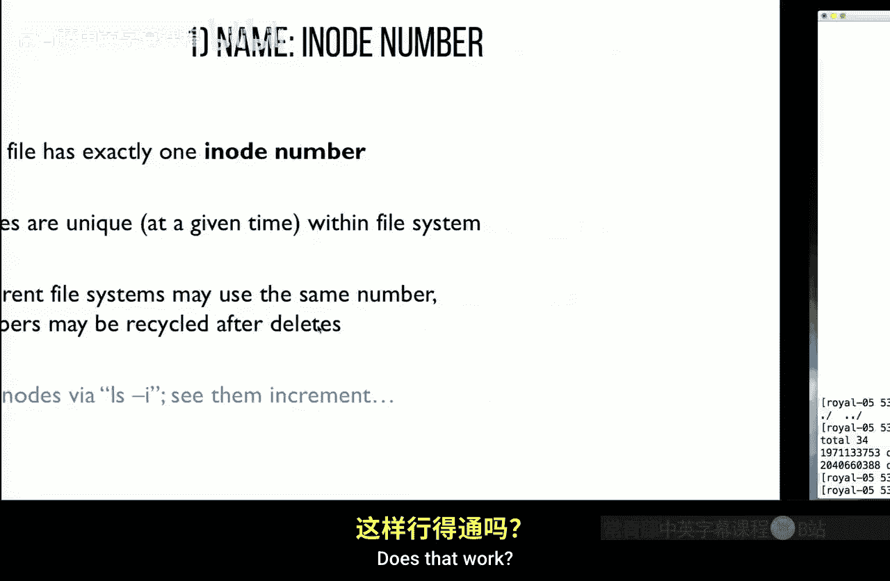

I work't。Okay， so let us make a file。嗯。Okay， dash L I。Okay。So giving the dash I parameter here。

 it prints out the i node number first。 So you can see that these are very large numbers for i nodes。

 the file system。 I'm running on a royal machine， lots of。Fileles have been created。

 And so now that's my file， high dot text。 If I create a new one。Put some more stuff in there。

And now let's do our LS。

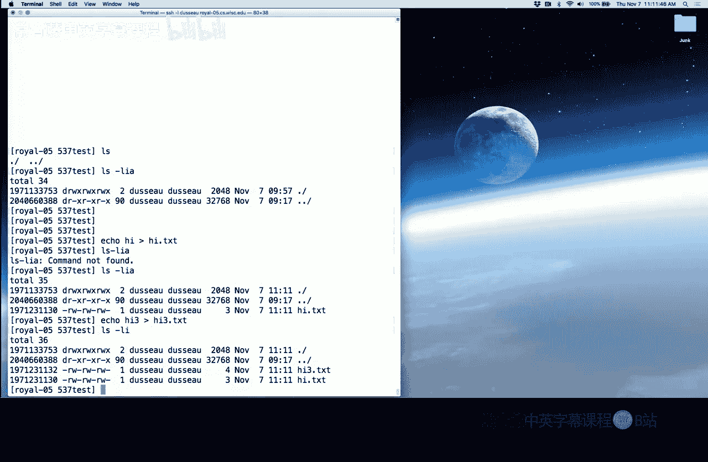

And so high had iode number， something 30， I don't know if someone else came in on this machine and also created a file in between there。

 but it's usually a monotonically increasing inode number。

 and so we're going to get a unique number after that so in numbers are something that you can find out about for your file system。

 users don't usually care about it， but it is something that's possible to use as a way of referring to files。

O。We have done that now。Okay so sometimes people are curious why do we call them iNots and nobody knows really why this name came up but it's the generic name for the metadata that's referring to file data and so Dennis Ritchie who' was one of the creators of UniX right and he's like well he doesn't even know why they started to use the word iNote。

 maybe I stands for index？But that its， it's an index structure。 It just is a flat array of i nodes。

 You're gonna have one i node for every file in the system， Big array。Okay。

 so let's look at these inots in more detail。 So in our next lecture。

 we'll talk about what's actually going on inside of inots in a lot more detail。

 But today it's pretty high level。 what do users see So at the highest level。

 what's most important about inots。 They're a linear array。

 you can uniquely identify each of them with some number。

 though these are tiny numbers in the real systems。 they're huge numbers once in an in。

 it needs to contain pointers to the data for that particular file where it's stored on disk。

 So in our example today， it'll be a simple pointer and it will assume that files are stored contiguously on disk。

 but that's not going to be the case in real f。 But there's some way to designate where the file data lives on the disk and then we'll have like a size that shows how large the file currently is。

Okay， and so one important thing is like if I tell you find inode number 2000。

 there's a simple way within that file system to figure out where in number 2000 actually lives on the disk what disk block corresponds to inode 2000。

 So there'll be some simple mapping in old file systems。

 all the ins were at the beginning of the disk。 So I know 2000 would probably be at a block sector 2000。

 but now we have more complicated ways， but it's still usually a simple lookup to figure out how to find where a particular in lives on your disk。

 which particular block。Okay。Al right， so let's imagine we're trying to use our file system。

 and the only way we can refer to files is by their iode number。

 We probably have some read write calls where you'd say please read iode number。

 whatever into this buffer and I want to read a certain number of bytes。

 and you could write to an iodeode with the contents and how many bytes and then you could use this seek call to specify where you want the next read or write to go。

 So with each file we'll have to have some like offset that we're recording so that。When you read。

YouYou're tracking where you last read so that you'll read from the next location We' be storing the offset or you could seek to a new random location。

 and you would read from the offset that you just specified。 And so obviously。

 when you call See that doesn't actually do anything with the disk。

 It doesn't have anything to do with the disk See that's going on down there。

 It's just setting the offset that we're going to read from next within that file。

 It's just something that's being performed in memory。

 there's nothing about the actual disk going on there。Okay。So why is this a bad interface？Well。

 nobody likes referring to files by numbers right we usually like to have names， we're human beings。

 we like names。 There's no organization here。 it's just whatever the file system gave us as an I know number that's what we're going to be forced to use to refer to this file。

 and then we need to figure out like how that offset is working when multiple processes or multiple threads。

 read or write to the same file。 So we'll figure that out。Okay。

 but we're gonna remember inots as a building block。

 but then we're going to build names on top of inots。 Okay。

 so we all want to use names for our files in our directories。

 The file system is still going to use inots as its internal mechanism。

 but we're gonna to have a way of translating the user names that we like to these in numbers。

Okay so basically what we need to do in the file system is we need to just have a mapping that goes from a path that we like to use to this inode number that the file system wants to use and these are just stored in special files out there and so these special files have a special name that we refer to and so what are these magic。

 awesome naming files。So obvious that you can even。Believe this is what it is。

Those are just directories， right， directories。 Yes。

 so a directory is exactly a mapping between file names and i node numbers。 believe it or not。 Okay。

 so in our implementation here， we'll start with just assuming we have a single directory。

 And we're going to know where that i node for that directory lives。

 It's always going to be i node to， believe it or not。 Okay， so strangely。

 that is where the root directory lives。 It's in in number two。

 We'll take a look at that later in real systems and see that that is the case。😊，Okay， so。

How is this going to work then？So what should iode number two point to so in our example here。

 in number 0 and three are pointing to file data， in number two。It is pointing to。A directory。

 And this directory is a lot just like a file。 The i note looks pretty similar to it。

 It still contains a pointer telling us where that data lives。

 It still gives us a size for how many bytes this。Information is。

 It's not telling us the size of all the files that are in that directory。

 It's telling us the size of all the mapping information。 So if you treat this information。

 just like data， just like a file， it's the size of that information。Okay。Great。

 so what is the name of the file stored with iode 0？So if you just see this。

 you'll see that you cannot tell what the names of the files are F names are not stored in iNots anywhere because later in fact we'll see that the same inode could have multiple file names that map to it so file names are not stored in iNots that will be a trick question for you sometime later。

 the file names are all embedded in directories and so inode number zero。

 the way that we find out which file name that maps to is you have to find a directory entry that has the name zero and points I mean with one directory this works fine。

So。The hello file is stored in in 0， and the readme dot test file is stored in in 3。

 And we can find that by just reading that。Al right。So let's do some operations here。

So you can sort of see that directory hierarchy。So certainly we want to have multiple directories who don't just want to have a single root directory。

 or'll have a directory tree and。In this example， it really shows that you can have the same name reused across multiple directories。

 That seems really obvious， but getting the implementation to do that it's kind of nice。

 It's just straightforward as well。So if you look at a directory tree。

 it's easy to find all of the files in the directory tree right it's always the root sorry it's always the leaf nodes of this tree。

 So the path name for this particular leaf node is it's starting at the root and then it's slashfo slash bar dot text and this version over here of this bar dot text it's from the root to the bar directory to the food directory and then to bar dot text。

😊，So we're going to have。One，2， three directory files in our file system image and this one will have one entry for one file。

 this one will have two entries， both of them will be to other directories， they look very similar。

're youre just recording the names and the inots where the information for those directories are stored and then Fo will have one directory entry showing us the iodeode number that bar dot text maps do。

Great， so each directory， it really is just a mapping of the file names that are in that directory and the eye knows where they live。

And when doing that process of reading these names and getting to the right leaf node。

 that's just what we call path name traveral or directory traversal。Yeah。Okay。

 so let us do a little example here。So the point of this is。

 look at how expensive it is to actually do a read。So the user wants to read this file。

 how many reads is it going to take going out to disk。

 We'll assume all reads go out to disk at this point。

 how many reads are we actually going to have to perform。So maybe I'll give you all。

A couple minutes to think about this。 See what you can come up with by talking to someone else。

 please。So remember， this is where the root directory lives。 you'll start by reading the root In。

Alright， so in this example， it's going to be all the things that actually look like they have useful information in them。

 So we're going end up doing six reads to read that file right So it's going to be six reads because for each component of the path for each directory。

 we have to read the directory in and then the directory data。 and we have two directories here。

 and then we have to read the in and the data for the actual file that we want。

 So it's going to be sixreads。 So let's go through that in some detail。

 So to do this path name traversal。 we start at the root。 you read the root iode。

 which is in number two。 that's our first read。 And from that we get the location of the root directory itself。

 So then our second read， we're actually able to read this directory。

 and then we'll have some parsing to do where we go through all of the directory entries in that directory。

 and we look for Etsy there。So you can kind of format directories however you want in old systems。

 that's why it was like you had to have a fixed file name length。

 like maybe eight characters for the part before the dot and then three characters after it。

 because it's much easier just to have a data structure where there's a fixed length for all of your entries。

 but now we can have variable length。File names， we can have special characters in there。

 but you can imagine if you were writing your first code to。Pse directory entries。

 you probably would have wanted something very simple。Okay， so you'll parse this structure。

 you'll find that Etsy is in there and Etsy corresponds to In number zero。

 so on our third read we read In number zero。We see where that directory lives， it's data。

 and so we read that in and then we parse it and we look for the BshRC file if it's not there。

 we're going to return an error， but it is there， we see that the BHRC file lives at in number three。

 so then we read。Iy note number three。And from that， it tells us where the data actually lives。

 we could read that and then read that。Alright， so 6 reads just to do this。

So we're going to probably want to change this as we go。

 right So any questions about how we did those operations。Al right， so again。

 what's going on with directories。 What's kind of elegant is that we can store directories just the same way as we can store files。

 So as we get more complex data structures to store really big files。

 those same data structures are going to let us store really large directories in clever ways。

 Like if we want to store it as a tree instead of just a simple linear list。

 So we're going to store directories just the same way that we store files。

 But we're going to have a bit in our in or in our metadata that tells us that we should interpret this in as a directory instead of a file。

 That's really the only difference。So if the user wants to create a new directory。

 we know that there's a system call and then a utility that will let them do that。

 there's a system call reader that you can call if you need to parse these directory entries and get back the directory entries and the file names in the corresponding i noteses so that you could write something like know LS and just look to see what all of the contents of a given directory are。

Clearly there's no right D， you can't directly modify a directory yourself。

 The way that you end up writing to a directory is you just create files in that directory。

 and then the directory entries are made。Alright。All right。Most direct well， all directories。

 in addition to having the files that are in that directory， we have these special directory entries。

 dot and dot dot。 And so you should all know that dot corresponds to the current directory and dot do corresponds to the parent directory。

 So that's why you're often， you know， you can see D dot dot that takes you up one level in your directory hierarchy and the way that that works so elegantly is that that's one of the directory entries in that directory and that is exactly storing。

When you look up dot dot， it's going to give you the in number of the parent directory。

 And then you can just you know， go from that in number。

 You can figure out how it all fits in the directory。

 You don't have to have back pointers or something like that。 I guess this is the back pointer。

 It's telling you the i node number of your parent。

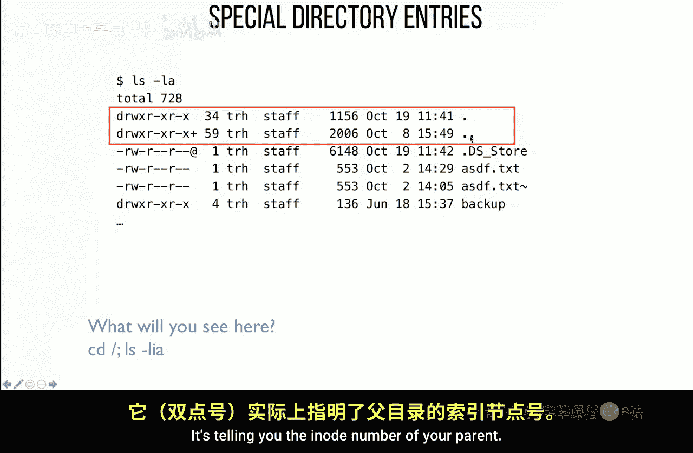

Okay， so let us do a demo。

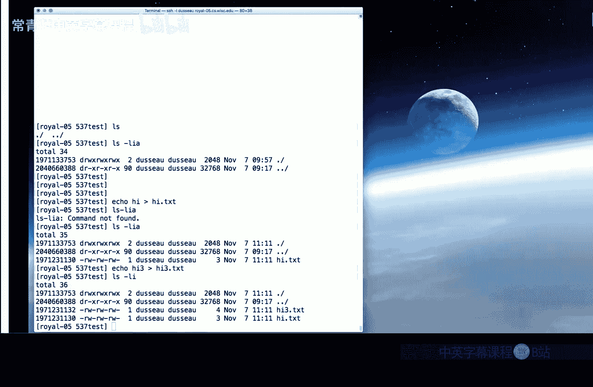

Okay， so I thought it was kind of interesting if we CDd into root。And then we do LS。

 what do we see here， So yes， in fact， we're always storing dot and dot dot and the root is kind of a special case that。

 as I told you， the root I know it is number two， but there's no parent above that so if you change into the parent from the root you just keep going back to the root itself。

To fix that recursion there， that's our base case。 And otherwise。

 this is printing out the roots case is a little bit different as we're going to be seeing later。

 because we're going to mount different file systems here。

 So some of the i note numbers look a little funny， but。That's what's happening there。Okay。

 and then within my own directory back here。Again， we had our。

Iode number for the current directory and the in number of the parent directory。

So any questions about dot or dot dot？Okay。All right， so let's start using this。

 so now you could imagine an API where every time you want to read or write a file。

 you'll now give this path name， it could be either a relative path name relative to your current working directory or it could be an absolute path name where you're starting with the route and you'll specify the full path name and you'll specify you know your buffers and where you want to read and how much you want to read。

Okay， so this lets us to use the names that we like， but it's going to have a bunch of disadvantages。

So what will be the main disadvantage of this approach。Yeah。

It's certainly very costly to traverse through this。 Every time we do a read。

 we're gonna to do those six discs that we were talking about in the example to figure out where you are right now。

 So it's very expensive to do the path name， lookup。

 Let's just do that once when we access the file for the first time。

 And so that is how we get to file descriptors， which is what we all know that we do。

 So the idea with a file descriptor is you open up a file and that returns a file descriptor to you。

 which you can use for your later calls to read and write。

 So it's only in that open call that you're doing the expensive filing path traversal。

And so we're going to have a bunch of data structures which we will understand in a few minutes where we're going to store some of this stuff in memory and then we'll do reader rights via the file descriptor and it's going to track some information for us and in each file is going to have different file descriptors corresponding to the files that it has open and as you all know。

 file descriptors， 01 and 2 are used for standard in。

 standard out standard error that that's a convention that we use so that you can write or read from those entities those file descriptors and that that's always just no numbers and as you saw with the shell how it's pretty easy then to close those and open new files and have all of the application can continue to。

 for example， write to。File descriptor one and now writing to file descriptor one instead of writing to standard out rights to this other file that you've opened。

 So this will hopefully make more sense today。 So this is what our new API is going to look like。

 you'll specify that complicated path only in the open， you'll get back your file descriptor。

 which is a simple integer。 it's just an index into our open file table。

 And then when we call read and write， we just pass in the file descriptor。Okay。

 so this is has the advantages we want。 We get to use the names that we like。

We only have to do the expense of trueperal once and we're going to figure out how offsets are defined and how they make sense to be consistent okay so if you look at the XV6 implementation。

 you saw some of this in that first add a system call project where you had to look at what was what were the open files right and so that you saw each process that's active。

 it has a list of open files up to some maximum here which in XV6 was pretty small but every process can have some number of open files and so the file descriptor is just the index into this array and then what does each。

Structure look like。It is just giving us a pointer to the iNot。

 so this has all of the information that we care about is kept in the in and then the offset。

 that's what we're going to care about that it's tracking the current location where the next read or write for this file descriptor will go。

Okay， so let's look at this in detail how we go from the file descriptor table to these descriptor objects that are kept in memory and then the actual iNot itself。

 which you can think of as an on disk structure here。 So we'll read the in into memory。

 we'll be able to manipulate it in memory， cache it in memory。

 but it is something that's kept on disk okay。So。01 and 2。2 standard in， standard out。

 standard error。When we open the next file， which we're all going to keep just opening file dot text。

 we're going to allocate file descriptor 3 to this。 We know that that's what the definition of open。

 It requires it actually， It requires that you give the lowest available file descriptor to the next call。

Okay， so we now have this mapping， so when we open up the file。

 we're going to allocate this descriptor object and it is going to track for us the In that this corresponds to。

 which is file out text and it's going to track for us the offset that the next read or right to this file descriptor will go okay so it starts off as zero right。

So let's do some things like we do a read。 What's going to change。

 We're reading to file descriptor 3，12 bytes。 So that just changes in our descriptor object。

 the offset that the next read or write would start at。 Okay， so that's pretty easy。

You feel like you don't need to pay attention at this point。 So the question becomes， well。

 what objects are we going to start sharing when we open this file again。

So we open this file again within the same process， and so our question is。

 are we going to end up replicating this descriptor object or not？We're not going to share this。

 So these are separate opens。 So what ends up being important about that is that if you do a read to file descriptor 1。

 and then you do a read to file descriptor 2， they're not going to interact at all with their offsets。

 Youd end up reading the same data across the two of them。 There's no sharing that's going on there。

That's just like just coincidence that you passed open the same string and to each of them。

 they each have separate descriptor objects there。So sometimes that's what you want。

 you want each of them to be able to read from different locations。

 treat them like theirre different files， but in other cases。

 you want it to be that you could have like threads cooperating on the same file。

 you want them to actually share the same offset。So that's where you can use this du call。

 which duplicates a file descriptor and so in this case it has that same rule that it needs to return the next free。

File descriptor， and this is actually going to point to the same descriptor object as what we do there。

So the implications of that are that if we do a read from file descriptor 4。

 that will increment the offset。 And then if we do a read from file descriptor 5。

 we would read from the next offset that was just modified there， yeah。What。えとた。Yeah。Well。

 we certainly don't have to。 And so this is， these are the semantics of what would happen if we didn't do any closes。

 So you， you can have a file opened multiple times within the same process or across different processes。

There are circumstances where you could want that in an application。ださ。

any number of processes can open a file and you could open the same file multiple times within the same process。

Yeah。Well， you're going to get weird behavior。 Yeah。

 because they're gonna be there unless you've done some file locking。

 they're each just going to write to whichever offset they think they should be writing to。

 And that's why we need to have locks and concurrency， and stuff like that。 Yeah，嗯，哼。て中て。Well。

They would need to。 I think then you would want to use dupe in that case so that you don't end up reusing the same。

If each you could partition a file into four consecutive chunks and have each of them work on their separate partitions。

 that could work totally， yeah。Then they wouldn't mess with each other's offset。All right， okay。

So many times you want to read sequentially and when you read sequentially。

 the system is going to take care of that offset for you。

 it's just incrementing the offset by the amount that you read。

 but other times you want to do some reading from random locations or you need to go backwards through a file or whatever。

 So there's this Lse system call that you can give different parameters too。

 So the first parameter is this file scriptor integer。

 then there's a last field that tells you how to interpret what you want to do in the second field。

 So if you set that last field to set， which is what we often do in our examples。

 if I don't specify it then this is what I mean， it means just set the offset of the file to whatever you passed in here。

 but you can also say you want to go to the current location plus some number of bytes like if you need to skip over some structure。

 then you seek offset away from the current。File offset。

 or sometimes you know that you need to extend a file and write to the end。

 you need to append to a file in which case you would seek to the end of that file and then seek more offset you'd probably set to zero in most cases there to seek to just the end of the file。

 but if you wanted to extend the file， make the file system allocate some blocks for you potentially you can extend the file that way。

 seek to the end plus some amount。All right， so that is how LC works。Okay。

 so let us give you a little quiz here。And let's see if you can figure out what the values of the offset should be for these three file descriptors with this code。

And so some other stuff has happened before this， but that doesn't really matter。

 assume nobody else is messing with file dot text， if that helps。All right， so when we say open。

 the first time we'll get our descriptor object and offset 12 or file descriptor number 12 will points to that and the offset starts off at zero。

 right， then we open it again。They get another descriptor object that starts at offset zero。

 which also points to that file。And then we do a read from this file， thescriptor of 16 bytes。

 so that increments this to 16。Then we dupe this。On here。Let me know if I make any mistakes。

And then we read， because I'm hating the filescriptor numbers here， not matching。

Integers that I need to deal with， we do a read here， so this increments this to 16。

 which is shared by that。 that's the key thing。 and then we do an L See where we're setting it to offset set 100 for this filescriptor。

😊，So I believe the right answer。Is 100 for the first one。 That's the offset。 And then these two。

 it's sharing the same offset， which we bred to 16 for that。So any questions about that。

 Does that make sense， yeah。Oh so well， this is our integer is just the index into this。

 it really is the integer zero is the index to get file descriptor4 standard in。

 and so this really is anteger integer， it's just the index in this。So and then within here this。

 I'm just trying to say that this is the offset here， there's a pointer to descriptor object type。

All right。Sounds good， okay， so you might be wondering what happens with fork。

 And so maybe some of you have read the man pages for fork in the past and you're like， oh。

 I understand all this stuff about address spaces。 I understand that the child has a copy of the parent's address space。

 But now you can start to wonder well， what happens to file descriptors when you call fork from the parent to the child。

So now this will make sense to us the man pages say the child process has its own copy of the parent's descriptors so that makes total sense right you just like with address spaces you get the exact same copy now the child will get a copy of the parent's descriptors and those descriptors are going to reference the same underlying objects so that for instance file pointers and file objects are shared between the parent and the child so if you do an Lse on a descriptor and the child process it will affect a subsequent read or write by the parent so that is a little bit tricky but it certainly makes sense when you understand those pictures that。

We have the same file descriptor for a file that we opened in the parent， we then call fork。

 the child will have a same file descriptor 3 pointing to this same descriptor object in this open file table。

And they'll each end up seeing the changes that the other does。All right， so though。

 they will completely share those file descriptors that existed before you called fork。 certainly。

 if you call open on a file， after you call fork， those things will diverge after that because there will still be new file descriptors in the one child that are not。

Identical in the parent。Okay。All right， so another kind of interesting thing is there's actually no delete for a file。

 you call RM。 that's just a utility， but it's based on the system call onlink。

 So we're actually using reference counting within the file system thats often going to be the case that we have multiple file names that point to the same in。

 So when we remove one of those file names， we don't necessarily want to remove the data for that file because we might have another file name that's pointing to that same data。

 So another piece of metadata in inots in addition to the special bit is this a directory or file。

 we know about pointers to the data， we know about size。

 those are all in inots and then the fourth thing that we now know about are a reference count how many names point to this particular in。

 And so it's only when the reference count goes to zero that you would garbage collector actually free up the file that has now gone to zero。

Okay， so that's what we will look at a little bit with on link that when you actually remove a file from the utility。

 you're just decrementing the reference count and once that reference count goes down to zero。

 then the file system would remove。The file data and then file descriptors are similar。

 You could have a file opened multiple times。 We could close one。

 We don't want to just remove this data structure。 the first time someone calls close。

 You need to have some reference counts。 How many times was that file opened。

 and then only delocate that structure on the last close for that。Object。O。

So it turns out that people kind of use this， they use lots of weirdnesses that were introduced like into the first versions of UniX that then。

And being assumed and everybody has to keep implementing for backwards compatibility because utilities want to use them。

 So， for example， you can have a process that opens a file and then it removes the directory entry for that file so that nobody else could read or write it。

 So because nobody else has a name for it anymore。 But that process can continue to write to it because the reference counts still exist there's still a pointer to that that I know that needs to be active。

 And so because of that you're able to kind of like have a temp file that you're sure nobody else can write to。

 And also what's really nice is then if that process dies。

 there will no longer be any references to it and the cleanup happens automatically that then there are no references when your process dies and the file will be deleted。

 whereas if you needed to make sure that。You correctly delete that file。 It would be tough。

 Usually to deal with that if your process could just have an error and die at some point。Okay。

 so anyways， everybody ends up using this， and so every version of UniX or Linux out there has had to keep using this as well that you can open up a file。

 delete it， and you better keep that file still around。Okay， trivia for you there。All right。

 so next we'll talk about links， so you've probably all used links before you've seen that they're useful when you want multiple names to go to the same data that you might want to have a directory structure that mirrors that has slight changes to it versus another copy you want to know like for example。

 you want the current version to point to one。Particular version of utility。

 and then you could install another version and then you can kind of point to the version that you want to use right now。

Okay， so we will look at how you actually implement links。

 There's two different ways that you can have links。 There's hard links。

 and then there's soft or symbolic links。So hard links。

 the idea here is that these are going to be with the reference counts。

 and we're not going to let our file disappear until all of the links have disappeared。

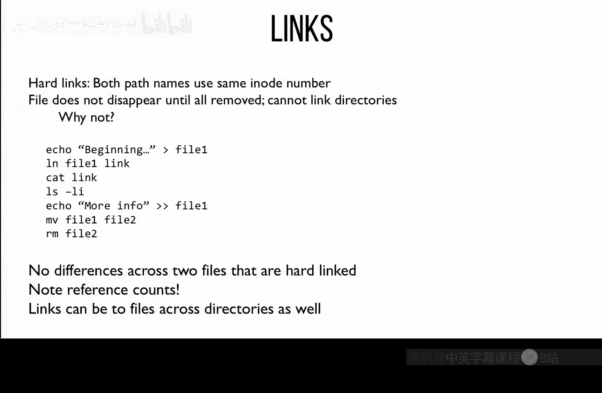

Have been removed， okay， so let us look at an example。

And I wish I could remember my example at the same time I do this。All right， so we have our file。

Hide dot text。And we can look at what its Iode number is。

 and now let's make another version of this file， and I'll make a hard link to that file。

And I guess I'll call it goodbye dot text。And now if I look at what files there are。

 goodbye dot text and high dot text， they both have the same i note number。

So we just have within this directory， we have a directory entry that maps the name goodbye dot text to this i node number and the name high dot text to this i node number。

 So of course。If I cat what's in goodbye dot text， we see the contents and if we。

Apppens some more stuff to this。And now we cat。High dot text。What do we think we'll see？

That that worked the way that it should， that they're both just the same names to the same file。

 that this appended the string goodbye to that file， and it's the same file。

 whether I use the name goodbye or hi。All right， so that's kind of neat and so what I can do now is I can remove either one of these files high。

Yes and I can still look at goodbye dot text there's no problem with that that still lives and I should have looked at the reference counts a little bit。

 but we can go back here so when I did this LS dash L remember the first column is the in number these are a bunch of permissions so one thing you'll see is that that first。

Bit is designating if it's a directory or not， then there's a bunch of permission bits。

 and then this next field here， it's a reference count。

 And so high3 dot text was the first just ordinary file we created。 There's no other names for it。

 So it just has a reference count of one， but goodbye dot text and high dot text。

 We're incrementing the reference count for that in number 30 because there's two names for it。

So now though， if I look at the reference counts， after I deleted one of them。

 high dot text doesn't exist anymore， so the reference count for。

 I know number 30 went down to one as well。So that's how hard links work in systems。Yeah。Awesome。

 yeah。So first， why does the current directory have a reference count of2。

 That's kind of neat because you can think about， well。

 theres the our parent is has a reference to us。 So that's one of them。

 And then the other reference is our dot。Right， okay， so how many。

 why do I have 90 references to my parent， Well， I guess if I look at my parent。

 you can see there's a whole bunch of directories in there。

 and each of those directories has a parent。Reference to incrementing that reference gap。Yeah。

 so that's pretty neat。That you can figure out exactly why you have all of these different reference skillss。

All right。

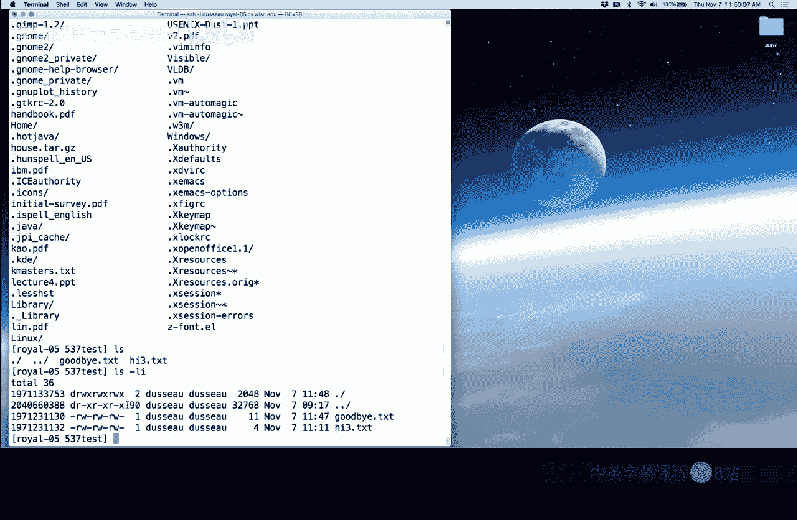

So did we cover everything I wanted to about hardlink， Okay。

 so you can they're just different names for the same data， the same iNot。

There's really no difference between the two files once they've been hardlink。

 there's no like primary， secondary or anything like that。

 watch the reference counts as you increment them and the one last caveat is that you can't oh you can't have a link a hard link to a directory。

And so why can't you have a hard link to a directory。

 It's because a system really can't tell that there's anything special about that。

 And so it would be possible to construct like cycles in your directory tree。

 And then if you have any utility that is trying to traverse a tree。 It's not a tree anymore。

 it would be very easy to add a hard link back to a higher level and then you'd get stuck in infinite loops。

 So systems do not let you have hard links to directories。

 That's why we're going to need to have soft links or symbolic links。

 but certainly we could have had links that went across directories In my example。

 it was always just two file names in the same directory。 but of course。

 you could have just had a different could have been a file that it was in a different directory as well。

Okay。So let us move on， and that was answered。So let us look now at soft links。

 so these are going to be quite a bit different。

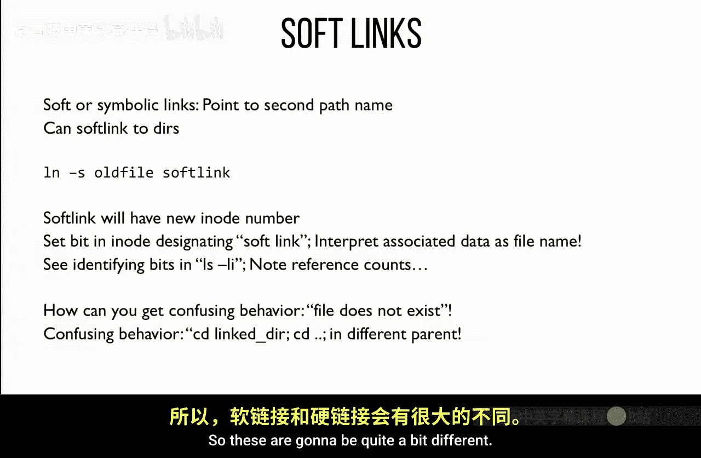

And they're useful for different reasons。Okay， so what do we have in here？Now。

 let's say I want to create a soft link to the file high3 dot text。

And let's call it goodbye 3 because I can sort of remember these things。Now let us do an LSI。Okay。

Sue。Goodbye3 and high3 do not have the same i note number。 So that's one thing to note and。

What you will see is that there is now a special bit being set in the i note for this symbolic link。

So there's a special bit， just like there was a directory bit。

 there's a bit telling us to treat this。File data as a symbolic name instead so what we're actually storing in the file name when it's a symbolic link is the name of the file that we're linking to So if we looked at the data that was associated with the file goodbye3 dot text it just has the data high3 dot text there and when you try to look at goodbye3 dot text and the system see that the symbolic link bit has been set。

 it then says， hey， I'm actually going to do a lookup as part of that path name traversal I'm going to look up high3 dot text instead do that look up。

 see that the in number is 32 and kind of move on from there。So。

It involves all of these extra lookups。 But it's like you're linking by the names of the files instead of through the i notess there。

 So what are the different results because of that， So certainly now we can cat goodbye 3。

 and we see the same stuff。 I can。Put more contents into that。And I can cat high 3。

 and they both see the new contents。 But what's going to be the huge difference here。

So the huge difference is what happens if I and see my shell nicely tells me with that symbol。

 you know it's just kind of a convention to put that at symbol to let me know that's a symbolic link if I remove high3 dot text。

What is going to happen？So goodbye3。tex still thinks it is a symbolic link to there。

 so if I tried to catch goodbye3。My system's going through。No such file or directory。Because。W。

 goodbye3 still exists。The file that it points to does not。 So when it tries to read that。

 it doesn't， it doesn't exist anymore。 So that's why sometimes that will be very confusing to you。

 You swear， you look， you see goodbye，3 dot exists。 You then try to cat it。

And you're told that it doesn't exist， so it's often because you have a symbolic link that's been broken there。

All right。 so there is a different relationship between the parents and kind of the child that was formed from that symbolic link there。

 But you could have multiple， you know， symbolic links all pointing back to the parent。

 There's nothing wrong with doing that。Other interesting things。

 you now can have a symbolic link to directories and so why can you do that because now we have that special bit that's being set。

 we know that this is a symbolic link and we're handling it differently so your utilities that traverse the directory structure。

 they can see， oh， this is a symbolic link and often those utilities won't follow symbolic link so that they won't get caught up in cycles。

So that simplifies that， but let's do an example， make dirt， D。And then， let's。Within or。

 what do I want to do。Let us make us symbolic link。Back can call it confusing。So now。

 if I C D into confusing。I look from my prompt， it looks like I'm in confusing。

 but when I print the working directory， it did go back up into the parent。

 So sometimes you'll notice that youll be you'll think you're nicely Cding through some directory hierarchy。

 you'll then try to C D back into the parent。 and you're someplace completely different than where you started。

 and it's because you followed a symbolic link and then you're in a different place than you thought you were。

Allright。So hopefully， now some confusion that you've ever had in your life that this will be explained because of what you've learned today here。

All right， so any questions about symbolic links？Well。

 I think this is the LS is showing this pretty nicely that goodbye 3 dot text。

 the name is being mapped to high3 dot text， and not every version of LS does that， you know。

 if you do it LS without the flags， you're told that it's a symbolic link， at least with this shell。

But the D L gives you more information。More questions yeah。这关区。The name。Oh yeah， yeah， yeah。

 That's a great example。Oops， I got confused。Alright。Okay， so there's no high3 that text。

 we if we echo。What into high3 dot text to create that。And now we cat goodbye3 dot text。

 It has the right thing。 Yeah， so it's all named based， which is kind of nice。

 Then if you remove high3 dot text and you can put something new there。

 that connection is still there。Yep， it's all name based。And this it could have been a whole。

 you could have put a relative name there， we could have put an absolute path name there。

 it didn't have to be just a single file name， it could have been any part of the directory structure。

 and the lookup just follows whatever you put in there。Great。Yeah。What you say to the confusing？Yeah。

新党ぞ。Yeah， CDd into。 Well， and then I go into confusing。Yeah啊。I'm back here。 It。

 It does use like the I need to draw this to make it better， but。Yeah， you follow the symbolic link。

 and then it is like the real directory that you're in is where you're in。

 And so it is the parents of the real directory that that you're now in。 Yeah。

 it doesn't keep a history or something like that。

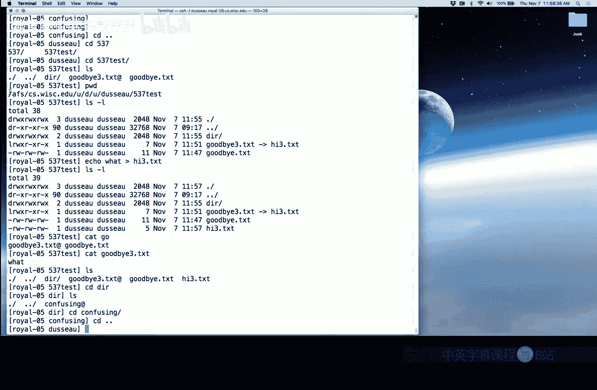

Great。Okay。So I think that's all the stuff I wanted to cover there。 but again。

 if you looked at the reference counts for soft links。

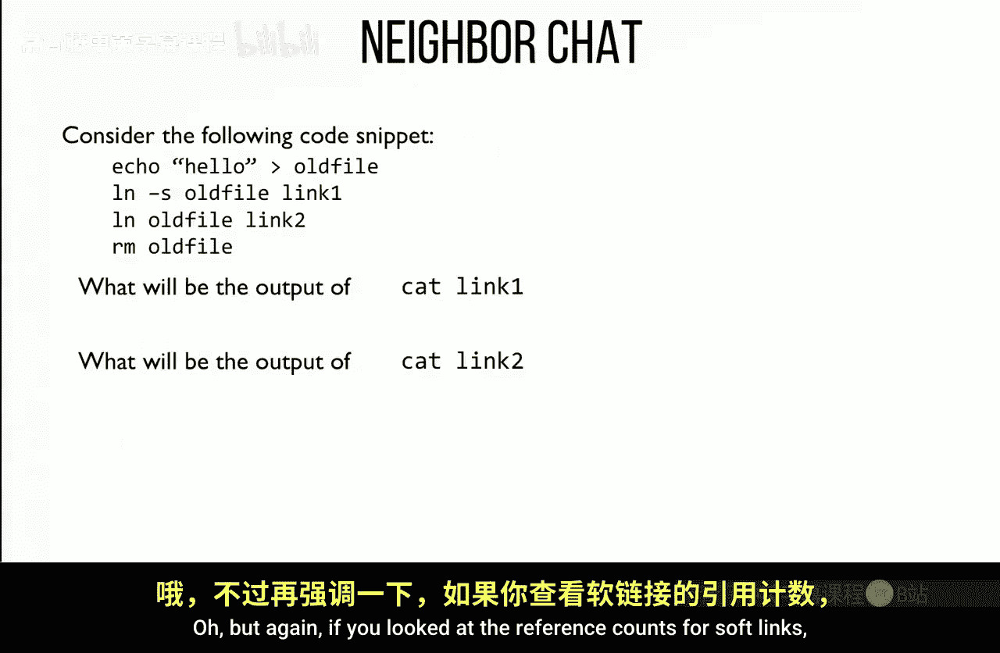

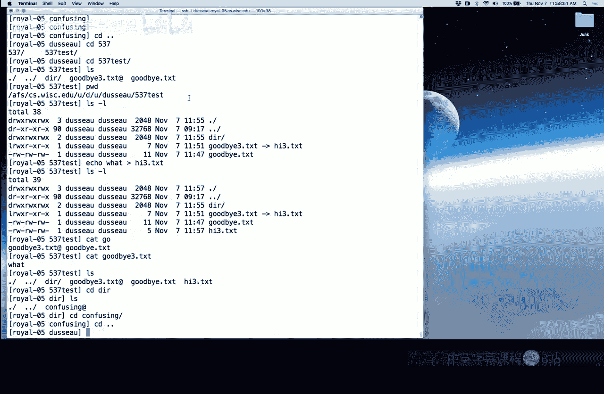

There shouldn't be anything that got incremented。Yeah， the reference counts are all ones， right。

 It didn't know like with the， with the hard counts that the hard links that we have multiple names to the same thing。

 So that's why we could just remove high3 dot text。 The reference count was just one。

 It doesn't know that someone is pointing to this， yeah。

So like imagine you had a software installation and you had， you know， you know， ghost view。

Version 1。6， and then you had version 1。7 and version 1。8。You know。

 it's the administrators that are kind of maintaining all these different versions for you what they're going to then do is they're going to link ghost view just itself to。

And it would probably use a soft link to the version that it wants you to be using。

And so then all that stuff works。 And if there's a problem then with this。

 they can revert by just changing the name and the symbolic link there to that。

You could definitely think of it as it's like a shortcut。

 It's just a different name of a different way of getting there， yeah。Great。O。Okay。

 so quick quiz to you then， if you're given this， what will the output of those two be？Okay。

 let me try to draw this out a little bit more so it makes it more useful， so we have some directory。

 we create a file， we call it old file， and it has an in number， in number five then points。

 it has a size and stuff like that， and it points to the data which is hello， right？

And then we create old file。 It's a symbolic link。We created link one。

It's going to have an i note associated with it。 let's say it's sixs。

 We're going to set that bit in here saying that this is a symbolic link。

ItStill has some size and stuff and it has a pointer and point what is the data that it's pointing to？

It's just the name， old file。And then we do a link。Link2。And so what work does that involve。

 All I need to do is just copy that i note number there so that's。An easy operation。

 And then we remove old file。And so actually what we forgot to do is we need to have a reference count on this as well。

 it was one at this point and then it became two here。So now when we do the onlink of old file。

 we'll remove the directory entry and we decrement our reference count and that goes to one so we won't delocate all of that stuff there。

And so now when we try to look at link one。We read in number six。

 we see that this is a symbolic file so we know to interpret this as a path name。

 we then try to open up old file by doing the directory traversal which means looking for old file in this directory it's not there so we'll say file not found right think one。

Not found。But it works totally fine to look for link too。

Because we just see that it has iNote number five that still exists and we can look at those contents。

So any questions about that？Okay， great， okay。All right， so this is kind of like how naming works。

 But another big thing is well， how can user processes communicate with the file system and tell it what it needs to do？

 So we don't want it to be the case that every time you call read or write or do a directory lookup。

 you have to go out to disk。 that would be ridiculously slow。

 So the file system in the they're going to maintain this buffer cache which is a cached copy of what you've read and written recently。

 So clearly buffer caches have a lot of advantage for reads if what you want to read you've read recently in the past。

 you'll just find that in memory in your buffer cache but they're also really useful for rights because now you don't have to immediately write out data。

 you can tell the user yeah， I wrote out your data and let them continue from that right system call。

But that data is just living in memory。 It has not been flushed out to disk。

 So your application is really， really happy。 You call right。

 you continue on and you exit and your right may never have gone out to disk。

 But your application ran very fast。 So if your application actually cares about making data durable and actually being on the hard disk or actually flushed out of memory。

 That's when you need to have this F syncnc call。 So you call F syncync on a per file basis。

 You tell it I want you to flush out from the buffer cache。

 The data that's associated with this file。 and at least get it out to the disk and make the disk actually deal with it。

Okay， because。T question for you。What happens when you call clothes on a file descriptor。

 Does that at least actually flush your data from the buffer cache out to the disk。

 And if you read the man page forclo。 This is from the direct man page a successful close does not guarantee that the data has been successfully saved to the disk as the kernel uses the buffer cache to defer rights。

 typicallyy if file systems do not flush buffers when a file is closed。 Common misperception。

 your data is still just in memory。 If you need to be sure that the data is physically stored on the underlying disk。

 use Fync， and then it depends on the disk hardware。

 So you still can't absolutely guaranteed that that disk is not keeping it cached and it's track buffers and stuff like that that it really did all of the work of making it go to the media。

 but it's kind of the disk's problem at least at that point。

 and you could configure the disk so it does that or does not do that。But you need to call Fync。

 if you need to make sure that your data actually goes out to disk。

 So you can do like a little microbenchmark kind of performance thing。

 You can write an application that writes tons of data and see that it goes really fast and then write the same thing。

 but call Fync， either after every right or at the end of all of the rights。

 And you'll see that there's just a huge performance difference between the two。

 since if you actually call Fsync， it actually has to touch the disk， whereas otherwise it didn't。

So questions about Fync or buffer caches。So we'll use the buffer cash a lot。

It's shared across different processes。 So if one process calls read of a file another process can just use the copy that's in the buffer cache as well。

 so that's very advantageous。Okay。Great。So what does rename do。 So rename， it's a simple operation。

 It just changes the contents in a director race from one name to another。

 Or if those entries were in different directories。

 you would just change the name from one name to another。 So it's。

Makes a lot of sense when you understand how it's represented that it's just a name change。

 you don't actually have to move data around or do any data copying or anything like that。

 It really is just changing names in directory structures。

But people want to use name a lot to do atomic operations。

 So if you're writing an application that needs to have like。One version of data or another version。

What they'll usually do is。You have your new data that you're writing out。

 you'll write it to a temporary version of that file that no one else knows about。

 and then you es it to make sure that all of the data is there。

 and then you call rename from what you were writing and garblling and making a mess of and was in some inconsistent state。

 you'll rename that back to the file that other people expect to look good and to be consistent and to have all of the right formats and all of that and as long as that happens atomically it'll be the case that other processes that are reading file dot text。

 they'll never see your garbled stuff you are writing into the temp file。

 they'll see either completely the old versions of that file or completely the new versions。

The only trick with this is that now rename needs to be an atomic operation。And so， it's possible。

In the file system that this isn't done correctly。 And so it's possible that if you had your old name that was in your directory structure and then you change it to a new name。

 it's possible that you could have a crash between those， those two points。

 And so that's one of the things we'll be looking at with journaling file systems to make sure that you can't。

Kind of crash between those two and forget that you were doing a rename。

 Because in this example here， if we removed our old name and then we crashed。

 we would lose our name completely。 If we'd still have the data around。 We'd still have an i note。

 but we wouldn't know the name of it。 We wouldn't know what file that was supposed to be。😔。

So then that's why you run things like FSCK on your system。

 if you had a crash at that point and it can look through and find i nodes that it can't reach and kind of find problems。

But that's really expensive to do。 So instead， we want to have Eync。 Sorry。

 we want to have journaling to make sure that we kind of don't forget that we were doing this if we have a crash。

We'll talk about that later。Okay， other things you might be interested in。

 permissions and access control so but we have separate bits that record for this file。

 who is allowed to read， write or execute this file， and that just corresponds to the user。

 the group that they belong to， and then everybody else。

And then something else that you might have seen。 So this is for local file systems。

 these individual readrite execute bits， but distributed file systems like AFS have as or access control list that are built on top of this and they're much more powerful than these readWrite execute bits that you have to very coarsely set for the people in my group。

 which who knows who's in your group and everybody else。

 So what access control this that you do is you can say should I， and this is s is the example here。

 He is allowed to read， list， insert， delete， write， lock or do administrative。

Actions on this particular directory。 And so this is like how we handle your hand in directories。

 which are all in AFS is we can mess around with these AFS as。

 And when you're allowed to turn things into your hand in directories， we give you。

Because we know your C S login。 It's the same as your hand in directory。

 I write run a script that says， give the person who' Cs login the same as this directory， you know。

 the full bits other than a， I don't ever give you administrative rights to this。

 And then when the deadlines passed， usually run a script that removes all of those things and just gives you read list permission so that you can check and make sure that you turned in your stuff correctly。

 but you can't write it anymore。And then it's nice if any user can have list access because then maybe your project partner can see that。

 well there are some files there， I'm not sure what they are。

 but it looks like they turn something in。Alright。哦。Okay。

 so the last thing is that it's often the case that you want to have many file systems on your system。

And so different systems have approached this in different ways。 if you're running windows。

 it's used to export in an ugly manner， like you have these individual devices and you can have individual file systems on each and you'd have to refer to each drive explicitly is like your E driverive or your C driveri。

 That's really， really ugly。 the way that Linux works is this is all transparent to that you have different file systems that are in that directory structure。

 So there's something that's called this mount protocol where you give it a particular device or partition on a device。

 So this is like giving a particular partition on a disk and you're saying where you want it to be mounted within your file system hierarchy and then you have to tell it what type of file system it is that this is a version of the EXD4 file system and that we have read writeite privileges to this。

 whereas we have this AFS protocol and that is all how your home directories are being managed。

 So within like a instructional machine， there's going to be some of the file system。

That is using the local disk， like the slash temp。 So that's like why when you log into different royal machines。

 if you look at what's in slash temp， it's different on every machine。

 that's just using the local disk， whereas if you look at what's in slash home that's using AFS that's giving everybody the same image there。

 So it's pretty neat that it lets you transparently like traverse this structure and it records enough information so that it knows。

There's like an abstraction layer above i nodes to let it know what file system it should be looking at。

 so it can still start at the root at in too， but then some names it's going to see that it needs to direct it to another file system protocol。

But you can embed within arbitrary points of this directory hierarchy， other file systems。Okay。

And that we did it okay so today we've learned about the API， we've learned about inots。

 we're going to continue to talk a lot more about iNots， we know how file descriptors work。

 we know how F syncync works， and we know how soft and hard things work and so next time we'll talk about more what's going on inside the file system we'll talk about metadata a lot more and how to actually figure out what blocks to allocate to different files。

So have a great weekend。

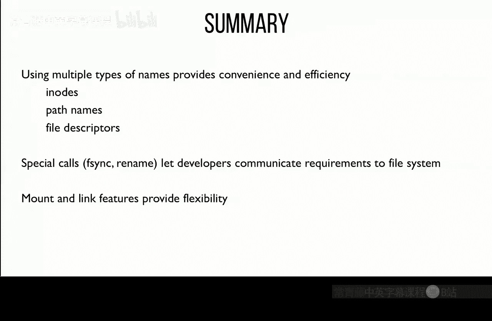