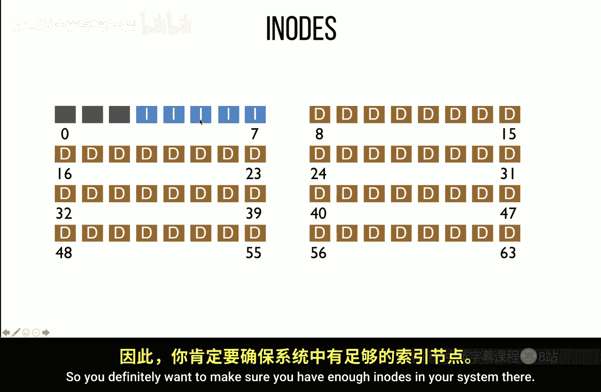
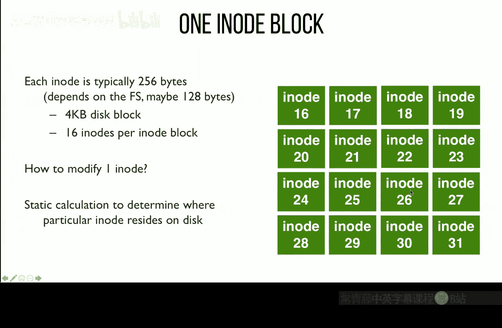
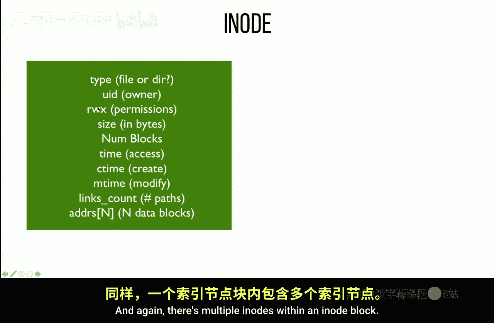
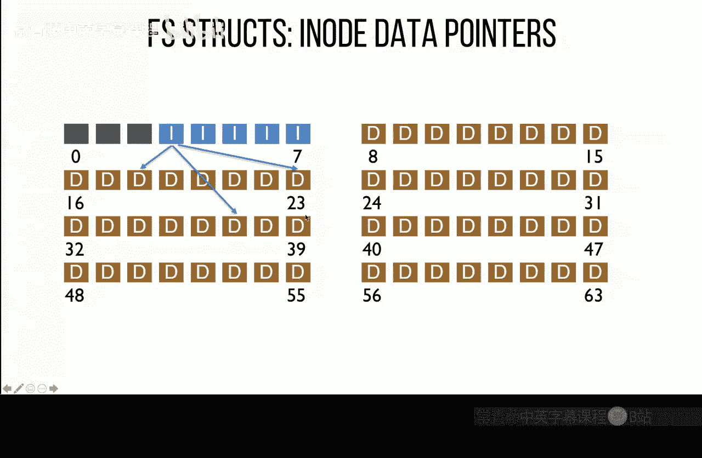
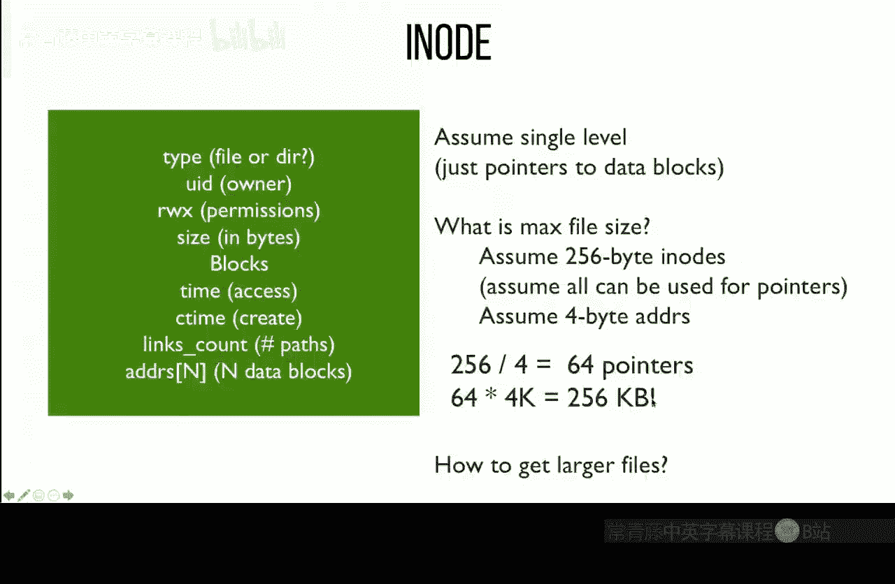
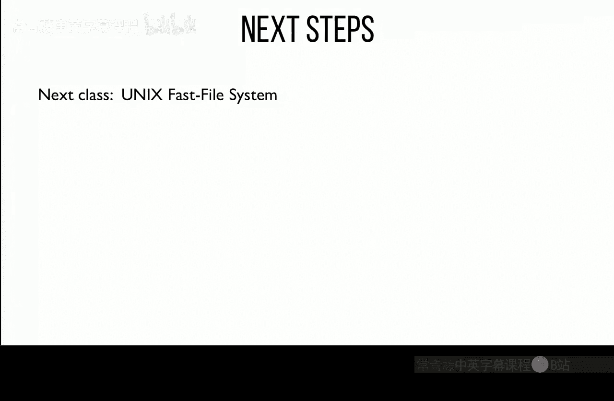

# 威斯康星大学【中英⚡操作系统｜CS 537 Fall19, Introduction to Operating Systems】 p19 P19 Persistence_ File System Structures _ University of Wisconsin- -BV1wUzSB3Ecf_p19-

All right everybody， good morning， we're going to continue talking about file systems today。

 kind of getting into the internals of how the file system works， what its data structures look like。

 how it performs allocation， how it performs the actual operations。

Okay so a bunch of announcements so you've all seen that your midterm two grades are in Can I haven't yet released how you actually did on each individual question I just have to run some scripts to do that the average is pretty high people did pretty well congratulations to you all yeah so any questions about the midterm I don't really have more to say other than I will release the actual solution guide and how you did sometime perhaps today or sometime soon。

All right， so the other thing is I want to make like these new quizzes to encourage people to understand the specification and to get started on them a little bit earlier。

 so some of them I'm going to do retroactively as a way for people to make up points on some of the projects that they really did very poorly on them like they got less than 50% on the projects by taking these retroactive specification and implementation quizzes they can get some。

Porion of these points back。 So there's lots of details there that's all in canvas with how the scaling works。

 So some of those retroactive quizzes， the first ones do on Friday。

 and then the project  three retroactive quizz is due on Monday。 And so again。

 if you did well on those projects， you do not need to take those quizzes。

 there's no benefit to you taking those quizzes， you only get a benefit if you scored under 70 points。

 And even if you got 68 points。 the way the scaling works。

 you can get one you can get half more points。 So it really is for people who did not do the best on those first projects。

 But I do want to have kind of similar quizzes for the projects moving forward。

 So there is a quiz on this project 6。 the project itself is do a week from Friday。

 but the spec quiz is due by the kind of late afternoon tomorrow。

 So the idea is everyone should take a look at the spec before they go to the discussion section。

 you should take that quiz before you go to。cus section。

 and the way the regrading is working on that， I think in the end。

 I decided you can take that quiz as many times as you want to get as many points as you can。

 but we're not going to show you the correct answers。

 That's kind of the compromise on incentive to keep working at it。

 but we're not going to tell you the exact right answer each time。

So any questions about Project six or map produce？Yeah。😊，Oh。

 it'll be a very small portion for performance。 We have our test cases。 you know。

 as long as your things finish in a base amount of time， you usually get most of the points。

It's nice if we have like 10% to play with， I guess。

 to see if some people really have better implementations than others。

 I know some people like that challenge of how much can they optimize it。

 Give you some extra points for really being the best at that， but it'll be pretty small。

More questions about Project 6， mapuce。All right， and so in discussion section tomorrow。

 that is what the T is will be talking about。All right， so today we're talking about file systems。

 we're talking about the on disk data structures， basically what the metadata needs to look like。

 So we're going to have a bunch of different options for what the metadata could be structured。

 basically how do you track pointers from a file to the actual data。

 So we'll look at some kind of old fashioned approaches and then we'll get into kind of what's used in most modern systems or at least the good base level from modern systems today。

 and then we'll look at the actual disc operations that you need to do in order to do a bunch of different operations that users care about。

Okay so let's do a quick review of what we covered last time。

 so in our last lecture we were talking about what the file system API looks like。

 what the interface looks like for users that are interacting with a file system and so we argued that a nice name for users to deal with was they want to be able to specify a path for a particular file and that you will open up a file that corresponds to that path and return a file descriptor to the user process and then in future operations they can use that shorthand that file descriptor as the way of performing reads and writes to that file that it's going to be relatively expensive to open a file because you have to traverse this path and look at all the iNots and read all the directories and look for all the correct directory entries that opens going to take a while but once you have a file descriptor that will be a shortcut to knowing the in that this file corresponds to and the particular offset that this process is reading or writing to so each open file。

Sriipor will have a corresponding offset that's associated with it。All right。

So this is what our example looked like that we started with。

 So imagine we have iodes which are a type of metadata and for each i node。

 the most important thing to track at this point is that each of them is pointing to a base location for where the data lives on disk that's associated with that iode or that metadata。

 So for example， inode number 0， its's data lives at disk block。Where this is pointing some pointer。

 And so how would we open up the file bash R C that's in the at C directory， in the route directory。

So we have to start at a known location。 We know where the root directory's in lives。

 That's our first step。 The root directory's in is always number two。

 for some reason in Linux systems。 So we go to ine number two。 We read that。

 we find out where the data is for ine number two。 and it's right here。

 And so now we can read this directory。So that's two reads。

 We're looking for the Etsy directory within the root directory。

 so we parse this data and we find the Etsy entry and we find out that the Etsy file is associated with sorry Etsy directory is associated with in number 0。

So then we read in number 0。 That's our third read。

 We then find the location of the data that corresponds to the Esy in。

 We're able to read that directory。 We parse it looking for the next entry that we're interested in。

 which is bash R C。 We see Bsh R C is associated with in number 3。 We can then read in number 3。😊。

Get the pointer， Find out where the data lives。 And we can finally now read this， this file。

 So opening it would get us up to five reads， and then actually doing the read itself would be a sixth read to look at that data。

So any questions about that about。What directories contain， You go to the in first。

 The in tells you where the data lives that's associated with that file， and then we can read it。

Yeah， we're going to cache all of this stuff。 Yeah， Yeah。

 we do not want to go to disk every single time。 We。

 we're going to have a buffer cache where most of the time， if you're reaccessing things。

 it would be in your file system buffer cache。 Yep， absolutely。Other questions？All right， okay。

 and so then you'll remember the other thing we talked about were these file descriptors。

 And so what happens when we do an open of some file from a user process。

 Well we do all of the traversals we get an inode that we now know where that is。

 We're going to create this descriptor object in memory and that's tracking the offset for this particular open and the i know that it corresponds to。

 and then the index into that file descriptor table。

 That's what the user uses to access this file that this is the shorthand use index3 to get to this file that you opened in the past。

And so now after you open the file， we'll initialize the offset to zero。

 When you do a subsequent read from this process， we're going to track that offset and remember that you read 12 bytes in the past。

 So we'll increment the offset to 12。 And so the next time we call read。

 we would read from offset 12 in a very natural way。 or if we did a write to that file descriptor。

 we would write to offset 12。Allright， and so then if we open that file again。

 even within the same process， we are going to have a new descriptor object that's associated with that open。

 it's just coincidence that's to the same file， there's really nothing going on that knows that it's to the same file because we'll have a new descriptor object。

 it will have a new offset there and so when we do reads or write to this file descriptor2。

 it will have a completely different offset than the other one that's not shared in any way。

 but if you do a do call and then it actually is duplicating the file descriptor itself。

 and so both of those will have the same value， though'll both point to the same descriptor object。

 And so if you do a read or write to file descriptor2 or file descriptor 3。

 they're both going to end up interacting with the same offset and they'll share that offset。

So those were the basics of filescriptors and how that offset is tracked and stuff like that， yeah。

What would be the complexity， what？哦。Great， so when you do the actual seek call。

 it doesn't do a read， right， all it does when you call seek is change this offset。

 So it's a constant time to just call seek。 great， And then when you actually do the read。

 then it'll depend upon the device characteristics。 which is why， you know。

 hard disks are so interesting because they're so slow。

 But when we look at other persistent devices like flash。

 they do really more have like a random access behavior。 So then it would have good。Great。

More questions。O， and then the other thing we briefly talked about was that there really isn't a delete of a file。

Everything is done using garbage collections， so we're always going to have reference counts for how many open files we have or how many names we have that will get you to a particular iNot So for example。

 when you call RM the user utility that calls the system called unlink unlink doesn't necessarily just remove that file what it does is it removes the name for that file in the directory that you're currently using the directory entry。

 it removes that directory entry so there's no longer that name but then it will look to see well how many remaining references are to that i note it has to look in the iNot。

 it decrements the reference count by one if it goes down to zero it says now there's no more names to this file and it can remove all of the associated data。

So we're gonna do some more examples of this again， more through today。

 But just to remember So hard links were allowing us to increment the reference count for in。

 It was just giving us multiple names that were exactly the same for a particular in whereas symbolic links were quite a bit different。

 They don't increment the reference count。 a symbolic link just kind of remembers a name that you should look up instead of the one that you thought you were using。

So that one didn't do anything with reference counts。

And then the other kind of neat side effect of using reference counts is that if you have a file that's open。

And you delete that file， but you haven't yet closed it。

 The file system won't actually remove that file for you。 It waits until you actually close the file。

 and there's no longer any outstanding references。 There's no longer any open files to that so that you can kind of continue to operate on that file。

 but yet no other process would be able to find a name to it anymore and open it up or change it itself。

Alright， yeah。Sorry， no， no， no。 So it definitely does not。 So let's say you。You removed a file。

 and its reference count went down to 0 in the i note。

 but you still have a file descriptor that points to it。 so it won't。Remove that file。

 But then when you call close， it will see that there are no longer any file descriptors that point that I note either。

 And then it would remove it。So it's an and there that you can't have any names or hard links to a file and you can't have any open files or those descriptor objects that are pointing to it either in order to remove an i note in the associated data that goes with it。

Okay。So that was the review。 So let's now look at some new stuff。

 So what we're going to try to understand today is we are going to view our disk as a linear array of blocks。

 Of course， this will be more like millions of blocks。 We'll just pretend we have 64。

 assume that each block here is representing about 4 kiloBte worth of data。

 So we'll figure out where should we allocate data， so forth。Okay。

 so our basic task today is going to be pretty similar to the task the OS had before with mapping users logical address spaces to physical portions of memory。

 We're going to have that same process where we need to take a file and figure out how it should map to different disk blocks that are out on disk。

So we're going to have a lot of the same。 Oh we could do this。 We could do that。

 lots of analogies between the two very similar pros and cons to what we saw with memory。 Okay。

 so we're going to look at a contiguous one， extent based linked， all of these things。

 which will make sense by the time we're done。And we'll look at a bunch of different metrics。

 So one thing we could be worried about with how we are representing the mapping of a file and its i node to the data blocks that corresponds to that file。

 We could be worried about the fragmentation。 Is this going to use up。Weird chunks of disk space。

 such that it'll be hard to allocate future files。 It could be hard to grow this file over time。

 We could be doing allocations that make it really slow to do sequential accesses later。

 And we want it to be the case that if you're just reading from a file that you'll kind of get the best sequential performance is possible。

 That's what the user is going to assume if they're reading sequentially from a large file that they'll get sequential bandwidth out of the system。

 So we need to make sure that we preserve that。If the user does do random accesses。

 if they're skipping around， if they're doing LCs across a large file。

 they're not going to expect their performance to be as good a sequential。

 but it still had better be reasonable。 And then we'll also look at well。

 how much space are we wasting for tracking this mapping between file offsets in the particular data blocks and it's a little bit different here because we actually have to keep the metadata stored persistently on disk too。

 right the metadata has to be longlived。 It's part of the file system。

 It's not like if we just crash the machine， it's okay if all those mappings go away。Alright。

 so the first type of mapping。It's kind of what you would come up with if you had five seconds to come up with a。

Policy here。So our approach is going to be each file。 It's data blocks。

 They have to be allocated contiguously on disk。 And so what's the relevant metadata in this case。

 So if I know， I need to go to iode a and figure out where the data for in A lives。

 it's just going to record for me in that in。The starting block for where that file lives and then the size of that file。

 So that's the only metadata that it needs。And so you could imagine a policy that would do this。

 What would a file allocation policy look like。 Maybe you'd like to know how big this file is going to be。

 You'd find some free space。 And you'd say， oh， this looks like a good place to start growing file D。

So systems did this in the past， but nobody does this anymore。

 So let's look at kind of what the pros and cons are。 So fragmentation。

So it's going to have pretty bad fragmentation。 It's just like kind of base bounds with our dynamic memory mappings。

 right， where it has to be a contiguous region of blocks for our file。

 And so it's very possible that we might have a file that is 8 blocks。

 and we wouldn't be able to allocate it using this approach unless we did some type of compaction。

 and we def fragmentmented the disk， and we made a contiguous to B to C。

 And then there'd be enough space free for a new file that we want to allocate。

 So fragmentation is horrible with contiguous allocation。Ability to grow the file over time。

 We already have an example where we can't grow B。 This isn't a very good approach。

 What's the seek cost for sequential accesses， So once we find where B is。

 how good is sequential performance going to be。Great， yeah。

 this one's going be great because it's all sequential。 It exactly matches the。

Mapping between the user's file and what happens on disk。

 And then how long would it take you to calculate the block for a particular read to a random offset。

That would be really quick as well， right， if I told you， you need to read block 3。

 It's just simple arithmetic to take this starting block and add three blocks to that and figure out where that particular block off。

 that would be。 So that one's great。 and wasted space for metadata。 This one's trivial as well。

 It's just， we just needed to track the starting block in size。 O， so this one's very basic。😊。

Straightfor。Next approach that people did is a lot like when we added segmentation with virtual memory。

 So here， instead of having to make the file completely contiguous。

 we're going to have some small number of extents。 And each of those just has to be contiguous with one another。

 So now our metadata will be， will have some small number of extents that we can reference。

 maybe like 2 to 6。😊，And we just need to record for each of those segments where the start is and what the size is。

Meowic type of drive。 So that would， so imagine if we're assuming we're using a hard drive， it's all。

The O S has no idea what is going on underneath that linear block array。

 And so it's going to do the same type of allocations regardless of the drive。

 There are some more modern file systems that try to take the performance characteristics of flash into account。

 And maybe we'll touch on that very， very lightly at the end after we've actually talked about flash。

 weve talked about log structured file systems to see like how you might want to do things for different devices。

 But hard drives all look similar enough that theyre going the file systems going to do the same。

 no matter which which hard drive they're running。Great， okay。

 so this makes fragmentation a little bit better than contiguous。

 It makes it a little bit easier to grow the file over time。 but it kind of all depends upon well。

 how many extents do we have， And it's usually a pretty small number。 So you can still run out。

 It's still pretty fast for sequential access。 It's kind of the opposite of your ability to grow the file over time。

 the more little extents you have， the more seeks you'd have to do as you kind of jump across file D or file B。

 But it's usually still pretty good。 It's still pretty fast still to calculate where and offset。😊。

Within a file lives， doing simple arithmetic from which segment that block must be in。

 and then it still doesn't take up too much space for metadata。Okay， so really。

 the problem is that we can't grow these files over time。

 So that's why we're not going to want this extent approach。Okay。

 so this one's just like a really weird approach。 So someone thought， hey。

 let's treat our files like linked lists。So think about what a linked list structure would be for a file。

 And this was really actually done。 Otherwise， I wouldn't talk about it。 but really。

 someone said I'm going to do this as a linked list。 So the metadata is pretty nice。

 it's just the location of the first block of the file。

 but each block now also has to contain a pointer to the next block of that file。 So， for example。

 if you had 4K blocks。 it would be a tiny bit less than that of data that you could actually keep within the block。

So each block is going to contain a pointer to the next block。So how does this do with fragmentation。

SoThis is a lot more like kind of kind of like paging， but done paging with a linked list。

 We wouldn't have done that。 So we're not going to have any external fragmentation anymore。

 We can use any disc blocks that are free。 We'll just add our pointer to it。Internal fragmentation。

 you'd still have a tiny bit of internal fragmentation when the size of your file doesn't fill up your last block。

 but not a big deal， ability to grow a file over time。 That's great cost for sequential access。

 It's going to completely depend on your data layout。

 if you were able to allocate the block sequentially， you'll get great sequential performance。

 If you had to jump around because you were needing to grow that file or you were taking advantage of the fact that this isn't causing fragmentation。

 you'll have more sequential access。 Okay so the one I want you to think about is how is this going to perform for a random access。

Ridiculous， right， You have to actually traverse that whole linked list of file blocks。

 and you actually have to read them all just to get to your random location。

 So this is just like the worst thing you could ever imagine doing on a slow disk。

 So we are not going to do this for any。Somewhat ran， somewhat。Modern file system there。 O。

 so we will fix that in the next one。 And it is wasting a bunch of disk space for all of those pointers within blocks。

Okay。So is there something we can do to this linked list approach and make it。

A little bit more complex and something that a real file system is going to do。

 I'll call it a real file system。Okay so you might have heard of this fat table that Windows file systems has。

 and it is basically taking that linked list information and just pulling out all of the pointers and putting it into this file allocation table。

 this that table。You would still have like the same allocation of file blocks to disk blocks。

 you would still logically think of it as a linked list。

exceptcept what we're going to do is instead of storing the pointers within the data blocks themselves。

 we're going to remove all of that and put it in this fat table。

And so let's kind of think about what this metadata would look like。Okay， so we have。For files。

 the metadata， for the files or what's stored in some。🤢，Thing like an in。

 It would be the starting block。 So the starting block of A。

 that looks like it's just mumble it for me so I can do this， right。主。Starting block for B is。6。

 is not what you're saying， C。10 and 11 is。0。Deep， sorry， did I say like 11？

T question D it starts at block zero okay， so then what is in the fact table？😊。

This is a system wide table， it's for the file system。

 and we are storing in index 0 of the fat table where the next。

Block is for the file that was stored at block 0。 So from 0， what would we store there。1， great。

 One will store。Thank you。 So that's jumping around at two， we store。3， it looks like。Is that right。

No， so what should I put here？It should be just like null is what they'll do so that they'll show that this is the end of the list for file A and so forth。

So we're just basically going to have one entry for every block of our disk or our file system。

 And it will show the mapping here。 And so this might take， you know，4 B for each。

 Just whatever is big enough to store one block number。Okay。

 so it's a lot of the same characteristics as the linked list approach。

 but instead we're pulling all that metadata into the fat table。So。

Where's one case where it's actually going to do worse。 So this fat table。

 you're going to store it in memory， you're gonna cache it in memory。

 but you do need to make it persistent， right， You do need to flush it out to disk as well。

 In case you have a crash。 you need to know what your file system looks like when you reboot。

 So you are flushing that out to the disk。 if youre not if it's not in the cache right now because it is a large fat table。

 you would have to do an extra read from the fat table on disk as well。 So in the worst case。

 now you're actually having to do two disk reads to follow this linked list structure。

 one from the fat table and then one to the actual data itself。 So if it's not cache。

 it would actually have worse performance than the linked list approach。

 but you can usually keep pretty significant portions of that fat table in memory。

 And so for random accesses， you'll be able to just traverse this inmemory structure and figure out where the particular block is that you need to go out to disk to read。

Alright。So any questions about this fat table approach， yeah。Well， if this was not cached at all。

 you would have to go read here。Oh。 yeah， if you were doing random reads。

 you would just be reading here。 And then the final block。

 it would just be for sequential that it could be doing worse。Great。More questions。Okay。

 so now you know what fat table is， and now we'll get to more what a lot of UniX file systems started with。

And so we're going start having an indexed allocation。

 And so we will still use fixed sized blocks like 4 kiloby blocks。

 and we'll basically just keep a pointer for every block of the file。

 And there'll be just a fixed sized array of these block pointers。

 And so the main tricky thing here is， well， how large is your file going to get。

 How many pointers are you going to need。 And so this you either have to waste a lot of space for this fixed array of block pointers or。

You're only going to be able to support very small files。

 if you really just had a linear array of block pointers as part of your metadata。

 So A's metadata would say point to this block to this block to this block file。

 D's metadata would say point to those blocks like that。Alright。

 so it is good in terms of we don't have any external fragmentation。

 We can grow our files very easily。 It supports random access with simple calculations。

 but it has a lot of space for metadata that's required。 So we're not going want to do this。

So let's improve indexed allocation。And so this is what the original UniX FFS system did。

 And it's what E X T2 was based on in EX T3 as well。

So the idea is now we have our i node and we'll have some number of pointers in our i node that are directly pointing to data blocks。

 So exactly the approach we were talking about before。

 we have some number of direct pointers to data blocks。 Let's say 12。

But then we're going to have a pointer to what we're going to call an indirect block。

And that indirect block， it just contains pointers。 It's just like a multi levelvel tree here。

 It's containing pointers to the data blocks itself。 So what's really。

 really nice is you don't have to allocate that indirect block ahead of time。

 you don't have to allocate that pointer ahead of time。 when the file is small。

 the only thing that you'll have allocated is that I note itself。

 and whatever data blocks that you need it。 And then once the file gets bigger。

 And it grows past that you know。13th。Data block， whatever however money pointers that we have。

 that's when you allocate the indirect block and you start allocating the data blocks for it。

 And then if you grow past needing that size of a file。

 you'll allocate what we call a double indirect block where each of those double indirect points to an indirect。

 and then most file systems will have a triple indirect as well where each of those entries points to a double。

 which points to a single indirect， which points to data。So this is an imbalanced tree。

 and it very nicely allows us to support both small files and large files。

 So it's great for small files that we don't have to waste all of the space for all of that metadata we're not going to need。

 but still can grow to very large sizes。😊，So the one slight disadvantage is， well。

 what happens when your file needs， you know，15 blocks。

 Your performance is going to see just a little bit of a hiccup when you're doing that sequential read。

 most likely， because you read these data blocks nicely。 But before you're able to get to this one。

 you have to do one extra disc read to read in this indirect block。

And so sometimes you'll see a slight performance problem there。 But then， of course。

 this indirect block we're going to cache it so that when we access the next data block。

 we'll already have this cache， we don't have to keep reading that indirect block over and over again。

All right。 So this is kind of what we're going to be assuming as our default。

 I know and how it's set up。 But we'll keep talking about this as we go today。So I， yeah。Yeah。

 so each iode is a fixed size。 Let's say it's 512 B or 256 B。

 It will have reserves some number of pointers for direct， and it will always have that number。

 And then it will have usually one pointer to an indirect and then one pointer to a double and then one pointer to a triple。

 Yeah， it won't just keep growing this i note or something to add more of those。

So there still is some max size， but it will see。 it'll end up being like you can do 4 GB files with。

With just。Double in direct， I think it will do that calculation。

 but it supports pretty large files pretty quickly。Alright。Okay。

 and so all modern file systems don't use exactly this。

 You could have a more complex data structure where you have more like just some arbitrary tree where instead of having those fixed sized blocks with our indexed approach。

 you could have like indexes。 sorry， extents extends that are variable length and store them in a tree and spend a lot of fun time optimizing your data structure。

😊，It has kind of similar performance， we'll say to this approach so we're just going to use our multi levelvel indexing approach。

Okay。We are assuming our multi level indexing approach。Alright。

So now I want to get into more of the details of what's actually in each of those data structures。

 so we'll talk about data blocks， I know it's indirect blocks， directories data bit maps。

 I know bit mapps and the super blocklock Okay so we're starting off with our linear array of blocks that map to the disk in some way that the file system does not need to know the file system just knows the number of them and the size of them。

 right？And so we want most of the disk to be devoted to data blocks。

 that's the thing that users care about， that's the size of your files that you can actually store。

 we want most of the disk to be data blocks， so visually that is what's going to happen in today's lecture we're just going to make this very simple in our lecture on Thursday we're going to look at actually where should we put the data blocks relative to all of the other metadata to get better performance。

 but today just lots of data blocks。Okay， and then we're going to have to have some number of inots。

 And so there's lots of like special magic， constant parameters to figure out well how many i nodes should you have as a ratio of the number of data blocks and that's kind of why you can configure your file system different ways So you could imagine if you know you have a lot of small files you're going to need a lot of i notess right because。

Am。You're only going to be pointing from your i node to just a few data blocks。

 And if you didn't you could very easily use up all of your i nodes。

 but still have some data blocks left around。 So you definitely want to make sure you have enough i notess in your system there。

O， so let's look at what's inside an in block。So remember， again。

 we're dealing with 4 kB disk blocks。 That's usually the unit that the file system will read and write to 4 kB at a time。

But each i node is not going to be 4 kB。 so a disk block will be divided up into maybe 16 i notess。

 So if you think about what happens when you actually want to modify one of these i notess。

 you can't just modify one i node。Or create it from scratch， initialize in anything。

 in order to do that， you do have to read in the whole disk block。

 do your modification to the 1 I know that you care about。

 and then write them all out again because you cannot just modify 128 by。All right， and of course。

 you can do some pretty straightforward calculations then to figure out where a particular i note lives in which disc block and which offset。

Using your modulo and integer division there， okay， so let's look at what's inside of an iNot。

So in the last lecture， we talked about the fact that directories are going to be stored using the same structures as files。

 So remember， when you read a directory， its data is stored just like a file stores its data。

 All of the metadata will be exactly the same for a directory versus a file where we have all these size and access times。

 we just need this bit to be able to distinguish between the two and to know if this iodeode refers to a file or a directory。

 And we also talked in the last lecture that was useful to know if something was a symbolic link versus a file。

 So we'll actually have another bit to differentiate files， directories and symbolic links。

Other metadata that you might have in an iNot， we would want to know the owner of this file。

We want to know the permissions。 Do they have readr， execute to a particular file。

 What's the size of the file in bytes， then the size of the file in terms of the number of blocks that it's using。

 knowing that as a shortcut。 It just helps with some of the calculations we track a bunch of time statistics that a bunch of utilities will end up looking at。

 like if you think about like what make does make looks at when you last modified a file and created another one to figure out the rules doesn't need to recompile your your。

Source files for you to create a new executable。 It needs to know when those things were last modified to know if it needs to run the rules for make。

So the file system tracks all of that， it usually tracks like an access time， a create time。

 and a modified time。Then something else that we're going to have in each inode is this reference count。

 This is the number of links that we have to each file， the number of hard links。

 the number of paths， the number of names that get to it。

 So most files will just have a link count of one， but we saw if you have a hard link you know you increment that count and we saw like with directories with a dot and dot dot。

 that reference count often goes up as well。 And then finally we have our pointers to our data blocks。

 Some of those data blocks will actually be indirect blocks to more pointers。

 some of them will be to double indirect triple anddirect so forth。

 but we'll have some number of blocks there。So that's what annyn looks like pretty generic。

What are the interfaces for changing time， I don't。I don't think you can on。On Linux systems unless。

 I mean， I'm sure if you have some。Root privileges， you can do some things。

 I haven't looked into how you can muck around with these timestamps and make it look like you worked on your project before you actually did。

ははい。😊，All right。😀啊哈。😊，Single line node， yeah。And again。

 there's multiple i nodes within an iode block。

Okay， and so just to emphasize each of those i nodes， probably the block has multiple nodes in here。

 and then each of those is pointing to the data blocks out on disk。

六。And then。Great， so if we had just a single level， which is not what we have。😊。

This is just to emphasize that we could only have very small files if we just had 256 byte inots。

 pretend they can all be used for pointers， each pointers， four bytes。

 that would mean we have 64 direct pointers， each of those 64 pointers can point to a 4K block。

 we could only have files of 256 kilobytes which is ridiculously small。

 so we do not have just direct data pointers down here， as we said before。

 which is what this picture would look like。

That is not what we were going to do。 You also could have done an approach where you had pointers to indirect blocks。

This would have allowed us to store， pretty large files。But so with indirect box。

So if we had 64 indirect blocks， what's the largest file we could have stored here？

Each of those indirect blocks contains 1000 pointers， right。

 because it's a 4 kiloby block and each pointer is 4 B。 So 1000 pointers left。

 we have 64 of those blocks times the size of the block of data that they can point to。

 That's going to be 64 MBbyte files that we could support with that。

But we don't want this approach either because it would be painful for the small files that you have to do this extra level of indirect。

 Most files when you look at them， most of your files are very small。

 though most of your data is in large files so you have to optimize for both cases there that most files are small。

 but most of your data ends up being in the large files out there。

 so we want to do something to optimize for small files which is what I showed you before that we're going to do that multilevel index where we have some number of pointers to data blocks。

 pointer to indirect and then a pointer not shown to double indirect and triple indirect。

 so let's just do the calculation real quick。Let's assume we have 12 direct pointers。

That should look like 12 to you， there's a one pointer to an indirect block which points to some number of data blocks。

 and then we're going to have one pointer to a double indirect。

 the double indirect contains pointers to indirect。

So let's figure out how large of a file one in could then reference。

So most of this doesn't end up being。Contributing much to our size。

 but we had 12 direct pointers times 4K。 We had 1024。Pointers in here in our indirect block。

 How do we get that， It's because the 4 k block divided by 4K pointers。 There's 1000 pointers there。

And then we have our double indirect block that I did not show。 We had one of those。

 but that also contains 1 thousand pointers， and each of those thousand pointers points to one of these。

 which contains 10 pointers。 So when you multiply all that together， we just end up looking at this。

 This is basically one meg times 4 kilotes， which is where we get our  four GBabte file that we can support。

So a pretty straightforward way of supporting very large files with just a small number of。

Pre allocateated pointers， because if you need these indirect blocks and double indirect blocks。

 you'll allocate them when the file gets that large。So any questions about that？Okay。All right。

 so directories are going to end up being stored in the same way as files again we're just going to have this bit that shows us that the data corresponds to a directory instead of a file and so what's neat there is that if you have a really large directory with a lot of directory entries。

 it can use indirect blocks just like files could it's just the exact same mechanism for allocating more data blocks to a directory。

Okay。So let's look at an example， we have some directory data。

 so we had an iodeode that pointed this to this directory data and the directory data。

 it just has some structure that the file system is defined。

 like we probably have a valid bit to show that this directory is valid， we always have that dot。

For ourse， dot dot for our parent， telling us what our in is in the i note of our parent。

 And then we have two files inside this directory。 We actually can't tell at this point if it's a file or a directory。

 we'll have to go to their in to do that。But let's say someone calls unlink of。File fo。

 What do we need to do。So the first step is pretty easy。 We remove the name for that。

 We remove this entry from this directory。 So just switch that to invalid。 and that will do that。

 But then we need to figure out， can we actually deallocate the i note at this point。

 So we need to make sure there aren't any open file。Descriptures to F。 even though we've unlinked it。

 And then once we've seen that that's not the case， we go to the iode。 We look at its reference。

 We decrement its reference count by one。 And then if it's 0。

 if there are no other names that will get to in 80。

 then we know that we can delocate the iode and we can delocate all of the data blocks that that iode points to。

So just reference counts there。The。The file system will do that for it。Sorry。

 so certainly in the inode， we'll have the reference count。

 which is tracking the number of like hard links to this file。

 But then we have in memory that like those object descriptors。

 And we will just need to make sure that there aren't any there before we。

Would delete the file as well。And。So the interaction there I'm not going to be completely precise with。

 but it will make sure that we don't delete a file that is also open there。All right， okay。

 so one other thing we need to talk about is well how do you actually find all of these data blocks or free iNots you could have different data structures right you saw in your last Xc6 project。

 there is a free list for tracking memory another so that we could do that for our file system as well free blocks。

 but what we usually like for file systems better is to have a bitmap that's showing us the state of every disk block in the system。

 and you could use like a one to show that the corresponding block or inode is allocated already and zero if it's free or the reverse there。

 whatever convention you want， but basically we'll have a mapping between all of the bits in our bitmap to each inode or each data block telling us if it's free or not。

 and we're going to look at this a lot more in the next lecture。

But if you go back to how our disk is structured， we have our data blocks。

 we have our in table or our in blocks， and then we're going to have blocks that are devoted to a bitmap for the data blocks and a block that's devoted to the bitmap for the in so again there's just zeros and ones in here and the first bit in this block tells us if this in well there's a bunch of iNots in here if it's free or not and the next bit shows us if the next inode and that block is free and so forth and then this bitmap is for the data blocks。

 the first bit shows if this one is free or not the second bit if that one's free。

So it's just a bitn。So that's a pretty easy data structure to like look at the state of a lot of blocks quickly and to find a whole bunch that are like all free so that you could know that you'd be able to。

Contiguously allocate a bunch of your file。All right， okay。

 And then the last structure is you always need to have the super blocklock since you can configure your file system in different ways。

 you can have different numbers of i nodes， different numbers of data blocks。

 The file system the next time it boots up， it needs to know how you decided to configure that file system image。

 So the super block is going to track all of that。 Tell you your block size where everything is。

 Store that in the super block。 So that's what that is。All right。So。

This is our summary of our static data structures， we're going to have a superb， a bitmap for iNots。

 a bitm for data blocks， an in table， and then data blocks， remember they can be used for files。

 they can use be used for directories and they can be used for more indirect pointers。

So that is the overview of the static structures。And let me give you a little break before we get into actually doing some operations now using all those data structures。

 so I'll give you about three minutes， and then we'll reconvene。More questions， yeah。

Before we read the bitmap up。So we have to read the in bitm to find a free in so that we can allocate the in for bar。

 That's why we're reading the in note bitmap to find a free in so that we can allocate an in for file bar。

And then once we made our choice， for which I know Barr is going to have。

 we write out the bitm to flip that bit show we took that one。We certainly。

 once we've done one read in this example， we'll assume that it stays cached for the rest of this operation。

 The other thing we're not really looking at is the relative ordering of all of these things that's what we're going to look at when we look at crash consistency that journaling is going to make sure that we do all of these all of those rights like atically because we could be messed up with a bad file system state if only some of those rights happened。

 but for now we definitely had to do these reads in this order because we had to follow our chain and then we have to read the I know bitmap to figure out。

What I know we can allocate。 But then the order that we do these remaining rights is a bit arbitrary for this example。

Oh， did I goof up someplace here。Yeah， yeah， yeah。 no fo data。 No， this is fo。

 So we needed to read fo， but we were not creating any data for the file bar yet。 It's an empty file。

 It's just， we're going to start off。 bar file is size 0。 It doesn't point to any data yet。

 We just created a zero length file。 It just has an i note at that point。啊，哈。😊。

We're writing to the block that has the bar i note。 So we read in that whole block。

So that we would know the other iNots that were in that block。

 we then in memory change the iNot for bar to have the new contents that we that we want。

 and then we write up the whole thing again。 So it's the same in。 It's bar's iode in this example。

 we read it， and then we write it。Well， the in has the metadata。 It has the pointers in it。 It has。

So I think we'll just go out to some more examples。 And I'm sure more examples will make this clear。

 Allright， So now we're just going to open a file。So what do we need to do to open？

So we've seen this already。 We're going to read the root iode at 0。 We'll read the root data。

 looking for fo。We'll find Foo， we'll find Foo's In number， now we can read Foo's In。

 now we can read Foo's data， so now we know the directory for what's in directory foo。

We will now from that， we will find Bar in。 We just created that in the last operation。

 but this is a new day。 Now we found Bars in by reading Fos data。

 So now we know that and we want to open it。 And that's all I needed to do。

 I've now done everything I need to open up this file and then subsequent operations can read or write to it。

 But I know the state of file bar and can do things in the future。 yeah。😊。

That would not be recorded in the persistent state in any way。 Yeah。

 that's completely stateless in terms of what's going on on the desk。 Abolute。 I mean。

 I could maybe we could do something with access times， but in general。

 I don't want to put like time as modifications。And so that will take place。

At a level above well make sure that there are no open files。To this。

 and then only decrement the reference count if that wasn't the case。

 But that's all taking place in memory with open files。More questions， yes。

So I'll say we won't modify time in any of these things。 Otherwise。

 we're throwing in rights all over the place。 So I think for all examples， we will not modify times。

And you can configure your file system that way to get better performance， too。 Allright， O。

 so that's it for。Open， so we dinner open。 And now we're continuing along。

 We've already done the open。 We have the。Descriptor object that points to it， we know Bars In。

 So now when we want to do a write， what do we need to do。Okay， so we read Barr's Iodeode。

So that we know its current size， we know it's been allocated to it。

And what other things are we going to need to read at this point？Yeah。Yeah。

 that sounds like a great one。 Let's read the data bit map， find a free data block， Pick one of them。

 and then write out our choice by flipping that bit。😊，Now we have a data block。

 so I bet we write it out。 so now we've written out that data that the user wrote that they care about。

 and then what are we going to need to do， We're going to need to modify Bar's inode to update the size and include a pointer to this data because certainly the next time we go to the inode。

 we need to follow that pointer to that data to be able to read that file。So in the iode。

 we're tracking the size and the pointers。So I think that's it， yeah。

Any questions about those operations？Okay， one more example， this one's awfully similar。

We start with Iode， now we want to read this。What do we do， We can just read it。

And then why did I make us write this one， I guess I。

I'm assuming the only thing I can think of is that I was assuming we had to do time here。

 which I do not like。Is there any other reason we would have to write that eye note。I don't think so。

 So I think I'm going to change the slide and write that we don't need to do that one unless we're accessing doing time。

 which I do not want our examples to do。O。So this one's nice， feeding is nice。And now closing a file。

 what do we need to do when we close a file。You've all been asking a surprising number of questions about that one。

 And the answer is nothing。 This is the great example。

 the file system persist state does not record which files are open。

 We don't do anything with flushing data or anything on a close。

This is all in memory operations that occur。 They're just you know。

 cleaning up those descriptors and the objects in memory。Okay。

And so we've been touching on a lot that we're not actually going to go to disk every time。

 It' would be way expensive if you were having to read inots and bitmaps on every single operation。

 So we are going to usually cache those things in memory， it's going to be really， really helpful。

 especially for rights because often you'll end up overr an in very quickly。

 you'll overwrite a bitmap very quickly， you might as well just batch those up and kind of wait until if you have a bunch of changes and then write them out all at once。

 And when we talk about journaling how to make sure that all of the operations either all happen or don't will get back into that。

 But in general， there's going to be a straight off the longer you wait。

 the faster your performance will be。 you'll be able to coalesce multiple operations more。

 but then you could lose more data if you weren't pushing it out to disk frequently。Okay。

 so this is it for the basics and then our next section we're going to talk about UniX FFS。

 and it's going to be more a what were the design decisions that they made。

 how did they optimize their file system， how do you figure out where iNots should be relative to data blocks。

 why should you use bit mapps instead of free lists。All right， so enjoy， I'll see you on Thursday。

