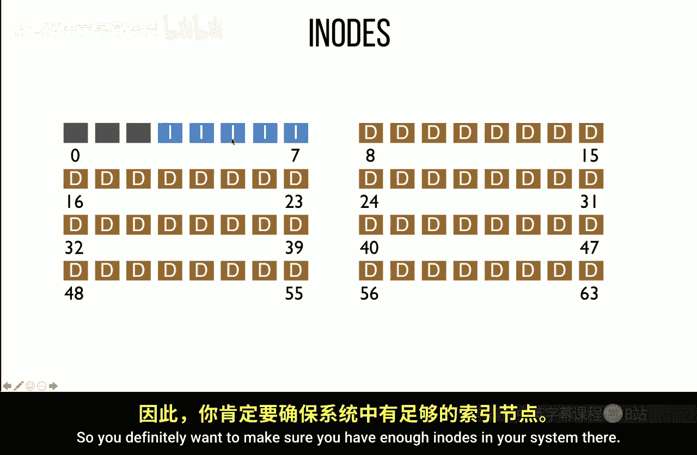
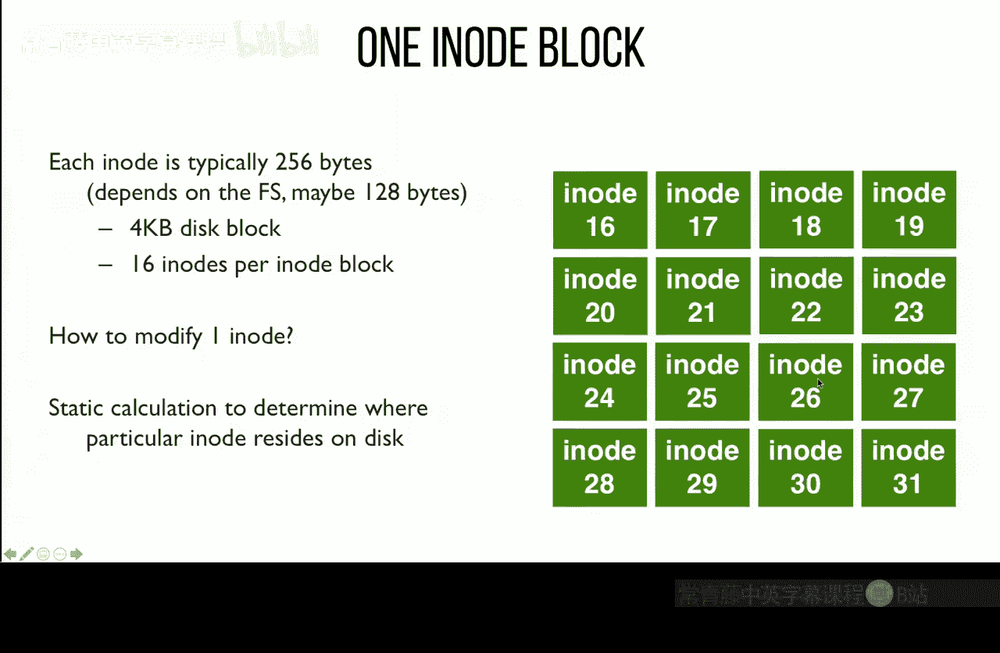
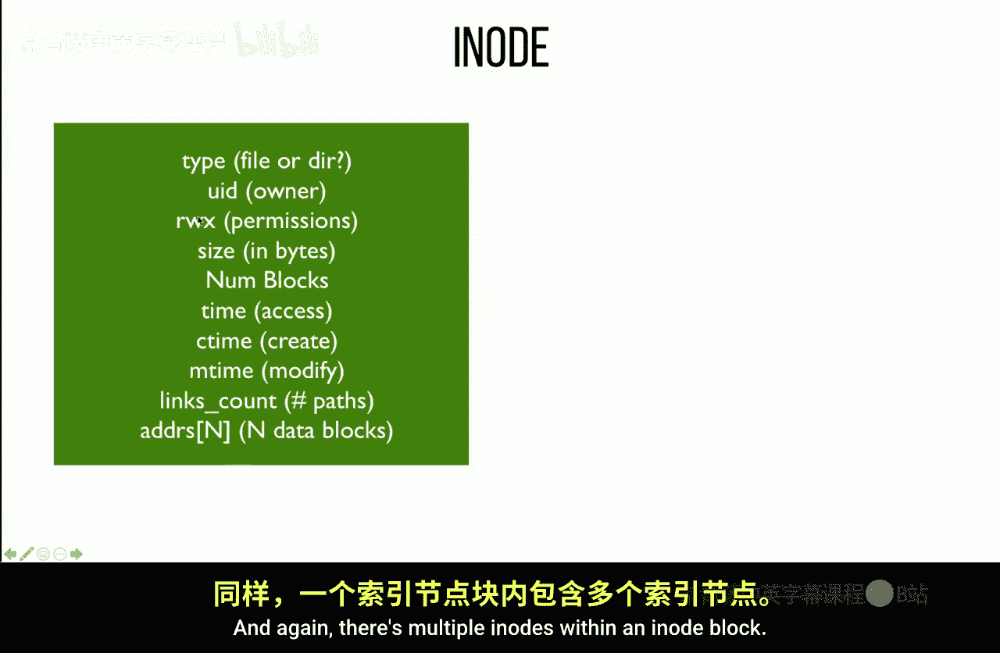
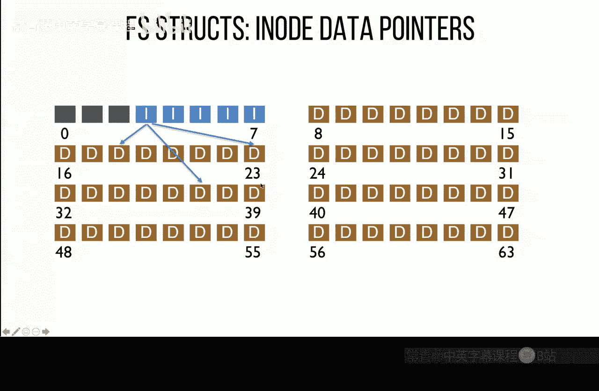
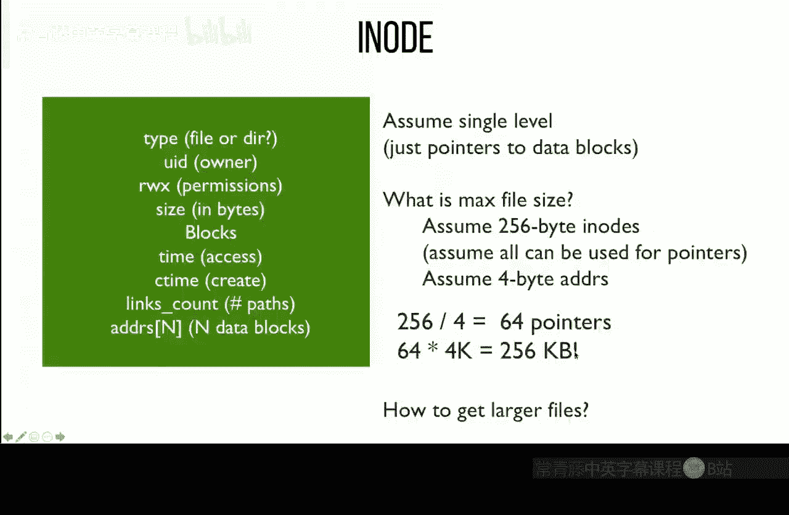
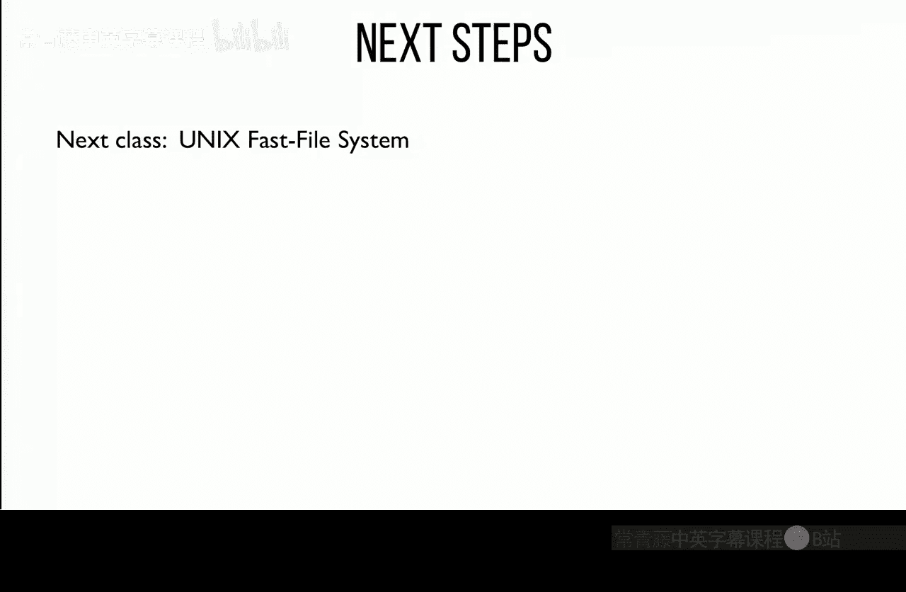

# 操作系统：P19：文件系统结构 🗂️

在本节课中，我们将深入探讨文件系统的内部工作原理，学习其核心数据结构、如何进行空间分配以及如何执行实际的文件操作。我们将从回顾文件系统API开始，逐步深入到磁盘上的数据结构，并分析不同文件分配策略的优缺点。

---

## 回顾：文件系统API与文件描述符

上一节我们介绍了文件系统为用户提供的接口。用户通过路径名打开文件，系统返回一个文件描述符。后续的读写操作都使用这个文件描述符作为快捷方式。

打开文件是一个相对昂贵的操作，因为它需要遍历路径、读取目录项并查找对应的索引节点（inode）。一旦获得文件描述符，它就指向了特定的inode和该进程当前的读写偏移量。

每个打开的文件描述符都关联一个独立的偏移量。如果同一个文件被打开两次，即使在同一进程中，也会创建两个独立的描述符对象，拥有各自的偏移量。而通过 `dup` 系统调用复制的文件描述符则会共享同一个描述符对象和偏移量。

删除文件（如使用 `rm` 命令或 `unlink` 系统调用）实际上并不立即删除数据。它只是移除目录中的一个名称（目录项），并减少对应inode的引用计数。只有当引用计数（包括硬链接和打开的文件描述符）降为零时，文件系统才会真正释放该inode及其数据块。

---

## 文件数据块分配策略

本节中，我们来看看如何将文件映射到磁盘上的数据块。这与操作系统将逻辑地址空间映射到物理内存的任务非常相似。我们将磁盘视为一个线性的块数组（例如，64个块，每个块4KB），并探讨几种分配策略。

以下是几种不同的文件数据块映射方法及其评估：

### 1. 连续分配
*   **方法**：每个文件的数据块必须在磁盘上连续存放。
*   **元数据**：inode中只需记录起始块号和文件大小（块数）。
*   **优点**：
    *   **顺序访问性能极佳**：数据在磁盘上物理连续。
    *   **随机访问计算快**：通过起始块号+偏移量即可直接定位。
    *   **元数据开销极小**。
*   **缺点**：
    *   **外部碎片严重**：难以找到足够大的连续空间分配新文件或扩展现有文件。
    *   **文件增长困难**：除非文件末尾有连续空闲空间，否则无法扩展。

### 2. 区段（Extent）分配
*   **方法**：允许文件由少量（如2-6个）连续的数据块区域（区段）组成。
*   **元数据**：inode中记录每个区段的起始块号和大小。
*   **优点**：
    *   相比连续分配，**碎片化问题有所改善**。
    *   **顺序访问性能仍然较好**（取决于区段数量）。
    *   **随机访问计算快**。
    *   **元数据开销适中**。
*   **缺点**：
    *   区段数量固定且较少，**文件增长能力依然有限**。

### 3. 链表分配
*   **方法**：将文件数据块组织成链表。每个数据块末尾包含一个指向下一个块的指针。
*   **元数据**：inode中只需记录第一个数据块的块号。
*   **优点**：
    *   **无外部碎片**：可以利用任何空闲块。
    *   **文件增长容易**。
*   **缺点**：
    *   **随机访问性能极差**：必须从链表头开始遍历才能找到目标块。
    *   **空间浪费**：每个数据块都需存储指针，减少了有效数据空间。
    *   顺序访问性能取决于数据块在磁盘上的实际分布。

### 4. 文件分配表（FAT）
*   **方法**：链表分配的改进。将所有块的“下一个指针”集中存储在一个独立的文件分配表（FAT）中，数据块内不再存储指针。
*   **元数据**：inode记录起始块号。系统维护一个全局FAT，其每个条目对应一个磁盘块，存储该块所属文件的下一个块号（或结束标记）。
*   **优点**：
    *   继承了链表分配的优点（无外部碎片，易于增长）。
    *   若FAT常驻内存，**随机访问性能得到改善**（只需在内存中遍历FAT）。
*   **缺点**：
    *   FAT本身需要持久化存储，占用磁盘空间。
    *   若FAT未缓存，随机访问可能需两次磁盘读（读FAT条目 + 读数据块）。

### 5. 索引分配（多级索引）
*   **方法**：inode直接包含指向数据块的指针数组。为支持大文件，采用多级索引树。
*   **元数据（以经典UNIX FFS为例）**：
    *   inode包含：12个直接数据块指针、1个一级间接块指针、1个二级间接块指针、1个三级间接块指针。
    *   间接块是专门存储数据块指针的完整磁盘块。
*   **优点**：
    *   **无外部碎片**。
    *   **文件增长灵活**，支持超大文件。
    *   **随机访问性能好**：通过计算即可定位所需索引层级。
    *   **优化了小文件**：小文件仅使用直接指针，无需额外间接块开销。
*   **缺点**：
    *   大文件需要多次间接访问，可能引入轻微性能开销（但间接块可被缓存）。
    *   元数据结构相对复杂。

**多级索引容量计算示例**：
假设块大小4KB，指针4字节。
*   直接指针：`12 * 4KB = 48KB`
*   一级间接：`1 * (4KB / 4B) * 4KB = 1 * 1024 * 4KB ≈ 4MB`
*   二级间接：`1 * 1024 * 1024 * 4KB ≈ 4GB`
*   三级间接：`1 * 1024 * 1024 * 1024 * 4KB ≈ 4TB`
总支持文件大小可达数TB级别。

现代文件系统（如EXT2/3/4的基础）大多采用此类多级索引或其变种（如Extent树）来平衡大小文件的性能。

---

## 磁盘上的文件系统结构

了解了分配策略后，我们来看看这些数据结构在磁盘上是如何布局的。一个文件系统映像通常包含以下部分：

### 超级块（Superblock）
存储整个文件系统的元数据，如块大小、inode总数、数据块总数、各种结构（如位图、inode表）的起始位置等。系统启动时首先读取超级块来了解文件系统布局。

### inode位图（inode Bitmap）
一个位图，每个位对应一个inode，表示该inode是空闲（0）还是已分配（1）。用于快速查找和分配空闲inode。

### 数据块位图（Data Block Bitmap）
一个位图，每个位对应一个数据块，表示该数据块是空闲（0）还是已分配（1）。用于管理数据块空间。

### inode表（inode Table）
一个连续的区域，存储所有inode。每个inode大小固定（如128或256字节），因此一个4KB的磁盘块可以存放多个inode（如32个）。对单个inode的读写必须在其所在的整个磁盘块层面进行。

### 数据块区域（Data Blocks）
文件系统的大部分空间。用于存储：
*   文件内容
*   目录内容（本质上是一种特殊文件，存储`<文件名, inode号>`的列表）
*   间接块、二级间接块等（用于多级索引）

**inode内容详解**：
一个inode通常包含以下信息：
*   **文件类型**：普通文件、目录、符号链接等。
*   **权限**：读、写、执行权限。
*   **所有者与组ID**。
*   **文件大小（字节）**。
*   **占用块数**。
*   **时间戳**：访问时间、修改时间、状态改变时间等。
*   **链接计数**：指向此inode的硬链接数量。
*   **数据块指针**：直接指针和间接指针。

---

## 文件系统操作流程示例

让我们通过几个具体操作，看看文件系统如何运用上述数据结构。

### 操作1：创建文件 `/foo/bar`
目标：在目录`/foo`下创建一个新的空文件`bar`。
1.  **读根目录inode**：已知根目录inode号（通常为2），读取其inode。
2.  **读根目录数据块**：根据inode中的指针，读取根目录内容，查找名为`foo`的目录项，获得其inode号。
3.  **读`foo`目录inode**。
4.  **读`foo`目录数据块**：查找是否已存在名为`bar`的条目。
5.  **读inode位图**：查找一个空闲的inode，假设找到inode `k`。
6.  **写inode位图**：将inode `k`对应的位标记为已分配，并写回磁盘。
7.  **初始化inode `k`**：读取inode `k`所在的磁盘块到内存，初始化其字段（类型为文件，链接计数为1，大小为0等），然后写回磁盘。
8.  **更新`foo`目录**：在内存中的`foo`目录数据块里添加条目`<bar, k>`，然后写回磁盘。

### 操作2：打开文件 `/foo/bar`
目标：获取文件`bar`的文件描述符。
1.  重复操作1的步骤1-4，找到`bar`的inode号 `k`。
2.  **读inode `k`**：将inode信息载入内存。
3.  **创建内核文件描述符对象**：在内存中创建一个结构，包含指向inode `k`的指针和当前偏移量（初始为0）。
4.  **分配文件描述符**：在进程的文件描述符表中找一个空闲槽位，指向刚创建的内核对象，并将该槽位索引（如3）返回给用户进程。
**注意**：打开操作本身通常不修改任何磁盘上的持久化数据（除非更新访问时间，但常被禁用以提高性能）。

### 操作3：向文件 `/foo/bar` 写入数据
前提：文件已打开，已知其inode `k`和当前偏移量。
1.  **读inode `k`**（可能已缓存）：获取当前文件大小和已有的数据块指针。
2.  **读数据块位图**：查找空闲数据块，假设找到块 `m`。
3.  **写数据块位图**：将块 `m` 标记为已分配，写回磁盘。
4.  **写数据块 `m`**：将用户数据写入磁盘块 `m`。
5.  **更新inode `k`**：
    *   增加文件大小。
    *   在适当的数据块指针位置（根据偏移量计算）添加指向块 `m` 的指针。如果文件增长需要新的间接块，还需分配并初始化间接块。
    *   将修改后的inode写回磁盘。

### 操作4：关闭文件 `/foo/bar`
**在磁盘层面无需进行任何操作**。关闭操作仅在内存中进行：
*   释放进程文件描述符表中的对应槽位。
*   减少内核文件描述符对象的引用计数。如果引用计数降为零，则释放该内存对象。
*   文件系统的持久化状态（磁盘数据）不受影响。

---

## 性能考量与缓存

显然，如果每个文件操作都触发多次磁盘读写，性能将无法接受。因此，操作系统广泛使用缓存：

*   **缓冲区缓存（Buffer Cache）**：缓存最近访问过的磁盘块（包括inode、目录数据、间接块、文件数据、位图等）。后续访问若命中缓存，则无需磁盘I/O。
*   **延迟写入（Delayed Write）**：对元数据（如inode、位图）的修改可能在内存中缓存一段时间，批量写回磁盘，以提高性能并减少磨损（对SSD尤其重要）。但这带来了数据一致性问题，需要通过日志（Journaling）或写时复制（Copy-on-Write）等技术来保证崩溃一致性，这将是后续课程的主题。

---

本节课中我们一起学习了文件系统的核心磁盘数据结构，包括超级块、位图、inode表和数据块区域。我们详细分析了多种文件数据块分配策略，并重点讲解了现代文件系统普遍采用的多级索引方法。最后，我们通过一系列操作示例，了解了文件系统如何协调这些数据结构来完成创建、打开、读写和关闭文件等任务。理解这些基础是后续学习文件系统性能优化、崩溃一致性及日志机制的关键。