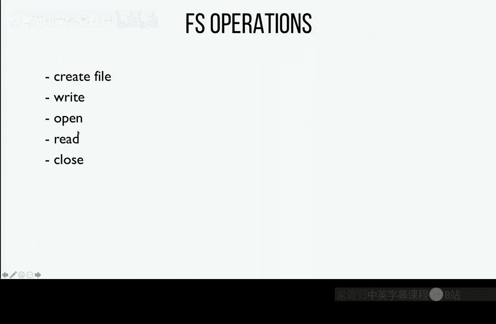
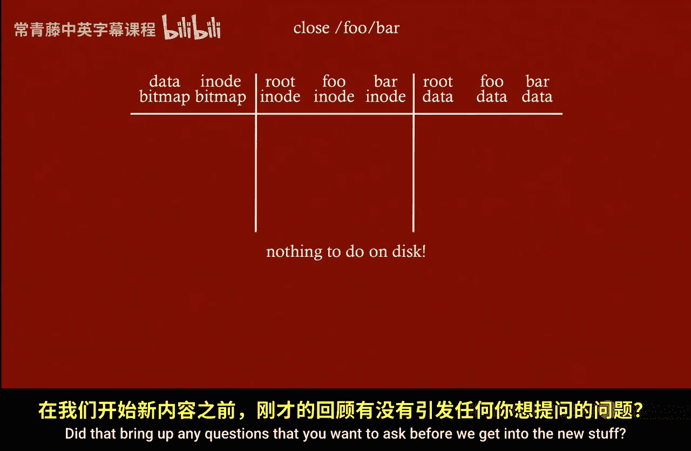
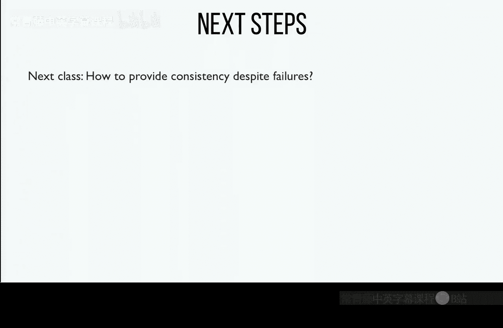

# 威斯康星大学【中英⚡操作系统｜CS 537 Fall19, Introduction to Operating Systems】 p20 P20 Persistence_ FPS _ University of Wisconsin-Madison -BV1wUzSB3Ecf_p20-

All right， good morning， everybody。 Today we're going to be talking about a specific file system。

 the Berkeley fast file system， or FFS。 And so it's going to use all the structures that we've talked about in the previous lectures。

 and we're going to look more at like how to optimize it and how to do good systems work。

 where we first measure the current systems， see what's wrong with it and then improve that。😊。

All right， so administrative stuff that you all know about。

 you know that there's some outstanding quizzes to do if you want to get makeup points for projects 2 or three。

 I released a new quiz that's on lecture content。 It's about the file system data structures。

 Basically， we show like a dump of what the file system image looks like with like i know contents and data contents director contents。

 And you need to figure out what operation from the file system must have preceded that image for the file system to look like that。

 So did it do like a create of a file or did it do a make or did it do a hard link or what were the operations that lead to that image。

 So that's do one week from Tuesday。And you also have your project due on Friday。

 So any questions about administrative stuff。All right。Okay。

 so today we're going to be talking about Berkeley F F S or the fast file system， good。

 straightforward name。 It meant the whole goal was to be faster， I guess than the previous version。

We're going to be kind of looking at how you go about tuning a complex system。

 we'll understand why the performance of that file system got worse over time。

 We'll look at how to choose the right block size， what they had to do with internal fragmentation。

 and then their policy for actually doing the allocation of specific blocks or inots to different groups on disk。

Allright， so let's make sure you all understand what we've talked about already。

 So we talked about what the structure of the file system looks like。

 We know what each of these things are。 So we know what the super blocklock is。

 that is going to describe the current file system image。

 It's going to say things like what's the block size that was used for this file system image。

 How many inots are there。 Where are all the i notess located and stuff like that。

Then we have these bit mapps that we'll be talking about more today。 But basically。

 the idea of a bitmap is it's telling you if each corresponding iodeode or each corresponding data block is free or allocated。

 theyre a very efficient way of finding out which iodes or which data blocks are currently free。

And then we talked about the IO table， which we'll get into more。

 And then most of the blocks on your disk are going to be devoted to data blocks。

 Data blocks can be three different things， at least， right， there's the user's file data。

 That's what we usually think of as being a data block。

But other things that are in the data blocks section， there would be all the directories。

 So the file system data， that's what is stored in a directory， all this directory entries。

 those mappings of file names to i note numbers。 Those are stored in directory data blocks。

And then all of those indirect blocks that contain pointers to actual data。

 Those are also stored in the data blocks section of the file system image。Okay。

 so we were looking at kind of our typical file system。 This is a small disk that we're representing。

 It has just 64 blocks。Most of the blocks are devoted to data。

 and then we have some number of i noteses。So let's look at what a typical i node would look like。

All right， so we've seen that there are actually multiple i nodes per data block per block。

 remember like a iode might be 256 bytes， but the block as a whole would still be1 kilobyte or 4 kilobytes so we're going to fit multiple inots within each disk block and then within an in this is where we have all the metadata that describes a file so we have to have a tight bit telling us if this is a file or a directory things like the owner。

 the size， the most important parts of the iNot。Are the actual pointers to the data blocks that go along with this file。

 right， so we talked about having。Directs pointers that are just directly pointing to data。

Then we have these indirect pointers where we're pointing to a block that contains more pointers to the actual data blocks and so forth。

Okay， so one thing to remember about the implication that we fit multiple i nodes per block is that any time you need to modify an in。

 this is going to mean that we have to read the old contents of that block。

 to see what the other i nodes contain。 Then in memory。

 you can modify the i node that you actually wanted to modify。

 and then you have to write out the whole block again because blocks are just always larger than i nodes。

 you can't just write a portion of the block。 We always write in block sized units。

So any questions about i knows at that level。Okay。And so I read you that picture from last time to make it look a little bit clearer and to actually contain all the things that I was referring to last time。

So this kind of shows a little bit more， its still a little confusing。

 but this shows more the pointers to data blocks。 So here we have an in。

 There's a fixed number of pointers to data blocks， direct pointers。

Usually there'd be like 12 I'm just showing two then we usually have one pointer to an indirect block so again this indirect block we allocate it in the data block portion of the file system image and we don't allocate this until you actually get a file that needs that that's larger than the number of data blocks it would get through direct pointers so then you allocate this indirect block which will contain pointers or just block numbers two data that you can allocate as you need it so we'll probably have like 1024 pointers in this indirect block because it's probably a 4 kilobyte block and each entry is probably four bytes so we get about 100 pointers in this block here so that would be those pointers to that those data blocks。

Then if we grow past that， then you allocate a pointer to a double indirect block。

 The double indirect block， again， contains 1000 pointers for the same reasons。

 Each of those is pointing to an indirect block。 Each of those contains 1000 pointers。

 So that's why you can support such a huge。File size with just this simple structure because already we have。

 you know， 1024 times 1024 times the size of a block。

 that's how large of a file you could support just through this path of the tree there。

So it's a pretty efficient structure that you can support both small files really efficiently。

 You don't have to waste a lot of metadata for those small files。

 and you'll reach the small files data very quickly through just one pointer。

But you could also support very large files， too with this， yeah。嗯。It's one to one。

 So we don't do any sharing of data blocks or any type of。Oh， no， no， no。 So like。

 let's say our file grows。 It uses these two blocks。

 and then it uses these 1024 that went with this indirect。 And then we need one more block。

So what we would do is we would allocate this double indirect。 That's just one block。

 and there'd only be one pointer value that would be filled in。 It would point to one indirect block。

 None of these others would be allocated yet。 And then for this one。

 most of the entries would be zero or invalid。 Only the first one would point to an actual valid data block。

 So that's why it's so efficient that you don't have to allocate things until you actually need them。

Yeah， that would be a max size， yep， great， great。😊，Yes。Yep， y。

 most file systems have a triple indirect as well。And certainly could go more and more。

 I'm not sure if anybody has a quadruple in director or not。

 but they definitely have triple indirectep。More questions。Okay。

So you remember the other data structure that we were talking about were what through directories looked like。

 so directories have a bunch of directory entries in them or Du entries。

 and so what a directory looks like is it's just data。

 it's stored in the file system just like data is so for example。

 if you had a huge directory that had a ton of directory entries。

 it would use the same allocation policy to allocate all of the space to record those directory entries。

 it could use indirect pointers and double anddirect pointers to if you had a huge directory。

But what's in a directory， all it is as mappings between file names and i note numbers。

 And then some extra bits to tell you things are valid or whatever。So when you do a lookup。

 you just peruse through the directory data， looking for the name that you need to find。

 and then it tells you the corresponding iode number where that file name is currently stored。

 and then you can look up in that iNot to get the pointers to Fo or whatever so if we did an unlink aFo。

 we would just be then deleting this entry from this directory we're removing the name fo that the namefo doesn't exist anymore。

But we still have to deal with the reference counts。 Then you go to the in 80。

 and you decrement the number of pointers to that particular file to that in。

 And so usually it will be one。 It'll go down to 0。 You'll see that no one else is pointing to it。

 And then you'll free up all of those data pointers。You know， you。

Make all of those data things free going through your in。

 and then you'll go to the actual in itself and mark that as free as well。

But if the reference count wasn't one， it didn't go down to 0。 If there's still other names to it。

 that means there's other ways of getting to that i note， other ways of getting to that data。

 So you wouldn't remove all of that clear。All right， so any questions about directories or。

Reference accounts。Okay。So then the other thing we were talking about， super blocks， I notess。

I don't think I anything new to say there。 Okay， so let's review really quickly the operations。

 This is what we were talking about at the end of class。On Tuesday。

 so I want to make sure that you all understand this before we add on to it。 Okay。

 so we'll look at how do you do these things。

Okay。So what are the operations we need to do to create a new file in the from the root directory and then in the food directory。

So the first thing that we're going to do， we have to traverse the path， right？ So remember。

 we read the root in that points to the root data。 We then go through the root directory。

 and we look for an entry for F。We then find Foo's I node number from that data。

 and then we can read Foo's I node， and it's going to point to the data。

 So this is a directory that we're now reading the directory fo。

So any questions about how we got to that？Al right， so now we have fos data。

 We can verify that barR doesn't already exist in that directory。 At this point now。

 why do we do a read and a write of the in bitmap。So can someone yeah？

To do the readed to pull on the whole blocks。By。Correct。Yeah， so we'll， we'll read it the in bitm。

 Look for a free iode。 It'll be a huge bitm where you that willll find a0 somewhere in there and we'll say。

 oh， that's the in we want to use。 We then flip that bit to one and write it back out again so that no one else can use that in for future allocation。

 So we've shown which in we are using。😊，By looking through the in Bimap， great。

 And then we need to read and write that in block that we just picked。 And so then the question is。

 why do we have to both read the in block and write the in block。

It's what I was talking about at the beginning of lecture。

 how there are multiple i nodes within each in block。 So we have to read in the whole block。

And just modify the one that we're actually using and then write that out again。

So any questions about why we do a read and a write of that Iode block for bar。Yeah。Yeah。

 so we certainly have to write out bars metadata because we're going to want to show that it's a zero size file to begin with。

 It has this one reference count。 We have one main that's going to it。

 Iize all of the pointers to null for that I note initially， it's an empty file that we're creating。

 And I think， oh and then a couple more things to do。So we have to modify Foo's data， right。

 We have to put in the entry for bar in the directory for Fo so that we'll be able to find the mapping between the name bar and the i note number that we got there。

So we'll write that to the data， and then we'll also write to who's eye note to show that。

The food data is now larger， right， We have more entries in there。 So the size of that directory。

 the actual number of characters that are in the directory entries are now larger than they were before。

So any questions about that。All right。Opening fo bar so that we can do some reads。

 We do the lookup through the path traversal like we did in the past。 and then we will from here。

 we'll know Bars in， and we are done at that point， right That's how you open up a file。

 You just need to get the in for a file。 This will then be in memory。

 Well have some some file object that's pointing to here And all of our future references will'll be able to just know where bars in is。

 So we only have to do that expensive file path name traversal once。

 when we open a file at that point， we'll have bars in and all of our future reads and writes don't have to go through that expensive traversal stuff。

 yeah。Oh great， so we're just opening an existing file and so we just need to find out where bar lives。

 what its in number is。So， I mean， we start at the root eye node， and which is number two。

 and we read that and it points to the data for the root directory data。 We read that。 We look up fo。

We then find who's i knowed and we read that in the points to this and so forth。

 But at no point in this are we allocating more data for that file。

 So the only time we'd have to look at the data bitmap would be if we were trying to allocate more data for that。

 And so when we do a right， then we will need to read the data bitmap， but not yet。Yeah。Oh， no。

 so we do not。We do not propagate up any rights。 So timestamps。

 it doesn't show at the root level that you read some file somewhere way down in the directory。Yeah。

 not that I'm aware of。I Sir。So definitely， we wouldn't have to for any modification timestamp because we're not modifying anything about those directory entries is the access timestamp modified。

When you do the the original traversal， its it's possible， certainly that that access timestamp。

But I'd feel like， okay， I need to look at some source code or look at some man pages and get that detail right for sure about access timestamps。

I hate access times stampamps， so we will try to forget them。All right， more questions。Okay。

So now let us assume that bar exists。 We have the in for it。 It's currently empty。

 And what do we need to do to write to this file now。So we have Bar's In cached in memory。

What's the first thing we need to do？Anybody remember what we probably want to do？

Read some data bit maps and pick one。 That looks good。

 So we picked a data block to put this new data that we're going to write。

 And we've shown that that's allocated。 And now we can actually write that data that we just picked。

 And then what's the last step that we're going to need here。😊，Yeah。

We need to modify the bars I node。 Yeah， to show that we are now pointing to this data， exactly。

 And I think that's all I'm going to put here。 And I said no reads or write。

 which was exactly your previous question。 but I can't say you shouldn't need to do any。Yeah。呃。嗯哼。

Yeah， yeah， I think I added that that this is the next example。 right No， that's perfect。

 That's perfect because I don't think I covered this last time。 So the question is。

 now we're going to do an append and do you always need to do more allocations is kind of the question。

 So in this example， I assumed we had filled up the previous data block。

 and now we're writing out a new data block。 So it looks just like the previous right。

 We have to get a new data block from the bitmap， show that it's allocated mark that we are using that data block and write it out。

 But here we were assuming that we needed a new data block。 And your question was， well。

 what if we had only written to half of the previous data block and now we're app to that file and maybe we're just app a few bytes and we don't need a whole new data block。

 So how do we know that。😊，So anybody have any ideas on how we would know that we don't need a new data block？

Are you going to answer your own question now？Well， we record the size of the file。

 We always know the size of the file。 So if you see that， you know。

 it's not a multiple of 4K or whatever our block size is。

 then you know that you have that much space left in the last block And you know how much you're writing out for this one。

 So you know if it fits in the current block。 So you don't need anything new。

 just the size of the file in the amount that youre next writing and you would know if it would fit in the remaining space of that last block。

 Yep。Yep， yep。 so right now， it's totally arbitrary。 we need to get them both written。

 And what we're going to look at in the next lecture is how to make it so that we are consistent if a crash occurs between。

 however we did this ordering that what we're going to see is neither way works perfectly under all circumstances。

 So we're going to need some other mechanism to make sure that they both occur or they neither occurs。

 So kind of view those as atomically happening， they either both happen or neither do。

 But the ordering here is not mattering in these slides at this point。Good question。All right。

 so this was all about the size stuff。Okay， because if you don't need to allocate any new data blocks。

 what will this operation look like。We'll still have red Bar's Iode defined the size。 We don't。

 We'll see that we don't need to allocate any new blocks， but we will then write out。 Well。

 I guess we'll end up reading actually， the data that was there so that we can append to that last block correctly。

 So we'll have a read now of bars data， the last block before we can write out the new stuff that we're adding there。

 And then we do still need to write to Bar's IO to modify the size of barss In。

 even though we won't be adding any new pointers in this case。So any questions about that？Yeah。

I'm going to say that it does not matter about the ordering because we are going to figure out in the next lecture how to use another mechanism of journaling to make sure that they either both happen or they don't happen。

That。Yeah， so just view those as happening concurrently， yeah。

Filling a block and starting a new block。The right statement。For the data。Well， again。

 we're gonna to view it as that we're just going to do one and they're all going go in this journal。

 and it's all going to happen。 But we would certainly have to。

 we'd write to the one data block that we're doing a partial write to。

 and we would do a write of a new data block。 And we'd have to write the iode to show the new size and the new pointer。

 And that just all needs to happen in one transaction。We don't want to do any inefficient。

 you write a little bit and then you write and you write。Disks are slow。

 We need to make sure it all goes together。More questions。Okay。All right， reading。

 we just have the eye node。 We read the data。 We're done。Because we're not looking at any timestamps。

And then closing of a file， you all remember what happens here， which is absolutely nothing， right。

 that closing a file， it just removes some allocated data structures that are in memory。

 We don't record anything on disk or flush any write out to disk or anything like that。Okay。

All right， so that is our review。 Did that bring up any questions that you want to ask before we get into the new stuff。

Okay。So we'll be talking about the Berkeley fast file system。

 which was developed quite a while ago now in the 1980s。

 So why I like to talk about this paper is that it's not just a review of all of these file system structures。

 but it really gives you a good example of what it means to be a systems developer So with systems。

 it's not like you just come up with some idea and you say oh my idea better than anything else that exists out there and you build something completely from scratch that's just not practical with how many people and how many years people have put into developing software and very complex systems。

 So the way that people actually build systems is of course。

 they find kind of like what's the current state of the art， what's the best system out there。

 what's the system they have to work with and they really try to understand that system in detail and it's pros and cons and its problems。

 So they figure out what that state of the art is， and then they really do spend some time measuring it。

 sometimes you don't need to do the measuring someone else comes to you and says it's performing really poorly on a particular workload or we see that。

There's this particular bottleneck in the system all the time is being spent in this one routine。

 figure out how to improve that and get rid of it。 So I think this is really an interesting part of systems building is understanding the existing system and figuring out you know kind of what's wrong with it and what you need to do to fix it that a lot of the time is really spent understanding current systems and you know then only some of it is building your own system。

So hopefully by really understanding something in a lot of detail that gives you some ideas。

 maybe you borrow ideas from other systems that you've seen。

 or maybe you're just able to figure out some technique， you've seen someplace else。

 how you could apply it to this other system。And so then you get your idea， and then you build it。

 and then you evaluate it。 And then you probably iterate through that process again。

 looking to see what's the new bottleneck， What's the new problem。

 How are you going to further improve it from there。

So we often refer to this cycle or this iterative processes。

 there's a measure phase and then a build phase and then measure it again and build measure something first before you build it。

 Like maybe the current system is good enough。 It handles the workload that it needs to every day。

 It's scalable enough。 There's really no reason to spend more time developing and making it work better。

 You're better off， adding some new features to some other system。

So this is a lot what system building is like。Okay， so the Berkeley FFS people。

 they had a file system that they cared quite a bit about the original UniX file system。

 this was something that they were using， but they were seeing that it had ridiculously poor performance。

So it had the structure that we've been assuming so far。 It just had a super block。

 It had an iode table。 It had data blocks。 It didn't have bitmas， which we will get to。

 Instead of having bitmaps， they had free list just like you did for the X B6 memory allocator where when the data block is free。

 then it can be pointed to。 know， it's the head of your free list。

 and you'll reserve some part of that data block that's on the free list to be a pointer to point to the next free data block。

 right。Same thing for i notess。 Just use some of the in memory as a pointer to the next free in。

And the data blocks were tiny。 They were 512 B sectors。

 which is the smallest amount that the disk itself can read and write。

 And that it guarantees that those 512 B sectors will happen atomically。

 that that either happens all at once or doesn't happen at all。Okay， so they ran their system。

 They had some benchmarks that they cared about， and they looked。

 and they did the easiest case possible。 They did completely sequential reads and writes。

 So that's where we hope we'll see like the peak bandwidth from the disk， right。

 because it's purely sequential。 It's not supposed to be doing any random stuff。

So they compared what they were getting to the peak bandwidth of the sequential bandwidth of the system。

 and they're seeing that they only got 2% of that。 So you would not be very happy with this old disk and you're only getting 2% of the peak bandwidth out of that。

 So let's figure out why。Okay， so one of the problems was the system was not aging very well。

 So what aging means is that you don't have a clean file system where you just started up and everything was free。

 and it was easy to find free blocks。 and you just allocated them。

As your system runs and you allocate files and you delete files and you truncate files and you append to files and you create more files。

 your system ages， and then what your allocation policy was matters quite a bit that now it's hard to find free space that's next to other free space and your system tends to get very fragmented。

So if they had a completely new file system， they got a grand number of， you know。

 almost 18% of the peak bandwidth。 But just after it ran for a while。

 it would go down to that 2% or 3%。Rightra， yeah。No， it's horrible。 Yeah。

 we're gonna fix these things， yeah。Yeah， yeah。 So we have three things we're going to look at。

 number one is this。 And you're leading to two and3， great。

So this is only going to be part of the problem。So problem number one is this aging thing。

And it becomes fragmented over time。So why is this。

 It was because they were doing that free list approach。

 So your free list initially started out nice and sorted。

 And so if you needed to allocate five blocks to a file， if you grab the next five blocks。

 you would naturally get five blocks that were next to one another and then if you read the file sequentially。

 you'd be ending up accessing the disk sequentially as well But over time they just had a big jumbled mess of a free list。

 they would just add free blocks to the front of the list as they were free。

 and then when you try to grab five blocks for your sequential file。

 you end up getting five blocks that are quite scattered across the disk So you are not at all going to get sequential performance because you're not accessing the actual disk sequentially even though within each file you think you're accessing it sequentially。

So what are some fixes to this？So what would you have done in your project？

 That was the grand debate。 Did you need to do this or not to get it to work the way that we expected you to。

Was， do you need to sort that entire free list or not。

 So that that's one fix to this is if we would just sort this， that would make it easier。

 at least to find five consecutive blocks。 But it's still going to be pretty difficult to deal with as a data structure。

 as something else that people will do is you can have a def fragmenter for your disk that looks to see。

 oh， for the allocated files you already have。 They're quite scattered， reads them into memory。

 deletelets the space。Tries to get some free space on the disk， writes them all out again。

 but those are just horribly horrendous processes to run， right because they're so memory intensive。

 You can't be using your file system all you do it。 It's just really。

 really slow to defragment your disk。 So we want something better。

So the way that we're going to approach this lecture today is we're going to talk about three problems。

 and then we'll have the solutions after we talk about the three problems。

 So this is the first problem。Free list gets。Performs poorly with aging。Okay， second problem。

 It had a tiny， tiny block size。 Remember， it had just a 512。Bte sector as its block size。

 And so they did an experiment where they just doubled the block size from 512 B to 1 k。

 And then what they found is that that did improve performance by more than two times。

 So why would that double your performance to increase the block size by a factor of2。Yeah。😊，Well。

 it's not。 So like， let's imagine we're just doing reads。

 So we're not even having to do the allocation。 We're just like reading。

 and our performance doubles for reads。 And we're still using that horrible free list with this approach。

 which is doubling the block size。 So it's still going to be very jumbled。

But our reads are going to get twice as fast now。Yeah， exactly。

 you'll do half the Cs because you'll only have half the blocks that you used to。

 so you'll do half the seeks， and then you'll get to the next 512 bytes of that 1 kilobyte larger file。

 you know instantaneously basically， so that will help quite a bit。So。

Now we only have to do half as many seeks， and then it actually performed a little bit better than double。

 And so one reason why this would happen。This one's a little harder to。To guess。So， yeah。That's well。

 that's not going to make our performance better。 We with larger blocks。

 we're going to have more internal fragmentation， and we're going to fix that problem with something。

Am。So larger blocks are usually worse for internal fragmentation。What else could be going on here。

 and it has to do with that iode structure and those direct pointers and indirect pointers。Yeah。Yeah。

 yeah。So with larger blocks now we'll need fewer indirect blocks。

 so basically if you go back to our structure in our iNot you know we had some fixed number of direct pointers now we can get to twice as large of a file through just direct pointers so that's a good thing and now our indirect blocks we'll be able to contain you know twice as many pointers so it'll be a little bit faster kind of once we get into that world as well。

But the main thing is that these blocks are not twice as big。

 so we won't have to go to indirect blocks as quickly， we'll do a little bit better with small files。

So a couple advantages to having larger blocks。Any questions？Okay。Oh。And so the problem is。

 so why don't we just go to larger blocks。 And so I think it was this slide that made it so that the P D F for the lecture slides was just humongous today。

 I don't know if people were able to download it or not。

 but it just made this humongously large P D F。 And I think it's because of this one。

So what this graph is showing。😊，Is the fact that most files that you have in your file system images are very small so that that's an important。

Case to consider so this is a study that some grad students in our research group did a couple of years ago。

 so these are modern measurements of a bunch of Apple workloads where we ran a bunch of different applications and kind of made up these different synthetic workloads but what you'll see then for example。

 if you look at the keynote workloads we show with this black。

Shading what percentage of the files are less than 4 kiloBs then which are less than 64 kiloB And so you'll see here that and this is the number of files they actually access。

 So modern applications access a ridiculous number of files。

 It's not just like the one file you think you're saving that helps the data that you care about it actually has all of these auxiliary files that it's updating as well。

 So a ridiculous number of files and most of those files are very， very small。

 So our file system has to be able to efficiently support small files。And this is true today。

 and it was certainly even more true back in the 1980s when we had much less data than we do now。

Okay， so we need to support small files。So what if we just tried to increase our block size。

 So this is a graph showing how much space was wasted in the FFS system as they increase the block size。

 So if you compared like the actual data that the user cared about and then how much extra space they had to allocate if they had 512 byte blocks。

 there was just that little bit of extra internal fragmentation that would make them waste I don't know。

8% of the space as you increase the block size， there's just more of the block that you don't end up using and then finally when you go to a 4 kilobyte block。

 you'd end up wasting 45% of your of your disk space just by doing that that you would lose due to internal fragmentation。

So the numbers would be a bit different now in modern days。

 but it would still be the case that you know they certainly had to worry about wasting this space that they couldn't just make a 4 kiloBte block。

 So we'll look at a solution for that。Yeah。All right， last problem。

 I don't really have a measurement for this， but basically they found that the blocks were laid out very poorly。

 that there ends up being a very large distance between inots and data and related iNots so if you think about this they had their whole disk structured like this there's millions of blocks on a disk and so every time you access an iNot and then you want to follow one of the pointers to access the data that's associated with that file you'd have to do this huge long seek to get over to those data blocks so this。

Structure just implies that you're going to have a lot of seeks。

 and there's really nothing too smart that you could do about it。

 because we are going to look at a different layout。Okay， so we solve three problems with FF S。

 They had a free list， which LED to random allocations over time。 They had two smaller blocks。

 and these blocks are laid out very poorly that there's a long distance between the i notes and the data and stuff。

 So really， the problem is， is that they were just viewing their。File system， their disc。

 as they weren't looking at the performance characteristics of it at all。 They were thinking of it。

 It's just like， oh， it behaves just like Ram。 We've used freeless in Ram before。

 and they work great。 You can't do a free list on disk when you access Ram。

 It's okay that you do random accesses to inots and data Fo pointers， however you want。 But clearly。

 you can't do that on a disk where locality matters so much。

So they needed to make a disk aware file system that really understands that it's running on a disk that leverages the performance characteristics of the disk。

 the storage technology that they had at the time， and design their system accordingly。Okay。

So we're going to fix those problems instead of having a free list we will have a bitmap and that is what we've already talked about。

 This is so assumed everybody has a bitmap now you can just think about how awesome bitmaps are for what we need to do here So remember we have a bitmap for iOs。

 we have a bitmap for data blocks and they're just really。

 really fast to update into search through so when we find a block that we want to allocate。

 you just flip the bit from zero to one to show that it's now free or allocated。

 you don't then have to do any sorting or anything weird like that to update your list。

When you want to find a free block， you can just read in one block of a bitmap and you get information about so many different blocks out there。

 right， So let's do a quick calculation。 Let's see what's here。

 So how many bits could you store in one4 kB block。It's just our four。Kilbyte times 8 B。

 So it ends up being 32768 blocks that we're able to see the state of by just reading in one bitmap block。

 And so once we have that in memory， it's going be very fast for us to search through that。

 looking for， you know， our six consecutive free blocks。 That's easy to do that。😊。

Those manipulations in memory。 So bitmaps just turn out to be great data structures for attracting the state of the file system。

Any questions？So it's usually going to be the you certainly you could just read in one block。

 but this is going to end up being cached in modern systems。

 You're going to have most of it available in memory so that you can do the reading and perusing quickly。

 But then you will have to write them out promptly and flush it and sync it to make sure that if you have a crash that。

The file system knows what you actually allocated。 So the reads end up being cached。

 but then you have to flush out the rights of those。Allright。And just remember。

 we have bitmap blocks that are separate for our iOs versus our data blocks。Okay。

 so one of the big innovations of FFS was figuring out how to kind of divide up these i nodes in data blocks。

 So if we need to allocate an iodeode and we need to allocate some data blocks。

 which one should we choose of those that are free。So intuitively。

 it's pretty obvious that it would be bad if your iNot were allocated here and one data block is allocated here。

 and then your next one is here and here and here， you're going to have to do lots of seeking across that disk to access what the user thought were sequential blocks of their file。

 right。So we need to allocate i nodes close to their data blocks in order to reduce that seek cost。

So it would be better to do this， but not every file is going to be able to get the first data blocks of the group and it's still a bit of a seek there。

So certainly not every file gets to be so lucky。So what are we going to do？Okay。

So let's think about what needs to be close to what for different workloads。

 So imagine your workload just consisted of running LS all day long， very useful workload。

 What are you going to end up accessing all of the time。 So when you run LS。

 you're looking at that directory data and you're just needing to print out the directory data。

 right， so you needed to go from the directory's in to all of the directory data。

 And that's all you're doing because you're printing out file names。 That's all LSs。

So that's a really easy one。 It's just printing out directory data。

 But what do you need to do if the user says I'm going to all day run L S L。

Thenhan what do you need to display to them。Then you're displaying things like the permissions and the size of the files and things like that。

 So when you're doing L S L， you're accessing the metadata for all of those files。 So now。

 instead of just needing to get the directory data。

 we're needing to read the i notess of all the files that are pointed to by that directory data。

 So what that implies then， is that。When you。So if you're just doing things like LS or just doing kind of typical accesses。

 it's going to be very common that you need to keep data near iNots。

 that's intuitive we need to get the file all to be close to one another。

 but it's also going to be often the case that inots are going to all be accessed together if they're in the same directory so in this case we would at one time need to be all the inots that are part of the same directory so it'd be nice if we kept all those inots together。

So how are we going to do this？So this is what it looked like before。

 And so this is what modern systems are going to do and what F F S started with。

 that they just have these groups。And they just decide to split up the whole disc into many。

 many groups， and each group has the exact same structures as before。

We're going to have a super block。 We're going to have a bitmap and the bitmap corresponds exactly to the i nodes in the data blocks that are in this group。

 Then we have some portion of the inode table here。

 and we have some portion of the data blocks there。 And so， of course。

 one inode can point to data blocks that are in any group but to get good performance。

 we're going to try to make it be the case that inots here point to the data blocks there that will get much better performance because there's shorterse distances there。

So we're going to see if we can do that。Okay， so back in F F S。

 they had more knowledge of actually the disk geometry。

 They kind of knew the exact layout of sectors to cylinders and to tracks and platters。

 So they called these actually cylinder groups because they could make it that they would know exactly where like a cylinder ended。

 So you remember the cylinder is all of the tracks across all of the platters。

 So take one track and move across all the platters。 And that would give you a cylinder。

 So a cylinder group or just a bunch of consecutive。Cylinders there。In modern systems。

 we don't know exactly the layout of blocks to the disk。

 So now they drop the name cylinder group and they just call them block groups。

 and they just take some consecutive blocks and call that a block group。 And that's your block group。

All right。Alright， so then the one last question for you。

 I've replicated here the super block a bunch of times。 So why might you want to do that。

So the super blocklock will be exactly the same in all of those groups because it's describing the whole file system。

 It's describing things like the size of the blocks and where the i nodes are located。

 how many inots there are and stuff like that。 And so you need the superblock in order to do anything with your file system。

 And once you know how important that superblock is， you're like， well。

 I'd better keep a bunch of copies of that thing because if one of them is corrupted。

 then you wouldn't be able to read your file system at all。 So。

We are going to do replication of that superblock。And FFS did something a little bit fancy there where they would make sure that they didn't always make the super block the zeroth entry of each group。

 because if they did that， then it would always be on like the top surface and it's more likely to have like a correlated failure where you lose like your whole top platter or whole top surface。

 It's better to then kind of rotate your allocation of that and put your super block。

 you know once on the top platter once on another platter to kind of scatter that around to be more reliable。

Okay， and you don't have to write to your super block very often。 It's mostly a read only structure。

 So it's not too expensive for performance that we're replicating that。 Yeah。

 it's just like read it once。 And then we know how the file system is constructed。Okay。All right。

 so let's look at the actual policy here， so we want to put our data blocks near the i node that's associated with it。

 and we also want to put iNots near the directory entries， so are we going to be able to do that？

So the problem is， if we say， well， everything should be close to everything else。

 we haven't made any decisions at all。 You can't just put everything close to everything else。

 So what we really need to do is figure out what's okay to kind of separate from one another。

So this is how I like to view the structure。 So remember。

 we have our directory i notes and we'll have many。

 many directory i notes and each directory I note points to some directory data。The directory data。

All those directory entries， they have the mappings between the names and the file i notess and the file i notess contain pointers to data blocks。

 and directory data could also have pointers to direct other directories。

 which would mean they have pointers to directory i notess。

 and those directory i notess have a bunch of directory entries to them as well。

 So that's this part of the tree。 ends up being the same as this part of the tree。Just through many。

 many different levels there。So what we've said is that it's important to keep data blocks near their inots。

 and it's important to keep these inots near the directory data。

 So how can we ever make a decision and decide that something really isn't that important and it's okay to put it in a different directory group because when I say like we should put them close to one another。

 What I'm really saying is we should put them all in the same directory group that that's good enough for a good。

 good performance。So any ideas on where we should cut this tree here。

So we don't have a whole lot of choices。Yeah。😊，三 doesn。That's a good way of thinking about it。

 So we definitely want the file data to be close to the file Iode。

 we want the directory data to be close to the directory iode。

 These don't seem to have any relationship to one another other than the fact that they're in the same parent directory and from the parent directorys perspective。

 it wanted to have its children inots next to them as well so that it could do that like LS dash L quickly But we have to make a choice somewhere。

 So the choice that designers have made and seems to work well in practice is to cut our tree here。

 So if you're in a directory and you create another subdirecty， that's when we'll decide， oh。

 it's a good time to go to another cylinder group or block group for that new directory and then within that new directory will have a locality again for all of its files and the iodes in the data that go with those new files。

 but if in that subdirecty we then create another subdirecty well again pick another cylinder group for that new directory So every time we make a new director。

We go into a new cylinder group and let that run get filled up。

So that we can kind of keep one directory together as long as it's just files。

 But once it becomes another directory， you split to another place。So。

So as long as your directory has a bunch of just files， your L S D L will be fast。

 But once you start to have a lot of subdirecties， then you have to be going to another cylinder group to get the i notess for those other subdirecties。

So any questions about that？Okay。So what we're doing here then remember， if you have a file iode。

 you'll put it in the same group as the directory iode and data so and then what do you do when you create a new directory and you have to figure out where to put its inode。

 you'll put it in a new group。And so you'll have to pick which group to put it into。

 we're not going to care about locality at all。 It doesn't matter if it's close to the old one or not。

 we've given up on being close， so we just want to make sure that it's a pretty empty group that we're moving over to so we want to find a pretty empty group and we want to have more inots available than most do the intuition here being it's a new directory。

 we're probably going to create a lot of new files。

 new files need new inots so there better be a lot of free inots in this new group that we're starting this directory often。

And then as we're allocating data blocks， we'll try to put the first data block and near the in for that file。

 and then as that file grows， we keep the next block close to the previous block of that file。

 and so if all works well， that those later blocks will also be close to the inode。

 but it might not be if we ever had to move groups for some reason。Okay。So。One other problem。

That was how we dealt with small files and subdirecties。 But what happens if we have one large file。

 so you could have one large file in your directory and it creates you know， you know。

 uses up a lot of data blocks， thus squeezing out any other files that wanted to have their data blocks close to them into that group。

So what we'll end up doing here is we have to treat large files a little bit differently so again most files are small。

 that previous policy worked for most files， but once you see that you have a large file we're going to switch over to another cylinder group and it's better to penalize that one large file like one time than to penalize many。

 many small files each one time because you just do the onese for the large file then you're able to access a big chunk of its next data sequentially whereas if you were having to do onese for every other file that would just be a lot of extra seeks so better to penalize one file than many small files。

So we do not want this case here where we have one file A and it's using up all the data blocks in this group instead we want to have something like this where you start scattering the data for a across multiple cylinder groups So then the question is what is a large file when should you start to switch。

So the nice intuition is that。It's kind of like when you start to use an indirect block。

 that's when it's a good time to switch。 So you're already having to do some extra work。

 you're gonna to see a little hiccup in performance anyways when you're accessing an indirect block because at that point you had to follow those pointers and do an extra disc。

 So you might as well at that point do a disc seek as well。

 So every time you allocate or access a new indirect block。

 that's when we'll go to another cylinder group there。

 So in our picture we all cause another break in that policy to go to a new cylinder group whenever you allocate an indirect block。

So what you'll end up seeing then is that about every after 48 kilobys。

 that's when you run out of direct pointers and you have to go to your first indirect block。

 that's when you'll go to your first new group。And then after that。

 it's kind of after you've filled up a。Indirect blocks worth of pointers that you would go on to the next one。

Great。 And so the intuition there is when you go to a new group。When it was a new directory。

 we looked for group that had a lot of free i notess。 when it's a lot of data。

 we're going to try to find a group that has a lot of free data blocks， because clearly。

 we're using up a lot of data blocks with this large file。 We're not creating a lot of files， yeah。

Great， so with this one large file。Think of it as， you know。

 you got to access 1 MB and then you do a Siq and you go to another cylinder group and you access another me。

 and then you do another Si and you go to another group and you access 1 MB。

 So you get to do like a whole MBby's worth of reading sequentially with just one seek in between each of those for that large file。

So that's you're still gonna amortize the cost of that seek over a pretty large file。

 That's not too bad。 But if that large file uses up all the data blocks in this group。

 then all of the other poor files that got stuck here。 their data ends up being in a different group。

 So for every one of those。 whenever we tried to read it。 We always had to pay a seek。

 And it was a small file to begin with。 So we're not able to amortize that seek over much useful work。

 So that's why it's better to make the large file go to a bunch of different groups then make a lot of small files go to different。

Great question。I wish I could remember that number because it。Yeah。

 because I don't remember if it ends up being like we have like 1000 groups on a modern disk。

 If you think of like， it's a multi gigabyte disk， they're pretty large。け水よか。Well。

 we're going to split up that large file across different groups， right， yeah。

And so we have different policies。 We try to find empty groups to put them in。Allright。Okay。

All right， so one other piece of information we now need to keep on disk is in addition to the super blocks and the bitmaps and the iNots and the data blocks。

 we're also going to have what's called a group descriptor or a summary block。

 if you end up looking at file system code， you might end up seeing this that basically we just need to keep the statistics there so that that block allocation policy can pick an appropriate group that has more than average number of free blocks or free inots。

Okay。So those were really the main innovations of FFS that they。Handled the free list better。

 and they have these cylinder groups， but they did a bunch of other things as well so they supported long file names instead of having just have eight character names。

 could be arbitrarily long they can do atomic renames。

 which will talk a bit more about next lecture that it's going to be important that we can do some operations atomically we wouldn't want it to be the case that you rename a file and renaming。

 remember you're deleting one name and adding a new name And if you had a crash in between that you would no longer have a name to that file and that would cause problems so we don't want that and they added symbolic links that we talked about in the last lecture。

So the other feature that we didn't really talk about yet is how are they going to handle large blocks。

 So most files are small。 We'd have a lot of internal fragmentation if we just gave them 4 kiloB blocks。

 So they are not going to quite do that。So large blocks are great because they improve performance。

 We are able to amortize that seat cost over a larger transfer， but they waste a lot of space。

 We saw that you have more internal fragmentation with large blocks， given that filess are small。

 And then it's the exact opposite pros and cons with small blocks。 So the question is。

 is there a way to get the best of both worlds。 So that's what they came up with。A way to do that。

So what they did was they divide blocks up into what are called fragments。 And basically。

 the idea is when your file is large enough， you'll use a whole block。

 But when it's small or when it's just like the tail end of the。File。

 when you would end up having internal fragmentation。

 then you'll switch over to just using up some of the fragments that are in a block。

 So this might end up being a technique that you could apply to some future system that you work on。

 this notion of how to kind of subdivide things up。 So， for example。You have a block size of 4 k。

 A common thing to do would be then to have a fragment size of 1 k。

 So each block has four fragments in it。 And we're going have a bit map that's per fragment。

 It's at the fragment level， not at the block level。

 We have to be able to track the state of every fragment。Okay。

 and so you'll be able to figure out based on the size and exactly where you're pointing if your address is pointing to a fragment or to a block。

Okay， so let's figure out what we need to do to use fragments and blocks。

So the basic idea is we have a file A and it's 5 kilobytes， so the first four kilobytes。

 it has to use up a whole block。But the tail end of that file， the last1 kiloB。

 it can use just a fragment and it can share that fragment。

 it can share that block with other files out there， so we won't have any internal fragmentation。

 We won't be wasting a lot of space。 So the idea is we're getting the best of both worlds because we're able to share that block。

 we're not going to waste space， but we're going to for large files。

Most of our data will be in blocks， which we'll get better sequential performance with。

But some of the allocations end up being a little tricky。 So， for example， if A grows。

 the rule is it's allowed to share this。Block with the others where it is， but。

You are not allowed to use multiple fragments across multiple blocks。

 because if you allowed the system to do that， we would degenerate to exactly just we might as well just have fragments and not have any notion of blocks at all。

 So once you get into this situation， you have to do some extra work， right。

 because we don't want to have。Scattered allocations like that。

 What you have to do is you have to copy out the fragments that were in that other block and move them to a new one there。

So you could see this could be pretty expensive based on what your allocation policy looked like if you had like two files that were each getting appended to kind of concurrently and they were each growing by like just 512 kilobytes each。

 they were just each using up a fragment， they could end up sharing a lot and then you'd see that they expand out and you'd have to do a copy so that would be a really bad kind of allocation pattern that could happen。

So anybody have any idea what a good solution to that could be。And so if you think about like。

 when you use Lib C these days and kind of the interaction between user level processes and the file system and what gets actually written out to disk。

That's where this ends up being important。 It's kind of the interface between your user level application and what the file system does。

That just because your application is writing out in little tiny 512 byte chunks。

 it doesn't mean that the file system needs to extend that file out by 512 bytes each time and get into this nasty situation where they're all interleaved So that's why like Lib C in different writing functions to files will have some type of buffering associated with them。

 So even if you're writing just like one byte at a time。

 the file system buffers that up until there's like some unit that makes sense to the underlying system and then it can flush it all out at once。

 So they introduce this notion where the file system can notify the layers that are using it about what are the optimal right sizes。

 so like the application should know they shouldn't write in anything smaller than a4 kilobyte unit otherwise they're going to get bad performance。

 so there'll be some amount of buffering that gets done and like the libraries that you use so that you're not pushing tiny rights down through the system and expecting。

To get good performance， because certainly one by would be even worse if you have to read back old contents。

 modify one by， write them all out again。 That would be ridiculous。

So it makes a lot more sense to kind of write in whatever the。

Block sizes that's being used by the layers beneath。Okay。And then one other。

A painful thing they had to do。 So their peak performance ended up being only 50% of。

Motter of what the max throughput of the disc was， because。They had。

 they didn't have all the DMA that we were talking about before。

 how you could have quick turnaround to access the device。

 They had to do lots of program D and tell the device now do a read， now do a read。

 And that would take so long that they would end up missing like the next block here。

 So they would try to allocate it sequentially。 but they would do this access。

 They would then be spending the time processing while this one went by。

 And then they'd be at this one by the time they got got ready。

 So then they'd have to spend all of these extra rotations。

 So they had to allocate things such that they really put block 0 here， then block one here。

 which is called skip sector allocation。 And then they would be the disc。

They would be ready with all the processing that they could actually service this next request sequentially without missing it。

So the best they could do， given that they had to do this skip sector allocation was 50% of the peak disk bandwidth that you could see。

 But we don't need to do anything like that in modern times because we have a lot more hardware support。

 There's buffer。Track caches that are taking care of that stuff。Okay。

So FFS came up with a bunch of new stuff to remember， so it has this notion of bit maps。

 It has the locality or cylinder groups。 It has the rotated super blocks to help with reliability。

 and they did a lot with the smart allocation policy to keep eye nodes close to their data blocks。

 and these structures have really stuck around into modern systems that you'll see a lot of that same terminology and ideas in the EXT family of file systems。

 E T2 and3。But the main takeaway is when you're designing any piece of software。

 please keep in mind the performance characteristics of whatever it is that you're building on top of that if you're building on top of a hard drive and you have to optimize for sequential performance。

 then you better optimize for sequential performance。 Don't treat it like it's random access。

So at the end of this section， we'll look at flash。

 and that's going to have very different performance characteristics。

 And so we'll think about kind of how you might want to do things differently。

 given those performance differences instead。Okay， so this was the end of kind of the overview of how the data structures look in modern file systems。

 And so next， we're going to be looking at how you can make sure that those operations occur atomically and how you can add journaling on to this。

 So this is a good stopping point in terms of your mental state。

 make sure you understood all of this stuff before we move on to the next one because that one's a little bit more。

 You definitely need to understand this， to understand the next stuff。

So I will see you all on Thursday。

