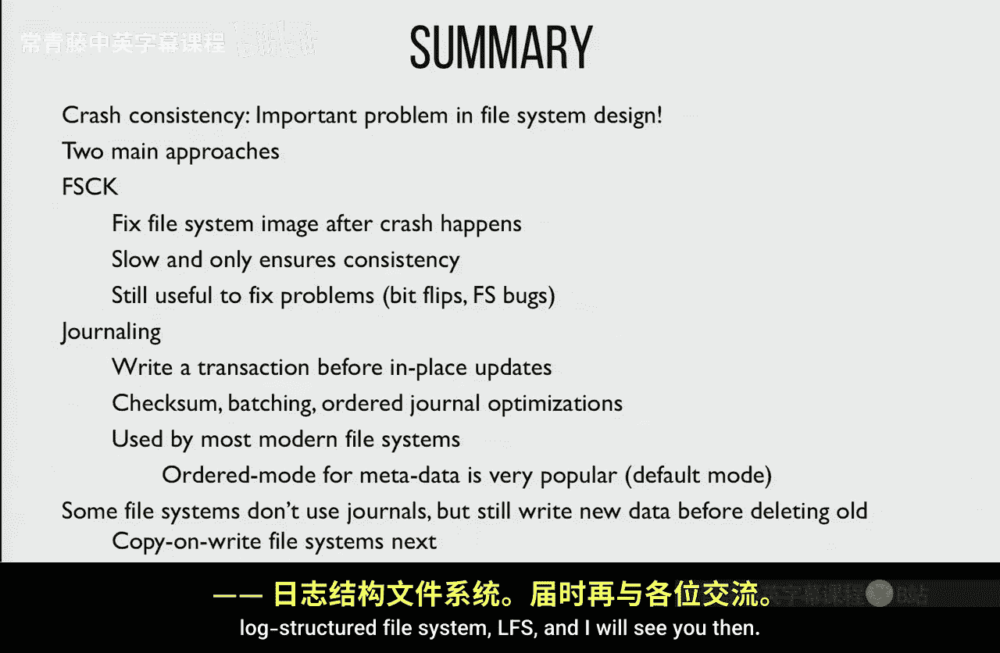

# 威斯康星大学【中英⚡操作系统｜CS 537 Fall19, Introduction to Operating Systems】 p21 P21 Persistence_ Crash Consistency _ University of Wisconsin-Madis -BV1wUzSB3Ecf_p21-

All right， good morning everybody。So today we're going to be talking about how to get crash consistency out of your file system in the previous lecture as I've been saying a lot like let's not worry about the order that we do our rights。

 today we're going to figure out all of that and make all of that work so I like today's lecture that it's pretty conceptual and it builds on everything that you've learned so far so it's a good point to make sure that you really understand everything up to this lecture now。

All right， so what's going on in the class right now。

 you can take a makeup quiz for Project4 if you scored 70 points or fewer and that's due one week from one0 I made it available whenever that was。

 I do up a quiz that's available right now on lecture content that it's kind of this detailed can you figure out what file system operation must have taken place if you see this is what the state of the file system was before the operation and then after the operation showing the contents of bit mapps and inots and directory blocks and stuff like that。

 So that question tends to be very similar to one that shows up on exams and so that's a good one to make sure you know how to do。

You all are working on Project six that's due on Friday。

 we'll have the usual it's officially due at 5 pm， but as long as machines are working。

 feel free to spend your Friday night in the lab and so I assume discussion sections tomorrow will continue to go over that and you can ask questions and answer other people's questions。

 I guess in that discussion section。And then Project 7， yeah， so we will have one last project。

 but it might have like two parts or one and a half parts。 it will be all about the file system。

 it will be XV6 based， there'll probably be some implement some file system functionality that doesn't currently exist in XV6 make it a little bit more modern。

 It already has journaling those so you don't have to do that。

And it'll probably be something with a file system checker。All right。

 but we'll have another one of the specification quizzes for Project7 to make sure that everybody is getting started early and that we understand what the spec means。

 yes。It will be due the last day I can possibly make it due。

 which I believe is the last day of classes。 But if if I hear otherwise， I will make it do later。

We were running out of time。😊，Okay， any more questions about that type of stuff。

All right okay so today we're going to talk about crash consistency。

 so basically how to keep our very complicated file system data structures consistent if some crash occurs at some inopportune point in time。

 so first we'll look at kind of the motivation for this。

 what would go wrong with your file system if we did have a crash at a bad time what are some of these ways of checking the file system。

 were using an offline checker then we'll look at how does journaling work。

 which all modern file systems do to update the file system and then we'll talk about some optimizations for journaling。

Okay， so first of all， data redundancy， what is data redundancy。

 so we're going to say if we have two pieces of data， A and B， who knows what they are at this point。

 if we know what A is， then it kind of constricts what B could possibly be。

 then there's some redundancy across A and B， right there's some relationship across those two things。

 there's some not pure information across them both， so there's some redundancy there。

So we saw lots of examples of redundancy when we looked at raid systems， right。

 there was just that pure， complete redundancy when we had raid level， what for mirroring。

 That was raid level。One， right， So that was mirroring， that was complete redundancy。

 And then we saw in grade levels 4 and 5。 There was also some redundancy there with those parity blocks that were being performed across stripes。

 There was restrictions on what those blocks could be once we had a parodity block。

Well file systems are certainly going to have lots of redundancy as well。

 even when it's not just a pure， simple， mirrored copy。

 there's just relationships across other data structures that we have there。

 so starting off with a very， very simple example， imagine that you have a super blocklock and in our superblock。

 we record a bunch of information such as the total number of blocks or data blocks in the file system。

And then we have i notess， we all know what inots are。

 we know that i noteses contain direct pointers to data。

 and so if we know something about the superblock， we're also going to know something about what could be in i noteses right so the leading question is is there redundancy there and the answer is going to be yes。

 and so let's look at that。Okay， so if I tell you that the superblock tells us that there are n blocks in our file system。

And i note contains pointers to data blocks。 what are the possible values for all of those data blocks？

So any number between 0 and n -1， there's some redundancy there， If we know what n is。

 it's restricting what the i notess could also hold as well。 So it gives us extra information。

 And so if we ever see an in where a data pointer contains some value that's greater than n。

 we can infer that some problem has occurred and we'll figure out how to fix that。Okay。

So that's a very， very simple example， we're going to look at much more complicated examples today。

 so why is this so complicated the file system has a lot of different data structures， it has iOs。

 it has directories， it has bit maps， and there's related information across all of those different structures and it needs to be the case that when we perform an operation and we update one of those data structures。

 the other data structures should be updated in a way that's consistent with that。All right。

 so why this is really tricky is that the disc doesn't give us an interface to update a bunch of different blocks atomically right what the disk gives us us an interface is you can write 512 byte sectors atomically And if you try to do more than that。

 one of those sector rights might occur， then you might have a power fail and then you wouldn't make the next sector right that you are hoping to do。

And this is even more complicated when you think about the fact that disks are doing scheduling right。

 that it doesn't even guarantee that it's going to do a request in order with like a first come first serve or FiIO scheduler。

 The disk is probably doing shortest seat time first or shortest positioning time first。

 It's rearranging all of our rights。 So it's going to be kind of tricky to figure out how to build up。

Protocol on top of those atomic 502 sector rights to make our higher level operations atomic。Okay。

So we'll be worried about anything that could possibly go wrong， we don't know why we lose power。

 maybe there's a power outage， maybe you rebooted the system by kicking the power supply。

 maybe you just had a bug in your file system and you have a kernel panic and that crashes your system and the rights don't go out to disk properly so we're going to be worried about all these cases where our normal file system updates don't occur。

 they get interrupted， but we still need to make sure that the file system is in a consistent state。

 even when we had those crashes at bad points of time。right， so keeping in mind， like。

 this is one of the types of operations that we understand what to do if we don't have any power crashes。

system crashes so let's remember what happens if we want to append to a file fo slash bar and we already have the in for bar open and available in memory right so now we want to do the right operations and so what do we need to do to do this append。

😊，Well， we needed to find an available data block to do the append into。

 which required that we go into the data bit map。 We read what was currently allocated。

 which ones were free。 We pick one， and then we write it back out。

 Then we needed to write to our iode to show which。Block we're going to point to。

 And then we had to write the actual data。 So there's these three rights that all need to occur。

 And We're going to use this as our running example and see what happens if only some of those rights occur。

 So we don't know we can't control which right will occur。

 It could be because the disk could reorder them。 and then we could have a crash after any one of them occurred。

 So let's see what's going to happen。All right， so here's a tiny picture。

And so the idea of this picture is we understand all of these data types and this is what the file system looks like before we do our on append and this is what it's supposed to look like after but we might not successfully move to this after state so we have our bitmaps for our inots where each one of these little squares corresponds。

 I guess to bit and our bitmap for our data blocks， then we have our iode table。

 the portion of the disk that holds all the iNots， and then we have our portion of the disk that holds all the data blocks and so when we do our append we're going to need to write change one of the bits in the data bitmap。

 we're updating the value of the in from version1 to version 2 and we're writing to a new data block DB instead of just DA。

So that's what we're doing with ourend。And now what we want to assume happens is we have to do those three rights。

 data bitmap， in， data block。 So maybe one of them occurs， maybe two of them occur。

 if all three of them occur， we're happy， No worries。 we don't need to look into that。

 But let's try to figure out what's going to go wrong in each of these cases。

So let's imagine we only get to write out our data block and we don't get to write out our i node or our bitmap。

And then we had a system crash。So who's going to be happy and who's going to be unhappy is kind of the question。

 Is the file system unhappy about this happening。File system doesn't really care that you lost your data。

 The file system data structures are still totally fine， right， It hasn't messed with anything。

 Your iode is just going to point to old data。 Your bit map still just looks like you haven't allocated that data。

 It's totally fine。 You lose some data。 But none of our data structures are a mess anywhere。

 Does that make sense to everybody。Great， O， so now let's imagine that we write out the i node。

 but we don't write out anything else。 We don't write out this bitmap。

 We don't write out this data block。 So what could go wrong then now。

So we're going to have a new iode。 It's pointing to this data block， which we have not written。

 and we have not updated the data bitmap。So we're going to be pointing the garbage。

 We're going to point to some old data that was there。 That's one bad thing。

And then what's the other bad thing。So we write out this new I note it's pointing to garbage and we don't flip this bitmap。

Yeah。そなすけ。Exactly。Exactly， right。 So we didn't mark that this data block is allocated。

 Some other file append is going to get that data block。 and they are also going to set there。

 I know to use that data block。 I going to point to it。 So not only are we pointing to garbage。

 but some future file is also going to use this data block。

 And we're going to be able to then see in our file。

 any secret data that they were hoping to write to their file。 So this is a pretty bad privacy leak。

 if this data block gets allocated to another file。Okay， so two problems， we point to garbage。

 And then because we didn't update the bitmap， another file could use the data block and we'll both point to that。

 So that's bad。So how about you all spend a couple minutes talk with your neighbor and reason through what bad things are going to occur and it will always be a bad thing for these remaining ones。

 what will go wrong in your FA system？Talk for a couple minutes。Alright。

 so let's catch up as a class。 So what goes wrong if we write to the bitmap and we don't write to anything else before our power failure occurs。

Right，It'll never be used by anybody else who having like this space leak。

 where if that would happen over and over and over again。

 we would eventually run out of data blocks and not be able to grow our files。 Great。

 So what would happen if we wrote our in and our bitmap， but we didn't write out the data block。

You would point to garbage data， right， So at least we're not sharing with anybody else in the future because we did switch that bitmap。

 but we are going to be pointing to garbage。 It could be some old file that didn't get cleared out。

 We're going to see what some old file contents were， or certainly we're going to be confused。

 So either a privacy leak or we just see garbage data。Or so what happens in this case。

 we write out our iNot， but we don't write out and we do write out this data block。

 so we're pointing to that successfully， but we don't mark the bitmap。Then what's going to happen？

Yeah。Right， so pretty confusing semantics， some other file could then be allocated。

 that data block were're both going to be pointing to that data block。 And whenever I update my file。

 they're going to see my changes。 and whenever they update their file。

 they're going to see my changes as well we're sharing a data block in this iNotode。

 which is pretty horrible。And then the last combination， we write out our bitmap。

 we write out our data block， but we don't write out our in。What's that one like？Yeah。Yeah。

 so it's just a combination in this case of we lose our data， but that's life。

 And then we were going to have this space leak where。

We mark that it's allocated but we're not pointing to it， we can't reach that data。

 nobody else can use it， so we're just wasting space there。All right。

 so we've seen that in all of these cases， if we don't do all three operations， bad things occur。

 and we really can't control the ordering of these things happening。

 so we are going to have to come up with something clever， which we eventually do。

But the first approach that we're going to do to fix those inconsistencies is to have what's called a file system checker。

 FSCK， it's something that runs after， you know you like if you ever noticed that you crashed and you didn't shut down the system correctly。

 this FSCK is supposed to run if you notice any problems and it will fix up any inconsistencies you have in your file system image。

So we're going to look at a bunch of examples。 What types of fixes could you do to make your file system consistent。

 But what we're going to see is that just making the file system consistent isn't necessarily the right thing。

 We are not going to know after the fact exactly what the file system was trying to do。

 We're just going to clean up the data structure so that at least we don't lose space in the future or let multiple i nodes point to the same data。

All right， so for example， how would we tell offline if we could just read through the whole file system image。

 all of the blocks， how would we be able to tell that a data bitmap is consistent or not？

So we want to see if each one or zero in that bitmap matches whether or not that data block is actually pointed to。

 so to figure that out， you're going to have to go through every single valid in。

 every single valid indirect block and see if there are any pointers to that data block。

 is that data block reachable， if it is， then the bitmap should be set to one， if it's not reachable。

 it's free and it should be set to zero。So it's a pretty complicated bit of work that you need to do。

 but it's something that you can figure out to clean up that data bit mapap。

So does that make sense to everybody why we would need to look through all of the inots and see what data blocks are pointing to and then all the indirect blocks and so forth to see what they're pointing to to see what are all the data blocks that are reachable。

 and therefore， those are all the ones that have been allocated。All right。

 so FSCK is this really neat utility in my opinion， just as all of these really neat checks。

 some of them are pretty easy checks， so some of them are just like entirely local。

 like it looks within the super block to see those structures make sense。

 it looks within individual inots to make sure that the times stampamps make sense and that the size and the nu blocks make sense。

 it looks within directory entries and make sure that they're formatted like directory entries and that they contain a dot and a dot dot and everything that we said they should look like that those individual structures actually look like that。

The checks that are a lot more complex and more interesting and more time consuming are those that have to look at like the entire file system state to figure out if the file system is consistent right now or not。

 So for example， the one we are already looking at， can we figure out if the list of free blocks。

 the bitmap is that correct or not。A all the in link counts correct。

 because we're going to need to look at then how many different directory names there are that point to each iNot and see if that's right。

We're going to have to look at every single i node and see do any of them point to the same data block。

 that would be a problem if two inots pointed to the same data block and are there just any bad block pointers out there at all。

 so let's look at how we would fix those。O。So let us imagine we are running our FSCK。

Find that this block is pointed to by this。 I know this is a data block。

 And then we look in the data bit mapap。 and we see that this bit here is currently 0。

 But this is pointed to。 So this is a pretty easy fix。

 We just know that this block is actually allocated。 So we should just flip that bit from a 0 to a1。

 So that one's pretty easy。All right， so we can do that。Let's look at some more complex ones。

 so let's imagine we've traversed our entire file system tree。

And we see that we have two directory entries， maybe they're in separate directories。

 maybe they're in the same directory， but both of them， they have， a different file name。

 but then they have the same in number。 So both of them are pointing to the same in。

 And then when we look in that in， we see that it has a link count of one。So is this okay。

 What's the problem， how do we fix it？So first of all。

 is it possible for two directory entries to point to the same iode？Yeah。

 so that's exactly a hard link remember that we have just two names for the same file。

 two different ways of getting to that file and they just both in their directory entries。

 they have a different name and then the same iNot number。

 but the key is that it's supposed to then have a link count that corresponds to the number of pointers to it to the number of entries that refer to this。

 so the fix here is pretty straightforward as well。We don't kill one of these directory entries。

 We don't trust the link count。 It seems like it's more useful information to trust the name。

 But you could see we don't really know for sure what what went went wrong。

 Maybe they were in the middle of removing this link。 And for some reason。

 they had decremented the link count， but they hadn't yet changed that directory entry。

 We don't really know what the truth is。 All we know is there's a way to make this consistent。

And so the way to make this consistent is just to go into that iNot and to change the link count to two。

 and now it matches what it's supposed to do。So does that make sense to everybody？Alright。

Another example。You go through your whole file system tree。 You get to an in。

 and it has no references to it。 It looks valid。 You have some like valid bits in here。

 It says it's valid。 It's pointing to nice data。 Maybe it's a huge file。

 It looks like a really important file。 It has a link count of one。What should we do to fix this？

So the easiest fix to have a consistent file system。Set this link count to 0。

 Remove all of the data blocks it's pointing to delocate all those data blocks。 Dlocate this i node。

 set the bitmap to 0。 consistentent file system。 Everybody's happy。

But the user might be pretty darn unhappy with the fact that their file just went away。

 So what's a better fix for this。 And maybe you've seen this。

Strangely named directory on your system at some point。给。Excuse me。Well。

 we're going to try to recover this file。So we just need to come up with a name for it is really the only problem。

 so we're going to come up with a name， we'll put this in a certain directory。

 we'll name it some random string and we'll just need to you record the i node number that it's pointing to as part of that directory entry。

 and then where do we put that thing。So you might have seen before in lots of systems。

 there's a lost and found directory。 If you ever run FSCK and then you look at what's that says， oh。

 I've ever covered a file for you。 It's going to be in this lost and found directory。

 It's going to have some random string of a name。 And that's going to be the files that didn't have directory entries that corresponded to the i notess there。

So that is a mystery solved for you for future systems。

 That is why there is a lost and found directory where they need to come up with some fake name for all of the i notess that didn't have directory entries。

Yeah。Well， so we only looked at a pen， and we saw。You know that there were like the three operations that needed to be atomic。

 If you look at what happens like when you。Create a file or re name a file。

 There's going to be a bunch of operations that all have to happen atomically， too。

 with messing around with a directory entry。 And so it's just possible you could be in the middle of doing that when a crash occurred。

 Or what happens more often really， is that there's a corruption on the disk that there's a。

Either like a latent sector error where you can't read a particular。

 you can't read the data block where this director entry was stored。 And so you can't get to this。

 You can't figure out what it was because the disk has a scratch there or some error。

 or it has even just like some silent corruption。 Some bit got flipped because you have buggy software in your file system or your device driver And it didn't write this out correctly。

 And now you don't have a link there。 So it could either happen because of untimely crashes or because of disk errors that occur on the。

On the actual desk。More questions。Okay。Another case。So another bad problem that could occur。

 you could have two i notess， link count of one， so they have one name to each of them。

 and they both point to the same data block。So can this happen with any good operations？No。

 there's no file system API that should let two files share the same data block that does not exist。

 So how are we going to fix this one。 What would be a reasonable solution。What。

Redirect the references。 Yes， so， but who's the winner here， Who really owns this block。Yeah。Yeah。

 we're going to just have to make a copy， we don't know who really owns this， one of them is wrong。

 one of them is lying， but we're going to just have to say I can't tell。

 and they're both going to get a copy of that data， and then at least in the future。

 their rights won't be intertangled and they'll write to their own data in the future。8。Exactly。

MJust like we were seeing in those first slides or saw， if we didn't write to the bitmap。

 then another file could be allocated that particular data block。Yes， you're right。

 we haven't shown any of those data structures。 presumablysumably this one is already allocated。

 And then when we allocate this block to this file， we will definitely。Update the I know sorry。

 the data bitmap to show that this is allocated。Yes。Absolutely， we have no way of knowing。 I mean。

 you could imagine doing something smart like， oh， you know the file system allocation policy and you saw that this file's data blocks。

 It owned 120 through you know，200 and this one owned everything。 know， very far away。

 And it's like oh you could have inferred that this probably did belong to this。

 but there's no smarts like that that I know of inside of FSCK。

 the human being with A I could I would guess it belonged to this file。

 but we're just going to say we can't tell they're both the same and we'll both give them a copy。

More questions。All right。And then this fairly easy problem。 We have an eye node。

 It's pointing to some data block that's beyond the end of the disk。 What are we going to do。

We have no solutions here， even if we see that the data bitmap has some allocated data block that's not being pointed to。

 we're not going to infer oh this was supposed to have pointed there or something like that。

 We'll just clear that pointer up， remove that data block， maybe give it a new one。

 if it needs to for the size of the file， but we just have to remove that there。All right。

 so any questions about any of those fixes。So that's basically what FSCK does。

 It builds up all of the knowledge it can about all of the data structures on disk and then tries to make a consistent file system based on information that it's seen。

But there's going to be two main problems with FSCK。 So first of all， as we've been saying。

 it's not always obvious how to really fix something。

 which file really should have owned that data block。

 we don't know what was the real directory name for that I know that wasn't being pointed to we don't know we just have to make something up So all we can do is kind of move this system into a consistent state。

 not necessarily the correct state kind of in the extreme you could view this well you could just remove every file you could just make a new file system and that would be a consistent file system and that would meet the requirements of FSCK as well。

 we have a consistent file system that you can start with again。So the extreme is just。

Remove everything whenever you're and you have any doubt。 So you don't quite want this。

But there's another problem with FSCK。 and that's that it's ridiculously slow as we get to larger and larger disks。

 So if you looked at a 600 gig disk and you have to do a check over that。

 it's going to take about 70 minutes to do that。 So it just takes a long time to read all of those i notess to read all of that directory data。

 You don't even need to read all of the data belonging to files right That was never anything important there。

 The file system does not care what users have in their actual files。

 but they have to read all the metadata and the directory data and the indirect pointers。

 It just takes a long， long time to read that whole disk and to form the data structures to do the checks that it needs。

So we do not want to run FSCK every time you accidentally turn you know your system crashes。

 we want FSCK to be something that's only run if we really detected some strange problem and we saw that there was like a latent sector error or some disc corruption。

 then we'll run this to clean things up。O。So any questions about FSCK before we move on to the better solution。

Yeah。Absolutely。Oh sure， so writing FSCK is pretty tricky because it's going to have the same problems with aimity and making sure that it updated things correctly。

 so I'm sure if you crashed during FSCK， you're going around FSCK again and try to fix up any problems that it introduced。

嗯哼。😊，Pcious terms。Yeah， so certainly any modern FSCK is also going to have journaling in it as well。

 like the file system will too。Yep。But。But those code paths， I can say， from experience。

 are not well debugged or tested and crashing during FSCK is。

It's pretty problematic that it will cause problems。Okay。All right。

 so let us talk about a more efficient way to make sure that not only is your file system consistent。

 but that you actually have the right result that you probably wanted。Okay。

 so we don't want to have to read the entire file system image every time we have a crash and we don't want it to be just that we move the file system to some consistent state。

 we want it to be that we're actually moving the system into the correct state。So to do this。

 we're going to need to be able to make our rights atomic to the disk。

 And so when you think about what did atimity mean when we were doing concurrency。

Their atomity meant， you know we had some critical section。

 and we needed to make sure that that critical section executed atomically relative to all of the other critical sections that were manipulating the same data。

 so locks were able to give us atomity or mutual exclusion over our critical section。

That's not quite the same thing as what we need here for persistence。

 the type of adimity that we need is that it needs to be the case that either all of our rights happen or none of them do。

So we're not so worried about concurrency of things going on simultaneously with our rights。

 because the file system is in control of all of that。 The file system knows exactly what's going on。

 that's just single threaded with what's getting written out to disk。

But it needs to be the case that either all of those rights that are associated with an operation happen or none of them do。

O。So what you can think of this as if you thought of like all of the states that your file system could be in。

 a subset of those states are the consistent ones， the ones where the bit maps match with the i node。

Pointers and directory entries。 Those are all the consistent ones。

 And FSCK is just trying to move you into some consistent state。

 which includes a completely empty file system。Whereas with a journaling file system。

 we're trying to make it that if you're moving from A to B， like you're app to a file。

Or if you're making a new directory or creating a file that you're either in the situation where that append didn't occur or it did occur。

 There shouldn't be the case that we're somehow halfway in between that and the append sort of occurred。

 So that's what we're going to make sure happens with， with journaling here。Okay。8。

So our basic approach， the intuition here is that we're going to be fine as long as we never delete any of the data or the metadata that we care about until we have all of our new data also on disk。

 And once you have that new copy， then it's going to be okay to get rid of your old data。

So we're going to add actually more redundancy to the system。

 and that's going to fix our problems that were caused by redundancy。So intuitively。

 what we're doing here is when we're doing an operation like a pen and we have to modify three data structures。

 we'll make a note that we're in the middle of modifying these three data structures。

 We'll give the details of what we need to do exactly。

 And then when that node is completely done and we can trust it， it's been written， It's been saved。

 Then and only then will we update the metadata that lives forever on the disk。

 only then will we modify our bit maps and our in and our data blocks and stuff like that。Yeah。そいた。

If we have a crash while we're updating this metadata well we'll talk a lot about that because basically that's so yeah that point here。

 we crash maybe while we're updating this。 So there'll be two cases。

 one is we were actually still writing our note and if we did it's going to be like the operation didn't take place。

 we're going ignore the note and we'll just revert back to our old state if we did finish the note but we weren't yet done updating our metadata and our data we're okay because the note tells us exactly what we need to do。

 we just replay that note and do the right completely at that point。 So again。

 it's like when we do our recovery。After crashing， we looked to see what the state of this was and determine。

 do we need to recover or not。Yeah。Yeah。😊，So this is my high level intuitive description。

 and then we are going to go over this in gory detail， do not worry。

 we are not going to be just intuitive about this one。😊，All right， so are we good with the intuition？

All right， okay， so a bunch of terminology for you， we're not going to call them cute little notes。

 we're going to call it a journal when we do a write to our journal that's going to become a journal transaction when we are done with our note or our journal transaction。

 we're going to write a bit that shows that we're done with it and that's going to be called the journal commit block。

😊，And that means that our transaction is committed， we're done。

 it's been safely made durable on disk。Then after we're done with that transaction。

 the journal commit， then we do what's called checkpointing and that's actually updating the in place data structures。

 that metadata， the bit maps， the i notess in their fixed place locations that we were talking about before。

 like for FFS has an iNotote table in the checkpoint。

 that's when we actually update all of those final data structures。Okay。

So let's look at some pictures。In FFS， we learned that we had these block groups or cylinder groups。

 and within each group， we had bitmaps and iodes and data blocks。

 and we have some super blocks scattered about。 We're now also going to have a journal。

 We're going to have one journal， at least conceptually。 and it's at the beginning of the disk。

 and we always write to this journal。 and then the fixed locations for the i nodes and the data blocks are still scattered throughout all of those different groups。

So a group， this is like what's going on inside of a group。

And then this picture is showing what's going on inside of a transaction。

 and we'll start with a slightly simplified version of this。But basically for each transaction。

 what we're going to do is we're going to have a begin block that describes。

 it's like a descriptor block， it describes what is in this transaction and then we have all of the data that we actually want to write and that all has to happen atomically and then at the end of that we have that commit block or an end block saying I successfully wrote all of this out。

 I'm done with this note， you can trust it， if you have a crash and you see that I wrote this please replay all of this and update those in- place data structures。

O。So let's do some examples。So let's say。The user needs to write block。A or the contents As。

 a block 5。 That's some type of metadata。 And then write the value B to block 2。 Maybe that's a bitm。

 That's all abstract here。What is our journal over here going to look like？ So in this picture。

 this is our journal and over here are the fixed place in place data structures。Okay。

 so we're going to start by having some like descriptor block and it's saying that， you know。

 the first thing belongs in block 5 and the second thing actually belongs in block 2。

 and then it wrote out the contents of what those blocks should be。

 and then it wrote out that end that commit block saying I'm done writing this transaction。

And then once it's done， writing all of that out and it knows that it's safe on disk。

 then it can do the checkpoint， it can copy those values to the actual bit maps and the actual iNot that are on disk and do that work。

So， let's imagine。We were none of this had happened yet， and we were in the middle of this。

 we wrote the descriptor block， we wrote A， and then we had a system crash。

So what would happen in that case。 So we have a crash。 We come back up。

 We look at our journal and we see that we have some stuff here that looks pretty good。

 but we don't know what's here。 And this bit is still set to like invalid。

 We didn't write this part here。 So we're not going to replay that transaction。

 and we won't update a or anything else on disk in the fixed locations。

 So it's just like that operation didn't occur。 And were still in a consistent state。

 It's just like we didn't yet append to the file before we had the crash。

Or the other thing that could have occurred is we wrote our transaction out。

 but before we did the checkpoint， the system crashes， but then when we recover。

 when we boot up again， we see that all of this is here。 It's all valid。

 and so we will replay this transaction and we will write out A and B and make that all atomic again。

So that's how we can pretty easily make sure that we are either in the prior states or the after state with this mechanism here。

Al， so any questions about that basic protocol。We're going to optimize it and do some fixes to this。

So a couple of tricky things， so we need to make sure that。

We have performed the checkpoint before we can do another transaction if we want to write to another file C。

Sorry， another content C。We're going to have to make sure that we。Written all of this stuff out。

 we've check pointed it all out before we overwrite this with a new transaction。

I think that's pretty straightforward。Okay。Now， here's my question for you。So we know disks are slow。

 We know that they perform really poorly if you give them like one random access at a time。So。

It's important for us to optimize and figure out like how many of these operations can actually go on in parallel versus which one of them needs to be strictly performed sequentially。

So in the extreme case， we would write out block9， do a barrier which like flushes that block out of our RamM out to the disk and tells the disk。

 push us out of your cache and make sure it's on your persistent media and then tell me when you're done with that right and then we would from the file system push out C and go through that whole thing and it would just take forever to make sure that it's not being cached in the disk and it's really getting all the way out to the persistent media So in the extreme case maybe we need to do each of those operations completely sequentially。

 write out 9， wait for it， wait out 10，1112 then write out it must have been4 and 6 and do each of those strictly sequentially。

So I'll take a question， and then I'll give you some time to figure out which of those could occur in order or unless you were going to answer that question。

 Youre going to answer it。 Okay， well， I will give everybody some time to figure out。

 when do you actually have to wait to make sure those operations were done versus when could you have sent them all off together。

So please spend two minutes talking about that。So think about if you have a crash and you have a recovery。

 what do you have to know？When we're doing these rights，9，10，11，12，4，6， 12 again。

 because we have to write 12 that we're done。With the checkpoint。All right。

So we'll think of this in terms of barriers。 We're writing out 9，10，11，12，4，6，12。

 What do we need to make sure。Happens at once。 I know。 I'll that。Looks like our first。

Unit of stuff that we can write out altogether。So we can write out 9，10 and 11。

 and that can arrive on disk in any order。 We won't get messed up if this happens in a different order。

But what we need to make sure happens in order is that 9，10 and 11 had better be on disk and。

Recoverable before we write that commit block， because if somehow the commit block got written out and this block didn't。

 then when we do our recovery， we would think all of this stuff was valid and we would try to replay it and we'd end up replaying garbage。

So the protocol， it needs to write out 9，10，11 all of the data that's part of that transaction and then do this barrier where it makes sure that everything is flushed out to the persistent media on disk and there's no scheduling across that barrier and then this。

Operation takes place。All right， and then。We need to。 then we can't just start checkpointing。

 So we have to then make sure that the， this。Gets recorded before we update blocklock 4 and 6。

So that one's a little bit trickier to understand why that is。

 So why do we have to do another barrier after writing out block 12 before we can do the checkpoint of4 and 6。

Does anybody have any ideas here？So if we didn't do the barrier。

 our bad situation would be we accidentally write C and we didn't yet get this commit block out and then we crash then when we do the replay and the recovery。

 we would see that this had not been committed correctly。

 yet we would have already messed up some of our fixed data there and we wouldn't replay C and T so we would just have C out there and that's a mixed date which we do not want。

 so we need to make sure that that commit block。Is good on disk before we start doing that checkpoint and messing up our complete data。

And then we have another barrier that we need after we write out CN andT before we clear this bit that basically we need that's what we're doing to free the journal and let another later transaction use this。

So the way you can think of that is 9，10，11， those are all happening in parallel。

 then you have this barrier where we need to wait for 9。

10 and 11 to be acknowledged before we can write out 12。

 we have to wait for 12 to be acknowledged and then we can do the checkpoint of four and six and then once we're positive that's done and then we can clear this and get rid of that note。

 throw it away， but we definitely need to then make sure that four and six got written out before we throw away that note by marking this with a zero and invalid our last right to 12。

Yeah。Great， so we call this doing the the journal commit over here where we're writing to the journal。

 The checkpoint is we're copying， well， from memory our。

Iodeode and our directory entry or bitmps to the in place normal data structures that we've been talking about for。

 That's where the in is in on the disk and where the bitmap is on the disk。

 So the checkpoint is writing to those permanent fixed location data structures for inots and stuff。

So we're temporarily writing the contents of iOs and bit mapps to our journal。

 but the permanent location for them is still over in this blue space that we're updating on checkpoints。

So any questions about that？Yeah。嗯，哈。Great， so I think you're asking， we wrote out the journal。

 We wrote out C And T。 So everythings good。 now we have a crash。

 and now we recover what's the recovery process going to do。

 So it's going to do it's going to see that this is still valid。

 So it's going to replay that transaction。 But it's going to replay it correctly。

 It's just going to overwrite C And T with itself。 So it just replay the transaction。

 which is just wasted work， but it's no correctness problem。 So we'll take that any day。

 we'll replay our transaction。 And then as you replay our transaction。 You know。

 you free it free it up。 Yeah，' a good question。More questions about what to do in different cases。

 with crashes and checkpoints。tauff。Allright， okay。

 so we're gonna to talk about some optimizations to that because that was too easy right Okay。

 so we really want to optimize our performance with the disc as much as possible， since it's so slow。

 we don't want to have those barriers of us they're absolutely needed。

 So this is kind of just like a kind of a conceptual trick。

 You can end up doing this perhaps in other systems that you have to optimize in the future。

 but there's this neat duality between like a check sum and ordering that what we can do So in our previous protocol。

 we had a barrier that we said we had to make sure 9。

10 and 11 went out to disk before we wrote the commit block。

But what you can actually do is you can send all four of those blocks out in one chunk。

 except what we're going to put in the commit block now is a check sum over the contents of blocks 9。

10， 11。So what does that do for you if。So the checkum is a good way of checking to make sure that the contents are what you expect。

 that they match that checkum。 So if we're doing our recovery and we see that the checkum doesn't match that。

 then it means that something didn't get written out。 It either means we didn't get to the checkum。

 or it means we did get to the checkum， but we didn't write out C because the checkum isn't matching。

 It's not covering those previous data items correctly。

So we can get rid of a barrier here and instead do a checkum over the contents of the other data blocks。

 so when you're doing that journal commit in memory you'd be computing a checksum over all of those blocks and then as part of that right。

 what you'd be putting in that commit block is the checkum that you calculated。

So does the motivation for that make sense to people。

So the checkum is like an indicator it's showing that。It matches what was written out or not。

Let's say you， you could view the checksum as like it's like the parity。

 It's like an ex or something like that。 And so if。If our calculation。

 I guess that's just good it as it's an addition over some things here。

 And let's say we're just adding 4，6，3 and whatever this number is as our check sum， if then。

If we crash and recover and then we see that this checkum doesn't equal 4 plus 6 plus3 plus whatever。

 then it means that one of those things didn't get。we would see a new value here。

 let's say we see an A here， then we would see that the check sum that was written out doesn't match the check sum that we calculate based on what is there now when we're doing the recovery。

And so we can tell something didn't get written。 And therefore， this isn't a valid note。

 and we shouldn't replay it。Yeah。😊，Yeah， yeah， yeah， exactly。Any checks some you want？Alright， so。

Great， so if the checks sum doesn't match the checksum that we calculate over this。

 then it means the transaction didn't get out。Correctly， and we should not re it。

So slight performance improvement to get rid of that barrier there。Okay。All right。

 so we've been imagining so far that every operation goes out as a separate journal transaction。

 So like if you do an append， we put the three metadata blocks in the append。

 And then we did a commit and fleshed it all out。 That's not what happens in practice。

 That would have ridiculously bad performance。 So what you really do is you do a whole bunch of operations and you buffer them in memory。

 And then every five seconds or so， the file system flushes it out as part of a group transaction and they all get committed together or they all don't happen。

 So that's a good idea for a bunch of reasons for one thing。

 like often you're modifying the same bitmas over and over again。

 why should you keep writing every intermediate value of that bitmap to your transaction。

 You end up just writing like the final value of that bitmap block to the transaction。

 And then you don't have to do as many rights。Also。

 it's kind of neat in that what what ends up mattering for performance。

 So you're a user and you're calling right。 And you want to make sure that that data is safe on disk。

So。Your data is safe on disk after the commit happens， right because we now have our note。

 you don't actually have to wait around for the checkpoint to occur。

 If you have a crash after the commit， but before the checkpoint。

 you're still going to get all of your data back so。From a performance standpoint。

 you just need to get all of these commits done。 and then the checkpoints can happen much。

 much later in in the future。 So you're buffering and memory all of these checkpoints。

 And the other really， really nice thing is that our journal rights。

 think about what that access pattern looks like。 So journal rights。

 are they random or are they sequential。They're just purely sequential。

 We just treat the disc like a disc。 we write to it like a log， I got a journal。

 we get great sequential performance when we're writing to the journal。

 Then when we do those checkpoints， that could be random we're just jumping all around over the disc。

 So it's great that applications really only need to wait for the commit。

 which was sequential and fast。 and then we can do that checkpoint later in the background and the application doesn't need to wait for that。

 And those are much slower because it's random performance。😊。

So does the motivation for that make sense to people。We're doing a bunch of sequential updates。

 that's when the data is really committed， if we have a crash。

 we can just replay that write to the random locations。All right。Okay， so in our journal。

 we're not going to have just one transaction， we're going to have transaction groups and we're going to treat our journal like a big circular log。

 it's probably about 128 megabytes within a transaction again。

 there's multiple operations that were occurring。And so we are going to have to kind of manage this log space。

 So we'll T1， T2， T3， T4 have all been committed。The question is。

 when can we reuse this space from T1。And put T5 there。

So we can reuse the space for T1 after we've checkpointed all of T1's updates to their in place locations。

 and we don't need that anymore。 Then we can mark that that's free and we can use that space in the log for T 5。

 So there's all of these operations that can be going on。啊。Somewhat in parallel。

 And we can be getting good sequential performance for all those things that have to happen in the foreground that if you're waiting for your right to complete。

 you just need to wait until it gets written to this log。All right。Yeah。

This is always a fixed amount of space on disk with this approach。 anyways。 I mean。

 it's a pretty large amount of space。But。Yeah， I mean， I guess you could try to allocate more space。

 I think you're's going to devolve into a different approach at some point if you try to do that because it ends up。

 you just make this a larger but fixed amount of space and just rotate around。Yeah。All right。Okay。

But that does bring up， so what is exactly going in this journal？So， in our previous。

Approaches we were assuming we were writing metadata blocks and data blocks。 But in practice。

 a lot of systems don't write the user data to the journal。

 You only write the file system data to the journal。

 So remember when we were doing those first examples of what could go wrong if we didn't write out a data block。

 We said， well， the file system doesn't really care。

 The user might be unhappy that they lost the data。

 but the file system structures are still consistent if the user's data didn't make it out。So。

 so what we're going to do to get a lot better performance is we're not going to journal the user' data。

 I mean， that's most of the rights anyways。 so it's great that we don't have to write that user data twice once to the journal and then once to the checkpoint。

I check。You can do some things with checkpoints over user data。

And I can point you to a research paper that investigates the pros and cons of that。

It basically makes you assured that things are。Still consistent。

 but you don't push data out as quickly。 So there's like a trade off between how recently updated the data was for better performance。

嗯。Yeah， okay， but we are not going to write out user data anymore to our journal and so we're only going to journal the metadata。

 which means like the super blocklock， the bit mapps， the I know its indirect blocks still。

 even those are kept in data blocks， there's still metadata that we need to journal and directory data blocks that's still metadata that we need to put in this journal。

So we're going to make sure that our metadata is still consistent。

 We're never going to have only updated half of our file system structures and not the other。

 We're just not going to have any consistency with the user's data。

 And so it's up to the user to deal with that。 So maybe you were like the user can do check sums over their data if they care about it。

 and the application can kind of deal with staleness problems。 but the file system isn't going out。

So there's two different types of this metadata only journaling and so maybe you've heard of these terms before。

 one type of metadata journaling is called right back mode and this is like the sloppiest type of metadata journaling。

 you don't worry about when you write out data versus the metadata。

 so it could have the best performance， but it's going to give us bad semantics。

So what happens with this is we're still very careful with putting our bitmap and our iode in our transaction。

嗯。But we don't do anything with data。 And so what could happen in these different scenarios here。

So it could be that we wrote out our。Transaction， we got all the way to the commit block。

 We did our checkpoint， and then we have a crash。 and then we do a recovery。

 So what's going to happen in that situation。We're going to be pointing to garbage data because we never pushed out that data block。

 So we're still consistent。 We're not going to leak any data。

 The I node points to something that the bitmap agrees with。

 and we're never going to be able to figure out that something went wrong because we're just going to be pointing to some data and who knows what data that is。

So we'll have a consistent file system， but we could still point to garbage data。

But we're going to get better performance than when we。Journal data as well since。

There's a lot of data to write， and it was kind of expensive to provide it both to our journal and to our fixed locations there。

So instead of doing that right back， metadata journaling。

 most file systems are going to do something called ordered mode journaling that's a little bit more careful about how it does when it writes out the data relative to the metadata。

 so it all works pretty nicely if you just guarantee that you write out the user's data before you do any of the metadata stuff。

So let's look at a couple examples here。So let us imagine。

So what I'm trying to show here is that this is an old version of B and I， the bitmap and the in。

 But this is going to be a new version of the data。And we didn't get anything written to the。嗯。

Journal。So what's going to happen in this case？So these two things are consistent with one another。

 They're just the old versions。 and I isn't pointing to D。

 but B hasn't been updated either to show that it's been allocated。 So we just write out some data。

 but it was to a free block。 It doesn't matter。 We lose that right。 but everything's consistent。

 it's just like we had the crash before the right occurred。So that's completely consistent and fine。

 We wrote out the data first， and we didn't get anything else done。 We just lose that right。

Something else that could have happened。 We write out D because we have to do that first。

 and then we write out our。Transaction， and we get all the way through that。

 and then we have our crash。So what's going to happen in this situation。

So we have our crash it's part of recovery， we replay that transaction， we get the descriptor block。

 we get the new contents of those blocks， we see that it was written all the way and then we'll do our checkpoint at that point and update B and I to show the correct things so that will work perfectly well that B and I now point to D just like it's supposed to so if you go through all of the different timings and scenarios if you do this ordered mode。

It's。Always guaranteed that we'll be able to point to。Data that。That has been written before。

 So that works pretty well。 There are some cases where if you overwrite data blocks。

 you can confuse an application because it could see some old data and some new data intermixed。

 but the metadata structures will always be consistent with the data that's there。Okay。

And then in this case， I was just trying to show。Right that we。Before the crash。

 we did the transaction commit， we did the checkpoint， all those things point here。

 then we have the crash and everything's consistent。Okay。So， that is how。

Metadata journaling works with ordered mode， you have to make sure that the data block goes out to disk and is persisted。

 you do your barrier， you make sure you get an acknowledgement that that right occurred and then you can do your transaction that's going to result in data structures that point to that so then it'll be consistent。

All right， so you should be able to work through different examples that show what would happen if different blocks got written or didn't get written to disk。

 and then you had to replay and do a recovery from some crash。Right。Yeah。Mr。Transaction。

So the difference when we did data journaling is that this D would have been put in this transaction as well。

 So it would have been a longer transaction。 And then we would have。

 we would not have written to block 7 first。 we just would have written B。

 I and D to this transaction。 And then once it all took place， then we would checkpoint B， I and D。

Okay， so if it's data journaling， you put everything in the transaction and then you checkpoint everything。

 if it's this ordered mode， then you can write out the data first and then write out the transaction with just the metadata and you get very similar semantics。

 not exactly the same， but pretty similar。So if you look at what most file systems do。

 most file systems will do this ordered journaling mode。

 If you look at what's the default in EX T3 or EX D4， it's always going to be this ordered mode。

 and it's only if you really， really care about your data consistency that you would put it into that data journaling mode that has to write all the data blocks twice and get slightly better consistency properties。

Okay。So what we've been talking about so far is what's called physical journaling。

 where in our journal， we wrote a descriptor block。

 and then we put the exact physical blocks that need to be replayed or updated if we have a crash。

But this can have bad performance in cases where like。

 what all you're really doing is you're flipping one bit or you had an eyen and you just change one field。

 or you had a huge directory and you're just changing one directory entry。

 If you're making small changes relative to what used to be there。

 and you still have to write out all of these blocks。 We're doing a lot of extra writetes。

So not much data change perhaps， so what you'll see in some systems is that you'll do logical journaling instead of physical journaling。

 where it's more like you keep a list of the changes you just do a diff of what should be changed if you find that you need to replay this transaction。

 so it's not too much different in terms of behavior and how you handle it when you replay。

 you now just like add on these changes to what's on disk instead of overr what's there with the new stuff that you're keeping in your journal。

O， but you'll see some systems will do this instead because it can be a win if it's just small amounts of data that changed。

All right， okay， so some important points to make here with this summary。

 So it is like every time you build a file system， it is really important that file systems can deal with power failures。

 since this is persistent data， you can't just reboot your system and get back to a good state。

 it has to be the case that your file system is always in a good state。

 no matter what happened in the past so that you can recover from that so people have taken two different approaches。

 there's this FSCK， which is like an offline file system checker and what I want to emphasize here is that just because you're doing journaling。

Do you need a file system checker or not。 So everybody still does have a file system checker。

 even if they do journaling， because it's still the case that you have these bit flips in this corruption and you need to be able to recover your file system with all your really useful data on it if something odd went wrong that you had some bugs in place。

 So everybody still does have an FSCK， even though they do journaling。

And then we've seen with journaling。 it's basically we're doing a note of what we want to change。

 And then we're changing the stuff that we cared about。 And again。

 the important point here is that every。Well， most modern file systems do some type of journaling with this order mode being the most popular。

We're still going to deal with other types of crash consistency。

 So the other popular type of crash consistency is what's called copy on right。

 And so that's what we'll kind of look at next with a log structured file system。 where basically。

 we write out our new data。 And then we just point directly to that new data。

 rather than doing this extra work of writing。Our new data to log and then having to copy it again。

 Why not just make our new data the the final copy of it。

 So that will be the other approach for dealing with consistency and making sure that we can handle power failures。

Allright， Any questions about FSCK or journaling。Okay， so on Thursday。

 we will talk about a specific copy on my file system， log structured file system， LFS。

 and I will see you then。

