# 威斯康星大学【中英⚡操作系统｜CS 537 Fall19, Introduction to Operating Systems】 p22 P22 Persistence_ LFS Copy on Write File Systems _ University of Wi -BV1wUzSB3Ecf_p22-

Al right， good morning， everybody。 So today， we're going to have our last lecture on crash consistency for local file systems。

 After Thanksgiving， we'll talk about a combination of how SSDs work with distributed file systems。

 But today， we're continuing to talk about local file systems and how to make it so that they are crash consistent。

 And so in our last lecture， we're looking at journaling， which is one way of doing this。 Yeah。

 just a quick schedule。 yeah。😊，あ注づいて。On Tuesday， there is no lecture On Wednesday。

 There is no discussion section There are no。等我到再。I don't think that makes me very happy that you're all happy that we don't have class。

 especially since you're the group that comes to this class。But yeah。

 because the project is due on Friday。 We' are not really going to be around giving you any office hours or help or anything like that。

 And then we will release the project after Thanksgiving either on Monday or maybe over the weekend。

 and then we'll kind of start up again。 But a week of really nothing do in this class and no lecture。

 nothing going on。All right。Oh， I didn't plug this in。RightSo if you didn't do well on Project4。

 there's that makeup quiz to show that you understand the specification and that you understand a lot of details about the XV6 scheduler。

 so please take that quiz before November 25。 if you did not do great on Project 4 and you want some makeup points。

I think you all are working on the MacRduce project at this point。

 it is due tomorrow technically at five， but till midnight as long as everything's working well。

 and then after Thanksgiving， that's when we'll make the final project available Project 7。

 it will deal with XV6 file system doing some improvements within the file system and then you'll write a file system checker that's external2 XV6 so it uses an XV6 file system image that you'll be processing。

 but you're still going to be writing that in the normal Linux environment and it's just you read what that XV6 file image looks like and look for problems there。

And again， we'll have a specification quiz for that to make sure that you all know what you're doing before you get into the details。

 So more questions about scheduling or。Assignments or anything like that。Great。

 so today we're going to be talking about another approach for getting crash consistency in a single node file system。

 So last time we talked about journaling today， we're going to talk about how to do copy on rights or a log approach。

 And so basically we're going to be looking at how we're going to get really great performance out of rights by treating the disk as a sequential log。

 We're going to write everything sequentially。 That's going to be great。

 So it's going to make a lot of things much more complicated now we're not going to know where our inots are in that log。

 So we're going have to do some extra work to figure out where those i nodes are。

 We're going have to do some special things to recover from crashes， of course。

 and we're going have something new。 we need to worry about because we're treating the disk as a log。

 We're eventually going to run out of space。 if we just keep writing to it。

 So we're going to have to garbage collect old data so that we can use that space again for new data。

😊，Okay。

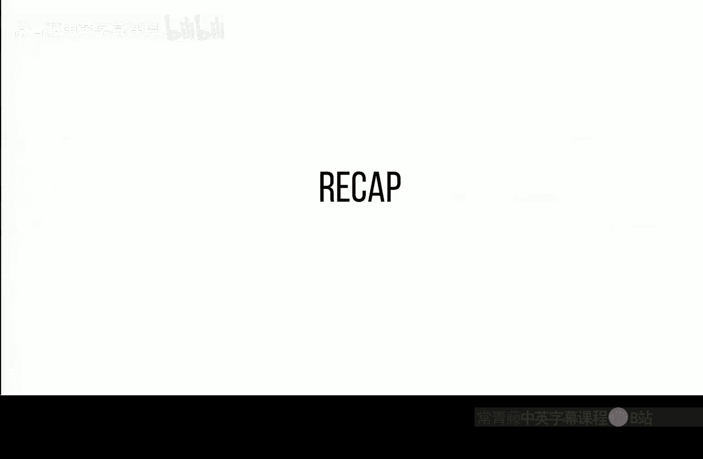

So let's begin by making sure you all understand what we talked about before。

 So this is the picture we've been showing。Mouse works great。

 So this is what the file system image looks like before in operation。

 We have our bitmaps for i nodes and for data。 We have our in table。 We have our data blocks。

 Then we do an append， which requires modifying a bunch of structures on disk。

 We're going to have to mark the bitmap that we now have a new data block allocated。

 We're going to have to change the in in place。 We're going to overwrite the old value with a new value for our in because that inode now has a pointer to this data block。

 and we have to write out that data block。 Great So there's basically three rights that we need to do at the file system level and the disk can't do that atomically for us。

 The disk can only atomically write how much data，512 bytes。 just a single sector。

And these are clearly scattered all over the disk。 the disc cannot do that atomically。

 so the file system has to put together some mechanisms so that that you see all of those structures in the consistent state so we looked in the past at what would happen。

 if different combinations of those three blocks， did not make it to disk before we had a crash or actually in this example。

 it's this does make it to disk and then we have a crash and the other things don't make it to disk。

So if the data block gets written to disk and the others don't， that's not really a big deal。

 We just have some data written to the disk。 We can't get to it。 It's lost。

 but it doesn't mess up our file system data structures， right。

Some of the other problems were more problematic， though， if we write out our i note。嗯。

But we don't write out the data block or the bitmap。 Remember what goes on there。

 Then we're now having a pointer from this in to this data block。

 but we didn't write out that data block。 So this i note is now going to point to a bunch of garbage。

 right。And even worse， when another file calls aend or we create another file。

That file could be given this data block because we didn't mark the bitmap。

 So another file would see that that block looks free。 It could be given that。

 And then they would both point to that same data block。 And they we'd have this security leak there。

So that was the second problem。Third problem was we might not write sorry。

 we do write out the bitmap， and that's all we write out。

If we mark something as allocated and nobody's pointing to it， that's just like a space leak。

 If we kept doing that over and over again， eventually， we would run out of data blocks to allocate。

Other combinations， you write out i node， but you and you write out the bitmap。In this case。

 we're going to be pointing to garbage data。Nobody else is going to be able to allocate that because we've marked it。

 that we' allocate that we're using it， but we're going to point to some garbage data。

This combination is we write out our in， we write out our data block。

Then what's going to happen because we didn't write out that bit mapap showing that we're using this。

 Another file could be allocated this data block， And they are also going to point it to it。

 And they're going to be able to read whatever secret data we've written in there。

 So that's a problem。And then finally， if we write out our bitmap and we write out our data block。

 but we don't have an iode that points to there。 we'll have that space leak again where we're not using that data block。

 Nobody can get to it。 but the f system thinks that it is。

So I think if you understand all of those different cases。

 you're understanding pretty well what the data structures do and things that can go wrong。

 So any questions about those different cases。Allright。

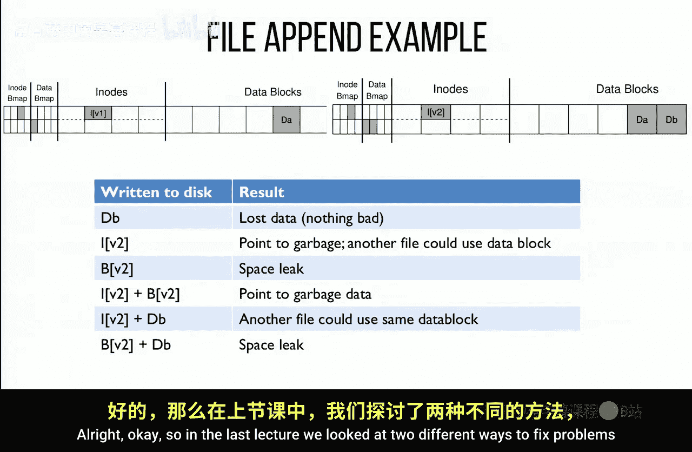

Okay， so in the last lecture， we looked at two different ways to fix problems where a crash occurs at a bad point in time。

 The first one was to write this file system checker or FSCK。

 and the basic approach there was if you have a crash and you notice that you didn't shut down your file system in a good consistent state。

 then you have to run this file system checker that reads over all of the metadata on your disk。

 And so this is really problematic and that it takes a ridiculously long amount of time to read all the metadata。

 it can take hours to do that on a reasonably sized hard drive， if it really has to read everything。

 and also it doesn't really know what you are trying to do when the disc got into that bad state。

 it can't revert you to like the correct state， all it can do is put the file system in a consistent state。

 it can make sure that all of the。Allocated data blocks are pointed to by I nodes。

 but it can't really figure out who， which file was supposed to own each individual data block， so。

You can make it consistent， but you can't necessarily make it correct， and it's very expensive。

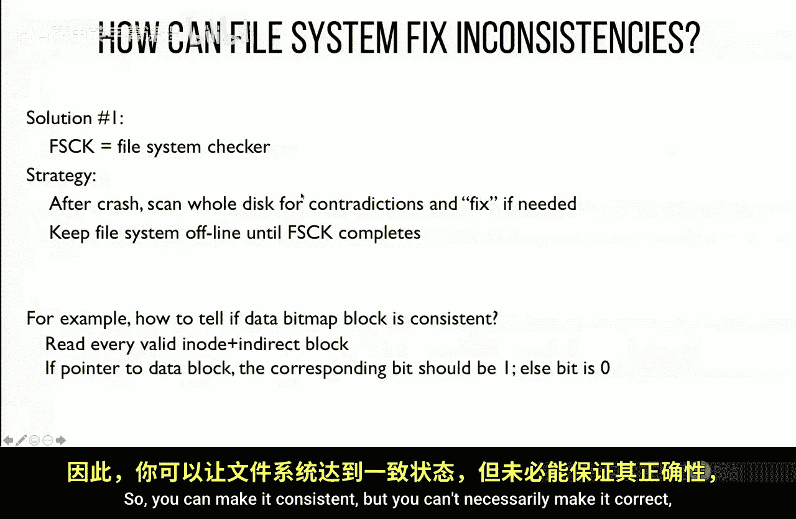

And so as you will see in your last project， there's a whole bunch of really neat checks that you will get to write and think about how you can figure out if a file system is consistent。

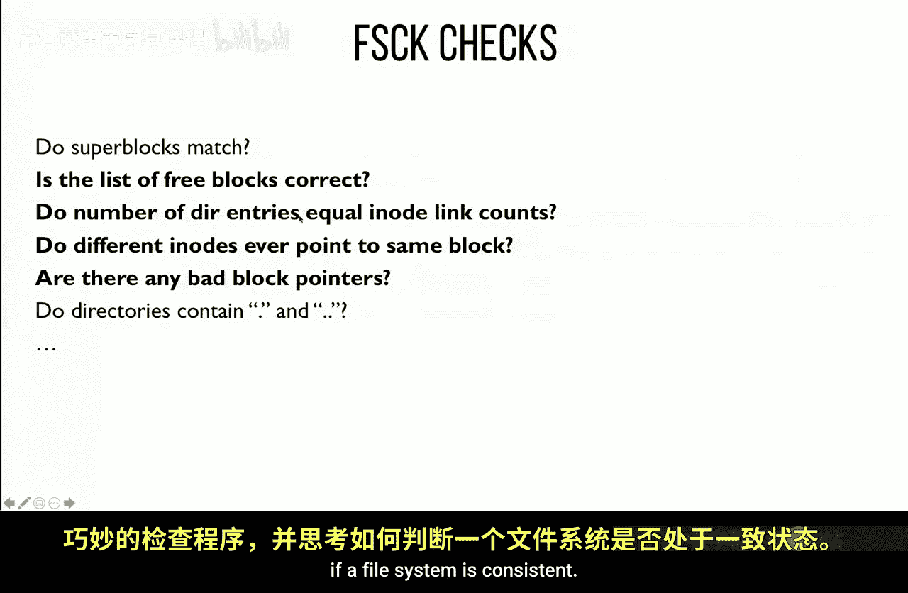

Okay。But all modern file systems these days have some approach to keep the file system image consistent。

 They will also have FSCK to deal with the case that the disc gets corrupted because of some hardware problem。

 but they all have some type of journaling or the copyrightite that we'll talk about next。

So our goal here is it's okay if we have to do some recovery work after a crash。

 but it better not be proportional to the size of the whole disk。So basically。

 with our journaling approach， what do we do on recovery。 So we found out that you know。

 we crashed or booting back up， we have this journal log。

 and we're going to replay the transactions that are in that journal log。

 All of the transactions that are committed。 If there were some transactions that didn't finish that we didn't mark that last commit block。

 We won't replay those because we were in the middle of them。

 We don't really know all of the metadata that needs to be written atomically to make that transaction complete。

 So that's the work that we do on recovery。 We basically replay all the committed transactions that are in our log or journal。

And what's great about this is that we're not just moving the file system into a consistent state。

 We're moving it into actually either an old state or a new state。

 It's going to look like either the crash occurred before or after that operation that we were in the middle of doing when the crash occurred。

 okay。So that's what we're talking about here that with Ats City now we're moving our file system image either to the states where it looks like the append occurred or it looks like the append had not yet occurred。

 we're not in the intermediate state where some of the data structures have been updated but not all of them。

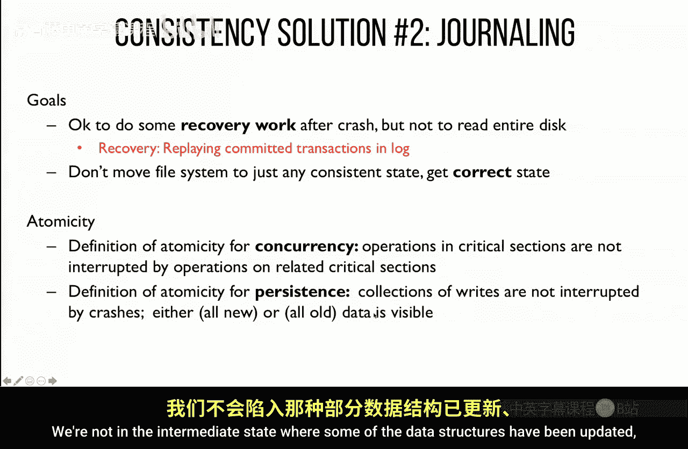

Okay， so I just wanted to make sure everybody understands data journaling before we get into the next approach。

And so just remember， we have all of the data structures that we did in FFS。 We still have groups。

 and each group has a bunch of stuff in it。 Remember each group has bit maps。

 it has inots and it has data blocks， and we have just that multiple places so that we can get better locality so that we try to keep data blocks close to their inots to have better performance。

But we're now going to have one journal for the whole disk and that's usually at the beginning of the disc and our journal looks something like this where we have a bunch of transactions in the journal and we keep app to it。

 we treat it like it's a circular log， we can go back to the beginning once we fill this up。

But what's in each transaction， We have like a begin descriptor to describe what's in this transaction。

 It's going to tell us the blocks on disk in this checkpoint region。 So I'll refer to this。

 These are like the in place data structures that are being shown here。

 Those are like the fixed checkpoint locations。 So you write things temporarily from memory。

From your file system， you know， it's doing the upend。

 It keeps all of that stuff in memory for a while。 It's buffering it in memory。

 And then it flushes that out to the transaction。 And it keeps a copy all of those data structures still in memory。

 And then once it sees that the journal transaction is done。

 It's written everything that it needed to there。 And it wrote that commit block。

 Then sometime later， the file system will also push out from memory。 the。

Metaadata and data to the fixed locations on disk。 And that was the checkpointing step there。

Because sometimes it gets a little confusing。 You might think we're somehow reading from the transaction to write back to the checkpoint regions。

 But no， all of those things are still in memory。 And the file system just first wrote it to the journal and then second writes it to the checkpoint region or the fixed locations on disk。

So any questions about that。

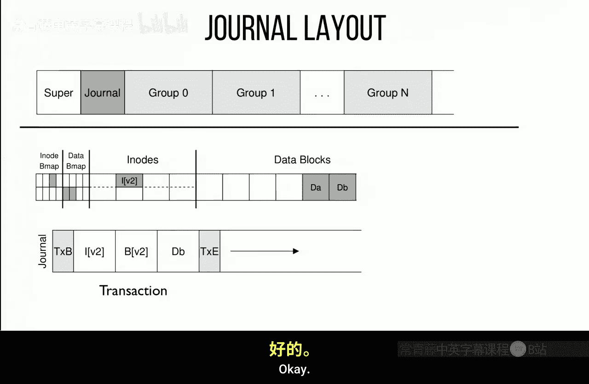

So we talked about a couple of different types of journaling。

 The first approach is what's called data mode journaling。

 and it has the best crash consistency semantics because it keeps the data consistent with all of the metadata。

 But data journaling usually has pretty bad performance because you're writing all of the data blocks twice。

 You're writing all of that user data， both to the journal and to the fixed locations on disk。

 And the file system doesn't really care if the data is consistent or not。

 And applications might or might not care。 But so in our first approach， will journal everything。

And so what we're showing in this example here， we're saying this is our journal over here。

We're going to write out some type of descriptor block that says that we need to write the value A to block 5。

 We need to write the value B to block 2。 That's what's going in our descriptor block。

 That's part of our transaction。 And then if we get all the way to writing this end transaction or the commit of the transaction。

 Once we're assured that that has been written out to disk。 Then we can do the checkpoint。 right。

 And so the checkpoint means we write those values to their fixed checkpoint region locations。

 So that's when we write A to 5 and B to block 2。And at that point。

 we're sure that this is on disk and it's persistent and it's in the right locations。

 And so at that point， we can free this transaction and write a zero here。

 make this invalid so that if we crash。After we've showed that this has already been written。

 we won't replay that and do that work again。Yes。You would first write this showing that it's been allocated。

 that it's committed， that we're done。 And then after you do the checkpoint。

 we'll write a0 there showing we've freed it， that we've committed that。 Sorry。

 We've checkpointed that transaction over here y。Because you need to know that you've already done this so you won't get stuck redoing all of the work。

 And you need to reuse that space in the journal for the next transaction。Great。

Other questions about this， yeah。Yes， this is all on disk。 So this is on disk。

 This is the journal portion of the disk。 and these are the blocks on disk。

 So it's the same picture as this。 I just kind of flipped everything around for confusion's sake。

 But this is the journal。 This is these are like it's one group all on the disc。

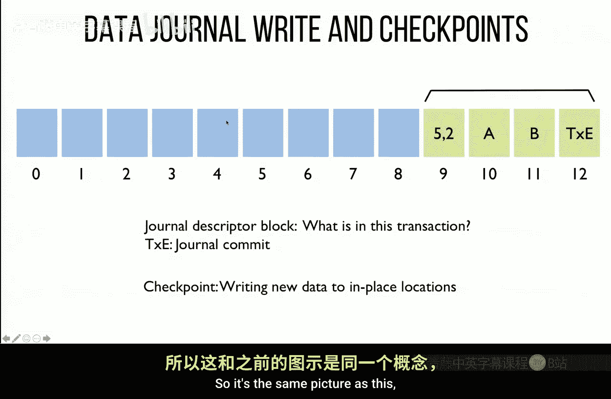

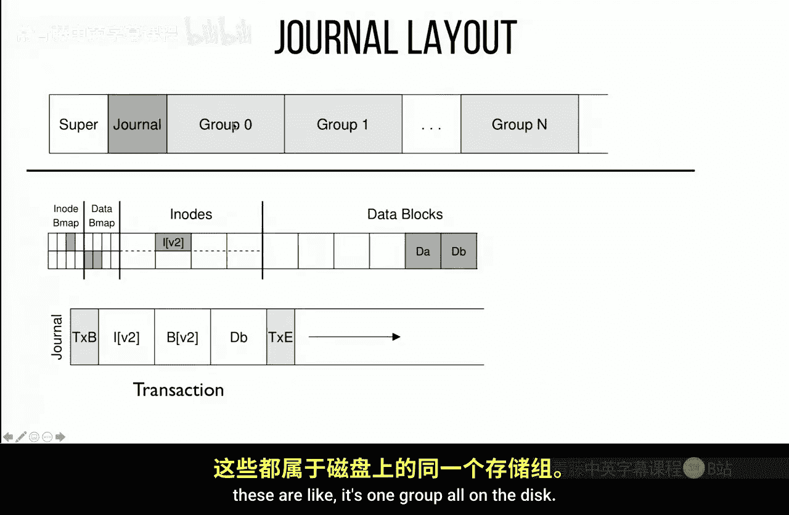

And so we're not showing what's in memory， but in each case。

 it was from memory that we wrote to the journal， and then it was from memory that we wrote to the checkpoint locations as well。

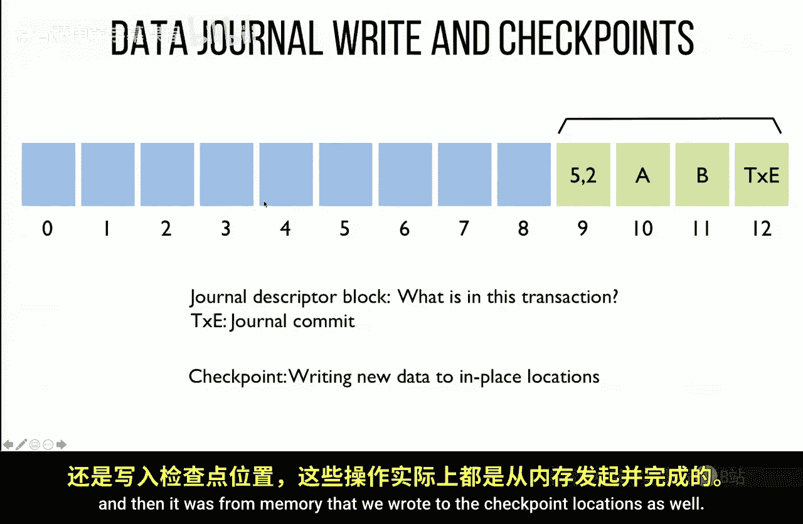

Great questions。So that was data journaling。And as I was saying that's too expensive。

 We don't want to write all of our user data blocks twice。

 So what most file systems will do for their defaults is they'll just do metadata journaling。

 That name's pretty intuitive。 The first approach is what's just called write back。

 This is the one that has some problems where you don't carefully order data versus metadata。

 So you don't worry about when the data gets flushed out to disk at all。

 This is just like the easiest lazy approach。 All we care about is metadata。

 So what can happen with that approach since we're not bothering to worry about when the data goes out。

 is we could commit all of our metadata。 And then we could checkpoint our metadata to disk。

 And then we could have a crash。 And when we reboot and we recover。

 we're never going to recover that data back。 But we're in this kind of bad situation where our i node points to a bunch of garbage。

 And we talked about the problems with doing that before。 I guess at least we marked the bitmap。

 That will be consistent。 The i node in the bitmap with。Be consistent with that。

 But we're going to point to a bunch of garbage And our application is probably going to be pretty confused about how it got into that state。

 So people don't like right back journaling for that reason。

 because we're not controlling what happens with the data。

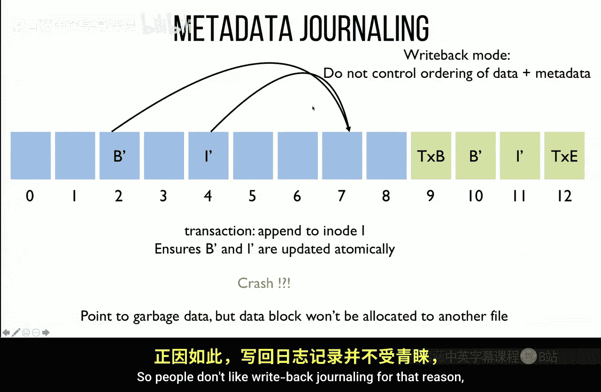

So the approach that most file systems will do is their default with metadata journaling is what's called ordered mode。

 where you make sure you write the data for this user file out to the checkpoint region before you start this transaction。

 So we get this out to disk。 And then we can write the transaction here。

 And then replay it if we crash or just flush it out to disk as part of that checkpoint later。

 And so then since we're writing out D first before anything else。

 We're guaranteed that I will be pointing to something valid because we guarantee that we wrote that first。

 So this gets。Much better semantics。 And it usually gets pretty similar performance to just that right back approach as well。

 So this is what most citizenss will do for their default。Rightright。

So any questions about how ordered metadata journaling works。

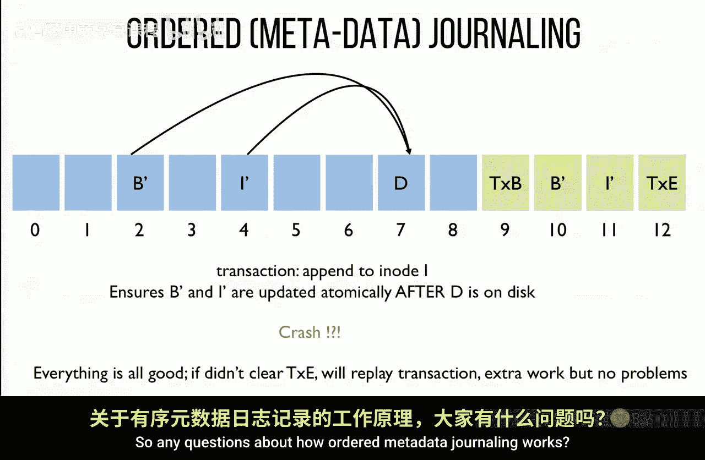

OkaySo one quick question for you。If you can identify what type of journaling is going on here and so I've set it up to tell you that we're writing the data。

 it's like user data is in blocks 5 and6， this is like the checkpoint region。

 the iNotode is in block4， the bitmap is in block 2 those are all the in- place checkpoint location blocks and then we have some journal that's filling up between8 and 15 so you can kind of figure out which rights here are going to the journal and which are going to fix locations and so can you identify which journaling mode each of those three are I'll give you a couple of minutes to talk with your neighbor about this one。

And one of the answers might be one that I did not review for you today。

See what you remember about Tuesday。Alright， So what do you think the first example is。Yeah。に消されました。

 we don't write data right， It's metadata only。 Yeah， And then the question is。

 is it right back or is it ordered， Can you tell。I guess you can't definitively tell。

 but it looks like it's doing one of them。 So if I so I'm writing to 5 and 6。

 and I said that that's data。 So， yeah， we're writing to the checkpoint region。

 the in place locations for our data blocks。And we're writing the data first。

 So that gives you a good hint that it's ordered mode。 And then we're writing to 8，9，10。

 Those are the journal things。 So it's probably like the journal。Descriptor。

 And then it's a bunch of the metadata that needs to be written。And then we're doing a barrier。

 You'll remember we have to make sure that those items get。

Written out to disk before we write that commit block to the journal。

 because we the disc will reorder things。 And if we didn't put that barrier there。

 then it would be possible for us to write the。Commit block of that transaction。

 And then if we had a crash and we replayed things， it's possible the commit block made it out。

 But like 8，9 or 10 didn't make it。 And then we'd write a bunch of garbage out to our checkpoint regions when we tried to replay that。

 So that's why we need that barrier there。😔，And then we need another barrier after we do the。

Showing that it's a committed transaction。Because this shows that we're in a complete state and that therefore。

 we know that it's all good。And then because we can't start writing these things out until we're positive。

 we've written everything to our transaction correctly。

 So you have to wait to make sure that the transaction was written correctly before you start messing with and overwriting those checkpoint metadata blocks。

 So now that we're sure that it's all been done correctly。

 we can destroy the old contents of those metadata blocks with our new contents。

 whatever is part of this new operation where we're modifying the iode and modifying the bitmap in the in place checkpoint region parts of the disk。

So this is ordered metadata journaling。Just to be certain。somewhere in 8 million。Yeah。😊，Absolutely。

 so 8 was probably the descriptor。9 was probably， you know。4our or two and 10 is the other one。

Because we had to write all of those things exactly to the journal， because if we crash and replay。

 we're going to exactly replay what's in 9 and 10 and write them out again to4 2。

 So it's exactly the same thing。 This is what we're doing The physical journaling。

 It's just the exact contents of that block y。Yeah。Well， I know that nine。

What's your question exactly？来。Well， I didn't show it here。 All I told you is that it's。I mean。

 since it's probably 8 has to be like the descriptor and the 9 and 10 are corresponding to whatever we're writing in4 and 2。

 So it's probably an i note and a bitmap。Yes。People have tried to do that。

 so you can make some things more safe by really adding all of those barriers and making the ordering good。

 but people have found it's really hard to get correct。

 Therell be some part of the file system that doesn't adhere to that protocol and then you have problems。

 You can't make it quite as perfect as as this approach。

 and it tends to have worse performance because you are doing those barriers more often than you end up doing them here。

Yeah， yeah， because you're writing， you're able to do all。 you know。

 we're actually going to have a grouped transaction。 We're going to have a whole bunch of metadata。

 This is just a tiny example。 But you could do a whole bunch of things before this barrier。 Yeah。

 but people have done exactly that approach。 Soft updates is what it's called and。😊，It's interesting。

 but it's not quite as good， y。Great questions。 Okay， so what is approach number 2。

So this one's just pure data journaling。 Remember everything here between 8 and 15。

 That's our journal。 And we're writing more than we did in this example。

 So we're writing the data as well。 We're writing our descriptor。

 We're writing the contents that will need to be written later to the fixed locations。

 We're doing our barrier。 We're writing our commit block。

 We're doing another barriers and make sure that's all done before we mess with the checkpoint region。

 and we're overr our bitmap， our in and our two data blocks that must have been in those blocks as well。

So that looks like it's data journaling。And so what is this one over here。

I think I'll let you talk for a minute to remember what this approach might have been。All right。

 so I heard one person talking about it correctly。 So I will go over it。 So this is data journaling。

 It's very similar to this one。 The only difference is we're able to skip this barrier and send all of these rights simultaneously to the disk。

 So the trick is how are we able to get rid of that barrier， the key is that in block 13。

 which is our commit block of that transaction。 We don't just write， you know。

 a bit of one showing that we're done。 What we write in there is a check sum that's over blocks。

 the contents of 9，10，11 and 12。😊，And so the idea with doing that is that if we do have a crash while this was being written and they all don't get written out correctly and then we try to do a recovery in our replay。

 we'll read back this transaction into memory as part of the replay。

 we'll check the checkum that was stored here and if it doesn't match the checksum that we're going to calculate over what was written out to blocks 8 through 12 then we can tell definitively that something went wrong and some block between8 and 12 didn't get written out and so the journal transaction did not get committed correctly and we will not replay that。

So we're able to get rid of one barrier by using a checkum in the commit block instead。

So does that make sense to everybody。Okay， alright， so I think that is it for journaling。

 So any last questions about journaling before we go on to the next approach。OK。Alright。

 so we're going to look at another approach。 It's called v structured file systems， LFS。

 or it general， general case is a copy and write file system。

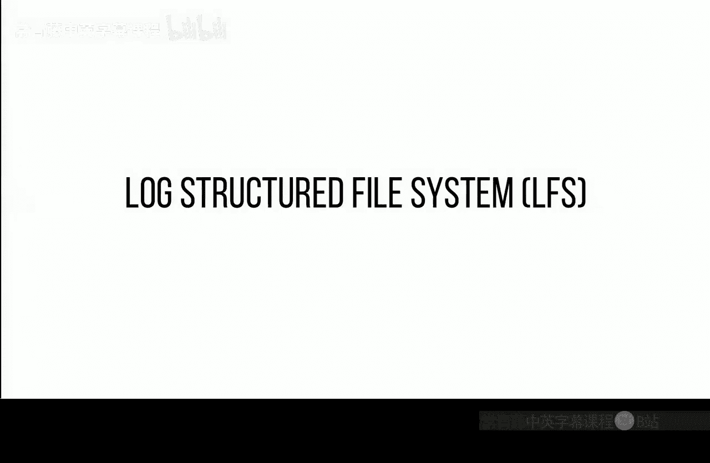

Okay， so to put this in a little bit of context， we first looked at a file system that did not have any journaling。

 We've then looked at a couple examples of journaling file systems。

 EX T3 and EX T4 would look a lot like what we've been talking about。

 And then the example file system that we're looking at today would be LFS。

 but there are a bunch of other copy and file systems like ZFS and butterfS。

 And then when we're done with this， these were all local file system。

 even if you're running a distributed system， a distributed file system。

 they're running on top of nodes that are running a local file system。

 So everything that you've learned is still applicable in the distributed file system era。

 know if you're doing things in parallel across many machines。

 they still are writing to a local file system。 but we can of course build things on top of those local file systems。

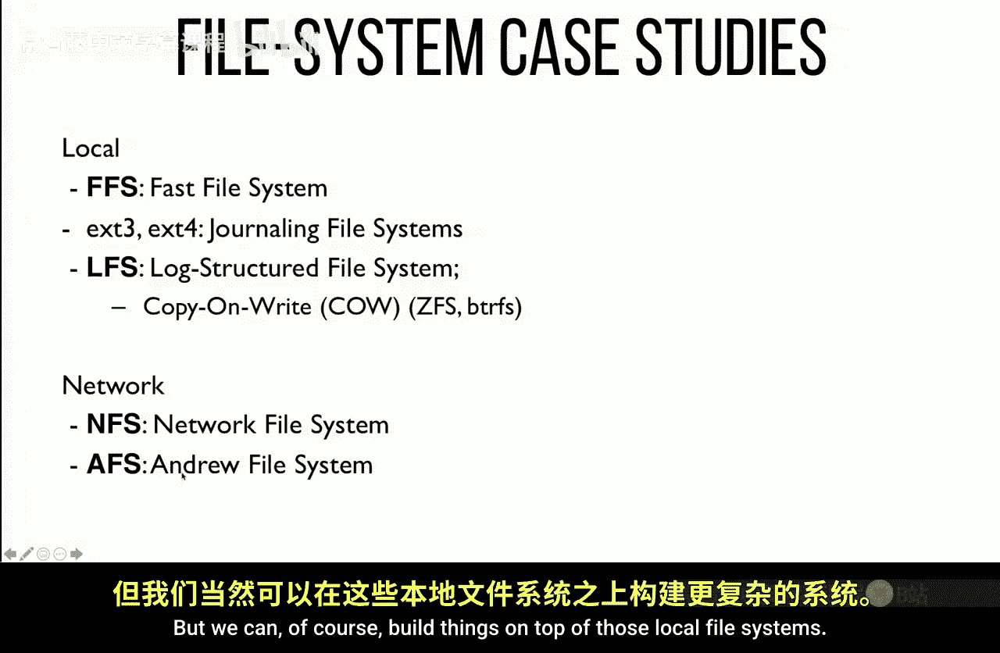

Alright。Okay， so we're going look at another approach for crash consistency and the general principle for all of this stuff is that you're always at some point going to have to have both copies of the data on disk。

 You have to have the old data on disk and the new data on disk and so that you can then autoically kind of pick one or the other。

So the first approach that we took was journaling。 It wrote the new information out。

 And only once it knew that new information was written out， would it overrite the old information。

 What we're gonna to look at today is what's called copy and write。

 It's going to write the new information to a new location。

 And then it's going to be able to just completely discard the old information by updating some pointers so that it knows that this new location is what we want to be the new。

Data that goes with this file。

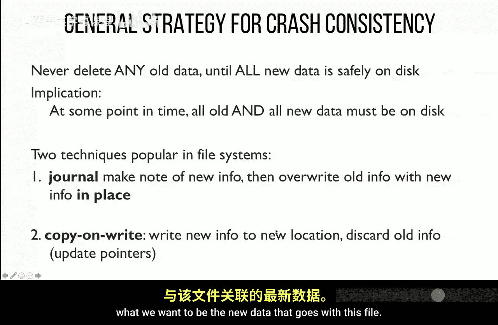

Alright， so let's do some silly cartoons to see this。

 So this is a bad animation of our previous journaling approach， a very high level。

 We had our in place checkpoint data somewhere on disk， some block A and some block M。

 and it had some contents 12 and 5。 And then when we wanted to update those two blocks。

 What would we have to do， We'd have some journal descriptor that I'm not showing。

 We write 10 and 7 to our journal， We write a commit block to the end of this。

 And then once that's all done。Then we checkpoint it。

 and we write that data out to the checkpoint location。 Okay， so what's the main point of that。

 And then we have to clear it when we're done to show we're complete。

The point of that was we wrote all of our data twice， right， We first wrote it to a journal。

 Then we wrote it to the checkpoint region。 That's pretty bad when you have slow disks， right。

 We don't want to do that。

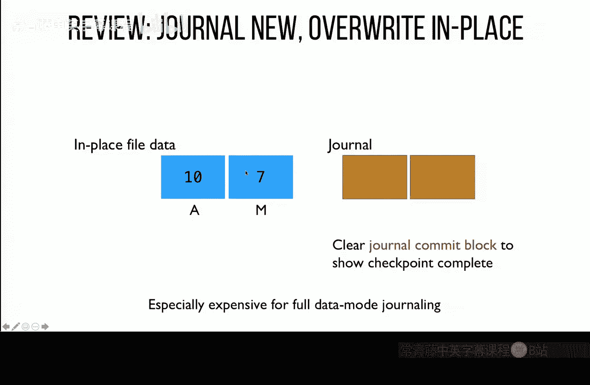

So that's what copypy onr is going to enable us to skip。 So for a while。

 we had our file and it was stored across blocks A and M with these contents。

 Then we want to update our metadata， our data， All of our different data structures。

 We just write them out to some new blocks。 It can be anywhere on disk。

 It's not going to be a fixed journal location。 This is just going to be where we want this file to live in the future。

We write out the new contents and then the thing that has to happen atomically。

 So if we have a crash now， we'll just have the old state。

 But then once we've gotten all of this stuff out and we're sure that it's all on disk and it's durable and it's persistent and it's beautiful。

 then we just change that pointer。 So somehow we know that everything that's associated with the current state of the file system lives over here now。

So that's going to be what we have to figure out how to do is basically。

 how do you now make everything point to this new structure。

So the obvious advantage of copy on write versus journaling is we didn't have to write the contents 10 and 7。

two times。 So we could have twice the performance of that journaling approach there。Alright。

 so hopefully， that intrigues you and you're like， yes。

 we need to figure out how to do this because I want to get twice the performance。

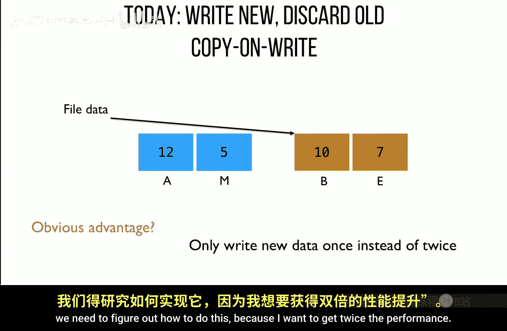

Okay。All right， so we're going to talk about LFS as our specific example。 This was developed。

 It was back in the 1990s now at this point。 And so it was kind of concurrent with the raid work And so with raid going on。

 everybody was very concerned about how bad small random right performances。 Remember。

 like with raid 5。 how horrible it was to do a small random right。

 because whenever you did a small random right， you had to read the old data。

 you had to read the old parity， write the new parity and write the new data。

 You were doing four times as many operations for a random operation as you would。

 if you were just done a nice and sequential。 So what we really want to do with LFS is we're going to really make sure that all of our rights to our persistent media are done in a sequential manner so that we'll do well on both a single disc where we know we get better performance with sequential rights and we'll also do a lot better on raid 5 because we're going to be treating our storage system with just sequential rights。

O。So it's kind of easy to， to treat a disc sequentially when you're doing rights。

 because you just say， I'm going to write this stuff out sequentially。 You get to choose。嗯。

But it does not work so well for reads， right。Sometime in the past。

 someone wrote out this data and they wrote it out， however they did。

 And now you're going back and reading。 yet you don't get to choose where that was on disk。

 You might have to do a bunch of random rates， still。So it's not a perfect solution。

 Our rights are going to get sequential performance， but reads could still be a bit random。 Now。

 the hope is that it's not as bad because when you do reads， hopefully a bunch of stuff was cached。

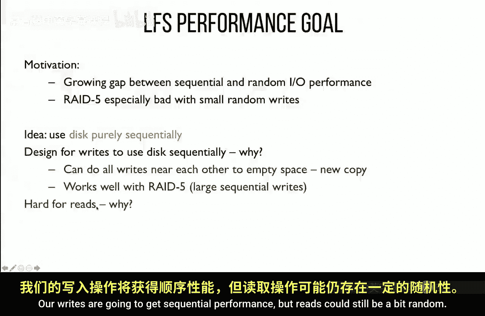

In in memory， so maybe you're not going out to disk so much， or maybe you end up getting good。

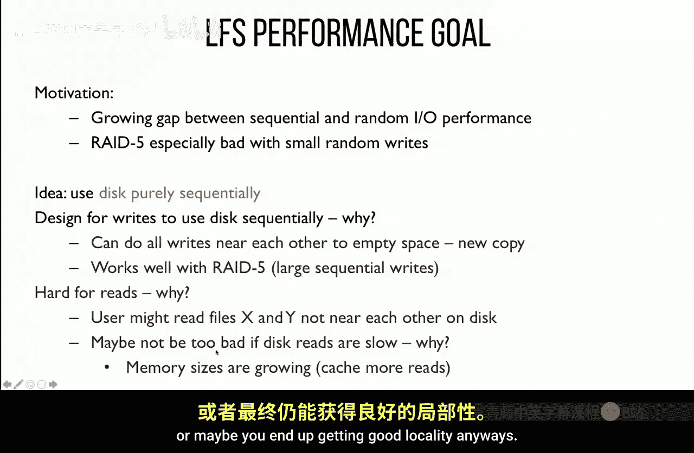

Looccalality anyways。 But we're going to do great with rights。 So let's mostly think about rights。

Okay， so what's going on with LFS is when you're doing things like an append or a create file or a maker。

 we still buffer that stuff in memory。 You're writing to data structures that live in memory for the most part。

 And then at some point， you're going to decide to flush that stuff out to disk。 But now。

 instead of writing it to a journal， we're going to write it out to what's called a segment。

so the question here was， how much stuff should we keep in memory before we've decided we have enough。

So basically， you keep your data buffered until you have enough that you're going to get good sequential bandwidth from the disk。

 So a couple of meby， many meby，64 MB， something like that would be enough to get good sequential performance。

 And so whatever you've modified in memory， whatever that final state was。

Once you've filled up that segment， that's what you're going to write out to disk。

 All of the bit maps and the i nodes and the data are all going to go in one segment together。

 So there's no longer a fixed location where different i nodes live or where different data blocks live。

 You're just going to write out whatever happened to get modified in the last interval。

And so we're never overr old copies of data。 We're just going to always write to a new location with our new data。

 So that's why it's copy andr。 We're keeping the old stuff around。 We're writing out the new copy。

 And if we have a crash before we finish this， we still have that old copy that was in a good consistent state too。

て个。Yep， yep， we're going to keep moving that metadata around。

 which is going to be the challenge and what's hard about this。

We're not gonna even keep eye notess like at the beginning of。Group。

 we're not going have groups anymore。 We're going to have segments， yeah。

But good direction that we're going in here。 We're going to figure out all of this stuff。

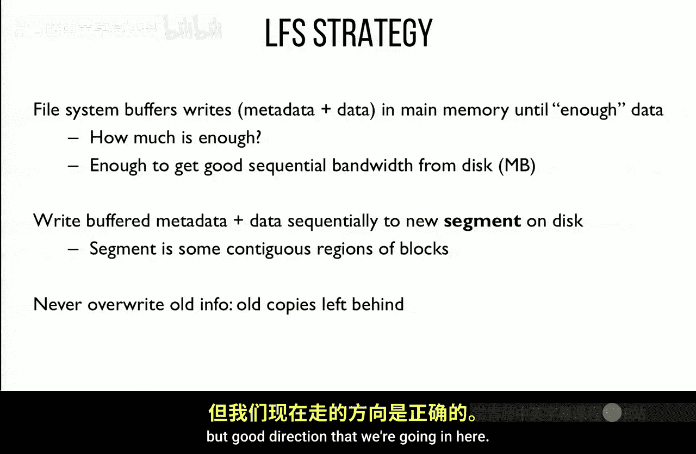

Okay， so basically on disk， we had a bunch of segments。 This was the segment we wrote to first。

 then we wrote to this one。 It has mixed up in here， bit maps， inots， data blocks， directories。

 indirect blocks， all of that stuff。 Then we start writing to a new segment in memory with our new modifications that we're doing。

 These are our rights that we need to。Take place。 And then at some point， that fills up。

 and we write it out to disk。 and it just becomes part of this log。 And so then later。

 when we do reads， the trick is going to be， how in the world do we find where our data lives。

 It seems really easy to write it。 But now how are we going to read this back and actually find where anything is。

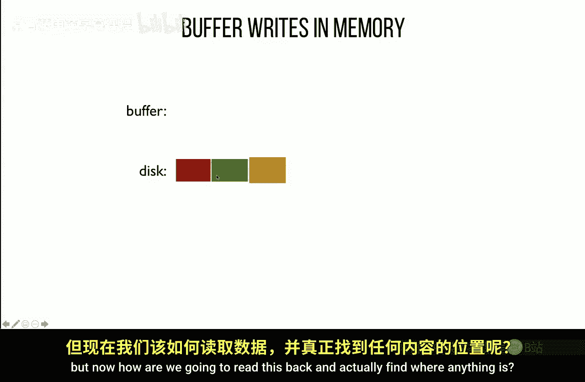

Okay。So we're still going to use all of the same data structures that we did in the past。

 We're still going to have bit maps。 We're still going to have iodes and direct blocks， directories。

 all of that stuff。嗯。But let's figure out what we could remove。

So what allocation structure did we have before that we can remove。Allocation structure。

 we had bit mapps before that were telling us which data blocks were allocated。 Now。

 we're not going to have data blocks living in specific locations。

 So the only thing that's really different is we're not going to have data bit maps anymore。

But we still have everything else。So let's figure out how we're going to read a file because we can't just say。

 I know I need to read in number 20。 We don't know where in number 20 is anymore。

 So we're going to have to figure out how to find them。

So the way we're going to figure this out is we're going to start off with the approach that doesn't work。

 that might have seemed intuitive。 So why it doesn't work and then do the approach that does work。

Okay， so our approach that is not going to work is we'll say like what will be in a directory entry now。

ll now it'll be a file name and then the disk block where that in lives， where we just wrote it out。

 So instead of having a file name mapping to an in number。

 we'll say it's a file name that's mapping to where that in lives on disk right now。

That seems pretty intuitive， it's a good start。What's going to be tricky is whenever we update an iode。

 we're going to have to write it to a new location， and then its name is going to change， though。

 So this name is going to keep changing。 So let's look at an example。

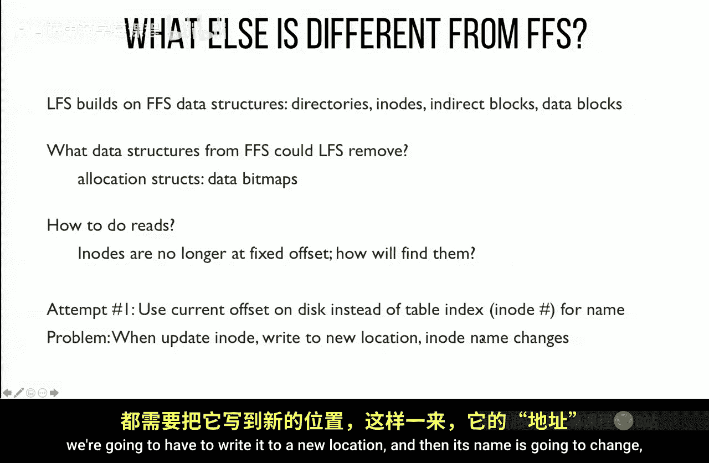

So a common thing to do is you had some large file file dot text， and we want to overwrite it。

 We want it to contain new data。 So how is that going to work， So this is what's on disk right now。

 Maybe it's in different segments。 I don't know。 It doesn't matter。

But we could kind of we could read what was in the file data if we knew like， okay。

 we still start at a fixed iode location for our root directory。 We would read the root iode。

 we'd see it has pointers to data blocks， we would then be able to read the directory for the root。

 we would parse it just like we did before， where we would see that there's an entry for file dot text。

 And now instead of having an iode number， it's going to have the block number where file dot text lift。

 And I'm going to pretend it's right here。 So that's what would be in our directory entry。

So then we know that we need to read this iode to find out where the the file data lives。

 We'd read that in。 We'd see it has a bunch of data pointers。 for example， to hear。

 and we could read that。Okay。But now， let's imagine we're trying to write new data。

 So we're treating this like a log。 We write out this new data here。So。Are we done。 Well， clearly。

 we can't just write out the new data。At the very least。

 we have to change this iode to point to that data， right。Now。

 am I allowed to change this in here to point to this data？No， not in a log structured file system。

 That would be like a random right。 I'd be going back to wherever this w was written on disk。

 The whole print。 So we cannot do this。Random right， bad。So instead。

 what we need to do is we need to somehow write I this inote again and make that point to this data block。

Now， can you see the problem that's percolating up。

 We had a directory entry that was telling us where this in lived。 doesn't live there anymore。

 Now it lives over here。 So we're going to have to change that directory， write that one out again。

 put a new pointer in it and then change the in there to point to this one。

So the problem we're seeing is that if we change anything， any data in our hierarchy。

 we have to percolate these changes all the way up to the root of how we got the path to get there。

So it just involves just too many changes， everything that pointed to this in the whole tree has to be changed as well if we change any one thing。

So we do not want to do this， We don't want to keep changing all of our data structures。

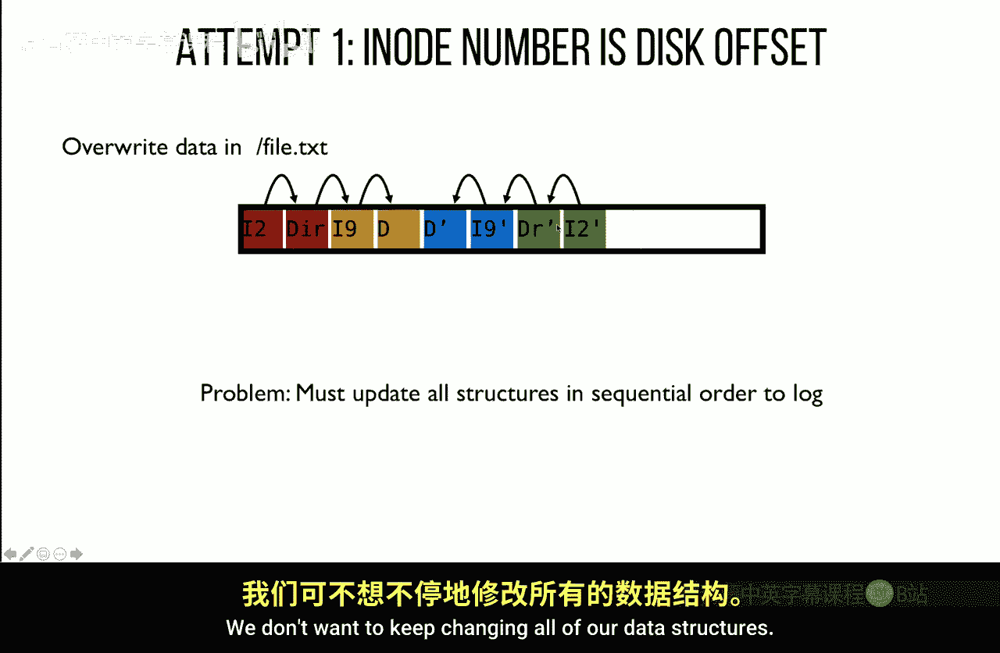

So。This is a summary of the problem we just saw。 If we try to， instead of using i node numbers。

 if we try to use disk blocks as our name for that， then we have to percolate those changes up。 Okay。

 so what's in a different way that we could do this。

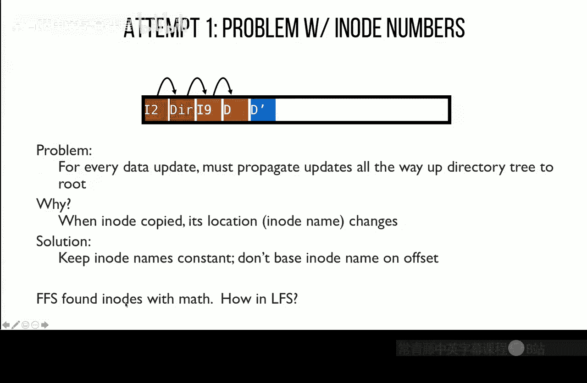

So they often say that any problem。In。In computer science， right。

 you can solve it with a level of indirection。 So what we're going to do is we're going to have a table that shows us where the i nodes live。

 And so this table is going to be called an I mapap。 and you look up in the eye map for the you know。

 the row that has the i node number that you're looking for and that i map then tells you the block location where that in is。

So we've somehow pushed this problem off。 We said， our eye map is going to tell us all of the secrets。

 everything that we need to know。 So now we're going to have to deal with this Iap。

 But let's just assume this im map is working great。

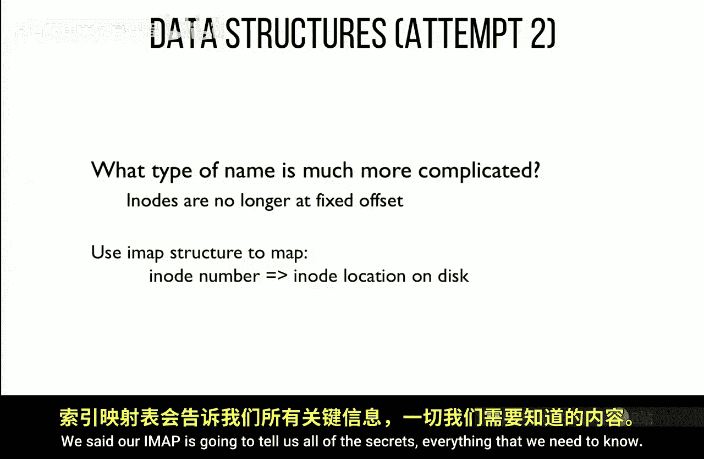

So remember， the im map is going to have one entry for every i node。

 and it's showing us where that i node has been allocated on disk， the block number。

So we're gonna to figure out where we're gonna to store this I map。

It would be nice if we could just store it in memory， but it's a file system。

 So you can't store things just in memory because we have to worry about the fact that we're going to lose power。

 and we have to keep this eye map persistent。We also don't want to keep just like the eye map at the beginning of disk because every time we change where an eye note is located when we move it。

 we need to change that eye map。 And that would involve a random right to the beginning of the disk to change that mapping。

So it's kind of levels upon levels of what gets written out to these segments。

 but we're going to write the imMap out， or at least a portion of the imMap that we just changed。

To the segment， as well。So now you're going to be like， well。

 how in the world am I going to find where the portions of the im map are。

 that's going to be a smaller amount of data， and it'll be easier to keep that in memory。

 That won't change as often。 And we can keep that stuff at the beginning of disk， okay。

But we're basically， every time we change where an i node is located。

 we're going to change this eye map， and then we'll write out all of the i notess that changed。

 you know， as。And in that segment， when we're done with that segment。

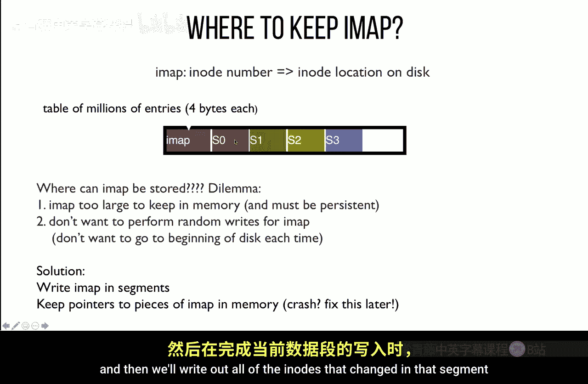

Okay so let's see if there's some pictures here that help so what are we keeping in memory we're going to have a cache of our pointers to IMap pieces so if you know our IMap is large but we've kind of partitioned it into all of the inots that changed and so the IMap is kept in a bunch of different locations。

 we just need to remember where those different locations are and so that's much less information than the actual imMap。

And then if we were finding that were keep modifying some of the iNots very frequently because we're writing to the data that goes along with that file very frequently。

 then we can just cache those portions of the IMap in memory。

 So we don't have to keep going out to disk every time to read that。

 So if you were rereading an in or a portion of the IMap， that had better be cache in memory。

 So you're not really going out to disk for every single one there。Okay。

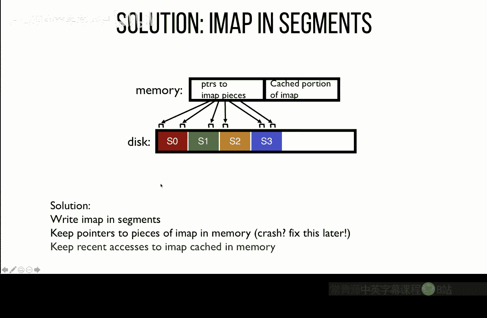

So let's look at more pictures and just kind of go through all of that again with a different style to make sure that we we're getting this Okay。

 so you're appending to a file。Well， let's do an overrite。 So we had a file that had some data in it。

 And if it was just F，FS， if you overrite a block。You don't have to really do much Usually。

 You just find out where that block is allocated in the past。

 and you just overwrite those contents and you're done。Right， but now what we're going to do。

 when you overrite a data block， you're going to actually allocate new space in a segment for the new contents of that data block。

That'll go in your segment。 And then， of course， you need to modify the iode to show that it points to that data block now。

 So our iode changes every time we even overwrite data because the data is in a new location。

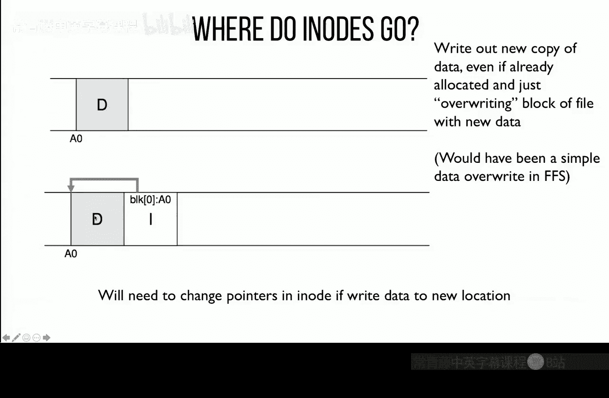

Right。It would be bad performance if we flushed out every single right。

 So we're gonna buffer that stuff。 So it usually is the case that you're writing to one file a lot。

 So it will usually be the case。 Then you're able to write out a lot of data blocks。

 And then you just have to write out the in once and show all of the new locations for those data blocks。

Yeah。啊哼。😊，The number。You're oh， you're still。You're writing it out again。

 If you're even overwriting an existing data block， like you had a， you know，1 MB file。

 you're overr the middle block of that thing。 You're writing that one block out again。

 So you're not writing the whole file out again。 You'll write out that one block again and you'll have to write out the in again so that that one right pointer points to the new location。

And so think about what an in looks like。It's going to have some pointers to other segments as well。

 right， So we're going to update our pointers in our in to point to the new data blocks。

 But if there's some data blocks that we didn't change。

 we're very likely to have pointers to other segments on this。Disk as well。

And then the other thing to notice， yeah， just that we're doing this pretty efficiently。

 we were only having to write out the in once because we changed a bunch of things that we're referred to。

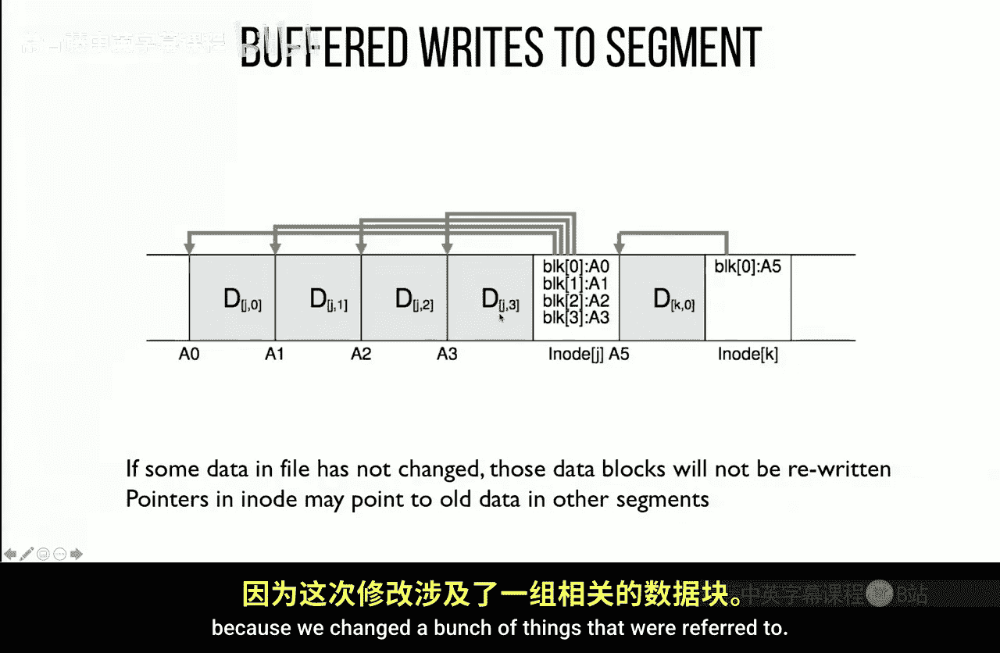

Okay。Alright， so that's basically how you do the rights without the eye map。

 And so let's talk about the im map again。So when we changed。Where this iode lived。

 we had to change the contents of the im map so that we can find out where the iode lives。

 So there was some entry in our im map for iode number K。

 And now we want to show that in number K lives at block A1， Whereas in the past。

 Who knows where that lived。 It lives someplace else。 But now it lives in block A1。

 So our im map has to tell us that。

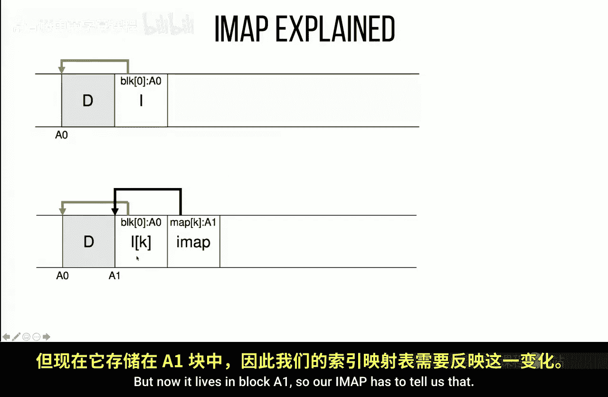

Okay。Alright， so then we're gonna get into the question a little bit more about how do we know where our immap lives And so most of the time that's going to be cached in memory。

 but if we so we'll have some way of knowing where the different portions of the imMap are for each in number because it's just kind of like fixed math。

 the first so many iodes live in the first part of the map and then so forth。

 it's just a linear list And so you know at least which portion of the immap you need。

 if you know what iode number you're looking for。 So then we'll either cache that in memory where all of those pointers are to the imMap or if we don't have it cached in memory。

 we're going to be able to go to this checkpoint region which is going to tell us where it lives。

 So I'm gonna go into that next。But any questions about。That level of things。

So it is relying on all of your knowledge of how FF S works with all of those data structures。

 And now you're having to imagine i notess being。Written around to new locations。

 So it's a good stress test of your understanding of the past stuff。

And it's not going to really get any harder than this。 I would say， I mean， today's lecture， I think。

 is as bad as it gets in terms of indirection and what can point to what。Okay。

So if you understand those basics， I'm going talk about crashes。All right， okay。

So let's think about what has to be recovered after a crash with LFS。So basically。

 it's this eye map that we've been talking about that tells us。Where the eye nodes live。

So if we have a crash and we need to reconstruct our pointers to the IMap。

 one way that you could do that would be that it's a self-deibing data structure。

 you can go through your whole disk， you can look for where the imMps seem to be and then just give yourself pointers to those places on disk and then read them as needed。

But discs get larger and larger。 This would be ridiculously slow as we have larger disks。

 So what systems are going to do instead is they're going to do what's called checkpointing。

 where they save the information that they have into a known location on disk。

 And so what they're needing to record are pointers to each of those eye mapap pieces that are in different segments。

And so you have to basically decide， how often should you checkpoint？

That if going to the beginning of the disk to record your eye map pointers， that's random I O。

 So we can't do it every time we change an im map。 right That would be too much。

 But if we don't do it often enough， then we're going to lose some more of these pointers。

 and we're going to have to do the slow work of reconstruction more often。

 So it would be pretty common to like checkpoint every 30 seconds or so。

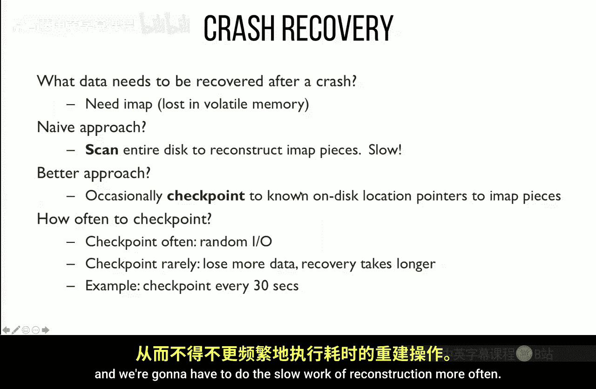

So a picture of this one。Okay， we have our disk， we have in memory pointers to the IMap pieces。

And we're also going to have in our。

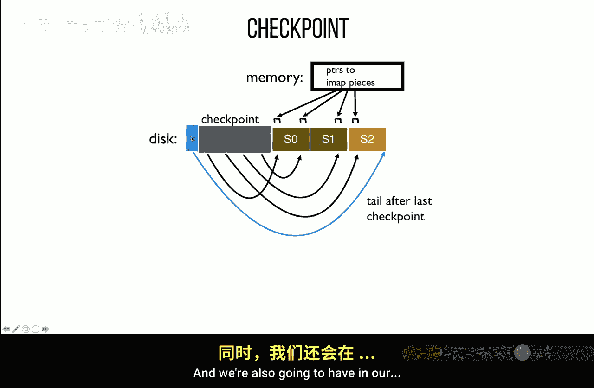

What didWhat was the term I used for this before， Oh I called it a checkpoint。 Okay， Yeah。

 checkpoint region， great。

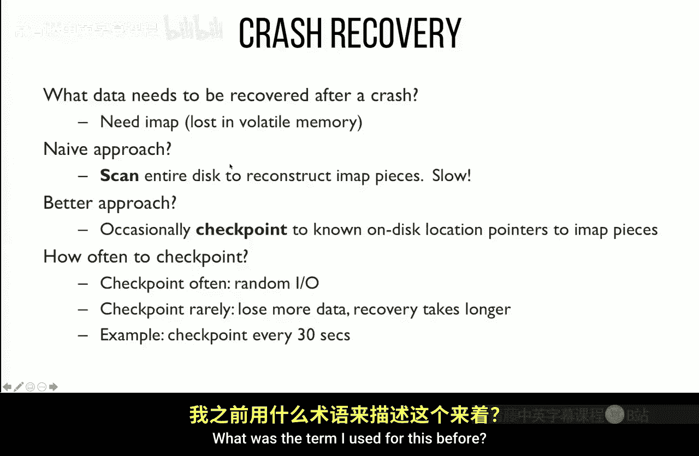

Our checkpoint region has the pointers to the im mapap。 So this is actually very small。

 but in the picture， it's big， but it's actually not that much data。

 It's just pointers to where each of those im maps are stored。

 And so periodically when we change where the imM is stored。

 we can right out to the checkpoint here are new locations and we're always recording like which of those segments we've are accurate right now that we've checkpointed correctly because as we continue to run。

 and we continue to append to files and make directories。

 we're going end up writing to more segments， we're going to write the im map over again。

 and we're not going to always update the checkpoint right So now we crash。So at this point。

 those things are not in our checkpoint。 if now we crash， what are we going to lose？

We're going to lose everything that was in memory， so we're not going to know where those imap portions live so we can reconstruct some of them by reading the checkpoint。

 and then we'll get that。 And now we have to just get the im maps that were in this last one。

 So we're told which ones were current and up to date。

 We just have to then go through the segments that weren't checkpointed。Do the traversal of that。

 Understand the data structures。 know， this looks like an im map and therefore need to make some new pointers to that。

 So that's how we're going to get all of our pointers to I maps。

 because we know that once we know where an imap lives， we can find where an in lives as well。

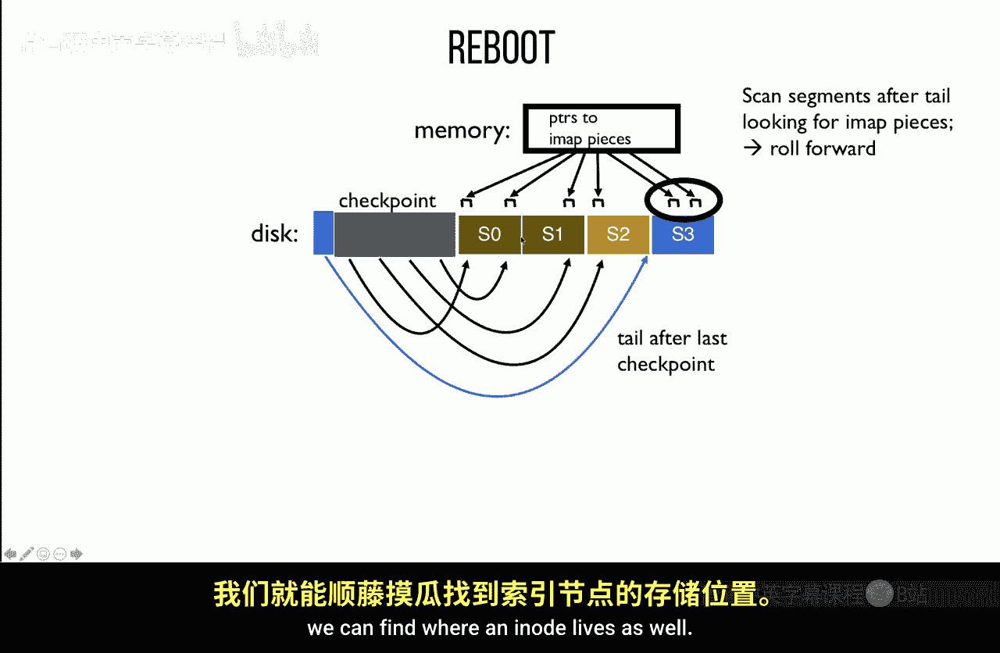

Okay。So that's the summary of what's going on with checkpoints。 We checkpoint occasionally。

 We're writing the I map pointers to the beginning part of desk。

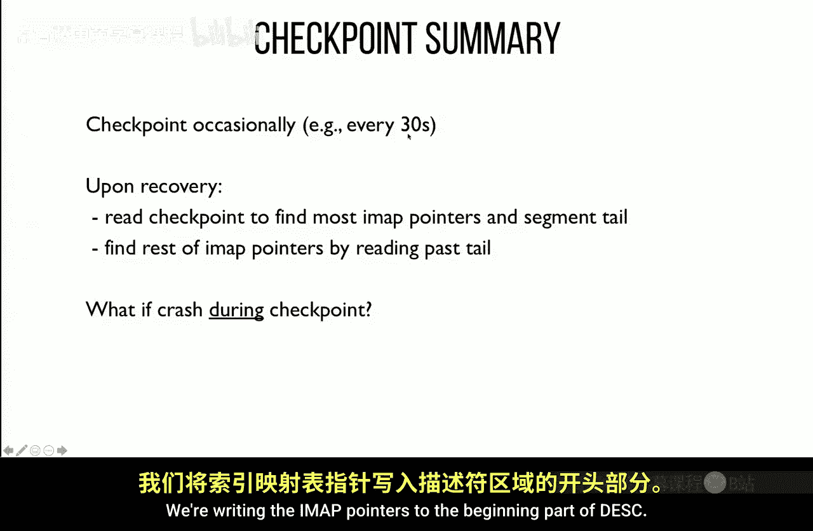

Yes。呃。So it's not。 It's only logically that we're treating this like a nice circular buffer。 It's。

 in reality， it's going to be these are each individual segments that could be free or allocated。

 So instead of a nice tail pointer， it would have to be that we were keeping like a bit recording the state of each of them。

So conceptually， we can kind of view it as it's being written too sequentially。

 We haven't talked about garbage collection yet， but clearly you can't just keep writing to the disk forever and ever with new segments。

 We're going to run out of space and we're going to have to reuse stuff。

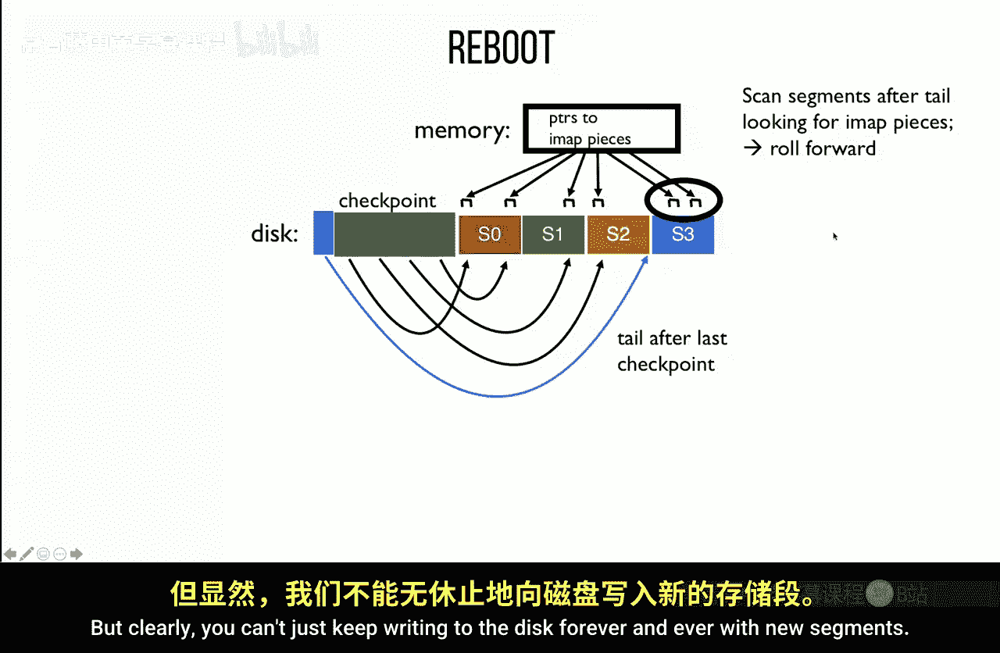

Yep。Good question。Okay， so you could be paranoid because we are file system developers。

 You could be paranoid。 What if you crash while you're doing the checkpoint。

 This has to work correctly， because it will happen at some point。

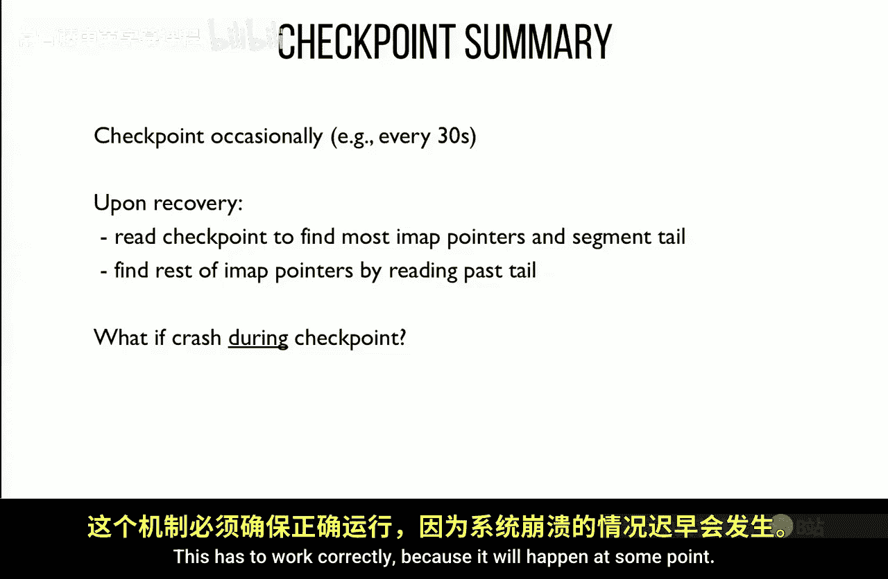

So the common approach for this type of thing is you just have two checkpoint regions。

 So we're kind of doing copy on right of our I map pointers。 So we had some valid。Checkpoint regions。

 some valid imap pointers， and then when we're doing our checkpoint and we're needing to update that。

 we do not update that one in place because if we were updating it in place and there was a crash it would be in trouble so instead we have another copy of that and we write out to there and then when we're all done with that we put a timestamp there and then when we do our recovery we can look to see well which version has the more recent timestamp and do that and if this one didn't get to the point where it has a timestamp it would look like garbage and we would know we needed to use the other one that was complete。

So again， copy onr saves the day at another level of the system。 You just need to make a new copy。

 Don't muck with your old structure that was in a consistent state。 Don't mess that one up。All right。

Any questions about that？

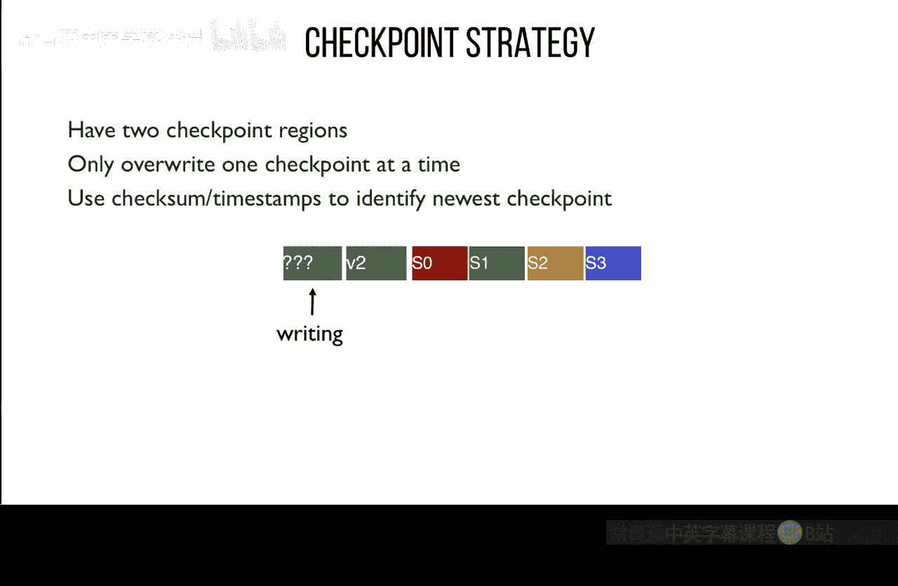

Okay。Last issue for LFS， garbage collection。

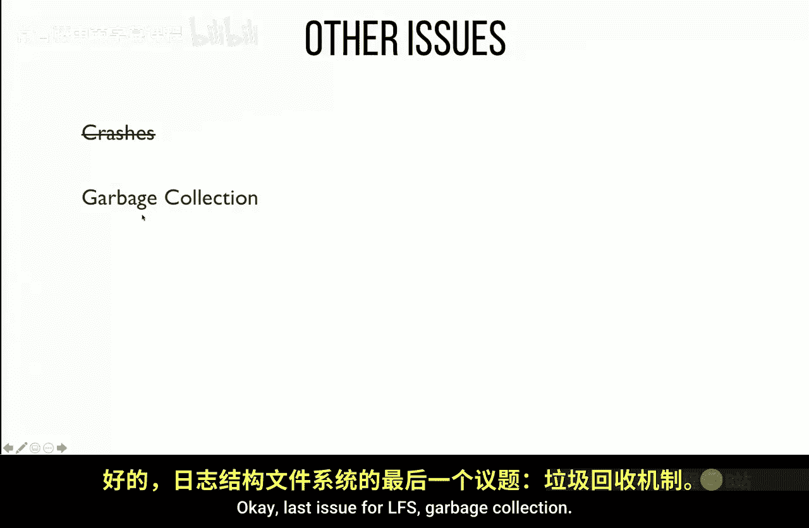

So we are， we keep making copies whenever we overwrite data or append to a file。 whatever we do。

 we're always making a new copy。 So sometimes that can actually be pretty nice。

 This is a really good approach to use a copy onr file system if you need to have like a versioning file system or you're needing something like Dropbox that keeps track of all of your old versions that if I accidentally deletes my file。

 wouldnn't it be wonderful if my copy onr file system was keeping around all of the old data and it was keeping around the metadata that let me get to that data。

 So it is really easy to build up a versioning file system that keeps everything if you build it on top of copy onrite。

😊，But we're not going to assume that today。 We're going to assume that we need to figure out what's been overwritten and reclaim that。

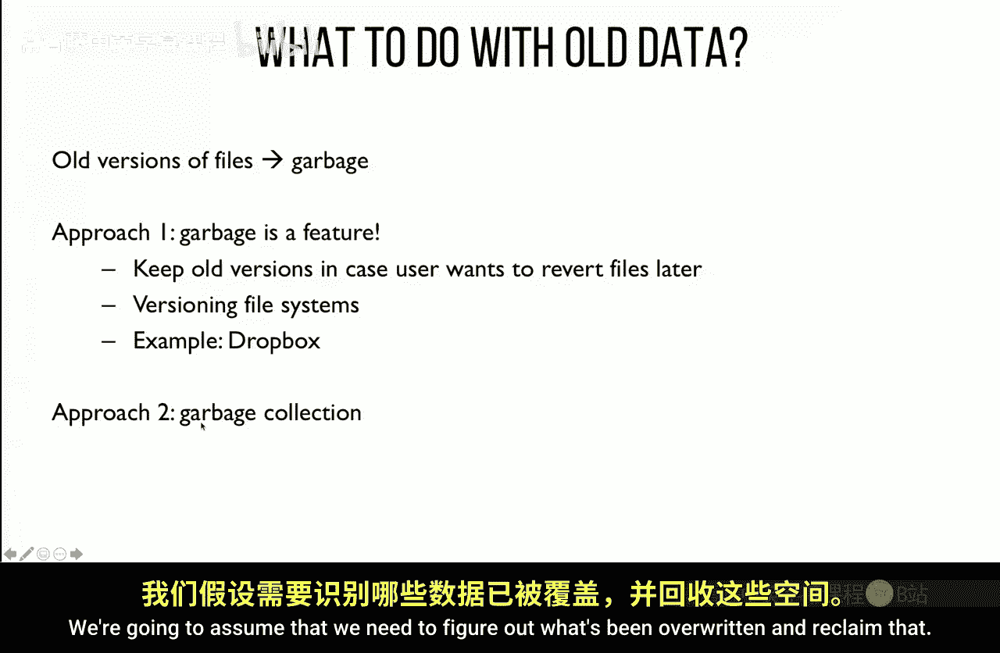

So we've seen in other systems that。We had to reclaim things， like i notes。

And when did we have to reclaim an i note before in just like FF S。Let's go back to remembering that。

F， F S， I knowed。 how would you know that you need， that you can。Mark that I notice free。

When the reference count goes down to 0， great。 So every time someone unlinked a name that was mapping that name to that iode。

 we would decrement the reference count in one that gets down to 0。

 we would know that that iode was free。 There are no names to it。All right。

 so we're going to still have that， but we're also going to have our copy on right file system where anytime we just create a newer copy of something。

 we want to be able to tell that the old copy was garbage and get rid of it。

So we're going to do this garbage collection at the level of a segment。

 We're not going to figure out that an individual in or data block is free and。

 and make it available to be written to again， because then we'd have all these tiny little free blocks scattered throughout our disk。

 We want to have like a whole segment that's free that we can write to。So again。

 it doesn't really matter to us that one little iode is free right now。

 it would be just a random write if we wrote to it。

 so we want to wait until we have a whole segment worth of dead i nodes and we can use that whole segment for our next rightte。

So。Because that's the only way we get good sequential performance。 Okay。

 but this is going to be tough because it's really rarely the case that a whole segment is dead and has only files that have been overwritten in other segments。

 You usually have some old long live files that need to be kept around。

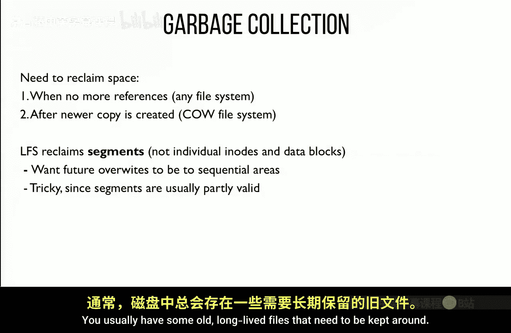

So this is what we're usually going to do。 let's say we know that we need more segments than this。

 we're a little worried having only two free segments， we want to have an extra one。

 So what we're going to do is what's going to be called cleaning where you take two segments that don't have a whole lot of used data。

 10% plus 35%。That's the active data。 And so that's only going be 45% used of a segment if we're able to combine them。

 So I'm not sure what my picture did。 Oh， I combined different ones。 I combined 60 and 35， great。

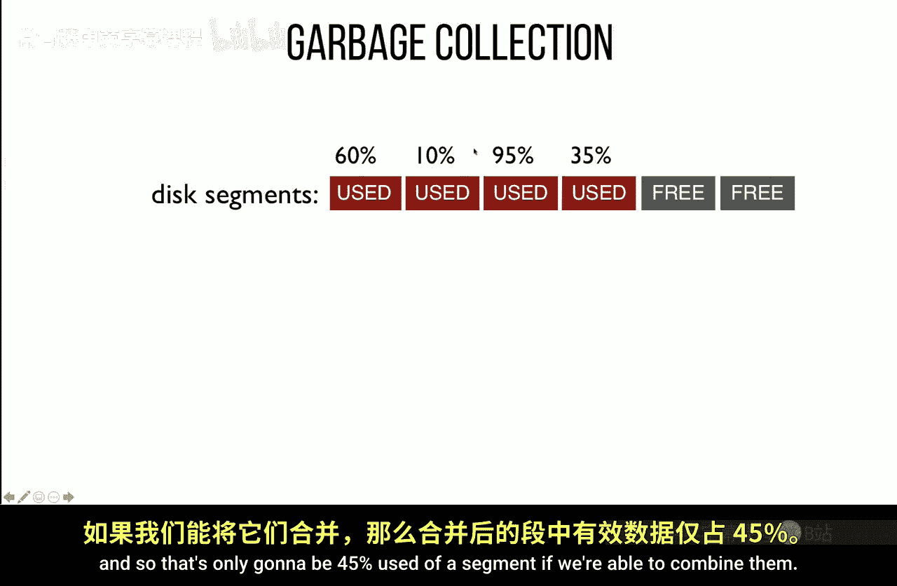

So now I have a nicely used segment there，95% full。 and I can mark these two segments now as free。

 And I now have three free segments that future rights can go to instead。Okay。

So this is going to involve a lot of neat policy and mechanism。

 And so we'll talk about the mechanism for how to figure out what data should be copied and how you do that。

 Okay， because think about this， We're moving blocks from this segment over to this segment。

So when we move a data block， we'll， of course， have to change the i node that's pointing to it。

 So it has the right new location for those data pointers。 And we're changing where an in is located。

 So we have to change the eye map to show that the in is now going to be in this new place。

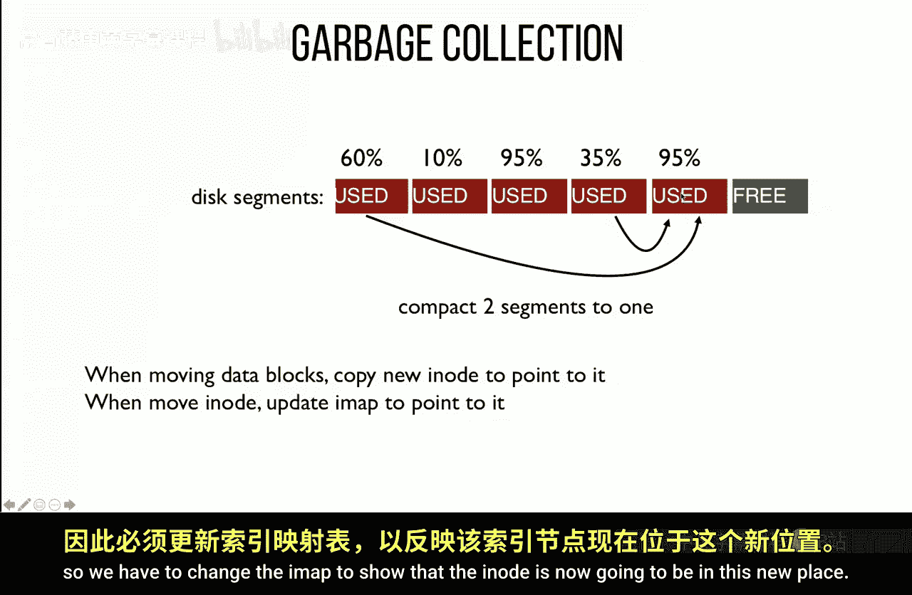

So we can do that stuff。But what's even trickier is we need to know which i noteses are alive。

 and which i noteses are dead， which data blocks are alive， and which data blocks are dead。

 because it's only the alive ones that we want to copy over， the other ones they just get reclaimed。

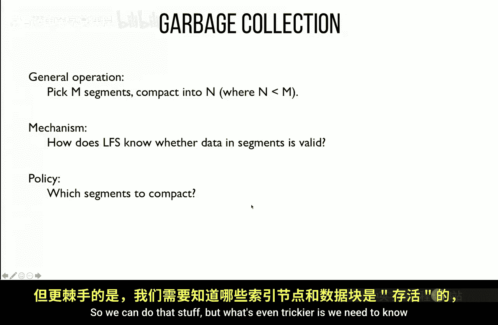

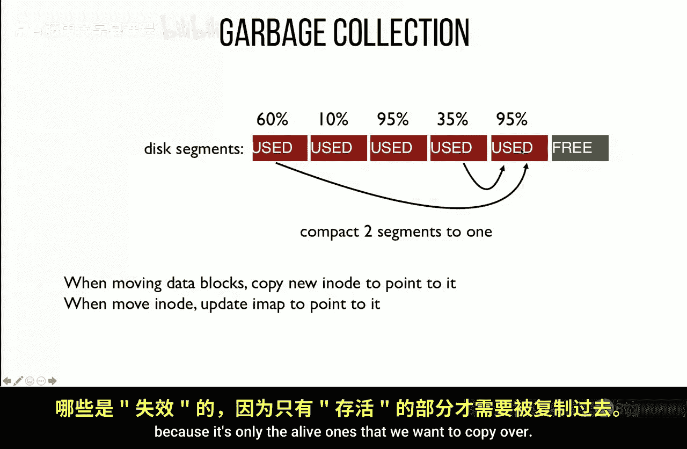

So our last thing to understand is， how do we figure out if an i noteote is alive and a data block is alive。

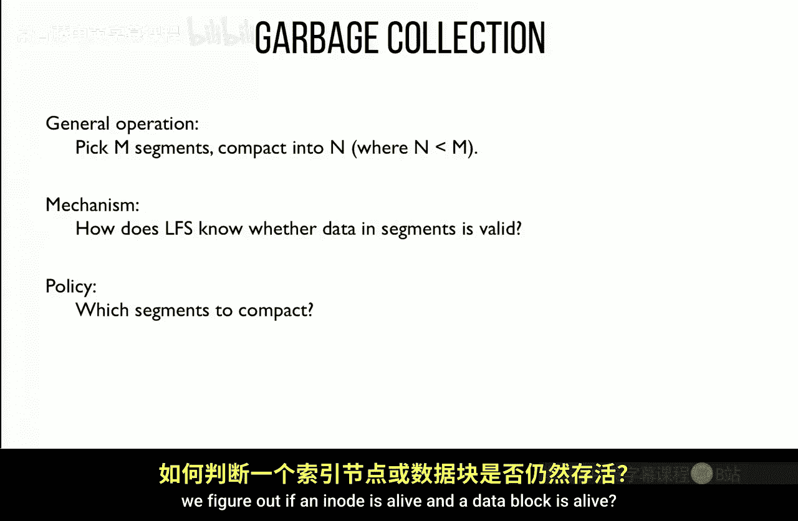

Okay。So this picture is showing this as well。It's the same iode in each case， it's k。

And each of them is pointing to some data。And if we have IMap。

The I map will tell us which one of these is good and which one of these is garbage， right。

Because our im map is going to tell us that this is the current iode。And therefore， this other。

 I know that's the same number that one's garbage， nobody can point to it。

 we can't get to it through the IM。 so therefore this is free space that we should reclaim。

And even better， the data block that this points to is also free。 Nobody can get to it。

 we should reclaim that。So that's the intuition for what we want to do。

 If we can get to an iode and the data blocks through the im map， they're alive。

 If we can't get to them， then their garbage and should be reclaimed。 Okay。

 so i nodes are pretty easy to check to see if they're current。

So when we're doing that cleaning and we're going through a segment and we need to figure out is each eye node free or allocated。

 We just looked the eye map and if the eye map points to this eye node。Then， it is。Good。

 it's an allocated iode， and we need to copy it。 If the I map points to a different location on disk for this iode。

 then it's garbage。 and we just throw it away。 So that's pretty fast。

But what happens when we're going through our segment and we just see some data block。

How do we figure out if that data block is alive or dead。In the previous picture。

 I made it look really simple because I'm like， oh， is there an i note pointing to it or not。

But that implies that we somehow are able to look at all of the iods in the world and see if any of them are pointing to us。

And this IO doesn't have to be in this same segment。 It could be anywhere on disk。

 And we don't know what file this belongs to in normal in F F S or other file systems， right。

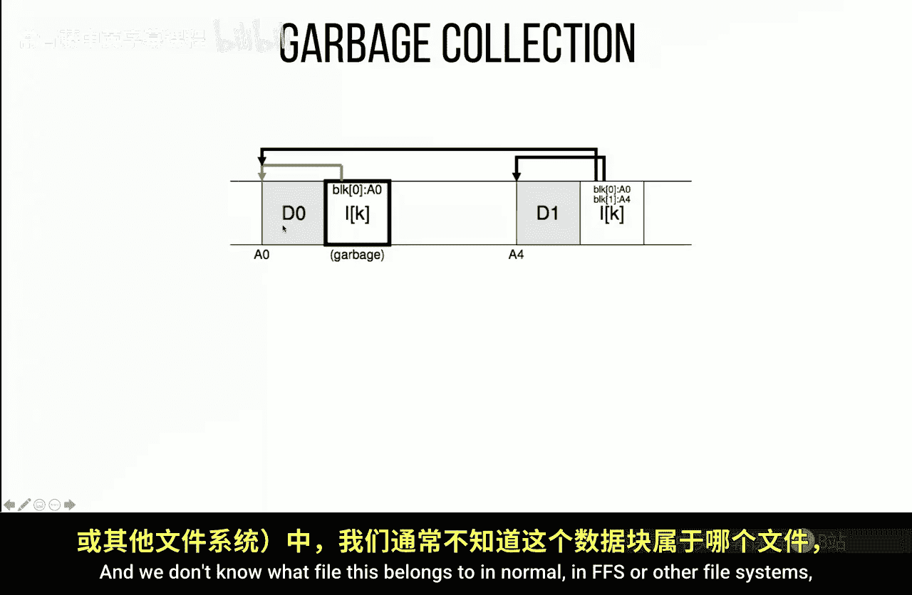

So we can't just scan through all i nodes and see if anybody points to this data block。

 That would be ridiculously slow。 So we have to track some additional information to figure out what data block this really is。

 So one more data structure that goes in each segment。 It's called the segment summary。

And it's like a descriptor for that segment。 And it just tells us what is the iode that we're storing here。

 And then what's the offset within。That file for each of the data blocks， so。

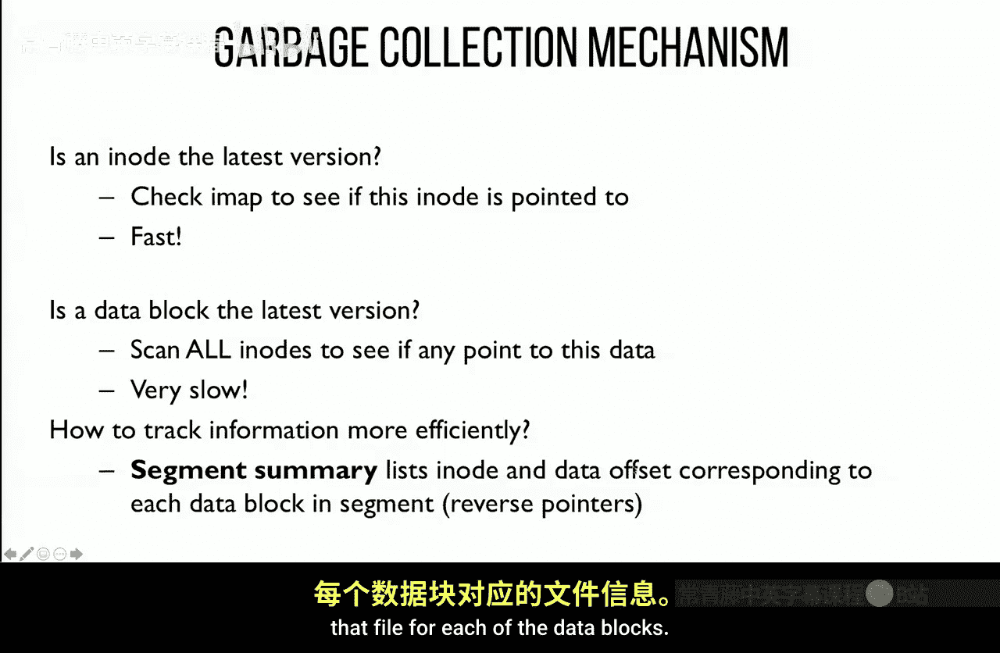

This previous one will be described as Im block0 of Iode K。

 and then itll be much faster for us to do this lookup。

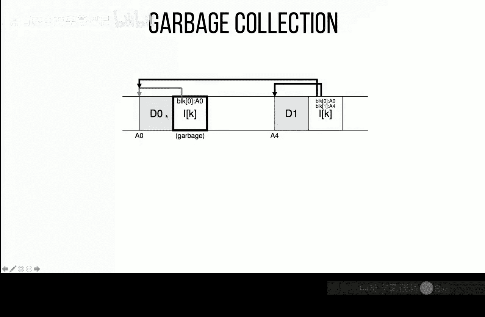

That's not just arbitrary data。 We know where that would be referred to if it is referred to it。

 Okay， so let's do a nice picture。

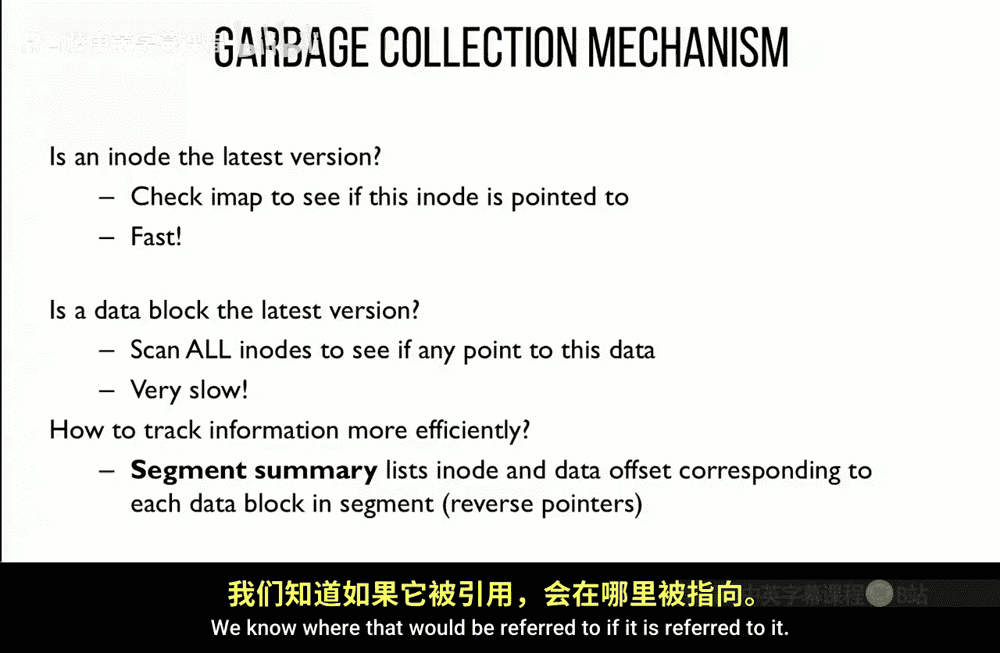

We have some segment that we're cleaning。 There's a whole bunch of stuff in here。 But fortunately。

 we have this segment summary block。 and we want to figure out if this data block is alive or dead。

So what do we do， We look in the segment summary block to find out which I know this data block belongs to and which offset it is within that in within that file。

So we go into the segment summary block to find out what in it is。

 we then look up that iNot in the i map。And see where that iode lives right now。

 the most current version of that iode。And then we know what offset this is supposed to be at。

 but unfortunately， this iNotode is pointing to a different data block there。

 and so now we know that this data block is not the most current version。

 it is not alive and you it's very sad and we can kill it and it's free and this becomes free space that can be used for future rightss。

AVery violent process to do garbage collection in LFS。

But we're able to figure out who's alive and keep them around。 and we just free up the dead。

Ones that we can't reach anymore。Alright。So that's the basic mechanism。 And again。

 I think if you understand this mechanism， then you understand the data structures that are going on in LFS。

 If you're able to figure out， okay， to know that this data block belongs to a certain iode。

 We needed to track that information。 and we can get to the current iode through the I map and then see where that in is point。

Yes。嗯。So like when we're done with a segment， when we've done all of that stuff in memory。

 we'll write out the segment summary describing it。 And then when we're doing the cleaning process。

 we will you know， use it to read what was in here。

 And then we're going to be writing out all of the live data to a new segment in which case we'd write out a new segment summary for that new segment。

If that makes sense。So it's never like we're just doing little modifications within a segment。

 We'd be writing out a whole new segment with all of the alive data from that segment and the stuff that's dead is just why we had that。

 No I think it's。

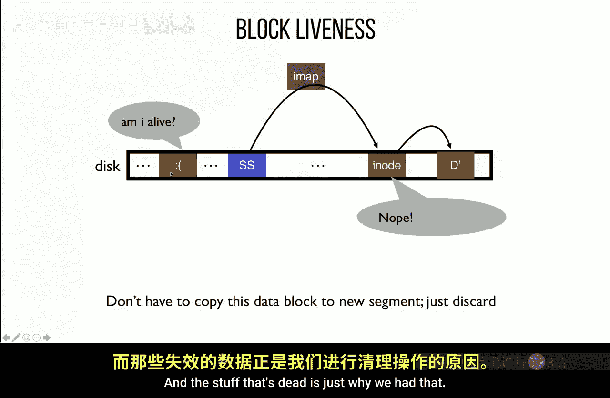

Yeah， if it was dead， then it's just the empty space here that doesn't get copied over to the new block。

And we write a new segment summary that describes。So any questions about that mechanism？Okay。

So that's really the most important part of garbage collection is understanding that mechanism。

 but policy people do look at like， how do you figure out which is the best segment to clean。

So you could combine arbitrary numbers of segments together as long as the total doesn't equal 100%。

 but you don't really know。It it's hard to track well how much free space is there。 But in general。

 it's a good idea to clean the ones that have the most free space since that's going to give you the most free space。

 But another kind of neat thing to do is if you have two segments that look like they have the same amount of free space。

 How do you pick between them。 Well， so you kind of want to find out which one has the coldest data versus the hottest data。

 that hot data is what's referred to as like we're overr it very frequently。

 and so it's changing a lot， And so if it's changing a lot。

 it's becoming dead very quickly because we're having to write to it and make new allocations。

 So if it's this hot data， there's really no reason to clean it right now。

 because if we wait just a little bit longer， it will kill off even more of its old data by writing to new locations。

 So we should wait just a little bit longer if it's having a lot of activity。

 you're better off cleaning a segment that has old long livedd。

Fileles that nobody has written to in a long time， because if you wait a little bit longer。

 it's not going to change much， You're not going to get more free space by waiting a little bit longer。

 So kill off the old data first， I guess， before going to the。The new data。So that's a policy。

Alright。So。Let's do some comparisons now between journaling and LFS。

 So the question I want to leave you with is， which one is going to give better performance。

So they have a lot of different performance regimes。

So if you think about where does data end up with journaling， with journaling。

 we got to pick those final locations like statically ahead of time。

 We figured out how big our group should be。 We figured out where the in should be。

 we had a policy like FFS that was saying， try to keep related inots and data blocks together。

 So we really managed where data lived very carefully。 And when we wrote that data。

 we had to pay the cost when we wrote to it， right， maybe we had to jump around on disk a little bit。

 But the whole idea of doing that was that we hope that when we read the data back。

 that it's organized in a nice manner that's going to match our future read accesses。

 so that maybe we have to pay a cost once when we wrote it， But when we read it back。

 hopefully thousands of times， it's all nicely organized with the data next to other related data and we get good performance。

So that's what journaling did with the fixed locations。

 So we can say that had like logical locality where we got to think about which data should be next to which other data。

The opposite approach we're seeing with LF and with other copy on right file systems is that it tends to just put the data。

Next to other data that it was writing at the same time。 So writing becomes really fast。

 But then later， when we have to do a read， it can be much slower because if we read data。

In a different order from when we， how we wrote it。

 then we're going to have a lot of jumps around the disk and have more random accesses。So。With LFS。

 we're going to do well with reads。 If the order we read the data matches the order that we wrote the data。

 So it ends up having completely different read performance across those two systems。 journaling。

 put everything in fixed locations， LFS。It does the allocation based on when you did the right。

 So if you read it back at the same order that you did the right， then you'll have good performance。

So it's just going to totally depend upon your relationship between how you did your rights and how you do your reads。

 which one you're going to get better performance with。And then the other thing。

 people do a lot of performance comparisons with copy onr file systems and journaling file systems。

 because we started this all by saying。Copy on right file systems are great because they only have to write the data once。

 whereas journaling did twice， so。Nively， you might think copyr is going to get twice the performance of journaling。

 but it doesn't。 And I。Told the reason why。 Otherwise， I would have left that with it。

 Can you figure out why。 And it's because LFS has all these garbage collection costs。

 So if you run LFS on like an empty file system where it doesn't have to do any garbage collection。

 it just performeds beautifully and does great。 But if you then try to benchmark it and run it in a real circumstance when it's been running for a lot of time。

 It fills up that disk， you have to do garbage collection， doing garbage collection。

Uses up your disk bandwidth so that you're not able to do other foreground traffic of rights and do your other workload that you really care about because you're having to do garbage collection。

So LFS does great as long as it's like a fake benchmark where you don't have to do garbage collection。

 But once that's competing with your traffic， it tends to then perform pretty similarly to our journaling approaches there。

 So it really is just kind of a matter of personal preference and style， which approach better。

 again， I think what's neat about copy onr file systems is how easily they mesh with versioning where if you wanted to keep around old copies of your data in case it gets deleted or change。

 And you didn't like it。 the copy onr file system is's going to let you do that much more easily。

So any final questions about journaling or local file systems for that matter。Allright。 So， you know。

 happy Thanksgiving。 I know it's not Thanksgiving time for all of you。

 but I will not see you until after Thanksgiving。 No class on Tuesday or Wednesday。

 And when we return， we'll start talking about what does flash look like and then how our distributed systems build on top of all this。

😊，So enjoy。

