# 威斯康星大学【中英⚡操作系统｜CS 537 Fall19, Introduction to Operating Systems】 p23 P23 Persistence_ Unwritten Contract of SSDS _ University of Wiscon -BV1wUzSB3Ecf_p23-

All right， good morning everybody。 I hope you all had a great Thanksgiving break and that it was truly a break and that you are all now to have。

 I'm sure a very busy two weeks in your life across all your classes。 I'm sure you are very busy。

 I appreciate that， so I appreciate that you are all here today。

 We're going to learn about solid state drives。😊，So a bunch of administrative stuff that you should all know about。

 so you know， Project 7 is available。 it's due the last day of class。

 the last time I can make it available。 It has two parts。 One is within X v6 itself。

 It's to add symbolic links to the file system。I think so that well。

 they're both pretty straightforward。 I think。 So and then the second part is making a file system checker。

 You write that outside of X V6， but it works over an X V6 file system image。

 And so there's two specification quizzes that you should be looking at very promptly。

 there's one on part A that's due tomorrow on symbolic links。 I think that's pretty straightforward。

 The specification quiz on the second part is a little bit trickier because you do have to understand how to interpret these hex dumps of the file system image。

 So you have to be able to just look at， you know a dump of。😊。

What the contents of a disk would look like， understand the data structures。

 be able to look at a bitmap and say， oh， I see where the zero is in this hex representation of a bitmap。

 And therefore I can infer that it's this particular data block that must be free that corresponds to that data to that bitmap。

 So I think it's all straightforward。 but it does take a little bit of time to feel comfortable with that。

 So for that quiz， I'm giving you all three tries。 and the deadline for that part B will be Thursday。

 So you have some time after discussion section， yes。Correct。

 the 11th of December is when Project 7 is due， yes。All right， no surprises about that， right？13。Oh。

 O。 yeah， the due date is different than the available date。 Yeah。

 due date is when things are due available just means it gets hidden in canvas after that point。

 which seems weird to me sometimes。Any questions about Project 7。

 So the T A should be going over this in discussion section tomorrow。

You can still ask for project partners， if you like。

 if you do work with a project partner on one part of it。

 you do have to work with that same person and with that person for the other part。All right。

 final exam that's on Friday in the evening we're in two rooms， go to the room in social sciences。

 if your last name starts with A through H， go to the humanities room。

 if your last name starts with I through Z， it's very similar to the practice exams that are available as well as to midterm one and midterm two that you saw。

 It's that same style of it slightly cumulative。 there'll be some true false questions that are variations of the true false questions that were on the virtualization and concurrency exams。

 and that'll be worth about 25% of the final exam。And then on Tuesday we're not going to cover any new material in here。

 we'll just be doing a review over this last section on persistence if you have specific questions you would like me to cover。

 there's that form that's available on canvas that just you can dump some questions that you want to ask that I'll go over then Tuesday morning and then Wednesday we'll spend that discussion section on exam review。

So any questions about the exam or stuff wrapping up？All right。

 so today we are talking about solid state drives， and then on Thursday。

 we'll have our last technical lecture that talks about distributed file systems like NFS and AFS。

 But today we're still in the local file system world where we're trying to understand what new device technology looks like that a lot of what operating system designers do is we react to new workloads and we react to new technology So if there's some new technology out there。

 we have to understand its performance characteristics and its reliability characteristics so that we can modify the file system or kind of give encouragement to applications running on top of the file system for how they should use that device to get better performance and reliability。

So we need to understand how SSDs are built and then what the implications are for file systems。Okay。

 so we started learning a lot about hard drives。 And that's somewhat historical， but not entirely。

 So if you look at what storage devices are in most data centers today。

 it's still the case that most of them， most data is stored on hard drives in the world。

 If you look at what's in the cloud， it's mostly still storing data on hard drives。

 But solid state drives are certainly up and coming。

 That's what's going to be available on all of your new machines and on your laptops。

And a lot of that has to do with the fact that the price of solid state drives is dropping dramatically。

 And so as they become a better cost alternative， they will become more dominant。Alright。

And if you look at like how are manufacturers doing。

 they are getting a lot more money out of solid state drives than hard drives these days that it used to be that most of the money the manufacturers got was through hard drives。

 Now， it's do solid state drives。 Okay great。All right。

 so so far we've been assuming always that we're running on a block based device。

So what that was nice with was that our file system could just treat the storage device as just。

 you read and write arbitrary blocks。 And we didn't need to know anything about the performance characteristics or any low level details。

 right， That was what was beautiful about that。😊，So what you can do。

 So that picture there is it's an old hard drive。 And then we move some to some solid state drive with no moving parts。

It is possible to just run unmodified file systems and applications on top of that。

 And you'll get some performance that we want to understand。

Or you can take your new storage technology， and you can figure out how you should modify file systems to get better reliability and performance with that new technology。

 And you can also write your applications， your databases， your key value stores。

So that they also take advantage of the performance characteristics of this solid state drive。

So we want to understand what we should do there。 this is annoying today。Yeah。Okay。

You love this microphone。Okay， so if you don't know how a solid state drive works and you just run some workload on it that hasn't been modified。

 it's possible that you're going to get really unexpected bad performance so the graph on the left is an actual graph running on a solid state drive over some amount of time and if you don't use it correctly and you just try to totally do a huge right intensive workload for a while。

 you'll get some great peak bandwidth， and then at some point the device can't keep up with that。

 it has had a lot of fragmentation， it's done a lot of bad merges and then you just can't get anywhere near the peak performance anymore。

That's kind of a rare case。 what's much， much more common is that there's some steady state performance that you'll get as you access the device。

 but then you'll see these peaks where you see much worse latency for a particular read or right operation and so we'll learn that that's because maybe there's some garbage collection going on in the background or some wear leveling going on in the background and your foreground traffic is going to get impacted by those background tests that have to run。

And then in the worst case， you don't use the device correctly。

 and your device ends up dying a lot sooner than you would expect。Okay， so let's understand this。So。

 so probably we've been thinking a lot about like， what the interface is that you program to for a device。

 like you just read or you write an individual sector or block， right， We understand， read and write。

But it turns out that。Devices have unwritten contracts as well。

 So the API is like the written contract is what you must have what you must do。

 But unwritten contracts say， like， well， how should you use this device to get the best possible performance。

 So what did we learn about hard drives。 How would you want to。

Access them to get the best possible performance。 What type of workloads work well。Yeah。Sequential。

 great。 So we know that you get much better bandwidth if you access the drive sequentially and then what other types of workloads do better。

So basically， any workload that doesn't do far seeks that if even if it's not completely sequential。

 if your next axis is pretty close in the linear block address space to the previous one。

 it'll have a shorter seek distance and you'll do better than if you were randomly seek all across the disk。

 So the unwritten contract for hard drives was pretty straightforward。

 What we're gonna to see is that solid state drives are much more complex。

 and they're much more difficult to use correctly。 So that's what we're talking about today。

So what we're going to see is that instead of those two simple rules。

 we're going to have five rules for how to use an SSD well。

 So one is you should send lots of requests or very large requests to an SSD。

 the locality does matter。 if you access the same blocks over and over again。

 you will get better performance or blocks that are near one another。

 if you have requests that are aligned to some block unit that we'll talk about you'll get better performance if you group blocks that were going to die in the future at nearly the same time which means they're getting overwritten that you're writing a new version of those blocks。

 you'll get better reliability and performance and also if you tend to write out blocks that all are going to die at the same time in the future that also helps your reliability and performance。

 okay so none of this should be obvious to you yet。

 we have to understand what an SSD looks like before those rules will make sense。

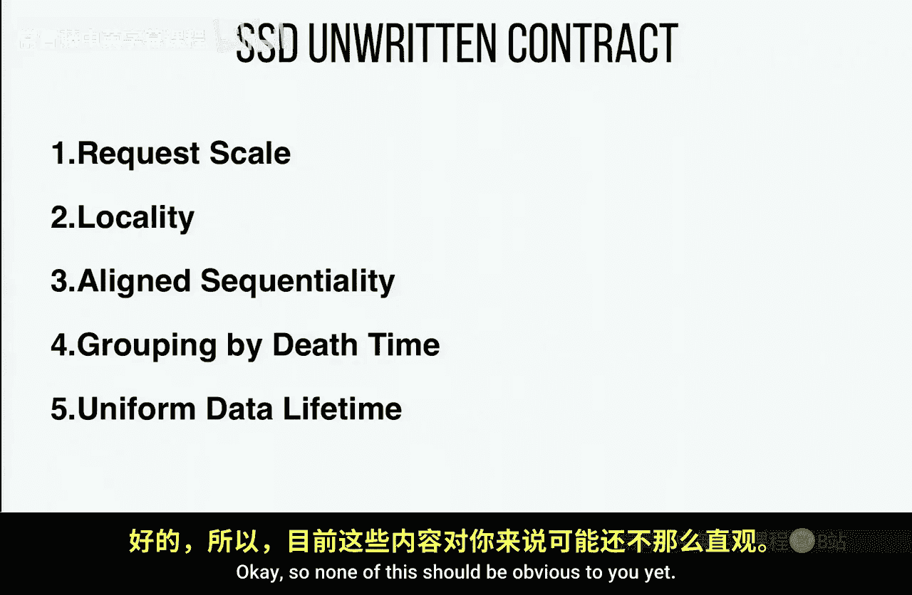

Okay。So this I hid some stuff because first we want to understand just flash and so solid state drives are built on top of a flash technology。

 but then they add some stuff up here that we'll talk about later。

 but what is basically flash so flash will be composed of pages。

 pages are grouped together into blocks。Blocks are grouped together into channels or planes or banks。

 and then we'll have multiple of those channels on our SSD。

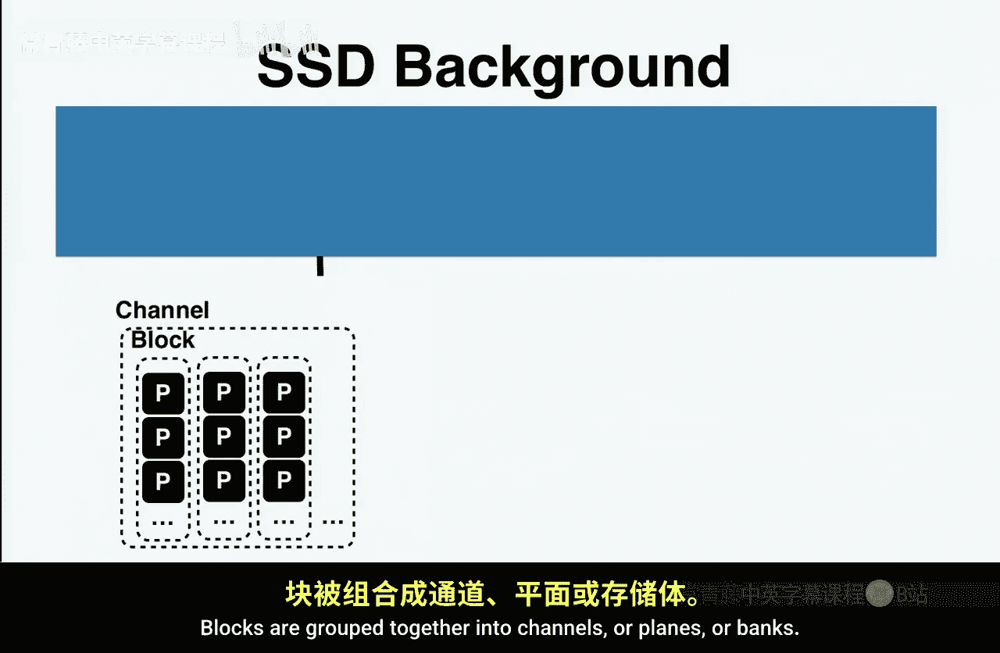

So we want to understand pages， blocks， and channels， and then later。

All of the stuff that's being hidden up here。Okay， so but what you will quickly see is that there are no moving parts in flash。

 that's why it's going to have such great performance for beads and rightss。

 just is basically holding some charge in some cells。

 we're going to be able to access it very much in parallel， no seeks going on。

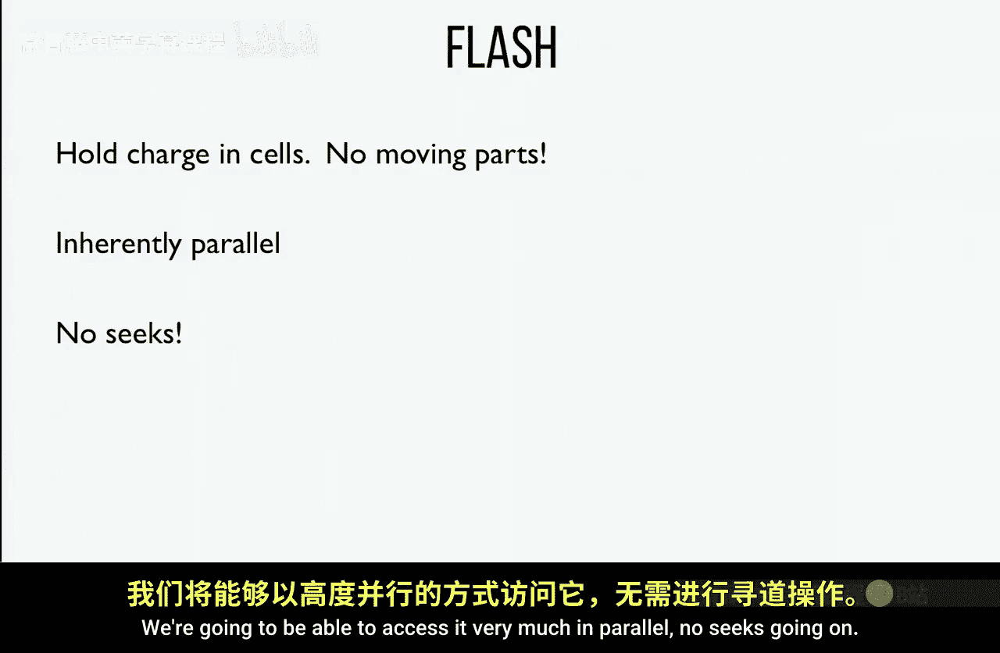

So we talked about the fact that there are these parallel banks or planes or channels。

 I'm going to use each of those terms randomly， I think throughout today， but you can in parallel。

 access each of those banks。 You could be doing a read at one bank right on the other bank。

 All of those operations can go on in parallel that you're going to have some internal bus within the SSD that can handle the bandwidth that's needed to go to each of those individual banks。

 So that's our first level of parallelism here。Then let's kind of go completely down to the lowest level here。

 An individual cell。 So an individual cell can hold an individual bit。

And so there's a couple of different recording technologies， so these are NN cells。

 and it's a single level cell。 So a single level or SLC just means that within one cell。

 we can store one bit。 if it's completely charged， of course， that's a one， if its has no charge。

 we'll call that a zero。 So one level one cell one bit。

Another technology is what's called MC or multilevel cells。 So here within a single cell。

 you can have multiple levels of charge and we'll have different thresholds。

 And if we cross that if we're in certain bounds， we'll call it a different2 Bs worth of information here。

 So the two extremes are obvious。 And then in the middle， if it's just past some threshold。

 But below some other threshold， we'll call that a 0，1 and then a 1，0。So within a single cell。

 depending upon the exact amount of charge， it can hold different values。

 So that's a multi levelvel cell。Okay， very low level stuff。

So let's think about this technology a little bit so you can buy an SLC or an MLC device and they tend to have different costs and different capacities and different reliability。

 So if you had to think about this， not just guess if you were told you have a SLC versus an MLC device。

 which and they have the same capacity， Which one do you think would be the most expensive then。

Raise your hand if you think it's SLC。Raise your hand if you think it's M LC。Intering， Allright。

 so S LC is going to be more expensive because we need more of these individual cells， right。

 So if we're having the same capacity， that means we have more of these cells。 where。

 and we're just only holding one bit in each of those cells。😊。

And then which one is going to be the most robust。Raise your hand if you think it's going to be SLC。

Raise your hand if you think it's going to be MLC got Okay， So this one's SLC。

 that all we have to tell is is it charged or is it not charged just a 1 or a 0， whereas with MLC。

 you have to be able to differentiate between all of these different levels。

 So it tends to be not as robust。 It's more sensitive to errors over time。 So generally。

 the SLC technology is more expensive and more robust。

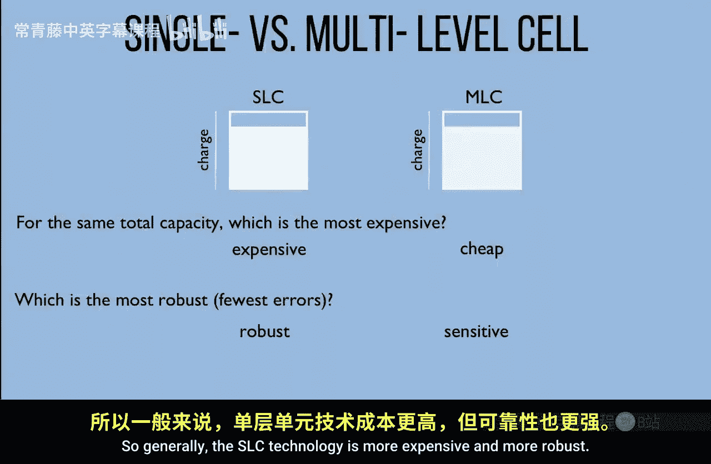

So what does that correspond to then So there's something that we have to worry about that's called wear out。

 So you can only write to a cell of an SSD a fixed number of times。 and it's very。

 very different depending upon if you have an SLC or an MC device。 So with SLC。

 it's about 100000 times MC it's just about 10000 times before you're going to start getting errors on those individual cells and then the pages that are corresponding to those cells。

 So what devices are going to need to do or what the file system is going to need to do on top of that device is will be what's called wear leveling or you need to make sure you want all of the cells to die at about the same amount of time because that's when your device dies right it'd be very bad if you just kept writing to one cell over and over again。

 that cell dies and then you basically have to throw away your whole device。

 whereas if you had even doubt or you had done wear leveling you had made all the cells be written about the same amount of times then you're going to prolong the lifetime of that device。

 So that's what we're going to worry。A bit about。How can we do wear leveling so that all of the cells have the same number of rightstes over time。

So how do you actually write to flash？ So there's two different steps here。 So the first step is。

You can write zeros to something that has previously been erased， so if it was filled with ones。

 you can then write zeros to it and you can do these writings or these program programming at the fine granularity pages。

 remember pages fill up blocks。 so you can write zeros to individual pages。

 but then if you want to rewrite that， you have to erase a whole block and fill it up with ones again。

So this is a much different interface than what we saw for disks， right。

 where just you just wrote whatever you felt like writing to a sector of a disk。 Here。

 you have to erase a block and then write a page back there。 So what does that look like。

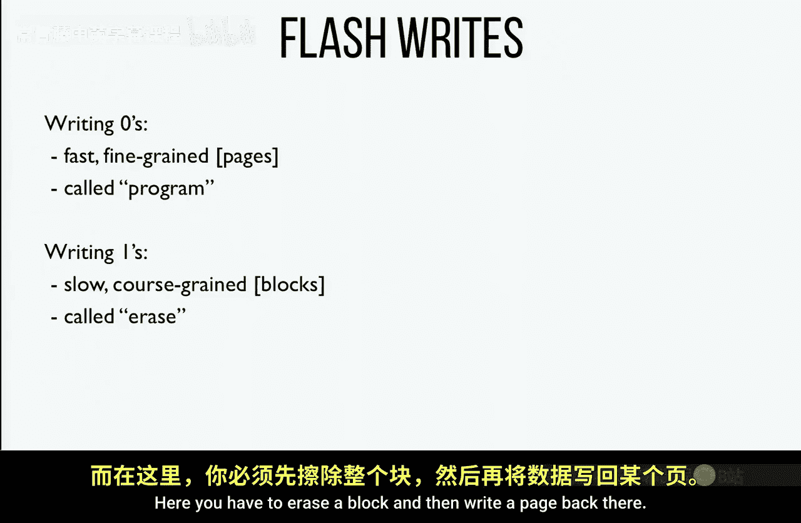

Remember， we have our banks that we can access in parallel。

 Each bank is going to be divided up into multiple blocks。

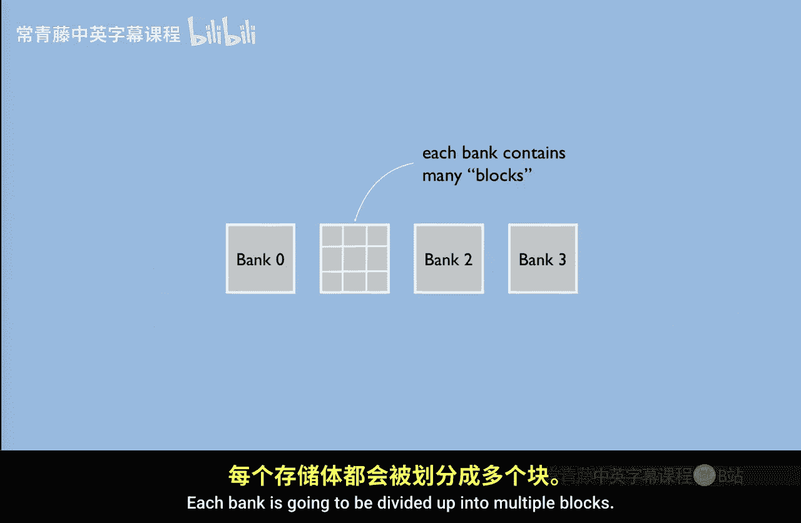

And each block is divided up into multiple pages。At this point， it's all erased。

 It's nice and empty for us。 And so now we can write to any page that we want to hear。 So。

 for example， we could program。 That's the word for write， an individual page here。

But we can't now rewrite to that particular。Page， if we wanted to rewrite to that individual page。

 we would have to erase the whole block， and then you can program an individual page again。Alright。

 so let us see if we understand this API。So with disks。

 we were just reading in writing individual sectors So 512 bys。

 That's the smallest unit that was guaranteed to be atomic not a disk。With flash。

 let's just remember from what I just told you for each of these things。

 Is it a page or a block that were。Reading or writing。 So with flash。

 are we able to read or write a page， Sorry， Are we able to read a page or a block。

Raise your hand if you think it's blocked。Raise your hand if you think it's Paige。right。

 so it's a page that's the smaller units。 You can read smaller units。

 You can read individual page of flash When we do the writing， when we do an erase。

 when we switch everything over to once， Was that to a block or to a page， Please mumble as a class。

 Are we erasing a block or a page。😊，多。😀Yeah。😊，All right， so this is trickier than we thought。

 All right， so you're erasing a whole block， that's the large unit。

 and then you are programming an individual page on that block。

 you can change some of those ones to zeros。😊，Okay。Alright， so some more terminal。 Yeah， should。Yes。

Yes， so now at this point when therere one， I could then come back and program this page。

 I can program this page， I can program this page， you can go。

You can switch any one of them from ones to zeros。It's just to go from a 0 to a 1。

 You have to erase the whole thing it once。 Yeah， good question。All right。Okay， more terminology。

 okay， so let's see if we're remembering plain block page， so which can be accessed in parallel。

Mumble has a group playing blocker page。Okay， talk with your neighbor。For a minute。

See if you can fill in all of these and we will get the answers。All right。

 so plain blocker page can be accessed in parallel。Planes， yes。

 those are those channels or those banks or those planes。

 you can be having requests going to all of those banks or planes at once。

And then what's the individual units that you can read or program， it's the smallest unit。

It is a page， and then you have to spend a big expensive operation to erase a whole block at once。

 that's just the way the technology works。 We are not going down to that level of why that is。

All right， so what must it be that fits some number of pages。Block， yeah。

 I'm just trying to go up the hierarchy。 Blocks are made of pages。

 Thats to give you some sense of scale。 How many pages about are in a block。

 that's going to tell you a little bit about that cost relative。 you're raising a whole block。

 then getting to program or write an individual page。 And then this must be the size of a。Page。

 there's no other units there other than bytes。 That's what fits in a page。 And then。

The last thing is a plane， and that's composed of many， many blocks。

So this is general order of magnitude。 These are probably on the small side for the number of blocks in a plane。

 Of course， you're going to have many planes as well。 and then the number of pages in a block。

So any questions about that terminology， yeah。Yes， exactly the same word。Yes， bank。

 plane and channel are all the same and I will not keep track of which word I am using when I use those。

 we will not be consistent or anything like that， those are the words that are used for those things yep。

So how often does that change across models and stuff， I really don't know。Yeah， I mean， certainly。

 you can't configure your given SSD to have different sizes that I'm aware of like you buy this SSD and it has these parameters fixed。

I guess if you ever needed to be told， I would tell you how many。

 but assuming some number between that range， those are good assumptions。Sure， yeah。Yeah， so right。

 across， you can be accessing multiple planes， so you could be accessing multiple blocks that are in different planes。

 but you couldn't be accessing multiple blocks that are in the same plane in parallel the way that we're getting our parallelism and our speed out of our devices by sending requests to different planes。

Right， well， we can program an individual page。 But when you erase， it's a whole block。

So programming， we can switch from ones to zeros for an individual page。

 But if we want to clear it all out and be able to rewrite to a page。

 we have to erase the whole block。Great。Yes。Correct， you can read an individual page。

 and it could be across different banks or channels all in parallel。 Yep， exactly， great。Yes。

So cells are the bits that are making up our pages here。Perfect， any more questions？O。

So what's amazing about these things is just they get so much better performance than your hard drives that we understood in the past。

 So to get peak throughput out of the disk， maybe that was 130 mebytes per second。

 That was only for sequential traffic。 with flash， you can get more like 200 MBbys per second。

 But what's important here is that it's not just for sequential workloads that even workloads that have enough outstanding requests that are random can get really high throughput as well。

 So you have to be sending it a lot of requests to get 200 meby per second。

 but they could be random requests that are going to different banks。

And then the latencies of flash are just much， much better than disk as well。 So with this， remember。

 it was like 10 milliseconds to just do one individual reader， right。

 Now we have three different latencies we need to worry about。

 And you should be able to probably guess。Which operations of read or program or erase each of those three times correspond to。

 So what's probably really fast， read， program or erase。Reading， and then the middle time。

 is that probably programming or erasing？That's programming because it's just an individual page and then it really is expensive if you have to erase a whole block。

 so we do want to minimize how often we have to erase things。

 but then once we're able to just it is erased。 if we have a bunch of free pages in the background。

 free blocks in the background， it'll be relatively inexpensive to write them。

 but writing is going to be a little bit more costly than reading on flash。Yeah， you。

Don't let to do it over。Right， this is a very， very low level operation。

 Ersing just switches those zeros to one so that we could do a future program or right。

 So SSDs are going to have a new operation。 Actually， it's called like trim or discard that says。

 like we don't care about this block anymore。 It's a new API that the file system is going to have so that the SSD doesn't have to track that because we're going to do a lot more work inside the SSD than the hard drives did。

 So that's going to be a useful operation。 So high level。

File system delete might end up calling this trim or discard command。

 but that's very different than the erase。Yes。It's just a technology thing that's below my level of。

Understanding or want to get into， yeah， that's just how it works。 you have to erase the whole block。

 Yeah， yes。Well， it's often， again， I mean， you're having to set the charge levels that's just harder to do than reading。

 but I don't know the exact why it's this exact amount more。

But programming or writing is a little bit more expensive than reading。More questions。O。Alright。

 so now we're going to get to move up into file system implications。So before。

 when we built our file systems on top of a storage device。

 we just viewed it as a linear array of blocks or sectors。 and we could read or write them。

 It's a little bit different with flash， but it's still kind of similar。So as file system developers。

 this is what we're interested in doing。 If you really wanted to do a lot of work。

 You could come up with a completely new file system that's designed just for flash。

 It's going to use that program in a raise interface。 It's going be able to deal with wear out。

 do some where leveling and things like that。 So there are some file systems like that。

 But the way that the field has gone is it's more like we。😊，Well。

 we're not gonna to do this approach。 We're gonna go through a couple options here。 Okay。

 so another option would be you just take your traditional file system like FF S or LF S， E X T 3。

 And we run that on top of flash， the flash that we've talked about。

 But we need to build a translation layer to go from our read and write block operations that the file system knows how to do to these。

😊，Program and erase operations。 So reads that the file system will send to flash will be relatively the same。

 right， We're just。Reading individual pages。 But what happens on a write。

 So rights are kind of painful now because we're going have to do a whole bunch of extra work。

 So this， let's say the file system wanted to write an individual。sectorctor。

What we're going to have to do， we're going to have to read back a whole block。From the flash。

 we'll modify the individual sector that we wanted to within that block in memory， right。

 And then we have to erase the whole block。 And then we have to program or write out the whole block again。

Because we can't just modify a single page within that block that we wanted to change。

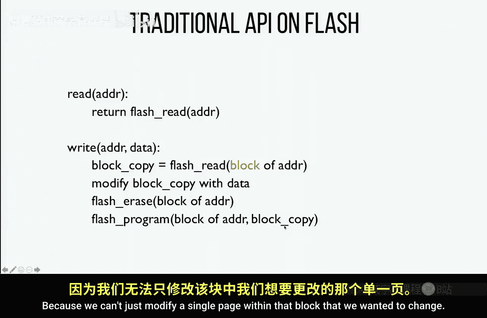

So this visualizes it pretty nicely。 We have a file system， and it wants to change， let's say。

 a bit map。 It wants to just mark something is allocated。 wants to change a single bit here。

 What's all of the work that it needs to do。 So on a disk， we just would have。

 we could have written out an individual sector containing this。 What do we have to do on flash。

We read in the whole block。In memory， we can modify the bit that we wanted to on a page or whatever。

 and then we have to erase the whole block out there before we can change any of those。

 and that's why we had to read the whole thing in because we're going to have to write out what we remembered there and program them all back。

So that's really， really expensive。 Remember， we looked at how expensive it was to do in a race that's。

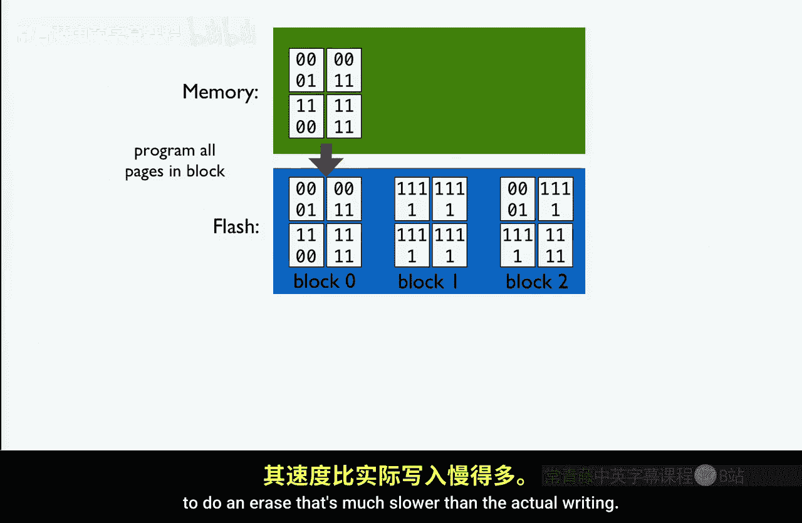

Much slower than the actual writing。So this causes what's called right amplification。

 You wanted to do a small amount of writing， and that translates into many more right operations or to much more data that actually has to be written。

So in our example， let's say you wanted to just write one2 kilobyte page。

 what are you going to need to do now， you have to read in the whole block。

 you have to erase that whole block， and then you have to program back the whole block to switch that one bit that you wanted to so a lot of extra work if we are so oblivious and we don't do things the right way。

Okay， so if we were just randomly changing bits in our file system。

 we would do all of this extra right amplification and it would be really， really slow。

So let's think about what types of workloads would actually perform much better。

 So if we were modifying。Bits or sectors sequentially。 then if this wouldn't have so much overhead。

 right， because you would read in that whole block。

 you would change all of the pages that you wanted to modify at once that corresponded to this big sequential operation。

 And then you could program all of those blocks than again at once rather than having to do that end times。

 So the implication of that is that one of these file systems is going to perform much。

 much better than the other on flash。So what do you remember about F F S and what it's。

Access pattern looks like for rights。 And then what do you remember about L FS。

 the log structured file system and what its right pattern looks like。

So raise your hand if you think FFS is going to perform better。

Raise your hand if you think LFS is going to perform better。 Okay， yes， yes， LFS will perform better。

 It's that log structured file system。 The whole motivation for LFS was that it was going to work better on a certain raid technology。

 Ra 5。 We saw that Ra 5 also didn't do small rights very well because it has to update that parity block。

 So they came up with LFS to do a bunch of sequential rights。

 And so sequential rights are going to work really well on flash as well。 And in fact。

 what we see over and over again is that this new technology gets invented and always sequential things end up just working better and log structured file systems end up being a really good solution。

 Yeah。😊，It definitely can help with wear out as well。If you just like the current version of AlFS。

 if you just ran it on flash， it wouldn't know that it has to do something with wearout。

 and so it might not do the right thing， but certainly you could modify AlFS to take into account wear out。

 and then you would have a file system that probably looks more like those ones that I put on the opening slide where you're coming up with a new file system specifically for flash and it's going to deal with with wear out。

Yeah， but log structured is a good thing to do。So a copy on right fileile system or LFS that writes out a bunch of changes all at once sequentially is going to be a really good match to this flash technology。

But we're not going to just want to run AlFS， other people like other file systems for different reasons。

What we're going to do instead is we're going to have some hardware that is translating blocks for us within our SSD。

 So we're not running directly on flash。 We're using an SSD。 So what does an SSD have in it。

 It has this F TL or flash translation layer that's taking what looks like a。Logical block address。

 And it's converting it to this physical address。 And so that's doing a lot of the same thing as what we saw with Ra。

 where there we had these， this logical list of blocks。

 and then we translated that to individual blocks that were on different disks。

 in different locations and might be replicated or not。

 So here it's that same abstraction where you have a logical list of blocks。

 And that's going to go to different places on the flash in different you banks。

 on different blocks down there。In a array we were able to just use some simple math， right。

 it was just like you do some modular， you do some division。

This F TL is going to be much more complex。 It's going to be mapping that we do on the fly。

 That's just like， you know。Hash table， that shows where our logical address lives currently on the SSD。

 what its physical block address is。Okay， so let's us look at an example。

So this is our FTL layer that's inside the SSD。And this is the interface that the file system sees。

 it's a linear array of blocks， the logical space， and then the FTL is translating those sorry they should be pages。

 it's taking these pages to different pages in different blocks。

 and so that's what the FTL is tracking is this mapping here。So now what happens。

 the file system wants to write to a new page here。Well， in our old approach， we would have had to。

Remember， read in this whole block， modify the one page， erase the whole block。

 program the whole block back to make that one change。 Now we can do something smarter with this FTL。

 what the FTL is going to do is it's going to just make a new mapping for this logical page probably someplace over here and just remember that new mapping。

 So that's what's so awesome about what goes on。 So picks this free page。

 It could see that it was free because it's gonna to keep some status information and we could tell it probably was because it was all ones。

 And then we just program that in。 It was all one， so we can do the cheap program operation。

 and then we what we need to do now。 we just need to update our FTL mapping and remember that logical page one lives over here。

 so that if later we want to read logical page one we'll know that that lives over here。

So that's much， much faster。And we just need to now know that this is invalid。 It's garbage。

 And so we have to do garbage collection within the SSD itself。

 It needs to know that this is free and it can be used for right to a new block sometime in the future。

 So lots of complexity going on in this FTL layer。Yeah。What。

It's going to mess with locality quite a bit。 Yeah， and we're going to have to。我是。In most cases。

 it won't really matter now to applications if blocks are near one another in space anymore。

 because as long as there're to different channels， you still get that good bandwidth out of it。

 We don't get better performance now for having sequential accesses or not。

 So that's what's kind of nice here。 So we kind of destroyed the original locality。嗯。

And it's going to have to now pay more attention to like where leveling。

 to make sure that individual blocks aren't written more than others。Great。

 so this one is going be garbage collective sometime later。All right。

 so now our F TL has to track all of the physical pages， what their state is。

 So there's three possible states。 A block could be valid， invalid or free。

So let us try to label some of these pages， which pages look to be valid right now。

They're the ones that are being pointed at， so for example， this one here。

 everyone being pointed at is valid， which ones are invalid？

The invalid ones are all the ones that no longer have a pointer to it。 So， for example， those there。

And then all the blocks that are free。We have to know this from more than just the fact that there are ones there。

 but we were tracking this， that this has not been written to， there's no mapping to it。

 therefore it's free， and then we can just program those pages later very inexpensively。

So we need to track for each physical page， is it valid。

 invalid or free in the FTL so that it can do this smart mapping？O。So a quick quiz。

What operations end up causing each of those transitions。

 so I'll give you a minute to talk with your neighbor and then we'll just make sure you know what those are。

All right， so to go from invalid to free， what must have happened？Did you relocate the block。

 did you erase it or did you program it。I heard all three， I think so one of those was right。

To go from invalid to free， did you relocate a race or program。Ese all right， because you erased it。

 you change it to all ones， now it is free， you can use it for future right operations if it was free and you did something to it。

 what would you have had to do to it to make it valid？😊，You must have programmed it。

 you have a mapping now， you did a right to it， there's some data there that the file system cares about。

 and then how do you go from right to invalid， you must have relocated it。

 you rewrote to a particular block and now the old location for that the physical page for it。

 it's garbage now it's invalid and we'll need to recycle it and make it free later。Okay。

So questions about this， yeah。开始。So every time you write to it。

 you could write to it in the unit of a page。 Yeah， so。

That's what we're assuming here is we have individual page mappings。嗯哼。😊。

RightSo if if we write to block， sorry to page 3， we're going to end up taking a free page and marking that one as valid。

 and then the old one will become invalid。Well， so I mean。

 think about we're doing rights at like the logical level。

 the file system has some data structure here it has some in here that it cares about。

 so it wants to write to that particular iNote and then within the SSD。

 there's this flash translation layer that's moving around where your in actually lives on the SSD and so first it lived here and this one was valid。

 but then when you rewrote that in， it needed to allocate put that in a new place so it found a free page。

 it then marks the old one is invalid and it updates the mapping to show that now three lives over here on the SSD and that this is the valid entry。

Is that your question？Okay。I这。Yeah， we want to be able to write one page at a time。

So if we wanted to write a block， So we're going to kind of get into this issue， I think。

 next that you're getting it。 There's different ways that you can get better performance。So。

I think we're going to get into that。Okay。All right。

So so far we've been assuming we have a mapping in our FTL for every single page。

 but that just isn't realistic， so let's figure out how big our mapping table would have to be for a reasonable size device。

 so we have a 200 gigy SSD。 We have pages that are two kilobytes that's assume it takes 4 Btes to record a mapping from a logical page to a physical page。

So we're going to have some RAM in our SSD that's holding these mapping tables。

Because we need that to be faster than we don't want to store it in the SSD itself。

 our mapping table is being stored in RAM in the SSD。So how big would this need to be？

We must have 200 gigabtes divided by  two gigabyte pages。 that's how many pages we have。

 Each page requires that much information in the mapping table。

 so we're using up 400 MBbytes of Ram just for these mapping tables。 That's too expensive。

 We're not going to do this yeah。It certainly is an issue。 I I can't remember if， like。

 I'm sure some have。啊。You know that they that this is battery backed or that we are going to have ways of。

Flushing these things out periodically， because we aren't going to keep the whole。

 No solution is going to keep this whole thing in Ram。 And I just don't remember if it's。

 can you keep it just as a cache that you can reconstruct or not。Yeah， sorry。All right。

 so there's gonna to be two different ways of dealing with the fact that these mapping tables are too large。

 one is we'll keep most of the mapping table out on disk。

 on the flash and will'll only keep the active part currently in RAM so this is going to be why we're going to have to have good locality with our future accesses because if you access portions of the mapping table that are in RAM you'll get good performance if you access portions of the mapping table that are on flash。

 you'll get poor performance。Or the other thing that people can do is they're going to have what we're going to learn about。

 which is a hybrid mapping， which means we were not going to keep page level mappings for every page。

 only page level mappings for some and block level mappings for others。Okay。

 so I think we are done with what。Is all of the background。

So those are our channels which are composed of blocks。

 which are composed of pages now you know that there's also this controller。

 this FTL that's on the SSD， it is in charge of all this address mapping。

 it's in charge of doing the garbage collection to figure out which pages are invalid。

 it's in charge of where leveling of making sure that different pages get the same amount of rights to them or traffic so that they'll all die at the same time。

 and then the SSD also has some RAM as well that's caching these mapping tables。Okay。

 so that's all the background， how are we doing？

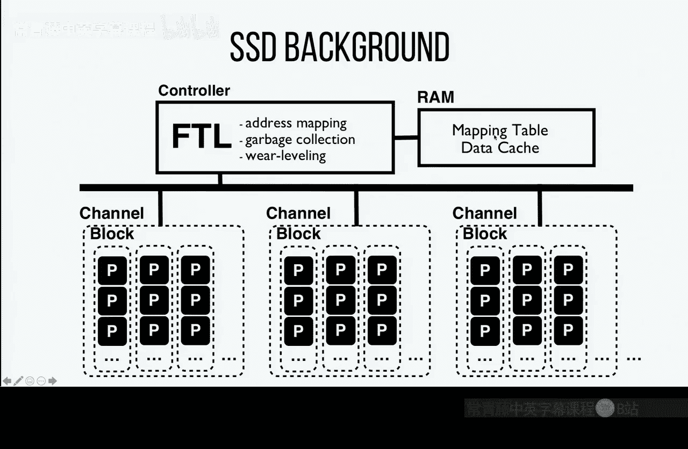

Plenty of time。Okay， so that's kind of like all of the architecture stuff。 Now。

 we are in an O S class。 We want to figure out how to use this new technology well。

 And so what we'd like to be able to take from all of。That background， all of that。

 how the thing behaves is figure out what are the performance characteristics of that device then。

 What is our unwritten contract， How should the file system or applications that are written on top of that file system interact with the SSD to get good performance。

 Okay， so what we're going to see now is given how the SSD works。

We're going to get better performance if we follow these five rules。

 if we send large requests or many requests to SSD。And we'll just go over all these。

So the first rule is pretty straightforward。If you send to the SSD a large request or many。

 many out many。Small requests randomly were going to get good performance and the reason for that。

Is that your request can go to all of those channels in parallel， all of the channels are active。

 they're delivering their peak bandwidth， so that works really really well。

So the implication for this is when you're using an SSD。

 either send many large requests or even many small requests and you'll get good performance and if you don't do that。

The student did a nice little animation， I think。If we only have requests going to like one channel at a time。

 then you're not using any of the potential bandwidth of those other channels。

 we're not going to get the peak bandwidth out of our system。Okay， so then you get much。

 much lower bandwidth。So any questions about why you want to send lots of outstanding requests or one large request that spans across all of those channels。

 that that'll get the best。Peak throughput from an SSD。Yeah。It is true。

 Like we don't know kind of how our request is being mapped down at the SSD level。

 So we have to assume that our large request that the SSD F T L has done some reasonable allocation of those blocks across all of the different channels。

 But the SSD should be aware of that， that it needs to kind of have requests span multiple channels to get good parallelism。

 Yeah， that is very related to your other questions。 So that makes sense。All right。Okay。

 second rule is a little trickier。 So you're going to get better performance。 So by clients。

 it's a file system or it's an application running directly on the SSD。

 It's going to get better performance if it accesses with locality。

 So if you keep accessing the same。Blocks over and over again， reading the same blocks。

 you're going to get better performance。 And that's because a lot of SSDs build their FTL so that it is just a cache of the full mapping table。

 So again， in flash， that's where you're going to have the。

Permanent copy of our mapping table that shows how you go from logical to physical pages。

 and then in RAM on the SSD， the mappings that we've done recently， we will cash up there。

What a nice little animation。And so then if in the future you need to do that same translation again。

 that translation will be quick。嗯。And so。It isn't that， you know。

 it's the actual data that's being cached in the SSD。 It's that the translations are being cached。

 and that's why you need to have kind of the same access locality where you're accessing the same pages over and over again so that you'll know where they're mapped to in the SSD。

Okay， great。And so you get worse performance if you keep having to go do different translations and you need to go out to flash to get those。

So that's our second rule， any questions about that one？Okay。All right， so our third one。

 we're going to get into more details again。So we're going to learn more about how the SSD works to understand this rule。

 So you'll get better performance out of SSD if you have aligned rights and you kind of act do all of your rights sequentially。

 So if you do just not just random pages that you're writing。

 you will get better performance if you write to pages sequentially or in block sized units。

And so that's because a lot of SSDs do this thing that's called hybrid mapping with the FTL。

 where they don't just have a cache and page level mappings。

 they have this thing where they switch between some mappings are at the page level and some mappings are at the block level。

And so what we're going to see is that if your workload does align sequentiality if it writes to an entire block starting from the first page of the block。

 you do get better performance because of this hybrid mapping。Okay， so let's understand why this is。

So let's start with an example where we have one mapping per page。

 so our FTL is tracking every logical page where the physical page is in flash。

And so the problem with that， of course， is that it took up too much memory for the mapping。

 and so we can start to generalize this and think about well what if we had a mapping for every two pages or a mapping for every block instead。

 So what would the implication be So clearly it takes up much less space to have mapping at a course or granularity but it's a little bit harder to visualize what that's going to mean for performance or for updating these mappings。

 So let's imagine zero and one have been mapped to these two blocks and they have to stick together then because we have just one mapping for every two pages and then these next two pages。

 two and three are mapped together over to these consecutive pages over in this block。

 So two and three always have to be together though of course they could both be together in a different block So that reduces our number of mappings。

 which is good， but what happens when we try to do a right now。

So let's say we wanted to write to logical page2。And we want to write this value。

 What are we going to need to do。So we need both of these pages， two and three to always be together。

 So here these had previously been erased， they're available， we can write to them。

 but what we're going to have to do is we're going to have to not just write our new one。

 but we also have to copy all of the other pages that were part of the same mapping。

 So the tradeoff here is that by having fewer mappings， we save a lot of space。

 but it's going to hurt our performance because we're going to have to do all of these additional copies to move around the other pages that are part of that mapping even when they're not being changed。

Okay， so we have much less flexibility。 We had to find two free pages。

 and we had to write extra stuff， and we have extra garbage。 right。

 Both of these pages are now garbage。Okay。So what we want to do is we want to have the best of both worlds。

 we want to use page level mappings when we're writing page frequently and it's changing a lot。

 but we want to use block level mappings if it's just sticking around not changing much and we want to reduce the space that we need for its mappings so that's what a hybrid FTL is you know we're taking a compromise between these two extreme approaches。

 so most of our data will be mapped at the block level， this course grain。

 we're going to get a lot of space savings in our mapping table from doing that。

 but if we're changing data a lot， then we're going to map it at a page level。

So let's look at how this is actually done。So。Within the SSD。

 it's going to treat some of its flash pages as log blocks。

 And so these are the data that's changing a lot。 They're going to be written to a log instead。

 And then there's these three different policies and basically what we want to see is that if we aren't smart about how we do our rights。

 we're going to have to do a full merge in the SSD， which is going to give us a bad performance。

 And if we write our workload in this way that allows the FTL to do a switch merge。

 we'll get the best performance。 So that's why it matters how we use the SSD。O。

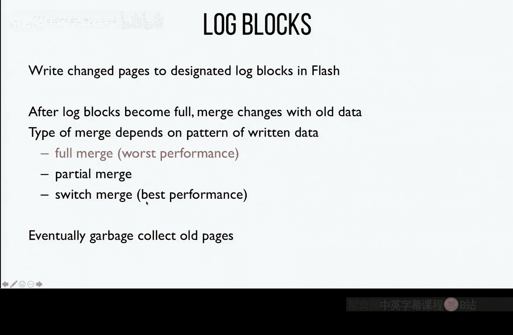

So if you don't write out blocks in a good order， the SSD would have to do a full merge。

So in this example here， we had some。We had our logical blocks。We sorry。

 I should probably be saying sectors here。 Here's our sectors。 We want pages。 Okay。

 let's say these are pages，0，1，2，3。 Those are our pages。 We want to overwrite one of the pages。

 We only have block level mappings。 So what is going to happen。The FTL will pick a new page to write。

D 2，2， it picks it in that log block， and it was already erased。 It was all ones。

 so it can just do this。 So that's pretty good。It sits around like that for a while。

 and it keeps a page level mapping for this block that's just this page that's just been written and it keeps also a mapping for the others as well。

 So it can't keep that around forever， though the whole point is we need to eventually convert everything to block level mapping so we can't let everything degenerate to page level mapping because that would take too much space。

 So if we don't do any more rights at this point， the SSD is going to have to do what's called the full merge where it has to merge the pages in this block together。

So in this worst case， what's all the work that it needs to do？It finds another free block。

And it writes A， B， and C to that。And it writes D to that。

And then it can update the block level mappings so that we have just the one mapping for all of the pages in that block to this other location。

So efficient mapping in the end， which was our goal。

 But the problem with this full merge because of how we just wrote to one page is that we had to do a lot of extra copies。

 It's very， very expensive。 So if you kept doing that over time。

 you're going to see bad performance out of your SSD because it's going to be spending all of this time doing full merges in the background while you're just trying to write individual pages。

O。So that would be a bad style of writing to your data。And then we have a whole bunch of garbage。

Okay， another way that you could have written to this and your SSD might have reacted。

 Maybe it's a little smarter this time。 So therefore。

 it's going to get to do a partial merge instead of a full merge。 When you write to this page。

 it's going to smartly say， I'm going put this in the last page of this block。

 since that's where this belongs。And then if you don't do any more rights in the future。

The SSD still has to do some copies， but it only has to copy some of the pages over to this log block。

And then update the mappings for the whole block to point to this new location here。

 So that's a partial merge， slightly better performance than full merge。

 kind of depends upon your workload。 What's going to happen there with is the SSD going to do the partial merge or the full merge。

 Okay， but switch merge is what we want to have happen。So with switch merge。

 your workload nicely matches what's going on inside the SSD。

 and you write to pages within a block sequentially。 So this is where we're getting that rule。

 You get the best performance。 If you have aligned sequential rights。

 So if you nicely write to page 0。Then we can have our page level mapping for just that individual page that's great。

 sometime in the future， it doesn't have to be immediately。

 but sometime kind of promptly you write to the next page。

 we're gonna have these individual page mappings and then why it's called switch merge is we can just in one operations switch our block level mapping from pointing to this block to pointing to this block。

 we didn't have to do any extra copies so if you write to pages sequentially you're going to get the best bandwidth out of your SSD。

Okay， so that's， yeah。Yeah， then it would be doing like then it would be doing that partial merge where if we didn't write。

So let's say we never write to D， what would it do at some point it would do a copy from this block over to here for us and then update the。

Mapping to point to this whole block。 Does that make sense， Yeah。

 so it has to do a little bit of extra work if we don't write to all of them ourselves。

 But it's not as bad as having to completely copy everything。

So it's kind of tricky to understand how applications and their right behavior map down to all of this extra work within low levelvel storage technology。

 but it really can have a huge impact on performance on exactly how you do all of these rights。

 how much extra data movement is required down there。

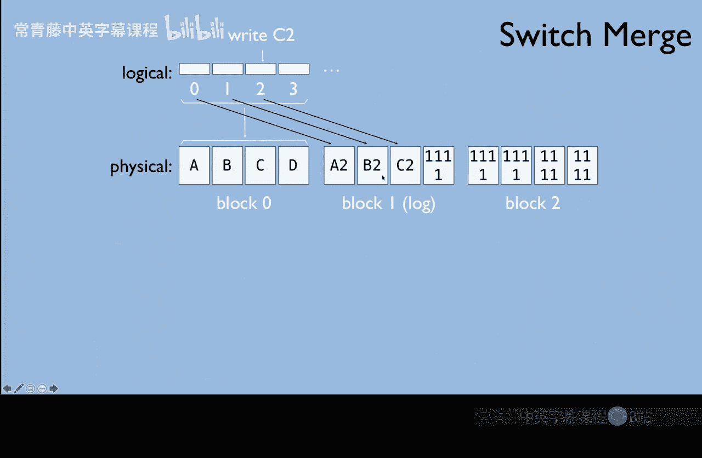

Okay。But that is as far down as we go in the stack with having to understand what SSDs do。

 you now know more about how SSDs work than most computer scientists。

 I'm sure that there are these three different types of merges， the full merge。

 the partial merge and the switch merge， and it's a way of。

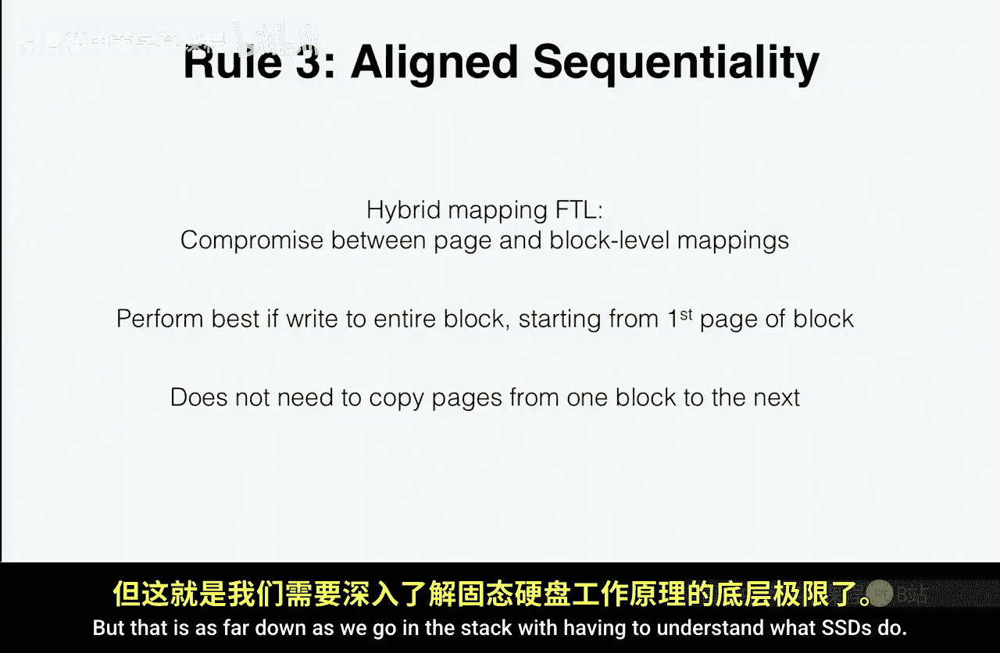

Updating mappings so that you don't have to track every page level mapping。

 you keep page level mappings for a short period of time while you're updating those blocks and they're being accessed。

 And then once things have come kind of stable and cold and they're not being accessed。

 then you want to switch everything over from page level mappings to block level mappings so that your mapping table won't take up as much space。

 And so just doing that conversion from page level mappings to block level mappings。

 it might require some extra copies like it did in full merge and partial merge。

 but maybe the user wrote to every single page and then you can do this nice switch merge。

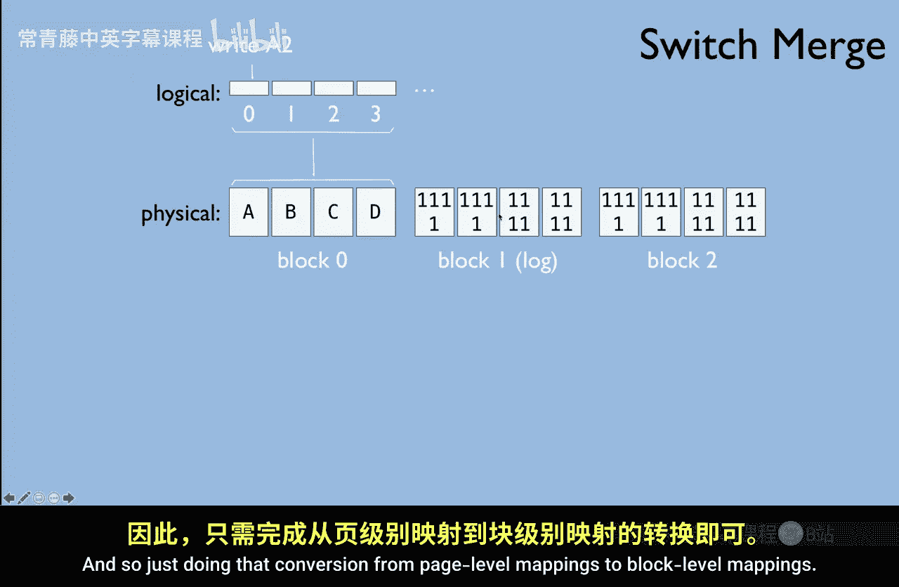

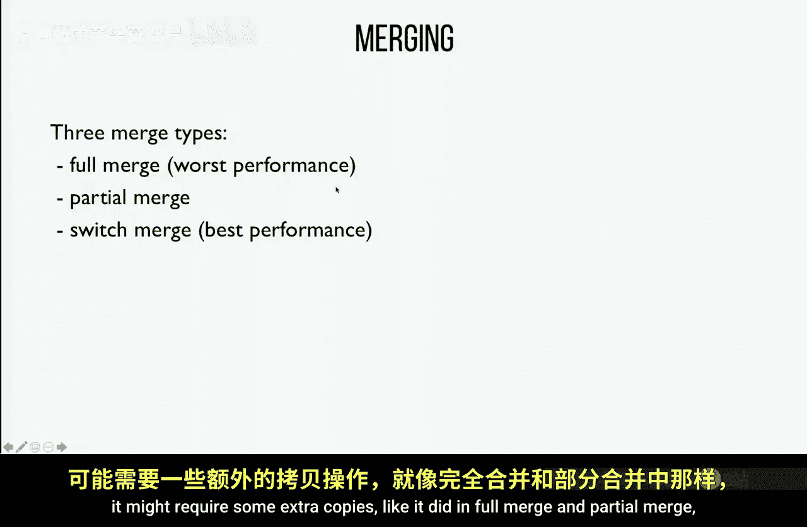

Which will have good performance。So any questions about those types of mergers。So again。

 this is like all the SSD is implementing all of these policies internally， it has the FTL layer。

It's really hard to find out what device manufacturers are doing once it's within an SSD。

 but we have some information that they do these different types of merges and you can kind of infer it by trying to run different workloads and stress it in different ways to figure out from its performance what it must have done。

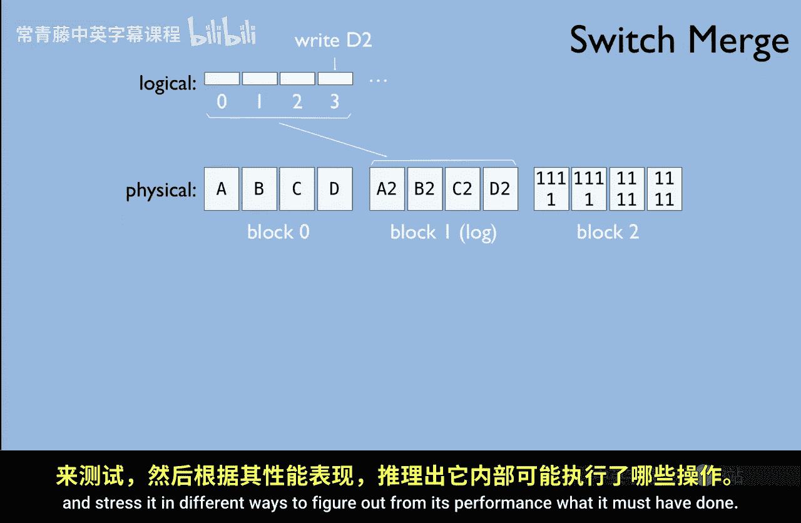

Okay， so again， it's those different types of hybrid mappings that give us this rule that if you want to get the best performance out of your SSD。

 then you're going to get the best performance if you write to an entire block and you start from the first page of the block and you write it sequentially。

Okay。Allright。 so the next， the final two rules。Are all about device reliability。

 not so much about performance anymore。So we said that。Okay。

 so let's just look at this So we're going to get better performance and reliability if we write out blocks that die at nearly the same time。

 and so remember block dying means that you just overrode its contents at the logical level and the SSD had to find some new space for it。

So let us look at this cute animation， so these are pages within a block。

 let's say we nicely wrote them out originally so that these blocks are going to die or be overwritten at 1 pm。

 whereas the next set of blocks for a different file are going to die at 2 pm。

So what's going to happen as time advances？What's great is that at 130。

 all of the pages within this block are now dead。And we can just erase it all without having to do any garbage collection。

 right， So this is a lot like what we were doing in LFS at the file system level where， you know。

 if you had a live blocks， you have to copy them over to a new segment。

Same thing is going on with garbage collection within SSDs。

 We have to get these free blocks so that we can use them for new rights that we need to do and stuff like that。

 So if a whole block goes dead together， we don't have to move any of the stuff out。

 It's just all free and available to us to use。 So that's the ideal case。All right。

 But if we had that same data， half of it dies at one， half of it dies at2。

 but we kind of write it out such that it gets allocated to different blocks。And again。

 this isn't completely up to the file system to do this。

 the SSD is doing a lot of these decisions too。Now。

 what happens at 130 is that half of our data goes dead again， but half of it is in one block。

 half of it is in the other block。 And so if we need to have a full block that's invalid and available for us to erase。

 we're going to have to copy some of this from the one block to the other。

 which is going to cause extra work。 So that's why you'll often see like these performance blips because at some point。

 the SSD is going to decide， I need to get a bunch of new free block so that I can handle future rights。

 And so it goes and does all this garbage collection。 And when it does the garbage collection。

 it sees I've got to move things around and that takes some work。

 And so if you then try to use the device while that garbage collection is going on。

 you're going to get worse performance。Either have to wait for it or it's just using a bandwidth。

Great， there， it shows a nice copy。Okay。呵。Okay。All right。

 so you have to do all these extra ride so you get worse performance。😊，All right， final rule。

So why does it matter if we write out data that has the same lifetime or not？ Okay， so imagine。

 so again， lifetime means do you rewrite the data at the logical level。

 You're rewriting that bitmap over and over again， it's。It has a short lifetime。

So if all of your pages or all of your blocks have the same lifetime， then what's great is that。

You don't need any wear leveling right， that the device is going to die when the cell with the most rights to its dies。

 so if it's a completely uniform distribution of how often you're writing to each block and it's needing to be allocated someplace else。

 it's just going to have this great wear leveling， so that's the ideal case。

But if you have some data that is living around a long time。 So you wrote， let's say the super block。

 when you created the file system and you don't update it it all over time。

 then that one block just sits around forever。 or you have some cold data。

 You haven't overwritten that file that you saved your picture of yourself in first grade。 You know。

 that's just sitting around there forever。 And it's not being overwritten。Ever。

That's going to end up causing problems that some data is being overwritten。 It's dying frequently。

 and other data is not being overwritten， and it just needs to stick around for a long time。

 because if you just let that data stick around for a long time in the same block。

 that data isn't being written to。 It doesn't。 It doesn't die。 It doesn't wear out。So。

What you're going to end up seeing then is that some of your blocks on the SSD fail much faster than others。

And so。If this is the case， then you have to do where leveling。

 if somehow your application was able to write things more frequently or your file system was。

 then we wouldn't need to do this， but that's pretty hard to do。

 so basically your SSD needs to do where leveling to take into account these differences。

So again， this is why we saw in our first slide of the day， why over time。

 as you do different rights， you'll see that some of your rights that the file system are the application cares about。

 they take a lot longer than others， some of them could be because they're triggering erases。

 probably the smaller ones， other ones it could be because it's triggering that some garbage collection needs to be done and you're seeing that because basically you want all of those erases to be happening in the background so that when you actually go to do your right that there's a bunch of free blocks available and that that foreground traffic can then just go very quickly。

But if you get stuck and there aren't free blocks and it needs to do garbage collection。

 you're going to end up seeing that。Okay。Alright， so any questions about。

SSDs or garbage collection or these rules。O。So。I think our main points then is that if you use flash。

 well， it's much， much faster than disk， it is more expensive。

The way that it works well is because it has this flash translation layer inside of it。

 It's doing a dynamic mapping from logical blocks to physical blocks。

 and it's doing this copy on right， just like we saw with LFS， which is copy on right。

 When you do a right to a block， you make a copy of that block。

 and you just change the mappings for where that block lives。

 That's an example of a copy on right system。 you make a new copy。

 you change the pointers to where you find that copy。But because of that。

 it's really complex and so different applications will see different performance depending upon do they follow those five rules or not。

 so if you send large requests or many requests to a flash。

 you'll be able to get the internal parallelism if you send reads for the same。

Pages and blocks over and over again， you'll hit in the FTL cache and get good performance。

 if you do aligned sequential rights， you'll be able to do those switch merges in the SSD instead of full merges and you'll get better performance。

 And then if you're able to group data by death time or uniform data lifetime。

 you won't have to do as much garbage collection and wear leveling and you won't see as much of a performance drop or data reliability problems either。

So that was it for SSDs and then what we're going to talk about on Thursday is we'll talk about distributed file systems。

 talk about NFS and exactly how that works， and then with the remaining time we'll talk about AFS。

 another distributed file system， but I'm happy to answer questions about SSDs。

 or I'll see you all on Thursday。

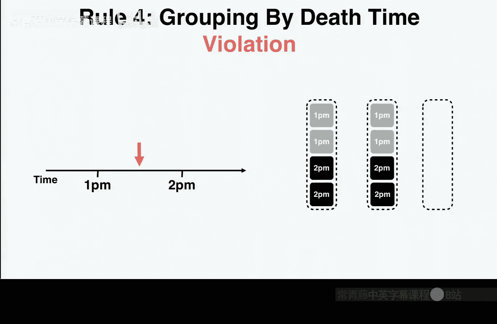

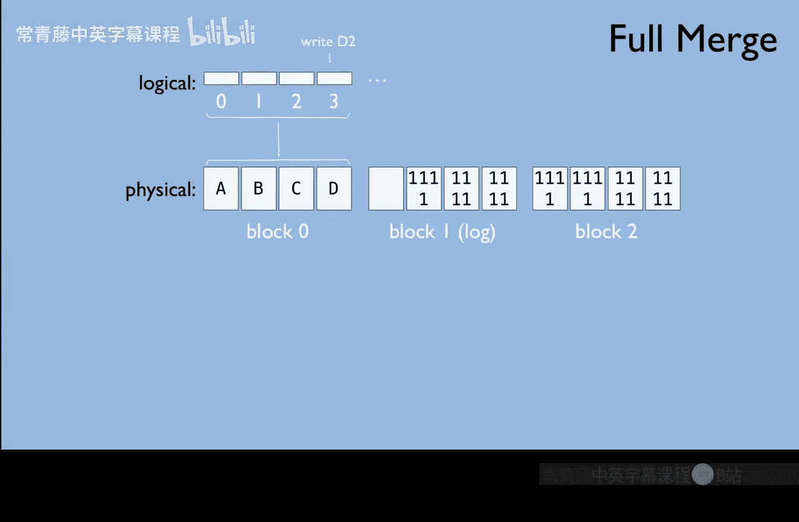

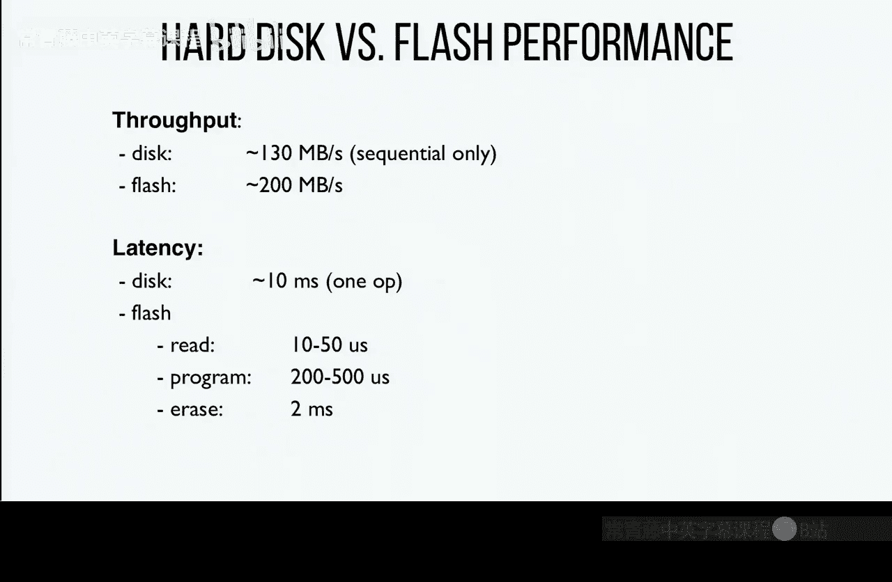