# 威斯康星大学【中英⚡操作系统｜CS 537 Fall19, Introduction to Operating Systems】 p24 P24 Persistence_ Distributed File Systems_ NFS, AFS _ University o -BV1wUzSB3Ecf_p24-

Al right， good morning， everybody。 So today is our last technical lecture。

 We're going to be talking about distributed file systems。

 So this one's a bit disconnected from the previous lectures。

 You don't need to understand every single detail of the previous lectures in order to understand this one again。

😊，Allright， so we're going to learn about NFS and AFS。Let me plug this in。

So the usual administration stuff so you all know the Project7 is outstanding。

 Hopefully you went to discussion section yesterday and you learned some of the details for implementing that。

 It's due on Wednesday， as you all know， there was a quiz for the first part of the specification due yesterday and then the seven Bs back is due today。

 you have three tries again to complete that and remember it's the last one that counts for your points。

 So if you did great on the first time then you do worse on the last time you still get that last time for your points。

So any questions about the quizzes。Alright， And then you all know the final exam is on Friday evening。

 Friday the 13。 and that we have to split across those two rooms。 And it's based on your last name。

 And you all know that it will look very similar to the practice exams。

 and we'll have a bunch of true false questions that are essentially copied or slight variances of the true false questions you saw on previous exams。

 And I'm always surprised at how。😊，Everybody does kind of the same on them the second time I asked those questions versus the first time I asked those questions。

 which makes me think that people are not reviewing those previous exams from this semester as much as they should。

 so please do that。😊，And then we'll have an exam review on Tuesday。

 So if you would like me to go over certain topics or you have specific questions。

 please use the web form to let me know those questions by Monday at 5。Yes。

About 25% of the whole exam。Yeah。And they're all， basically。Copies from previous ones。

 I just sometimes change a not to remove the word not or change a word。

 So it's the opposite of what it was。 So it's not the exact same question。

 but it's really asking the same thing as the previous one。Yeah。😊。

I will not post answers to previous exams from previous semesters。 That's what we have out there。

 And so you， you are all free to work together， figure out what those answers are。

 You can post answers to previous exams on Piazza， do whatever group work you want。 Buts。

 that's what I have there。All right， more questions。O。

 so today we're going to learn about distributed file systems。

 we're specifically going to look into NFS and AFS。

 What we're going to see is the main innovation of NFS is that it's stateless。

 which makes it really easy to handle crashes。 If your stateless server crashes and reboots。

 it didn't lose anything， so the protocol works pretty well under those circumstances。

What we're going to see， though， is that NFS has really poor performance。

 It has bad scalability as you add more clients， and it has a very weird cash consistency protocol。

 It's kind of tough to figure out what a client will read from a file based on what other clients are doing with those same files。

 So A FS， the protocol that runs on our instructional lab。Is not stateless。

 The servers track state about which clients are currently communicating with the server about particular files。

 But because it holds that state， it's going to be much more scalable。

 You're going to be able to handle many， many clients interacting with that AFS server。

 And it has a more intuitive consistency model。 So that's what we're going over today。Alright。

 so very quickly， distributed systems， you could certainly take a whole course on distributed systems。

 There's lots that you could get into here。We're just going to define them as you have more than one machine that's working to solve some problem that you care about。

 So there are kind of two extremes of this。 You could have like a client server system or a network system where it really is just like multiple clients connecting to a centralized server。

 and we'll consider that a distributed system because the work is being done across multiple nodes。

 And that's really what we're looking at today。 But kind of the more complex situation that you would look at if you looked at this for a whole course。

 Would you'd be thinking about the case where that server is itself parallel or distributed。

 and you have multiple nodes or machines all working together to do that servers job。

 So that would be what's going on in the Google cluster where you're running some page rank algorithm or some mappro algorithm over multiple nodes that are doing your work for us。

 But that will be for later。Okay， so lots and lots of reasons why you'd want to use a distributed system to solve your problems。

 Certainly often， a single node isn't powerful enough to get the work done that you need to get done。

 You have lots and lots of requests that you need to handle。 C but to do a lot of throughput。

Or it could help with just your latency as well。 You have more machines that have more processing power。

 more memory。 You can kind of split up a single request and get it done more quickly if you paralyze a single request across multiple machines。

Certainly， it improves your storage capacity。 We can now have nodes that each have disks。

 and we can stripe our data across all of those different nodes。

 all of those disks and have a lot more storage。😊，It's also going to make us more fault tolerant so we can replicate computation。

 We can replicate our data across multiple nodes， And then we should be able to tolerate if one of those nodes crashes。

And then finally， certainly now we can have data sharing that multiple clients can all read and write the same files。

 So that's what we're focusing on today。But why this is fun is because it's also harder， right。

 I always like it when the problem becomes harder。 So we thought it was hard enough with a single machine with concurrency。

 Now we have multiple machines。 They're all doing things concurrently as well。

 And now we have to worry about this horrible failure model where some nodes fail。

 but other nodes do not fail。 And we have to worry about the communication layer failing or not。

 So we're not going to focus on the communication layer in here， you can take 6。

40 and learn a lot more about that。 But certainly you could worry about。

 you know the fact that you could just have individual bit errors when you send a message from one node to another。

 You could lose packets。 You could completely be disconnected from another machine and not be able to communicate with it。

 So that becomes really tricky。 you can't communicate with a node at all to figure out like。

 who's a part of this system， who do we need to communicate and coordinate with。

 But we're not gonna to look much at that。What we're really going to be worried about is if we just have an individual node。

 which will for us will either be the client or the server。

 our NFS or AFS server could crash or our clients， our individual machines that are connecting to that server could crash。

 And we want to make sure that our distributed system still works well for those。More simple cases。

Al right， so before we've been talking about local file systems。

 that's still going to be the building block of all of our distributed file systems， right。

 So even when a distributed file system is running。

 it's that distributed file system on the server is still using a local file system like E X T 4 when it needs to get the data off of disk。

 It's still built on top of a local file system。 So everything you've learned is still very relevant。

 But now we're moving up the stack in terms of abstractions here。And we have some notion of sharing。

 even when we had just like a single machine， because we had multiple processes on that same machine that were all reading and writing the same files。

 And so we had some notion of how they would interact。

 and that like if one process on a machine write to a file。

 the other process on that machine would immediately see those changes because they're sharing the same buffer cache。

 any Taiwan process write to a data block。 and that's kept even just in memory when other processes read that same data block on that same machine。

 they will immediately see those changes。 They don't have to wait for the disk know for it to be flushed there。

 or for you to close the file or anything like that。 It's all immediate。It's going to be much。

 much different now that we're running on different clients that are all connecting to the same server。

 We're going to end up getting different semantics。 We have one process running on one client。

 another process running on a different client。 Now they're reading and writing the same file。

 And it's going be much more complicated on do they immediately see the other clients rights and how they've changed that file。

 So we'll talk about that a bunch。Okay， so what are our goals for all of this？

So it would be great if it's simple and it would be great if it's fast。 So like。

 if the client or the server crashes， we want to be able to recover from that and still operate correctly。

😊，It would be great if it's completely transparent that we can't tell that we're now accessing files that are on a stber instead of on our local machine。

 we're not going to quite get those exact semantics， but we'll still have the same APIs at least。

 and you can still access things using the same system calls。

But we will get slightly different semantics there。And then finally。

 it would be great if our system was completely scalable。

 so we have our centralized server that all of these different machines are contacting。

Original distributed systems， maybe they'd scale to tens of clients contacting them。

 We certainly want to be able to scale to hundreds of clients。

 if you think about the scale of our instructional machine that you know we have many Linux machines you're all working on if you the server starts to get slower because everybody's accessing the file system。

 you'll be unhappy。 And when you start doing things within like a Google scenario。

 you have to be able to scale to thousands or tens of thousands of nodes。

 So those once you get to like tens of thousands of nodes。

 you have to completely redesign everything。 and it doesn't look anything like the centralized AFS。

 So we're stopping kind of in the hundreds of nodes with what we're doing today。Alright， okay。

 so starting with NFLFS。So you should think of NFS as more a protocol than a specific implementation that there's this well-defined NFS protocol and there's some spec that describes it and you could go out and implemented if you wanted it to and then you could sell your NFS implementation。

 And as long as you adhere to that then clients should be able to connect to your NFS server and behave properly。

 So lots of different companies have implemented NFS protocols over the years。

 A lot of them were hardware manufacturers， so they would say here's your NFS server。

 We're going to load it with lots of memory。 We're going to make the memory persistent battery backed so it has better reliability properties and so they would make money selling those things。

 We're going to be focusing on what's called NFSB2 version2 that's not the current version of NFS but version2 is very elegant and it is like it's completely stateless。

 which is like a nice concept， but it turns out not to work well in practice。

So it's going to be great that it's stateless because then the server can just crash and we can reboot it and it doesn't lose anything。

 but the problem is we're going to see it it's not very scalable in the end。

 and so that's what they did with NSV4 is they add state to it so that it's more scalable。

 but then it's just not elegant and not good for teaching so for our contrast we then switch over to AFS。

 which also is not stateless and does scalability better。Alright， so I think that's it for the setup。

Okay， so to understand NFS， we're going to break it up into three parts。

 just kind of high level architecture， then the actual protocol that we're sending messages between the clients and the server and then this caching model so that we understand what clients on processes on different client machines are going to end up seeing in the files that they read and write when they're sharing with other。

OfCl。Okay， so here's our general picture。This is our NFLFS server。 It's a single machine。

 It's running a local file system so that it can store the files that it is serving to other clients through this file system and on some local disks that are attached to that file server there。

We can have some number of clients on the order of hundreds， and they are individual machines。

 They can have a local disk。 They don't have to have a local disc。 What's kind of nice is that NFS。

Supports like server， sorry diskless clients so that they could just use the file server for all their data。

 But usually clients will have a disk as well for like temporary files or just local things so that they can boot up if they can't reach the NFLFS file server。

And they're going to use this protocol， R PCC for remote procedure call as their way of communicating with the file server。

 And we're going to keep that pretty abstract today， as well。And in this cache here。

 what we're going to cache in our buffer cache， our file system buffer cache are those reads and the rights of even NFL data that we're gonna have a local copy of it over here。

 Because if we always went to the file server for every single read and write。

 The file server would just get overloaded， right， It would just。

 it can't handle hundreds of clients asking for data that they've already read and written。

 It makes sense to buffer this stuff for a while over here。

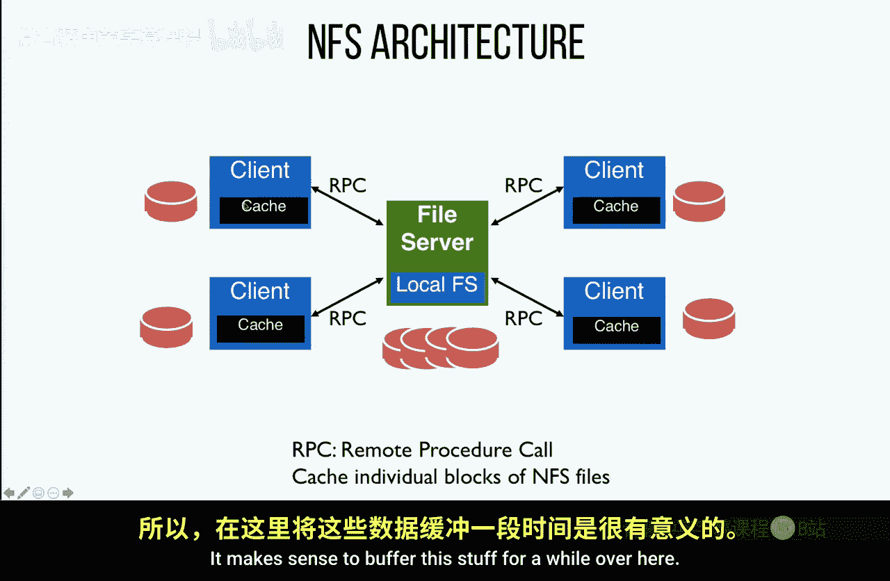

Okay。So what's going on in the client。 So this is just like a sample client。 It has a local disk。

 as well as connected to NFLS。 So the idea here is that we have that mount protocol where you can then stitch together parts of your。

Direy hierarchy so that different parts of your directory hierarchy are served by different file systems。

 So in this particular machine， we have two devices。

 two hard drives that are attached to this machine。

 And then we tell the system where the root directory is mounted and that's on this local disk and then we have like a local backups directories。

 so like EX T4 would be handling accesses within the directory structure that end up having their path names resolved within there。

 So there's this let's call this via fast or virtual file system layer that runs on top of all of this that kind of figures out which file system is responsible for different portions of this directory hierarchy。

But if you then do some path name through to your home directory。

 then all of those are going to be stored in this distributed system。 In our example， NF S here。

 So that's why when you're using an instructional machine， if you look at slash temp。

 that's just stored on the local disk， Where is your slash home that's all keptped through AF S and is shared。

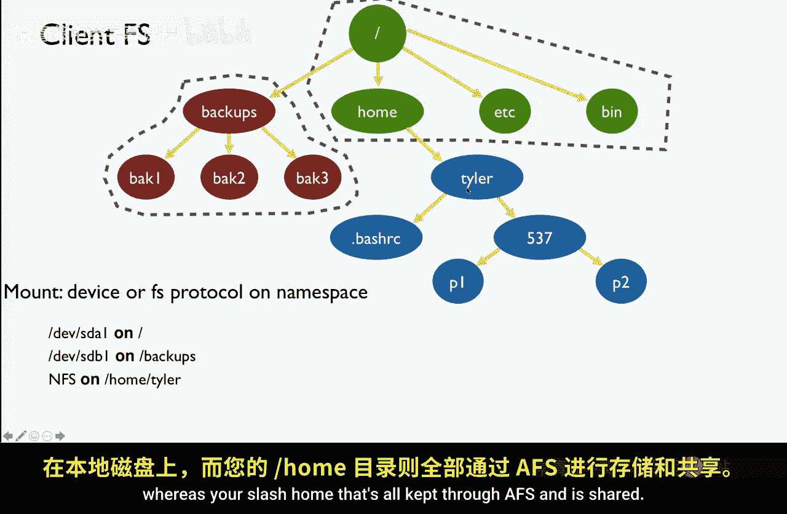

Okay， so to be very clear here， we have our client。 We have our NFLFS server。

 If the client wants to read something from the local directory。

It's still going to call the same read system call。

 So this is completely transparent to the client where the files actually live。

 It calls read on whatever file at once。 And in this case。

 the read is going to just go through the local file system， E X D4。Alright。

 And then if they did a read of a file that is located。Through their home directory。

 the VFS layer is going to see that that corresponds to a different route。

 and it's going to end up sending it to like some local NFS。

Client code that then kind of is going to do some work for us and send that request over to the NFLFS server。

 which will handle all of the reads， go through the local file system。

 read the stuff through disk and send it back。 So we're going to talk about the details of what this path looks like in a lot of detail。

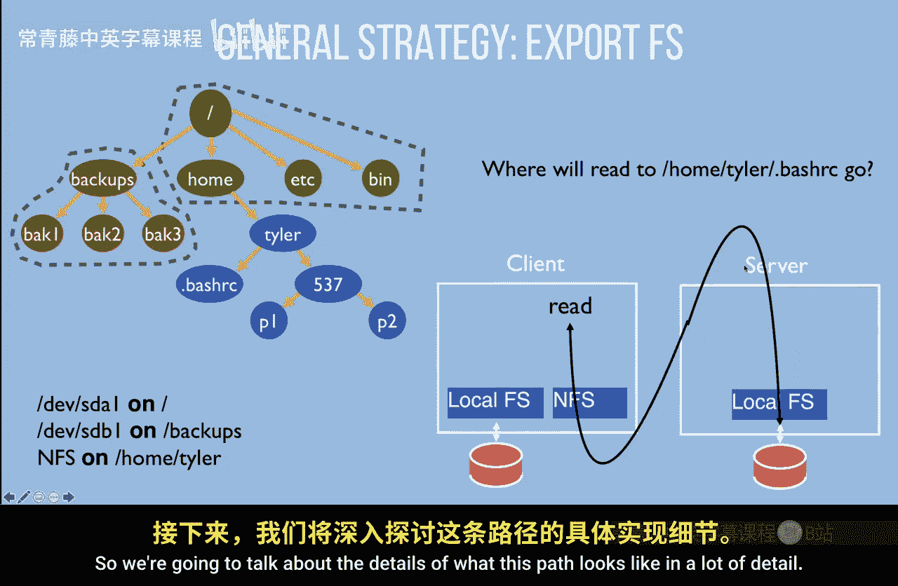

But that's the setup there。All right， so let's get into some interesting stuff。

 How do the clients actually communicate with the server。Okay。So like we often do。

 we're going to go through a bunch of different approaches。

 We'll start with something that isn't going to work and see why it's not going to work。

 And then there'll be version 5 where it finally works。 okay。

 but there's slight changes along the way。Okay， so the easiest thing that you might think about doing is。

Well， why don't we just send all of our requests， our opens， our bes， our writes。

 whatever we thought we needed to do on this local machine， the client。

 Just send those directly to the server and have the server do all of those system calls for us and just return the results back to us。

And we're going to use this R PCC layer to just invoke those。Functions over on the server。

 And so the R PCC layer has like all these nice wrapper functions so that and it does all the marshallling of arguments and sending it over TCP or UDP and takes care of all that。

So we will assume that all of that works very nicely。

 but we just need now to call when we see an open on the client。

 we just do an RC to run open on the server， the open on the server。

 it's going to return a file descriptor， right， And so we'll just return that file descriptor back to the client。

 the client。 Wellll remember that file descriptor。 And then if we need to do a read on the client。

 we just send that file descriptor back to the server。 and it keeps doing the work for us。 Okay。

 so let's think about why this is not going to work since it is strategy number one。

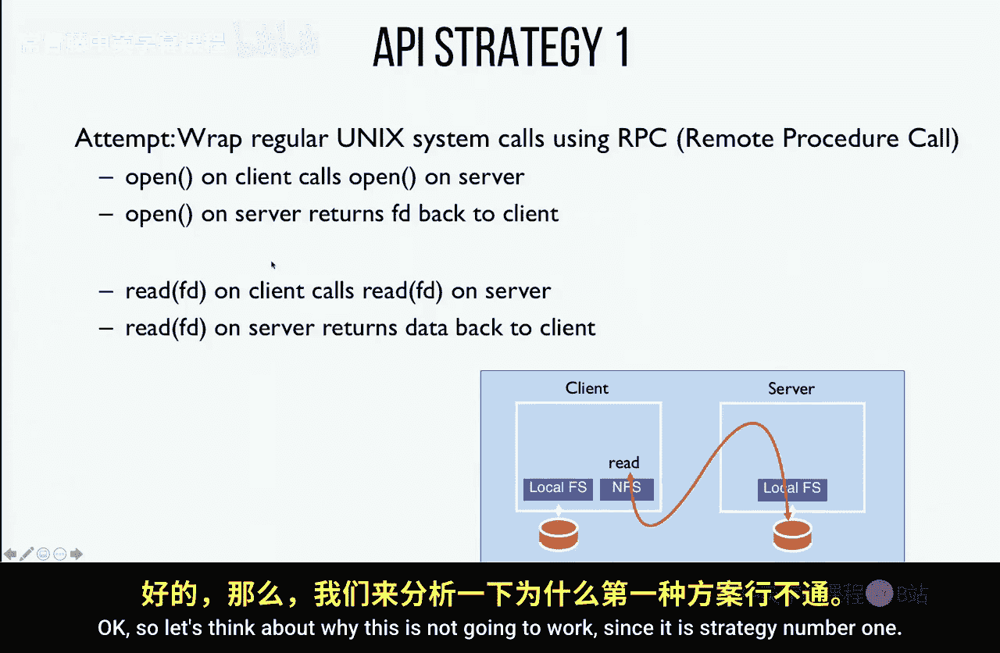

Okay， so in this scenario， the server is remembering for us。 So that's the key word。

 It's remembering， which means it's not stateless， which means we're going to run into trouble here。

 The client is remembering the file descriptors of each of the clients that have contacted it so that they can do those feature reads and writes。

So basically， when a client doesn't open。it'll be the server that actually does the open。 Remember。

 and it will get some information associated with that file descriptor and return that file descriptor number back to the client。

And so， and then the client does a read。 And it just sends that file descriptor number back number  two。

 And then the server is able to do the appropriate read on that file descriptor。

 So remember what goes in a file descriptor。So， let's。

If you had to say two important things that are in a file descriptor， what's in there。

What's it tracking， What's the state。And I node number， yep， and in an offset， right。

 So it's the server that's remembering the offset for the client in each of these cases。

 the client doesn't remember。 It just keeps calling read。

 And that's supposed to advance that offset so that your next read that you do follows after the previous one。

The server is remembering all of that as part of what's in that file descriptor that's within the file system there。

Great。Okay， so what is， so if every， if nobody crashes， this is going to work just fine。

 The problem is， we have to worry about crashes。 So what is going to happen if our server crashes now in between some of these reads。

 So we did our open， the client knows it wants to read from file descriptor 2。

 the server is tracking the offset。😔，This could even， yeah， it's advancing the offset。

 We did a couple of reads， and then the server crashes。

 and the server comes back up again And what's going to happen。 Well， that the future reads。

 then that this client sends to this server。 It's not going to know about file thescriptor  too。

 it maybe could recreate some stuff。 But it would have to remember a lot of things if it was trying to remember what the offset was and all of that。

So we're tracking state， and that is makes dealing with crashes difficult。

So we could try to figure out some crash recovery protocol where you reboot and you communicate with the client。

 but。That's just too complicated。 Or the usual solution is， well。

 don't keep things only in memory if you need to remember them forever。

 So you could persist all of that important state。 The file descriptors push them out to disk。

 but that's going to be really， really slow。And it does get into these really complicated issues of what are you trusting about the clients。

 So if you have to keep around these file descriptors， it means。Like。

 you're trusting that the clients aren't acting malicious and they're not telling you to just open up a lot of files that they don't really care about because now the server has to do some amount of work and remember things for an arbitrary amount of time。

 And so if a client could never close a file， It could crash。

 It could go away and the server would be like， well。

 do I still have to remember this file that you opened yesterday。

 Are you just being really slow or are you being malicious and you don't ever intend to to access that again。

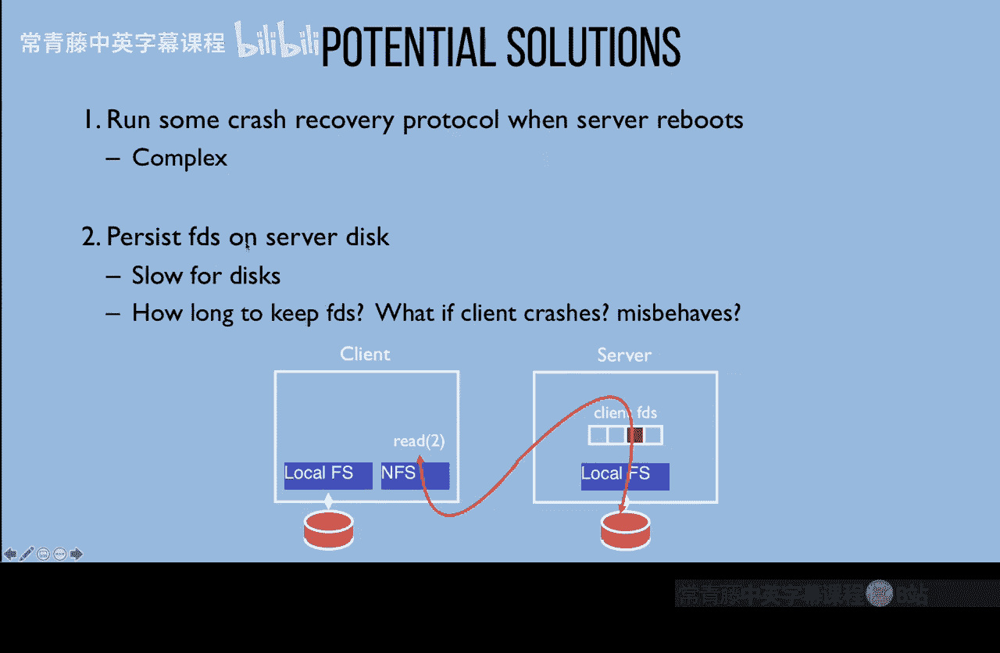

So those things end up being pretty tricky。So we don't want to do this solution。

So rather than making the server remember anything about the clients that are communicating with it。

 what we're going to do is we're going to completely describe every operation that the server needs to do in the request that we're sending to it。

So。Every request that we send over the network from the client to the server will completely say what that operation needs to do。

 It doesn't need to remember anything about what happened in the past。

 And so this is the key to having a stateless protocol that server doesn't need any state。

 It doesn't need to remember what happened in the past。嗯。So to be precise。

 the server doesn't have it's allowed to still keep other state， though。

 it's just it can't require it。 It could keep something in memory if it's just a hint or a cache or kind of helping it have better performance。

 but it still has to behave properly and correctly if that state were to go away。Right，Because， yeah。

 it's fine if we kind of have worse performance when the server crashes and reboots。

 but it has to still behave correctly。 And so when people talk about NFSV2。

 they're really referring to this fact that it's a stateless protocol。

 That's the most important thing to remember about NFSV2。

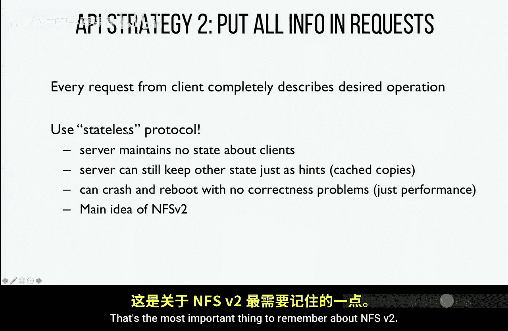

Okay， so we are going to eliminate file descriptors on the server because that state that's having to track an i note number that corresponded to that file descriptor and a file offset。

 So if we're not having the server track file descriptors， what are we going to have to send over。

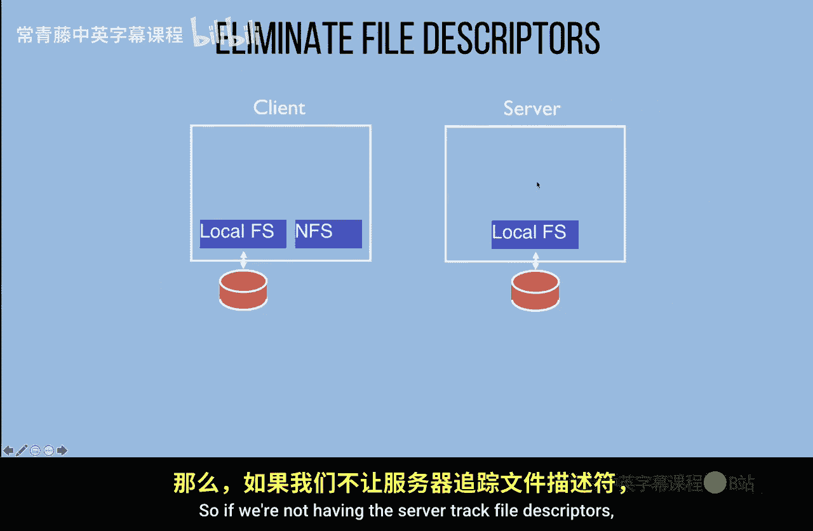

So one option would be as part of every request between a client and a server。

 instead of sending over the file descriptor， we send over the name of the file that we want to open right。

 This is completely describing what we want to have happen in this read operation。

 Read from a particular file that we're naming here into this buffer of a certain size and read from this offset or write in the same way there。

 So this is completely self-deib。 That's pretty nice。So that's nice。 The pro， I think。

 here is supposed to correspond to the server does not need to remember anything。 maybe not。Yeah。

So this， the nice thing here is that the server can crash。 And then if it reboots， it just redoes。

 it will be able to handle the future beats and rightss that it sees。

 But what's the problem with this interface here。Yeah。Well， I wouldn't use the word seek， but。Right。

 right。 You have to open up that file every time you need to do that path name traversal。

 which is going to be very， very costly。 So dealing with path names。

 we saw those are nice names for human beings， but not good names for performance。

 So we do not want to do all of those path lookups。

 We learned that's why we have opens to begin with。

 So we're still going want to have some notion of open that we're sending back and forth， perhaps。

But we do not want it to have to remember anything。Okay。

 so this approach is going to be pretty close to what works， but it's not going to be perfect。

 So on our client， we'll call open over to the server。

 the server is going to do the path name traversal and then return to us the in。

 And then in is something that's longlived。 It's permanent on disk already right So the server doesn't have to do any extra work to remember that in。

 We're just going to have a new interface is part of our local file system on the server where now you can just tell the file system I want to do a read or write directly to some inode that I know the number of。

Okay。Then when the client wants to do a read from that file that it just opened。

 it will pass back that I know that it was given and the client is going to do the work of tracking the offset of where it wants to read right。

 so that's not too difficult。But is this perfect？ And so this is pretty tricky to figure out why this doesn't work。

And so if you can figure out why this does not work。

You understand all of the previous lectures on the details of what is going on with those file system metadata structures。

 So where would we run into problems potentially here。Yes， you got it too quickly。Yes。

 so this is assuming that iNots are unique and so what would happen if this one client was writing to a file。

 it thinks that file is associated with this particular inode number。

 meanwhile another client deletes that file， another client allocates a file that inode is reused and given to this new file and now we're letting this original client keep using that old inode number that doesn't point to the correct file anymore。

😊，Alright， so because you can imagine like， all the permission checking is going to be done on this open。

 And then if you get the right iode number back， you're given complete permission to do the read and write operations。

Okay， so we're now reading and writing to the wrong file， which is not okay。So the solution to this。

Is we need to have we could either have an in number that's guaranteed to be unique over time。

 but at some point you're still going to recycle， even if you had a huge number of i notess。

 you could be a little bit more careful of waiting and doing a new in number as long as you could。

 but at some point， you're going to recycle back。So the solution that systems use is that in addition to all the other fields that we've learned about that you keep in an in。

 like is it a directory or is it a symbolic link， What's the size of it。

 What are all those data pointers， another field that the in is actually going to have is what's called a generation number。

 So the first time an in is allocated， It's gonna to have a generation number of0。

 Then if you delete that in allocate it to another file。

 you're going increment the generation number to one and so forth。

 So every time that in corresponds to a new file， it needs to have a new generation number so that you can tell it's a unique file。

Yeah。It's within the i node。 Yeah， yeah。 So I don't think X V 6 has generation numbers。

 They are not worried about these， these problems。啊哈。😊，Right， so in that case。

 we do those reference counts， and so we do not delocate the iode and the data blocks that are associated with that file。

 as long as there is any reference to it， which includes open file descriptors， so。Yeah， exactly。

 So that's why we could get those weird semantics in Mux。

 where you're guaranteed to be able to still keep accessing a file， even if someone else deletes it。

 So you can have like these secret hidden files that you're guaranteed nobody else can read or write。

 if you open it and then delete it。So it's kind of a messy little side situation there。 Yep great。

More questions。Okay， so now we have a unique name for every in。

 it's the IO number plus this generation number。And that is the thing that NFS is going to return back to clients。

 It's going to be a volume ID so that you could have multiple disks within this server kind of partition things is iode number and the generation number。

 and so it returns that as a file handle and the client is not supposed to interpret that file handle it's not supposed to know which bits correspond to in number。

 it's not supposed to use that in any of its code or make any assumptions about that it's completely opaque and just treat that as some mysterious file handle and who knows what's actually in there。

Okay， so I think that describes all of the details of what's going on with file handles。

 which are those things there。 Okay， so that is what we are going to deal with。Through NFS。Okay。

 so here's my question for you。We have an open system call that we will send over to the server。

 We have P read and P write that we will send over to the server where we're saying we want to read from a particular file handle at a particular offset。

How are we going to support the append system call that applications wanted to use。

 So can we send an append from a client over to the server， Is there any way。For this to work。

 basically， for the server to be keeping track of this。 And so the answer is going to be no。

 not with how RC is implemented。 So we haven't talked much about RC。

 but this is like sending the P read operation over to the server。

 And so the problem with remote procedure calls is you have to figure out what happens when there's all of those errors when the server crashes when packets don't get through and stuff。

 And so basically what RRPC ends up doing is they provide what's called at least once semantics where if the RRPC for P read returns successfully。

 It doesn't mean that it executed exactly one time。 It means that it executed at least one time。

 So it could have actually called that RC function on the server two times instead of just the once。

And the reason they have to do that is because they are also making assumptions that it's stateless in many of the protocols that if you want to really make sure that something happens exactly one time。

 you have to keep some state and record the fact that it occurred so that if the machine reboots。

 you're able to say， oh yes， I already did that function otherwise。

 there's just always going to be some race condition between like I told you to do that and then you didn't give me an act back yet or not。

 I can't tell if you did the operation or not。So basically， that's what we're working with here。

 we are building on top of an RPC that doesn't guarantee that it will do something only once。

So we cannot have a message that's like， do an append for me， because。

We' are going to get different behavior if that append operates exactly once or if it operates two times or more。

 right， so。And we don't want it to be the case that if the server crashes while we're in the middle of that pen。

 that it happens multiple times。So what we need is we need a protocol that has only item potent operations。

 So the idea of an item potent operation is you get the same result。

 whether you call it one time or more than one time。

 So it doesn't have the same effect It' calling it zero times。

 but it has the same effect as calling it one or more times。

 So the RPC layer with its at least one semantics is going to operate very well with these item potent operations because you can keep replaying them and you won't get any different results。

 So certainly any function that has a side effect， you know that increments a counter。

 those are not item potent because that counter is going to increment each time and have a different value depending upon how many times you call it。

 but if you're just like setting a value， then that ends up being item potent and that's safe to do multiple times。

Yeah。It's a strange analogy， but I like if you're saying like if you have all of the information and you tell it to write all of the information。

 then of course you can keep doing that right over and over again。就是张。If， if you were。Yeah， if you。

 yeah， we have to just basically translate a pen into a right to a specific location。 exactly。

 we can only write to specific locations， and it's fine to do that over and over again。Great， so。

Writing to a specific location is item potent， you can do that as many times as you want if we start off with our file that has all A's。

 we call Pw write one time and this happens to write two b's there in the middle。

 we can call P write over and over again。 at least one time and it works totally fine but append clearly is not item potent we start with a。

 we call append one time。 that's our desired result is to have just one B there。

 but if the system ends up having to replay that append because it couldn't figure out if the server actually got that message or not。

 then we're going to get different results。 so the append operation is not item potent。

 but clearly applications call append all the time How are we going to handle this。

So we're going to have to figure out on the client side how to translate that append operation to item potent operations that we can send to the C。

Okay， but first， let's step back。So what operations that we know about with the file system are item potent。

So if you have to read， you can clearly call a read as many times as you want。

 and you'll always get the same results。 Reads are beautifully item potent and writing to the same location over and over again。

 those are both item potent。 So those are great。 And we just learned that aend is not item potent。

So here' is your arguing point。Is make their item potent and is creating a new empty file item potent。

So this is not a trivial question， so I'll give you two minutes to talk with your neighbor about。

 do you think those operations are itemem potent or not？

So can you all make their over and over again and get the same results。

 Can you call C a file over and over again and get the same results。嗯。Alright。

 so who thinks make de is item bolt。 Raise your hand。

Who thinks make there is not item potent raise your hand？

So I'd actually accept both answers for this because it's one of those like it's not strictly itemempot。

 but it's kind of practically itempot。 So what is exactly itemempot about that。

 that at the end of that， So let's assume the directory did not exist before you started， by the end。

 no matter how many times you call it that directory should exist。

But what is not the same across each of those calls is like the return code of makeD that if you call makeD and the directory does not exist。

 it's successful and it returns a one， if it does exist it returns a zero。

 so you're going to get different return codes and error codes， but in the end。

 no matter how many times you call it you should still have that directory created at the end of all of that。

All right， so that's why I'm never sure to say， is it really item potent。

 it's not completely but practically it is。 And then create is the same thing。

 You're creating a new file， no matter how many times you call that at the end of that。

 you will have the file created exactly once， but you will have a error return codes if that file already existed。

 So different return codes depending upon if you see the result of the last create that the server did or not。

So any questions about those operations。And return codes。Okay。Allright。

 so basically what we're going to do， we have our file handles。

 we are just going to remove aend from our protocol。

 So we're going to have to figure out how the client can do an append on top of our final API here。

So basically， it still needs to be the case that client applications can call append。

 it's just that the NFS protocol that we're sending between the client machine and the server machine can't have as an RPC。

 an append RPC call， but we still have to have an append system call on the client。

So the way this is going to work， we still have file descriptors on the client。

 That's what we deal with over there。 We're going to end up translating those file descriptors over into the file handles that we'll send to the server and the client is going to track the stuff that the client needs to track。

 which is the current offset where we're reading from。

 And since the client is tracking the current offset。

 it can track how many times a pen has been called and figure out where the offset should be。O。

So again， what are we keeping in our local file descriptor。

 it's the file handle that the server gave us back when we called open。

 and then just like before it's tracking the offset where the next read or write should start at。

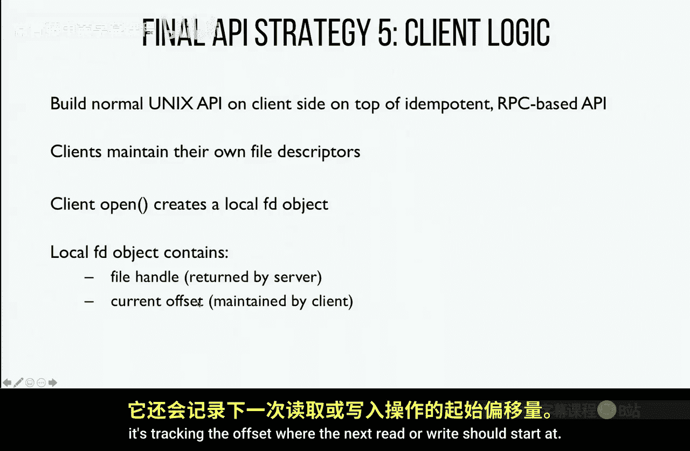

Okay， so what is going on here， Let's do a simple final example of how the protocol works。

So a client application previously called open and it。

Saw the return code from that open to the application was a file descriptor of five and within the client's NF library over there。

 it's going to be mapping file descriptor number five to the file handle that was returned to it when we called open。

 So now when we call read on file descriptor5 of a certain size。嗯。

That will be handled by our local nFS clients。It looks up file descriptor5 in its local file descriptor table。

And it's able to pull out the file handle that was returned previously when we called open and the server told us that file handle。

 And then we on this client are tracking the offset so that。

 you know currently we're reading from offset 123。 We're reading 100 bytes。

 And so then the next time we call Re we'll have incremented that offset to 124 plus 123。

 So we're just tracking the offset from this particular client。

And so now we have enough information that we can send the item potent P read over to the server。

 we're able to grab out the file handle that has that iNote and generation number that the server understands。

 we're able to tell it the offset that it should read from， and we're able to tell it the size。

 obviously we got that directly from there。So it's within this client logic that we'd be implementing the append。

 that we would be keeping track of where we last read or the end of the file so that we could just translate that into a P read or Pw write。

All right， and so then the client sends to the server， this item potent P read。

 the server interprets this， it goes into that file handle。

 and it's able to extract the inode number from that file handle and send that read to that particular。

 sorry in that it knows about and do the operation as desired。

And then it'll have the read result back and it just sends that back to the client through the RPPC interface。

 So the client and the server have to do some work for all of this。

 And the key is we have that item potent P read in the middle and a bunch of rappper work that the client does before that to track state。

 So the only state that's being tracked is on the client。

 There's no state being tracked for this client on the server。 That's why the server can crash。

 If the client crashes then of course it's all bets are lost right We don't know exactly what happened。

 we just have to restart。 our applications and do all of that。

So any questions about this part of the NFLFS protocol？

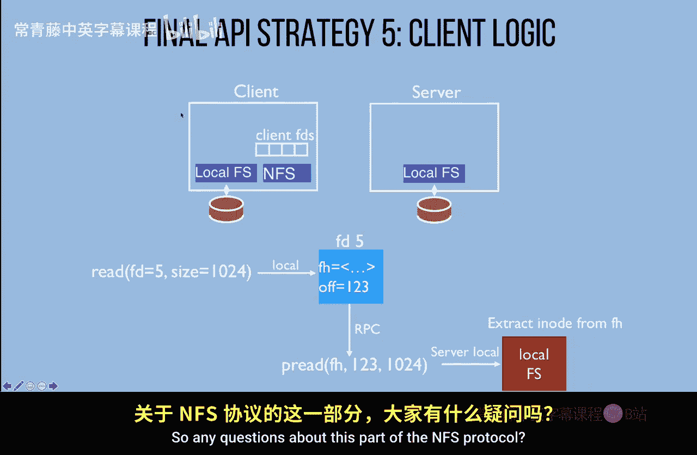

Okay， so we are onto caching behavior。 So this is where we're going really end up contrasting NFS and AFS。

 because NFS is not going to do this caching part well at all。

So we know we need caching to get decent performance。 You can't go to slow disks all the time。

 You can't go over the network all the time。 So NFS is going to cache， individual read。

Blocks in a bunch of different places， sometimes on the client and sometimes on the server。

 So how do we make sure that all this is in sync so。

The thing that we're really focusing on is each of those clients， when they were doing reads。

 they're caching some of that file data here， and another client is caching file out of there。

 How does that stuff get eventually pushed to the server。

 and how did they find out what each other modified。O。

So we're going to look at three different problems。

 The first problem is that the file server cachees some data。 So if as part of that protocol。

 we call P write and we send that to the server。As an R PCC。

 if the client had to wait until the server actually wrote that out to disk。

 it would just be ridiculously slow。 So we want the R PCC to return very promptly， right when the。

Data has been written just to the server's memory and not written all the way out to the server's disc。

So what often happens in servers， they just write it to the local buffer and then they return。

But of course， then if we just wrote it to the local buffer and then the server crashes。

 we're going to have all sorts of problems。

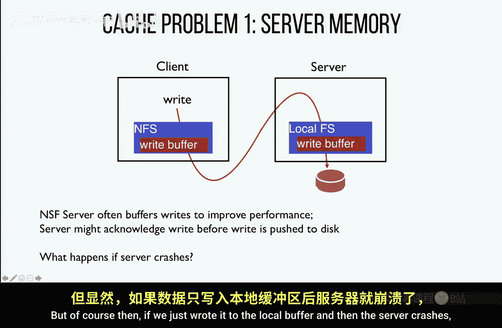

So consider this example。 We have a single client connecting with our server over here。

 The server is caching blocks 0，1 and 2 in memory， and then it's periodically flushing it out to disk。

Sometime in the past it wrote A B and C here and then something happened and the client goes back and it reads blocks0。

1 and 2 and what it ends up seeing is that it contains X B and Z。

 so how could that happen and none of the rights failed。

 the protocol said all of that stuff looks beautiful。

So a crash occurred somewhere in this sequence here。So。Its you know。

 how could it have gotten Z and X， but not B， right so。We wrote all of those things。

 we wrote X to zero it flushed it out to disk， we then wrote Y to1。

 but it doesn't flush it out to disk， and then we have our crash and then it reboots and then the server very nicely continues to take more requests from the client in which case it gets Z written over here and it flushes that out to disk sometime in the future so you can get these really really weird contents on disk。

 even though the client doesn't even know that the server ever crashed and rebooted。

So we have to fix this。 And there's really only two fixes to do this。

 One is have bad performance and don't buffer anything。 If you write your own implementation。

 you are welcome to do that for your NFLFS server。 But the reason people make money off of NFS servers and they were able to be hardware companies is they would make sure that that memory was battery backed or has some type of extra power supply that's handling it。

 you can use alternate memory technologies for this and just really make sure that this is still。

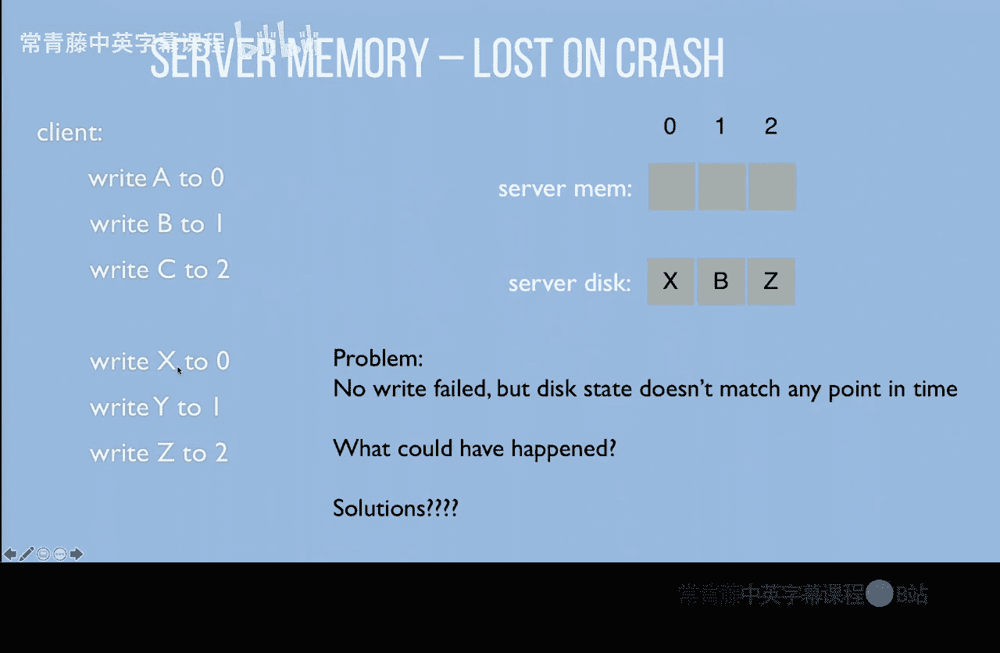

Persistent if we have a power failure。So those are the only two solutions。

 make it more expensive or don't do it。

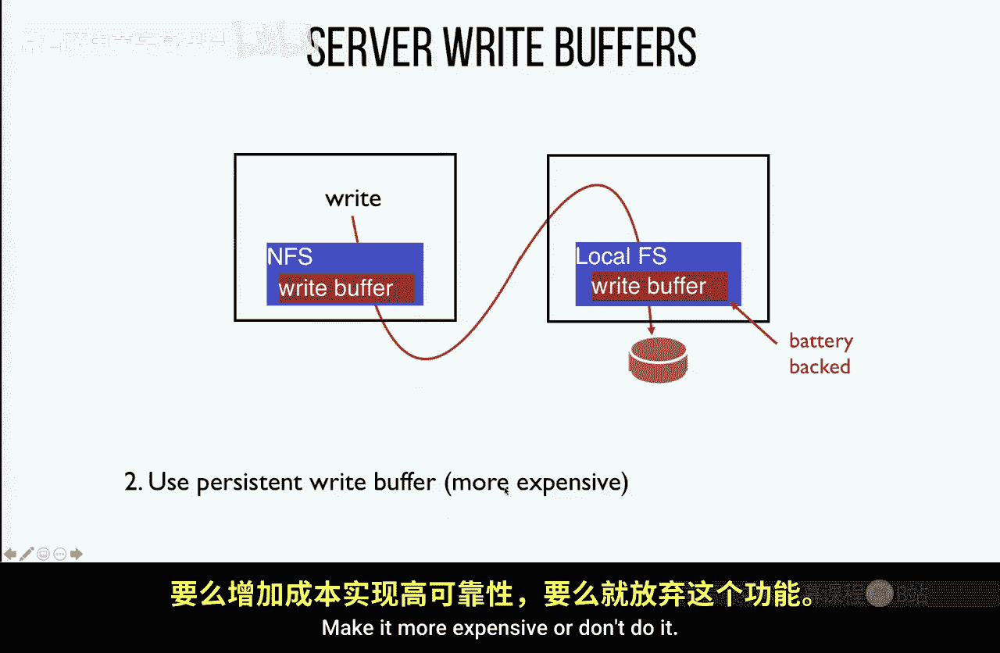

So that one isn't as interesting。 What's interesting is we have multiple clients that are reading and writing the same file。

 and they're each caching that same file。 Are they going to see the same contents or not。

So you really have to cache data on clients because think about we have hundreds of clients all connecting to this server。

 if they sent every request to the server， the server would just get overloaded。

 it'd be a total bottleneck， the clients have to be able to operate on their own a little bit and at least reread data from their own memory that they've looked at recently in the past。

So。In this example， client1 reads a particular block from the cache and it keeps it cache locally。

 and another client could be reading that same file and read the same contents into its cache。Now。

 the problem occurs when client1 decides it wants to write that file and it changes the contents of a particular block from A to B。

 Well， what in the world is going to happen now in our system， Because， of course。

 client 2 doesn't have the right contents。 But for a while。

 the server doesn't even have the right contents。 So we have to figure out what's going to happen。

 because if we were running these two。Processes back on a single machine。

 and one of them did a write。 and another client did a read。

 and they were running on the same machine。 They'd end up seeing the exact same data。

 So you end up getting different semantics in this NFLFS world where you're running distributed。

So what can we do about this， NF is not going to have a great solution。 Okay。

 They're going to have a bunch of hacky things that they do to kind of make things work pretty well in practice。

 but it is not elegant in any sense。So basically， we have to figure out when after client won。

Modifies a cache block， when should it flush it back to the server？

And so there's a bunch of different reasonable options to do here。So。

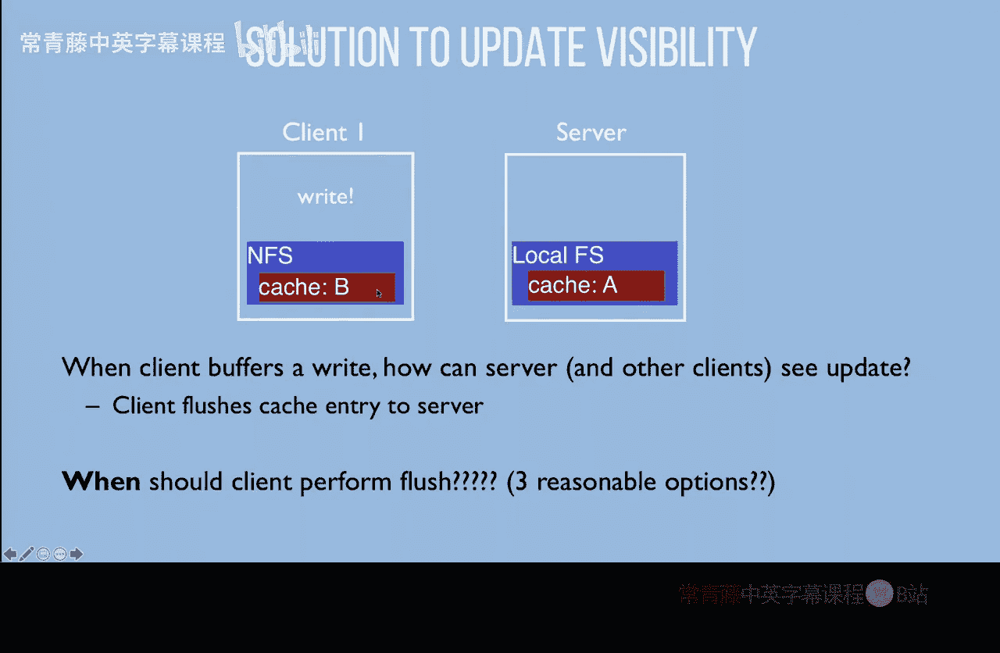

One option is every time you do a write on the client， just flush it immediately back to the server。

 that would。Kin of defeat some of the purpose of caching。 It'd be too slow。

 You could have some policy where you say every 30 seconds push that right back to the server that gets pretty weird semantics。

 but you could do something like that。 What NFS does is it's a requirement within the protocol that if you call close on a file on a client right you have to flush all of the data blocks that you modified to the server when you call close。

But it might do it at other times， so you can't guarantee these certain semantics。 It might。

 like if there's not enough memory， you've cacheed too much stuff， you're running low on memory。

 you would also flush those blocks back to the server and forget about them to save the memory there。

Okay， so。Now we'll know when those rights will go back to the server。Probably。

 but it's still gonna to be kind of problematic because you could still have two clients that are each closing the same file that they modified sometime in the past。

 they each modified different blocks。 And now they're calling close and they each just kind of flush those back in a random order back to the server。

 So the server is going end up seeing， oh， client 1 told me about these three blocks。

 Client 2 told me about these 10 blocks， and it's going to intermingle them。

 and there's no consistency between does client 1 or does client2 end up winning or which copy you keep of each of those things。

 So it ends up just being really messy and intermingled。

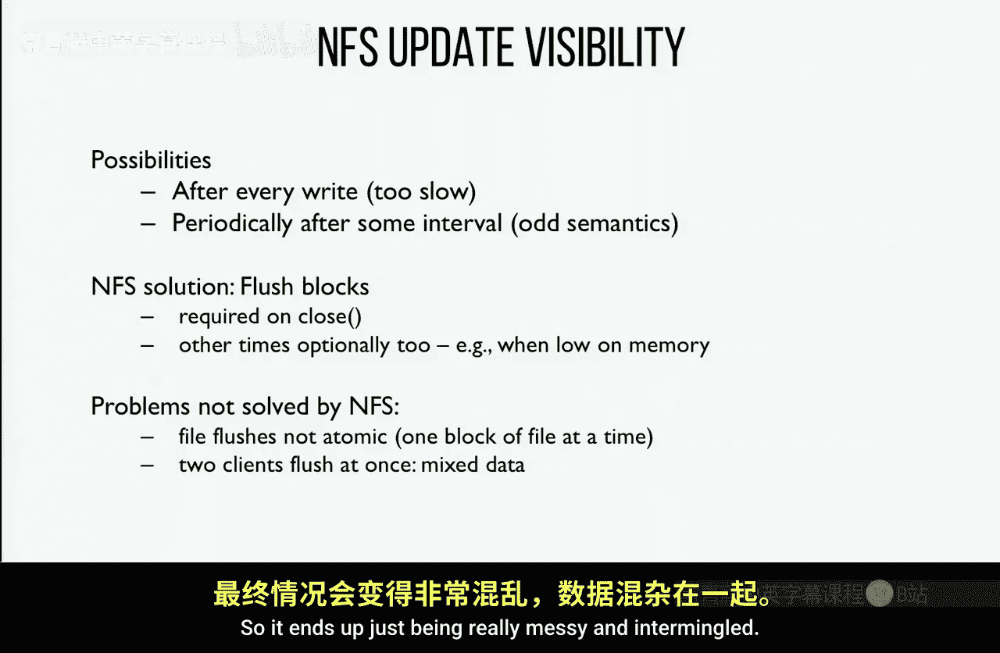

O。So that's one problem， client one updating its rights back to the server。

 then once the server has the copy， which is what we showed here。

 we did our file close and we flush those changes when in the world is client2 going to update its cache and see that it shouldn't be caching it as A anymore。

So let's figure this one out。 how should client2 find out that this data is different now？

So one solution would be this server would tell client to that this changed。So is that consistent。

 Does that make any sense to do in NFLFS。For this server to tell client to， hey。

 you're caching something。 and I have an update to that。 Please get rid of that。So， no。

 this doesn't make any sense within the NFS philosophy because that would require state right for the server to tell the client get rid of this in your cache。

 the server would have to be remembering that client2 has this cached。

 It would be remembering something So that would be state。 So NFS， that is not its philosophy。

 It's not tracking that client2 has this file open or that it has its cached。

 It's like I don't care what clients want to do。 They just send me item potent requests。

 and I respond to them。 So it doesn't remember anything about those clients。

 So we are not going to send anything back to clients。

 What we're instead going to do is we're going to put the burden on the clients。 The clients。

 basically before they use this。 They're going to ask the server。 hey， is this the current copy。

Can I use this cached copy right now。So we're going be sending a lot of messages to the server but it's better to just ask the server。

 hey， so it has a timestamp， it says I got this copy from you an hour ago。

 when was the last time this file was written to and the server says well someone wrote that file a minute ago so therefore your copy is invalid you better get a new copy right now so that's how basically this protocol is going to work is it's going to do these stat calls where the client asked the server when did that file get written and if it was written more recently then it got the copy it knows it has to throw it away。

嗯，哼。Yeah， so in some sense， that can be okay。 So youre。

 So one problem is we're pulling the server all of the time， making it do this extra work for us。

 And it's kind of hard to figure out what's the relative ordering of things。

 So sometimes it can be okay if something changes immediately after we asked。

As long as you can do like these。If you can make the system have a linear order across competing entities so then you can get into really all these weird semantics about distributed systems。

 But you're right， this is going to give a very odd consistency protocol and we're going to have a simpler one with AFS。

 but it is hard to say like what happened before something else。 but at some point。

 something has to happen before something else。 and you have to just say， well。

 you did the read before that other right happened。

And as long as you can kind of give a consistent ordering across all the clients。

Lots of applications work correctly。嗯，哼。😊，Yup。Yep， yep， yeah。

 If you're gonna to build an application that requires that type of correctness。

 NF S is not going work well。 definitely， yep， yep。Okay。So， great。

 So this is what I was describing before。 The client is going to keep asking the server， hey。

 has my data changed since I last read it， And if it has。

 then it invalidates this copy here and reffetches and gets B。Okay。

 so this is kind of sort of gonna work。 It gives us weird semantics， but it sort of works。

 So this was a version of NFS that was operational for a while。

 but theyre smart system developers were're working in the real world。

 It has to actually work and work well for current scales and workloads。

 And so what they found is that it really did not scale past tens of clients and that was because the clients were spending all of those times sending those requests to the server。

 theyre called stat calls where they say when was that file last written。

 So lots of times the file hasn't changed， but the client has to be paranoid。

 It has to just keep asking the server， hey did this change， Hey did this change。

 the server spending up all of its time doing that。

90% of its time just answering those stupid questions。

So we need the clients to give the server a break and not be constantly asking it if a file has changed。

So basically， their great solution is they're only going to ask the server every three seconds if a file changed。

 and that is going to be the NFS protocol for us。 So basically， you're kind of caching。😊。

Your results for when you last called stat。And so if you just let it fade cached forever。

 you would never ask the server again。 You call stat one time。

 you found out that the file was changed。An hour ago。You would remember that forever。

 So what they do then is every three seconds or some parameter you can configure in your system。

 They forget the results of that stat that they sent。 So if they didn't ask you， you know。

 if they don't know when they last ask you， they'll ask you again。

 So basically they end up asking the server every three seconds， hey。

 when did that file change sending it that stat call。So the implication then。

 is you won't see changes on a server until perhaps three seconds after the。

The server actually got those changes。So it's kind of a weird。

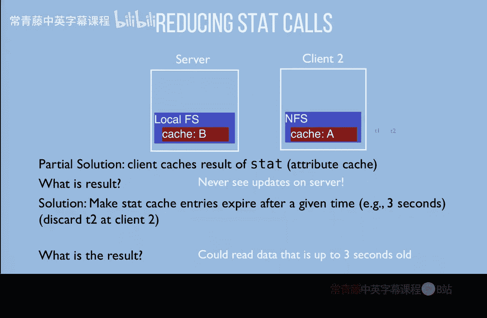

Semantics， but if you actually want things that's what you would see if we had NFSV2 running anywhere。

 but NFS was really， really very influential because it worked very well it did scale to hundreds of clients sort of and it was really elegant。

 it can handle the server crashing because it built on this notion of really keeping the server completely stateless and having the protocol just use itempotent operations but the problem is we have that really weird consistency model where we can't really say what data a client is going to see know that probably you'll see updates after three seconds and it doesn't scale as much as we would like because we still are sending stats to the server。

So that's NFS。 and I want to contrast it with AFS。And then at the end of the lecture。

 which we're getting very close to， we'll compare for a workload what NFS would see versus AFS so that we'd see that they would actually see different file contents。

So if you still have questions about NFS and how it works。

 I think that'll be best answered when we compare the two for a workload and see what would be said。

 okay。So last system that we will be looking at in 5，37。 Okay， AFS。

 So NFS has that scalability problem and the ugly cache consistency。

 So AFS is directly trying to solve those two specific problems。

 And it's going to solve those problems basically by making it a really complex server and making the server hold some state。

And that's just what it's going to do。 And we don't know how to make things more scalable for this world without having some state。

 O。So one big change that AFS is going to make is it's going to transfer files to across the network a whole file at a time。

 NFS just read individual blocks。 like if you wanted to read one block of a file。

 NFS was a pretty good choice because if it was a huge file， it would just read one block of it。

 so you wouldn't have to transfer the whole thing。It makes sense to actually look at how people use file systems and it turns out most of the time if you read one block of a file。

 you read the whole file， it's very rare to just read a small portion。

 So AFS people were also great system builders， they looked at how systems are actually used。

 they did all these measurements and they saw that files are usually read in their entirety so you might as well send the whole file across the network。

So this is going to end up giving us some better semantics because when we open a file。

 the AFS client is going to read the whole file at that time。

 and then it's going to have that same copy that it gets to use for all of its future reads and writes until it closes that file again。

 So that's just much simpler。 It's not getting these weird intermixes of when another client changed some file。

And then when that client closes the file。It's at that point that it's going to flush any changes back to the server。

 So this is now a guaranteed time。 NFS did this too， but NFS could have sent updates sooner。

 AFS guarantees that it won't send random， weird updates until the whole file is closed and that it sends the whole file。

So this is going to give us easier semantics to deal with that the AFS clients。

 they see the same file the entire time from when they open a file to when they close it instead of getting weird updates in there。

And it also is going to end up being much more scalable because now the only time we interact with the server is when we open or close a file。

 right， So when we call read， that operation just stays beautifully local on our client machine。

 We don't bother the server at all。 So that's why we're going to get the much better scalability。

And it's also going to help。Understand the cash consistency model。

 So we had those two portions of cash consistency across clients。

 How do we send updates to the server and then how do other caches keep in sync with the server。

So how do we from a client tell the server that we change something。

 So this is very much like what NFS did when we close the file。

 that's when we flush all of our changes to the server。

 But now instead of intermixing potentially different blocks across different clients that are simultaneously closing a file with AFS it's always one file wins or the other does。

 So if client one closes a file and it starts to get written to the server and then simultaneously。

 another client closes the file， it will first the server first completes the first right all to completion。

 and then it completes the second right all to completion。

 So it's guaranteed that the last closer of that file will be like the winner。

 that will be the version that sticks around on the server forever and ever。Al right。

 so you can see there's all sorts of concurrency issues you really do have。

 if you're trying to cooperate， you would have to have some other locking mechanisms like we learned about with concurrency so that they would actually cooperate。

 This is giving us at least we get like some correct contents。 But if you cared which writer one。

 you better have some other scheduling or concurrency mechanisms built on top of that。O。Last problem。

This was after clientient1 has updated the server with this change。

 How does client 2 find out about it。And we said in NS， client too had to do that horrible polling。

Because it didn't want to have state。 A FS says it's fine for me to have a complex server with lots of state。

 We're smart people。 and we're going to deal with these problems。

So the server is now going to track which clients have this file open。

So we're tracking the state of which clients have this file open。And so now clientient2。

 it can trust its cache as long as the server tells it that another client hasn't overwrittendden that。

 So what we do we call this callback， you establish a callback when you open a file。

 so I opened file Z and the server remembers that file Z is being cached by client2 and clientient2 has that whole file cache and while it's doing its reads。

 it can just use that local copy。Then let's say another client decides to write that to file Z。

 the server breaks the call back with client two， so client2。Knows it can't trust that anymore。

 Client2 gets to keep using that file， though， until it calls close。

 it gets to keep using its cached contents。 But if client 2 opens the file again。

 because that callback was broken， it knows that it needs to get a new copy at that point。

So those are all of the details said。As quickly as possible。

 So the way that I like to see that you all can get that is to go through some examples because then you're like。

 oh， yeah， I wasn't understanding that。Okay。And I'm skipping these details。 I wrote detail on there。

 And I said， if it seemed like those were too detailed， we will skip that O。

The key things to remember about AFS are that we're getting better scalability because we're keeping state on the server so that the clients don't have to keep poll the server to find out if things have changed and we're going to get better scalability because we're doing that whole file caching。

 where clients cache whole files instead of having to go for every reading right。Okay。

 and then we're keeping the state of which clients have files open and doing that okay。

So at a high level， if you had to say， what's the cash consistency model in NFS versus AFS， like。

 when does a client see a change。In NFS， when you read a file。

 you could potentially see the updates to a particular block 3 seconds after another client closes the file。

 So that's just kind of like a weird。Behavior。What A FS does is it's the next time you open a file。

 after another client closes the file， you're guaranteed that you'll get those changes that that other client wrote。

 So you should be able to test something like this out on the instructional machine log into two different royal machines。

Write some changes to a file on one。 and you shouldn't see those changes in the other。

 If that first client didn't close the file yet。 But then once you close the file。

 then you should see it elsewhere。 It depends upon exactly what version of AFS they're using these days。

 exactly what we'll see。 But that is the idea there。

 But that's why sometimes you might see slightly different versions of a file when you're logged into different machines。

 depending upon how things are propagated around。Okay。

 so what I like to do to see if you understand these two protocols and this is the type of question that would be on the final exam is to give you some system calls that are occurring across two clients and give you some times that those are occurring。

And then to try to figure out what messages are going to be sent between the client and the server。

 so there's never any messages sent between clients。

 it's always between the client and the server and what is the server going to do as a result。

 and then what are the file contents that client A and client B are going to see。So。

We can kind of look at these at a high level。 So for NFLFS。Let's just try to understand what。

Data contents you might end up seeing， so。Here we're just doing reads。

 We'll get all of those from the server。 We'll get into the details later。 Client B opens a file。

 writes it。 So the tricky thing， one question for you is， is client A going to see that right in NFS。

No， and so why would client A not see that right yet， It's 10 seconds after that right occurred。

 Would client A see that。Yeah。Right， great。 It's not closed yet。

 So client B has not flushed that right over to the server。 So here， client A says。

 well I got to keep checking the stat on this file。

 It is going to send a message to the server saying， hey。

 has this file changed and the server is gonna to say， no but。 it hasn't changed。

 I still have your old contents。 Go right ahead and do that。 So we still have to do some work。

 but the server doesn't yet know that client B has changed that。 Yeah。嗯哼。😊，Great。

 so the right will happen locally on client B， it will be buffered in client B's memory or it could go to disk even on client B。

 but it is not sent to the server until we do the clothes。Yeah。All right， yes。It could be， yeah。

 but for an exam question， we'll say， don't assume any extraneous random things happened。

 but it's possible that if B's memory was full， it would try to free up memory by finding that。

 exactlyact。 Yep， so after this， it's guaranteed that it's flushed。 And so when we do this read here。

 are we going to see the change that client B did。😊，Yeah。

 we will see that one because we'll go to the server and see that change。So in contrast。

 then let's think at a high level what would happen in AFS with this workload。With A FS。

 client A does this open， and it fetches the whole file。

 And then all of these reads are beautifully local。And then client B does this open。

 it fetches the whole file， it writes that one thing， keeps that local。With AFS。

 is client A going to see the contents？At this point， nope here， client B in AFS at the close it。

Sends it to the server， and we'll have a new copy of that file over here。

And then the key is what's going to happen at time 80 on client A is client A going to see that new data or not No。

 it will not because it uses the same version of the file from open to close， which is very。

 very nice。 It has a consistent image of that file。

 it won't get confused saying why I did this file change underneath of me。

 I'm the only one who I thought was writing this， no it sees the same version of that file the whole time。

嗯。But what did happen was when the server got the。Update from client B。

 It breaks the callback that it was remembering for client A。

 So it sends a message to client A saying， hey， you can't trust that file anymore。

 So then at time 100， when client A opens that file again， it says， hey。

 I don't have this file actually cacheed。 I can't trust that。

 So it does a rech of that file at that point and sees the updates that B did at that point。Yeah。No。

 it's never exact。 No， time and distributed systems， you can't do much ordering between things。Right。

 I mean， to be precise， you should be saying assuming the messages in the system take you know。

1 millisecond。Then， you know， you should have received that callback break， you know。

 this far in the future， at least， yeah。Yep。Yes。It still uses the cached copy at this point here。

 even though it will get the break of the callback at time 80。

 so it only checks to see if it has a callback or not when it opens the file again。

 And so it's guaranteed to have the same file that it's reading from the whole time it does open and close。

 it only be checks that when it calls the next open。Very good question。Yep。

 so this is my very messy handwriting showing kind of more of the details there。

 So really thinking about what's happening， what are the messages being sent from the client to the server and what does the server really need to do on each of those things。

 So when this is NFS。 when the client calls open that makes the server do some work to just do a lookup right and it doesn't do anything other than that。

 it just does like that path name traversal and returns the file handle。

 which is going to be stored in the client is part of the file thescriptor。

 And then when the client does all of these reads that sends those item potent P read operations over to the server。

And then when it gets to this read of the same block。What does it do at that point。

 it checks the cash。And it's going to see that its cash attributes have expired。Right。

 because it's been more than three seconds since the last time。 So every time it does like a read。

 it gets the attributes。So it doesn't have to do a new stat that's like appended to every time you interact with the server because NFS clients want to know those attributes so badly they're told every time they interact with the server。

 these are what the attributes are for that file right now。

 so it would have told it that oh that file didn't change。At time 20。

 it was told that file didn't change at time 30， though。

 it says hey it's been more than three seconds， so I'm going to ask again。

 even though I do have a copy of block one here。So it asks the server by calling get attribute or stat。

 have they changed and it says no， it has not。 And so client A is able to use its cached copy at that point。

 We don't have to transfer the whole data。 We just have to do that short little message for finding out that a can trust its data at this point。

And then at time 31， that's less than three seconds， so it trusts those attributes。

 it says I don't have to ask again， I know the file hasn't changed。

 and I'm going to use my cached copy of this block here。

So that's more of the details of what's being sent back and forth between clients and servers and the work that a server needs to do here。

嗯。So I would recommend。Making sure that you can kind of walk through the protocol at that level for NFS。

 and then AFS is just much simpler。 It's much more elegant when we do our open between the client and the server。

 we do that one transfer， we get all of file A's data at that point。

 we set up the callback or the state for client A on the server at that point。

 then all of the reads are just local， don't worry about it， don't bother the server。

 Then when client B does the open， it sets up a callback， we get all the file A back to client B。

This continues locally， it's when we do the clothes that we send。The changes is back to the server。

 it breaks all the callbacks， but it doesn't affect client A。

Until it does the open again in the future and checks to see if it still has the callback or if that was broken。

So those are the more of the details， yeah。啊哈。😊，Great， so like if at time 85， client A does a right。

 Great。 So then at time 90， we're going to write our we have to update the server。

 And so the server then at time， you know，95 is going to have client A's changes。Well。

 if client B opens the file before the changes get flushed to the server。

 it's going to get its old version。 But if it opens it after those changes got pushed to the server。

 then it would get the new changes。 So it's all timing relative， we can't guarantee everything。

 But it is。 if it open happens before。The other one sent it there。 You get to use the old version。

Okay。we're gonna have two clients that are just competing and not cooperating at all of this。 Yeah。

 if if you， if you really wanted your changes and you saw someone else did， you。

 you and your project partner can just day along， Just keep changing that file and wondering why it's。

s going back to the old version， y，When you were talking about last on the wins。

 is that just conflictfs or is that just like since it has the whole file。

 it's rewriting the whole file？The latter， just that it's going to rewrite the whole file。

 and that's going to be the version that it remembers。 And it has no memory that it had this。

Other version before that B write like 10000 and then B write like。Correct。Exactly， yep， yep。

 And if B just wrote modified one block of that file， it's still whatever B's version is。

 that's going to be their version that's out there。 Great questions， yep。All right。

 so this was it for file systems and persistence。 We've gotten through every technical detail in this class now。

 you understand NFS and AFS。 and so on Tuesday， we'll do the this is what we did in this course and really focus on the last part of the course。

 and if there's specific things you want me to talk about for file systems， please do ask questions。

 All right， I will see you all on Tuesday。😊。

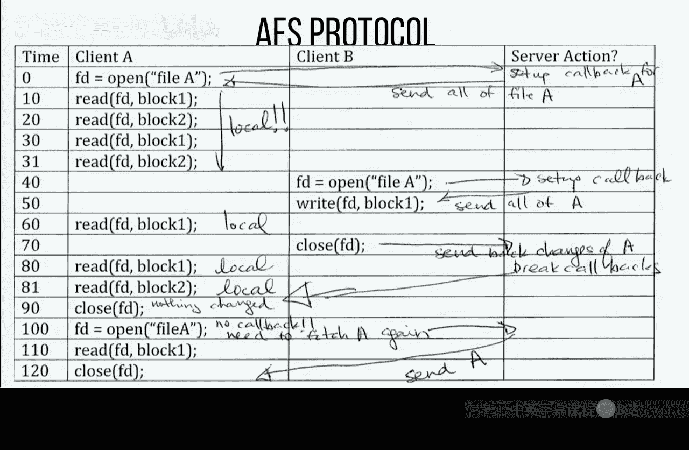