# 操作系统：第24讲：分布式文件系统：NFS与AFS 🗂️

在本节课中，我们将学习分布式文件系统，特别是NFS和AFS。我们将探讨它们的设计理念、协议细节以及缓存一致性模型，并理解它们如何解决分布式环境下的文件共享问题。

## 概述

分布式系统由多台机器协作解决特定问题。我们主要关注客户端-服务器模型，其中多个客户端连接到一个中心化的文件服务器。使用分布式系统的主要动机包括：提升处理能力、增加存储容量、提高容错性以及实现数据共享。

然而，分布式环境也带来了新的挑战，例如节点故障、网络通信问题以及跨机器的并发控制。我们将重点分析当客户端或服务器崩溃时，系统应如何正确恢复。

## 本地文件系统与分布式文件系统

在深入分布式文件系统之前，我们回顾一下本地文件系统。它仍然是所有分布式文件系统的基础构建块。即使在分布式环境中，服务器端的文件系统（如EXT4）仍然负责从本地磁盘读写数据。

在单机上，多个进程共享同一文件时，由于它们共享相同的缓冲区缓存，一个进程的写入能立即被其他进程看到。但在分布式环境中，不同客户端上的进程读写同一文件时，语义将变得复杂得多。我们将探讨NFS和AFS如何定义这种跨客户端的文件可见性。

## 设计目标

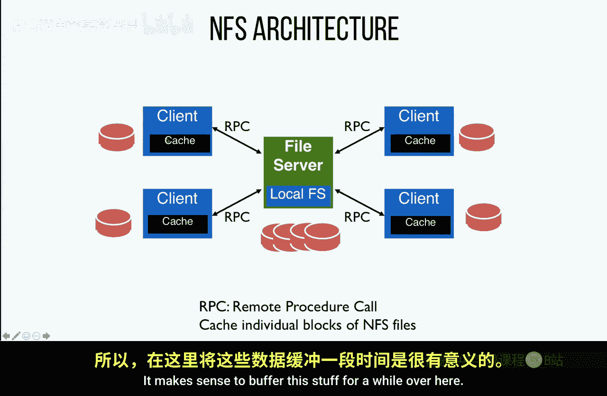

我们对分布式文件系统的期望目标包括：
*   **简单性**：系统应易于理解和实现。
*   **高性能**：读写操作应快速。
*   **容错性**：客户端或服务器崩溃后，系统应能正确恢复。
*   **透明性**：访问远程文件应尽可能像访问本地文件一样。
*   **可扩展性**：系统应能支持从数十到数百个客户端的并发访问。

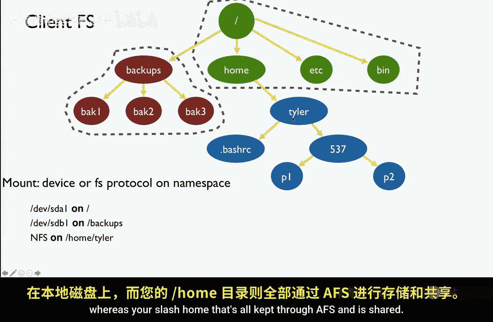

接下来，我们将看到NFS和AFS如何以不同的方式尝试达成这些目标。

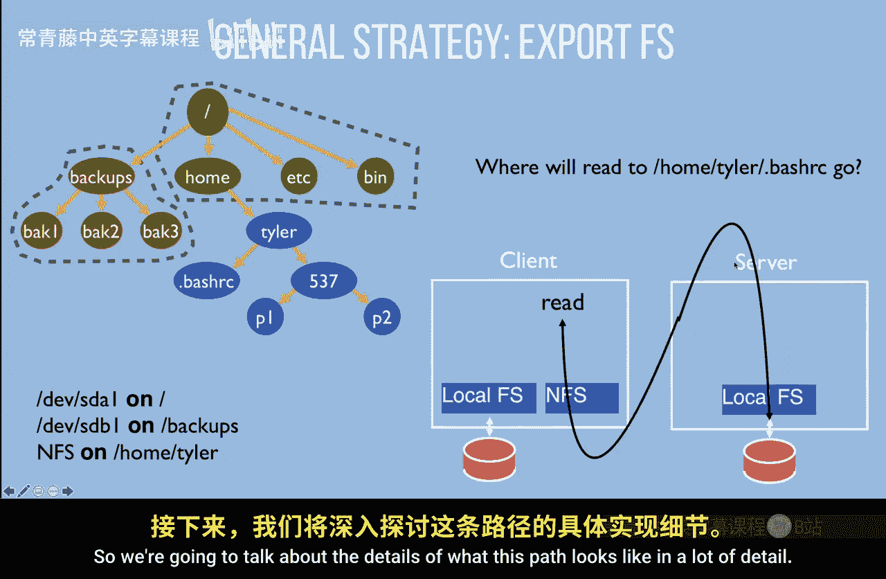

## NFS：网络文件系统

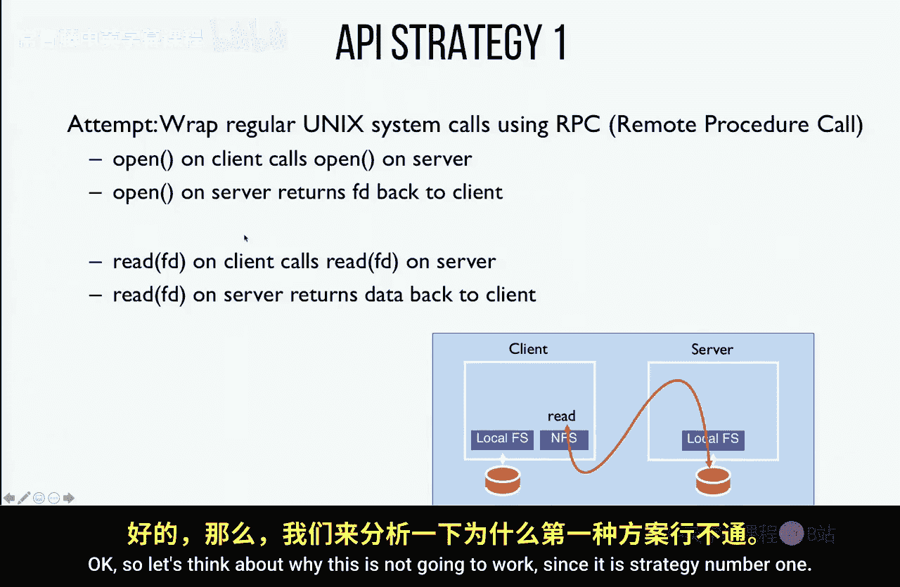

NFS更像一个协议规范，而非单一实现。我们将重点讨论NFS版本2（v2），其核心创新在于**无状态**设计。

### 架构概览

NFS采用经典的客户端-服务器架构：
*   **服务器**：单台机器，运行本地文件系统（如EXT4）来存储数据。
*   **客户端**：多台机器，可能拥有本地磁盘。它们通过**远程过程调用**（RPC）与服务器通信。
*   **缓存**：客户端会在本地缓存最近读写过的文件数据块，以减少网络访问和服务器负载。

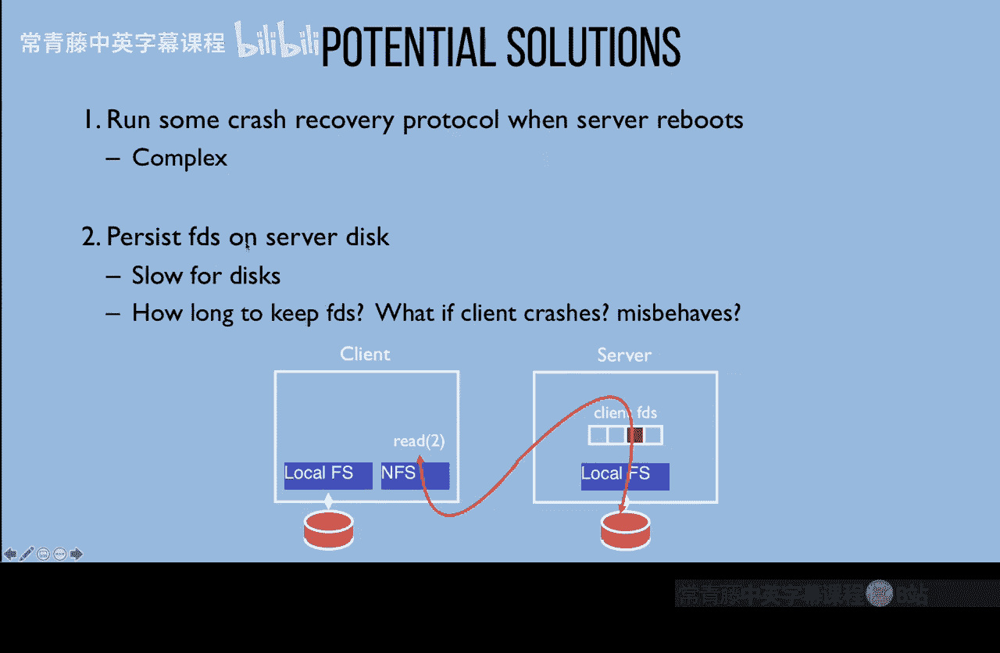

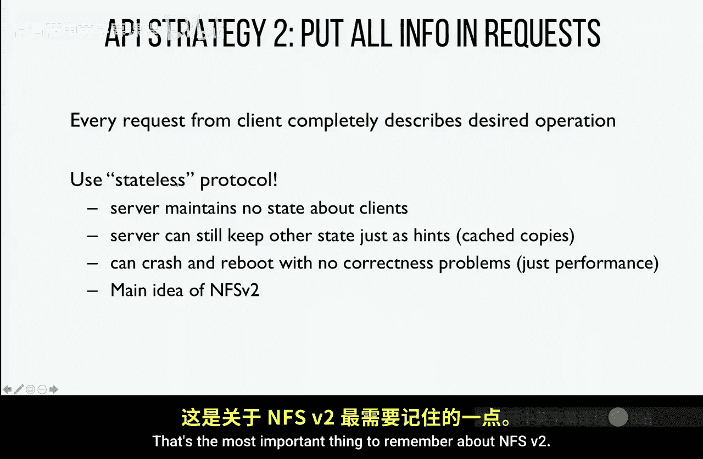

客户端通过**挂载协议**将远程文件系统的目录整合到本地的目录树中。例如，`/home`目录可能映射到NFS服务器，而`/tmp`目录则存储在本地磁盘。对应用程序而言，访问本地文件和远程文件使用的是相同的系统调用（如`read`, `write`），**虚拟文件系统**（VFS）层负责将调用路由到正确的底层文件系统。

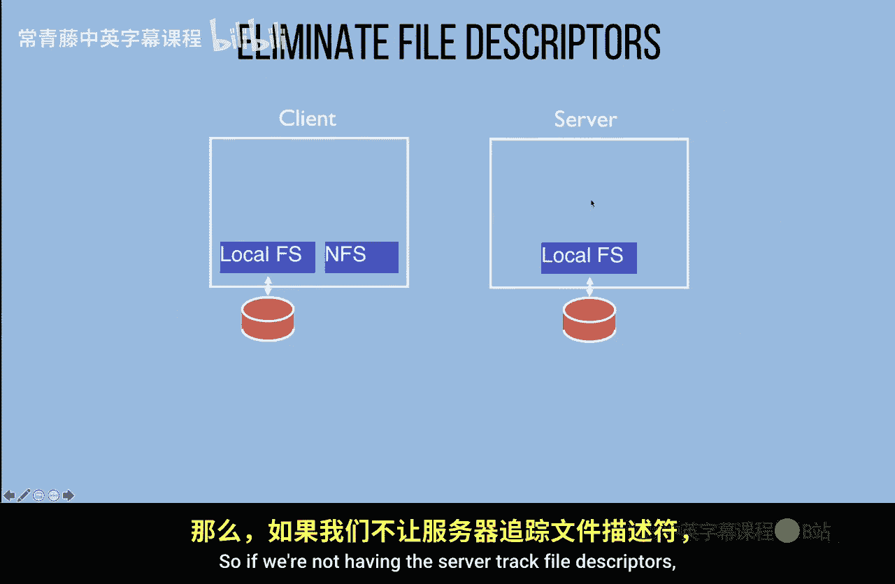

### 协议演进：走向无状态

最初的设想是让服务器代理执行所有客户端发来的文件操作（如`open`, `read`）。但这要求服务器为每个客户端维护**文件描述符**状态（包括inode号和当前偏移量）。如果服务器崩溃后重启，这些内存中的状态将丢失，导致恢复困难。

NFS v2的解决方案是设计一个**无状态协议**。服务器不记忆任何与客户端会话相关的状态。每个从客户端发往服务器的请求都必须**自我描述**，包含执行操作所需的全部信息。

这意味着需要摒弃基于文件描述符的接口。我们尝试了几种方案：

1.  **方案一（失败）**：每次读写都发送完整路径名。这会导致每次操作都需进行昂贵的路径名查找。
2.  **方案二（改进）**：客户端发送`open`请求，服务器执行路径查找后，返回一个**文件句柄**（file handle）。后续的`read`/`write`操作直接使用该句柄和客户端提供的偏移量。文件句柄通常由**卷ID、inode号和生成号**组成，确保其唯一性，防止inode重用导致的安全和一致性问题。
3.  **最终方案**：客户端负责跟踪文件偏移量等状态。服务器完全无状态，只处理自描述的读写请求。

### 幂等操作与RPC语义

NFS构建在RPC层之上，该层提供“至少一次”的调用语义。这意味着，如果RPC调用成功返回，该操作可能在服务器上执行了一次或多次。

为了适应这种语义，NFS协议必须只包含**幂等操作**。幂等操作是指无论执行一次还是多次，结果都相同的操作。
*   **幂等操作示例**：`read`（读取特定偏移量的数据）、`write`（向特定偏移量写入数据）。
*   **非幂等操作示例**：`append`（追加写），多次执行会导致数据重复。

因此，NFS协议本身不提供`append`操作。客户端应用程序调用`append`时，客户端的NFS库会将其转换为一个计算好偏移量的`write`操作，从而在协议层面实现幂等性。

### 缓存与一致性模型

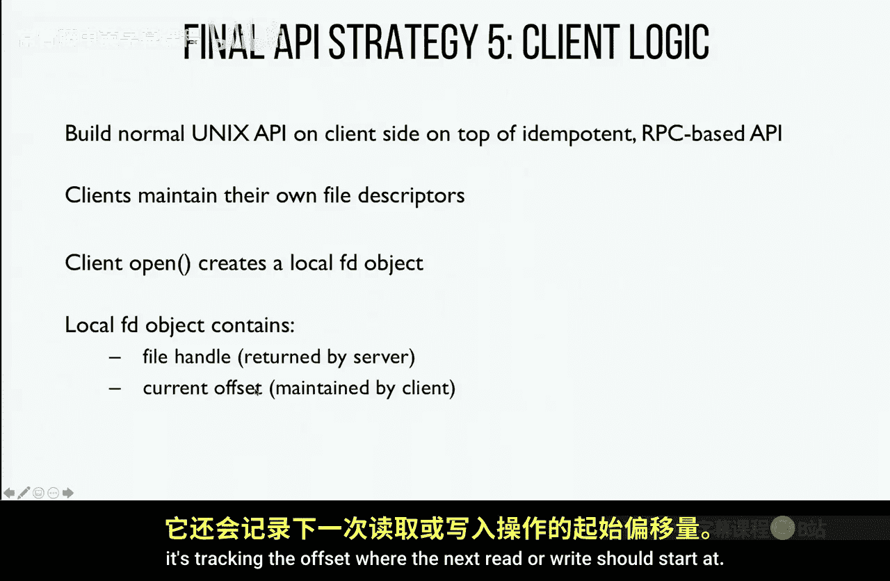

为了提高性能，NFS客户端会缓存文件数据块。但这带来了缓存一致性问题：一个客户端的修改何时对其他客户端可见？

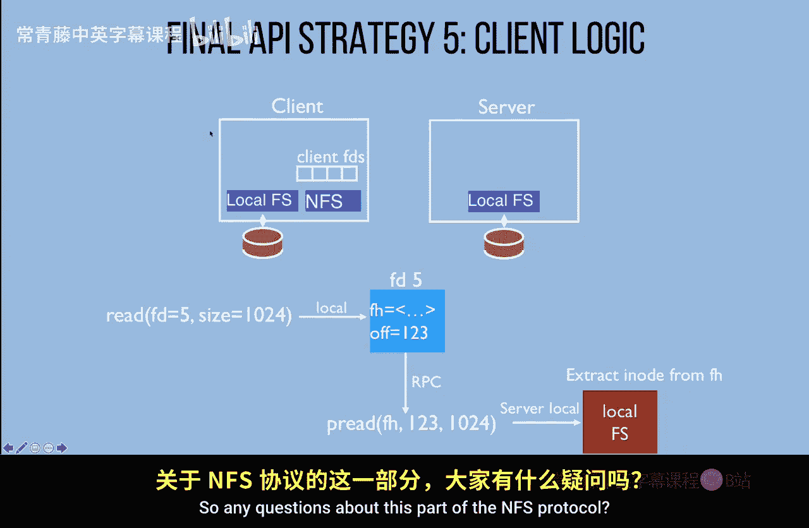

NFS采用一种“尽力而为”但语义宽松的一致性模型：

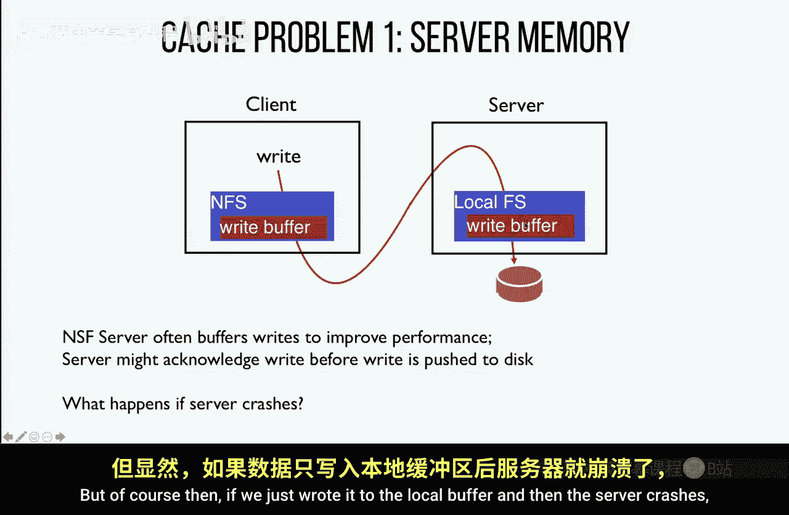

1.  **写回时机**：客户端修改数据后，不会立即同步到服务器。通常，在文件`close()`时，所有修改会被刷新回服务器。在内存压力下，也可能提前刷新。
2.  **更新可见性**：客户端在读取缓存的数据块前，会先向服务器查询该文件的属性（如修改时间），以检查缓存是否过期。为了减少服务器负载，NFS客户端不会频繁查询，而是采用一个**属性缓存**，通常每3秒使缓存失效并重新查询一次。

因此，在NFS中：
*   一个客户端的写入，在其他客户端看来，可能最多有约3秒的延迟才会可见。
*   如果多个客户端同时写入并关闭同一文件，服务器最终接收到的文件版本取决于网络时序，可能导致不可预测的结果。

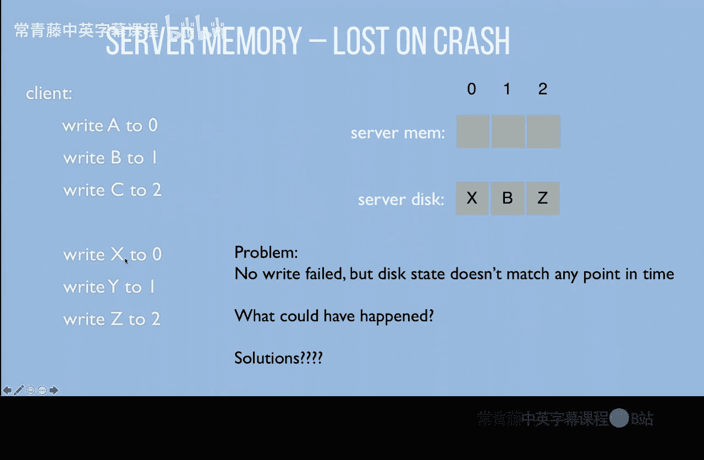

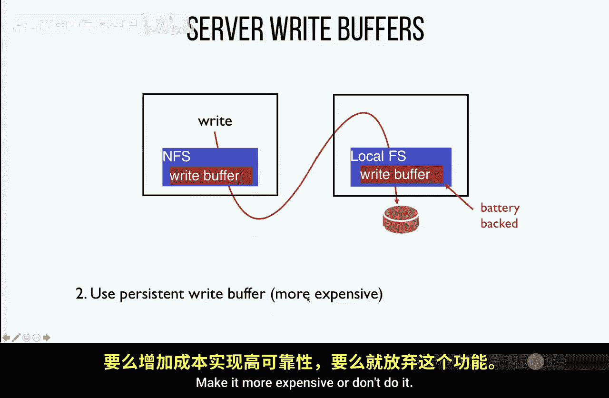

这种模型简单，能容忍服务器崩溃（因为无状态），但牺牲了强一致性和可扩展性（大量`getattr`请求会压垮服务器）。

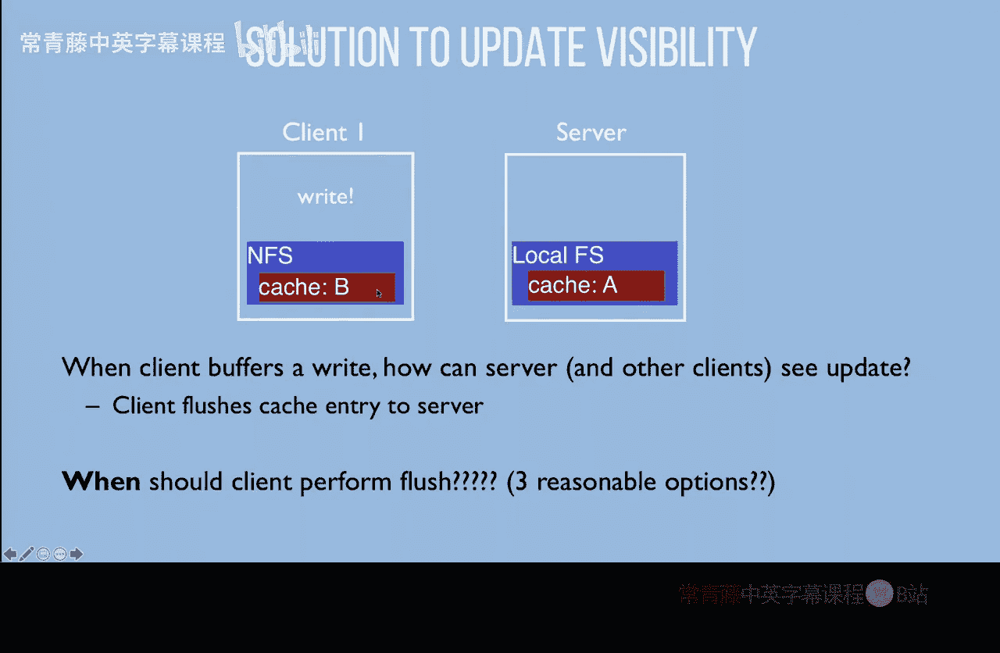

上一节我们介绍了NFS的无状态设计和其宽松的一致性模型。本节中，我们来看看另一种设计哲学——AFS，它如何通过引入状态来获得更好的可扩展性和一致性。

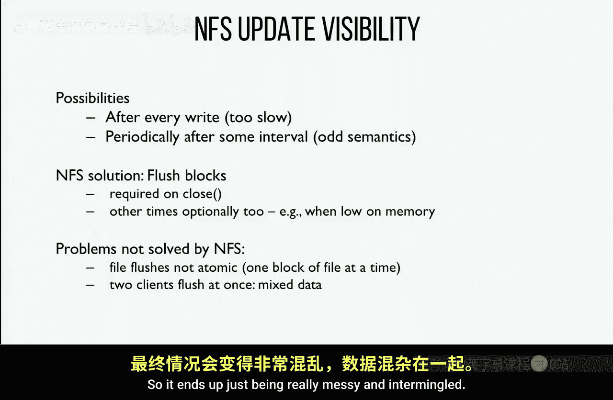

## AFS：安德鲁文件系统

AFS旨在解决NFS面临的可扩展性差和缓存一致性模型怪异的问题。其核心思想是**以状态换取可扩展性和更清晰的语义**。

### 关键设计决策

1.  **全文件缓存**：与NFS缓存单个数据块不同，AFS客户端在`open()`文件时，会**传输并缓存整个文件**。后续的`read`和`write`操作都在本地缓存副本上进行，无需与服务器通信。这基于一个观察：大多数情况下，文件是被整体访问的。
2.  **基于会话的一致性**：客户端在从`open`到`close`的整个会话期间，都使用同一份文件缓存副本。这为应用程序提供了稳定的文件视图，不会出现在会话中间文件内容意外改变的情况。
3.  **服务器维护状态（回调）**：AFS服务器会跟踪哪些客户端缓存了哪些文件。当某个客户端`close()`文件并将修改写回服务器后，服务器会**主动通知**（回调中断）所有缓存了该旧版本文件的其他客户端，告知它们缓存已失效。
4.  **更新传播时机**：客户端只有在`close()`文件时，才将完整的修改后的文件写回服务器。服务器按顺序处理这些写入，后写入的版本会覆盖先写入的版本（“最后写入者胜”）。

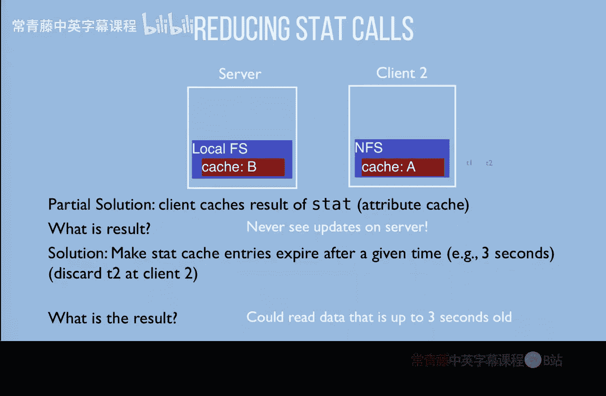

### 工作流程对比

通过一个例子对比NFS和AFS的行为：

假设文件初始内容为“A”。
*   **时间 10**：客户端A打开文件并读取。
*   **时间 20**：客户端B打开文件，写入“B”，但**不关闭**。
*   **时间 30**：客户端A再次读取文件。
*   **时间 40**：客户端B关闭文件。
*   **时间 50**：客户端A再次读取文件。

**在NFS中**：
*   时间30的读取：客户端A会查询服务器，由于B未关闭文件，修改未刷新，服务器回复文件未变，因此A读到“A”。
*   时间50的读取：此时B已关闭文件，修改已刷新。如果距离A上次属性查询超过3秒，A会重新查询并发现文件已变，从而获取新数据“B”。否则，可能仍读到“A”。

**在AFS中**：
*   时间30的读取：客户端A使用其在时间10获取的整个文件缓存，读到“A”。它不受B写入的影响。
*   时间40：B关闭文件，将“B”写回服务器。服务器中断A的回调。
*   时间50的读取：此时A再次`open()`文件。由于回调已中断，A发现缓存无效，于是从服务器获取最新版本，读到“B”。

### AFS的优势

*   **可扩展性**：极大地减少了客户端-服务器间的交互（仅在`open`和`close`时），使服务器能处理更多客户端。
*   **一致性模型更直观**：客户端在文件会话期内看到一致的快照。更新的传播界限清晰（下次`open`时）。
*   **性能**：读写操作完全本地化，速度极快。

### AFS的代价

*   **服务器有状态**：需要维护回调状态，服务器崩溃恢复更复杂。
*   **网络开销**：即使只读一小部分，也需要传输整个文件，对小文件或随机读取不友好。
*   **更新冲突**：对于并发写入，采用“最后写入者胜”策略，可能导致更新丢失，需要应用层协调。

## 总结

本节课中我们一起学习了两种经典的分布式文件系统：NFS和AFS。

*   **NFS**：采用**无状态**服务器设计，通过**幂等操作**实现容错性。其缓存一致性模型宽松（约3秒延迟），通过客户端轮询服务器来验证缓存有效性。这种设计简单，但可扩展性有限，一致性语义较弱。
*   **AFS**：采用**有状态**服务器设计，通过**全文件缓存**和**服务器回调**机制，大幅减少了客户端-服务器通信。它提供了基于会话的、更清晰的一致性模型（在`open`-`close`会话内文件视图稳定），并获得了更好的可扩展性。代价是服务器逻辑更复杂，且不适合所有访问模式。

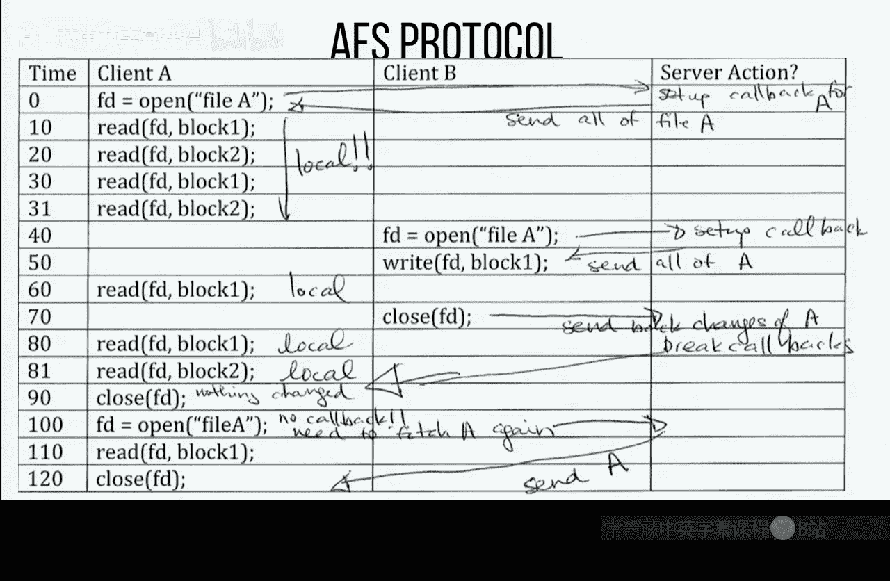

两者代表了在分布式系统设计中，在**状态管理**、**一致性强度**和**可扩展性**之间进行权衡的不同思路。理解这些基本原理，有助于我们评估和设计适合不同场景的分布式存储解决方案。