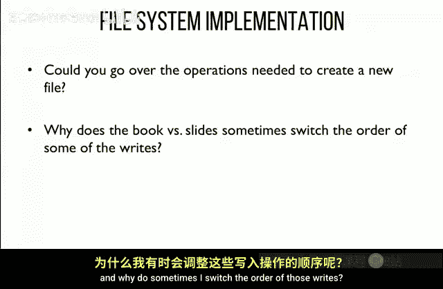
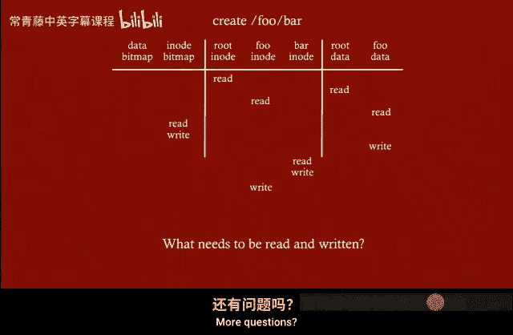
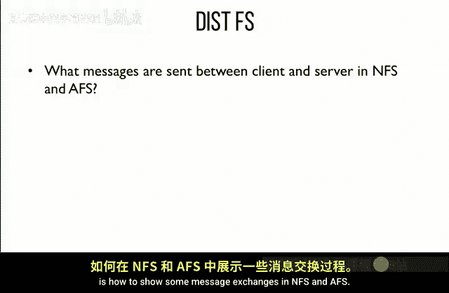

# 威斯康星大学【中英⚡操作系统｜CS 537 Fall19, Introduction to Operating Systems】 p25 P25 Persistence_ Review _ University of Wisconsin-Madison -BV1wUzSB3Ecf_p25-

嗯。All right， good morning everybody。Welcome to our final lecture in 537 so today is going to be just review for the final exam so basically I am surprisingly unenthusiastic about today's lecture like I've really enjoyed giving all the other lectures I'm like。

 oh I'm talking about something new I'm teaching you something today I'm like I've talked about all of this stuff already So if you all want to get something out of this I recommend that you bring the energy to this one because I'm otherwise done right so okay let us go through this stuff。

😊，Okay， so our administrative issues， so you all know that project seven is due tomorrow。

 technically at five， but you have through midnight as long as everything is working fine。

I've now posted on canvas in the spec the exact details for how you should do this hand in。

 so you need to have onepartners tech file that's at your top level of p7。

 you need to work with the same person for both parts so it goes in the top level now there are two subdirecties。

 Part A and part B and you should copy your code and we give the exact details of how to do that in the spec now so before you start just writing to those directories。

 please read the spec to see what we actually want there。Allright。

 so you now have permission to do that。 The directions are up。 follow the directions。 Okay。

 final exam。 we all know that that's on Friday in the evening。 we're splitting up by last name。

 If your last name starts with A through H， show up in social sciences。

 if your last name starts with I through Z， show up in humanities。As you all know。

 it's a slightly cumulative exam that it's mostly on persistence。

 but I will repeat questions that I already asked you that are true false about virtualization and concurrency。

 And again， those will be variants of questions I asked in the past。

 you should definitely go through the previous questions from your midterm one and midterm two。

 know those questions and answers so that those are easy for you and three points， great。

And then today， in lecture， I'm just going to cover the questions that you asked。 Unfortunately。

 I got very， very few questions posted to my wonderful Google form。

 So I'm largely using questions that previous semesters asked。😊，So ask questions as we go。

 And then in tomorrow， I expect the discussion sections will go over some of the practice exams so that you can have time to look at those practices。

 yes。Yes， ask， we can use this hour 15， ask questions， yes。No。

 we did not cover GFS or MARuce or RPC or TPC or UDP this semester。

 so those topics will not be on your final exam the only distributed system topics that will be on the exam are NFS and AFS。

 the two distributed file systems。Other questions about content or structure， or format。

Anything like that。 Okay， then we are going to get into。

What have we learned this semester So we've talked about three different roles of the operating system The first was it provides virtualization then we have all these concurrency mechanisms。

 and then last we've been talking about persistence so go back and remember a tiny bit about virtualization。

 remember the role of the OS here is to virtualize the resources。

 the hardware that it has to manage so that each application believes it has its own exclusive copy of that resource so we virtualize both a CPU and the memory we know that the abstraction that we give for the CPU is a process or a thread and the abstraction that we give for memory in our address basiss and we learned about a bunch of different mechanisms here that should。

Sound familiar to you， we know about limited direct execution where you basically get to run a user level process and let it execute its commands unless it needs to do these privileged operations that require a system call into the OS。

We learned about different CPUU scheduling policies like shortest job first or around Robin。

 you learned a lot about how to do address translation to go from virtual address spaces to physical addresses。

 we learned about segmentation， paging， the TLB to do faster lookups and so forth。

And then we know about different page replacement policies as well。 Well that's not。

Multilevel feedback here is not a page replacement policy， that's a scheduler。

 LRU is a page replacement policy。😊，I guess that would be a good straightforward question。

 matchch the letters to， is it a CPU policy or a memory policy there。Okay。

And then our next big topic was concurrency， where of course we know that here the goal was to manage the concurrency or the operations that are occurring in parallel across different threads or across different processes and those processes are probably cooperating。

 they want to access the same state and we just need to make sure that we order those events。

And so we learned about locks， semaphores， conditioned variables。

 We know both how they can be implemented on top of atomic hardware instructions like test and set。

 and we know how to use those operations and how semaphos can solve neat problems like dining philosophers or reader writer locks and conditioned variables can do those things too。

Okay， so I wasn't really going to do a review of those two topics because we've reviewed that stuff a lot。

 Okay， so persistence， this is what we really need to remember。

 And so the basic goal here is the role of the OS is to make sure that there is a way for processes to access data across reboots or power outages or whatever happens across different applications。

 This is long liveve data and what's neat about it in my opinion is that you really do need to be able to handle crashes and that just makes the problem a lot more difficult because you have to make sure that all your file system data structures are consistent。

And there's also tons of performance issues here， so we really have to understand what the underlying devices look like。

 what their performance and reliability characteristics are， that if we access hard drives randomly。

 we get very poor performance， if we access it sequentially。

 we get great performance RA also has different performance levels depending upon which one you're using and SSDs will have different performance depending upon how you access it。

So O S and file system designers need to understand these characteristics of the devices they're running on top of。

 So that's why we always have some work to do。 There's always new technology。

 and we always have to adapt to that in some way so that the people writing user applications don't need to know all of those details。

Then we talked about what the API looks like for accessing the file system。

 things like open and read and write and seek。Then we went into the actual implementation for a while。

 What are all the different metadata structures like bit maps and i nodes， indirect blocks。

 directory structures。 And we talked about allocation policies in FFS。

 So this was the 1980s file system that was first looking at making sure that i nodes were kept near data blocks and so forth。

And then we talked about how to make sure that our metadata is consistent if only some of it gets written out before a crash occurs。

 and we looked at two different ways of making sure that that data and metadata is consistent。

 There is journaling like an EXT 3， and then there's copy on right like in the log structured file system or AlFS。

And then finally， we looked at two distributed file systems， NF S and AFF。So that's our overview。

 Those are the types of things that I would expect you to remember。All， so let's get into details。

Okay， so here's just a bunch of kind of random questions that people have asked over the years。

 And so you can figure out， you know， could you answer these student questions。

 but I'll show some slides to answer them。 Okay， why do we so we're going back so we'll go through the last part of the course kind of in order。

 starting with IO devices and then ending with distributed file systems。

So try to get back into the mindset of， we know what an I O device is。

 So why do we have to write the data first and then write the right command。

 Could he do it in the opposite order。So remember this is what that device controller looks like that the OS is going to interact with this piece of hardware by first polling on this status register that it can't interact with this device as long as the device is busy while it's still handling a previous operation。

 it then says for this right command， this is all the data I want you to write。

 and then it writes the actual command to this here and so the question is saying could we have done that in the opposite order and no。

 I don't think that would make any sense because clearly you have to get the data there before you tell the device that it can write that data。

Al right， so this was like the simplest protocol， the one that has bad performance。

 And then we looked at a bunch of different ways of optimizing that。 Like。

 we want to add interrupts to this， and we wanted to add DMA。

 So you should remember about interrupts in DMA。Because we looked a little bit at the timing of what was going on across the CPU and that device controller。

 So in a particular example， process A was using the CPU in the disk。 and why was it like。

The questions are hard to understand。😊，Why is it using both of them so this was in those first versions where we don't have interrupts where basically our process a does some work。

 it's been waiting while C is using the disk， then it sees that the disc is idle and it is able to send the request off but in this version here after it does that right it still has to spin wait until it's done。

And so the basic answer for avoiding all of that was to add interrupts and so。This is a lot faster。

Where now if a sees that the device is busy， we will block， go to sleep。

 let the scheduler run another process that has some useful work to do while a is waiting for that device to be ready。

 So certainly all modern systems are going to use interrupts。 We're able to overlap CPU and I O。

 We're able to schedule useful jobs that have。Useful work to get done， yeah。Here。Well。

 this was the way to find out that the right is done。

 So its it does kind of matter like certainly for a read。

 you're going to have to wait until the read is done for a write。

 Different systems do different things with Do you acknowledge the right or not。

 The application definitely doesn't get informed that the right completed。

 but the file system might still be notified that the right was。不一样。

Rights are kind of bad with propagating errors back up to applications。 But the file system。

We'll need to wait or at least know that that operationberration is completed。OK。

So are interrupts always better than polling。So think about that in your head。

I would say the answer is no， they often are。 but if the device is really fast。

 then you're better off， you know， just waiting that tiny bits and waiting until that device gets back to you。

 So that's going to be the trend as we go towards more modern devices like non NVM， nonvolat memory。

 It was probably going to have a lot more systems that do polling instead of interrupt so much。

And certainly， if youve got a lot of these requests。

 you have this flood that's kind of tricky to deal with。Okay。So then we looked at hard disks。

So see if you can make sense of this question。If a disc is double sided。

 does that mean that the number of heads is two and the number of sectors per cylinder is doubled as well。

What else。So these are not my questions， remember。All right。

 so let's just make sure you remember what the。Parts of a disc look like。

So in this picture we have a platter and if it's two sided。

 what that means is that each surface of the platter is recorded on and so each side of that platter。

 each surface can be read and written to， and so each surface is going to have to have a reader right head that it can activate。

And so the definition of a track， then it's just on one surface。

 And the definition of a cylinder is that it's all of the tracks over all of the surfaces together。

 Sorry， know， So it's like the stack of tracks。So if we looked at this one platter。

 this one track has two tracks within the cylinder that's on there。

 and then that cylinder expands up there。Alright， so just to remember the difference between a track and a cylinder。

Yeah。has the三 time。No， you cannot。 It would be neat to do that， but that's just too expensive。

 And they're all in sync。 anyways， all the arms are going to be moving together。 So nope。

More questions。不给。Alright， so think remember that how you read or write from a disk。

 remember there are three components， there's the seek time， the rotation time and the transfer time。

 And so remember first you do the seek that your disc arm is going to move over the correct track or the correct cylinder and then you have to wait once you're on the correct track。

 for the disc to rotate in for the sector to go underneath the disc head and of course。

 the disc is constantly rotating even as you're seeking。

And then you have a small amount of transfer time when your discca is actually in the right place for that sector to transfer underneath。

Okay。So that is why random operations are very slow because you're doing lots of of seeks。

 If you don't have to do much seeks。 If you're just doing sequential operations。

 disks perform very well。Okay， any questions about discs。 This is your opportunity。 I am happy to。😊。

Diveerge from my。Planned route here， yes。Can you decide。

So we say like you can have a model for if you're doing random seeks， if you're doing random I O。

 that then we say that it's going to be on average， one thirdd of the max seek distance。

 that if you just look at if you're starting in a random location and you seek to another random location and you look at all the possibilities there。

 then the average turns out to be one thirdd of the max seek distance。

 So that's a good model for if you're doing random I Os。

 you're going to pay a one third of the max seek。And you can be very complicated with how your model seeks。

 but we just say。It's linear with the Sih distance。Other questions about discs， yes。Oh， track sw。

 Great。 So the problem with track sw， I don't have a picture。 but imagine。

 let's look at this one here。So here we're going。0，1，2，3，4，5，6，7，8，9，1011。

 And so this is assuming that we can move this track head and do this little seek and get to this one by the time well the just keeps spinning right but if it turns out that it's really kind of slow to get that disc head moving。

 it might take us too long to get the disc head moving over to this track and it might be that the disc head is over here by the time we get there So track sw takes that into account and would allocate sector 12 here instead12。

1314 around there and 23 would be here。Exactly， exactly that we tried to read block 12。

 but we were over here by the time we got there。 And so we missed it。

 and then we have to take that extra rotation。 So track S gives us the optimal sequential bandwidth。

 And it's something that's internal to the disk that the disk knows exactly all of those costs。

 The disk manufacturers are the ones that do that mapping of actual sectors to locations on the disk。

We could not see this at the O S level。 It's all internal to the disc。Other questions about discs。

 yes。但这的。To this question， okay？Well， so I usually， like， if I do a scheduling question。

 it should always be in terms of cylinders。 So it should like you， you can't tell that were which。嗯。

Which。Surface we're on。 So either in a scheduling question。

 view it as there's just one surface to this disc or I'm giving you cylinder numbers in your because Sik is just looking at。

 you know， moving across in this dimension。 It's not looking across activating different disc heads in other dimensions。

 Schcheduling doesn't have anything to do with that stack。Scheduling is just。Seek a notation。Yes。

 there's a disc head for the top surface and for the bottom surface。

 and they're both on the same arm。They all move together。

They cannot read different things at the same time。 That's why we had to do the scheduling。

 We'll first read one。We'll let the sectors go underneath of it to read it。

 Then it's true once we switch over to a different surface， we'll activate a different disk。

 but it will be in the exact same position as the other one。Just on a different surface。Yeah。

 one surface at a time。Oh it helps with capacity， so this is how we get a larger disc is we just put in a bunch of platters because some of the cost is related to the spindle and to kind of having the disk arm so it does give you greater capacity for the cost。

 the other way of getting greater capacity would be to make you know more dense surfaces or larger surfaces and those all end up being slower or more costly this is just a pretty cheap way to stack up a bunch of surfaces and get good capacity for the performance。

Great。Okay， I'm going to move on。To discheduling。 So what is the deal with scan and C scan and。

What should we look at there？Okay。So remember the goal of an IO scheduler is the OS is giving the disk a bunch of IO requests that it can handle in any order that it wants。

 so that's why when we were doing journaling we had to kind of worry about this。

 we couldn't give the disk things that modify both the journal and the checkpoint region at the same time because the disk is allowed to reschedule those operations and do them in any order so that's why we had to kind of have barriers at the file system level when we were doing journaling so we wouldn't give all of those requests simultaneously to the disk but here we're saying the disk does have a bunch of requests that it's allowed to reorder and there's different algorithms that look at just minimizing seek time and some try to minimize rotation time。

So one of the algorithms was scan， and this is also called elevator， and so this one。

 it starts at one end of the like on the outer tracks and it moves towards the inner tracks and it services each of the requests that it sees as it scans over that cylinder。

And it will be cylinder， and so it would wait for the rotation for each of those as it seeks onto the correct cylinder。

And then once it gets into the inner， it then goes back towards the outer tracks and again handles all the requests that it see as it goes towards the outside。

 So that scan， and then the slight variance of that。

 And this is just a horrible memorization thing for me。 that these names are not at all intuitive。

 C scan means it goes in just one direction all the time。 So it always goes from outer to inner。Yeah。

I would have to tell you， I'd have to say the low numbered sectors are on the outside。

 and the discca is currently here， and it's moving this direction。

I would have to give the direction and where it is and the ordering of the sector numbers， yep。Oh。

 you， if theres， if there's no request， you would just stay where you are。Yeah。あせ？

And we were out here。Oh， if then we see a request for 22 and that's the only one that we have。

 then we can start going back this way。 So the elevator algorithm。

 it doesn't have to like go all the way to the very most inner track。

 If it doesn't have requests there， it'll stop at this track and then it can start going back out again when it gets another request that's on the out。

Right， it would go in towards the inter sector if there was a request there， But if there isn't。

 that'll just start switching back to。Candle the requests that are there。So it's work conserving。

 Remember that that means that it will always do work if there's something there。

 It's not going to wait around for some other request to come in the future that would be better for it。

 So it's a work conserving scheduler， which we will contrast with some other things。

Some more questions about yes。Could you say that louder？啊哈。😊，Oh， I didn't put any here for you。

 So the problem was just that since we're going back and forth。

 it will take us longer to get to requests that we're on the outside so。If we handle things out here。

 we're handling a lot of work， we're handling a lot of work。

 and then we go back this way and we handle a lot of work。

 handle a lot of work and meanwhile the request that came a while ago for an outer track has to wait a long time。

 so that's the improvement with C scan with only one direction that it's slightly more fair that it goes back to the outer tracks after it's done with the inner track it just skips back up there again so that the request that arrived a while ago for those up there would be handled promptly。

It does not read anything。 It just skips back there。That's the difference y。啊哈。😊。

I'm not quite sure what。 so like。If our disc cat is here and we're， I need a bigger picture here。

 If our disc cat is here and we're moving in and we had a request for 22， you know。

 we're not going to see it until we do everything in from 14。

 and then we'll jump to the outer and then we'll come back in again。Oh， no。

 you don't have to go out to the outer track。 You would just go as far as you need to。 Yep， great。

 Okay， that is enough for。For discs。 Okay， and seek distance。

 you just look at what's the distance across cylinders that we would give you the cylinder number。

 And you would say， what's the seeking distance across those cylinders。 So， for example。

 if you go from 12 to 10 to 5， that's just 2 plus。5， yes， equals 7。Okay。

Work conserving versus nonwork conserving。 So these are terms that you will see in other contexts other than just disccheduling。

 It certainly applies to CPU scheduling as well。 So work conserving means that you always do work if it's available。

 you never leave the device or the resource idle if there is work to be done。

 So most of the schedulers we've looked at in this class are work conserving but sometimes it's nice to be non-work conserving if you know something about your workload that there's going to be a better request coming along very soon。

 And so we looked at that in the context of anticipatory scheduling where an anticipatory scheduler is anticipating the future。

 So it's not doing some work even though it could So it's not work conserving。 So， for example。

 the disk。It would be better for it to see a bunch of requests from A。 They're all near one another。

 and then a bunch of requests for B。 So it's better for the OS to kind of hold back B's request。

 even if they're there in kind of wait for a to send another request。

 and then it can send it to the disk and the disc will just have much better performance being able to handle a sequentially then having to go back and forth between A and B and get random performance。

 So that's an example of where a non-work conserving scheduler can be much better than work conserving。

All right。Now we're on debates。 okay， so what is throughput。

 So certainly you should remember what is throughput versus latency versus capacity versus reliability。

 How many disk failures can handle， those are the basic metrics。

 So throughput is the amount of data that can be read per second。 And so， yes。

 you do want to be thinking about all of the disks in the raid being able to read or write concurrently。

 that each of those disks you can read or write from each of them simultaneously。

 And so you can get the bandwidth from all of them at the same time。

 It just all then goes over the bus in the bus can handle the throughput that each of those individual disks can deliver。

Okay。So yes， please remember the different rate levels。 So raid level 0。

 that was just basic striping。 Each disk contains pure data。 There's no redundancy。

 We can't handle even a single disk failing。 So if you wanted to read block4。

 you would go to disk 0 offset  one。 and that's where that。Block is。

 we just stripe the blocks across each of the discs。Okay， redundancy。 So what was going on with Ra 1。

 So remember， Ra1 is mirroring。 Yeah， describe。GreatSo latency is the time to perform one operation。

 So in most of the cases， it's still just the same time that it took to do that operation on a single disk Ras don't usually improve your latency because like how long with a single disc How long would it have taken us to do a read Well you just go to that disk and do a read Now with a raid。

 how long does it take you to do a single read you still just do that work。

 So it doesn't improve latency， but it improves throughput。Greatly。Does that make sense。

 Latency is just the time from the when you initiated the operation to when it finished。

It's a duration。It time for one operation to complete。

And the reason raids do better is because you do many operations simultaneously。

 but it doesn't help your one operation go any faster。Alright， so what was going on with Ra 1。

 Remember， Ra 1 is mirroring。 We usually combine it with striping。 And so the question here was。

 how many disks can fail without losing any data。 And so is the question。

Is the answer one or is it half。 So we're going to assume that our disks are fail stop。

 This is important because you get different results。

 depending upon what you assume about your error model for disks。

 So it could be that just like contents are corrupted， that would not work very well with raid。

 we're going assume that when the data is corrupted。 the disk knows it and it just fails stops。

 It says， I don't have that data for you。 And so with raid 1。

 we can certainly handle like disk1 failing。 So a conservative answer is it can always handle one disk failure。

 but it might be able to handle and divided by two。

 if we get lucky and the other disk that gets that fails is。Is part of a different。Replated here。

 So disc 3 could also fail。 And we would still have a copy of the striped data there on disk 0 and 2。

O。So mirroring allows us to handle some disc failures。Then we talked about Ra 4 and Ra 5。

 Ra 5 completely dominates。 Ra 4。 Remember， Ra 4 used a single disc as a pary disk。

 And so that pary disk becomes the bottleneck for every right operation。 So nobody uses Ra 4。

 It's just to kind of think about Ra 5 is very popular， though。

And so we talked about this left symmetric layout for Ra5， so we have five disks。

 they contain data sometimes， and they contain parity sometimes。

 and so we have different stripes where this parity block is calculated over blocks zero through three for this stripe。

And then it'll be a function just like an Xor of the bits of each block here。

 that's what's in that parodity block， and then this is the next stripe。

 and this is the parodity block over blocks，5，6， seven， and 4。

And so leftsymmetric was neat because it helps you get the best sequential bandwidth。 since example。

 if you're reading0 through4， this layout lets you read each of those。

Blocks across each of the discs， and you get the maximal bandwidth with that layout。

 So it's just kind of a clever layout that you may or may not come up with if you were given five minutes to do a ra layout there。

Okay， so。Any questions about less symmetric。Yes。Paity is a redundant computation over the data。

 And so the idea is， is that if we lose disc。3， and we need to recalculate what it was holding before。

 We can recalculate it using the parity and the data on the other disks。 So disk 3 is dead。

 We can then just do an X or over block 0，1，2， in this parodity block。

 And that will exactly reconstruct what was here before。So parodity， you know。

 it's cheaper than keeping a complete mirror。 It's not an exact copy of any one other disk。

 You have to do this extra work to update parodity。

 both on every right and also if there's a failure and you need to reconstruct the contents of this disk。

 but it gives us better capacity， then raid one would with keeping a complete copy because now we're just wasting you know。

 one disk out of N， one out of five in this case， is wasted space for our redundancy。Nope。

Rade 5 does not let you do that， but there are more advanced grade levels that let you handle multiple disk failures。

 But that's beyond the scope of this course。So rate 5 does better on almost every metric。

So let's look at those。So sequential reads， they're pretty similar。 sequential rights。

 pretty similar。 randomand reads， pretty similar。 It's for really the random rights that are so different。

 So remember when you're updating one of these blocks。In Ra 5。

 the way that you do that is you read the old contents of that block。

 you read the old contents of the pary。You look at what you want to change in your data from the old copy to the new。

 And then you know that those are exactly the bits that need to change in the parity as well。Yeah。

Yeah， it would be the。 it's a static mapping。 It doesn't need to remember anything。

 It's all through math calculations of just modulo and integer division。Certainly， the disk， I mean。

 it depends upon if it's software rate or hardware rate because you can do all of this within the O S itself。

 but it's a static computation， and certainly。You know。

 the controller or somebody has to be able to read the parity about blocks and write them too。

 They're all accessible， but there's some simple calculations to figure out the which offset on each disk you're going to。

 But right to the file system， all the file system sees is the the data blocks。 you know。

 and it's treating those for its。Metaadata and its data， whatever it wants to put there。

 the file system doesn't know anything about those parity blocks。All right。

 so for random rights with Ra 5， I was trying to explain why you end up getting like one fourth of the peak bandwidth because you're doing four operations now for every one right。

 But those are nicely spread across all of the different disks。

 So if you're doing a ton of random rights。All of the dis will still be busy。 but there。

 but we're doing some total four times more work than we would have needed to if we were doing like grade 0。

 where everybody just has their own data。And then Ra 4 was much。

 much worse than this because one of the discs was acting as the bottleneck。

 It was holding parodity for everybody。 So on every operation。

 we had to read from the parody disk and write to the parodity disk。 And so that。

Becomes the bottleneck for V4。All right。So， let us。Keep moving。哦，Yes。Why。Sequential rights。

 So what we're imagining here is。InOkay， so like we know that we want to write blocks 0，1，2，3。

 And so in memory， we calculated what the parity is for that。 That's very fast。

 And then we write outs to the disks， all at once。 the data and then the parity。

 So all of the disks are staying nicely busy。But only n- one of them are doing useful work for us。

So that's why we have the n minus-1 times the throughput of a single disc。

So all n -1 are doing useful work for that sequential right。 This one， the n disc， it's doing work。

 but it's not useful。 So it doesn't count towards our throughput measure。All right。Okay。

Now we're getting into the file system。 So someone had a question about linked allocation。 remember。

 linked allocation was that really strange approach that is no longer used by any reasonable system where your metadata in like your iNotode would point to your first data block and then within each data block。

 It would actually contain a pointer to the next data block that was part of that file。

 So it does ridiculously pour for random accesses since you would have to read all of those pointers and still kind of search through the file to get to the random offset that you wanted to Yeah。

Yeah， this would be the right time to do that。 I didn't unfortunately。

 So the file allocation table is like the compact representation of this linked approach。

 So that's that fat table。 and that has been used in DoOS systems and it's better representation because it just then keeps a list。

 So for example， the so in our fat table。嗯。We would say that block 0 in entry 0。

 we would have the contents one， and then in block one of our table， we would have the contents 1，2。

3，4，5。 so it contains all of the pointers basically in the fat table and the fat table will be relatively small。

 We'll at least be able to cache a portion of that in memory and so we won't have to go out to disk to follow all of those pointers we'll just do lookups in our fat table that's hopefully cacheed in RA。

啊哈。😊，Yeah。So。We'll have our fat table， we still have to have like some metadata per file。

So for example， our metadata for file D says you start at block zero。

And our metadata for block for file A says you start at block2。

 And so then our0th entry in the fat table for 0， it says， oh。

 the next entry for whatever file this is， it doesn't know really at this point。

 it's just showing the chain that goes to one。 and then the entry for one。 that goes to4。

 I think we said the entry for two that goes to3。 And so it just shows where the next thing is in the chain。

 And this is much smaller so it can keep that in memory。Yes。Great。

 so as you made this larger at some points。So it would。

 it would be really bad if we kept these blocks as tiny as a sector because then we would be using up a lot of our disk space for these pointers。

 So we would have more overhead that we're devoting to metadata because I of our 512 bys for those bytes would have to be to another pointer。

But that gives you the maximum flexibility as you make your block size larger。

 the overhead for metadata is going to go down， but it's going to be a lot more like that contiguous allocation policy where you know。

 all of the blocks have to be next to each other。 So it's just kind of a range between a lot of overhead for sectors。

 but you could place them anywhere and just having one big block for every file in the extreme。

Alright。O。Let us get into more things。 All right， what's the difference between an indirect block and a directory。

 An indirect block contains pointers to data blocks that are part of a file or a directory。

And a directory， it's。Holds directory entries， which are mappings between names and in numbers。

 So it's true like a directory can contain indirect blocks， right。

 if you have a directory that has a lot of listings。

 it could definitely have pointers to the data blocks to hold all those directory entries and then it could hold a pointer to an indirect blocks with pointers to more data blocks that you could hold more directory entries So directories can have indirect blocks and double indirect blocks and all of that as well。

OK。Allright， so。Why is it that whenever we modify Is。

 we always have to read the block and then write the block？

And so that's because iods are smaller than blocks。

 And so if we need to just modify block iode number 16。

 we can't with the disk interface just overwrite random bits of a block。 We have to read them all in。

 modify what we need to modify and then write them back all out。

 So it's just because of the granularity of an in is much smaller than what we can write to the disk。

Stop me if you want me to go slower。All right， so then there's calculating how large of a file different file systems can support like FFS。

And so remember， this is what the structure looks like with my bad cartoon。

 We have some number of direct pointers to data blocks。

 We have probably one pointer to an indirect block， that indirect block。

 it has some block size like 4K。And then each of those pointers are some size， like four bytes。

 so we would have about 1024 pointers in this indirect block to more data blocks。So at this point。

If we only had one indirect pointer in this structure and this was 4K。

 we'd have 4K plus 4K plus 1024 times 4K would be how large of a file this structure could contain。

 but then once we add a double indirect block， again， that can hold1 thousand pointers。

 each of those thousand pointers， points to an indirect block。

 each of which holds a thousand more pointers， So it's a thousand times a thousand times 4K。

For how much data we can reach from this part of the structure。

So that's how you calculate how large of a file， a structure could contain。

And so I saw there was an old sample question that then I think said， you know， well。

 how large of a direct， how many directory entries could you hold So you'd need another piece of information like how large is a directory entry。

 So if I told you directory entries are 32 Bs， then how many directory entries could this hold。

 it would just be the size of the file divided by the size of the directory entry。

 So whatever we calculated here， divided by 32 Bs， that would be the number of directory entries you could hold。

More questions。Yeah， it's， it's baked in。 It's hard coded。

 It seems like it would be easy to change and to do something clever there。 But with this structure。

 it's， there's a certain number of each of those types of puners， yep。All right。Okay。

 so I think I went over all of that。Okay， so what happens when you write to a file and why do sometimes I switch the order of those rights。

Okay， so here we are creating a file bar in a directory fo。 So what do we need to read to begin。

 We need to read the root in。 We know where that lives because it's at some fixed location like in number two。

 So we read the root in that gives us a pointer to a data block。 So now we can read the root data。

 We search through that。 We look for an entry fo。That tells us foo's i node， which we can read。

 And then that will point to foo's data so we can read the directory foo at this point。

Now we want to create。 and so we make sure that bar doesn't already exist。

 Once we see that bar doesn't already exist， we're going to create that file。 So how do we do that。

 We need to find a free iodeode so we read the inode bitmap。 We pick one of them。

 so we write it out to show that we've allocated that。

 and then we write the actual oh we have to write the entry that we just created in F in the directory saying that bar points to this particular inode We have to show that we've initialize the file bar。

 It's a zero size file at this point。And we really had to read the old one because there's multiple i nodes within a block。

 And then we have to write the in for foo because we just change the size of foo as well。

 So even without worrying about timestamps， Fo's i note did change。

 it became larger because we're pointing to more data than we used to。

So those are the operations that take place， it's a nice concrete。

 quantitative question to ask or you get into lots of details on do you really understand what's going on。

 right？Any other question？Right here。Oh， and just a write。 So if we write to bar。

 we're not changing fo in any way。 Is that what you're asking。So if we write to bar。

 we will change Bar's in because we've changed the size of it。

But we won't change food at all just because we're writing to a file bar。嗯。

Because the mapping that all that food news， that file bar lives in Ino 10。

 And so nothing about that has changed， so。Fhoo won't change if we write to bar。Okay。Yeah。

Because i notess are less than a block size。Remember so。

 and we can't just write out some smaller portion than a block。Alright。

 so then the other question people often ask， sometimes I show one of these things being updated in a different order than others。

 And so the order of many of these things doesn't matter at all that if we want to have a consistent file system。

 we're going to need to make sure that either all of the rights happen or none of them do。

 So that's why we're going to add journaling。 So in this example。

 we didn't do anything with journaling， So I don't care what order these rights happen。

 we're in trouble if we have a power failure when this stuff is going on and then add journaling to fix that。

In this case， because we're creating a new file， FO is tracking the mapping between the name bar and its iNot number。

 and so since we've added a new entry to Fo's directory to what it does。

 we've changed the size of the data forO because it's directory。More questions。

Okay， alright。FFS， what was going on here， so this was the policy one where they do a good job of keeping i notess close to their data blocks。

 and there were a bunch of different policies for figuring out at what point you should move to a new cylinder group。

So the cylinder group was there。Group of locality。 So within a super within a cylinder group。

 you have i notess and， and data blocks。So。嗯。So at some point you have to decide to go into a new cylinder group because you can't fit everybody in the same cylinder group。

 though you're trying to keep iOs next to their data。

 So when they would decide to switch to a new cylinder group would be if you're creating a new directory。

 then you put that new directory's inode in a new cylinder group that you decide that that's not that related to the other data that's part of your file system hierarchy there。

And then the other place where we would have a break would be for very large files。

And we define a large file as you're moving to an indirect block。 So at this point。

 we would switch to a new cylinder group as well。And so there is a question here， which was due to。

We are typo in my slides， that。So basically， which cylinder group do you choose。

 And this is a detail that really does not matter that much。

 But when you are looking for a new cylinder group for a new directory in。

 you want to find a group that has fewer used i notess than average。

 or what most people would call that more free i notess， I would say。 And then when you're。

Trying to find a new cylinder group for your large file。

 you're going to want to find one that has fewer used blocks than average。

 or the more logical way of saying that it has more free blocks than average。

 So that was the detail there。So I fix the typo here。All right。So those are policies。

 Why do we need to do sector placement and this is a detail too about FFS and it's kind of similar to that trackcu thing the system was just so slow back with FFS that you couldn't allocate sectors to individual adjacent things you would end up missing so they have to do the thing where they actually only use zero。

1，2，3，4 because by the time they kind of turn around the request the disk would have spun past that location。

 so they could only get half the peak bandwidth no matter how good of a job they did with FFS。O。

Journaling， Okay， so I love journaling。 Allright， so you should know details of journaling。

 what you need to write， what goes wrong if certain structures aren't updated。

 So this was the motivating example for why we need journaling。So in this example。

 we are appending to a file， and so we need to update a bunch of things all at once。

 We need to write out the data that's part of our append。

 We need to change the iode so that it's pointing to this new data and we need to change the bitmap to show that this data has been allocated。

And so you should be able to go through in each of these cases， if only some。

 if only one or two of those three blocks ends up getting written out to disk。

 and then we have our crash and we come back。 There's a bunch of bad things that will happen in different cases。

 So the best case is we just didn't write out the data。 Oh sorry， we wrote out the data。

 That's the only thing that happened before the crash。 In that case。

 there's nothing bad that really happened。 We just lost the data。

 but nobody's pointing to garbage data。 we didn't change any bit maps。 So that would be fine。

 So these are all the other different cases of bad things that could go on。So that's the motivation。

 and you should be able to go through that。But journaling， so journaling。Ask some questions about's。

Make sure we understand this。So in this picture， I'm trying to show what happens with data journaling。

And so。We're going to have some。Journal that will contain multiple transactions。

 So if you did multiple appends， multiple creates， multiple makers。

 all of that those operations could be in one transaction。But what you'll have here is you'll have a。

Descriptor block that says exactly the format of the blocks after that in the journals， for example。

 saying where each of these should be written that block。A needs to go out to to the fixed。

Region block 5， this is called the checkpoint region or the in place region。

 This is where you're storing your eye notess and your bit maps。 That's what's over here。

 And then we're using the log for different things over time。And then we write what we。

 the contents of the metadata and the data that we actually want to change。

 And then we write a commit block at the end。So basically。

 if we can see that all of this stuff is on disk， it must mean that。So let's imagine we have a。

Power crash at this point。 And we have a recovery。 So what's going to happen。

So the recovery code is going to look and see。Is this a valid transaction or not。

 So if we hadn't yet flipped this bit before， if this still said one that this was valid。

 then the recovery code would say， hey， I don't think you did the checkpoint for this。

 So part of as part of recovery。 It will re that transaction。

 and it will rewrite a to block 5 and B to block 2。 So itll redo some work。

 but it doesn't cause any problems。 It's just a little performance thing。

So then let's imagine we've recovered， we're running along。

 we have some new updates that take place and now we write block C and T to our journal and then we have a crash and then we recover now the recovery code is going to see that the commit block was not written we weren't done with this transaction already and so it does not replay that so the whole beauty of journaling here is that it makes sure that all of those updates take place or none of them do so all of our metadata will stay consistent the bitmaps will match the inots will match the data blocks they all happen or none of them do。

Yeah。Exactly， so on recovery， if we reboot and we see， hey， this， we did not。

 we do not have the commit block written， or with that version where we write a checkum here。

 the checkum does not match the contents 4，6， C and T。 so it would not replay the transaction。No。

 this is just totally example。 It has to be self describing enough that it knows what the commit block looks like。

So it itll just， we don't care about that detail。 It knows this is a commit block。

 It knows that it's one or 0。So。啊。Any more questions about kind of this type of data journaling。

This was in this version。Everything goes in the journal。Data blocks and metadata blocks。

 There's a bunch of variations of this， though。Okay， so。I'll be talking about like， what is metadata。

 So metadata is everything that isn't data。 It's directories， It's indirect blocks， It's inots。

 It's bit maps， it's all of that stuff， everything but user data。

 So if we have a version that does only metadata journaling， it puts everything in the journal。

 except for the user data， indirect blocks， everything that still goes in here。

Metadata is everything but data。So then we talked about there's two different types of metadata journaling。

 There's right back。Which is the sloppy one。 And then there's ordered。

 which is the default in most file systems that guarantees that it。Writes out data before it。

Updates anything else。 So in this example here， we write out some new data。

 Maybe our old structures point to them。 Maybe they don't， but kind of no harm done。An。And then。

What will make sure is that。If we want to update those structures。

 D had to go out first so that if B prime and I prime do contain pointers to it。

 We're guaranteed that those new pointers point to valid data and not some other。Fileles。

 data that we didn't initialize， that it'll be guaranteed because we wrote out D before we write out this metadata that when we then have the correct metadata here。

 it's going to point to valid stuff。So that is why ordered mode writes out the data first。Great。

 so what I was trying to show in this picture is like these are old copies of B and I。

 And then if B is the bitmap and I is the I know that points to it。 So once we get。

 so this is the metadata， we put it in the journal。We first write out D。

 then we start doing this journal。 Then once we get to the commit and we've written that commit。

 then we're free to do the checkpoint and overwrite B with B prime and I with I prime。

 So we have to get this committed before we can muck with our good in place forever copies of those things。

 because then if we get all the way to the commit block。

 then if we have a power failure and we reboot， we'll be able to replay that。

 If we just started to overwrite those things without doing that。

We couldn't guarantee that they all got done or not。So more questions about journaling。Yes。Great。

 so this is the journal descriptor block where before I would have put that this had a2 and a4 in it。

 that it's showing where those things will go。 So I'll call this a descriptor block or transaction begin block or sometimes I show what's actually in it。

 And then this is the transaction end block or the commit block。

 saying that this transaction transaction is done。So those are just generic。Terms for those things。

 we have to be able to describe this transaction such that we can say where they should be written。

More questions about journaling。Okay。So nobody asked any questions about LFS。

 So I have no LFS slides in here。 We can see what happens at the end。

 I guess this is the only sort of LFS question that was related to flash so。

Remember we talked a bit about flash， it's pretty complicated， you can erase it。

 change all the bits to ones， and then you can program it， and you can make an individual page。

 have some zeros on it。So it was really， there's a lot of extra steps。

If you are just trying to run a file system directly on flash that doesn't have an FTL or flash translation layer。

 that maps。The logical blocks to the physical blocks on the flash。So if you don't have that。

 what you would need to do is every time the file system wanted to modify like a。

Block of an for an i note。 What you would have to do is you'd have to read in a large block。

 which would be like 256 kB。 let's say you erase it。 and then you can program the one。

Page that actually wanted to be changed。 So that was pretty slow because you you have to erase a whole larger block before you could program a smaller page。

 So if you think about like what FFS would be doing， it's overr kind of random locations on disk。

 It an i note here a data block here and indirect block here。 Its scattered all over the place。

 So it tends to do a lot of random updates for metadata in random rights on flash are going to be poor because we're gonna to do all this extra write amplification where you have to erase blocks and then reprogram them if you wanted to change any page within that larger block。

So the implication of that is that LFF is going to do much better on flash than FFS was。

 So people are finding for lots of new technology， log structured file systems or copy onrite file systems that just make a new copy of the data and write it out sequentially。

 They tend to just do really well for a lot of different technology like shingle disks that have this also this weird behavior characteristics。

 you have to write out a bunch of data， and then they have great capacity。

 Ra5 does much better writing out a bunch of sequential things。

 flash does a lot better with these sequential things。

 So log structured file systems end up just being a great solution for lots of technology。Yes。

Can we assume So the checkpoint region， we remember we were keeping two copies of those so that we could be modifying one。

 And if we're in the middle of that， and we have a crash， we can use the older one。

 And the checkpoint region contains the pointers to the eye maps that are scattered around in different segments？

 And so your question is， can we assume that a checkpoint region。哦，我。

So there was a whole business about how we were going to do recovery。嗯。I don't。

 you don't have to be able to keep。All of the eye map pointers in。Memory。嗯。But we're going to。Well。

 certainly okay， so yeah， for good performance while we're running。

 we can keep all of those in memory， yes。Well， we definitely cannot not be modifying that checkpoint all the time。

So that's why we had that recovery protocol where the checkpoint has things that we checkpointed。

 know 30 seconds ago， we might have changed some things as we were running that we written out portions of the imMps since we did the checkpoint。

 so the structure has to be self-decrib enough that on recoverycover。

 we can go through all the segments and say， oh， this is an IAPap pointer that didn't get in the checkpoint and incorporate it into it。

Model， but you're right。We do not do random rights to that checkpoint region， very frequently。

Alright， more questions about LF S or flash。Yes。You talked about kind of the lifetime of the st in flash and talk about how that can have implications for having like large cold。

Yeah。With flash systems， are those larges occasionally shifted？I' spreadread out the like。Yeah。

 that's what we're leveling would do within the SSD itself。

 that the FTL should be aware of how many rights have gone to certain cells。

 And if it's not seeing that that is getting the same way as others， it should shift it around。

 And so that's why you'll see some of those performance flips where。Yeah。

 it has an internal tracking some stats of how many rights have occurred to each block Yep。

 so they're pretty complex， they do lots more work than hard disks did。

 And then if they're deciding to do where leveling while you're writing。

 you're going to see your performance be worse yep。Good， yes。Yeah， so modern systems。

 people use SSDs， which use flash instead of hard drives because they have so much better performance and the cost per byte is getting to be pretty similar to hard drives。

Yeah， so SSD is like the FTL plus flash is how to think about that。Yeah。

I think you can still get better capacity。 you can get much better， much larger hard drives than SSD。

Yeah。And the heart， the lifetime would certainly be， it's good for long term storage。 Yep， Yep。

 hard drives are not going away completely， yep。Okay。

So my last point that you all should remember is how to。Show some。

Message exchanges in NFS and AFS。 and so this was the protocol that I showed at the end of the last lecture。

Again， a very concrete specific question that is easy to ask students what exactly would happen in terms of messages that get sent to the server between the client and the server and then what blocks would different clients see and would different clients see updates that other clients had made or not。

And so this was showing exactly what happens in NFS that when a client opens a file。

 it just does a lookup， you remember and it gets a file handle back that has the iNot number in the generation number of that particular file an an opaque handle it's not supposed to look at that and then when it does reads to that file descriptor in the future it's just going to read individual blocks。

 it wants to cache that stuff though we don't want to keep sending our reads back to the server all the time so NFS will look to see do I have block one cached it sees that it does。

 but it needs to make sure that it's kind of keeping up to date with other changes that are in the system so it calls stat or get attribute on the server to find out has anybody。

Written file a since I last got my cached copy because it remembers I got my cached copy at time 10。

 And so it gets a good attribute back。 And it says， oh。

 file A hasn't changed since some time negative， right， So it's trust itss copy。 and here time 31。

It's within three seconds， which is a magical number for NFS。 It says。

 I just found out within three seconds when that file last changed and it wasn't recently。

 So I'm also going to trust that blocklock 2 is good and it doesn't have to send a get attribute in that case。

嗯。And so are there specific questions that people have about this NFLFS protocol，81 yep。

Why is block2 not in the cache？Great， so what happened was this one did the close of the file。

 and it flushed that change to the server。 And so when we did this read here， we found out that。

We wanted to find out from the server if our file had changed and so it found out that the file had changed and so it has no it's not tracking individual blocks being changed on the server。

 The server doesn't have stats for every single block。

 you know we just know when a file was changed So all we know is this file was changed and we have to throw out all of our blocks that are associated with that file。

 And so we will reread that and go to the server and get block2 back even though blocklock2 didn't changed。

Great question， yes。Exactly， the attribute is like the timestamp for when that whole file is modified。

 that's what we keep in eye notes it's basically just sending back that modification time for the file。

Yeah， we don't have stats for individual blocks。Yes。So。You could。Okay。

 so you could view that as just like an implementation thing， so imagine， so yes。

 you write back the whole file if you change anything， but implementation wise。

 you could be smart about that and not send back all of the blocks that you know are identical。

 but conceptually you should think of it as yes， it's writing back the whole file。

 but implementation， let's be smart。Correct， so。Yeah， so on close。

 NFS guarantees that it will flush all of the blocks that have been written。

 NFS technically could do rights at other times or it flushes at other times。

 but it's guarantees on the close that will do that and AFS guarantees that the only time that will happen is on the close。

嗯m哼m。It server。Yep， yep， you should assume that for N that it will do the only the guaranteed ones y。

Perfect。More questions about NFS or AFS。Because this is my last slide。Yes。😊，Oh stats。

There's just like it's a way of just polling the server。 Sometimes we call it stat。

 Sometimes we call it get attributes。 And we're just saying for this file。

 tell me it's modification timestamp。 Now， it turns out that everybody wants to call those stat calls all the time。

 So even things like read。It will also return the。The get attribute at those times too。

 so you're always fine every time you interact with the server for a particular file。

 it tells you the attributes of the file at that time。Yeah。More questions， yes。Oh。

 what is look up here？So when we open the file， the message that we send to the server is please look up this file and return the file handle that goes with it so it doesn't keep any state。

 it doesn't do really any work other than the path name traversal to figure out what the corresponding iodeode and generation number is for that so that it can pass that back to the clients Great so it does very little work on a lookup。

And then it does to do work every time it wants to do a read。

 but it doesn't read any portions of the file when the client did the initial open， whereas in AFS。

 when a client doesn't open， the server does a ton of work， it you know basically a lookup。

 the path name traversal， it then reads the whole file。

 it sends the whole file back and it sets up that callback so that if a future client another one also opens that file and changes it client A would be notified。

 so much， much different work is done in AFS because it state full。

 and has much better cache consistency properties and much better scalability properties than NFS。

 but it's more complicated and more difficult to get correct。Allright。Well。

 I will see- is there one more question？Yeah。Yes。Can you give me a number which？At time 1，10。

 So yeah， I have to call get attributes because it's been more than three seconds since I last got the。

Attribute， oh， oh， because great， great。 So that's a great point。

 We keep things cached across calls to open。 That's kind of the benefit of having a cache。

 It's not within just a single call to open。 We are caching blocks across multiple opens。

 So I could have used this copy here。 and I will use that copy there because nobody's changed it。

 I just have to make sure that the file hasn't changed since I last got the attributes back here。

Good point of emphasis。 Caching is across multiple calls to open。 That's why caching is so awesome。

All right， one last question。Okay， please look at the practice exams。

 go to discussion section tomorrow， turn in Project seven。

 and show up happy and well studied for class on Friday nights。

