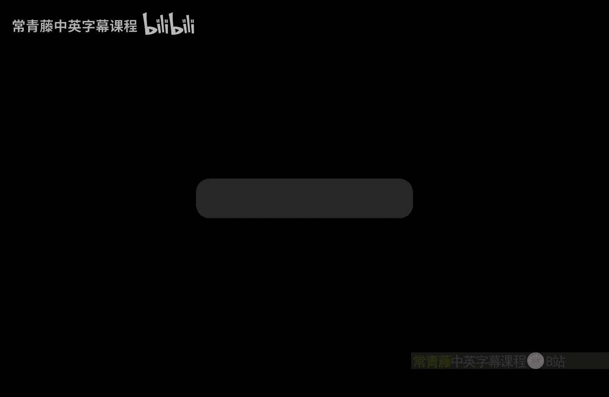

# 001：课程介绍 👋

在本节课中，我们将了解CS341算法课程的概况，包括授课教师、课程结构以及一些重要的课程安排信息。

大家好，欢迎来到CS341课程。我是Anna Lubiw教授，本学期我将与Trevor Brown教授共同讲授这门课程。我们之前都曾教授过这门课程，因此你们将得到经验丰富的指导。Trevor教授将负责前12次讲座，我将负责后12次讲座。本视频的目的是向大家问好，让你们看到我的面孔，并希望你们能安心地前来参加答疑时间。

Trevor Brown教授和我将在整个学期中安排答疑时间，共同布置作业，并在每周五进行辅导课。你们可以在课程网页上找到相关信息。

总之，我期待在答疑时间见到你们中的许多人，并祝愿你们有一个愉快的学期。我知道课程仍然在线进行可能令人失望，但另一方面，我们已经相当习惯这种方式了，至少这不再是一个冲击或意外。

我希望这将是一个美好的学期。谢谢，再见。

---

本节课中我们一起学习了CS341算法课程的基本介绍，包括授课教师的安排、课程结构以及答疑和辅导课等重要信息。