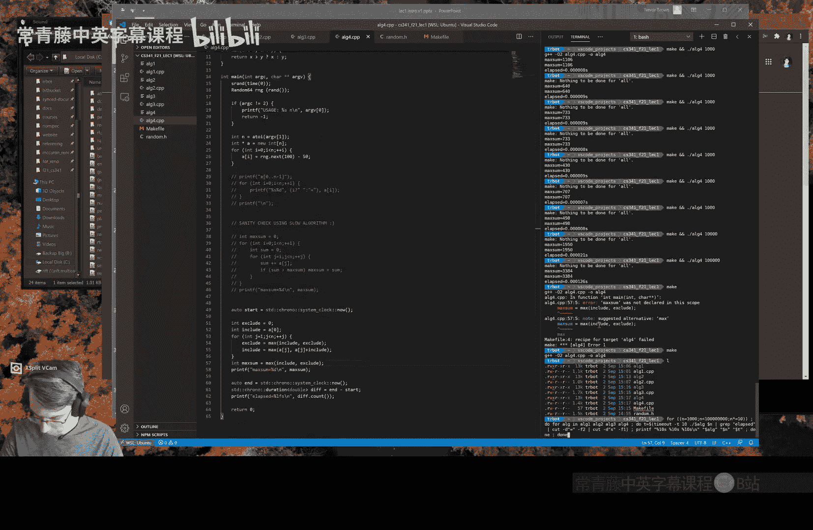

# 算法导论：第1讲：课程介绍与最大子数组问题

在本节课中，我们将学习滑铁卢大学CS341算法课程的第一讲内容。课程将介绍课程的基本信息、算法设计的重要性，并通过一个经典问题——最大子数组问题（Bentley‘s Problem）——来演示多种算法设计范式。

## 课程概述与安排

大家好，我是Trevor Brown，我将是你们在2021年冬季学期CS341算法课程的讲师之一。这门课程将由我和Annaluu共同讲授。

课程网站包含了教学大纲、日历、政策、幻灯片和作业等重要信息。建议你访问网站并记下作业截止日期等重要时间点，以免错过。

跟上课程进度至关重要，因为课程内容环环相扣。例如，如果你没有很好地理解分治算法，那么在后续学习动态规划时，可能会在理解必要的递推关系和递归背景上遇到困难。

我们将使用Piazza平台进行课程讨论。学生可以在上面提问，并鼓励互相解答。助教和讲师也会参与其中。所有重要的课程通知和作业澄清都会在Piazza上发布，请务必保持关注。

课程的所有部分（讲座、作业、期中考试、期末考试）都是统一的。如果你因严重问题可能错过作业截止日期，请尽可能提前通知我们。期中考试和期末考试将是带回家完成的考试。具体的评分细则可以在课程网站上找到。

本课程的教材是著名的《算法导论》（CLRS）。你可以购买实体书，也可以通过图书馆网站免费获取电子版。你需要掌握课程网站上列出的所有相关教材章节、讲座幻灯片及讨论内容。

课程还设有讨论环节，其主要目的是练习和巩固已学概念，而非引入新知识。目前计划将讨论环节设为可选。

## 学术诚信与协作规范

尤其是在线课程环境下，我们必须警惕抄袭的可能性。请小心避免无意间的抄袭行为。

我们允许学生之间进行一对一的高层次讨论，交流解决问题的通用思路，这适用于作业。但是，对于带回家的期中或期末考试，你绝对不能与其他同学讨论，这些考试需要你独立完成，以展示个人知识。

对于作业，我们通常允许你与个别同学进行高层次讨论。我们不建议进行大规模的群聊来分工解决问题，但你可以有一个伙伴一起讨论解题思路。

一个典型的建议是：不要从这类讨论中带走书面笔记。考虑到在线课程的实际情况，如果你们的讨论是通过文字进行的，这一点可能难以完全避免。因此，我的建议是：如果讨论的内容是那种你们可以面对面（比如在饮水机旁）交流，并且不需要借助白板来推导公式或记录细节就能理解的程度，那么这种讨论可能是可以接受的。反之，如果需要白板辅助来理清细节，那么就不应该与同学进行这样的讨论。请尽量将讨论保持在“探讨解题大致方向”的层面。

在截止日期之前，进行全班或大型群组的解决方案讨论是不允许的。截止日期过后，我们通常会发布官方解答，届时大家可以自由讨论各自的方法。

## 算法的重要性与课程目标

为什么CS341算法课程对你很重要？答案可能因人而异。从我的角度来看，算法是计算机科学的核心，经常出现在后续课程中，并且在技术面试中占据主导地位。掌握这些材料将使你的面试轻松许多。

设计算法也是一项极具创造性的工作，对于许多有趣的职位非常有用。虽然毕业后你可能不会直接实现基础算法，但在一些更有趣的工作中，你可能需要调整现有的基础算法以适应新的场景或约束，这能催生出许多真正有趣的工作。当然，这也是所有计算机科学学生的必修课。

## 什么是计算问题与算法？

非正式地说，一个计算问题是对输入和期望输出的描述。而算法，非正式地说，是一个定义明确的过程或一系列步骤，用于解决该计算问题，即接收输入并产生输出。算法是连接输入和输出的桥梁。

存在不同性能水平的算法。我们可以设计出性能越来越好的、更快的算法。当然，还有算法的正确性问题，有些算法可能根本不正确。

让我举几个你可能想解决的计算问题的例子：
*   **排序**：输入是一个任意顺序的整数数组，期望输出是同一个按递增顺序排列的整数数组。
*   **矩阵乘法**：输入是两个 n x n 矩阵 A 和 B，输出是矩阵 C，即 A 和 B 的乘积。
*   **旅行商问题**：输入是一组城市 S 以及每对城市之间的距离，输出是访问每个城市并返回起点的最短可能路径。这个问题在包裹配送、外卖路线规划等领域有应用。

这些问题可能具有截然不同的复杂度，我们需要分析这些问题的解决方案以确定其优劣。

## 算法分析与复杂度

你编写的每个软件程序都会使用某种资源。资源有多种类型：
*   **CPU指令**：我们通常称之为**时间**。技术上并非所有指令执行时间相同，但为了简化分析，我们倾向于将所有指令视为相同并占用单位时间，因此我们称之为**运行时分析**。
*   **内存**：指RAM（而非磁盘空间），我们称之为**空间**使用量。
*   其他资源：如I/O、网络带宽、消息、锁和并发软件的同步开销等，本课程通常不讨论。

**分析**是研究算法使用多少资源或在何种程度上使用资源。我们通常使用大O表示法进行分析，以忽略常数因子。常数因子不如算法复杂度随问题规模增长而变化的方式有趣，因为今天我们可能解决特定规模的问题，而未来可能需要解决规模大得多的问题。算法能否扩展到未来使用，或者我们是否需要设计全新的算法，很大程度上取决于其复杂度随输入规模增长的变化方式。

我们可以大致将算法分类为：串行 vs. 并行、确定性 vs. 随机化、精确 vs. 近似等。在本课程中，我们主要讨论算法领域中的一个特定部分。

*   **串行算法**：单个执行线程，一次执行一条指令。
*   **并行/并发算法**：多个执行线程，同时执行多条指令。
*   **确定性算法**：给定相同输入，总是产生相同输出。
*   **随机化算法**：多次运行相同输入可能产生不同输出（需注意随机数种子等细节）。
*   **精确算法**：产生问题的精确（通常是最优）解。
*   **近似算法**：产生接近解的结果。

在本课程中，我们通常涵盖**串行、确定性、精确算法**。如果时间允许，课程后半段由Anna主讲的课程可能会涉及这个分类中的其他有趣领域。

## 可解性与P vs NP问题

到目前为止，我讨论的都是我们可以找到解决方案的问题。但**可解性**探讨的是：是否所有问题都有快速的解决方案？是否可能高效地解决所有问题？或者，是否可能解决它们？

对于某些问题，例如之前提到的旅行商问题，我们目前只找到了指数时间算法。等等，这似乎是一个许多公司（如配送司机调度）正在大规模解决的非常实际的问题。当我们只知道指数时间的精确算法时，他们是如何做到每辆车每天可能有10个配送点的大规模调度呢？答案是：我们只知道指数时间的**精确**算法，但实际上存在快速的**近似**算法，可以证明产生的结果在最优解的某个常数倍范围内。为了能在调度卡车出发的时间内获得解决方案，我们当然需要牺牲解的精确性。

有些问题，我们尝试寻找解决方案很久了，但一直未能找到快速解法。我们猜想，也许解决这些问题只有指数时间算法。这些算法效率非常低。以旅行商问题为例，非正式地说，指数时间意味着在你的配送路线上增加一个站点，计算最优路线所需的时间就会翻倍。这使得解决现实世界规模的输入变得极其不可行。

因此，可解性真正的问题是：是否存在绕过这一限制的方法？或者，关键的是，我们是否应该停止尝试，而将精力集中在近似算法上？关于可解性最著名（或至少最流行）的开放问题之一就是 **P vs NP** 问题。非正式地说（我们将在课程后期更正式地讨论），它探讨的是是否可能在多项式时间内解决此类问题，或者其中一些问题是否确实无法在多项式时间内解决，而必须在指数时间内解决。

## 课程涵盖主题

一方面，我们将讨论针对**可解问题**的基础且快速的算法。这些是我们知道如何找到快速解决方案的问题。其中一些算法你可能听说过，如归并排序；另一些如Strassen矩阵乘法，你可能没听说过。

我们还将讨论一些图算法，例如广度优先搜索和深度优先搜索（你们可能以前学过）、用于在加权图中寻找最短路径的Dijkstra单源最短路径算法，可能还有Bellman-Ford算法。对于所有节点对最短路径，我们将讨论Floyd-Warshall算法。对于构建最小生成树，我们将讨论Kruskal算法或Prim算法。我们还将讨论拓扑排序，用于对有依赖关系的图进行排序。这只是我们将要涵盖的基础算法的一小部分示例。

更重要的是，我们将涵盖常见的**算法设计范式**。我认为，不仅理解计算机科学界公认重要且有助于展示有用算法技术的一套标准基础算法很有用，积累算法技术工具包并接触多种不同的算法设计范式也很有用。所有这些算法在某种程度上都属于一个或两个常见的算法设计范式。如果你想进行任何算法设计，或者修改、扩展现有算法使其适应新用途，掌握这些范式至关重要。

我们将考虑的几种设计范式包括：
*   **分治法**：尝试递归地将问题分解为更小的子问题，然后依赖递归算法解决子问题，创造性体现在将子问题的解组合成整个问题的解。
*   **贪心法**：它以一种“贪心”的方式处理问题，根据当前掌握的局部信息（即你试图解决的问题空间的受限信息），选择看似正确的步骤。它不会探索所有可能的解决方案，也不会探索在给定时间点可以做出的所有可能决策以选择最优的，而是根据某种启发式方法选择解决问题的下一步。这就是为什么我们称之为“贪心”，因为它只是选择下一步的启发式方法。我们基本上是启发式地逐步构建解决方案，而证明这种局部启发式方法能产生最优解通常是这些算法中微妙的部分。
*   **动态规划**：通常不是“贪心”的，因为我们总是在探索选择下一个元素添加到解决方案中的所有可能方式，我们审视构建最优解的所有可能的下一步，并选择最优的。因此，我们的解决方案不依赖于局部启发式决策，而是依赖于对所有可能决策的仔细、系统性的探索，并选择可证明最优的那个。动态规划算法通常比贪心算法更微妙一些，但证明过程更直接。我认为动态规划兼具分治法和贪心法的元素，是一个有趣的范式。
*   **穷举搜索/暴力法**：如果你没有深入研究算法学，通常会想到这类算法。它们是最显而易见的解决方案：尝试所有可能的解，然后选出最优的。


我们还将投入时间学习用于分析算法的数学工具。想出一个算法并证明它能正确解决问题是一回事；能够向自己或他人论证你的解决方案运行速度足够快，或消耗的内存足够少，从而能在合理的时间或使用合理的计算硬件上运行并获得解决方案，则是另一回事。

我们将学习一系列分析算法的工具：
*   **大O表示法**：你们以前学过，但我们会回顾并扩展知识，可能引入小ω和小o表示法。
*   **求解递推关系**：这是一种数学工具，使得分析比简单循环和直线代码更复杂的算法（例如涉及递归的算法）成为可能。你需要像递归树法、代入法或主方法这样的工具来解决描述其复杂度的递推关系。
*   **证明贪心算法最优性的工具**：如交换论证和“贪心选择保持领先”论证。

在课程后期，我们将研究**难解性问题**。我们将仔细研究 **P vs NP**：可在多项式时间内解决的问题类 **P**，与可在非确定性多项式时间内解决的问题类 **NP**。我们将研究这两类问题，并研究属于这些不同问题类的一系列示例问题。我们将研究多项式时间归约（一种证明方法：如果你能在多项式时间内解决一个问题，那么通过将第一个问题的解决方案作为黑盒使用，你就能在多项式时间内解决另一个问题）。我们还将研究可判定性问题，即一个问题是否实际上有解，是否是可判定的。

## 课程收获

我希望你们能从CS341课程中学到什么？你们在学习CS341之前已经具备了相当多的计算机科学知识，学习过像CS240这样的课程，学习过数据结构、数学和各种选修课。但在没有对算法进行深入研究之前，你们的知识就像缺了一口的鸡蛋。我希望CS341能填补这个空缺，让你的知识变得完整。

你将带着以下收获离开：
1.  **一系列基础算法的知识**：这些算法恰好也是求职面试中可能被问到的内容。
2.  **基本设计范式的知识**：这对于构建自己的算法、调整现有算法，或者仅仅是在识别广泛模式以帮助你分类想要解决的问题，并将其与你见过的以类似方式解决的现有问题类别联系起来，都非常有用。
3.  **可解性与难解性的研究**：这非常有用，因为即使在工业界工作中，你也 surprisingly 容易遇到一些你非常想解决，但结果发现（至少如果你想得到精确解的话）实际上无法解决的问题。能够识别出这是一个无法精确解决的问题类型是非常好的，因为你不希望永远徒劳地尝试解决它，而应该能够识别出你不可能精确解决它，并尝试找到某种近似解决方法。另一方面，有些问题可以解决，只是效率低下。也许未来某个极其聪明的人会找到在次指数时间内解决这些问题的方法，但目前活着的人中没有人知道如何在次指数时间内解决它们，而且我们某种程度上怀疑它们无法在次指数时间内解决。对于这些问题，你同样希望能够识别出你试图解决的问题实际上是其中之一，即所谓的NP完全或NP难问题。能够进行算法分析的数学技巧也很有用，因为当你编写一个算法时，能够快速进行一些粗略计算并说服自己它将在10秒还是五年内运行完毕，这是很好的。

我希望你们能带着所有这些知识和技能，成为一个快乐且完整的“鸡蛋”，自信地能够在现实世界中应用算法技术。

---

上一节我们介绍了课程的整体框架和算法设计的重要性，本节中我们来看看如何通过一个具体问题来实践这些概念。

## Bentley‘s 问题（最大子数组问题）

好了，背景介绍得差不多了，让我们来讨论一下Bentley‘s问题。让我们通过这个实例来演示之前提到的几种算法设计范式。

**什么是Bentley‘s问题？**
给定一个包含 n 个整数的数组 A[1..n] 作为输入，你需要找到**连续项之和的最大值**。

让我们看几个例子来演示一下：
*   **示例1**：数组 `[1, 7, 4, 0, 2, 1, 3, 1]`，所有元素非负。显然，最大连续和就是整个数组的和：**19**。
*   **示例2**：数组 `[-1, -7, -4, -2, -1, -3, -1]`，所有元素为负。在这种情况下，最大连续和是**不取任何元素**的和：**0**。
*   **示例3**：数组 `[-7, 4, 0, 2, -1, 3, -1]`。我们不想包含开头的 -7。取 `[4, 0, 2]` 得到 6。如果包含后面的 -1 得到 `[4, 0, 2, -1]` 和为 5，再包含 3 得到 `[4, 0, 2, -1, 3]` 和为 **8**，这是最优解。

对于这些小型示例，很容易看出最优解。但如果 n 是十亿或百亿，突然之间决定最大和就变得相当困难了。

## 解决方案一：暴力法（三次方）

如果你被要求解决这个问题，可能会先想到最简单的解决方案。以下是最直接的暴力解法。

**思路**：尝试数组的每一个可能的子区间（连续项），计算其和，然后找出最大值。

**伪代码**：
```plaintext
max_sum = 0
for i = 1 to n:
    for j = i to n:
        sum = 0
        for k = i to j:
            sum = sum + A[k]
        if sum > max_sum:
            max_sum = sum
return max_sum
```

**时间复杂度分析**：三重嵌套循环。外层 `i` 循环执行 n 次。对于每个 `i`，中层 `j` 循环大约执行 n-i+1 次。对于每对 `(i, j)`，内层 `k` 循环执行 j-i+1 次。总体时间复杂度是 **O(n³)**。

## 解决方案二：优化的暴力法（平方）

我们可以改进上面的暴力法。注意到在固定 `i` 的情况下，当 `j` 递增时，我们不需要每次都从头开始求和。

**思路**：在遍历 `j` 时，累加 `A[j]` 到当前和即可。

**伪代码**：
```plaintext
max_sum = 0
for i = 1 to n:
    sum = 0
    for j = i to n:
        sum = sum + A[j] // 累加当前元素
        if sum > max_sum:
            max_sum = sum
return max_sum
```

**时间复杂度分析**：两重嵌套循环。外层 `i` 循环 n 次，内层 `j` 循环平均约 n/2 次。总体时间复杂度是 **O(n²)**。这比 O(n³) 好得多，对于更大的问题规模（如千万级别）是可行的，虽然可能较慢。

## 解决方案三：分治法（O(n log n)）

我们可以做得更好，但需要使用更复杂的技术。第三种解决方案采用**分治法**。

**思路**：
1.  将数组 `A` 从中间分成左右两半（假设长度为 2 的幂以简化分析）。
2.  最大和子数组的位置有三种可能：
    *   **情况1**：完全位于左半部分。
    *   **情况2**：完全位于右半部分。
    *   **情况3**：跨越中间分界线。
3.  递归地解决左半部分和右半部分的问题（情况1和2）。
4.  用一种线性时间的方法找到跨越中点的最大和子数组（情况3）。
5.  最终答案是这三种情况中的最大值。

**关键点：如何线性时间找到跨越中点的最大和？**
*   对于左半部分，从中点开始向左扫描，找到以中点为**右端点**的最大和（即 `max_left_sum = max( sum(A[i..mid]) )`，其中 `i` 从 `mid` 递减到 `1`）。
*   对于右半部分，从中点+1开始向右扫描，找到以中点+1为**左端点**的最大和（即 `max_right_sum = max( sum(A[mid+1..j]) )`，其中 `j` 从 `mid+1` 递增到 `n`）。
*   那么，跨越中点的最大和就是 `max_left_sum + max_right_sum`。

**证明**：假设存在一个跨越中点的子数组 `A[i‘..j’]` 具有更大的和。那么它的左半部分和或右半部分和必须大于我们找到的 `max_left_sum` 或 `max_right_sum` 之一，但这与我们找到 `max_left_sum` 和 `max_right_sum` 的方式矛盾。因此，`max_left_sum + max_right_sum` 就是跨越中点的最大和。

**伪代码概述**：
```plaintext
function max_subarray(A, low, high):
    if low == high: // 基本情况
        return max(0, A[low])
    mid = (low + high) / 2
    left_max = max_subarray(A, low, mid) // 递归解决左半部分
    right_max = max_subarray(A, mid+1, high) // 递归解决右半部分
    cross_max = find_max_crossing(A, low, mid, high) // 线性时间找跨越中点的和
    return max(left_max, right_max, cross_max)
```

**时间复杂度分析**：这引出了递归式 `T(n) = 2T(n/2) + O(n)`。使用主定理或递归树法可得，时间复杂度为 **O(n log n)**。这非常高效，类似于排序算法的复杂度。

## 解决方案四：动态规划（线性时间）

最后，让我们看一个基于**动态规划**的解决方案。这个方案初看可能有些神奇，但它是最高效的。

**思路**：
我们定义两个递推关系：
*   `include[j]`：表示数组前缀 `A[1..j]` 中，**必须包含元素 A[j]** 的最大连续子数组和。
*   `exclude[j]`：表示数组前缀 `A[1..j]` 中，**必须不包含元素 A[j]** 的最大连续子数组和。

**观察**：如果我们能计算出所有 `j` 的 `include[j]` 和 `exclude[j]`，那么整个数组的最大连续和就是 `max(include[n], exclude[n])`。因为任何子数组要么包含最后一个元素，要么不包含。

**递推关系（状态转移方程）**：
1.  **基础情况**：
    *   `include[1] = A[1]` （只有一个元素且必须包含它）
    *   `exclude[1] = 0` （只有一个元素且必须排除它，空子数组和为0）
2.  **递推情况**：
    *   `include[j] = max( A[j], A[j] + include[j-1] )`
        *   解释：以 `A[j]` 结尾的最大和，要么是 `A[j]` 自己单独作为一个子数组，要么是 `A[j]` 接上以 `A[j-1]` 结尾的最大和子数组（`include[j-1]`）。
    *   `exclude[j] = max( include[j-1], exclude[j-1] )`
        *   解释：在 `A[1..j]` 中不包含 `A[j]` 的最大和，其实就是 `A[1..j-1]` 中的最大和（可能包含也可能不包含 `A[j-1]`），即 `include[j-1]` 和 `exclude[j-1]` 的较大者。

**计算与空间优化**：
我们可以用两个数组来计算，但注意到计算 `include[j]` 和 `exclude[j]` 只需要 `include[j-1]` 和 `exclude[j-1]`。因此，我们可以只用两个变量来迭代，将空间复杂度从 O(n) 降低到 O(1)。

**优化后的伪代码**：
```plaintext
include = A[1]
exclude = 0
for j = 2 to n:
    // 注意：计算新exclude需要旧的include，计算新include需要旧的include
    new_exclude = max(include, exclude)
    new_include = max(A[j], A[j] + include)
    exclude = new_exclude
    include = new_include
return max(include, exclude)
```

**时间复杂度分析**：只有一个简单的循环遍历数组，每次循环执行常数时间操作。因此，时间复杂度是 **O(n)**，空间复杂度是 **O(1)**（除了输入数组）。

## 性能对比与总结

让我们比较一下这些算法的理论性能，并看看实际意义。

以下是基于旧系统（Pentium II）的实测和推测数据：
*   **O(n³) 算法**：对于 n=10⁷，推测需要约 **140,000 年**。
*   **O(n²) 算法**：对于 n=10⁷，需要约 **2.5 小时**。
*   **O(n log n) 算法**：对于 n=10⁷，需要约 **2 秒**。
*   **O(n) 算法**：对于 n=10⁷，需要约 **0.5 秒**。

这些数据表明，算法设计的选择至关重要。O(n³) 的算法即使对于现代硬件也是不可行的。同时，我们也注意到 O(n log n) 的分治算法在实践中可能已经“足够好”，不一定非要追求理论最优的线性算法。

---

**本节课总结**：
在本节课中，我们一起学习了CS341算法课程的介绍，包括课程安排、学术规范以及算法在计算机科学中的核心地位。我们深入探讨了**最大子数组问题**（Bentley‘s Problem），并展示了四种不同的解决方案：
1.  **三次方暴力法**：最直观但效率极低。
2.  **平方暴力法**：简单优化，效率提升但仍不理想。
3.  **分治法**：采用递归“分而治之”的策略，达到 O(n log n) 的效率，是显著的飞跃。
4.  **动态规划法**：通过定义状态和递推关系，以 O(n) 的线性时间高效解决问题，是理论上的最优解。



通过这些例子，我们初步领略了**算法设计范式**（如暴力、分治、动态规划）的威力，以及**算法分析**（复杂度计算）的重要性。理解不同算法在效率上的巨大差异，是设计高效软件系统的关键第一步。在接下来的课程中，我们将系统性地学习这些设计范式和分析工具。