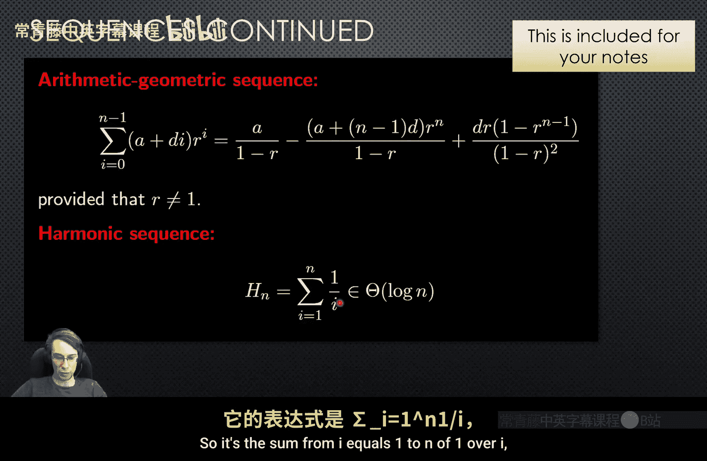
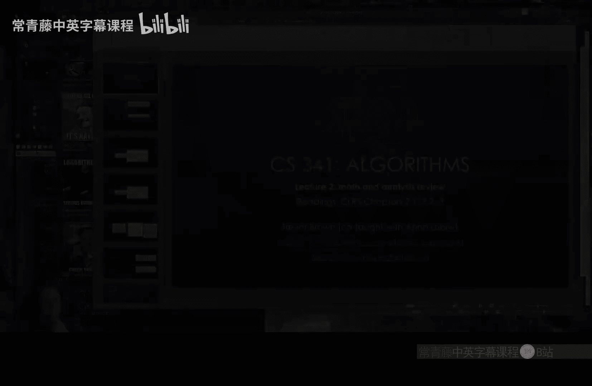

# 算法导论：第02讲：算法分析基础

在本节课中，我们将学习算法分析的核心数学工具，包括大O记法、极限法则、求和公式以及对程序运行时间的分析方法。这些内容是理解和设计高效算法的基础。

## 大O记法回顾与扩展

上一节我们介绍了课程的基本信息，本节中我们来看看算法分析中最核心的工具——大O记法及其相关概念。

### 形式化定义

函数 **f(n)** 属于 **O(g(n))** 的定义是：存在正常数 **c** 和 **n₀**，使得对于所有 **n ≥ n₀**，都有 **0 ≤ f(n) ≤ c·g(n)**。直观上，这意味着 **f** 的复杂度至多是 **g** 的复杂度。

函数 **f(n)** 属于 **Ω(g(n))** 的定义是：存在正常数 **c** 和 **n₀**，使得对于所有 **n ≥ n₀**，都有 **0 ≤ c·g(n) ≤ f(n)**。直观上，这意味着 **f** 的复杂度至少是 **g** 的复杂度。

函数 **f(n)** 属于 **Θ(g(n))** 的定义是：存在正常数 **c₁, c₂** 和 **n₀**，使得对于所有 **n ≥ n₀**，都有 **0 ≤ c₁·g(n) ≤ f(n) ≤ c₂·g(n)**。这意味着 **f** 和 **g** 的复杂度在常数因子内相同。

### 小o与小ω记法

除了常见的大O记法，我们还需要了解小o和小ω记法。

函数 **f(n)** 属于 **o(g(n))** 的定义是：对于**所有**正常数 **c**，都存在一个 **n₀**，使得对于所有 **n ≥ n₀**，都有 **0 ≤ f(n) ≤ c·g(n)**。这意味着 **f** 的渐进复杂度**严格低于** **g** 的复杂度，它们相差不止一个常数因子。

函数 **f(n)** 属于 **ω(g(n))** 的定义是：对于**所有**正常数 **c**，都存在一个 **n₀**，使得对于所有 **n ≥ n₀**，都有 **0 ≤ c·g(n) ≤ f(n)**。这意味着 **f** 的渐进复杂度**严格高于** **g** 的复杂度。

### 关系与练习

以下是关于这些记法之间关系的一些练习，你可以尝试判断其正误。

*   n² ∈ O(n³) 且 n² ∈ o(n³)
*   n³ ∉ ω(n³)
*   log n ∈ o(n)
*   n log n ∈ Ω(n) 且 n log n ∈ ω(n)
*   n log(n²) ∈ Θ(n log n)
*   n ∉ Θ(n log n)

直观上，这些记法对应着不同的增长率比较关系：
*   **f ∈ O(g)**：f 的增长率 ≤ g 的增长率。
*   **f ∈ o(g)**：f 的增长率 < g 的增长率。
*   **f ∈ Ω(g)**：f 的增长率 ≥ g 的增长率。
*   **f ∈ ω(g)**：f 的增长率 > g 的增长率。
*   **f ∈ Θ(g)**：f 的增长率 = g 的增长率。

## 从第一性原理证明复杂度关系

理解了定义后，我们来看看如何运用这些定义（第一性原理）来证明函数的复杂度关系。

### 证明 f(n) = n² - 7n - 30 ∈ O(n²)

根据定义，我们需要找到正常数 **c** 和 **n₀**，使得对所有 **n ≥ n₀**，有 **0 ≤ n² - 7n - 30 ≤ c·n²**。
选择 **c = 1**。不等式 **n² - 7n - 30 ≤ n²** 对所有 **n ≥ 0** 成立。同时，**n² - 7n - 30 ≥ 0** 在 **n ≥ 10** 时成立（因式分解得根为10和-3）。因此，取 **n₀ = 10** 和 **c = 1** 即可满足定义。

### 证明 f(n) = n² - 7n - 30 ∈ Ω(n²)

我们需要找到正常数 **c** 和 **n₀**，使得对所有 **n ≥ n₀**，有 **0 ≤ c·n² ≤ n² - 7n - 30**。
选择 **c = 1/2**。不等式 **0 ≤ (1/2)n²** 对所有 **n ≥ 0** 成立。不等式 **(1/2)n² ≤ n² - 7n - 30** 等价于 **(1/2)n² - 7n - 30 ≥ 0**。求解该二次不等式，得到两个根均小于18。因此，取 **n₀ = 18** 和 **c = 1/2** 即可满足定义。结合 O(n²) 的证明，可知 **f(n) ∈ Θ(n²)**。

### 证明 f(n) = n² + n ∉ O(n)

根据定义，**f(n) ∈ O(n)** 意味着：∃ c>0, n₀>0, ∀ n ≥ n₀: 0 ≤ n² + n ≤ c·n。
其否定为：∀ c>0, n₀>0, ∃ n ≥ n₀: n² + n < 0 **或** n² + n > c·n。
由于对于正数 n，n² + n 总是正数，我们只需证明后一种情况。
对于任意给定的 c 和 n₀，我们总能找到一个足够大的 n 使得 **n² + n > c·n**。整理得 **n² + n - c·n > 0**，即 **n(n + 1 - c) > 0**。由于 n > 0，这等价于 **n > c - 1**。
因此，只需取 **n = max(n₀, c)**，即可满足 **n ≥ n₀** 且 **n > c - 1**，从而证明 **f(n) ∉ O(n)**。

## 函数增长率比较与极限方法

为了比较不同函数的增长率，我们可以使用极限方法。

### 常见函数增长率排序（由慢到快）

以下是算法分析中常见的函数类型，按渐进增长率从低到高排列：
*   **常数**：O(1)
*   **对数函数**：O(log n)
*   **多对数函数**：O((log n)^k)，其中 k 是常数
*   **根式函数**：O(n^c)，其中 0 < c < 1
*   **线性函数**：O(n)
*   **线性对数函数**：O(n log n)
*   **多项式函数**：O(n^c)，其中 c > 1
*   **指数函数**：O(c^n)，其中 c > 1
*   **阶乘函数**：O(n!)
*   **指数指数函数**：O(n^n)

多项式函数和指数函数之间存在着巨大的效率鸿沟，通常将多项式时间算法视为“可处理的”，而指数时间算法视为“难处理的”。

### 使用极限比较增长率

对于在 n 足够大时为正的函数 f(n) 和 g(n)，考虑极限 **L = lim_{n→∞} f(n)/g(n)**：
*   若 **L = 0**，则 **f(n) ∈ o(g(n))**。
*   若 **L = c** (0 < c < ∞)，则 **f(n) ∈ Θ(g(n))**。
*   若 **L = ∞**，则 **f(n) ∈ ω(g(n))**。

计算极限时，需要用到微积分中的法则，例如和、积、商的极限法则，以及洛必达法则（用于处理 0/0 或 ∞/∞ 型未定式）。

**示例1：比较 n² - 7n - 30 与 n²**
lim_{n→∞} (n² - 7n - 30) / n² = lim_{n→∞} (1 - 7/n - 30/n²) = 1。结果为正常数，故两者为 Θ 关系。



**示例2：比较 (ln n)² 与 √n**
lim_{n→∞} (ln n)² / √n = (∞/∞ 型，使用洛必达法则)
= lim_{n→∞} (2 ln n * (1/n)) / ((1/2) n^{-1/2}) = lim_{n→∞} (4 ln n) / √n = (再次使用洛必达法则)
= lim_{n→∞} (4/n) / ((1/2) n^{-1/2}) = lim_{n→∞} 8 / √n = 0。
结果为 0，故 **(ln n)² ∈ o(√n)**。

## 求和、序列与对数规则

在分析循环和递归算法时，求和公式与序列知识至关重要。

### 求和与O记法的代数规则

*   **最大值规则**：O(f(n) + g(n)) = O(max(f(n), g(n)))。对于 Θ 和 Ω 同理。
*   **求和规则**：∑_{i=a}^{b} O(f(i)) = O(∑_{i=a}^{b} f(i))。对于 Θ 和 Ω 同理。这在循环分析中非常有用。

### 常见序列求和公式

以下是分析算法时常用的求和公式：
*   **等差数列**：∑_{i=0}^{n-1} (a + d·i) = n·a + d·n(n-1)/2 ∈ Θ(n²) (若 d ≠ 0)。
*   **等比数列**：∑_{i=0}^{n-1} a·r^i。
    *   若 r > 1: Θ(r^n)
    *   若 r = 1: Θ(n)
    *   若 0 < r < 1: Θ(1)
*   **等差-等比数列**：∑_{i=0}^{n-1} (a + d·i) r^i (r ≠ 1)，有特定公式。
*   **调和级数**：∑_{i=1}^{n} 1/i ∈ Θ(log n)。
*   **p级数** (p>1)：∑_{i=1}^{n} 1/i^p ∈ Θ(1) (因为其收敛)。
*   **幂次和**：∑_{i=1}^{n} i^c ∈ Θ(n^{c+1})，其中 c 是常数。

### 对数规则

掌握对数运算规则对简化表达式很有帮助：
*   log(xy) = log x + log y
*   log(x/y) = log x - log y
*   log(x^y) = y log x
*   log_b a = 1 / (log_a b)
*   **换底公式**：log_b a = (log_c a) / (log_c b)
*   a^{log_b c} = c^{log_b a}

**重要说明**：在算法的大O记法中，我们通常省略对数的底数，因为对于常数底数 b 和 c，有 log_b n = (1 / log_c b) · log_c n，而 (1 / log_c b) 是常数，因此在 Θ 记法中可以忽略。即，所有常数底的对数函数都是同阶的。

## 运行时间分析与循环

本节我们将应用前面的数学工具来分析算法的运行时间。

### 运行时间定义

*   **运行时间 T_M(I)**：程序 M 在输入实例 I 上运行所花费的时间（或执行的基本操作数）。
*   **最坏情况运行时间 T_M(n)**：对于所有规模为 n 的输入 I，T_M(I) 的最大值。即 **T_M(n) = max_{|I|=n} T_M(I)**。本课程主要关注最坏情况分析。
*   **平均情况运行时间**：对于所有规模为 n 的输入 I，T_M(I) 的平均值。计算通常更困难。

### 计算模型：字RAM模型

为了进行理论分析，我们需要一个简化的计算模型。通常使用**字RAM模型**：
*   内存由“字”组成，每个字可存储一个整数（通常假设足够大以存储指针或合理大小的数据）。
*   访问任何内存字需要常数时间。
*   基本运算（算术、逻辑、赋值、比较等）需要常数时间。

### 循环分析策略

分析包含循环的代码时，可遵循以下步骤：
1.  识别代码中的基本操作（常数时间步骤）。
2.  将循环转换为求和表达式。
3.  计算或简化求和式，得到关于输入规模 n 的函数 T(n)。
4.  确定 T(n) 的渐进界（大O、大Ω、大Θ）。

有两种主要策略来得到 Θ 界：
*   **策略一（分离边界）**：分别证明 T(n) ∈ O(g(n)) 和 T(n) ∈ Ω(g(n))，从而得出 T(n) ∈ Θ(g(n))。
*   **策略二（全程Θ）**：在分析每一步时都使用 Θ 记法，最终组合得到 T(n) 的 Θ 界。

**示例分析1：简单嵌套循环**
```
sum = 0
for i = 1 to n:
    for j = 1 to i:
        sum = sum + (i - j)^2
print(sum)
```
外层循环 i 从 1 到 n。对于每个 i，内层循环 j 从 1 到 i，执行常数时间操作。
总时间 T(n) = ∑_{i=1}^{n} ∑_{j=1}^{i} Θ(1) = ∑_{i=1}^{n} Θ(i) = Θ(∑_{i=1}^{n} i) = Θ(n(n+1)/2) = Θ(n²)。

**示例分析2：内层循环变量折半**
```
for i = 1 to n:
    j = i
    while j >= 1:
        // 常数操作
        j = floor(j / 2)
```
外层循环 i 从 1 到 n。对于每个 i，内层 while 循环将 j 不断除以 2，直到 j < 1。循环次数为 Θ(log i)。
总时间 T(n) = ∑_{i=1}^{n} Θ(log i) = Θ(log(n!)) = Θ(n log n) (利用斯特林公式近似)。

**示例分析3：三重嵌套循环（Bentley问题暴力解法）**
```
maxSum = 0
for i = 1 to n:
    for j = i to n:
        sum = 0
        for k = i to j:
            sum = sum + A[k]
        if sum > maxSum:
            maxSum = sum
```
该算法计算数组最大子数组和的暴力解。
总时间 T(n) = ∑_{i=1}^{n} ∑_{j=i}^{n} ∑_{k=i}^{j} Θ(1) = ∑_{i=1}^{n} ∑_{j=i}^{n} Θ(j - i + 1) = Θ(∑_{i=1}^{n} ∑_{j=i}^{n} (j - i))。
*   **证明 O(n³)**：由于 j-i ≤ n，且内层求和次数 ≤ n，可得 T(n) ≤ ∑_{i=1}^{n} ∑_{j=1}^{n} n = ∑_{i=1}^{n} n² = n³。故 T(n) ∈ O(n³)。
*   **证明 Ω(n³)**：考虑 i ≤ n/2 且 j ≥ 3n/4 的循环部分。此时 j-i ≥ n/4，且这样的 (i, j) 组合约有 (n/2)*(n/4) = n²/8 个，每个对应的内层循环 k 至少有 n/4 次迭代。因此，这部分的工作量至少是 (n²/8)*(n/4) = n³/32 ∈ Ω(n³)。故 T(n) ∈ Ω(n³)。
结合两者，得 **T(n) ∈ Θ(n³)**。

## 总结



本节课中我们一起学习了算法分析的数学基础。我们回顾并形式化定义了大O、大Ω、大Θ、小o和小ω记法，学习了如何从第一性原理证明函数的复杂度关系。我们探讨了使用极限比较函数增长率的方法，并复习了关键的求和公式、序列知识以及对数运算规则。最后，我们将这些工具应用于程序运行时间分析，特别是循环结构的分析，并通过实例演示了如何推导算法的渐进时间复杂度。掌握这些内容是理解和设计高效算法的第一步。