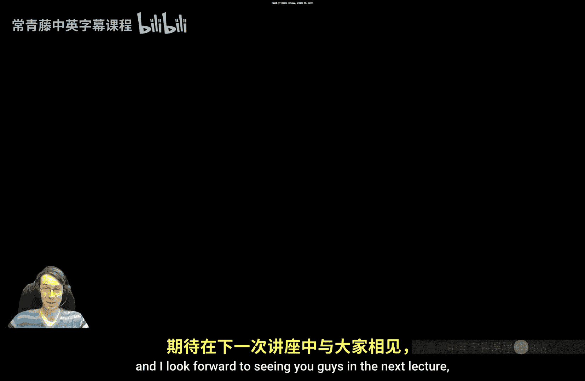
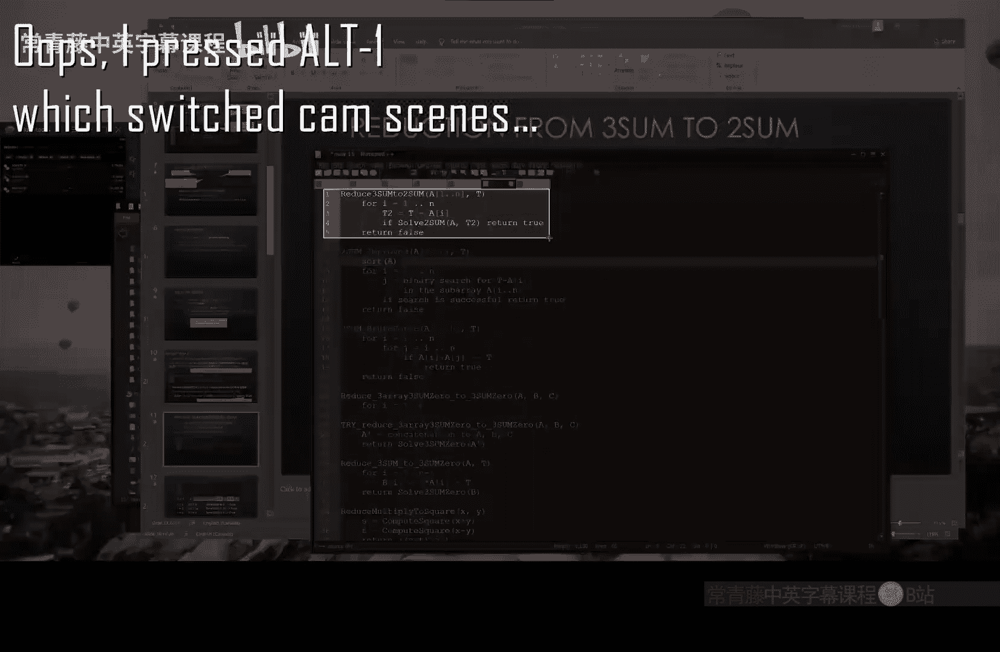

# 算法课程：第03讲：归约

在本节课中，我们将要学习一个核心概念——**归约**。归约是一种利用一个问题的解决方案来解决另一个问题的方法。这就像在编程中，我们复用已解决的问题方案来处理更复杂的问题。我们将通过具体的例子，如“两数之和”与“三数之和”问题，来深入理解归约的概念和应用。

## 问题定义与基础概念

首先，我们明确一些基础概念。**决策问题**是指算法的任务是判断输出是“真”还是“假”。一个问题的**实例**是指具体的输入。例如，对于“两数之和”问题，一个实例可能是一个数组 `[1, 2, 3]` 和目标值 `5`。如果对于某个实例，正确答案是“真”，则称该实例为**是实例**；反之，则为**否实例**。

理解归约对于理解问题的复杂性以及不同问题复杂性之间的关系至关重要。虽然这部分内容在课程后期关于“难解性”的章节中会大量使用，但提前引入有助于我们逐步建立直观理解。

## 两数之和问题

**两数之和**问题的输入是一个整数数组 `A`（包含 `a1` 到 `aN`）和一个目标整数 `T`。如果数组中存在两个值（可以是同一个值）之和等于 `T`，则输出为“真”，否则为“假”。用公式表示，即寻找索引 `i` 和 `j`（允许 `i = j`），使得：
`A[i] + A[j] = T`

### 暴力解法

一个简单的暴力解法是使用两层循环遍历所有可能的索引对。

```python
for i in range(1, n+1):
    for j in range(i, n+1):
        if A[i] + A[j] == T:
            return True
return False
```

该算法的时间复杂度为 `O(n²)`。

### 优化解法：排序与二分查找

我们可以通过**预处理**来优化算法。预处理是指在算法开始时对输入进行修改，以启用更高效的后续计算。对于两数之和问题，我们可以先对数组进行排序。

排序后，对于每个 `A[i]`，我们不再使用内层循环来寻找 `A[j]`，而是寻找值等于 `T - A[i]` 的元素。这变成了一个搜索问题。在已排序的数组中，我们可以使用二分查找，将每次搜索的时间复杂度从 `O(n)` 降低到 `O(log n)`。

优化后的算法步骤如下：
1.  对数组 `A` 进行排序。
2.  遍历每个索引 `i`。
3.  在排序后的数组 `A` 中使用二分查找，寻找值等于 `T - A[i]` 的元素。
4.  如果找到，则返回“真”；如果遍历完所有 `i` 都未找到，则返回“假”。

该算法的时间复杂度为：排序 `O(n log n)` + n 次二分查找 `O(n log n)` = `O(n log n)`。

### 进一步优化：双指针法

实际上，在两数之和问题中，我们可以在排序后使用**双指针**技术，在线性时间内完成搜索，从而将整体时间复杂度优化到 `O(n log n)`（排序占主导）。

双指针法的思路是：设置两个指针 `i`（初始指向数组开头）和 `j`（初始指向数组末尾）。计算 `A[i] + A[j]` 的和：
*   如果和等于 `T`，找到解。
*   如果和大于 `T`，则将 `j` 向左移动（减小和）。
*   如果和小于 `T`，则将 `i` 向右移动（增大和）。
重复此过程直到 `i` 和 `j` 相遇。如果仍未找到，则无解。

## 从两数之和到三数之和：归约的引入

上一节我们介绍了两数之和问题的几种解法。本节中，我们来看看一个与之相关但更复杂的问题——**三数之和**，并学习如何使用归约，借助两数之和的解法来解决它。

三数之和问题的输入同样是一个整数数组 `A` 和一个目标整数 `T`。输出为“真”的条件是存在三个值（允许相同）之和等于 `T`，否则为“假”。即寻找索引 `i`, `j`, `k`，使得：
`A[i] + A[j] + A[k] = T`

一个自然的想法是：既然我们已经有了解决两数之和的方案，能否用它来解决三数之和呢？这就是**归约**的核心思想。

### 归约的概念

假设我们有一个能解决两数之和问题的函数 `solve_2sum`。我们想要设计一个算法 `reduce_3sum_to_2sum` 来解决三数之和问题，并且这个算法会将 `solve_2sum` 作为一个“黑盒子”子程序来调用。这个子程序被称为**谕示**。

归约的一般模板是：接受三数之和问题的输入，通过某种预处理将其转换为两数之和问题的输入，然后调用 `solve_2sum` 来处理这个新输入，并根据其返回结果得出三数之和的答案。

如果三数之和问题可以通过这种方式，利用两数之和问题的解法来解决，我们就说 **三数之和可以归约到两数之和**，记作：`3SUM ≤ 2SUM`。这个符号可以理解为：解决 `2SUM` 的方案可以“流入”并用于解决 `3SUM` 问题。

### 一个具体的归约方案

以下是一个将三数之和归约到两数之和的具体算法：

```python
def reduce_3sum_to_2sum(A, T):
    # 预处理：对于每个可能的第一个元素 A[i]
    for i in range(1, len(A)+1):
        # 计算新的目标值
        new_target = T - A[i]
        # 调用两数之和的谕示，判断是否存在两个数之和为 new_target
        if solve_2sum(A, new_target) == True:
            return True
    return False
```

**算法思路**：要找到三个数之和为 `T`，我们可以先固定一个候选数 `A[i]`。那么问题就转化为：在数组 `A` 中寻找另外两个数，使得它们的和等于 `T - A[i]`。这正是两数之和问题。我们遍历所有可能的 `A[i]`，只要有一次 `solve_2sum` 返回“真”，则三数之和问题答案为“真”。

**正确性证明**：我们需要证明，对于任意输入 `(A, T)`，存在 `i, j, k` 使得 `A[i] + A[j] + A[k] = T`，当且仅当存在某个索引 `m`，使得 `solve_2sum(A, T - A[m])` 返回“真”。这组等价关系可以通过简单的代数重排得到。

**时间复杂度分析**：该归约算法有一个 `O(n)` 的循环。每次循环中调用一次 `solve_2sum`。因此，总运行时间为 `n * Time(solve_2sum)`。
*   如果 `solve_2sum` 使用暴力解法（`O(n²)`），则总时间为 `O(n³)`。
*   如果 `solve_2sum` 使用排序后二分查找的解法（`O(n log n)`），则总时间为 `O(n² log n)`。

### 更高效的归约：结合优化后的两数之和

我们可以利用更高效的两数之和算法来构建更快的三数之和归约。回顾一下，双指针法可以在 `O(n)` 时间内解决排序数组上的两数之和问题。

关键洞察是：在我们的归约中，虽然对每个 `i` 都要调用 `solve_2sum`，但每次调用的数组 `A` 是相同的。因此，我们可以将排序这个预处理步骤提到最外层循环之外，只做一次。

优化后的归约算法如下：
1.  对输入数组 `A` 进行排序（预处理，`O(n log n)`）。
2.  遍历每个索引 `i`（`O(n)` 次循环）。
3.  对于每个 `i`，在已排序的数组 `A` 上，使用双指针法在线性时间 `O(n)` 内寻找两个数，使其和等于 `T - A[i]`。
4.  如果找到则返回“真”，否则继续。

该算法总时间复杂度为：排序 `O(n log n)` + n 次线性搜索 `O(n²)` = `O(n²)`。这是三数之和问题一个经典且高效的解法。

## 更多归约示例

上一节我们通过三数之和的例子详细了解了归约的流程。本节中，我们来看看几个其他类型的归约示例，从简单到复杂，以加深理解。

### 简单归约：乘法归约到平方

假设我们想计算两个整数 `X` 和 `Y` 的乘积，但我们有一个“黑盒子”函数 `compute_square(z)` 可以计算任何整数 `z` 的平方。我们可以利用以下代数恒等式进行归约：

`X * Y = ((X + Y)² - (X - Y)²) / 4`

归约算法非常简单：
```python
def reduce_multiply_to_square(X, Y):
    sum_sq = compute_square(X + Y)
    diff_sq = compute_square(X - Y)
    return (sum_sq - diff_sq) // 4
```
这个归约将乘法问题转化为加法、减法和调用平方谕示的问题。

### 中等难度归约：三数之和（有目标）归约到三数之和（零目标）

考虑三数之和的一个变种 `3SUM0`：输入仅为数组 `A`，目标是判断是否存在三个元素之和为 **0**。现在，假设我们已有解决 `3SUM0` 的谕示 `solve_3sum0`，我们想用它来解决原始的三数之和问题（输入为 `A` 和 `T`）。

我们不能直接修改 `solve_3sum0` 的代码，而是要通过归约，将 `(A, T)` 的输入转化为 `solve_3sum0` 能处理的格式。

**归约思路**：我们想要 `A[i] + A[j] + A[k] = T`。这等价于 `(3*A[i] - T) + (3*A[j] - T) + (3*A[k] - T) = 0`（通过两边乘以3并重组项得到）。因此，我们可以构造一个新数组 `B`，其中每个元素 `B[m] = 3 * A[m] - T`。然后，调用 `solve_3sum0(B)`。如果 `B` 中存在三个元素之和为0，则等价于 `A` 中存在三个元素之和为 `T`。

```python
def reduce_3sum_to_3sum0(A, T):
    B = [3*x - T for x in A]  # 预处理，构造新数组
    return solve_3sum0(B)     # 调用谕示
```

### 复杂归约：三数组三数之和归约到三数之和（零目标）

这是一个更具创造性的归约，展示了如何编码额外的约束。问题 `3Array-3SUM0` 的输入是**三个**数组 `A, B, C`，需要判断是否存在 `A[i] + B[j] + C[k] = 0`。我们想将其归约到 `3SUM0`（单数组版本）。

简单的数组拼接 `A' = A + B + C` 然后调用 `solve_3sum0(A')` 是**错误**的，因为 `solve_3sum0` 可能会从同一个原数组中选取两个或三个元素，这违反了“必须从三个不同数组各取一个元素”的约束。

**归约技巧**：我们需要修改元素，使得只有当从 `A, B, C` 中各取一个元素时，它们的和才有可能为0。一个巧妙的方法是给来自不同数组的元素添加不同的“模10余数”。
1.  构造新数组：
    *   `D`: 对于 `A` 中每个元素 `x`，令 `d = 10*x + 1`
    *   `E`: 对于 `B` 中每个元素 `y`，令 `e = 10*y + 2`
    *   `F`: 对于 `C` 中每个元素 `z`，令 `f = 10*z - 3` (等价于 `+7` 模10)
2.  将 `D, E, F` 拼接成一个大数组 `A'`。
3.  调用 `solve_3sum0(A')`。

**原理**：乘以10保留了数值的“主体”，而加1、加2、减3则赋予了来自不同数组的元素独特的“标签”（模10余数分别为1、2、7）。三个数之和为0意味着它们模10的和也必须为0。只有选择余数分别为1、2、7（即 `1+2+7=10 ≡ 0 mod 10`）的三个数，才可能满足条件，而这正好对应了从 `A, B, C` 中各取一个元素。选择两个或三个来自同一原数组的元素，其模10余数之和不可能为0。

```python
def reduce_3array_3sum0_to_3sum0(A, B, C):
    D = [10*x + 1 for x in A]
    E = [10*y + 2 for y in B]
    F = [10*z - 3 for z in C] # 或 10*z + 7
    A_prime = D + E + F
    return solve_3sum0(A_prime)
```
这个归约的正确性需要详细证明两个方向，核心在于论证变换后数组中和为0的三元组，其元素必然来自变换前三个不同的子数组。

## 归约的类型与总结

本节课中我们一起学习了归约这一核心算法设计技术。我们看到了几种不同结构的归约：

*   像 `3SUM ≤ 2SUM` 这样的归约，在循环中多次调用谕示。
*   像 `3SUM ≤ 3SUM0` 和 `3Array-3SUM0 ≤ 3SUM0` 这样的归约，它们将输入实例进行转换，然后**只调用一次谕示**。在决策问题的语境下，这种归约被称为**多对一归约**或**卡普归约**，它在计算复杂性理论中尤为重要。

归约是理解问题内在难度和建立问题间联系的强大工具。通过将新问题转化为已知问题，我们可以复用已有的高效算法，并洞察不同问题在复杂性上的层级关系。在课程后续关于难解性和NP完全性的部分，我们将大量运用这种归约的思想。






---
**总结**：本节课我们介绍了归约的概念，即使用一个问题的解法来解决另一个问题。我们以两数之和与三数之和为例，展示了如何设计归约算法、论证其正确性并分析复杂度。我们还探讨了从简单到复杂的多个归约实例，包括乘法归约到平方、三数之和变体间的归约，以及需要创造性编码约束的三数组问题归约。理解归约为我们提供了复用算法和比较问题复杂性的重要框架。