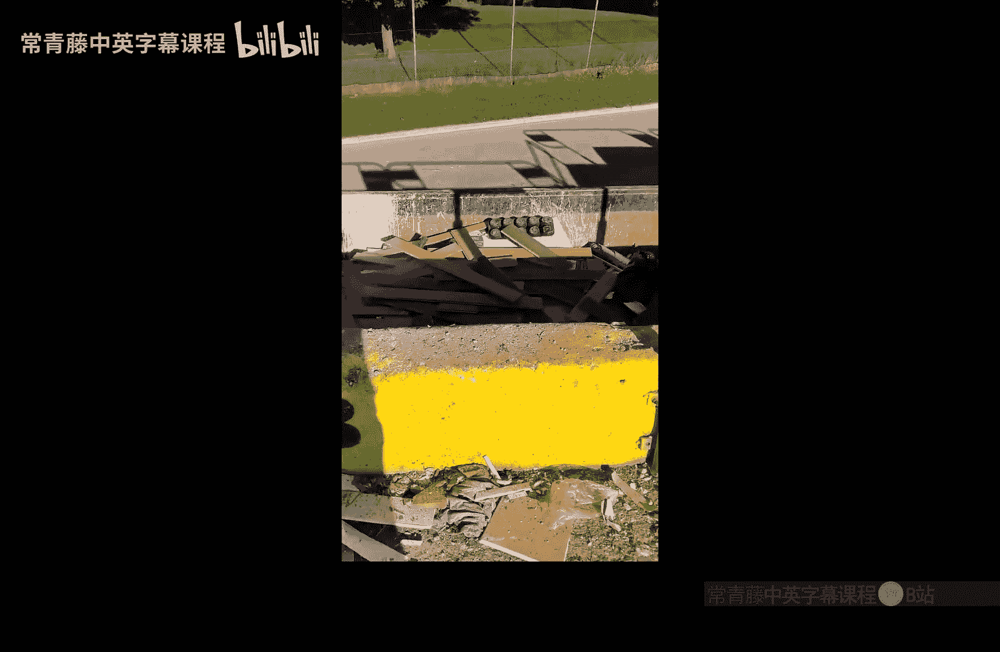
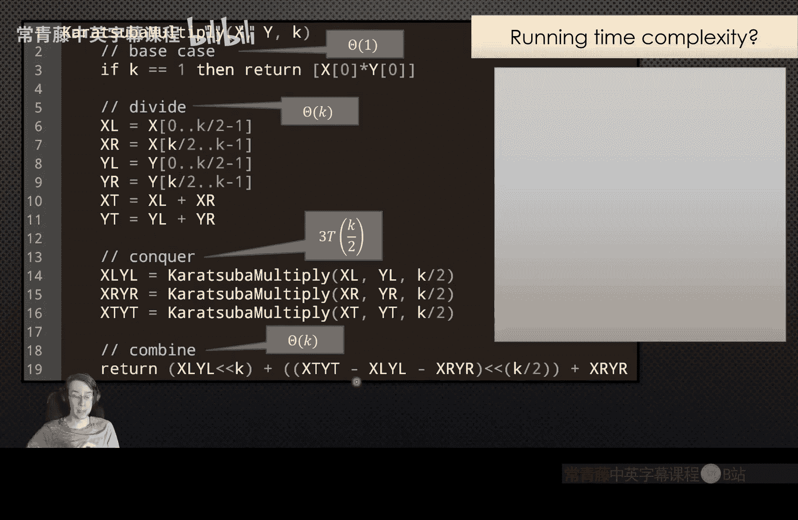

# 006：分治算法（下）

在本节课中，我们将继续学习分治算法，并探讨其在三个经典问题上的应用：非支配点问题、大整数乘法以及矩阵乘法。我们将看到如何通过巧妙的分解和合并步骤，设计出比朴素算法更高效的解决方案。

## 非支配点问题 🧭

上一节我们介绍了分治算法的基本框架，本节中我们来看看如何将其应用于一个几何问题：非支配点问题。

### 问题定义

给定二维平面上的一组点 S。我们说一个点 `(x1, y1)` **支配** 另一个点 `(x2, y2)`，当且仅当 `x1 > x2` 且 `y1 > y2`。这意味着被支配的点位于支配点的西南方向。一个点如果没有被集合 S 中的任何其他点支配，则被称为**非支配点**。我们的目标是找出并输出 S 中的所有非支配点。

### 朴素算法

以下是解决该问题的朴素算法思路：

对于集合中的每一个点 P，我们检查它是否被任何其他点 Q 支配。如果没有，则 P 是非支配点。

该算法的时间复杂度为 **O(n²)**，对于大规模输入效率较低。

### 分治算法

我们可以利用一个几何观察来设计更高效的算法：所有非支配点会形成一个从左上到右下递减的“阶梯”形状。

以下是分治算法的步骤：

1.  **预处理**：首先将所有点按照 x 坐标升序排序。这需要 **O(n log n)** 时间。
2.  **分解**：将排序后的点集 S 分成两个大小近似相等的子集 S1 和 S2，其中 S1 包含 x 坐标较小的前半部分点，S2 包含后半部分点。
3.  **征服**：递归地求解 S1 和 S2 的非支配点集，分别得到结果集 Q 和 R。
4.  **合并**：这是算法的关键。由于 S1 中的所有点都在 S2 中所有点的左侧，因此 S1 中的点不可能支配 S2 中的点。但是，S2 中的点可能支配 S1 中的点。合并时，我们只需要检查 S2 中 y 坐标最大的点（即 R 中的第一个点，因为递归结果按 x 排序后，y 是递减的）能支配 S1 中的哪些点。具体来说，我们从 Q 中移除所有 y 坐标小于 `R[0].y` 的点，然后将剩余的 Q 与 R 合并即可。

合并步骤可以在 **O(n)** 时间内完成。

### 算法复杂度分析



设 T(n) 为算法处理 n 个点的时间。我们有：
*   排序: O(n log n)
*   递归: T(n) = 2T(n/2) + O(n)

根据主定理，递归部分的时间复杂度为 **O(n log n)**。加上排序的代价，总时间复杂度为 **O(n log n)**，优于朴素算法。

---

## 大整数乘法 🧮

接下来，我们探讨如何用分治法加速大整数（位数很多，无法用计算机基本数据类型直接表示）的乘法。

### 问题定义

输入是两个 k 位的正整数 X 和 Y（二进制表示）。输出是它们的乘积 Z，一个最多 2k 位的正整数。

### 朴素算法

模拟竖式乘法，需要 **O(k²)** 次单位乘法和加法。

### 分治算法（朴素分解）

我们可以将每个 k 位数分成两半：
*   `X = Xl * 2^(k/2) + Xr`
*   `Y = Yl * 2^(k/2) + Yr`

那么它们的乘积可以表示为：
`X * Y = (Xl * Yl) * 2^k + (Xl * Yr + Xr * Yl) * 2^(k/2) + (Xr * Yr)`

这需要计算 4 个规模为 k/2 的乘法子问题：`Xl*Yl`, `Xl*Yr`, `Xr*Yl`, `Xr*Yr`。
递归式为：`T(k) = 4T(k/2) + O(k)`。
根据主定理，其解为 **O(k²)**，与朴素算法相同，没有改进。

### 卡拉楚巴算法

为了改进，我们需要减少子问题的数量。卡拉楚巴发现了一个技巧，可以用 3 次乘法完成计算：



1.  计算 `P1 = Xl * Yl`
2.  计算 `P2 = Xr * Yr`
3.  计算 `P3 = (Xl + Xr) * (Yl + Yr)`

注意，`P3 = Xl*Yl + Xl*Yr + Xr*Yl + Xr*Yr`。
那么，我们需要的中间项 `Xl*Yr + Xr*Yl = P3 - P1 - P2`。

因此，`X * Y = P1 * 2^k + (P3 - P1 - P2) * 2^(k/2) + P2`。

现在递归式为：`T(k) = 3T(k/2) + O(k)`。
根据主定理，其时间复杂度为 **O(k^(log₂3)) ≈ O(k^1.585)**，显著优于 O(k²)。

---

## 矩阵乘法 ⬜

最后，我们看看分治算法在矩阵乘法上的应用。

### 问题定义

给定两个 n×n 的矩阵 A 和 B，计算它们的乘积 C = A × B。

### 朴素算法

直接使用三重循环计算，时间复杂度为 **O(n³)**。

### 分治算法（朴素分解）

我们可以将每个矩阵划分为四个 (n/2)×(n/2) 的子矩阵：
```
A = | A11  A12 |    B = | B11  B12 |
    | A21  A22 |        | B21  B22 |
```
那么乘积 C 也可以相应划分：
```
C = | C11  C12 | = | A11*B11 + A12*B21   A11*B12 + A12*B22 |
    | C21  C22 |   | A21*B11 + A22*B21   A21*B12 + A22*B22 |
```
这需要计算 8 个规模为 n/2 的矩阵乘法子问题。
递归式为：`T(n) = 8T(n/2) + O(n²)`。
根据主定理，其解为 **O(n³)**，没有改进。

### 施特拉森算法

与卡拉楚巴算法思想类似，施特拉森设计了一种方法，只需进行 7 次 (n/2)×(n/2) 的矩阵乘法。

他定义了 7 个辅助矩阵：
```
P1 = A11 * (B12 - B22)
P2 = (A11 + A12) * B22
P3 = (A21 + A22) * B11
P4 = A22 * (B21 - B11)
P5 = (A11 + A22) * (B11 + B22)
P6 = (A12 - A22) * (B21 + B22)
P7 = (A11 - A21) * (B11 + B12)
```
然后，结果矩阵 C 的四个子块可以通过这些 P 矩阵的加法和减法组合得到：
```
C11 = P5 + P4 - P2 + P6
C12 = P1 + P2
C21 = P3 + P4
C22 = P5 + P1 - P3 - P7
```
现在递归式为：`T(n) = 7T(n/2) + O(n²)`。
根据主定理，其时间复杂度为 **O(n^(log₂7)) ≈ O(n^2.81)**，优于朴素立方复杂度。

在实际应用中，当子矩阵规模变小时，通常会切换回朴素算法以获得更好的缓存性能和常数因子优势，因此施特拉森算法常以这种混合形式使用。

---

## 总结 📚

本节课中我们一起学习了分治算法在三个不同领域的精彩应用：
1.  **非支配点问题**：通过排序和递归，将 O(n²) 的算法优化为 O(n log n)。
2.  **大整数乘法（卡拉楚巴算法）**：通过将 4 个子问题减少为 3 个，将复杂度从 O(k²) 降低到 O(k^1.585)。
3.  **矩阵乘法（施特拉森算法）**：通过将 8 个子问题减少为 7 个，将复杂度从 O(n³) 降低到 O(n^2.81)。


这些例子展示了分治算法的核心威力：通过巧妙地设计分解和合并步骤，减少需要解决的子问题数量或规模，从而获得渐进意义上的性能提升。它们也体现了算法设计中“牺牲简单性换取效率”的经典权衡。