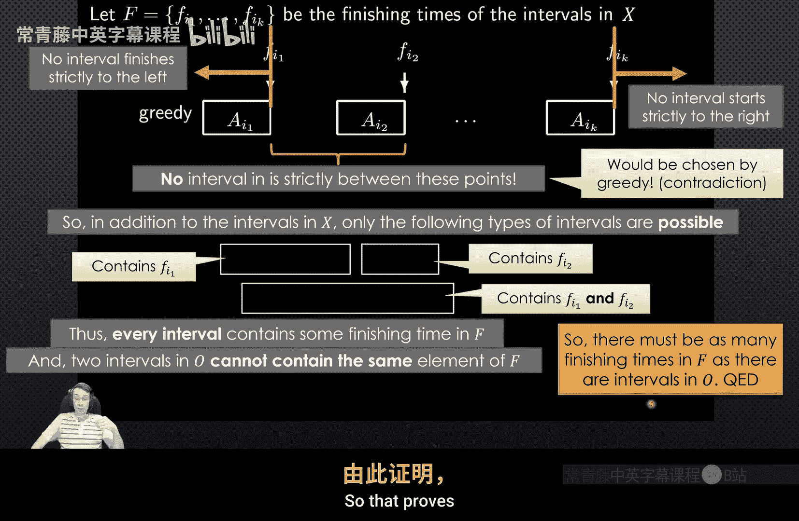

# 算法课程：第7讲：贪心算法

在本节课中，我们将要学习贪心算法设计范式。我们将了解什么是贪心算法，它们通常用于解决哪类问题，并通过两个经典问题——区间选择与区间着色——来深入理解贪心算法的结构、实现和正确性证明。

## 概述：什么是优化问题？

在深入贪心算法之前，我们需要理解它们通常用于解决**优化问题**。一个优化问题包含以下要素：
*   **问题实例**：问题的输入。
*   **约束条件**：任何可行解都必须满足的条件。所有满足约束的解的集合构成**可行域**。
*   **目标函数**：一个将可行解映射到实数的函数。我们的目标是找到可行解中使该函数值**最大化**（如利润）或**最小化**（如成本）的解，这样的解称为**最优解**。

贪心算法是解决优化问题的一种策略，它通常简单高效，但证明其正确性（即总能找到最优解）往往是更具挑战性的部分。

## 贪心算法的核心思想与结构

贪心算法从一个空的**部分解**开始，通过一系列**不可撤销的**选择逐步构建完整解。在每一步，算法根据一个**局部评估准则**，从当前可做的**选择集**中，选择**看起来最好**的选项，而不考虑该选择对未来决策的全局影响。

以下是贪心算法的形式化描述：
*   **部分解**：一个由已做选择构成的元组 `(x1, x2, ..., xi)`，它满足所有问题约束。
*   **选择集** `choice(X)`：对于当前部分解 `X`，所有能扩展 `X` 且不违反约束的下一步选择 `y` 的集合。
*   **局部评估函数** `G(y)`：一个函数，用于评估选择 `y` 带来的**局部**收益或成本。
*   **算法流程**：
    1.  从空的部分解开始。
    2.  当未得到完整可行解时：
        *   从当前选择集 `choice(X)` 中，选择使 `G(y)` 最优（最大或最小）的 `y`。
        *   将 `y` 加入部分解，形成新的部分解 `X' = (x1, ..., xi, y)`。
    3.  返回最终构建的可行解 `X`。

贪心算法的关键特性是**不前瞻**（不考虑未来选择）和**不回退**（不撤销已做选择）。其时间复杂度通常为 `O(n log n)`，主要开销在于按 `G` 进行预处理排序，然后进行一次线性扫描。

## 问题一：区间选择

上一节我们介绍了贪心算法的通用框架，本节中我们来看看第一个具体问题：**区间选择问题**。

### 问题定义
*   **输入**：一组 `n` 个时间区间 `A = {a1, a2, ..., an}`，每个区间 `ai` 有开始时间 `si` 和结束时间 `fi`（`fi >= si`）。
*   **可行解**：一个区间子集 `X ⊆ A`，其中任意两个区间都不重叠（即互不相交）。
*   **最优解**：具有**最大基数**（即包含最多区间）的可行解。

直观上，这可以理解为在一个会议室中安排尽可能多的不冲突会议。


### 贪心策略尝试
对于此问题，我们可以尝试多种贪心策略：
1.  每次选择**开始时间最早**且不与已选区间重叠的区间。
2.  每次选择**持续时间最短**且不与已选区间重叠的区间。
3.  每次选择**结束时间最早**且不与已选区间重叠的区间。

通过构造反例，可以证明策略1和策略2无法保证得到最优解。例如，策略1可能选择一个很长的早期区间，从而“挡住”多个更短的区间。

### 正确算法：按结束时间排序
策略3（按结束时间最早选择）是正确的。以下是算法伪代码：
```python
def interval_selection(A):
    # 按结束时间 fi 升序排序所有区间
    sort A by increasing finish time fi
    X = []  # 存储选择的区间
    last_finish = -infinity
    for interval in A:
        if interval.start >= last_finish:
            X.append(interval)
            last_finish = interval.finish
    return X
```
**时间复杂度**：排序 `O(n log n)`，扫描 `O(n)`，总计 `O(n log n)`。

### 正确性证明：“贪心领先”论证
我们需要证明算法返回的解 `X` 既是可行的（区间互不相交），也是最优的（区间数最多）。可行性由算法设计保证（只选择开始时间晚于上次结束时间的区间）。最优性证明采用“贪心领先”论证法：

1.  **定义与假设**：
    *   设贪心算法选择区间的顺序（按结束时间排序后）为 `ai1, ai2, ..., aik`。
    *   设任意一个最优解 `O` 包含的区间为 `aj1, aj2, ..., ajl`（我们同样按结束时间升序重新排列它们，以便比较）。
    *   为导出矛盾，**假设**最优解优于贪心解，即 `l > k`。

2.  **关键引理**：对于任意 `m`（`1 ≤ m ≤ k`），有 `f(im) ≤ f(jm)`。即贪心解的第 `m` 个区间的结束时间，不晚于最优解中第 `m` 个区间的结束时间。这可以通过数学归纳法证明，核心在于：由于 `ajm` 的开始时间晚于 `f(jm-1)`，且由归纳假设 `f(jm-1) ≥ f(im-1)`，因此 `ajm` 是贪心算法在第 `m` 步时的一个合法候选。贪心算法选择了结束时间最早的合法区间，故其选择的 `aim` 的结束时间一定不晚于 `f(jm)`。

3.  **推出矛盾**：
    *   根据假设 `l > k`，最优解有第 `k+1` 个区间 `aj(k+1)`。
    *   由于区间不重叠，`aj(k+1)` 的开始时间 `s(j(k+1)) ≥ f(jk)`。
    *   根据关键引理，`f(jk) ≥ f(ik)`。
    *   因此 `s(j(k+1)) ≥ f(ik)`。这意味着区间 `aj(k+1)` 开始于贪心解最后一个区间 `aik` 结束之后。
    *   但这样一来，`aj(k+1)` 应该是贪心算法的一个合法候选，且会被选中（因为它是结束时间最早的合法区间之一），这与贪心解只包含 `k` 个区间矛盾。
4.  **结论**：假设 `l > k` 不成立，因此 `l ≤ k`。贪心解包含的区间数不少于任何最优解，故其为最优。




## 问题二：区间着色

在学习了区间选择问题后，我们来看一个相关但目标不同的问题：**区间着色问题**。

### 问题定义
*   **输入**：与区间选择问题相同，一组 `n` 个时间区间。
*   **可行解**：为每个区间分配一种颜色，使得任何两个重叠的区间颜色不同。
*   **最优解**：使用**颜色总数最少**的可行解。

直观上，这相当于用最少的会议室安排所有会议，每个会议室一种颜色。

### 贪心算法
算法思路：按开始时间处理区间，每次尝试为当前区间分配一个已有的、不冲突的颜色（即该颜色对应的最后一个区间已结束），若无法分配则创建新颜色。

**基础版本伪代码**（可能效率较低）：
```python
def interval_coloring_basic(A):
    sort A by increasing start time si
    color = [0] * n  # 记录每个区间的颜色
    finish_time = [] # finish_time[c] 记录颜色c的最后使用结束时间
    d = 0 # 已使用的颜色数量
    for i in range(n):
        assigned = False
        # 尝试复用现有颜色
        for c in range(1, d+1):
            if finish_time[c] <= A[i].start:
                color[i] = c
                finish_time[c] = A[i].finish
                assigned = True
                break
        # 无法复用则创建新颜色
        if not assigned:
            d += 1
            color[i] = d
            finish_time[d] = A[i].finish
    return d, color
```
**时间复杂度**：排序 `O(n log n)`，内层循环在最坏情况下（颜色数 `d` 接近 `n`）导致总复杂度为 `O(n log n + n*d)`，即 `O(n^2)`。

### 正确性证明
我们给出一个简洁的证明，说明算法使用的颜色数 `D` 是最优的。
1.  设算法最终使用了 `D` 种颜色。
2.  设 `fD` 是**第一个**被分配第 `D` 种颜色（即最后创建的颜色）的区间。
3.  对于每种颜色 `c = 1, 2, ..., D-1`，考虑在 `fD` 结束之前开始的、最后一个被分配颜色 `c` 的区间，记为 `Lc`。
4.  可以论证，`fD` 与每一个 `Lc` 都重叠。因为如果某个 `Lc` 不与 `fD` 重叠（即 `Lc` 在 `fD` 开始前已结束），那么贪心算法在处理 `fD` 时本可以复用颜色 `c`，而无需创建新颜色 `D`，这与 `fD` 是第一个使用颜色 `D` 的区间矛盾。
5.  因此，在 `fD` 的开始时刻，存在 `D` 个区间（`fD` 和 `D-1` 个 `Lc`）同时重叠。这意味着任何合法着色至少需要 `D` 种颜色。
6.  算法使用了 `D` 种颜色，且 `D` 是所需颜色的下界，因此 `D` 就是最优解的颜色数。

### 效率优化：使用优先队列（堆）
基础版本的低效之处在于需要线性扫描所有颜色来寻找可复用的。我们可以维护一个**最小堆**，其中每个元素是 `(结束时间, 颜色)`，按结束时间排序。这样，最早可用的颜色始终在堆顶。

**优化版本伪代码**：
```python
def interval_coloring_heap(A):
    sort A by increasing start time si
    import heapq
    heap = []  # 最小堆，元素为 (finish_time, color_id)
    next_color = 1
    color = [0] * n

    # 处理第一个区间
    color[0] = next_color
    heapq.heappush(heap, (A[0].finish, next_color))

    for i in range(1, n):
        # 检查堆顶颜色是否可用
        if heap and heap[0][0] <= A[i].start:
            # 复用颜色
            finish, c = heapq.heappop(heap)
            color[i] = c
        else:
            # 创建新颜色
            next_color += 1
            color[i] = next_color
            c = next_color
        # 将更新后的颜色放回堆中
        heapq.heappush(heap, (A[i].finish, c))
    return next_color, color
```
**时间复杂度**：排序 `O(n log n)`，每个区间涉及一次堆操作（`O(log D)`），总复杂度为 `O(n log n + n log D)`。由于 `D ≤ n`，最坏情况为 `O(n log n)`，显著优于基础版本。

## 总结

本节课中我们一起学习了贪心算法。我们首先定义了优化问题及其组成部分。然后，我们阐述了贪心算法的核心思想：通过一系列基于局部最优的、不可撤销的选择来构建解。我们通过两个经典问题进行了深入探讨：
1.  **区间选择问题**：目标是选择最多互不相交的区间。我们证明了按**结束时间最早**排序的贪心策略是正确的，并使用“贪心领先”法完成了严谨的最优性证明。
2.  **区间着色问题**：目标是用最少的颜色给所有区间着色，使得重叠区间颜色不同。我们给出了按**开始时间最早**处理，并复用最早可用颜色的贪心算法。我们提供了一个巧妙的证明来说明其最优性，并介绍了使用**优先队列**来将算法效率优化到 `O(n log n)`。


贪心算法的设计关键在于找到合适的局部评价准则，而算法的难点和核心往往在于证明其全局最优性。