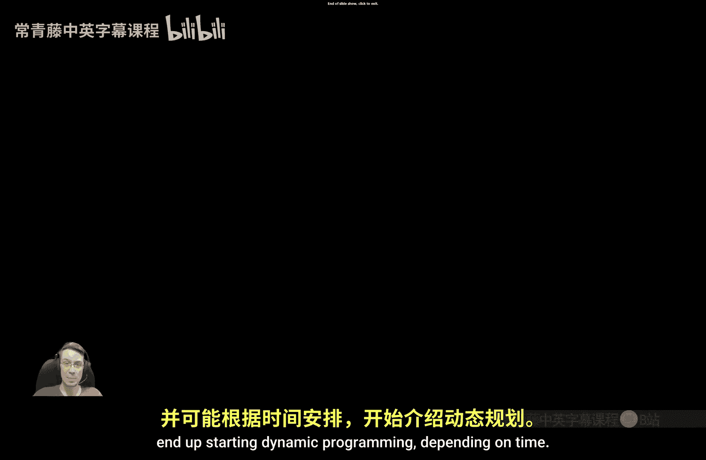

# 008：贪心算法（第二部分）

在本节课中，我们将学习两种经典的贪心算法问题：分数背包问题和找零问题。我们将探讨贪心策略的设计、算法的正确性证明，并理解为什么某些问题适合贪心算法而另一些则不适合。

## 分数背包问题

上一节我们介绍了贪心算法的基本思想。本节中，我们来看看一个具体问题：分数背包问题。

我们有一个背包，可以容纳总重量不超过 `M` 的物品。有 `n` 件物品，每件物品 `i` 有价值 `P_i` 和重量 `W_i`。在分数背包问题中，我们可以取走物品的任意一部分（即分数 `X_i`，其中 `0 ≤ X_i ≤ 1`）。目标是找到一个可行的解决方案 `X`，在不超过总重量限制 `M` 的前提下，最大化总价值 `∑(P_i * X_i)`。

### 贪心策略的尝试

以下是几种可能的贪心策略：

*   **策略一：按价值降序选择物品。** 总是优先选择价值最高的物品。这个策略可能失败，因为一个价值很高但重量极大的物品会占用过多背包容量，导致总价值不高。
*   **策略二：按重量升序选择物品。** 总是优先选择最轻的物品。这个策略也可能失败，因为一个很轻但价值极低的物品对总价值的贡献很小。

### 最优贪心策略

最优的贪心策略是**按单位重量价值（价值/重量）降序**选择物品。直观上，我们希望用背包的每一单位重量来换取尽可能高的价值回报。

以下是该算法的伪代码：

```pseudocode
函数 GreedyRationalKnapsack(P, W, M):
    // 预处理：按 P_i / W_i 降序排序物品
    将物品按 P_i / W_i 降序排序，得到排序后的数组 A
    初始化数组 X[1..n] = 0 // 记录每件物品取走的比例
    当前重量 current_weight = 0

    对于 i 从 1 到 n:
        如果 current_weight + W_i ≤ M:
            // 可以取走整件物品
            X[i] = 1
            current_weight = current_weight + W_i
        否则:
            // 只能取走一部分来填满背包
            X[i] = (M - current_weight) / W_i
            current_weight = M
            跳出循环

    返回 X
```

### 算法正确性证明

我们需要证明算法产生的解 `X` 是**可行**且**最优**的。

**可行性证明（非正式）：**
算法确保在每一步，取走的物品比例 `X_i` 都在 0 到 1 之间。循环结束时，要么所有物品都已考虑，总重量 `current_weight ≤ M`；要么因为背包被恰好填满而跳出循环，此时 `current_weight = M`。因此，解 `X` 总是可行的。

**最优性证明（思路）：**
假设存在一个最优解 `Y` 与贪心解 `X` 不同。设 `j` 是第一个 `X_j ≠ Y_j` 的位置。可以论证，必有 `Y_j < X_j`（因为贪心算法会尽可能多地取单位价值高的物品 `j`）。

由于 `Y` 是可行解，在 `j` 之后必然存在某个物品 `k`（`k > j`）使得 `Y_k > 0`（否则 `Y` 的总价值将低于 `X`）。然而，由于物品是按单位价值降序排列的，有 `P_j/W_j > P_k/W_k`。

现在，我们可以构造一个新解 `Y‘`：从 `Y_k` 中移除一个微小的重量 `δ`，并将这部分重量用于增加 `Y_j`。具体调整如下：
*   `Y‘_j = Y_j + δ / W_j`
*   `Y‘_k = Y_k - δ / W_k`
*   其他分量与 `Y` 相同。

可以证明，对于足够小的正数 `δ`，新解 `Y‘` 仍然是可行的。更重要的是，新解的总价值变化为 `δ * (P_j/W_j - P_k/W_k) > 0`。这意味着 `Y‘` 的总价值比最优解 `Y` 还要高，产生了矛盾。因此，假设不成立，贪心解 `X` 就是唯一的最优解。

---

## 找零问题

接下来，我们看看另一个贪心算法的经典应用：找零问题。


问题的输入是一个硬币面额数组 `D`（例如加拿大硬币系统：[200, 100, 25, 10, 5, 1]）和一个目标总额 `T`。目标是找出凑出总额 `T` 所需的最少硬币数量，并输出具体的硬币组合。

### 贪心算法

一个直观的贪心策略是：**总是先使用面额最大的硬币**。

以下是该算法的伪代码：

```pseudocode
函数 GreedyCoinChange(D, T):
    // 预处理：将硬币按面额降序排序
    将数组 D 按降序排序
    初始化数组 used[1..n] = 0 // 记录每种硬币使用的数量

    对于 i 从 1 到 n:
        used[i] = ⌊T / D[i]⌋ // 尽可能多地使用当前面额的硬币
        T = T - used[i] * D[i] // 更新剩余需要凑的金额

    如果 T > 0:
        返回 “无解” // 无法用给定的硬币凑出目标金额
    否则:
        返回 used // 返回每种硬币的使用数量
```

### 算法分析与正确性

该算法的时间复杂度主要由排序步骤决定，为 `O(n log n)`。

**对于特定硬币系统的正确性：**
贪心算法对于某些硬币系统（如包含1分钱的旧版加拿大硬币系统）能产生最优解，但对于另一些系统（如旧版英国硬币系统）则不能。

以旧版加拿大硬币系统（面额：100, 25, 10, 5, 1）为例，我们可以通过归纳法证明贪心算法的最优性。证明的核心在于利用任何最优解都必须满足的几条性质（例如，5分硬币最多1个，1分硬币最多4个等），并分情况讨论（`T` 在不同面额区间内），论证贪心算法做出的选择（使用最大面额硬币）也必然包含在任何最优解中，从而将问题规约到一个更小的、由归纳假设保证能最优解决的子问题。

**硬币系统的性质：**
如果一个硬币系统中，每个较大面额都是下一个较小面额的整数倍（例如 [64, 16, 4, 1]），那么贪心算法一定是全局最优的。这是一个**充分但不必要**的条件。旧版加拿大硬币系统并不完全满足这个条件（25不是10的整数倍），但贪心算法依然最优。

---

## 总结

本节课我们一起学习了两个重要的贪心算法问题。
1.  **分数背包问题**：我们找到了最优的贪心策略——按单位重量价值降序选择物品，并理解了其正确性证明的核心矛盾构造法。
2.  **找零问题**：我们分析了“总是使用最大面额硬币”这一贪心策略，认识到其最优性依赖于具体的硬币系统，并通过一个特定系统的证明示例展示了如何利用最优子结构性质进行归纳证明。



这两个例子揭示了贪心算法的威力与局限：它能为某些问题提供简单高效的精确解，但其正确性需要仔细验证，并且不适用于所有类似问题（例如，0-1背包问题就是NP难的，无法用简单贪心法解决）。