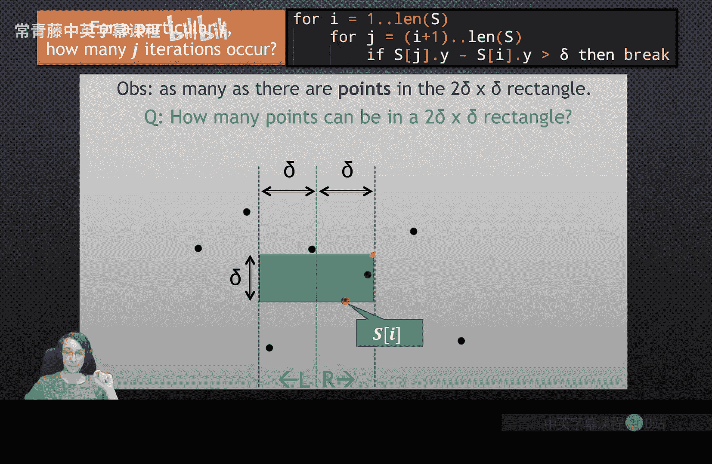
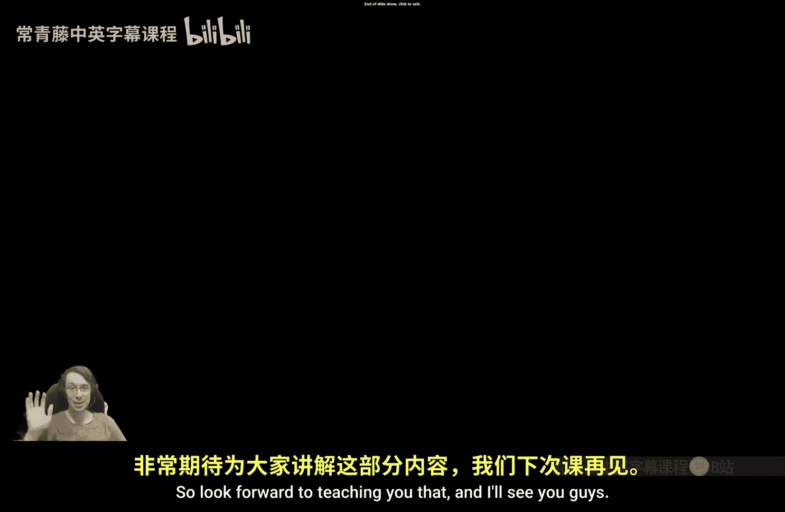

# 010：分治法（下）

在本节课中，我们将学习分治法的最后一部分内容，涵盖选择问题和最近点对问题。我们将从选择问题开始，探讨如何高效地找到数组中第K小的元素，然后转向如何在二维平面中高效地找到距离最近的一对点。

---

## 选择问题

选择问题的输入是一个包含n个不同整数的数组A，以及一个介于1和n之间的整数K。输出是数组中第K小的整数。如果数组已排序，问题将变得非常简单（直接返回第K个元素）。因此，我们的目标是寻找一个渐近快于O(n log n)的解决方案，因为简单的排序后返回第K个元素的方法复杂度为O(n log n)。

以下是选择问题的几个特例：
*   **最小值问题**：当K=1时。
*   **中位数问题**：当K=n/2时。
*   **最大值问题**：当K=n时。

### 快速选择算法

一个简单的算法是直接排序并返回第K个元素，其复杂度为O(n log n)。一个在期望情况下更快的算法是**快速选择**。

快速选择算法的思路与快速排序类似：
1.  选择一个**枢轴元素** `y`。
2.  围绕 `y` **重构**数组，使得所有小于 `y` 的元素都在其左侧，所有大于 `y` 的元素都在其右侧。此步骤耗时 `Θ(n)`。
3.  设重构后 `y` 的索引为 `i_y`。
    *   如果 `K == i_y`，则 `y` 就是第K小的元素，直接返回 `y`。
    *   如果 `K < i_y`，则第K小的元素在左侧子数组中，递归地在左侧子数组中寻找第K小的元素。
    *   如果 `K > i_y`，则第K小的元素在右侧子数组中。由于左侧有 `i_y` 个更小的元素已被排除，因此需要在右侧子数组中寻找第 `(K - i_y)` 小的元素。

以下是快速选择的伪代码：
```python
def quick_select(A, k):
    if len(A) == 1:
        return A[0]
    pivot = A[0]  # 任意选择枢轴，例如第一个元素
    left, right, pivot_index = restructure(A, pivot)
    if k == pivot_index:
        return pivot
    elif k < pivot_index:
        return quick_select(left, k)
    else: # k > pivot_index
        return quick_select(right, k - pivot_index)
```

#### 复杂度分析
*   **最坏情况**：如果每次选择的枢轴都是当前数组的最小或最大元素，递归问题规模每次只减少1。此时递归式为 `T(n) = T(n-1) + Θ(n)`，解得 `T(n) = O(n²)`。
*   **最好情况**：如果每次选择的枢轴都能将数组均匀分成两半，递归式为 `T(n) = T(n/2) + Θ(n)`，根据主定理，`T(n) = O(n)`。
*   **平均情况（期望）分析**：我们定义“好”枢轴为能将数组划分为至少1/4和至多3/4的两部分（即枢轴索引在 `[n/4, 3n/4]` 之间）。随机选择枢轴时，它是“好”枢轴的概率是1/2。因此，**在期望意义上，每两次递归调用我们就会遇到一个好枢轴**。这两次调用引发的总工作量为 `O(n)`，而遇到好枢轴会将问题规模至少缩减 `n/4`。这导出了平均情况递归式：`T(n) = T(3n/4) + O(n)`。根据主定理，`T(n) = O(n)`。因此，快速选择是一个**期望线性时间**的算法。

虽然快速选择在平均情况下很快，但其最坏情况 `O(n²)` 的复杂度仍不理想。接下来，我们将介绍一个能保证最坏情况线性时间的算法。

---

## 中位数的中位数算法

为了克服快速选择最坏情况的缺点，我们引入**中位数的中位数**算法。该算法的核心是**确保每次递归都能选择一个“好”枢轴**，从而保证最坏情况下的线性时间复杂度。

### 算法步骤
1.  **分组**：将输入数组 `A` 分成 `⌈n/5⌉` 组，每组最多5个元素。
2.  **找各组中位数**：对每个5元组进行排序（常数时间），找出其中位数。这样我们得到一个包含 `⌈n/5⌉` 个中位数的数组 `M`。
3.  **找中位数的中位数**：递归地调用本算法，找出数组 `M` 的中位数（即第 `⌊|M|/2⌋` 小的元素）。将这个值作为枢轴 `y`。注意，这里递归求解的问题规模是 `n/5`。
4.  **分区**：使用这个枢轴 `y` 对原始数组 `A` 进行分区（类似快速选择），得到左子数组 `L`、右子数组 `R` 和枢轴索引 `i_y`。
5.  **递归选择**：比较 `K` 和 `i_y`，根据比较结果，在 `L` 或 `R` 上递归调用本算法，寻找第K小或第 `(K - i_y)` 小的元素。

### 为何有效？复杂度分析
关键点在于，通过选择“中位数的中位数”作为枢轴，我们可以保证至少有 `3n/10` 的元素小于等于它，也至少有 `3n/10` 的元素大于等于它。这意味着，无论向哪边递归，子问题的大小最多为 `7n/10`。

由此得到递归式：
`T(n) ≤ T(n/5) + T(7n/10) + O(n)`

这里 `T(n/5)` 是寻找中位数的中位数的成本，`T(7n/10)` 是后续递归选择的成本，`O(n)` 是分组、找各组中位数和分区等线性工作的成本。

注意，`n/5 + 7n/10 = 9n/10 < n`。递归树每一层的工作量之和构成一个公比为 `9/10` 的几何级数：`n + (9/10)n + (9/10)²n + ...`，其和为 `O(n)`。因此，`T(n) = O(n)`。这是一个**最坏情况线性时间**的选择算法。

---

## 最近点对问题

最近点对问题的输入是二维平面上n个点的集合 `P`，目标是找到其中欧几里得距离最小的一对点。

一个朴素的解法是检查所有 `C(n, 2)` 对点，复杂度为 `O(n²)`。我们将利用分治法获得更优的解法。

### 分治策略
1.  **预处理**：将所有点按x坐标排序，得到数组 `P_x`。
2.  **分**：找到x坐标的中位数，用一条垂直线 `L` 将点集分为左右数量大致相等的两部分 `Q` 和 `R`。
3.  **治**：递归地在 `Q` 和 `R` 中分别找出最近点对，设其距离分别为 `δ_left` 和 `δ_right`。令 `δ = min(δ_left, δ_right)`。
4.  **合**：最近点对要么完全在左侧，要么完全在右侧，要么一个在左一个在右（称为跨越点对）。前两种情况已由递归解决。关键在于高效地检查是否存在距离小于 `δ` 的跨越点对。

#### 高效寻找跨越点对
关键观察：对于跨越点对 `(p, q)`（设 `p` 在左，`q` 在右），如果其距离小于 `δ`，则 `p` 和 `q` 必定都落在以垂直线 `L` 为中心、宽度为 `2δ` 的垂直带状区域内。
进一步观察：对于带状区域内的任意一点 `p`，只需考虑其与带状区域内、`y` 坐标相差不超过 `δ`、且位于 `p` 上方的点（最多8个）即可。这是因为在 `δ × 2δ` 的矩形内，最多只能容纳8个点，使得任意两点距离不小于 `δ`（基于鸽巢原理和 `δ` 的定义）。

基于此，合并步骤的算法如下：
1.  从 `P_x` 中提取所有x坐标在 `[x_mid - δ, x_mid + δ]` 内的点，得到集合 `S`。
2.  将 `S` 中的点按y坐标排序。
3.  对于 `S` 中每个点 `p`，检查其与后续（y坐标更大的）最多8个点的距离，更新最小距离。

#### 复杂度分析
设递归函数的时间为 `T(n)`。
*   排序 `P_x` 耗时 `O(n log n)`。
*   递归调用：`2 * T(n/2)`。
*   合并步骤：提取带状区域 `O(n)`，排序 `S` 耗时 `O(n log n)`，检查点对耗时 `O(n)`（因为内层循环是常数次）。
因此，递归式为：`T(n) = 2T(n/2) + O(n log n)`。
利用递归树法或主定理（情况2），可得 `T(n) = O(n log² n)`。

### 优化：Shamos算法
上述算法中，合并步骤的瓶颈在于每次递归都需要对带状区域内的点按y坐标排序（`O(n log n)`）。Shamos算法通过预排序优化了这一步骤。



算法步骤：
1.  **预处理**：创建两个数组：`P_x`（按x坐标排序）和 `P_y`（按y坐标排序）。
2.  **递归**：在递归调用时，不仅传递子点集对应的 `P_x` 子数组，还通过线性扫描 `P_y`，筛选出属于当前子点集的点，从而得到已按y坐标排序的 `P_y` 子数组。此筛选步骤耗时 `O(n)`。
3.  **合并**：在合并时，可以直接使用已按y排序的 `P_y` 子数组来寻找跨越点对，无需再次排序。

优化后的递归式为：`T(n) = 2T(n/2) + O(n)`。
这正是归并排序的递归式，其解为 `T(n) = O(n log n)`。因此，Shamos算法将最近点对问题的复杂度优化到了 `O(n log n)`。

---

## 总结

本节课我们一起学习了分治法的两个经典问题：
1.  **选择问题**：我们探讨了快速选择算法（期望 `O(n)`）及其最坏情况 `O(n²)` 的缺陷，进而引入了能保证最坏情况线性时间的中位数的中位数算法。
2.  **最近点对问题**：我们首先设计了一个 `O(n log² n)` 的分治算法，然后通过预排序y坐标的技巧（Shamos算法）将其优化到了 `O(n log n)`。



这些算法展示了分治法在解决非平凡问题时的强大能力，以及通过精心设计合并步骤和利用问题特性来优化复杂度的技巧。下一讲，我们将开始新的主题：贪心算法。