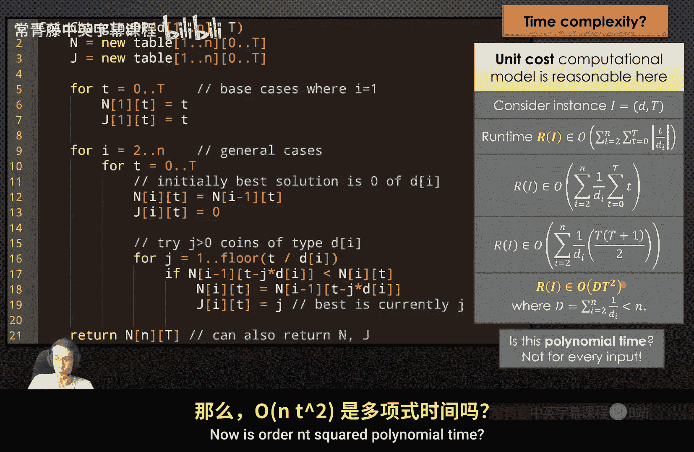

# 滑铁卢大学算法课程：CS341 Fall 2021：第10讲 - 动态规划（续）

## 概述
在本节课中，我们将学习如何使用动态规划解决两个经典问题：**0-1背包问题**和**硬币找零问题**。我们将从定义问题开始，推导出递推关系，设计动态规划表格，并最终实现算法。课程内容旨在让初学者能够理解动态规划的核心思想与应用。

---

## 0-1背包问题：问题定义与递推关系

上一讲我们介绍了动态规划的基本概念。本节中，我们来看看如何将其应用于0-1背包问题。

0-1背包问题描述如下：我们有一个容量为 `M` 的背包和 `n` 件物品。每件物品 `i` 有一个重量 `w_i` 和一个价值 `p_i`。我们的目标是选择物品的一个子集放入背包，使得总重量不超过 `M`，同时总价值最大化。与分数背包问题不同，在0-1背包问题中，每件物品要么完整放入，要么不放入，不能分割。

为了用动态规划解决此问题，我们首先需要定义子问题。令 `P(i, m)` 表示仅考虑前 `i` 件物品（即物品1到物品i），在背包容量为 `m` 时能获得的最大价值。

现在，考虑最优解 `O` 是否包含第 `i` 件物品。这引出了两种可能的情况：
1.  **最优解不包含物品 `i`**：那么，仅使用前 `i-1` 件物品在容量 `m` 下的最优解，就是使用前 `i` 件物品在容量 `m` 下的最优解。即 `P(i, m) = P(i-1, m)`。
2.  **最优解包含物品 `i`**：那么，我们必须先放入物品 `i`，消耗其重量 `w_i`。剩余容量为 `m - w_i`，我们需要用前 `i-1` 件物品在这个剩余容量下获得最大价值。因此，`P(i, m) = p_i + P(i-1, m - w_i)`。

由于我们不知道最优解到底属于哪种情况，因此 `P(i, m)` 应该是这两种情况中的最大值。这给出了我们的核心递推关系：

**递推关系（一般情况，i >= 2 且 m >= w_i）**：
`P(i, m) = max( P(i-1, m), p_i + P(i-1, m - w_i) )`

我们还需要处理一些基础情况：
*   **当 i = 1 时（只有一件物品）**：
    *   如果 `m >= w_1`，可以放入，则 `P(1, m) = p_1`。
    *   如果 `m < w_1`，无法放入，则 `P(1, m) = 0`。
*   **当 m < w_i 时（当前物品太重）**：无法放入物品 `i`，因此 `P(i, m) = P(i-1, m)`。

综合以上，我们得到完整的递推关系。

---

## 0-1背包问题：动态规划表格与算法实现

上一节我们推导出了递推关系。本节中，我们来看看如何将其转化为动态规划表格并实现算法。

我们将使用一个二维数组（或表格）`P` 来存储子问题的解，其中 `P[i][m]` 对应 `P(i, m)`。`i` 的范围是 `1` 到 `n`，`m` 的范围是 `0` 到 `M`。

以下是填充表格的步骤：
1.  **初始化（基础情况）**：填充第一行（`i=1`）。对于每个容量 `m`，如果 `m >= w_1`，则 `P[1][m] = p_1`；否则 `P[1][m] = 0`。
2.  **递推填充**：按 `i` 从 `2` 到 `n` 的顺序逐行填充。对于每一行 `i`，按 `m` 从 `0` 到 `M` 的顺序逐列填充。对于每个单元格 `(i, m)`：
    *   如果 `m < w_i`，则 `P[i][m] = P[i-1][m]`。
    *   否则，`P[i][m] = max( P[i-1][m], p_i + P[i-1][m - w_i] )`。

**算法伪代码**：
```python
def knapsack_01(p, w, M):
    n = len(p)
    # 创建 (n+1) x (M+1) 的表格，多一行一列用于简化边界处理
    P = [[0 for _ in range(M+1)] for _ in range(n+1)]

    # 填充表格
    for i in range(1, n+1):
        for m in range(M+1):
            if m < w[i-1]:  # 注意索引调整，w 和 p 从0开始
                P[i][m] = P[i-1][m]
            else:
                P[i][m] = max(P[i-1][m], p[i-1] + P[i-1][m - w[i-1]])
    # 最优值存储在 P[n][M]
    return P[n][M]
```

**空间优化**：观察发现，计算第 `i` 行时，只依赖于第 `i-1` 行。因此，我们可以将空间复杂度从 `O(n*M)` 降低到 `O(M)`，只使用两个一维数组（或一个数组，从右向左更新）。

---

## 0-1背包问题：重构最优解与复杂度分析

上一节我们实现了计算最大价值的算法。本节中，我们来看看如何找出具体是哪些物品构成了最优解，并分析算法复杂度。

### 重构最优解
为了找出最优解包含哪些物品，我们可以从最终结果 `P[n][M]` 开始，逆向追踪决策过程：
1.  初始化 `i = n`, `m = M`。
2.  当 `i > 0` 时：
    *   如果 `P[i][m] == P[i-1][m]`，说明物品 `i` **没有**被放入最优解。将 `i` 减1，`m` 不变。
    *   否则，说明物品 `i` **被放入了**最优解。记录物品 `i`，然后将 `i` 减1，`m` 减去 `w_i`。
3.  重复步骤2直到 `i = 0`。记录下的物品列表即为最优解。

### 复杂度分析
*   **时间复杂度**：我们需要填充一个 `n` 行 `M+1` 列的表格，每个单元格的计算是常数时间。因此，时间复杂度为 **O(n * M)**。
*   **空间复杂度**：使用二维表格时为 **O(n * M)**，优化后可为 **O(M)**。

**关于“多项式时间”的讨论**：算法运行时间 `O(n*M)` 是否是输入规模的多项式函数？输入规模通常用存储所有数字（`n`, `M`, `w_i`, `p_i`）所需的比特数 `S` 来衡量。`M` 本身需要约 `log M` 比特存储。因此，`M` 相对于 `log M` 是指数级的。如果 `M` 非常大（例如 `2^n`），那么 `O(n*M)` 相对于输入规模 `S` 就是指数时间。然而，如果 `M` 本身是 `n` 的多项式（例如 `M = n^2`），那么算法就是多项式时间的。动态规划算法在处理**物品数量 `n` 很大，但容量 `M` 相对较小**的实例时表现优异。

---

## 硬币找零问题：动态规划解法

现在，让我们将注意力转向硬币找零问题。我们有一套硬币面额 `d_1, d_2, ..., d_n`（通常 `d_1 = 1`），和一个目标金额 `T`。目标是找出凑出金额 `T` 所需的最少硬币数量，每种面额的硬币可以使用任意多枚。


我们定义子问题：令 `N(i, t)` 表示仅使用前 `i` 种面额（`d_1` 到 `d_i`）凑出金额 `t` 所需的最少硬币数量。

考虑如何凑出金额 `t` 并使用第 `i` 种面额。我们可以使用 `0` 枚、`1` 枚、...、最多 `floor(t / d_i)` 枚第 `i` 种面额的硬币。如果我们决定使用 `j` 枚第 `i` 种面额的硬币，那么我们需要用前 `i-1` 种面额凑出剩余的金额 `t - j * d_i`，并且使用 `j + N(i-1, t - j*d_i)` 枚硬币。为了最小化总硬币数，我们需要遍历所有可能的 `j`。

因此，递推关系如下（`i >= 2`）：
`N(i, t) = min_{j=0 to floor(t/d_i)} [ j + N(i-1, t - j*d_i) ]`

基础情况：
*   `N(1, t) = t` （因为只有面额为1的硬币，必须用 `t` 枚）
*   `N(i, 0) = 0` （凑出0元需要0枚硬币）

---

## 硬币找零问题：算法实现与复杂度

上一节我们定义了硬币找零问题的递推关系。本节中，我们来看看如何实现它并分析其性能。

### 算法实现
我们将使用一个二维表格 `N`，其中 `N[i][t]` 存储 `N(i, t)` 的值。`i` 从 `1` 到 `n`，`t` 从 `0` 到 `T`。

**算法伪代码**：
```python
def coin_change(d, T):
    n = len(d)
    N = [[float('inf')] * (T+1) for _ in range(n+1)]

    # 基础情况
    for t in range(T+1):
        N[1][t] = t  # 假设 d[0] == 1
    for i in range(n+1):
        N[i][0] = 0

    # 递推填充
    for i in range(2, n+1):
        for t in range(1, T+1):
            min_coins = float('inf')
            for j in range(0, t // d[i-1] + 1): # j 是使用第 i 种硬币的数量
                candidate = j + N[i-1][t - j * d[i-1]]
                if candidate < min_coins:
                    min_coins = candidate
            N[i][t] = min_coins

    return N[n][T]
```
为了能重构出具体使用了哪些硬币，我们可以在计算时额外记录对于每个 `N[i][t]`，最优解中使用了多少枚第 `i` 种硬币。

### 复杂度分析
*   **时间复杂度**：外层循环 `i` 有 `n` 次，内层循环 `t` 有 `T` 次，最内层循环 `j` 最多 `T/d_i` 次。总时间复杂度粗略为 **O(n * T^2)**（假设面额都不太小）。更精确的分析取决于具体面额。
*   **空间复杂度**：表格大小为 **O(n * T)**。



**关于“多项式时间”的讨论**：与背包问题类似，运行时间 `O(n * T^2)` 是否是输入规模 `S` 的多项式？输入规模 `S` 约为 `n * log T`（存储 `n` 个面额和金额 `T` 所需的比特数）。如果 `T` 非常大，`T^2` 相对于 `log T` 是指数级的，算法可能不是多项式时间。然而，如果 `T` 是 `n` 的多项式（例如 `T = n^k`），那么算法就是多项式时间的。因此，该动态规划算法在**目标金额 `T` 相对较小，或与硬币种类数 `n` 呈多项式关系**时非常有效。

---

## 总结
本节课中，我们一起学习了两个重要的动态规划应用：0-1背包问题和硬币找零问题。
1.  对于**0-1背包问题**，我们定义了子问题 `P(i, m)`，推导了递推关系，实现了自底向上的表格填充算法，并学习了如何重构最优解以及分析其时间复杂度 `O(n*M)`。
2.  对于**硬币找零问题**，我们定义了子问题 `N(i, t)`，推导了涉及多重选择的递推关系，实现了相应的动态规划算法，其时间复杂度约为 `O(n * T^2)`。
3.  我们深入讨论了这些算法的复杂度何时是输入规模的多项式函数，理解了动态规划在处理特定类型（物品多/金额大但容量/目标值适中）的大规模问题时的优势。


通过这两个例子，我们进一步巩固了设计动态规划算法的核心步骤：定义子问题、建立递推关系、确定计算顺序、实现并优化。