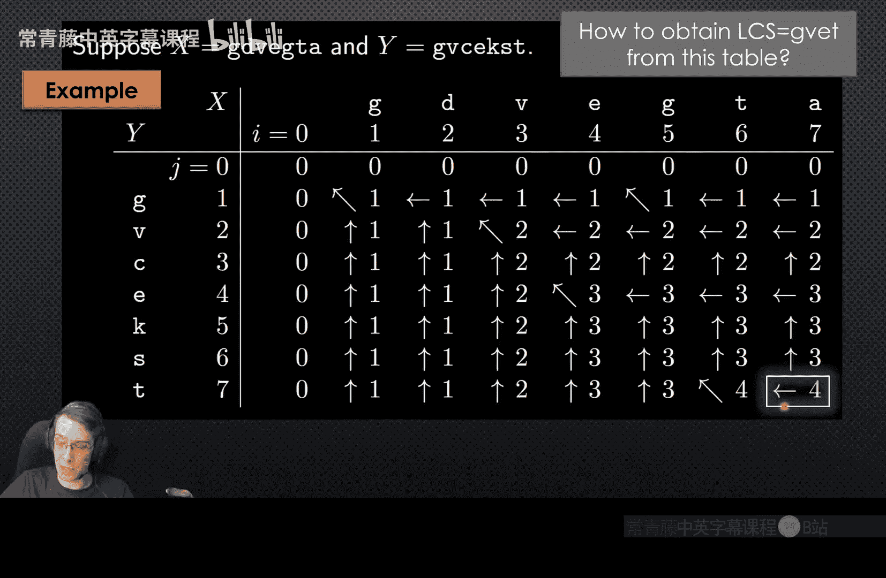
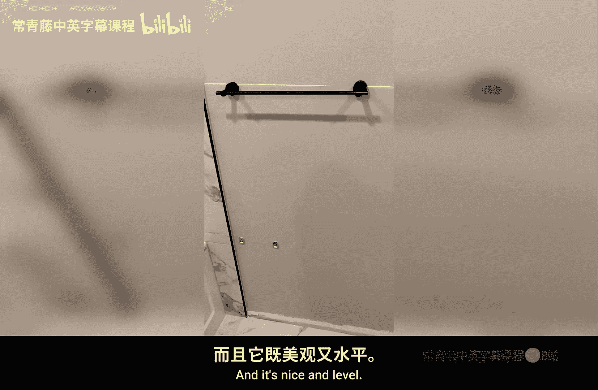

# 012：动态规划（三）🎯

在本节课中，我们将学习动态规划的最后两个经典问题：**最长公共子序列** 和 **凸多边形最优三角剖分**。我们还将了解一种与动态规划紧密相关的技术——**记忆化搜索**。

---

## 最长公共子序列问题 (LCS) 🧬

上一节我们介绍了动态规划的基本思想。本节中，我们来看看如何应用它来解决字符串处理中的一个经典问题：最长公共子序列。

**问题定义**：给定两个字符串 `X` 和 `Y`，长度分别为 `M` 和 `N`。我们需要找到一个字符串 `Z`，它是 `X` 和 `Y` 的**子序列**，并且长度**最长**。

**子序列** 是指从原字符串中删除零个或多个字符后，保持剩余字符相对顺序不变所形成的新字符串。

### 为什么贪心算法行不通？

一个直观的贪心想法是：按顺序遍历 `X` 的每个字符，在 `Y` 中寻找一个匹配字符，且该字符位于之前所有匹配字符的右侧。然而，这种方法并不总是能得到最优解。

**反例**：
*   `X = "AbracadabraZ"`
*   `Y = "AZbracadabra"`

贪心算法可能过早地匹配了 `Y` 末尾的 `Z`，导致无法匹配后续更长的公共子序列 `"Abracadabra"`。这表明我们需要考虑所有可能性，这正是动态规划的优势所在。

### 定义子问题与建立递推关系

我们定义子问题：`C[i][j]` 表示字符串 `X` 的前 `i` 个字符（`X[1..i]`）和字符串 `Y` 的前 `j` 个字符（`Y[1..j]`）的 LCS 长度。

我们的目标是计算 `C[M][N]`。

**考虑最后一个字符**：
1.  如果 `X[i] == Y[j]`，那么这个字符一定属于 LCS。我们可以将其加入 `X[1..i-1]` 和 `Y[1..j-1]` 的 LCS 中。
    *   **公式**：`C[i][j] = C[i-1][j-1] + 1`
2.  如果 `X[i] != Y[j]`，那么 `X[i]` 和 `Y[j]` 不可能同时属于 LCS。LCS 要么在 `X[1..i-1]` 和 `Y[1..j]` 中，要么在 `X[1..i]` 和 `Y[1..j-1]` 中。
    *   **公式**：`C[i][j] = max(C[i-1][j], C[i][j-1])`

**基础情况**：当 `i = 0` 或 `j = 0` 时，一个字符串为空，LCS 长度为 0。
*   **公式**：`C[0][j] = 0`, `C[i][0] = 0`

综合以上，我们得到完整的递推关系：
```python
if i == 0 or j == 0:
    C[i][j] = 0
elif X[i] == Y[j]:
    C[i][j] = C[i-1][j-1] + 1
else:
    C[i][j] = max(C[i-1][j], C[i][j-1])
```

### 算法实现与复杂度分析

以下是基于动态规划计算 LCS 长度的伪代码：
```
1. 初始化二维数组 C[M+1][N+1] 所有元素为 0。
2. for i from 1 to M:
3.     for j from 1 to N:
4.         if X[i] == Y[j]:
5.             C[i][j] = C[i-1][j-1] + 1
6.         else:
7.             C[i][j] = max(C[i-1][j], C[i][j-1])
8. 返回 C[M][N]
```

**时间复杂度**：我们需要填充一个 `(M+1) x (N+1)` 的表格，每个单元格的计算是常数时间。因此总时间复杂度为 **O(M * N)**。

**空间复杂度**：算法使用了一个同等大小的二维数组，因此空间复杂度为 **O(M * N)**。

### 重构 LCS 字符串

为了不仅得到长度，还要输出 LCS 字符串本身，我们需要在填表时记录“决策路径”。

我们使用一个额外的二维数组 `P`（或称为 `prev`）来记录每个 `C[i][j]` 是从哪个子问题转移而来的：
*   如果 `X[i] == Y[j]`，则 `P[i][j] = ‘↖‘`，表示字符 `X[i]` 被纳入 LCS。
*   如果 `C[i][j]` 来自 `C[i-1][j]`，则 `P[i][j] = ‘↑‘`。
*   如果 `C[i][j]` 来自 `C[i][j-1]`，则 `P[i][j] = ‘←‘`。

填表完成后，我们从 `P[M][N]` 开始反向追踪：
*   遇到 `‘↖‘`，将 `X[i]` 加入 LCS（从后往前构建），然后移动到 `(i-1, j-1)`。
*   遇到 `‘↑‘`，移动到 `(i-1, j)`。
*   遇到 `‘←‘`，移动到 `(i, j-1)`。
*   当 `i == 0` 或 `j == 0` 时停止。

最后将收集到的字符序列反转，即得到 LCS。重构过程的时间复杂度为 **O(M + N)**。

---

## 凸多边形最优三角剖分问题 📐

接下来，我们看一个几何上的动态规划问题：凸多边形的最优三角剖分。

**问题定义**：给定一个凸 `N` 边形，其顶点按顺时针顺序为 `Q1, Q2, ..., QN`。用 `N-3` 条互不相交的对角线将其剖分成 `N-2` 个三角形。每个三角形的周长是其三条边长之和。目标是找到一种三角剖分，使得所有三角形周长之和最小。



### 寻找最优子结构

考虑多边形的一条边 `(Q1, QN)`。在任何三角剖分中，这条边必然属于某个三角形，设该三角形的第三个顶点为 `Qk`（`1 < k < N`）。

选择 `Qk` 后，我们得到了一个三角形 `△Q1QkQN`，并将原多边形分割成三个部分：
1.  三角形 `△Q1QkQN` 本身。
2.  子多边形 `Q1, Q2, ..., Qk`（一个 `k` 边形）。
3.  子多边形 `Qk, Qk+1, ..., QN`（一个 `N-k+1` 边形）。

**关键观察**：如果包含三角形 `△Q1QkQN` 的剖分是最优的，那么子多边形 `Q1..Qk` 和 `Qk..QN` 的剖分也必须分别是**最优的**。否则，我们可以用更优的剖分替换它们，从而得到整个多边形更优的剖分。



### 定义子问题与建立递推关系

我们定义子问题：`S[i][j]` 表示由连续顶点 `Qi, Qi+1, ..., Qj` 构成的凸多边形的最优三角剖分周长和（`i < j`）。

我们的目标是计算 `S[1][N]`。

**递推关系**：对于子多边形 `Qi...Qj`，我们需要选择其中一个顶点 `Qk`（`i < k < j`）与边 `(Qi, Qj)` 形成三角形。这个三角形将子多边形分割为 `Qi...Qk` 和 `Qk...Qj` 两个更小的子多边形。
*   **公式**：`S[i][j] = min_{i<k<j} ( S[i][k] + S[k][j] + Perimeter(△QiQkQj) )`
    *   其中 `Perimeter(△QiQkQj)` 是三角形 `Qi, Qk, Qj` 的周长。

**基础情况**：当 `j == i+1` 或 `j == i+2` 时，多边形退化为一条边或一个三角形，无法或无需进一步剖分，其贡献的周长为 0。
*   **公式**：`S[i][i+1] = 0`, `S[i][i+2] = 0`（实际上 `i+2` 时已经是一个三角形，其周长在父问题中计算）。

### 算法实现与复杂度分析

我们需要计算一个二维表 `S`，其中 `i` 和 `j` 满足 `1 <= i < j <= N`。有效的 `(i, j)` 对大约有 `N^2/2` 个。

**填表顺序**：观察递推式 `S[i][j]` 依赖于 `S[i][k]` 和 `S[k][j]`，其中 `i < k < j`。这意味着：
*   `S[i][k]` 位于同一行 `i`，但列 `k` 更小。
*   `S[k][j]` 位于同一列 `j`，但行 `k` 更大。
因此，一个可行的填表顺序是：按子多边形长度（`len = j-i`）从小到大计算。即先计算所有长度为 2 和 3 的基础情况，然后计算长度为 4，5，...，直到 N。

**伪代码概述**：
```
1. 初始化二维数组 S[N+1][N+1] 所有元素为 0。
2. for len from 3 to N: // 子多边形顶点数，len = j-i+1，但这里 len 代表跨度
3.     for i from 1 to N-len+1:
4.         j = i + len - 1
5.         S[i][j] = INFINITY
6.         for k from i+1 to j-1:
7.             cost = S[i][k] + S[k][j] + Perimeter(Qi, Qk, Qj)
8.             if cost < S[i][j]:
9.                 S[i][j] = cost
10. 返回 S[1][N]
```

**时间复杂度**：三层循环。外层 `len` 循环 O(N) 次，中层 `i` 循环 O(N) 次，内层 `k` 循环平均 O(N) 次。因此总时间复杂度为 **O(N^3)**。

**空间复杂度**：使用了一个 `N x N` 的二维数组，因此空间复杂度为 **O(N^2)**。

---

## 记忆化搜索 (Memoization) 💾

记忆化搜索是动态规划的一种“自顶向下”的实现方式。其核心思想是：在递归求解问题的过程中，将已经计算过的子问题的结果保存起来。当再次遇到相同的子问题时，直接返回保存的结果，避免重复计算。

### 以斐波那契数列为例

以下是使用记忆化搜索计算第 `n` 个斐波那契数的伪代码：
```
全局数组 memo[MAX_N]，初始化为 -1（表示未计算）

function Fib(n):
    if n == 0: return 0
    if n == 1: return 1
    if memo[n] != -1: // 已经计算过
        return memo[n]
    result = Fib(n-1) + Fib(n-2)
    memo[n] = result // 保存结果
    return result
```

**与动态规划对比**：
*   **动态规划**是“自底向上”的迭代，显式地定义了一个计算顺序并填充表格。
*   **记忆化搜索**是“自顶向下”的递归，利用递归调用和缓存表格来隐式地解决问题。
*   两者通常具有相同的时间复杂度。记忆化搜索的代码有时更直观，但递归会有额外的函数调用开销。动态规划通常更容易进行空间优化（例如，将二维数组优化为一维数组）。

---

## 总结 📝

本节课我们一起学习了动态规划在两类不同问题中的应用：
1.  **最长公共子序列 (LCS)**：我们通过定义 `C[i][j]` 为前缀子串的 LCS 长度，建立了清晰的递推关系，并设计了 O(MN) 时间复杂度的算法。我们还学习了如何通过记录路径来重构出 LCS 字符串本身。
2.  **凸多边形最优三角剖分**：我们通过选择与固定边构成三角形的中间顶点，将问题分解为两个更小的子多边形问题，建立了 O(N^3) 时间复杂度的递推解法。

最后，我们介绍了**记忆化搜索**技术，它提供了实现动态规划思想的另一种途径，即通过递归加缓存来避免子问题的重复计算。

理解这些问题的关键在于识别**最优子结构**，并正确定义**状态**和**状态转移方程**。掌握这些核心概念，你就能运用动态规划解决更多复杂的优化问题。