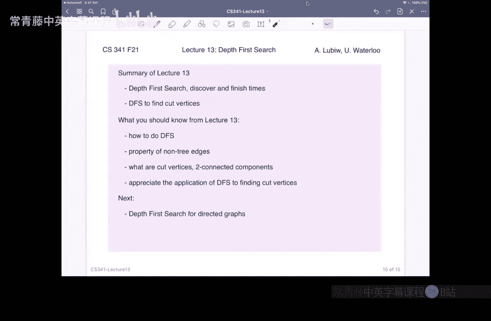

# 滑铁卢大学算法课程：第13讲：深度优先搜索


## 概述
在本节课中，我们将要学习一种重要的图遍历算法——深度优先搜索。我们将了解其工作原理、实现方式、关键性质，并探索其在寻找图的“割点”和“双连通分量”中的应用。

---

## 深度优先搜索简介

上一节我们介绍了广度优先搜索，它是一种“谨慎”的搜索，会先探索当前顶点的所有邻居，再进入下一层。本节中我们来看看另一种搜索策略——深度优先搜索。

深度优先搜索更像一种“大胆”的探索。它从起点出发，沿着一条路径尽可能深入地探索，直到无法继续前进，然后回溯到上一个顶点，尝试其他未探索的分支。

让我们通过一个例子来理解这个过程。

假设我们从顶点1开始深度优先搜索。
1.  查看顶点1的邻接表，首先发现顶点2。
2.  立即转向探索顶点2，而不是继续查看顶点1的其他邻居。
3.  查看顶点2的邻接表，发现顶点5。
4.  转向探索顶点5，查看其邻接表，发现顶点6。
5.  转向探索顶点6，发现其唯一邻居顶点5已被访问过。
6.  回溯到顶点5，继续查看其邻接表中的下一个顶点7。
7.  探索顶点7，发现其邻居均已访问。
8.  回溯到顶点5，再回溯到顶点2，继续查看其邻接表中的顶点4。
9.  以此类推，直到探索完所有可达顶点。

在搜索过程中，我们构建了一棵**深度优先搜索树**。首次发现顶点`u`是通过边`(v, u)`时，这条边就是树边。其他连接已访问顶点的边称为**非树边**，在图中常用虚线表示。

以下是深度优先搜索的一些关键特性：
*   **探索顺序**：深度优先搜索会尽可能深入，然后回溯。
*   **数据结构**：与广度优先搜索使用队列不同，深度优先搜索隐式或显式地使用**栈**来管理待探索的顶点。
*   **顶点状态**：每个顶点有“未发现”、“已发现”（正在探索中）和“已完成”（其所有邻居均已处理）三种状态。

---

## 深度优先搜索的伪代码实现

深度优先搜索通常以递归方式实现，递归调用栈隐式地充当了存储顶点的栈。

以下是递归形式的深度优先搜索例程，从特定顶点`v`开始探索：

```pseudocode
procedure DFS(v):
    mark v as discovered
    for each neighbor u in adjacency list of v:
        if u is undiscovered:
            set parent[u] = v        // (v, u) 是树边
            DFS(u)
        else if u is not the parent of v:
            mark edge (v, u) as a non-tree edge
    mark v as finished
```

为了遍历整个图（可能包含多个连通分量），我们需要一个顶层驱动例程：

```pseudocode
procedure DFS_Graph(G):
    for each vertex v in G:
        mark v as undiscovered
        set parent[v] = NIL
    for each vertex v in G:
        if v is undiscovered:
            DFS(v) // 以v为根开始一棵新的DFS树
```

**时间复杂度分析**：
该算法的时间复杂度为 **O(n + m)**，其中 `n` 是顶点数，`m` 是边数。这是因为每个顶点被访问一次，每条边在其两个端点的邻接表中各被检查一次。

---

## 深度优先搜索的性质

深度优先搜索不仅遍历图，还赋予了图丰富的结构信息。

**性质1：连通性**
从顶点 `v0` 开始进行深度优先搜索，能够到达所有从 `v0` 出发可达的顶点。这保证了我们可以通过多次调用 `DFS` 来找出图的所有连通分量。

**性质2：非树边连接祖先和后代**
这是深度优先搜索的一个核心性质。在深度优先搜索树中，任何一条**非树边**都连接着一个顶点和它的**祖先**或**后代**。不会出现连接两个没有直系祖先-后代关系的顶点的非树边。

*   **证明思路**：假设存在非树边 `(a, b)`，且 `a` 比 `b` 先被发现。在探索 `a` 时，我们会检查其所有邻居（包括 `b`），因此 `b` 必定在 `a` 完成之前被发现。这意味着 `b` 位于以 `a` 为根的子树中，因此 `a` 是 `b` 的祖先。

**性质3：发现时间与完成时间**
我们可以记录每个顶点被**发现**（第一次访问）和**完成**（其所有邻居处理完毕）的时刻。这两个时间具有括号化结构。

*   令 `d[v]` 和 `f[v]` 分别表示顶点 `v` 的发现时间和完成时间。
*   对于任意两个顶点 `u` 和 `v`，区间 `[d[v], f[v]]` 和 `[d[u], f[u]]` 要么完全分离（一个区间在另一个之外），要么一个区间完全包含另一个区间。它们**不会部分重叠**。
*   这反映了递归调用栈的行为：后进栈的顶点（后发现）会先完成并出栈。

---

## 应用：寻找割点与双连通分量

现在，我们来看深度优先搜索的一个重要应用：识别图的脆弱点。

### 割点的定义
在一个连通图中，如果移除顶点 `v` 及与其相连的所有边后，图变得不再连通，则称顶点 `v` 为一个**割点**（或关节点）。

割点意味着网络的单点故障风险。我们希望识别出它们。

### 利用深度优先搜索树识别割点
深度优先搜索树的结构为我们提供了判断割点的有效方法。

**情况1：根顶点**
深度优先搜索树的**根顶点**是割点，**当且仅当**它在树中有**多于一个子节点**。
*   **原因**：由于非树边只连接祖先和后代，根节点的不同子树之间没有边相连。移除根节点就断开了这些子树间的联系。

**情况2：非根顶点**
对于一个**非根顶点** `v`，它是割点，**当且仅当** `v` 存在某个子节点 `u`，使得以 `u` 为根的子树中，**没有任何顶点**能通过一条非树边连接到 `v` 的**祖先**。
*   **直观理解**：如果子树 `u` 能“绕开” `v` 连接到更上层，那么移除 `v` 就不会断开这部分图。否则，移除 `v` 就会使子树 `u` 孤立。

### 高效算法：Low 值计算
为了高效地判断上述条件，我们为每个顶点 `v` 定义一个 **`low[v]`** 值。
*   `low[v]` 表示从顶点 `v` 出发，通过其**后代顶点**，最多能利用**一条非树边**“回溯”到的最高祖先（即发现时间 `d[.]` 最小）的发现时间。
*   **计算方式（递归定义）**：
    *   `low[v]` 初始化为 `d[v]`（自身）。
    *   `low[v]` 可以更新为所有邻接顶点 `w` 的 `d[w]` 的最小值。
    *   `low[v]` 还可以更新为其所有子节点 `u` 的 `low[u]` 的最小值。

利用 `low` 值，割点判断准则可以简化为：
*   **根顶点**：子节点数 > 1。
*   **非根顶点 `v`**：存在一个子节点 `u`，满足 `low[u] >= d[v]`。
    *   条件 `low[u] >= d[v]` 意味着以 `u` 为根的子树中，没有顶点能通过非树边连接到 `v` 的祖先（最多连到 `v` 本身），因此 `v` 是割点。

### 双连通分量
与割点紧密相关的是**双连通分量**。一个双连通分量是极大的、不包含割点的连通子图。寻找所有双连通分量（即“2-连通分量”）的算法也基于深度优先搜索和 `low` 值的计算，由 Hopcroft 和 Tarjan 在 1973 年提出，同样能在 **O(n + m)** 时间内完成。

---

## 总结
本节课中我们一起学习了：
1.  **深度优先搜索**：一种基于栈/递归的图遍历算法，其特点是尽可能深入探索。
2.  **关键性质**：非树边总是连接深度优先搜索树中的祖先和后代顶点；顶点的发现与完成时间具有括号化结构。
3.  **重要应用**：利用深度优先搜索可以在线性时间内找出图的**割点**，并进一步找出**双连通分量**，这对于分析网络的可靠性至关重要。



在下一讲中，我们将探讨深度优先搜索在**有向图**中的应用。