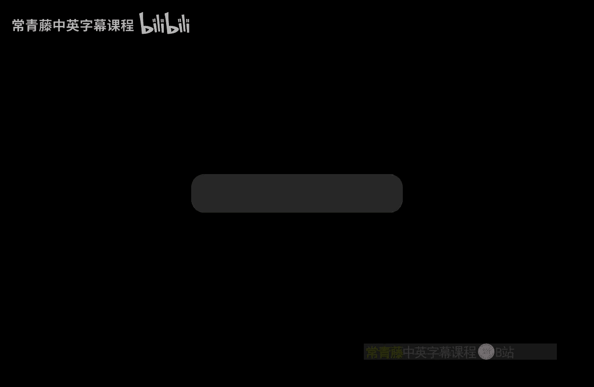

# 滑铁卢大学算法课程：CS341 Fall 2021：第14讲 - 有向图的深度优先搜索



在本节课中，我们将学习如何将有向图上的深度优先搜索算法，探索其与无向图版本的区别，并了解其在检测环、拓扑排序和寻找强连通分量等三个重要问题上的应用。

## 有向图的深度优先搜索

上一节我们介绍了无向图的深度优先搜索。本节中，我们来看看在有向图中，深度优先搜索是如何工作的。

在有向图中，所有边都带有方向箭头。这意味着从顶点 `V` 到其邻居 `U` 的探索，只考虑从 `V` 出发指向 `U` 的边。

以下是深度优先搜索在有向图中的伪代码核心部分，新增的逻辑（用于区分边类型）用蓝色标出：

```pseudocode
DFS(G):
    for each vertex v in G:
        v.discovered = False
        v.finished = False
    time = 1
    for each vertex v in G (in some order):
        if not v.discovered:
            DFS-Visit(v)

DFS-Visit(v):
    v.discovered = True
    v.d = time; time += 1
    for each neighbor u in v.adjacencyList: // 只考虑从v出发的边
        if not u.discovered:
            // 树边
            DFS-Visit(u)
        else if not u.finished:
            // 后向边
            label edge (v, u) as BACK_EDGE
        else if u.d > v.d:
            // 前向边
            label edge (v, u) as FORWARD_EDGE
        else:
            // 横跨边
            label edge (v, u) as CROSS_EDGE
    v.finished = True
    v.f = time; time += 1
```

算法的时间复杂度仍然是 **O(n + m)**，其中 `n` 是顶点数，`m` 是边数。

## 边的分类

在无向图的深度优先搜索树中，非树边只有一种（后向边）。但在有向图中，非树边可以分为三类。以下是区分这四类边的方法：

假设我们正在检查从顶点 `v` 到顶点 `u` 的边 `(v, u)`。

*   **树边**：如果 `u` 尚未被发现（`not u.discovered`），则 `(v, u)` 是树边。
*   **后向边**：如果 `u` 已被发现但尚未完成处理（`u.discovered and not u.finished`），则 `(v, u)` 是后向边。它指向搜索树中的一个祖先。
*   **前向边**：如果 `u` 已完成处理（`u.finished`），并且 `u` 的发现时间晚于 `v` 的发现时间（`u.d > v.d`），则 `(v, u)` 是前向边。它指向搜索树中的一个后代。
*   **横跨边**：如果 `u` 已完成处理（`u.finished`），并且 `u` 的发现时间早于 `v` 的发现时间（`u.d < v.d`），则 `(v, u)` 是横跨边。它连接的是搜索树中无直系祖先-后代关系的两个分支，甚至可能连接两棵不同的搜索树。

## 应用一：检测有向环 🌀

深度优先搜索的第一个应用是检测有向图中是否存在有向环。

**关键定理**：一个有向图包含有向环，**当且仅当**在其深度优先搜索森林中存在**后向边**。

**证明思路**：
*   **充分性（如果存在后向边，则存在环）**：如果存在一条后向边 `(v, u)`，那么在深度优先搜索树中，从 `u` 到 `v` 存在一条由树边构成的路径。将这条路径与后向边 `(v, u)` 连接起来，就形成了一个有向环。
*   **必要性（如果存在环，则必存在后向边）**：假设图中存在一个有向环 `v1 -> v2 -> ... -> vk -> v1`。设 `v1` 是该环中第一个被发现的顶点。根据深度优先搜索的性质，在完成 `v1` 之前，算法会递归地发现并处理 `v2, v3, ..., vk`。当处理到 `vk` 并检查边 `(vk, v1)` 时，会发现 `v1` 已被发现但尚未完成（因为 `v1` 是 `vk` 的祖先）。根据分类规则，这条边 `(vk, v1)` 将被标记为**后向边**。

因此，检测环的算法就是运行深度优先搜索，并检查是否产生了任何后向边。

## 应用二：拓扑排序 📋

对于一个**无环有向图**，我们可以对其顶点进行拓扑排序。拓扑排序是一个顶点序列，使得对于图中的每一条有向边 `(u, v)`，`u` 在序列中都出现在 `v` 之前。

**算法**：对图运行一次深度优先搜索，然后按顶点**完成时间**的**逆序**输出顶点，得到的就是一个拓扑排序。

**证明思路**：
我们需要证明对于任意边 `(v, u)`，在逆序完成序列中，`v` 都出现在 `u` 之后（即在原序列中 `v` 在 `u` 之前）。考虑边 `(v, u)` 的类型：
1.  **树边或前向边**：`u` 是 `v` 的后代，因此 `u` 会比 `v` 先完成。在逆序中，`v` 自然在 `u` 之后。
2.  **横跨边**：当检查边 `(v, u)` 时，`u` 已经完成。根据横跨边的定义，`u` 的发现时间早于 `v` 的发现时间。由于无环图中不存在后向边，`u` 不可能是 `v` 的祖先，因此 `u` 的完成时间也一定早于 `v` 的完成时间。在逆序中，`v` 仍在 `u` 之后。
3.  **后向边**：在无环有向图中，不存在后向边。

因此，所有边都满足要求，逆序完成序列即为一个有效的拓扑排序。

## 应用三：强连通分量 🔗

在有向图中，如果从任意顶点 `u` 到任意顶点 `v` 都存在一条有向路径，并且从 `v` 到 `u` 也存在一条有向路径，则称该图是强连通的。一个有向图的**强连通分量**是其极大的强连通子图。

### 测试图的强连通性
要测试图 `G` 是否强连通，可以：
1.  从任意顶点 `s` 出发，运行深度优先搜索，检查是否能到达所有其他顶点。
2.  将图 `G` 的所有边反向，得到图 `G_rev`。
3.  在 `G_rev` 中从同一个顶点 `s` 出发，再次运行深度优先搜索，检查是否能到达所有顶点。
如果两步都成功，则原图 `G` 是强连通的。这是因为第二步等价于在原图中检查从所有顶点到 `s` 是否存在路径。

### 寻找所有强连通分量（Kosaraju 算法概要）
以下是寻找所有强连通分量的 Kosaraju 算法框架：
1.  在图 `G` 上运行深度优先搜索，记录每个顶点的完成时间。
2.  计算图 `G` 的转置图 `G^T`（即所有边反向）。
3.  在 `G^T` 上运行深度优先搜索，但**在主循环中，按照第一步得到的完成时间的降序（即最晚完成的顶点最先）来选取起始顶点**。
4.  在第二步的深度优先搜索中，每棵生成的深度优先搜索树，就对应原图 `G` 中的一个强连通分量。

**算法思想**：
强连通分量有一个重要性质：如果将每个强连通分量收缩为一个“超顶点”，那么形成的图是一个有向无环图。算法第一步的搜索揭示了这种分量间的依赖顺序。第二步在反向图上按照完成时间降序搜索，可以确保每次搜索都局限在一个强连通分量内部，而不会“逃逸”到其他分量，从而正确地找出所有分量。

## 总结

本节课中我们一起学习了有向图的深度优先搜索。主要内容包括：
1.  **算法细节**：理解了有向图深度优先搜索的伪代码实现，以及其与无向图版本的区别。
2.  **边的分类**：掌握了有向图中树边、后向边、前向边和横跨边的定义与区分方法。
3.  **三大应用**：
    *   利用**后向边**的存在性来**检测有向环**。
    *   对无环有向图，利用完成时间的逆序进行**拓扑排序**。
    *   使用 Kosaraju 算法（两次深度优先搜索）来寻找有向图的**强连通分量**。


这些应用展示了深度优先搜索作为基础图遍历算法的强大威力。接下来，我们将进入新的图算法主题，例如最小生成树和最短路径算法。