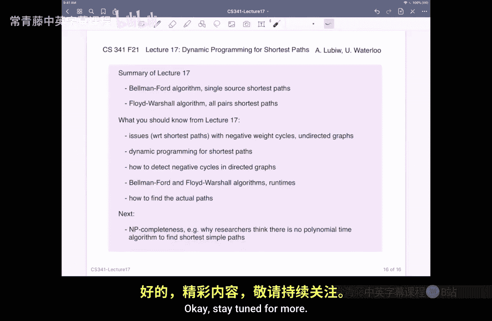

# 滑铁卢大学算法课程：CS341 Fall 2021：第17讲 - 最短路径算法（下）


在本节课中，我们将继续学习最短路径算法。上一节我们介绍了Dijkstra算法，本节中我们将探讨另外两个著名且高效的算法：Bellman-Ford算法和Floyd-Warshall算法。我们将了解它们如何工作、适用场景以及如何实现。

## 图与最短路径回顾

我们有一个带权图，路径的长度是其所有边权重的总和。目标是找到两点之间总权重最小的路径。

以下是图的两种常见存储方式，特别是当边带有权重时：

*   **邻接矩阵**：使用一个 `n x n` 矩阵，其中 `matrix[u][v]` 存储边 `(u, v)` 的权重。若无边，则用特殊值（如 `∞` 或 `null`）表示。空间复杂度为 `O(n²)`。
*   **邻接表**：为每个顶点维护一个链表，但链表节点不再仅存储相邻顶点，而是存储**关联边**的编号。同时，我们维护一个边列表，记录每条边的权重和两个端点。这样，空间复杂度为 `O(n + m)`，其中 `n` 是顶点数，`m` 是边数。

## 最短路径问题分类

最短路径问题主要有三种形式：

1.  **单源单目标**：给定起点 `s` 和终点 `t`，求 `s` 到 `t` 的最短路径。
2.  **单源多目标（单源最短路径）**：给定起点 `s`，求 `s` 到图中**所有其他顶点** `v` 的最短路径。Dijkstra算法解决的就是此类问题。
3.  **所有点对最短路径**：求图中**每一对**顶点 `(u, v)` 之间的最短路径。

通常，解决第1类问题会转化为解决第2类问题。

## 负权边与负权环

Dijkstra算法要求边权**非负**。如果图中存在负权边，甚至**负权环**（环上各边权重之和为负），问题会变得复杂。

考虑一个包含负权环的图。理论上，可以无限次绕行该环，使得路径总权重趋于负无穷。为了避免这种无意义的情况，一个自然的想法是寻找**最短简单路径**（不重复经过顶点的路径）。然而，寻找最短简单路径是一个**NP难问题**，目前没有已知的多项式时间算法。

因此，在本节讨论的算法中，我们做出以下假设来避免负无穷的情况：
*   允许负权边。
*   但图中**不能存在从起点可达的负权环**（对于单源问题）或**任何负权环**（对于所有点对问题）。

## 有向图与无向图

本节算法主要针对**有向图**。对于无向图，通常可以将其每条无向边 `(A, B)` 替换为两条方向相反的有向边 `A->B` 和 `B->A`。

但是，如果原无向边的权重为**负**，那么替换后形成的两条有向边会立即构成一个权重为 `2 * w`（`w`为负）的负权环（`A->B->A`）。这会破坏算法的前提假设。因此，**若图中存在负权边，本节算法不直接适用于无向图**。若无负权边，则可以安全地进行转换。

## 算法一：有向无环图（DAG）中的单源最短路径

对于一种特殊情况——**有向无环图**，存在一个非常高效的线性时间算法。

**核心思想**：利用DAG的**拓扑排序**性质。我们可以对顶点进行编号 `1...n`，使得所有有向边 `(i, j)` 都满足 `i < j`。如果源点 `s` 不是编号1，我们可以忽略所有在 `s` 之前的顶点（因为从 `s` 无法到达它们），并重新调整编号使 `s` 成为顶点1。

**算法步骤**：
1.  对图进行拓扑排序，并调整使源点 `s` 对应顶点1。
2.  初始化距离数组 `d[]`，`d[1] = 0`，其他为 `∞`。
3.  按照顶点编号 `i` 从 `1` 到 `n` 的顺序遍历：
    *   对于顶点 `i` 的每一条出边 `(i, j)`：
        *   尝试松弛：`d[j] = min(d[j], d[i] + weight(i, j))`

**正确性**：由于顶点按拓扑序处理，当处理到顶点 `i` 时，所有可能到达 `i` 的路径都已被考虑，因此 `d[i]` 已是最终最短距离。接着用 `i` 去更新其后继顶点。

**时间复杂度**：`O(n + m)`。每个顶点和每条边都被处理一次。

## 动态规划与最短路径

接下来介绍的两个算法都基于**动态规划**思想。最短路径问题具有最优子结构性质：如果最短路径 `p` 经过中间点 `x`，那么 `p` 中从起点到 `x` 的部分以及从 `x` 到终点的部分，也分别是这两点间的最短路径。

基于如何定义“更小的子问题”，有两种动态规划思路：

1.  **限制路径的边数**：子问题是“使用不超过 `k` 条边的最短路径”。这引出了 **Bellman-Ford算法**（用于单源问题）。
2.  **限制可用的中间顶点**：子问题是“只能使用前 `k` 个顶点作为中间点的最短路径”。这引出了 **Floyd-Warshall算法**（用于所有点对问题）。

## 算法二：Bellman-Ford算法（单源最短路径）

Bellman-Ford算法用于在**可能含有负权边，但不含负权环**的有向图中，求解单源最短路径问题。

**动态规划定义**：
令 `dp[k][v]` 表示从源点 `s` 到顶点 `v`，**最多经过 `k` 条边**的最短路径长度。

**状态转移方程**：
*   `dp[0][s] = 0`
*   `dp[0][v] = ∞` （对于 `v != s`）
*   `dp[k][v] = min( dp[k-1][v], min_{(u, v)∈E} { dp[k-1][u] + weight(u, v) } )`
    *   第一部分：不使用第 `k` 条边，即最多用 `k-1` 条边。
    *   第二部分：使用第 `k` 条边，且该边是 `(u, v)`。那么路径由“最多 `k-1` 条边到 `u`”加上边 `(u, v)` 构成。

**为什么 `k` 最大到 `n-1`？**：在 `n` 个顶点的图中，任何不含环的简单路径最多包含 `n-1` 条边。如果一条路径有 `≥ n` 条边，则它必然包含环。如果是负权环，总权重可以无限降低，但我们假设不存在负权环；如果是非负环，移除它不会使路径变差。因此，考虑最多 `n-1` 条边足以找到最短路径。

**算法实现（空间优化版）**：
我们可以将二维 `dp` 数组优化为一维数组 `dist[]`，并直接迭代 `n-1` 轮。

```
初始化 dist[s] = 0，其他 dist[v] = ∞
for i = 1 to n-1:
    for each edge (u, v) in graph:
        if dist[u] + weight(u, v) < dist[v]:
            dist[v] = dist[u] + weight(u, v)
```

**如何记录路径？**：类似Dijkstra算法，维护一个 `parent[]` 数组。当 `dist[v]` 通过边 `(u, v)` 被更新时，设置 `parent[v] = u`。最终从终点 `v` 逆向回溯 `parent` 数组即可得到路径。

**检测负权环**：再执行第 `n` 轮松弛操作。如果任何 `dist[v]` 值还能被更新，则说明图中存在从源点 `s` 可达的负权环。

**时间复杂度**：`O(n * m)`。需要进行 `n-1` 轮松弛，每轮遍历所有 `m` 条边。

## 算法三：Floyd-Warshall算法（所有点对最短路径）

Floyd-Warshall算法用于在**可能含有负权边，但不含负权环**的有向图中，求解所有点对之间的最短路径。

**动态规划定义**：
令 `dp[k][i][j]` 表示从顶点 `i` 到顶点 `j`，且**中间顶点（不包括起点和终点）仅限于集合 `{1, 2, ..., k}`** 的最短路径长度。

**状态转移方程**：
*   **初始化** (`k=0`)：
    *   `dp[0][i][i] = 0`
    *   `dp[0][i][j] = weight(i, j)`，如果边 `(i, j)` 存在。
    *   `dp[0][i][j] = ∞`，如果边 `(i, j)` 不存在且 `i != j`。
*   **状态转移** (`k >= 1`)：
    *   `dp[k][i][j] = min( dp[k-1][i][j], dp[k-1][i][k] + dp[k-1][k][j] )`
        *   第一部分：不经过顶点 `k`。
        *   第二部分：经过顶点 `k`。路径分解为 `i -> ... -> k` 和 `k -> ... -> j`，且这两部分都只使用前 `k-1` 个顶点作为中间点。

**算法实现（空间优化版）**：
使用一个二维数组 `dist[][]` 即可。

```
初始化 dist[i][j]：
    if i == j: dist[i][j] = 0
    else if edge(i, j) exists: dist[i][j] = weight(i, j)
    else: dist[i][j] = ∞

for k = 1 to n:
    for i = 1 to n:
        for j = 1 to n:
            if dist[i][k] + dist[k][j] < dist[i][j]:
                dist[i][j] = dist[i][k] + dist[k][j]
```

**如何记录路径？**：维护一个 `next[][]` 矩阵，`next[i][j]` 表示从 `i` 到 `j` 的最短路径上 `i` 之后的下一个顶点。
*   初始化：如果边 `(i, j)` 存在，`next[i][j] = j`；否则为 `null`。
*   更新：当发现经过 `k` 的路径更短时，`next[i][j] = next[i][k]`。
*   重构路径：从 `i` 开始，不断查询 `next[i][j]` 即可。

**时间复杂度**：`O(n³)`。三层嵌套循环。
**空间复杂度**：`O(n²)`，用于存储 `dist` 和 `next` 矩阵。

## 总结

本节课我们一起学习了最短路径领域的两个核心算法：

*   **Bellman-Ford算法**：解决单源最短路径问题，能处理负权边并检测负权环，时间复杂度为 `O(n*m)`。
*   **Floyd-Warshall算法**：解决所有点对最短路径问题，代码简洁，时间复杂度为 `O(n³)`。

你需要理解：
1.  负权环带来的挑战以及算法的前提假设。
2.  两种动态规划思路（限制边数 vs 限制顶点）如何应用于不同问题。
3.  算法的工作原理、时间/空间复杂度。
4.  如何实现算法并重构出具体的最短路径。
5.  如何利用Bellman-Ford算法检测负权环。



最短路径是图算法中的基石，掌握这些经典算法至关重要。接下来，课程将转向计算复杂性理论，探讨为何像“最短简单路径”这类问题没有已知的高效算法，即NP完全性问题。