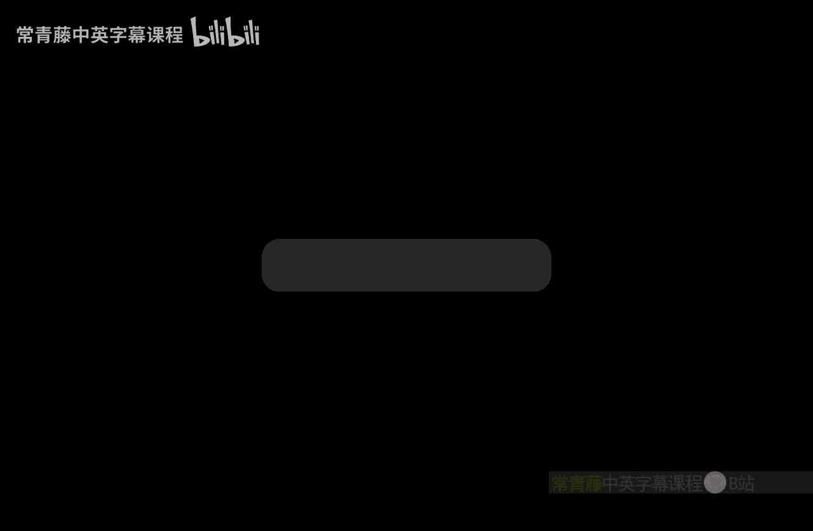
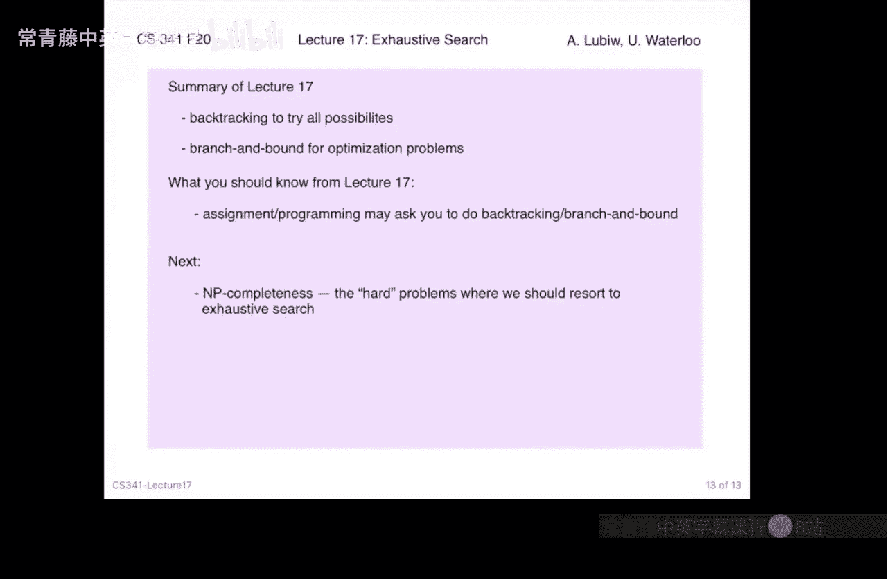

# 019：穷举搜索



在本节课中，我们将要学习两种用于解决“困难”问题的算法设计范式：回溯法与分支限界法。这些方法适用于那些目前没有已知多项式时间高效算法的问题。我们将通过具体的决策问题（如子集和问题）和优化问题（如旅行商问题）来理解这两种方法的工作原理。

## 概述

到目前为止，我们已经学习了许多算法设计范式，如归约、分治法、贪心算法、动态规划，以及图算法。这些算法通常被认为是高效的，其运行时间随输入规模呈多项式增长。

然而，许多实际问题没有已知的高效算法。例如，0-1背包问题、旅行商问题以及存在负权边但不允许重复边的图最短路径问题。

面对这些难题，我们有几种选择：
1.  使用**启发式算法**：运行速度快，但不保证运行时间或解的质量。
2.  使用**近似算法**：通常有最坏情况运行时间分析，并能保证解的质量。
3.  寻找**精确解**：即使需要指数时间，也尝试找到最优解。

即使你倾向于使用启发式算法，为了评估其性能，也需要在小规模实例上将其解与精确解进行比较。因此，学习如何寻找精确解是有价值的。

本节课我们将学习两种寻找精确解的系统性方法：**回溯法**用于决策问题，**分支限界法**用于优化问题。它们本质上都是在部分解的隐式图中进行搜索。

## 回溯法

回溯法用于解决决策问题，即判断是否存在满足特定条件的解。我们将以**子集和问题**为例进行说明。

### 子集和问题

在子集和问题中，给定 `n` 个元素，每个元素有一个正权重 `w_i`，以及一个目标总重量 `W`。问题是：是否存在一个元素子集 `S`，使得 `S` 中元素的权重之和恰好等于 `W`？

**公式**：是否存在 `S ⊆ {1, 2, ..., n}`，使得 `∑_{i∈S} w_i = W`？

例如，有5个元素，权重分别为 `{2, 2, 3, 5, 7}`，目标 `W=13`。通过分析，可以得出不存在这样的子集。

子集和问题是NP完全问题，目前没有已知的多项式时间算法。穷举所有子集需要检查 `2^n` 种可能性。

### 回溯法的基本思想

回溯法通过构建一棵搜索树来系统地探索所有可能的子集。树的根节点代表空集 `S = {}`，剩余集合 `R` 包含所有元素。每个节点代表一个部分解（当前的 `S`）和剩余可选择的元素（`R`）。

从根节点开始，我们依次对每个元素做出选择：将其加入 `S` 或不加入。这会产生两个子节点。如此递归进行，直到处理完所有元素，每个叶节点就对应一个完整的子集。

**代码**：搜索树的大小为 `O(2^n)`。

### 通用回溯算法

以下是回溯法的通用伪代码框架：

```python
A = {根配置} # 活跃配置集合
while A 非空:
    从 A 中移除一个配置 C
    if C 是一个解:
        输出 C 并停止
    elif C 是一个死胡同:
        丢弃 C
    else:
        通过做出更多选择，将 C 扩展为若干子配置 C1, C2, ...
        将所有子配置加入集合 A
```

算法的具体行为取决于三个问题相关的部分：
1.  如何判断一个配置是解？
2.  `如何判断一个配置是死胡同（无法扩展为有效解）？`
3.  如何将一个配置扩展为子配置？

集合 `A` 的存储方式影响搜索策略：
*   **栈（深度优先搜索）**：空间复杂度与树高相关（`O(n)`）。
*   **队列（广度优先搜索）**：空间复杂度与树宽相关（`O(2^n)`）。
*   **优先队列（最佳优先搜索）**：根据某种启发式优先级选择下一个要探索的配置。

对于子集和问题，通常使用栈以实现较低的空间占用。

### 应用于子集和问题

现在，我们将通用框架应用于子集和问题。一个配置 `C` 包含当前集合 `S`、剩余集合 `R`、`S` 的总重量 `w` 以及 `R` 的总重量 `r`。

探索配置 `C` 的步骤如下：
1.  如果 `w == W`，则 `S` 就是一个解，算法成功。
2.  如果 `w > W`（假设权重为正），则当前路径已超重，是死胡同。
3.  如果 `w + r < W`，即使将 `R` 中所有元素加入 `S`，总重量也无法达到 `W`，也是死胡同。
4.  否则，选择 `R` 中的一个元素，创建两个子配置：一个将其加入 `S`，另一个不加入。

该算法的运行时间为 `O(2^n)`，因为最多探索 `O(2^n)` 个配置，每个配置的处理是常数时间。

子集和问题也有一个动态规划算法，运行时间为 `O(nW)`。当目标重量 `W` 较小时，动态规划更优；当 `W` 非常大时，回溯法（尤其是其空间效率）可能更合适。

### 探索所有排列

回溯法也可用于需要探索所有排列的问题，例如**哈密顿回路问题**：在给定图中，是否存在一个经过每个顶点恰好一次的环？

一个配置可以是一个部分顶点排列 `P` 和剩余顶点集合 `R`。根节点是空排列。扩展一个节点时，从 `R` 中选择一个顶点作为排列的下一个元素。对于哈密顿回路问题，在扩展过程中，如果发现当前部分排列中最后两个顶点之间没有边，或者某个顶点的度数超过2，则可以提前判定为死胡同。

探索所有排列的搜索树有 `n!` 个叶节点。

---

上一节我们介绍了用于决策问题的回溯法，本节中我们来看看用于优化问题的分支限界法。

## 分支限界法

分支限界法用于寻找优化问题的最优解（如最小化或最大化某个目标函数）。我们将以**旅行商问题**作为运行示例。

### 优化问题 vs. 决策问题

首先，明确优化问题与决策问题的区别：
*   **决策问题**：询问是否存在满足条件的解（例如，子集和、哈密顿回路）。
*   **优化问题**：在众多可行解中寻找最优解（例如，0-1背包、旅行商问题）。

旅行商问题是哈密顿回路问题的优化版本：给定一个带权无向完全图（边权非负），寻找一个访问每个顶点恰好一次并回到起点的环，使得环上所有边的权重之和最小。

旅行商问题具有重要的理论和实际意义，是NP难问题。

### 分支限界法基本思想

与回溯法类似，分支限界法也系统性地搜索解空间树。关键区别在于“限界”步骤：
1.  **维护当前最优解**：记录迄今为止找到的最佳目标函数值（例如，最小权重）。
2.  **计算下界**：对于每个部分解（配置），快速计算其可能扩展出的**任何**完整解的目标函数值的**下界**。
3.  **剪枝**：如果某个配置的下界已经**不优于**当前最优解，那么继续探索这个分支不可能找到更好的解，因此可以安全地丢弃（剪枝）该配置。

这使我们能够避免探索大量无望的分支。

### 通用分支限界算法

以下是分支限界法的通用伪代码框架（以最小化问题为例）：

```python
A = {根配置} # 活跃配置集合，通常用优先队列存储
best_cost = ∞
while A 非空:
    从 A 中移除**最有可能**的配置 C # 通常取下界最小的
    将 C 扩展为若干子配置 children
    for each 子配置 C_i in children:
        if C_i 是一个完整解:
            cost = 计算 C_i 的目标函数值
            if cost < best_cost:
                best_cost = cost # 更新最优值
                # 注意：仍需继续搜索，可能还有更优解
        elif C_i 是死胡同:
            丢弃 C_i
        else: # C_i 是部分解
            lower_bound = 计算 C_i 的下界
            if lower_bound < best_cost:
                将 C_i 加入 A # 有潜力找到更优解
            # 否则，下界 >= best_cost，剪枝
```

### 应用于旅行商问题

对于旅行商问题，我们采用一种基于**边**的搜索策略，而不是基于顶点排列。一个配置 `C` 由两个边集合定义：
*   `IN`：必须包含在最终回路中的边。
*   `OUT`：必须排除在最终回路外的边。

**分支**：选择一个尚未决定的边 `e`，生成两个子配置：一个将 `e` 加入 `IN`，另一个将 `e` 加入 `OUT`。

**识别死胡同（剪枝条件）**：如果一个配置满足以下任一条件，则无法扩展为有效哈密顿回路：
1.  从图中移除 `OUT` 中的边后，图不再连通。
2.  `IN` 中任意顶点的关联边数超过2（因为回路中每个顶点度数为2）。
3.  `IN` 中的边形成了小于 `n` 个顶点的环（即非全环）。

**计算下界**：这是算法的核心。我们需要为配置 `(IN, OUT)` 计算一个旅行商回路权重的下界，且计算要快。我们通过解决一个**松弛的**、更容易的问题来实现：寻找**最小权重1-树**。

*   **1-树定义**：一个1-树由两部分组成：
    1.  在顶点 `{2, 3, ..., n}` 上的一棵生成树。
    2.  连接顶点 `1` 与这棵生成树的两条最小权重边。
*   **关键性质**：**任何**哈密顿回路都是一个1-树（将回路中与顶点1相连的两条边去掉，剩下的路径就是其他顶点上的一棵树）。因此，最小权重1-树的权重 ≤ 最小权重旅行商回路的权重。
*   **计算方法（针对配置 `(IN, OUT)`）**：
    1.  暂时移除 `OUT` 中的所有边。
    2.  将 `IN` 中边的权重临时设为0（以确保它们被最小生成树算法优先选择）。
    3.  在修改后的图中，使用Kruskal或Prim算法，找出顶点 `{2, ..., n}` 上的最小生成树。
    4.  找到连接顶点 `1` 到该生成树的两条最小权重边（使用原始权重）。
    5.  计算这个1-树中所有边的**原始权重**之和。这个值就是当前配置的一个下界。

**选择下一个配置**：通常从优先队列 `A` 中选择**下界最小**的配置进行扩展，因为它最有可能导向最优解。

**分支边的选择**：也可以采用启发式策略，例如选择能最大程度提高下界的边进行分支，以加速剪枝。

结合这些技巧，分支限界法可以构成一个解决中小规模旅行商问题的竞争性精确算法。

---

## 总结

本节课我们一起学习了两种用于解决难解问题的穷举搜索技术：
1.  **回溯法**：适用于决策问题。通过深度优先搜索解空间树，并利用约束条件提前剪枝无效分支。我们以子集和问题为例，展示了其工作原理。
2.  **分支限界法**：适用于优化问题。在回溯的基础上，通过为部分解计算目标函数的下界，并与当前最优解比较，来剪掉不可能产生更优解的分支。我们以旅行商问题为例，详细说明了如何定义配置、进行分支、识别死胡同以及计算关键的下界（通过最小权重1-树）。



这两种方法是处理NP难问题时寻求精确解的重要工具。理解它们有助于你在面对新问题时，判断是应继续寻找高效算法，还是需要诉诸于穷举搜索或启发式方法。接下来的课程中，我们将深入探讨NP完全性理论，这将为我们理解问题的计算难度提供理论基础。