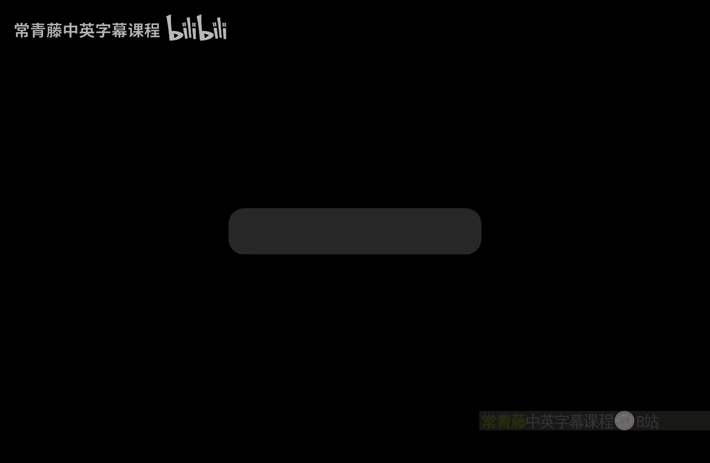
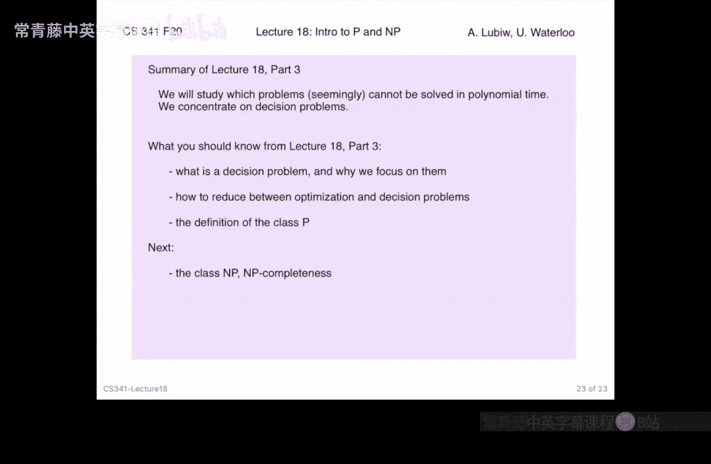

# 算法课程：CS341：NP完全性入门

在本节课中，我们将开始学习NP完全性这一主题。我们将探讨多项式时间算法的概念，理解为什么某些问题看似无法在多项式时间内解决，并学习如何通过“归约”来证明不同问题的计算难度是等价的。

## 多项式时间与下界

上一节课程中，我们重点学习了算法设计与分析。在本节中，我们来看看算法的“下界”问题，即判断一个算法是否为解决某个问题的最佳算法。

假设我们为某个问题设计了一个算法A，其最坏情况运行时间是输入规模N的函数T(N)。一个重要的问题是：这个算法是否是最好的？我们是否需要回到设计阶段寻找更好的算法？

例如，在上一讲中，我们看到了用于解决最大独立集或子集和问题的分支限界法，其运行时间表现为 **Θ(2^N)**。这意味着运行时间是 **O(2^N)**，并且存在无限多的问题实例，其运行时间确实如此。这是一个指数时间算法。那么，对于最大独立集或子集和问题，这真的是我们能做到的最好结果吗？

为了证明什么是最佳可能，我们需要证明任何其他解决最大独立集的算法，其最坏情况运行时间至少也这么糟糕。然而，证明这样的下界非常困难。对于子集和与最大独立集问题，目前还没有人能够证明这样的下界，但也没有人找到更快的算法。这就是本节课程要探讨的内容。

目前，计算机科学中下界研究的现状并不乐观。已知有些问题根本没有算法（艾伦·图灵在20世纪30年代已证明），有些问题只能在指数时间内解决，但这不包括前面提到的问题。还有一些精细的下界，例如证明排序至少需要 **N log N** 次比较，但这仅限于特定的计算模型（只计算输入数字的比较次数）。在通用计算模型中，这个下界并不成立。

因此，本节课程探索的主要开放性问题与下界有关。存在许多已知问题，如旅行商问题、0/1背包问题，目前无人知晓其多项式时间算法，但也无人能证明不存在多项式时间算法。

目前，人们能做到的最好结果是证明一大类问题在某种意义上是“等价”的：如果我们能在多项式时间内解决其中一个问题，那么我们就能在多项式时间内解决所有这些问题；反之，如果我们能证明其中一个问题不能在多项式时间内解决，那就意味着所有这些问题都不能。

在本节课程中，我们的焦点是多项式时间以及具有多项式时间算法的问题类别，这个类别被称为 **P类**。我们证明这类等价性的主要工具是“归约”。你们之前已经见过归约的概念。这类等价问题的名称就是 **NP完全问题**。我们将从花时间理解多项式时间和归约开始。

本节课程的目标是：
*   熟悉NP完全性的概念，这是计算机科学学位毕业生必须了解的。
*   能够识别一些NP完全问题，这可以防止你在未意识到自己在处理一个非常困难的开放性问题时，徒劳地尝试为NP完全问题寻找高效算法。
*   在本节课程结束后，能够自己完成一些NP完全性证明，从而理解其中涉及的要点，并掌握工具来证明你试图解决的问题属于这些难解的NP完全问题。

## 多项式时间的定义

首先，定义多项式时间：一个算法的运行时间是多项式时间，如果其运行时间（我们总是讨论渐近的、大O符号表示的最坏情况）是 **O(N^K)**，其中N是输入规模，K是某个常数。

以下是几个例子：
*   **O(N^2)** 是多项式时间吗？是的，常数K是2。
*   **O(N^5)** 是多项式时间吗？是的。
*   **O(N log N)** 是多项式时间吗？是的，因为 **O(N log N)** 受 **O(N^2)** 限制。
*   **O(2^N)** 是多项式时间吗？不，那是指数时间。
*   **O(N!)** 是指数时间，它不受多项式限制。
*   **O(N^1000000)** 是多项式时间吗？K的值非常大，但它是一个常数，所以算作多项式时间。
*   **O(N^(2^(2^(2))))** 是多项式时间吗？即使我添加更多的2，指数部分仍然是一个常数，所以是多项式时间。

到目前为止，我们在本课程中学习的大多数算法都是多项式时间的。例外情况包括上一讲中看到的回溯法和分支限界算法，以及0/1背包问题的伪多项式时间算法（其运行时间类似于 **N * W**，其中W是实际数值而非其编码规模，因此不符合多项式时间定义）。

## 多项式时间的历史与评价

关于多项式时间定义的历史：它比图灵关于哪些问题有算法的结果要晚。非正式地，我们可以将多项式时间视为“好”或“高效”的算法。这个概念最早由Jack Edmonds引入，他直到退休前都是组合优化系的教授。在他1963年的论文中，他给出了在图中寻找最大匹配的多项式时间算法。

Jack Edmonds在那篇论文中写道，他将给出一个最大匹配的“好”算法。他说：“我声称存在一个好算法作为一个数学结果。有一个明显的有限算法（指尝试所有可能的匹配，数量是指数级的），但该算法的难度随图的大小呈指数增长。是否存在一个难度仅随图的大小代数（多项式）增长的算法，这一点完全不清楚。”

因此，Jack Edmonds是最早探索这一概念的人之一。这张幻灯片展示了Jack Edmonds在撰写那篇论文时的大致样貌。

在这张幻灯片中，我想挑战“多项式时间总是好的吗？”这个问题。如果一个算法的运行时间是 **N^100**，那真的高效吗？并不真的高效。但一个有趣的事实是，已知的具有此类运行时间的算法非常少。另一方面，对于非常大的N，**N^100** 仍然比类似 **2^N** 要好。

另一个需要注意的例外是，有些有用的或“好”的算法在最坏情况下实际上并不是多项式时间。最著名的例子可能是线性规划的单纯形算法。虽然存在更复杂的线性规划多项式时间算法，但单纯形算法仍然具有竞争力，因为它在大多数输入上表现良好。然而，单纯形算法的缺点是存在会导致其运行时间非常糟糕（指数时间）的输入。

另一个例外是随机算法，它们具有良好的期望运行时间，但可能具有糟糕的最坏情况运行时间。尽管如此，在大多数情况下，公平地说多项式时间是好的算法，而非多项式时间的算法是相当糟糕和低效的。

## 归约的定义

到目前为止的总结：我们将在本节课程中研究哪些问题可以在多项式时间内解决，哪些似乎不能。你现在应该知道什么是多项式运行时间以及为什么它重要。接下来，我们将讨论归约并定义这些不同的复杂性类别。

我们将从归约的定义开始。如果我们有问题X和问题Y，我们说“X归约到Y”，记作 **X ≤ Y**，如果拥有解决问题Y的算法，可以用来得到解决问题X的算法。为了使这个“小于等于”符号有意义，你应该认为这意味着X比Y更容易。这如何与定义相符？它说如果我能解决Y，那么我就能解决X。所以X是更容易的问题，对吧？

我们通过说“问题X在多项式时间内归约到问题Y”来细化这个定义，记作 **X ≤_P Y**，如果拥有解决问题Y的多项式时间算法，允许我们得到解决问题X的多项式时间算法。这是归约的基本定义。

**X ≤_P Y** 这个定义的一个重要推论是其逆否命题：如果X不能在多项式时间内解决（即我们有证明），那么Y也不能在多项式时间内解决。

即使我们没有这两个假设（既没有Y的算法，也没有X不能在多项式时间内解决的证明），证明一个归约仍然是有价值的。归约将表明两个问题是同等困难的。如果我证明 **X ≤_P Y** 且 **Y ≤_P X**，那么我就知道这两个问题是等价的：在多项式时间内解决一个就能解决另一个；证明一个不能在多项式时间内解决也就证明了另一个也不能。

这就是我们在NP完全性中遇到的情况：我们能够证明问题的等价性，但由于目前的研究水平，我们还无法找到多项式时间算法或下界。

## 归约示例：哈密顿路径与哈密顿环

我将展示一个归约的例子。事实上，它将具有我上一张幻灯片提到的特殊形式。我要看的问题是哈密顿环和哈密顿路径。它们被定义为访问图中每个顶点恰好一次的环或路径。

例如，这个小十二面体图有一条哈密顿路径（如图），它恰好访问每个顶点一次。然而，这个图没有哈密顿环。在这个特定情况下很容易看出，因为这里有一个度为1的顶点。如果有一个哈密顿环，我必须访问这个顶点然后离开它，但没有其他边可以让我离开。我不能走这条边回去，否则会重新访问那个顶点。

尽管哈密顿环和路径以数学家Hamilton命名，但在他研究之前的几个世纪，人们就已经在考虑它们了。特别是在9世纪的克什米尔，人们研究是否能在国际象棋棋盘上找到骑士的哈密顿环。这是一个8x8的棋盘，他们想知道骑士能否通过合法移动（如图），访问棋盘的每个方格恰好一次，没有任何重复。我在这里提供了一个链接，阅读起来非常有趣，但请注意这只是为了丰富知识，并非必需。

从算法的角度来看，我们研究的问题是：给定一个图，它是否有哈密顿环？或者给定一个图，它是否有哈密顿路径？

我在上一讲中提到，我们可以使用回溯算法来判断一个图是否有哈密顿路径或哈密顿环。那些是指数时间算法。事实是，目前没有人知道如何在多项式时间内解决这两个问题中的任何一个，因此回溯算法是已知最好的算法。

现在，我将向你们展示这两个问题实际上是等价的。我将展示其中一个方向，并将另一个方向留作练习。我们将证明 **哈密顿路径 ≤_P 哈密顿环**。

根据定义，这意味着如果存在解决右边这个较难问题（哈密顿环）的多项式时间算法，那么就存在解决左边问题（哈密顿路径）的多项式时间算法。等价的逆否命题是：如果不存在解决哈密顿路径的多项式时间算法，那么也不存在解决哈密顿环的多项式时间算法。

我们将根据定义来证明这个引理。假设我们有一个多项式时间算法（我称之为 `A_cycle`）用于哈密顿环。我们可以像调用子程序一样调用它，它是一个黑盒，我可以调用它并获得正确答案，并且它在输入规模的多项式时间内运行。我们现在的目标是设计一个用于哈密顿路径的多项式时间算法。

我们应该像设计任何算法一样思考这个问题：我们有输入（一个图G），期望输出是回答“图G是否有哈密顿路径？”（是或否）。

设计这个算法时，你首先可能想到的是，我们当然想利用这个 `A_cycle` 算法。如果我一开始就直接把我给定的图G送给环算法，会发生什么？如果 `A_cycle` 算法返回“是”，那意味着我的图G有一个哈密顿环。我们以多项式时间完成了这个测试。这看起来进展不错，对吧？如果一个图有哈密顿环，那么它就有哈密顿路径（我只需去掉环的最后一条边，就得到一条路径）。到目前为止这看起来不错。我已经回答了我想要的问题：G有哈密顿路径。

问题出现在我们考虑另一种可能性时。如果 `A_cycle` 返回“否”怎么办？那说明这个图没有哈密顿环。那么我们是否知道它是否有哈密顿路径呢？我们在上一张幻灯片看了这个十二面体图，我也想与这个可能的图进行比较。我们必须说，我们真的无法判断，我们不知道。

这里有一个例子：这个图G没有哈密顿环（所以它可能是算法返回“否”时出现的一个例子），但它确实有一条哈密顿路径。另一方面，这里有一个图，它没有哈密顿环，如果你仔细看，会发现它也没有哈密顿路径。这两个小例子表明，仅仅因为 `A_cycle` 返回“否”（在这两种情况下都是），并不意味着我能判断图是否有哈密顿路径。

因此，尽管这种方法不对，但它给了我们一些直觉：我们真正需要的是从我的图G构造出一个新图G‘，使得G有哈密顿路径当且仅当G’有哈密顿环。明白吗？如果我能够做到这一点，那么我就大功告成了，因为我会把我的图G‘送给算法 `A_cycle`，它会告诉我G’是否有哈密顿环，从而告诉我G是否有哈密顿路径。

因此，我们的计划应该是构造这个图G‘，使得G有哈密顿路径当且仅当我的新图G’有哈密顿环。让我们想想如何做到这一点。

你可能会想到的第一个想法是：我有这个图G，如果它有哈密顿路径，我想确保G‘有哈密顿环。那么，如果我尝试为G’添加一条边呢？嗯，如果我知道添加哪条边，那一切都好办。但问题是我们不知道添加哪条边，对吧？所以我们必须以某种方式处理这个问题。我一开始画出了路径，但我们不知道路径是什么。那是我们无法解决的难题。

这是第二个想法，用来克服这个困难。我有我的图G，它有一些顶点和一些边（我不知道它们具体是什么）。但我要做的是创建一个新的顶点，我称之为v，并将v连接到这边每一个可能的顶点，所有的顶点。现在思考一下，这就是G‘。所以G’有一个新顶点v，与G中的每个顶点相邻。

让我再举一个例子：如果我有我的小十二面体图，我的归约是做什么？我创建一个新顶点v，并将它连接到G中所有的顶点（无论有多少个）。

现在让我们稍微思考一下。如果我在G中有一条哈密顿路径，我能在G‘中得到一个环吗？当然可以，我只需用那两条边连接到v。注意，这条哈密顿路径从哪里开始和结束并不重要，我总是可以连接它。反过来，如果G’有一个哈密顿环，它必须从v到某个点，最终回到v，而环在G内部的部分将是一条路径。所以这个想法是可行的。

我已经更详细地写下了算法。记住我们试图做什么：我们的输入是一个图G，我们试图回答“G是否有哈密顿路径？”我们可用的工具是我们有一个测试哈密顿环的神奇算法 `A_cycle`。

以下是完整的算法细节：
1.  我通过添加一个与G所有顶点相邻的新顶点v来构造图G‘。
2.  然后我在G’上运行环算法 `A_cycle`。
3.  无论它给出什么答案，我都返回那个答案。

像往常一样，当我们设计了一个算法，我们必须处理正确性并分析运行时间。我将首先看运行时间，然后再回到正确性问题（我已在上一张幻灯片概述，但会更仔细地讨论）。

首先，运行时间。这里的步骤1是构造这个图，通过添加一个新顶点和这些新边，这需要线性时间（**O(N + M)**，顶点数加边数），这没问题。

步骤2是运行这个算法 `A_cycle`。我们假设（根据前提）它在多项式时间内运行。这里我们必须小心一点：它在**其输入规模**的多项式时间内运行，其输入是G‘。所以我必须关心G’的规模是多少。如果G有N个顶点和M条边，G‘有多大？G’有N+1个顶点（原始N个加上新增的1个）。它有多少条边？我有原始的M条边，加上我添加到顶点v的N条新边。所以 `A_cycle` 在 **O(poly(N + M))** 时间内运行。通常，如果我将输入规模加倍，那仍然是多项式时间，对吧？所以算法在多项式时间内运行，这部分是好的。

接下来，让我们转向正确性问题。这里我们需要证明的是：G有哈密顿路径当且仅当这个算法返回“是”。我们将依赖的是：算法返回“是”当且仅当 `A_cycle` 返回“是”，对吧？这是我们的第一步。`A_path` 返回“是”答案当且仅当 `A_cycle` 返回“是”。这只是通过代码来看的，只是看代码如何工作。并且我们知道 `A_cycle` 工作正确，所以它返回“是”当且仅当G‘有哈密顿环。好的，这是因为该算法是正确的，`A_cycle` 是正确的。

所以我们真正需要证明的是：记住我们试图证明的是G有哈密顿路径当且仅当这个（算法返回“是”），我已经将其延伸为当且仅当G‘有哈密顿环。所以我需要证明G有哈密顿路径当且仅当G’有哈密顿环。

这仍然是一个“当且仅当”陈述，所以我们来看两个方向。
*   首先，假设G有一条哈密顿路径。假设它经过u1, u2, ..., uN，这是一条恰好访问每个顶点一次的路径。那么，在G‘中，我将把它变成一个环。如果你回想两张幻灯片前的图片，思路就是取这条哈密顿路径，并添加两条连接到v的边。所以哈密顿环是 v -> u1 -> ... -> uN -> v。这证明了一个方向。
*   另一个方向，如果G‘有一个哈密顿环，那么如果我从那个哈密顿环中删除顶点v，就会在G中得到一条哈密顿路径。就这张图片而言，这只是说我扔掉那两条边，剩下的就是这里的一条哈密顿路径。好的，这就完成了正确性证明。

这里我想评论一下这种算法的特殊形式。我们只运行一次算法 `A_cycle`。我只调用它一次，无论它给出什么答案，我都返回那个答案。这就是我之前提到的特殊类型的归约，它被称为“多一归约”，非正式地我称之为“一次性归约”，因为这是一个更容易记住的名字。我们如何记住这个一次性归约？因为我只调用这个算法一次，我只有一次机会，并且必须返回它给出的任何答案。我将在后面写下这个概念更正式的定义。

作为练习，我建议你找到另一个方向的归约，即证明哈密顿环问题在多项式时间内归约到哈密顿路径问题。遵循我们之前做的相同思路，这里的秘诀将是：如果我有一个图G作为哈密顿环问题的输入，我需要做的是构造一个图G‘作为哈密顿路径问题的输入，并以这样的方式构造：我的原始输入G有哈密顿环当且仅当G’有哈密顿路径。这给了你一个提示，即证明这个引理所需的主要内容，而实际进行这个构造所需的小技巧就是你需要让这个归约工作。

## 决策问题与P类

好的，这就完成了讲座的第二部分。我们将研究哪些问题似乎不能在多项式时间内解决，我们使用归约。从这部分讲座中你应该知道的是归约的定义，并吸收我们给出的将一个问题归约到另一个问题的例子。接下来，我们将给出这些类的一些定义。

**P类**和**NP类**被定义为决策问题的类。所以我们首先说明什么是决策问题以及为什么只关注它们就足够了。决策问题基本上是输出只是“是”或“否”答案的问题。NP完全性理论专注于决策问题，部分原因是这样更容易表述。如果这本身不是一个足够好的借口，但事实是优化问题和决策问题通常在多项式时间意义上是等价的。

让我们看一些决策问题的例子：
*   给定一个数字，它是素数吗？这里我们期望答案是“是，它是素数”或“不，它不是素数”。
*   给定一个图，它有哈密顿环吗？是或否。
*   这是旅行商问题的决策版本。我们通常认为这是一个优化问题，但这是决策版本：给定一个带权图G和一个数字K，我们想知道：这个图是否有一条长度小于等于K的旅行商路线？是或否。

在某些情况下，对应的（我们不是优化，我们只是想找到我们在决策问题中质疑其存在的东西）问题是：
*   对于“给定一个数字，它是素数吗？”，如果数字不是素数，告诉我它的质因数分解。例如，数字6是素数吗？不，它不是。但你要告诉我6等于2乘以3。
*   对于哈密顿环问题，我们实际上想找到那个环。
*   对于旅行商问题，我们想找到权重小于等于K的路线，并且我们也想找到最小的K并找到那条路线。

我们将讨论为什么决策问题和优化问题在多项式时间意义下通常是等价的。现在没有这方面的通用证明，这是另一个开放问题，但情况通常是可以的。让我先提到一个情况不行的例子：已知有一个多项式时间算法用于测试一个数字是否是素数（这是2002年一个相对较新的结果）。另一方面，没有已知的多项式时间算法可以分解数字。事实上，我们的公钥密码系统依赖于因子分解是困难的这一假设。所以这是一个已知决策版本和寻找因子版本在多项式时间意义上是否等价尚不清楚的情况。

然而，所有其他这些是NP完全问题的问题，它们的等价性是已知的。让我们看看其中一些结果，或者至少看一个例子。

我们将看最大独立集问题。记住，图中的独立集是一组顶点，其中任意两个顶点之间没有边相连。所以我可以把这个顶点和这个顶点放在一个独立集中，因为它们之间没有边。然而，我不能放入这个顶点和这个顶点，因为有一条边。

在这个特定的小图中，如果我们问最大规模的独立集是什么？我们不应该考虑包含度数很高的顶点，因为如果我把这个顶点放入独立集，它就排除了它所有的邻居，只剩下这个顶点可以与之共存，这将给出一个大小为2的独立集。然而，如果我们选择这个顶点、这个和这个，那么我们有一个大小为3的独立集。你可以检查其他可能性，看看3确实是我们在这个图中能获得的最大独立集。

对于独立集，优化版本是找到一个最大规模的独立集。问题的决策版本是：给定某个数字K，我们只问：是或否，是否存在一个大小至少为K的独立集？注意，我在这里问的是大小至少为K，因为这是一个最大化问题，我们想要尽可能大的独立集。找到一个小的独立集（比如大小为0）一点也不有趣。

让我们看看优化和决策在多项式时间意义上的等价性。在一个方向上，这真的很容易：如果我有一个用于优化问题的多项式时间算法，以下是我解决决策问题的方法：我只需取最优独立集，看它的大小，看看是否至少为K，对吧？所以只需检查我们通过假设在多项式时间内找到的最大值是否大于等于K。这就告诉了我们的是/否决策。

所以这个等价的另一个方向是更有趣的，它说：如果我有一个用于决策问题的多项式时间算法（只回答是或否，是否存在某个大小K的独立集），那么我们可以在多项式时间内解决优化问题。这与“20个问题”小工具有些共同点，也许你们有些人小时候玩过。这是一个小工具，你想着某样东西，然后小工具开始问是/否问题（它比面包盒大吗？），你输入是/否答案，最终小工具得出你正在想的东西的答案（你在想脚趾甲或你七岁时想的任何东西）。

让我们看看这个归约。首先，我们想找出独立集的最大大小是多少，我们可以通过尝试不同的K值来做到这一点，对吧？所以我们可以找到最大值，我称之为 **K_opt**（K的最优值），通过测试不同的K值。我们只对多项式时间感兴趣，所以我们甚至可以尝试K=1, 2, ...，直到N，或者我们可以更聪明地使用二分查找。为了做到这一点，我们正在使用决策算法。好的，我们假设我们有一个多项式时间决策算法。

在我们找到最大的 **K_opt** 之后，我们想找到一个实际大小为 **K_opt** 的独立集。做到这一点的技巧是逐个删除顶点，并说：你知道，如果我从图中删除这个顶点，我是否仍然有一个大小为3的独立集？答案是“是”，那么我实际上删除这个顶点并在更小的图上重复。当我删除这个顶点并问：是否仍然存在一个大小为3的独立集？我有一个三角形和另一个三角形，所以在删除这个之后我能获得的最大独立集是2。所以我说，哇，我不应该删除那个。这就是它的思路。

让我写下来。然后，为了找到一个大小为 **K_opt** 的独立集（我将独立缩写为IND），我们将逐个尝试顶点。在测试一个顶点后，我永远不会再回到它。所以，如果我发现图中（原始图，但删除某个顶点v后）的最大独立集大小仍然是相同的 **K_opt**（我可以用我的决策算法测试这一点），那么我将通过取图减去那个顶点v来缩减我的图。我可能留作练习来证明的断言是：在最后，图中剩下的所有顶点恰好构成一个大小为 **K_opt** 的独立集。好的，我只在删除一个顶点后仍然留下一个该大小的独立集时才删除它。这是证明这一点的核心。

然后，对于这个归约，我们应该做的另一件事是：这是第二个主张。这个算法在多项式时间内运行，假设我们的决策算法在多项式时间内运行。这里主要要检查的是我调用决策算法多少次，以及我要求决策算法运行的图规模是多少？所以这是假设决策算法是多项式时间的。好的，所以要检查我调用它多少次：我首先调用它N次（找到 **K_opt**），然后我为每个顶点再调用它N次，所以总共2N次，这是多项式次数。好的。

## 总结

有了为什么只关注决策问题是合理的这一理由，我们现在准备定义 **P类**。它是具有多项式时间算法的决策问题的类。同样重要的是说明我们使用的是哪种计算模型，在这种情况下我们测量的是比特复杂度。

在下一讲中，我们将正式定义 **NP类**。它似乎是一个更大的类（尽管没有人真正知道，也许P等于NP类），它是一个决策问题的大类，未知是否能在多项式时间内解决。NP类中最难的问题就是所谓的 **NP完全问题**。其主要理论是，它们在某种意义上是等价的：其中一个的多项式时间算法将为所有问题提供多项式时间算法。属于NP类的一些问题包括哈密顿路径或环问题、旅行商问题、独立集问题（作为决策版本）。

下一讲的一个预告是，这些问题的共同特征（实际上将是我们对NP类的定义）是：如果某个决策问题的答案是“是”，那么有一种简单的方法可以说服某人答案是“是”。例如，给定一个图，它有哈密顿环吗？如果有，你可以直接把环展示给某人，他们就会相信。另一方面，如果图没有哈密顿环，不清楚你能展示什么让他们快速验证这个图没有哈密顿环。这只是下一讲的预告。

本节课到此结束。总结一下，我们开始了对看似不能在多项式时间内解决的问题的研究。我们专注于决策问题。从这节课的最后一部分，你应该知道什么是决策问题，为什么只关注它们是合理的（特别是如何在优化问题和决策问题之间进行归约），以及最后，**P类**的定义。接下来，我们将定义**NP类**和**NP完全性**。

本节课就到这里。