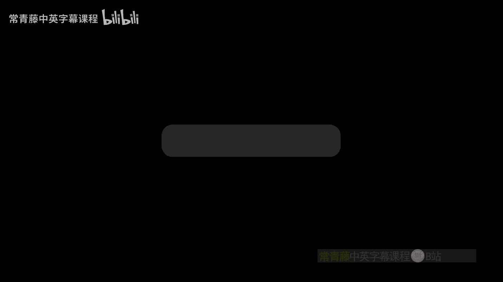
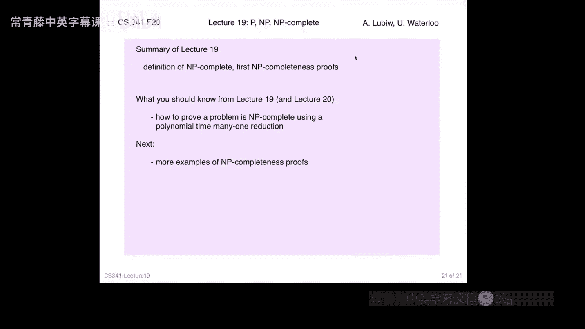

# 021：第20讲 - NP完全问题入门

在本节课中，我们将学习计算复杂性理论中的核心概念：**NP** 类和 **NP完全** 问题。我们将了解NP问题的定义、验证算法的概念，并学习如何证明一个问题是NP完全的。

---

## 什么是NP问题？🤔

上一节我们介绍了**P类**问题，即存在多项式时间算法的决策问题。本节中，我们来看看一个更广泛的类：**NP**。

NP代表“非确定性多项式时间”。一个决策问题属于NP类，当且仅当对于任何答案为“是”的输入，都存在一个**简短证明（证书）**，并且存在一个**多项式时间验证算法**来检查这个证书是否正确。

以下是NP问题的几个例子：
*   **哈密顿回路问题**：给定一个图，问是否存在一条经过每个顶点恰好一次的回路。
*   **旅行商问题（决策版）**：给定带权图和数值K，问是否存在一条总权重不超过K的旅行商回路。
*   **独立集问题**：给定图和数值K，问是否存在一个大小至少为K的独立顶点集（即集合中任意两点无边相连）。

这些问题的共同特点是：如果答案是“是”，我们可以提供一个易于验证的证书。例如，对于独立集问题，证书就是那个大小为K的独立集本身。

---

## 验证算法与NP的正式定义 📝

为了更精确地定义NP，我们引入**验证算法**的概念。

一个针对决策问题X的验证算法A，接受两个输入：原始输入`x`和证书`y`。它输出“是”（验证通过）或“否”（验证不通过）。该算法需要满足：对于任何输入`x`，原问题的答案是“是”，**当且仅当**存在一个证书`y`使得算法A输出“是”。

如果算法A的运行时间是输入`x`和证书`y`大小的多项式函数，并且证书`y`的大小本身也是`x`大小的多项式函数，那么我们称X可以**在多项式时间内验证**。

**NP类**就是所有能在多项式时间内验证的决策问题的集合。

---

## 证明问题属于NP的例子 ✅

要证明一个问题属于NP，我们需要指明证书是什么，并描述验证算法。

**例1：子集和问题**
*   **问题**：给定一组数字和一个目标值W，问是否存在一个子集，其元素之和恰好等于W。
*   **证书**：满足条件的子集S。
*   **验证**：检查子集S中所有数字之和是否等于W。求和操作可在多项式时间内完成。

**例2：旅行商问题（决策版）**
*   **问题**：给定带权图和数值K，问是否存在长度不超过K的TSP回路。
*   **证书**：一个顶点排列（即回路顺序）。
*   **验证**：
    1.  检查该排列是否包含每个顶点恰好一次。
    2.  检查排列中相邻顶点（包括首尾）之间是否有边。
    3.  计算该回路所有边的权重之和，检查是否 ≤ K。
    所有这些步骤都可在多项式时间内完成。

---

## 似乎不属于NP的问题 ❓

理解哪些问题**似乎不属于**NP同样重要。这里“似乎”是因为尚未被证明，但人们尚未找到将其归入NP的方法。

**例1：唯一子集和问题**
*   **问题**：给定数字集合和目标W，问是否存在**唯一**的子集使其和为W。
*   **难点**：如何提供一个简短的证书，既能证明存在一个解，又能证明**没有其他解**？枚举所有其他子集不是多项式大小的证书。

**例2：平面Steiner树问题**
*   **问题**：给定平面上一些点，允许添加额外的点（Steiner点），问是否存在一棵连接所有给定点（可能通过Steiner点）的树，其欧几里得总长度不超过K。
*   **难点**：
    1.  证书中的Steiner点坐标可能非常大甚至是无理数，难以表示。
    2.  验证总长度 ≤ K 需要计算平方根的和，目前未知如何在多项式时间内精确比较。

---

## P、NP与co-NP的关系 🔗

*   **P ⊆ NP**：任何有多项式时间算法的问题，自然可以在多项式时间内验证（证书为空，直接用原算法验证）。
*   **co-NP类**：指那些**“否”**答案可以在多项式时间内验证的决策问题。例如“判断一个数是否为合数”，证书是两个大于1的因数a和b，验证a*b=n即可。
*   **P vs NP 问题**：这是计算机科学中最著名的开放问题，问是否P = NP。若成立，则所有NP问题都有多项式时间算法。
*   **NP vs co-NP 问题**：是否NP = co-NP？同样未知。

我们还知道，任何NP问题都可以在指数时间 `O(2^{p(n)})` 内解决，其中p(n)是多项式函数。思路是暴力枚举所有可能的多项式大小证书。

---

## 什么是NP完全问题？🏆

NP完全问题是NP类中“最难”的问题。

**定义**：一个决策问题X是**NP完全的**，如果：
1.  X ∈ NP。
2.  对于**所有** Y ∈ NP，Y都可以在多项式时间内**归约**到X。

这意味着，如果任何一个NP完全问题存在多项式时间算法，那么**所有**NP问题都存在多项式时间算法（即P=NP）。反之，如果证明某个NP完全问题不存在多项式时间算法，则所有NP完全问题都不存在。

**证明第一个NP完全问题**非常困难，需要证明**所有**NP问题都能归约到它。但一旦有了第一个，证明其他问题NP完全就变简单了，因为归约具有传递性。

---

## 如何证明NP完全性：两步法 🛠️

要证明一个新问题Z是NP完全的，只需：
1.  **证明 Z ∈ NP**。（给出证书和验证算法）
2.  **证明某个已知的NP完全问题 X ≤_p Z**。（给出一个从X到Z的多项式时间归约）

由于归约的传递性，这等价于证明了所有NP问题都能归约到Z。

---

## 关键的第一个NP完全问题：SAT 📚

**布尔可满足性问题（SAT）** 是第一个被证明的NP完全问题（Cook-Levin定理）。
*   **输入**：一个布尔公式（由变量、与∧、或∨、非¬构成）。
*   **问题**：是否存在对变量的真值赋值，使得整个公式为真？

即使对SAT加以限制，它仍然是NP完全的：
*   **合取范式SAT**：公式是多个**子句**的合取（∧），每个子句是多个**文字**的析取（∨）。文字是变量或其否定。
*   **3-SAT**：每个子句**恰好包含3个文字**。3-SAT也是NP完全的。

**有趣的事实**：2-SAT（每个子句恰好2个文字）是**多项式时间可解**的，算法基于有向图的强连通分量。许多问题在参数为2时易解，为3时变为NP完全。

---

## NP完全性证明实例：独立集问题 🧩

现在，我们运用两步法来证明**独立集问题**是NP完全的。

**步骤1：证明独立集 ∈ NP**
*   证书：一个大小为K的顶点集合S。
*   验证算法：
    1.  检查S中是否恰好有K个顶点。
    2.  检查S中任意两个顶点之间在图G中是否都没有边。
    这两个检查都可在多项式时间内完成。

**步骤2：证明一个已知NP完全问题可归约到独立集**
我们选择 **3-SAT** 作为已知的NP完全问题。我们需要构造一个从3-SAT到独立集的**多项式时间多一归约**。

**归约思路**：
给定一个3-SAT公式F，包含m个子句。我们将构造一个图G和一个数值K，使得：
> **G 有一个大小至少为 K 的独立集 ⇔ F 是可满足的。**

**构造方法**：
1.  对公式F中的每个子句，在图G中创建一个三角形（3个顶点，两两相连）。三角形的三个顶点分别标记为该子句的三个文字。
2.  对于所有互为相反的文字（如`x_i`和`¬x_i`），在它们对应的顶点之间添加一条边。
3.  设 K = m（子句的数量）。

**正确性直观解释**：
*   独立集需要选出K=m个顶点。由于每个三角形是团（完全子图），最多只能从每个三角形中选一个顶点。因此，一个大小为m的独立集必须从**每个三角形中恰好选一个顶点**。
*   蓝色边保证了不会同时选择互为相反的变量，从而保证赋值的一致性。
*   如果F可满足，则每个子句至少有一个真文字，选择对应顶点即可得到一个大小为m的独立集。
*   如果G有一个大小为m的独立集，则从每个三角形选了一个顶点（文字）。将这些文字设为真，即可得到一个满足F的赋值（注意，由于蓝色边的存在，赋值不会矛盾）。

**时间复杂度**：构造的图G有3m个顶点，边数最多为`O(m^2)`，因此整个归约是多项式时间的。

至此，我们完成了独立集是NP完全的证明。

---

## 多一归约：NP完全性证明的蓝图 🗺️

在NP完全性证明中，我们通常使用一种特殊的归约——**多项式时间多一归约**。
其形式化描述是：存在一个多项式时间可计算的函数f，使得对于所有输入x：
> **x ∈ X ⇔ f(x) ∈ Y**

在算法描述中，它体现为“一次性”使用假设存在的Y的算法：
1.  将输入x转化为Y的输入f(x)。
2.  运行假设存在的Y的算法。
3.  直接输出Y算法的结果。

**证明要点**：
*   **正确性**：关键在于证明 `x ∈ X ⇔ f(x) ∈ Y`。
*   **多项式时间**：只需证明转换步骤（计算f(x)）是多项式时间的。

---

## 总结 📖

本节课我们一起学习了：
1.  **NP类**的定义：答案是“是”时有简短证书且可快速验证的决策问题类。
2.  **NP完全问题**的定义：NP中最难的问题，所有NP问题都能归约到它。
3.  **证明问题NP完全的两步法**：
    *   第一步：证明该问题属于NP。
    *   第二步：证明某个已知的NP完全问题可以多项式时间多一归约到该问题。
4.  我们以**独立集问题**为例，完整展示了如何利用**3-SAT**进行归约证明。

掌握多一归约的构造和证明思路，是理解并证明更多问题NP完全性的关键。下节课我们将看到更多NP完全性证明的例子。