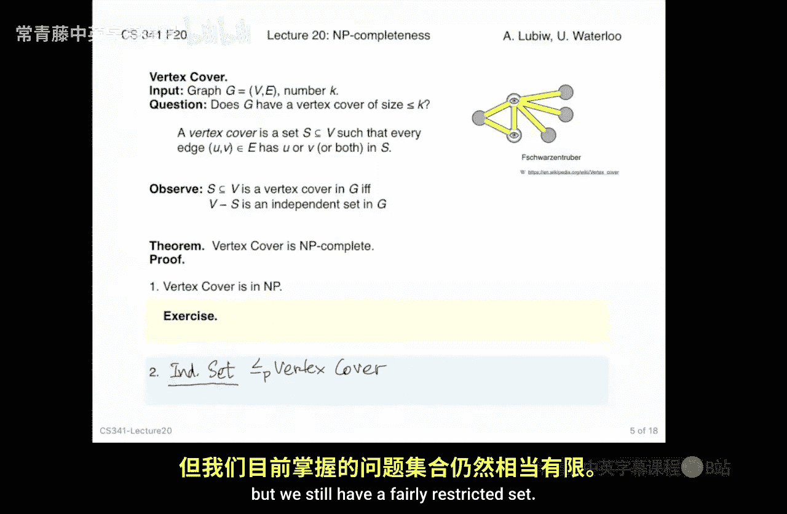
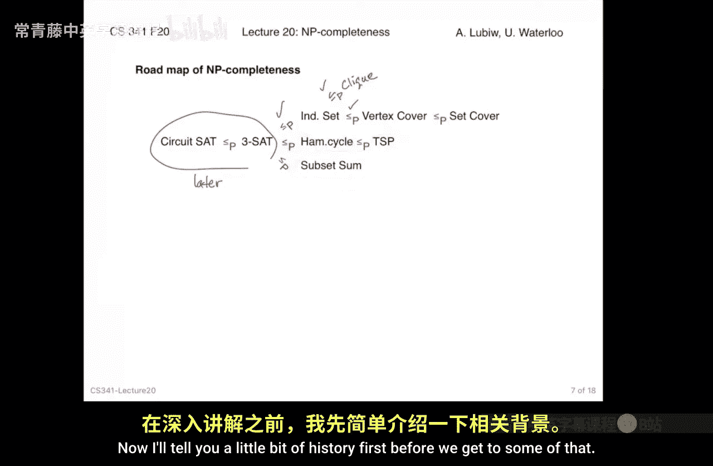
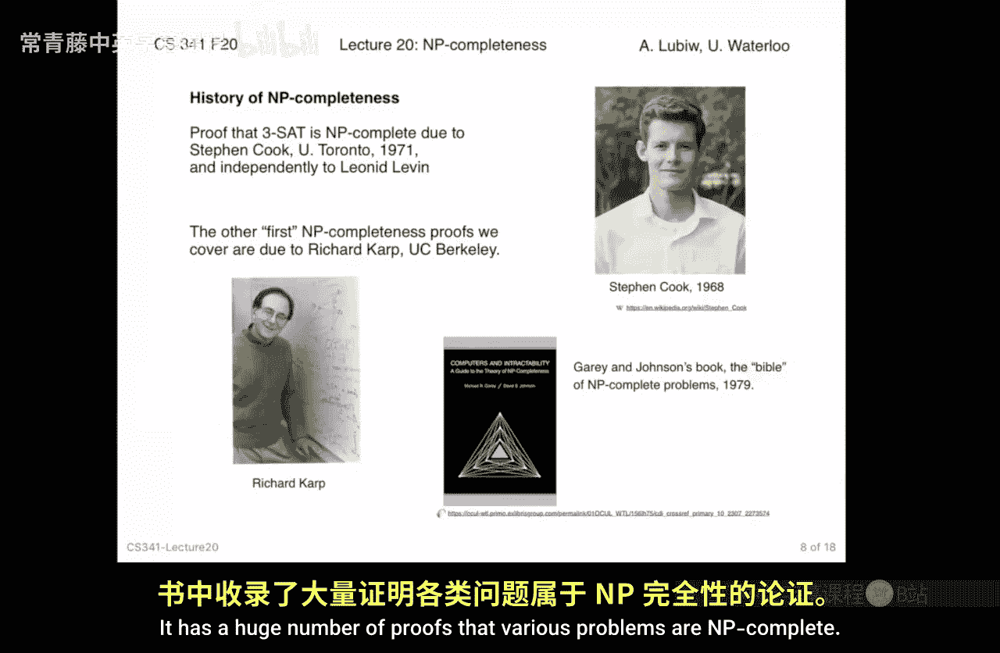
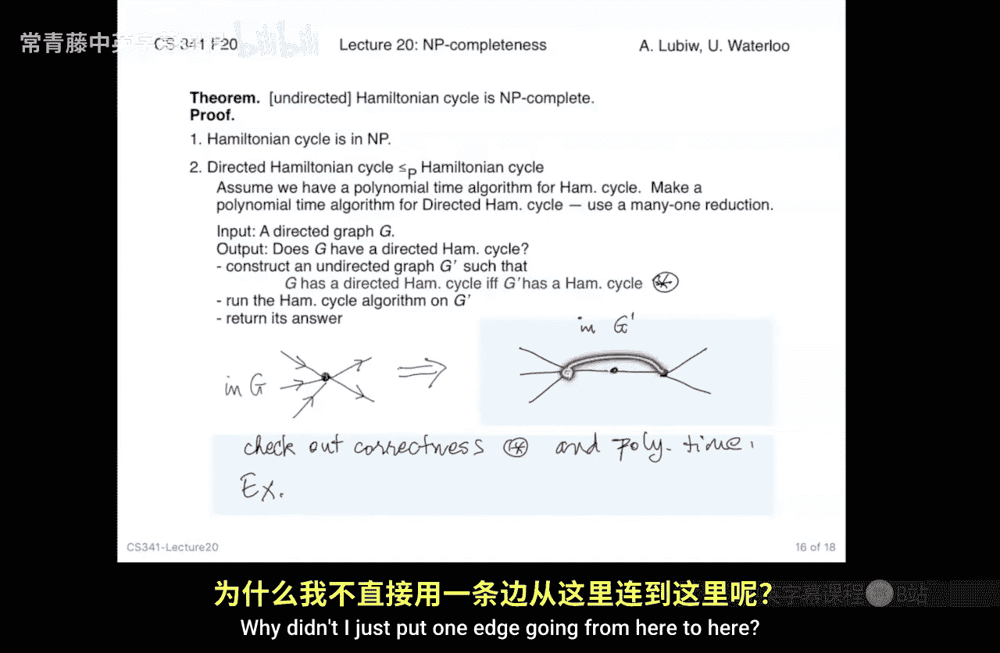
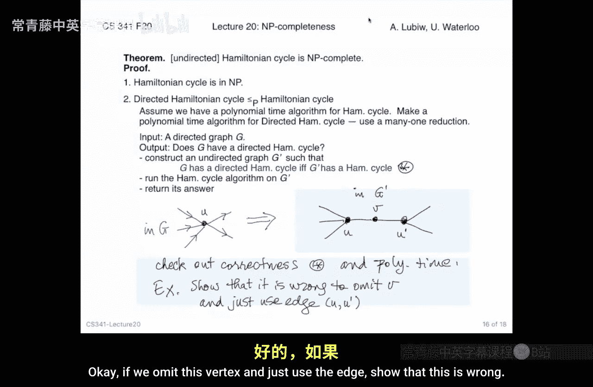
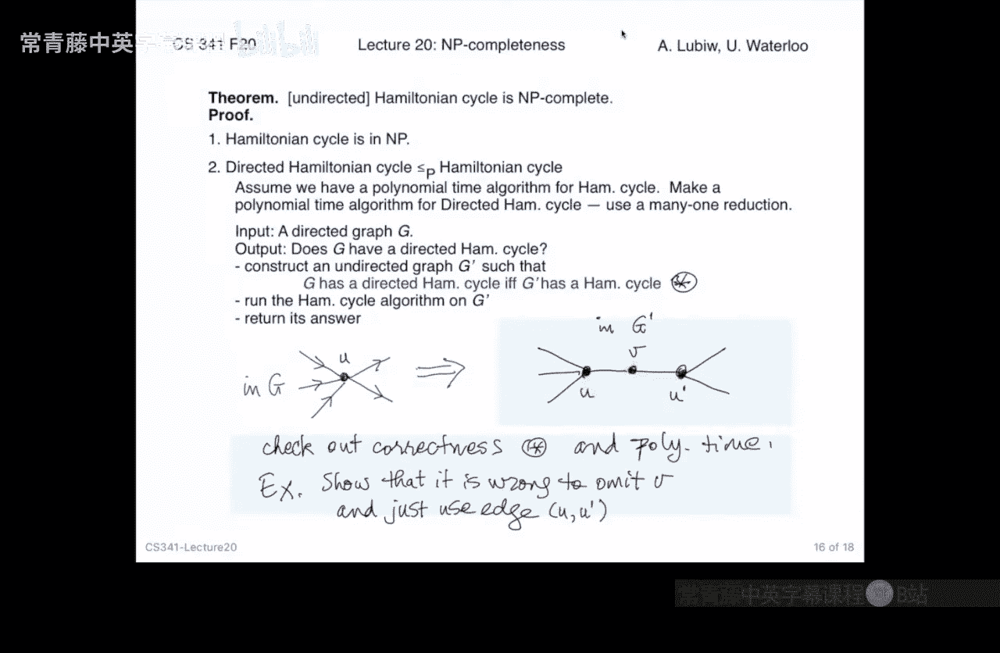
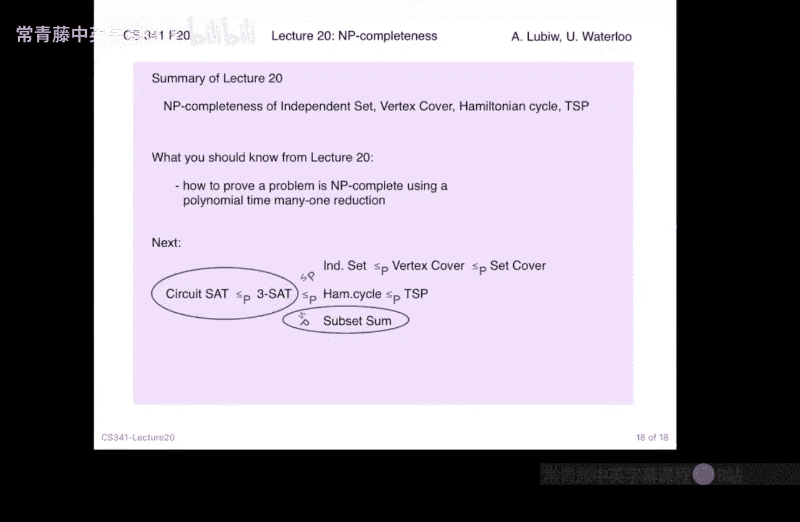

# 算法课程：第21讲：NP完全性深入探讨 🧩

在本节课中，我们将更深入地探讨NP完全性问题。我们将学习如何证明更多问题是NP完全的，并理解这些证明背后的核心思想。

## 概述

上一讲我们介绍了如何证明一个问题是NP完全的。本节中，我们将通过几个具体的例子来实践这一过程，包括团问题、顶点覆盖问题和哈密顿回路问题。我们将看到，尽管这些问题表面上看起来不同，但它们都可以通过多项式时间归约联系起来。

## 证明NP完全性的步骤回顾

要证明一个问题Z是NP完全的，需要两个步骤：

1.  **证明Z属于NP类**：这意味着Z必须是一个判定问题，并且存在一个多项式时间的验证算法。具体来说，如果答案是“是”，我们需要提供一个“证书”，并能在多项式时间内验证该证书的正确性。
2.  **证明Z至少和某个已知的NP完全问题一样难**：我们通过给出一个从已知的NP完全问题X到问题Z的**多项式时间多一归约**来证明这一点。

以下是关于归约类型的一些重要说明：

*   **多一归约**是一种特殊的**图灵归约**。在多一归约中，我们只调用一次假设存在的算法（用于解决问题Z），并直接输出其答案。
*   证明存在多一归约是更强的结果，也使得证明的结构更清晰，因此是更可取的。
*   一个开放问题是：对于任意两个NP问题，如果存在图灵归约，是否总是存在多一归约？尽管这在理论上尚未证明，但在所有已知情况下都成立，因此我们通常只考虑多一归约。

## 团问题是NP完全的 🎯

**团问题**的输入是一个无向图`G`和一个数字`K`。问题是：图`G`中是否存在一个大小至少为`K`的团？**团**是指一个顶点集合，其中**每对顶点之间都有边相连**。

### 证明步骤

**第一步：证明团问题属于NP**

*   **证书**：如果答案是“是”，证书就是构成团的顶点集合`C`。
*   **验证**：验证算法检查两点：
    1.  集合`C`的大小是否 `>= K`。
    2.  `C`中每一对顶点是否在图中都有边相连。
*   这个验证过程可以在多项式时间内完成。因此，团问题属于NP。

**第二步：证明某个已知NP完全问题可归约到团问题**

我们将使用**独立集问题**作为已知的NP完全问题。我们假设存在一个解决团问题的多项式时间算法，并利用它来构造一个解决独立集问题的算法。

**归约构造**：
给定独立集问题的输入：图`G`和数字`K`。
1.  构造新图`G'`为原图`G`的**补图**。补图`G'`与原图`G`有相同的顶点集，但边集相反：在`G'`中，两个顶点之间有边当且仅当在`G`中它们之间没有边。
2.  设`K' = K`。
3.  将`(G', K')`输入假设的团问题算法，并将其答案作为独立集问题的答案输出。

**正确性证明**：
关键在于观察团和独立集在补图中的关系。图`G`有一个大小至少为`K`的独立集，**当且仅当**其补图`G'`有一个大小至少为`K`的团。

**时间复杂度**：
构造补图最多需要`O(n^2)`时间，是多项式时间。

因此，我们通过从独立集到团的多项式时间多一归约，证明了团问题是NP完全的。

## 顶点覆盖问题是NP完全的 🛡️

**顶点覆盖问题**的输入是一个无向图`G`和一个数字`K`。问题是：图`G`中是否存在一个大小不超过`K`的顶点覆盖？**顶点覆盖**是指一个顶点集合`S`，使得图中的**每条边都至少有一个端点**在`S`中。

### 证明步骤

**第一步：证明顶点覆盖属于NP**（留作练习）。

**第二步：证明独立集问题可归约到顶点覆盖问题**

我们再次使用独立集作为已知NP完全问题。假设存在解决顶点覆盖的多项式时间算法。

**归约构造**：
给定独立集问题的输入：图`G`和数字`K`。
1.  构造的新图`G'`就是原图`G`本身。
2.  设`K' = |V| - K`，其中`|V|`是图的顶点总数。
3.  将`(G', K')`输入假设的顶点覆盖算法，并将其答案作为独立集问题的答案输出。

**正确性证明**：
核心观察是：一个集合`S`是图`G`的顶点覆盖，**当且仅当**其补集`V \ S`是`G`的独立集。
*   如果`G`有一个大小至少为`K`的独立集`I`，那么`V \ I`就是一个大小至多为`|V| - K`的顶点覆盖。
*   反之，如果`G`有一个大小至多为`|V| - K`的顶点覆盖`S`，那么`V \ S`就是一个大小至少为`K`的独立集。

因此，`G`有大小至少为`K`的独立集，**当且仅当**`G`有大小至多为`|V| - K`的顶点覆盖。

**时间复杂度**：
构造是常数时间的，只是做了一个减法计算`K‘`，因此是多项式时间。

## 历史背景与后续路线 📜

NP完全性理论由多伦多大学的**斯蒂芬·库克**和（独立发现的）前苏联的**列昂尼德·莱文**奠定。而大量具体的NP完全性证明（包括我们将要看到的）则归功于加州大学伯克利分校的**理查德·卡普**，其成果汇集在经典著作《计算机与难解性：NP完全性理论导论》中。

我们目前的证明路线图如下：已知3-SAT可归约到独立集，独立集可归约到团，独立集也可归约到顶点覆盖。接下来，我们将探讨**哈密顿回路**和**子集和问题**的NP完全性。

## 有向哈密顿回路问题是NP完全的 🔄

**有向哈密顿回路问题**的输入是一个有向图`G`。问题是：`G`中是否存在一个**有向哈密顿回路**？即一个经过每个顶点恰好一次并回到起点的有向环。

### 证明步骤

**第一步：证明该问题属于NP**（留作练习）。

**第二步：证明3-SAT问题可归约到有向哈密顿回路问题**

这是本讲中最精巧的归约之一。我们假设存在解决有向哈密顿回路的多项式时间算法，并利用它来解决3-SAT问题。

**归约思路**：
给定一个3-SAT公式，包含`n`个变量和`m`个子句。我们需要构造一个有向图`G`，使得`G`有哈密顿回路**当且仅当**该3-SAT公式是可满足的。

**构造细节**：
1.  **变量构件**：对于每个变量`x_i`，我们创建一条由许多顶点组成的“路径”。这条路径实际上是一个有向环的一部分，有两种遍历方式：从左到右（代表设置`x_i = True`）或从右到左（代表设置`x_i = False`）。路径上有很多“备用”顶点。
2.  **连接变量构件**：将所有变量的路径首尾相连，形成一个大的框架。
3.  **子句构件**：对于每个子句`C_j`，我们创建一个单独的顶点`c_j`。
4.  **连接子句顶点**：如果变量`x_i`以**正文字**形式出现在子句`C_j`中，那么我们从`x_i`的“真路径”上的某个备用顶点添加两条边：一条从路径指向`c_j`，另一条从`c_j`指回路径的下一个顶点。这允许哈密顿回路通过“绕道”`c_j`来访问它。
    如果变量`x_i`以**负文字**形式出现在子句`C_j`中，那么我们从`x_i`的“假路径”上的某个备用顶点添加类似的边，但方向与正文字情况相反。
    关键是要确保连接不同子句的边使用路径上不同的备用顶点，互不干扰。

**正确性证明（简述）**：
*   **可满足性 => 哈密顿回路**：如果公式可满足，则存在一组真值赋值。按照赋值遍历每个变量的路径（真则从左到右，假则从右到左）。对于每个子句，至少有一个文字为真，我们就从对应的路径位置绕道访问该子句顶点，然后返回。这样可以构造出一个哈密顿回路。
*   **哈密顿回路 => 可满足性**：如果图`G`有一个哈密顿回路。通过分析回路的结构（特别是访问子句顶点`c_j`的唯一方式），可以证明它必须恰好以某种方式遍历每个变量路径（决定了变量的真值），并且每个子句顶点都必须通过其某个文字的路径被访问（意味着该文字被满足）。从而可以提取出一个满足公式的真值赋值。

**时间复杂度**：
构造的图顶点和边数量是公式长度的多项式倍，因此构造过程是多项式时间的。

## 无向哈密顿回路问题是NP完全的

证明了有向哈密顿回路是NP完全的之后，我们可以很容易地证明无向图上的哈密顿回路问题也是NP完全的。

**证明思路**：给出一个从**有向哈密顿回路**到**无向哈密顿回路**的多项式时间归约。

**归约构造**：
给定一个有向图`G`，构造一个无向图`G‘`：
*   对于`G`中的每个顶点`v`，在`G’`中创建三个顶点：`v_in`, `v_mid`, `v_out`。
*   在`G‘`中添加无向边`(v_in, v_mid)`和`(v_mid, v_out)`。
*   对于`G`中的每条有向边`(u -> v)`，在`G’`中添加无向边`(u_out, v_in)`。

**直观理解**：这个构造强制任何哈密顿回路在`G‘`中必须按`... -> u_in -> u_mid -> u_out -> v_in -> ...`的顺序访问与`u`相关的顶点，这模拟了在`G`中沿着`u -> v`方向移动。`v_mid`顶点的存在至关重要（留作练习思考：如果只用一条边`(u_in, u_out)`代替会出什么问题）。

**正确性**：可以证明，有向图`G`有哈密顿回路**当且仅当**无向图`G‘`有哈密顿回路。

## 旅行商问题是NP完全的 ✈️

**旅行商问题**的判定版本输入是一个图（边有权重）和一个数字`K`，问题是是否存在一个总权重不超过`K`的哈密顿回路（即旅行商环游）。

**证明思路**：可以从（有向或无向）哈密顿回路问题归约而来。给定一个哈密顿回路问题的实例（图`G`），构造一个TSP实例：将`G`的边权重设为1，不存在的边权重设为一个大数（如`|V|+1`），并令`K = |V|`。那么，`G`有哈密顿回路当且仅当存在一个权重为`|V|`的TSP环游。因此，TSP也是NP完全的。

## 总结

本节课中我们一起学习了多个NP完全性证明：
1.  我们证明了**团问题**和**顶点覆盖问题**是NP完全的，主要利用了它们与独立集问题的紧密关系。
2.  我们深入探讨了**有向哈密顿回路问题**的NP完全性证明，这是一个从3-SAT出发的经典而精巧的归约。
3.  基于有向情况的证明，我们简述了**无向哈密顿回路**和**旅行商问题**也是NP完全的。

这些证明展示了如何将形式各异的问题通过多项式时间归约联系起来，是理解计算复杂性理论的核心。掌握这些证明方法对于完成相关作业和深入理解算法极限至关重要。