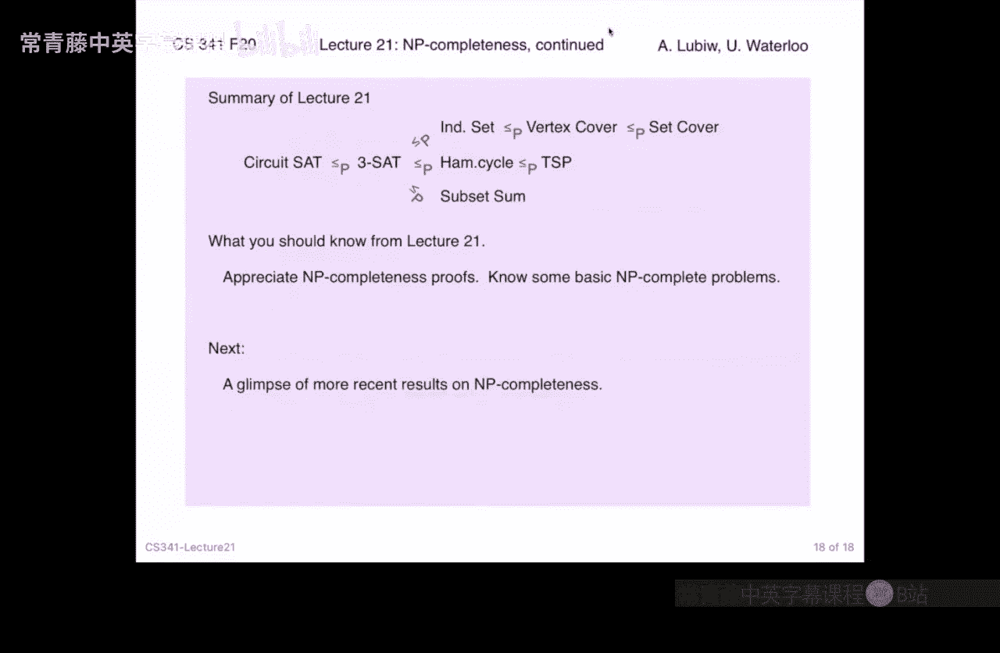

# 滑铁卢大学算法课程：CS341 Fall 2021：第22讲 - NP完全性进阶证明

在本节课中，我们将学习两个更具挑战性的NP完全性证明：子集和问题与电路可满足性问题。我们将看到如何将逻辑问题（如3-SAT）转化为数值问题（子集和），并追溯NP完全性理论的源头，证明电路可满足性是NP完全的。这些证明虽然复杂，但能帮助我们深入理解计算复杂性的基础。

## 子集和问题是NP完全的

上一节我们介绍了独立集、顶点覆盖和哈密顿环的NP完全性证明。本节中，我们来看看如何证明一个看似简单的数值问题——子集和问题——也是NP完全的。

子集和问题的定义如下：给定一组数字和一个目标值 **W**，问是否存在一个子集，其元素之和恰好等于 **W**。用公式表示，即是否存在子集 **S** 使得：
\[
\sum_{a \in S} a = W
\]

证明分为两部分：
1.  子集和问题属于NP类（我们之前已作为示例证明过）。
2.  将一个已知的NP完全问题（3-SAT）通过多项式时间多一归约到子集和问题。

这意味着，如果我们假设存在解决子集和问题的多项式时间算法，就能构造出解决3-SAT问题的多项式时间算法。

### 从3-SAT到子集和的归约思路

归约的核心思想是：选择子集中的数字，将对应于为3-SAT公式中的变量赋值真或假。我们将通过数字的位表示（这里使用十进制）来编码子句的信息。

以下是构造的具体步骤：

首先，我们创建一个0-1矩阵，称为“文字-子句关联矩阵”。
*   矩阵的每一行对应一个文字（例如，变量 **x1** 及其否定 **¬x1** 各占一行）。假设有 **n** 个变量，则有 **2n** 行。
*   矩阵的每一列对应一个子句。假设有 **m** 个子句，则有 **m** 列。
*   如果某个文字出现在某个子句中，则在对应的行列位置置1，否则置0。每个子句恰好包含三个文字，因此每列恰好有三个1。

接下来，我们将矩阵的每一行视为一个十进制数。但为了满足子集和“精确等于目标值”的要求，并防止同时选择互斥的文字（如 **x1** 和 **¬x1**），我们需要扩展这个矩阵。

完整的构造矩阵包含三部分：
1.  **核心部分**：即上面描述的 **2n** 行 **m** 列的“文字-子句关联矩阵”。
2.  **松弛变量部分**：针对每个子句列，新增两行。一行在该列位置为1，另一行在该列位置为2。这部分新增 **2m** 行，用于确保每个子句列的总和能恰好达到目标值4。
3.  **变量一致性部分**：针对每个变量 **xi**，新增一列。在该列中，对应 **xi** 和 **¬xi** 的两行位置为1，其余为0。这部分新增 **n** 列，用于确保只能选择 **xi** 或 **¬xi** 中的一个。

最终，我们得到 **2n + 2m** 个数（即矩阵行数），每个数有 **n + m** 位十进制数字。目标数 **W** 是根据目标列和（变量列为1，子句列为4）构造的十进制数。

### 归约的正确性证明

**正向**：如果3-SAT公式可满足，则存在一组变量赋值。根据赋值选择对应的文字行（若 **xi** 为真，选 **xi** 行；若为假，选 **¬xi** 行）。此时，每个变量列的和为1，满足约束。每个子句列的和为1、2或3（因为至少有一个文字为真）。然后，通过选择对应的松弛行（和为1时选两个松弛行；和为2时选值为2的松弛行；和为3时选值为1的松弛行），将每个子句列的和补足为4。这样就得到了一个和为 **W** 的数字子集。

**反向**：如果存在一个数字子集其和恰好为 **W**。由于每列最大可能和为6（三个文字行1+1+1，加上两个松弛行1+2），在十进制加法中不会产生进位，因此每列的和必须精确等于目标数字。变量列和为1保证了对于每个变量，我们只选择了 **xi** 或 **¬xi** 中的一个，这定义了一组变量赋值。子句列和为4，而松弛行最多贡献3，这意味着至少有一个被选择的文字行在该列贡献了1，即该子句被满足。因此，整个公式可满足。

这个证明表明，NP完全性证明可以相当巧妙，并且我们可以利用数字编码逻辑信息，这本质上是计算机科学中将问题转化为比特编码的核心思想。

## 电路可满足性是NP完全的

现在，我们来追溯NP完全性理论的起点，证明电路可满足性是NP完全的。这是第一个被证明的NP完全问题。

### 电路的定义

一个电路是一个有向无环图。
*   它有一些**源点**（入度为0的顶点），这些点被标记为输入变量或常量0/1。
*   它有一个**汇点**（出度为0的顶点），称为输出。
*   内部节点有三种类型：
    *   **与门**：有两个输入，任意多个输出。
    *   **或门**：有两个输入，任意多个输出。
    *   **非门**：有一个输入，任意多个输出。

给定输入值，电路以显而易见的方式计算输出值。

### 电路可满足性问题

电路可满足性问题的输入是一个电路，询问是否存在对输入变量的真值赋值，使得电路的输出为1（真）。

### 证明概要

证明分为两步：
1.  **电路可满足性属于NP**：给定一个电路和一组赋值，我们可以在多项式时间内模拟电路的计算，验证输出是否为1。这部分较为简单。
2.  **电路可满足性是NP难的**：我们需要证明，**NP中的每一个问题**都可以在多项式时间内归约到电路可满足性问题。

这是证明的关键。根据NP的定义，对于任意问题 **Y ∈ NP**，存在一个多项式时间验证算法 **A**。算法 **A** 接受两个输入：问题实例 **y** 和多项式长度的证书 **g**。当且仅当存在某个证书 **g** 使得 **A(y, g)** 输出“是”时，实例 **y** 才是 **Y** 的“是”实例。

我们的思路是将验证算法 **A** 转化为一个电路 **C**。
*   电路 **C** 的输入部分包括：已知的实例 **y** 的比特（作为固定0/1输入）和未知的证书 **g** 的比特（作为输入变量）。
*   电路 **C** 的内部结构模拟算法 **A** 的计算步骤。每个时间步的内存状态可以表示为逻辑门（与、或、非）的组合。
*   由于 **A** 是多项式时间算法，且证书 **g** 是多项式长度，因此模拟它的电路 **C** 也具有多项式规模。

这个构造过程本质上就是编译和硬件实现的过程：将算法转化为由逻辑门组成的电路。如果存在多项式时间算法解决电路可满足性问题，那么对于任何NP问题 **Y**，我们可以将其实例 **y** 和验证算法 **A** 转化为电路 **C**，然后检查 **C** 是否可满足，从而判断 **y** 是否为“是”实例。这就证明了电路可满足性是NP完全的。

## 3-SAT是NP完全的

在证明了电路可满足性是NP完全的之后，我们现在可以基于它来证明3-SAT也是NP完全的。这遵循标准的NP完全性证明模式。

### 证明思路

我们需要将电路可满足性问题归约到3-SAT问题。
1.  **输入**：一个电路 **C**。
2.  **目标**：构造一个3-CNF公式 **F**，使得 **C** 是可满足的当且仅当 **F** 是可满足的。
3.  **方法**：为电路中的每个节点（包括输入、输出和内部门）引入一个布尔变量。然后，为每个逻辑门编写一组子句，这些子句用3-CNF形式精确描述该门的输入输出关系。

以下是针对不同类型门构造的子句示例（设 **u** 为门输出变量，**v**, **w** 为输入变量）：
*   **或门** (**u = v ∨ w**)：
    *   子句1: **(¬u ∨ v ∨ w)**
    *   子句2: **(u ∨ ¬v)**
    *   子句3: **(u ∨ ¬w)**
    （后两个子句由 **u ∨ (¬v ∧ ¬w)** 转换而来）
*   **与门** (**u = v ∧ w**)：
    *   子句1: **(¬u ∨ v)**
    *   子句2: **(¬u ∨ w)**
    *   子句3: **(u ∨ ¬v ∨ ¬w)**
*   **非门** (**u = ¬v**)：
    *   子句1: **(¬u ∨ ¬v)**
    *   子句2: **(u ∨ v)**

最后，添加一个子句要求输出节点的变量为真：**(x_output)**。

### 关键点与正确性

*   **多项式时间构造**：电路规模是多项式的，为每个门生成的子句数量是常数（最多4个），因此整个公式 **F** 的规模是多项式级别的，并且可以在多项式时间内构造。
*   **正确性**：
    *   如果电路 **C** 可满足，则存在一组输入赋值使其输出为1。根据电路计算过程，为所有中间节点变量赋予相应的真值，这组赋值将满足公式 **F** 中的所有子句。
    *   如果公式 **F** 可满足，则存在对所有变量（包括输入变量和中间变量）的一组赋值。由于 **F** 的子句精确编码了每个门的逻辑，这组赋值必然使得电路 **C** 中每个门的计算关系成立。同时，输出子句要求输出变量为真，因此电路 **C** 在这组输入赋值下输出为1，即 **C** 可满足。

这个证明完成了从电路可满足性到3-SAT的归约链，确立了3-SAT的NP完全性地位。

## 总结

本节课中我们一起学习了两个核心的NP完全性证明。
1.  我们看到了如何通过巧妙的数字编码，将3-SAT问题归约到**子集和问题**，证明了这个看似简单的数值组合问题是NP完全的。
2.  我们追溯了NP完全性理论的起源，通过“将任意NP问题的验证算法编译为电路”这一高层思想，论证了**电路可满足性**是NP完全的。随后，通过为电路中的每个逻辑门构造等价的3-CNF子句，我们将电路可满足性归约到**3-SAT**，从而也证明了3-SAT的NP完全性。

这些证明虽然比之前见过的更复杂，但它们展示了NP完全性理论的深度和普适性，说明了从逻辑约束到数值问题，许多看似不同的问题在计算难度上是相通的。理解这些基础证明，有助于我们更好地认识计算复杂性的本质。