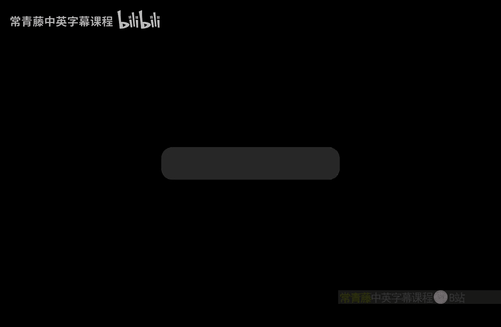
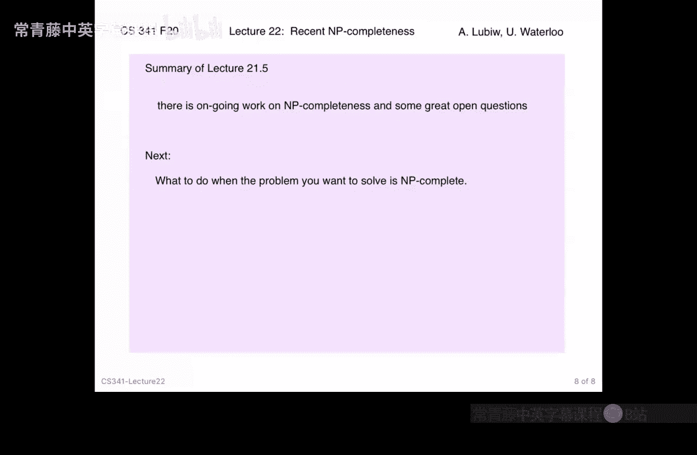

# 024：NP完全性专题与开放问题 🧩

在本节课程中，我们将探讨NP完全性理论中一些有趣且较新的研究成果，以及几个著名的开放性问题。我们将了解一些经典问题如何被解决，以及另一些至今仍悬而未决的难题。

## 课程背景与概述

这是第22讲，是一节拓展性课程，内容为选修性质。课程作业不会基于本节内容。通常这类拓展讲座会安排在第24讲，但由于视频可以随时观看，且内容仍与NP完全性相关，因此现在安排是合理的。

之前我们学习的NP完全性证明都是几十年前（1970年代）的标准结果。今天，我们将介绍一些更有趣、更近期的NP完全性成果，以及关于NP完全性的一些开放性问题。除了“P是否等于NP”这个重大问题外，还有许多其他未解之谜。

## 经典开放问题的进展

上一节我们回顾了NP完全性的基础。本节中，我们来看看一些在历史上曾被列为开放问题，但后来得到解决的经典案例。这些案例都源自Garey和Johnson于1979年出版的著名著作，书中列出了当时未知是否为多项式时间可解或NP完全的问题。

以下是其中三个著名问题及其后续进展：

1.  **线性规划**
    *   **状态**：在该书出版后不久即被证明是**多项式时间可解**的。
    *   **说明**：线性规划问题存在多项式时间算法，例如椭球法和内点法。一个有趣的未解问题是，是否存在一种算法，其步骤数在变量和约束的数量上是多项式的（类似于单纯形法，但被证明是多项式时间的）。

2.  **素数判定**
    *   **状态**：给定一个数字，判断它是否为素数。在1979年，这仍是一个开放问题。直到**2002年**，才发现了多项式时间算法。

3.  **图同构**
    *   **状态**：**至今仍为开放问题**。
    *   **问题描述**：给定两个无向图，判断它们是否在忽略顶点标签的情况下完全相同。
    *   **示例**：两个看似不同的图，如果通过重新标记顶点可以变得完全相同，则它们是同构的。此问题在化学等领域有重要应用，但至今既未找到多项式时间算法，也未证明是NP完全的。

## 有趣的NP完全性结果

在回顾了历史进展后，我们转向一些令人惊奇的、较新的NP完全性证明。这些结果展示了即使问题看起来受限，其判定版本也可能异常困难。

以下是几个引人注目的例子：

1.  **图边着色**
    *   **问题**：给定一个图和一个数字 `k`，能否用最多 `k` 种颜色为图的边着色，使得任何两条相邻边（共享一个顶点）颜色不同？
    *   **有趣之处**：根据Vizing定理，所需的最小颜色数只能是最大顶点度数 `Δ` 或 `Δ+1`。然而，**判定是否能用 `Δ` 种颜色完成边着色本身是NP完全的**。尽管答案只有两种可能，但区分它们依然是困难的。

2.  **最小权三角剖分**
    *   **问题**：给定平面上的一组点和一个数字 `k`，是否存在一种三角剖分（用不相交的直线段连接点，将区域划分为三角形），使得所有边的长度之和不超过 `k`？
    *   **状态**：于2008年被证明是**NP难的**。
    *   **特殊之处**：该问题**未被证明属于NP**。原因是验证边长之和是否小于等于 `k` 涉及计算平方根之和，而目前尚不清楚如何在多项式时间内精确比较这样的和与 `k` 的大小。

3.  **N×N×N 魔方**
    *   **问题**：给定一个 `N×N×N` 魔方的一个打乱状态和一个数字 `k`，能否在最多 `k` 步内将其复原？（一步指旋转任意一层）
    *   **状态**：于2018年被证明是**NP完全的**。
    *   **注**：对于标准的3×3×3魔方，由于其状态数是有限的（约430亿亿种），我们不讨论其“多项式时间”算法。其最大复原步数（称为“上帝之数”）在2013年被证明是20。

## 重要的开放性问题

了解了NP完全性的新证明后，我们来看一些至今仍未解决的重要开放性问题。这些问题既未被证明是多项式时间可解的，也未被证明是NP完全的，其中一些还具有独特的复杂性类别性质。

以下是两个关键的例子：

1.  **整数分解**
    *   **判定问题形式**：给定两个数字 `n` 和 `k`，`n` 是否有一个小于等于 `k` 的因子？
    *   **复杂性地位**：该问题同时属于 **NP** 和 **co-NP**。
        *   若答案为“是”（存在因子），证书就是该因子本身，验证其整除 `n` 且大小不超过 `k` 即可。
        *   若答案为“否”，证书可以是 `n` 的**质因数分解**。由于可以在多项式时间内验证分解的正确性及每个因子都大于 `k`，故属于 co-NP。
    *   **意义与挑战**：大多数同时属于NP和co-NP的问题都被认为是可能存在多项式时间算法的。整数分解的困难性是RSA等公钥加密系统的基础。然而，Shor在1994年已证明**量子计算机可以在多项式时间内分解整数**，这促使了“后量子密码学”的研究。

2.  **平凡纽结判定**
    *   **问题**：给定一个纽结图（三维空间中绳圈的二维投影），它是否表示“平凡纽结”（即可以连续变形为一个简单圆环，没有打结）？
    *   **示例**：一个简单圆圈是平凡纽结；某些带交叉的图经过变形也能成为圆环；而另一些（如三叶结）则不能。
    *   **复杂性进展**：
        *   **1999年**：被证明属于 **NP**（如果是平凡纽结，存在证书可验证）。
        *   **2016年**：被证明属于 **co-NP**（如果不是平凡纽结，也存在证书可验证）。
    *   **现状**：与整数分解一样，它同时位于NP和co-NP中，但**至今既未找到多项式时间算法，也未证明是NP完全的**。

## 总结与下节预告

本节课中，我们一起学习了NP完全性理论中一些超越经典教材的内容。我们回顾了历史上几个著名开放问题的解决，探讨了几个出人意料且较新的NP完全性证明结果，并深入了解了“整数分解”和“平凡纽结判定”这两个同时位于NP与co-NP中的重要开放性问题。

接下来，课程将回归必修内容，重点讨论当面对一个NP完全问题时，我们可以采取哪些实用策略。我们已经学习过穷举搜索算法，下一讲（第23讲）我们将探讨另一种重要的补救方法：**近似算法**。

本节课程到此结束。