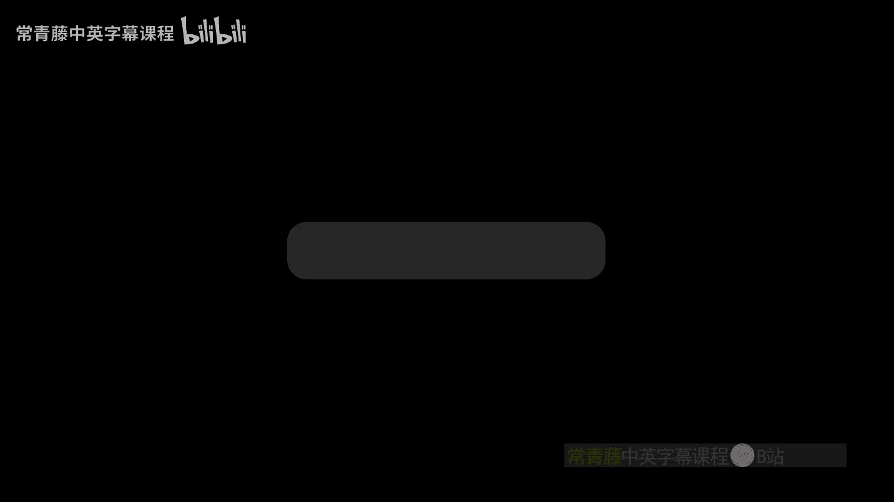
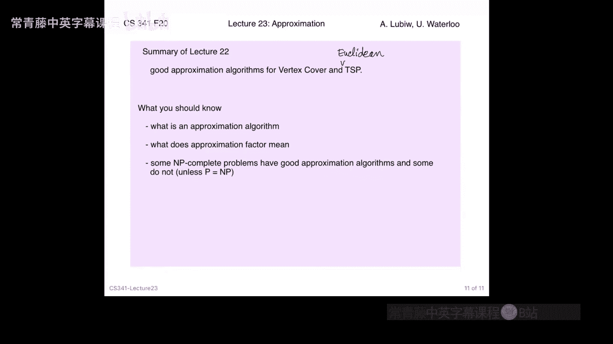

# 025：近似算法 🧮



在本节课中，我们将要学习如何处理NP难问题。具体来说，我们将探讨一种称为“近似算法”的方法。这些算法能在多项式时间内运行，并为解的质量提供可证明的保证。我们将通过两个经典问题——顶点覆盖问题和欧几里得旅行商问题——来理解近似算法的概念和设计思路。

---

## 顶点覆盖问题

上一节我们介绍了NP完全问题的背景，本节中我们来看看如何为顶点覆盖问题设计近似算法。

顶点覆盖问题是指：给定一个无向图，目标是找到一个最小的顶点集合，使得图中的每条边都至少有一个端点在这个集合中。这个问题的决策版本是NP完全的。

我们将分析两种贪心算法。

### 算法一：最大度优先贪心算法

算法一的工作流程如下：我们从一个空的顶点覆盖集合开始，然后重复以下步骤，直到所有边都被覆盖：选择图中当前度数最高的顶点，将其加入覆盖集，并移除所有与该顶点相连的边（因为这些边已被覆盖）。

以下是该算法的伪代码描述：
```
C = ∅
while 存在未被覆盖的边:
    v = 图中当前度数最高的顶点
    C = C ∪ {v}
    移除所有与v相连的边
return C
```
该算法在多项式时间内运行，但它并不总能找到最小顶点覆盖。

### 算法二：边选择贪心算法

现在，我们来看看第二种算法。该算法同样从一个空的顶点覆盖集合 `C` 和包含所有边的集合 `F` 开始。

以下是该算法的伪代码描述：
```
C = ∅
F = E (所有边的集合)
while F ≠ ∅:
    从F中任选一条边 (u, v)
    C = C ∪ {u, v}
    从F中移除所有与u或v相连的边
return C
```
该算法的核心思想是：每次选择一条未被覆盖的边，并将其两个端点都加入覆盖集。虽然这看起来有些“浪费”，但我们将证明它能提供一个很好的近似保证。

---

## 算法二的近似比分析

我们将证明算法二找到的顶点覆盖大小最多是最优解的两倍。

首先，观察算法选取的边构成了一个**匹配**。匹配是指一组没有公共端点的边。

其次，任何顶点覆盖都必须包含匹配 `M` 中每条边的至少一个端点。因此，最优覆盖 `C_opt` 的大小至少为 `|M|`。

算法得到的覆盖 `C` 的大小是 `2|M|`，因为每条被选的边贡献了两个顶点。

结合以上两点，我们得到：
`|C| = 2|M| ≤ 2|C_opt|`

这就证明了算法二具有**近似比2**。这意味着它能在多项式时间内找到一个解，其大小不超过最优解的两倍。

值得注意的是，算法一的近似比可证明为 `O(log n)`，因此在可证明的保证方面，算法二更优。

---

## 独立集问题的启示

顶点覆盖与独立集问题密切相关。一个图的最小顶点覆盖的补集就是最大独立集。然而，尽管顶点覆盖有很好的近似算法，**最大独立集问题却没有常数因子的近似算法**（除非P=NP）。这说明了不同NP完全问题在近似难度上可能存在巨大差异。

---

## 欧几里得旅行商问题

上一节我们讨论了顶点覆盖的近似算法，本节中我们来看看另一个经典问题——欧几里得旅行商问题的近似解法。

旅行商问题是指：给定一个完全图，边上有权重，目标是找到一个访问每个顶点恰好一次并返回起点的哈密顿回路，且使其总长度最小。当顶点是平面上的点，且边权是欧几里得距离时，即为欧几里得TSP。它仍然是一个NP完全问题，但我们可以利用**三角不等式**来设计近似算法。

### 近似算法描述

该算法包含三个步骤：
1.  **计算最小生成树**：为给定的点集计算一个最小生成树。这可以在多项式时间内完成。
2.  **生成“绕树”行走路径**：从最小生成树的某个顶点开始，沿着树的边进行深度优先遍历。每次访问一条边就沿着它走两次（一去一回）。这样会生成一条访问所有顶点（但某些顶点会被重复访问）的闭合路径。
3.  **采取“捷径”**：沿着上一步生成的路径行走，但跳过那些已经访问过的顶点，直接前往路径中下一个未访问的顶点。根据三角不等式，这种“捷径”的长度不会超过它所替代的原路径片段长度。

最终，我们得到的是一个访问每个顶点恰好一次的TSP环游。

### 算法近似比分析

我们将证明该算法找到的环游长度最多是最优环游长度的两倍。

令 `T_MST` 为最小生成树的总长度。
令 `T_OPT` 为最优TSP环游的长度。

首先，**最小生成树的长度不超过最优TSP环游的长度**。因为从最优环游中删除任意一条边，就会得到一棵生成树（不一定最小），所以最小生成树更短。
`T_MST ≤ T_OPT`

其次，算法第二步生成的“绕树”路径，其长度恰好是 `2 * T_MST`，因为每条边都走了两次。

最后，在第三步中，我们通过“取捷径”来避免重复访问顶点。根据三角不等式，每条捷径的长度都不大于它所绕过的原路径长度。因此，最终环游 `T` 的长度满足：
`T ≤ 2 * T_MST`

结合以上两个不等式，我们得到：
`T ≤ 2 * T_MST ≤ 2 * T_OPT`

因此，该算法对于欧几里得TSP具有**近似比2**。

---

## 关于近似算法的进一步说明

对于欧几里得TSP，存在更精确的近似方案。对于任意 `ε > 0`，都存在算法能找到长度不超过 `(1+ε) * T_OPT` 的环游。但需要注意的是，当 `ε` 趋近于0时，算法的运行时间可能会急剧增加（从多项式时间变为指数时间）。这属于更高级的算法课程内容。

---

## 总结

本节课中我们一起学习了近似算法的基本概念。我们通过顶点覆盖和欧几里得旅行商问题这两个例子，了解了如何设计能在多项式时间内运行，并为解的质量提供常数因子保证的算法。

关键要点包括：
*   近似算法的目标是快速找到“足够好”的解，而非最优解。
*   **近似比**是衡量算法性能的关键指标，对于最小化问题，它表示算法解值不超过最优解值的多少倍。
*   有些NP完全问题（如顶点覆盖、欧几里得TSP）存在很好的近似算法，而另一些问题（如独立集）则不存在（除非P=NP）。



理解哪些问题可以近似、近似的效果如何，是处理实际中NP难问题的重要工具。