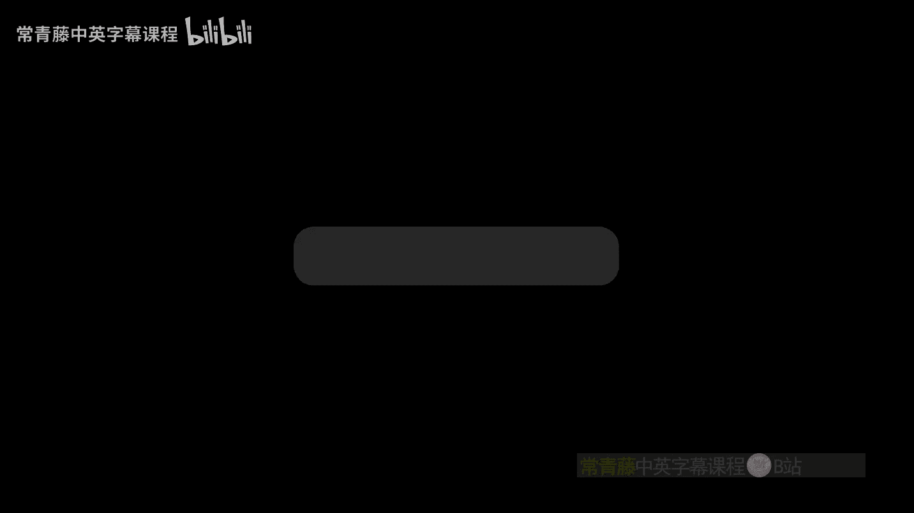
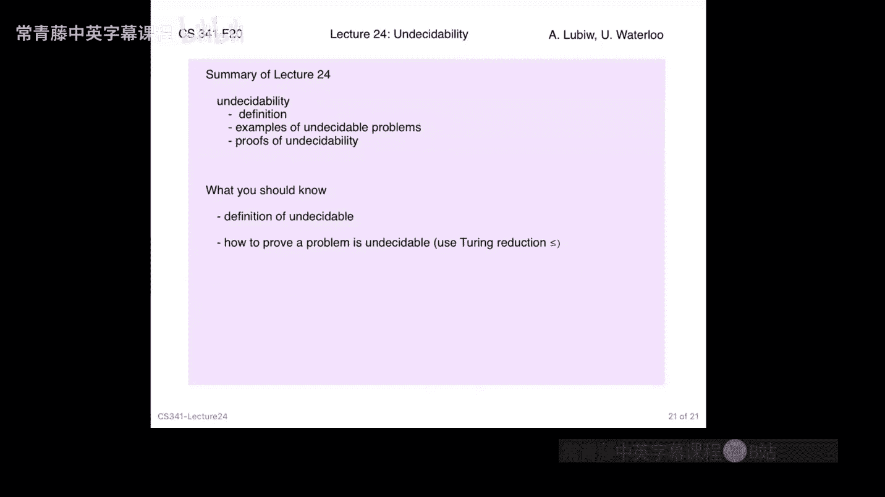

# 算法课程：24：不可判定性

## 概述
在本节课中，我们将学习计算机科学中的一个核心概念：不可判定性。我们将了解什么是不可判定问题，探索一些著名的例子，并学习如何证明一个问题是不可判定的。

---

## 引言与背景
到目前为止，本课程一直专注于算法的效率，即多项式时间与指数时间算法的对比，特别是在NP完全性部分。那里的坏消息是，一些NP完全问题似乎只有指数时间算法。而本讲座要讨论的是更坏的消息：存在一些问题根本没有算法，无论允许它运行多长时间。

首先描述几个这类问题的例子。

### 程序等价性问题
给定两个程序，它们是否做相同的事情？即，对于相同的输入，它们是否产生相同的输出？这是助教们在批改编程作业时必须处理的问题。他们想知道你编写的程序是否与执行正确操作的模型程序相同。不幸的是，没有算法可以完成这个任务。这就是为什么你的程序只在一组测试输入上运行，因为无法进行通用的测试。

### 铺砖问题
第二个被证明没有算法的问题是铺砖问题。给定一组有限的砖块，例如这13块3x4的砖，每块砖的每条边都有一种颜色。这些砖块不能旋转。我们要问的决策问题是：能否使用这些砖块铺满整个平面，并且颜色必须匹配？例如，可以将这块砖放在这块砖下面，因为它们在蓝色边上匹配；但不能将这块砖与这块砖并排放置，因为这里的颜色不匹配。

这是一个使用这13块砖铺砌平面一部分的例子，图中并未无限延伸。

这个决策问题没有算法。一个有趣的现象暗示了这个问题非常困难：这组砖块可以铺满平面，但只能非周期性地铺砌。你可能会想，如果砖块能铺满平面，并且本质上铺砌某个部分然后重复该部分，那么可以想象有一个算法能检查：对于平面的这个有限部分，我能否以某种方式铺砌，使得这部分可以连接到那部分，那么我就得到了平面的周期性铺砌。然而，存在只能非周期性铺砌的砖块这一事实，暗示了这个问题确实非常困难。

### 停机问题
第三个例子是停机问题，你可能在之前的课程中听说过。问题很简单：给定一个计算机程序，它会停机吗？这是一个没有算法的问题。

“它会停机吗？”这个问题可能让你想问：这是指在所有输入上、在某些输入上，还是在特定输入上？稍后会澄清，实际上所有这些版本都是不可判定的，没有算法能解决它们。

看一个小例子。这是一个非常小的程序：它从一个自然数开始，当数字不等于1时，我们减去2。很容易判断它何时停机：当且仅当给定一个奇数时它会停机，因为最终会减到1。如果给定偶数，会减到0，然后进入负数，所以这是一个容易判断是否停机的程序例子。

这是一个只长一点点的程序。没有人知道这个程序是否会停机。这个程序在做什么？它的停机条件相同，但我们检查：如果数字是偶数，则除以2；如果数字是奇数，则执行3n+1。举个小例子：如果从n=12开始，12是偶数，所以除以2得到6；6是偶数，除以2得到3；3不是偶数，所以执行3n+1得到10；10是偶数，除以2得到5；5是奇数，乘以3加1得到16；16是2的幂，然后会得到8、4、2、1，此时停机。

这里问的问题是：这个程序对所有输入都停机吗？没有人知道。经验证据表明，该程序在尝试过的每个输入上都停机了。我不知道尝试过的最大输入是多少，但你可以在维基百科页面上找到，它被称为3n+1问题，或者与一些人的名字相关联。著名数学家、组合学家保罗·埃尔德什对此的评价是：数学可能还没有准备好解决这样的问题。

比这个3n+1问题更一般地，我可以将任何关于数字存在的数学陈述转化为关于程序停机的问题。这意味着关于程序停机的问题可能非常深奥和困难。这是一般模式：如果我们有一个数学猜想，问是否存在一个数n使得φ(n)成立，那么我可以将其转化为一个程序：从n=1开始，当不满足φ时，继续检查下一个数。当且仅当找到一个满足φ(n)的数时，这个程序才会结束。

作为一个更具体的例子，我们可以考虑哥德巴赫猜想，它是未解决的，它问是否每个偶数都是两个素数之和。为了将其转化为“是否存在”的形式，我们问：是否存在一个形如2^n的数，它不是两个素数之和？然后你可以将其转化为这样一个小程序，没有人知道那个程序是否会停机。

因此，每当存在性问题悬而未决时，就像哥德巴赫猜想那样，就没有人知道相应的程序是否会停机。这正好证明了询问程序是否停机是非常深奥和困难的。

现在我们用定义来形式化这个概念：如果一个决策问题没有算法，我们就说它是不可判定的。稍微更一般地说，如果我们讨论的不仅仅是决策问题，而是更一般的问题，我们说一个问题如果**没有算法**，它就是**不可解的**。我们将坚持讨论决策问题并使用术语“不可判定”。

既然说“没有算法”，我们必须思考：究竟什么是算法？这在本课程一开始就讨论过。以下任何模型在定义什么是算法方面都是等价的：你可以用任何你喜欢的语言思考程序；可以思考伪代码（我们现在不关心运行时间，所以使用位模型还是单位成本模型都无关紧要）；伪代码随机存取机是另一个合法的等价模型；最后是图灵机（你可能在CS245中见过提及，但它是CS360的主题）。这是一个计算模型，艾伦·图灵在电子计算机出现之前就在思考：计算某物意味着什么？他的想法是：一个人坐在那里进行计算。“计算机”这个词在历史上实际上是指进行计算的人。他想象这个人有无限的纸张供应、一条长纸带、一支铅笔、一块橡皮和一组指令（一组有限的指令，他们应该遵循）。可以证明，图灵设计的这个称为图灵机的模型，在哪些问题有算法、哪些没有方面，与其他所有模型是等价的。

今天我们将研究一些不可判定问题。

---

## 不可判定性的历史背景
现在，我先介绍一下不可判定性的历史背景。这既是对这些思想的介绍，本身也很有趣。

20世纪初，戈特洛布·弗雷格是许多数学家努力将数学建立在坚实基础上的一部分。他们试图制定一组公理，例如皮亚诺算术公理、集合论公理，这些都是你可能听说过的公理集。他们想找到一组公理，使得每个真实的数学陈述都可以仅使用基本逻辑规则从这些公理中证明出来。

他的计划被罗素悖论挫败了。让我讲讲罗素悖论。

罗素说：设S为所有不包含自身的集合的集合。悖论在于他问：S是它自身的成员吗？看看这个：如果S是它自身的成员，那么这个定义说S不应该包含自身。哎呀，这是一个矛盾。另一方面，如果你说，好吧，S不是它自身的成员，那么它满足这里的规则（不包含自身），所以根据规则应该把它放进去，这又是一个矛盾。所以无论哪种方式都会导致矛盾。

如果你不喜欢思考“所有集合的集合”，这里有两种等效的思考方式：一种是“书目”的类比。“书目”是一本只列出其他书籍的书。那么，“所有不列出自身的书目的书目”就是一种等效的思考方式。然后你问：这个书目应该列出自身吗？另一种更现代的方式是：链接到不链接到自身的网页的网页。有些网页可能是算法来源列表，这样的网页应该列出自身吗？也许它会。但你可以想象有一个网页，其列出内容的规则是：它列出那些不链接到自身的网页。当你问这个网页是否应该链接到自身时，你会得到同样的矛盾。

这个悖论在某种意义上意味着，一旦系统足够强大，你就可以得到自我指涉（谈论自身），从而导致矛盾。更具体地说，这里的问题是什么？罗素使用了集合的概念，我们对集合的含义都有一些直觉，但从形式数学的角度来看，你必须非常仔细地定义集合。因此，罗素悖论的出现是因为对于那个理论，你需要比“事物的集合”更仔细地定义集合。如果你学习数学基础课程，你会发现集合是以一种非常狭窄和谨慎的方式来定义的，以避免罗素悖论。

那么，罗素悖论如何应用于计算？它的思想将使我们能够证明存在不可判定问题。换句话说，我们将从假设开始：如果算法足够强大，能够判定一切，甚至包括停机问题，那么我们将能够判定一些自我指涉的东西并得到矛盾。这有点抽象，但我们会讲到。

这是伯特兰·罗素的照片。我稍后会回到弗雷格及其将数学建立在坚实基础上的尝试。

但首先让我简单介绍一下提出这个摧毁了弗雷格计划的悖论的伯特兰·罗素。他寿命很长，提出这个悖论摧毁弗雷格计划时还很年轻。他是一位博学者，是哲学家、逻辑学家、数学家、历史学家、作家、社会批评家、政治活动家，也是诺贝尔文学奖得主。

我非常喜欢阅读伯特兰·罗素的自传和传记。他的一生极其漫长且非常有趣，从这个列表中你可以猜到。他年幼时父母去世，由一位非常严格的维多利亚式祖母抚养长大。他年轻时生活非常孤独，数学将他从这种孤独生活的沮丧中拯救出来。但他的个人关系也非常有趣，他有多段婚姻和许多风流韵事，所以他的传记读起来很有趣。

我也认为，在新冠疫情肆虐、我们都在与隔离作斗争的今年，尝试向外看，了解更多关于其他人、其他历史时期的事情，将注意力从自己和这个艰难的时刻转移开，是件好事。因此我建议，如果你有时间，例如在假期，可以多读一些关于伯特兰·罗素的东西。他在一战期间是和平主义者，因为公开反对战争努力而入狱六个月。他在狱中做了什么？他写了一些数学书。所以，也许他的人生能给你们一些人带来启发。

回到弗雷格试图做的事情：他试图将数学建立在坚实的基础上，罗素悖论摧毁了他的计划。这是他为他的书写的引言，大意是：对于一个科学作家来说，几乎没有什么比在他的工作即将完成时，其大厦的根基之一被动摇更不幸的了，而伯特兰·罗素先生的一封信就让我陷入了这种境地，当时这本书的印刷工作已接近尾声。在这里，他更具体地写了罗素悖论说的是什么：那个不属于自身的类（我们称之为“所有不包含自身的集合的集合”），他在这里问的问题就是罗素悖论。

那么，弗雷格所处困境的解决方案是什么？那就是数学必须被更仔细地定义，集合必须被更仔细地定义。

在这种数学探索的脉络下，大卫·希尔伯特在1928年以更具体的方式阐述了弗雷格所关注的问题。他问：数学是完备的吗？完备性意味着每个数学陈述都可以被证明或证伪。他希望数学是这样。其次，他问：数学是一致的吗？一致性意味着任何有效的证明步骤序列（逻辑步骤）都不应导致矛盾。我们当然希望数学是一致的，否则一切都将崩溃。第三，他问：数学是可判定的吗？是否存在一个算法来确定每个陈述的真假？这以其德文名称“判定问题”而闻名。

希尔伯特提出这些问题时年纪已经比较大了。几年后，当时还年轻的哥德尔摧毁了前两个问题。他证明：每个足够强大的数学系统要么不一致，要么不完备。这对数学来说是毁灭性的消息。此外，他还表明，这样的系统无法在其自身的公理内证明其一致性。因此，从这一点来看，所有数学都建立在有些摇摇欲坠的基础上。

但这当然不是关于数学基础，而是关于计算。所以我们最感兴趣的是第三个问题：数学是可判定的吗？是否存在一个算法来确定任何陈述的真假？哥德尔没有回答这个问题。图灵回答了它。大约在同一时期，艾伦·图灵证明没有算法可以判定一切；存在不可判定的数学陈述；存在我们无法知道是否停机的程序（等价地）。

图灵的一生也非常有趣，你可以在这里读到他的生平，可以观看最近关于他生平的电影。我选择了一张他年轻时的照片，可能比这张更年轻，我想我选择的照片大约是你们所有修这门课的人的年龄，甚至更年轻。

这是图灵论文的图片，他在其中证明了存在不可判定问题。他用了德文名称来指代希尔伯特的问题。你会注意到他的论文是关于可计算数的。我一直谈论的是问题是否可判定，数学陈述是否可证明。你必须记住的是，数字可以编码一切。所以，关于程序是否停机的问题，我们可以将其编码为数字是否可计算的问题。

关于历史，我要说的就这些。你应该从第一部分了解的是不可判定决策问题的定义：它是一个没有算法的问题。

接下来，我们将转向更具技术性的内容，看看一些证明某些问题不可判定的方法。

---

## 证明不可判定性：停机问题
与NP完全性理论一样，第一个不可判定性证明是困难的。我不应该说困难，也许它并不真正困难，但它是不同的。它是一个独立的东西。在此之后，后续的不可判定性证明使用归约，就像我们使用归约来证明其他问题是NP完全的一样。现在我们的归约与之前的一个不同点是：我们不关心归约花费多少时间。

我们将证明不可判定的第一个问题是停机问题。我知道你以前见过这个陈述，可能也见过它的证明。

这个问题是：输入是一个算法或程序A，以及该程序的一个输入W。我们要问的决策问题是：算法A在输入W上是否停机？

**定理**：停机问题是不可判定的。

**证明**：这个证明的主要思想是使用自我指涉来得到矛盾，其思想与罗素悖论相同。

我们首先假设（为了导出矛盾）存在一个程序H，它能判定停机问题。具体来说，这个程序H的输入是一个程序A和一个输入W。你可能会想：程序可以作为另一个程序的输入吗？当然可以，编译器一直都在做这件事。所以H的输入是程序A和输入W，输出是这个问题的答案：是或否（程序A在输入W上是否停机？）。

我们假设存在一个能做到这一点的算法。现在，使用这个程序，我们将创建一个新程序，我称之为H'。H'的功能如下：它以一个程序B作为输入。然后它调用算法H，输入是B重复两次（即B和B）。这个我们假设存在的算法将回答是或否。如果它返回“否”，那么我们就停机。如果它返回“是”，我们就进入一个无限循环。你们都能用两行代码写一个无限循环，对吧？这就是我的程序H'的定义。

现在，H'将扮演罗素集合S的角色。罗素那个导致矛盾的问题“S是否包含S？”在这种情况下变成了什么问题？它变成了问题：H'是否在它自身的输入上停机？

让我们看看这个问题的答案可能是什么。H'在输入H'上停机吗？我们只是在问一个停机问题，并且我们之前说过，H回答这个问题：程序H判定，给定两个可能的输入，第一个输入是否在第二个输入上停机。所以，H'在输入H'上停机，当且仅当我们的停机程序，当我给它H'作为第一个输入和H'作为第二个输入时，返回“是”。

这只是根据H的定义。现在我要做的是回顾我们为H'编写的代码，看看这里发生了什么。所以，如果我把H'代入这里……那么，看H'的代码：当且仅当H'在输入……（想象一下，我在这里运行H'，用H'代替B）所以我调用H(H', H')，如果它返回“是”，那么根据代码，我们会进入无限循环。所以，当且仅当H'在输入H'上永远循环。

这是一个矛盾，对吧？我们说的是：H'在输入H'上停机，当且仅当H'在输入H'上永远循环。所以我们得到了矛盾。

这里出了什么问题？我们假设存在一个解决停机问题的程序H。所以我们的假设——H存在——是错误的。因此，没有算法可以判定停机问题。

证明很短，但有点棘手，你必须理解它。可能值得多看几遍这些步骤，更仔细地检查这段代码以确保理解这些步骤。

---

## 使用归约证明其他问题不可判定
为了证明其他问题是不可判定的，我们将使用归约。以下是归约定义的提醒：这里不再有下标P，因为我不关心多项式时间。我只是说，如果拥有Y的算法能让我们构建X的算法，那么X可归约到Y。

我们在这里利用的是其逆否命题（这是一个等价的陈述）：如果X是不可判定的，那么Y也是不可判定的。所以，如果这个较简单的问题没有算法，那么较难的那个也没有算法。

我们将看几个不可判定性的证明。我在这里写了一个小路线图：我们不会讨论我在第一或第二张幻灯片中展示的铺砖问题，它通过从停机问题直接归约被证明是不可判定的。我不打算展示那个，因为它有点难。但我们将遵循这个链条，展示这些各种问题是不可判定的。

我们将从这个问题开始：**无输入停机问题**。给定一个程序A（它没有任何输入），我们问：A会停机吗？

**定理**：这是一个不可判定的问题。

我们将通过证明停机问题（已知不可判定）可归约到无输入停机问题来证明它。这将表明无输入停机问题是不可判定的。

我们遵循与NP完全性证明相同的结构：我们假设有一个算法，我称之为P，它能判定无输入停机问题。所以这个算法的输入是一个程序A，输出是是或否（A是否停机？）。基于此，我们将构建一个算法来判定停机问题。这就是完成这个归约的内容。

我们需要构建的算法：输入是一个程序B连同输入W，我们必须判定该程序在输入W上是否停机。

我们拥有的算法（P）和我们试图构建的算法之间的区别在于：在这个情况（P）下，我们只知道如何回答一个没有输入的程序的问题；而在我们要构建的算法中，我们有一些额外的输入。

你们都知道怎么做这个。你们可能甚至在第一次学习编程时就做过。在学习编程语言时，输入输出语句常常有些棘手，因为你可能已经能够编写一个程序，并想在某个东西上运行它，但还没有掌握编程语言中的读取语句。那时你做了什么？你只是编写程序，并在其中硬编码你想要运行的输入。然后当你想在其他东西上运行时，你只需硬编码其他输入。这就是我们要在这里使用的技巧。

让我更详细地看一下。这是算法（记住我们正在构建一个算法）。这是代码：

这个算法将修改程序B的代码。记住我们有这个程序B作为输入，还有输入W。我们想在B的代码中硬编码W。我们将创建一个程序B'，它在内部硬编码了W，并本质上在W上运行B。

我们正在做的一个小图示是：我有一个程序B，在某个地方有一行代码说“W是从输入读取的”。我想把它转换成另一个程序：除了这里我执行“W = 某个值”的赋值操作，而不是“从输入读取”语句外，其他一切都相同。

然后我们要做的是：我假设我有一个程序P，它可以判定某个其他程序B'在没有输入的情况下是否停机。这就是我们想为B'回答的问题。然后我们只需输出是或否的答案。这就是我的程序。

就正确性而言，这里需要观察的是：B'在没有输入的情况下停机，当且仅当B在输入W上停机。这由我们这里的小图示证明。这就是声称我们上面编写的这个算法是正确的所需的一切。

通常在这门课程中，我们总是说要分析运行时间。在这种情况下，我们需要分析运行时间吗？不需要，因为我们不关心多项式时间，我们不是在做一个多项式时间归约，我们只是在做一个归约，所以不需要进行运行时间分析。

这就完成了这里的证明。我们已经证明无输入停机问题是一个不可判定问题。

---

## 程序验证问题
我们将继续看几个例子。我可能不会给出证明的太多细节，但希望你们能感受一下它们的风格。

接下来看**程序验证问题**：给定一个程序，并给定一些关于输入和相应输出的规范（一个软件工程问题），我们想知道程序是否符合这些规范？需要注意的一点是，我们确实需要关于输入和输出的有限规范；我们需要以某种方式用有限的语句描述每个输入对应的输出应该是什么，因为一个问题总是需要有一个有限的规范。

**定理**：程序验证是一个不可判定的问题。尽管软件工程非常希望有一种方法来进行程序验证，但这是被证明不可能的。所以，自动程序检查是不可能的。

我们将证明我们的问题——程序验证——比无输入停机问题更难。换句话说，无输入停机问题可归约到程序验证。结构相同：我们假设有某个算法，我称之为V（用于验证），它能判定程序验证。所以它接受一个程序、输入输出规范，并判定是或否（程序是否符合这些规范？）。

基于此，我们将构建一个算法来判定无输入停机问题。这里的输入是一个程序A，我们试图回答的问题是：A会停机吗？

这里的想法是，我们将把“A是否停机”这个问题转化为“程序是否符合其规范”的问题。想法如下：我们将修改程序A，就像在前一个证明中一样。我只是在修改A的代码，我没有运行它。不要运行它，只是编辑它。更改代码，我将从中创建一个程序A'。

程序A'做什么？它读取输入（实际上它会忽略其输入，但为了程序规范，它从读取输入开始，因为程序规范接受输入并产生输出）。然后，我们将A的代码放在这里。然后我们在末尾添加一行，写着“输出1”。所以A'的代码基本上就是A的代码，但我们以一条读取语句开始，以一条输出语句结束。与程序A相比，它多了两行。

然后我将调用我的判定验证问题的算法，并问：A'是否符合以下规范？规范是：对于每个输入，输出都是1。这些是我可以在有限空间内写下来的规范。我问的问题是：A'是否具有无论给定什么输入都输出1的属性？当你查看这里的代码时，你会说：只要运行A时它停机并到达这条语句，它就会输出1。如果A不停机，它进入无限循环，我将永远无法到达这段代码的最后一行。这就是这里正确性的依据。

为了正确性，我需要说：是的，这个算法正确地判定了无输入停机问题。为此，正如我所说，我们需要证明：A'在所有输入上输出1，当且仅当程序A（无输入）停机。所以A'在所有输入上输出1，当且仅当A停机。这就完成了这个证明。

---

## 程序等价性问题
我们将再看一个例子。这是我第一张幻灯片上给出的第一个不可判定问题的例子：**程序等价性问题**。CS341的评分者会非常希望拥有这个功能来处理你们的编程作业：给定两个程序，它们是否做相同的事情？对于相同的输入，它们是否产生相同的输出？

**定理**：这是一个不可判定的问题，没有算法可以做到。

我们将遵循相同的模式，证明无输入停机问题可归约到程序等价性问题。因为无输入停机问题没有算法，所以这个问题也没有算法。

归约非常相似，我们将以前一张幻灯片中的相同方式构造A'，这将是我们的第一个程序。我们的输入现在是两个程序：第一个是前一张幻灯片中的A'（我们想知道它是否对每个输入都输出1），程序B将是一个非常简单的代码片段，它只是读取输入并总是输出1。然后我们问：A'是否等价于这个平凡的程序B？我们将问A'和B是否等价。它们等价，当且仅当A停机。我将把细节留给你们作为练习。听别人讲解这些论证是一回事，自己思考细节是更好的事。但我想，在看过并能够研究前面的例子之后，你现在可以做到这一点。

---

## 总结与展望
好了，总结一下。还有更多有趣的不可判定问题，但我们不会在这里讨论更多。如果你选修CS360，你会看到更多这样的例子。

最后，作为将不可判定性主题与本课程早期部分联系起来的最后总结，我这里有一张整个大局的图片：可以在多项式时间内解决的决策问题类P；更大的类NP（看起来更大，我们实际上不知道，也许它是一样的）；然后是更大的可判定问题类（无论我们花多少时间，是否存在一个算法可以做到）；然后是所有决策问题的巨大类。我们今天展示的是，停机问题以及程序验证等各种其他问题，是位于可判定问题类之外的决策问题。

用集合符号表示，我们有：P是NP的子集（我们不知道是否相等），NP是多项式空间可解问题的子集（同样，我们不知道是否相等），多项式空间可解问题是指数运行时间（即2的某个n的多项式次方）可判定的决策问题类的子集。这些是可判定问题的子集，并且已知这两个类不相等。可判定问题是所有决策问题的真子集。

这就是我们今天研究的内容。关于这里的第一个链条，已知的是P不等于指数时间可判定的问题集。我说过这些是否相等是开放的，那些是否相等是开放的，那些是否相等是开放的，但已知这个不等于那个。所以沿着这个链条，某处必须有一个集合不等于下一个集合的情况，但具体在哪里是未知的。特别是，多项式时间可解问题是否等于多项式空间可解问题，这是一个开放问题。

在哪里可以了解更多关于不可判定性和复杂性类的知识？那将是CS360，尤其是CS365，它快速涵盖360的内容，然后进行更多的复杂性理论。像这样的问题将在那里探讨。我之前说过，在哪里可以了解更多关于算法的知识？那将是在下一门算法课程CS466中，还有CNO系开设的组合优化课程，涵盖匹配算法和网络流等内容。在其他机构的计算机科学课程中，这些内容可能是像这样一门课程的一部分，但因为我们有一个专门研究这些主题的系，所以这些是单独开设的课程。

**本讲座总结**：不可判定性。定义是什么？一些不可判定问题的例子，以及一些不可判定性的证明。你们当然应该掌握这个定义，并且应该知道如何进行归约来证明某个问题是不可判定的。

好了，这就是本讲座的内容，也是本课程的内容。