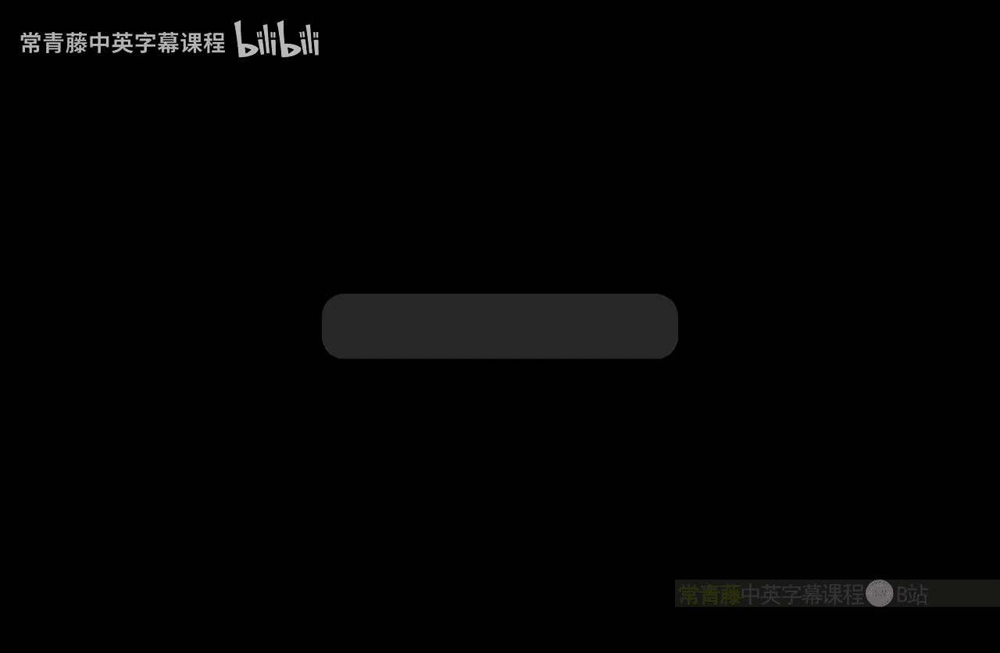

# 滑铁卢大学【中英⚡算法｜CS341 Fall 2021, Algorithms】 p01 P1 CS341 F21 Intro Anna -BV1DhrDBbEwR_p1-

Hi everybody welcome to CS341 My name is Professor Anna Lubu and I'm teaching the course this term along with Professor Trevor Brown we've both taught the course before so you're inexperienced hands and Trevor is going to be doing the first 12 lectures and I will be doing the last 12 so the purpose of this video is just to say hello to you all so you see my face and feel comfortable hope coming to office hours both Professor Brown and I will be doing office hours throughout the term and setting the assignments together and also doing tutorials on Fridays which you can find out about on the course webpage。

Anyway I look forward to seeing many of you in office hours and I hope you have a good term I know it's disappointing that it's still online but on the other hand we've all gotten fairly used to this at least it's not a shock it's not a surprise and。

I hope it'll be a good turn， thank you， bye。