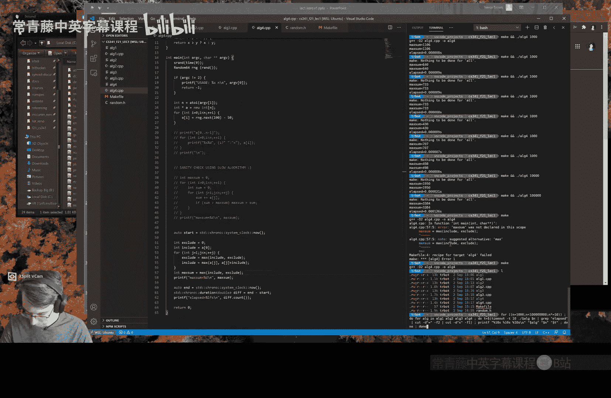

# 滑铁卢大学【中英⚡算法｜CS341 Fall 2021, Algorithms】 p02 P2 Lecture 01 -BV1DhrDBbEwR_p2-

Alright， hello everyone， my name is Trevor Brown and I'm going to be one of your instructors for CS341 algorithms in the winter 21 term。

 the course is going to be co taught with Annaluu。And the course website is right here more about that in a little bit。

Let me start off with a quick table of contents for what we're going to cover in this lecture video。

We're going to touch on the course mechanics and then look at an overview of the course material。

 and then we're going to turn to a worked example of a problem。I've called Bent Lee's problem。

 you might know this also as the maximal subinter problem。

And we're going to walk through multiple solutions demonstrating different algorithmic design techniques that we're going to learn throughout the course。

So let's turn our attention first to the course mechanics。So the course website here。

 so the usual address， you can find there the syllabus， calendar policies， slides， assignments。

 so I recommend that you go take a look at the website and mark down the important dates for assignments and so on because you don't want to be caught and end up missing deadlines because you didn't write them down。

And in this course， it's really important that you try to keep up with the lectures because material really builds over time。

 So if you have trouble understanding material early on in the course and you don't nail it down。

 it's likely that you're gonna end up having difficulty understanding the later material。 So。

 for example， if you don't understand divide and conquer algorithms very well。

 then you may have a hard time working your way through the necessary recurrence relations and the recursion background that really drives the intuition behind dynamic programming problems that we study later。

And we're gonna use course。 We're gonna use piazza， sorry， for the。The discussion in the course。

So questions can be posted there， preferably students will make some effort to answer each other's questions。

We'll also have Ts devoting some time to questions there and well， of course。

 be looking at questions there as instructors as well。 We'll also be making announcements on Piazza。

 So this is really important。 You should stay caught up up to date with whatevers posted on Piazza because we're gonna assume that you've seen and any announcements or assignment clarifications and so on that are posted there。

 So please you know read Piazza and stay up to date。

Talking for a second about assessments in the course。

 all sections of the course are going to have the same lectures， the same assignments。

 the same midterm， the same final。So you don't have to worry about anyconsistencies there。

If you're going to have some severe problems that'll cause you to miss an assignment。

 please notify us as long as possible before the deadline。呃。You know， we're。

Not going to be able to respond the same way to a request。 You know。

 the night of a deadline as we could to one that is a couple days in advance。

 So please as soon as you know that there's some chats you're going to miss an assessment deadline。

 please let us know。And the midterm and final are going to be take home exams for the course。

 I won't go into the nitty gritty details of the grading scheme for the course in this video because I think that's kind of pedantic and not super interesting because you could just find those details on the website。

So take a look at the website to see the grading scheme and of course。

 if you have any questions about it， you can ask questions on Piazza。😊。

So the textbook for this course is Intro to algorithms。

 it's the CLRS textbook that's very well known。So you're free to buy the textbook。

 there are places where you can get it even used for cheap。

But it turns out it's actually available for free via the library website。

 So if you're not the kind of person who needs a physical hard copy of the book to be able to make progress reading it。

 then you might want to check out the online copy on the library website。For this course。

 you're expected to know entire textbook sections as we list them on the course website next to the lectures。

All of the material presented in lectures， unless we explicitly say you aren't responsible for it。

 so not only the material in the book， but also in the slides and anything discussed in the lectures。

There are also of course discussion sections for the course。

 the purpose of these won't generally be to introduce new concepts。

 but rather to practice and reinforce existing concepts， I think at least that's the current plan。

So you know we'll try to be clear about what you're responsible for knowing in there。

 in general we're thinking of the discussion sections as optional。Okay。

 now let me talk about academic offenses for a moment。

 so especially now that this is an online course， we have to be aware of the possibility of plagiarism。

 be careful not to end up plagiarizing by accident。

We generally are fine with you know students discussing one on one with each other having high level discussions about general approaches to solving problems。

 even problems on us on assignments， not however on take home midterms or finals。

 you should not be discussing take home midterms or finals with your fellow students。

 those are absolutely things that you're supposed to do alone in isolation。

 demonstrating your own individual knowledge。For assignments we're generally okay with you having highlel discussions with individual students。

 so don't have a you know huge group chat where you divide up problems。

 but you can have a buddy that you work with and chat about approaches to solving problems。

 Now the typical recommendation that we make in this course is don't take written notes away from such discussions。

 Now this is sort of funny if this is an online course in an online world and you may very well only be having interactions with your friend online。

 And so it's a little bit hard to avoid taking away any written notes from discussions。

 especially if you're having these discussions in text form。

 And so the way that I would phrasese this is this typical constraint。

 the way I would rephrase it for you know the online world is if this is a topic that you could talk about with someone in person you know water coololerverse。

Station and you would not need a whiteboard to help walk through any equations or formulae or to write down any details。

 or remember what's going on that it's probably okay。

 If this is the kind of discussion where you would be using a whiteboard as an aid。

 you should not be having this discussion with your fellow student。 So， you know。

 try to keep the level of your discussion high enough that you're not fleshing at all the details just discussing broad strokes of problem solving。

And class wide discussions， large group discussions of solutions is not okay。

 at least until the deadline is passed， at which point will be publishing solutions generally anyways。

 And you guys are fine to discuss your various approaches with one another。Okay。

Let's try to sketch out the road ahead in this course。I want to ask the question first。

 why is or should CS 341 be important for you and the answer will probably be different for different students from my perspective。

 algorithms is really at the heart of computer science it often appears in later courses。

 really it dominates technical interviews。So if you master this material。

 you're going to make your interviews a lot easier。

And designing algorithms can also be really creative work。

It's useful for some of the more interesting jobs out there。

 so certainly in many of the jobs that you might take after university。

 you won't be implementing fundamental algorithms， but in some of the more interesting jobs that you could possibly find yourself doing。

You may have to perhaps not develop new fundamental algorithms。

Or implement existing fundamental algorithms， but find ways to tweak fundamental algorithms that already exist to serve some new purpose or to conform to the constraints that arise in some new setting。

 and a lot of really interesting work can arise there。And of course。

 it's a required course for all CS and you want to graduate。

What's a computational problem because computational problems are largely what we're going to be talking about in this course？

Informally， it's a description of input and a description of the desired output。

And an algorithm is informally a well defined procedure。

 or a sequence of steps to solve that computational problem。

 to take the input and produce some output。 So an algorithm is what sits between the input and output。

And there are different algorithms of varying levels of performance。

So we can make faster and faster algorithms with better and better performance properties。 And then。

 of course， there's also the question of algorithmic correctness。

 So some algorithms might not be correct at all。Okay。

 let me give you a few examples of computational problems that you might want to solve。

 So here are some fundamental ones we have sorting where the input is an array of integers in arbitrary order and the desired output is the same array of integers in increasing order。

 and see have these nice sorting algorithms， which I'm sure you guys have seen before in C S240 and other probably you've seen some initial sorting algorithms in the first C S course you took as well。

And then you have， for example， matrix multiplication where you have two and by un matrices。

 let's say。A and B， and the output is a matrix C。 That's the product of A And B。

And then we might have， as a more subtle example， the traveling salesman problem where you take as input a set s of cities and distances between each pair of cities。

 this doesn't necessarily have to be a strongly connected graph， but in my diagram here it is。

And your output is the shortest possible path that visits each city and returns to the origin city。

And so， you know， this is a problem that sees applications in， for example， package delivery。

 you know， scheduling the order of destinations for， you know。

 food delivery like Uber eats and so on。Okay， and these problems can have really vastly different complexities。

 and we want to analyze solutions to these problems to determine how good they are。

So every software program that you write uses resources of some kind right。

 So there are different kinds of resources。 They're CPU instructions。

 We typically refer to CPU instructions as time technically not all instructions take the same amount of time to execute some instructions are more pipelineable than others。

 but in order to avoid really complicating our analysis。

 we tend to treat all instructions as if they are the same and take unit time and so we just call this time time analysis。

 runtime analysis。The amount of memory that a program uses by memory， I mean Ram。

 not necessarily disk space， although that could be considered to be a resource as well。 Ram。

 we tend to call space usage。And of course， there are many other resources that we might care about in this course we won't typically talk about them。

 but some other resources that you might talk about in other courses include IO， network bandwidth。

 messages， locks and synchronization overheads for concurrent software and so on。

Now analysis is the study of how many resources or to what degree an algorithm uses resources。

 and usually we do analysis using big O notation to ignore constant factors because。

Constant factors are less interesting than the way that the complexity of the algorithm changes as we increase the problem size because today we have a particular problem size that we want to solve。

 and in the future we might have a much larger problem size that we want to solve。

And whether or not we'll be able to scale a particular algorithm out to work for us in future or whether we have to design a new algorithm altogether is really a function of how the algorithm。

 sorry， how the complexity changes as the input size grows， assuming that our input sizes。

 our demands that we place on our software algorithms increase over time。And there's。

 we can broadly speaking， divide our algorithms into a taxonomy of you know， serial versus parallel。

 deterministic versus randomized exact versus approximate and so on。 And in this course。

 we're really only going to talk about one small slice of the algorithmic landscape。

 let me explain to you sort of where that slice of the landscape sits in the overall landscape。

 So let's talk first about serial versus parallel or concurrent algorithms in a serial algorithm You have a single thread of execution that's executing one instruction at a time。

 in a parallel or concurrent algorithm。 You have multiple threads of execution that are executing multiple instruction at the same time。

 concurrently。Then there's this question of deterministic versus randomized。

 So a deterministic algorithm always produces the same output when you give it the same input。

 So if you repeatedly run a deterministic algorithm on the same input。

 it's always going to perform the same sequence of steps and produce the same output at a randomized algorithm。

Is a little bit different。 So there are different ways of doing randomization。

 You can actually do randomized algorithms that produce deterministic output。

 but take a meandering path to get there。 But for this course， I'm gonna talk about。

 I'm gonna define a randomized algorithm as one that on multiple runs of the same input might produce different outputs。

So for example， you could flip a coin， generate a random number。

 and then base your next action on the result of that。Now， of course。

 if you're talking about a random number generation algorithm that uses a seed as an input。

 you have to vary the seed or else that random number generation algorithm is actually deterministic。

 So you have to be a little bit careful talking about randomization。

And then there's a question of exact versus approximate solutions is the problem。

 So exact algorithms produce an exact solution to the problem。

 usually an optimal solution to a problem。And an approximate algorithm typically produces something that's close to a solution。

 So for example， if you're trying to approximate the area under the curve on the right and this animated diagram。

 you could imagine an algorithm that iteratively refines a discrete approximation until the result has a sufficiently small error and then you stop and call it a day。

Now， in this course， we're typically going to cover serial， deterministic， exact algorithms。

 although if we have time for a bonus lecture at the end of the course， perhaps Anna。

 who will be taking over for me halfway through the course and the lectures will cover some algorithms that are that explore some other interesting niche in this landscape。

Now。Up until now in this lecture， I've been talking about problems for which we can come up with solutions。

 but tractability is the question of whether all problems actually have fast solutions。

 whether it's possible to solve all problems efficiently。

 or indeed whether it's possible to solve them at all。So for some problems。

 such as the traveling salesman problem that we saw earlier。

 we've only found exponential time algorithms so far。Well， wait a minute。 That seems like。

A pretty practical problem that a lot of companies are solving at scale for things like， you know。

 delivery drivers。 How are they solving this problem at scale with maybe 10 deliveries in a day for each truck when we only know exponential time algorithms。

 Well， we only know exponential time exact algorithms。

 and there are actually fast approximation algorithms that can provably produce a result that is some constant times some constant fraction off from the optimal solution。

 you might travel more distance than necessary that maybe only 1。5 times the optimal distance and。

 of course， we have to sacrifice the precision of our solution in order to obtain a solution that we can get in time to schedule the trucks and send them out。

So there are some problems where we've tried for a long time to find solutions to these problems。

 and we've been unable to find fast solutions， and we think perhaps there may only be exponential time algorithms to solve this problem。

So these algorithms are really inefficient， you know， in the case of the traveling salesman problem。

 you know， to give you some informal idea of what exponential time really means。

 adding one stop on your delivery route doubles the run time to precompute the optimal route。 So。

 you know， this becomes incredibly infeasible as you know， if one a two stop route takes one second。

 then a 100 stop root takes， you know an amount of time that you know would result in in all all of the stars in the universe burning out and being absorbed by black holes。

 So you know this really severely limits our ability to solve real worldor inputs。So， I mean。

 tractability is really the question of whether there is a way around this limitation or crucially。

 should we stop trying and really focus on our our energy on approximation algorithms。

 And so that one of the biggest。Or at least most popular open questions intractability is the question of P versus NP P。

 which phrased really informally， and of course， we'll get into this later in the course more formally。

 It's the question of whether it's possible to solve such problems in polynomial time or whether some of these problems。

 perhaps cannot be solved in polynomial time really have to be solved in exponential time。 Good news。

 everyone。So right as I was in the middle of teaching。My new Logitech Bo camera arrived。

 so for the rest of the， you guys get to actually see my face。Okay。

 so let's talk briefly about the topics that we're going to cover in the course。So on one hand。

 we're going to talk about fundamental and fast algorithms to tractable problems。

 these are problems that we know how to come up with fast solutions to。You know。

 these are typical algorithms， some of which you've probably heard of before。

 like merge sort and some of which like Strau and's matrix multiplication， you probably haven't。

We're also going to talk about some graph algorithms， so you know for example。

 breadth for search and depth for search， which you guys have probably learned before。

 we're going to talk about you know Dtra's single source shortest path algorithm for finding the shortest path through a weighted graph。

We're also going to talk about probably some others like Bellman Ford and then for all pair shortest paths。

 we're going to talk about Floyd Warshol and for constructing minimum spanning trees we have I'm not sure yet which it'll be either Cruesscle's algorithm or Prims algorithm and then we're going to talk about topological sort for sort of pulling apart and ordering the dependencies and a graph that represents dependencies and there are lots of other algorithms that we're going to cover this is just a small sampling of fundamental algorithms that I wanted to mention explicitly crucialcily we're going to cover common algorithmic design paradigms so I think it's not just important to understand。

You know， sort of a standard set of fundamental algorithms that we all agree in computer science are important and are helpful for demonstrating useful algorithmic techniques。

 It's useful to build up that toolkit of algorithmic techniques and to get exposure to a lot of different algorithmic design techniques。

 but all of these algorithms to one degree or another fall into one or two of these common algorithmic design paradigms。

 which are really important to get a handle on if you want to do any sort of designing of algorithms or or maybe modifying or extending of existing algorithms。

 adapting them to suit new purposes。So a couple of the design paradigms we're going consider are divide and conquer greedy techniques so divide and conquer techniques try to divide up a solution recursively into smaller sorry a problem into smaller sub problemsblem and then rely on the recursive algorithm to solve the smaller sub problemsble and the creativity comes in as you're combining the solutions to smaller subproble into a solution to the whole problem greedy doesn't explore It's somehow greedy about its approach it takes。

Steps as you're trending towards a solution that seem like the right thing to do。

 given only local information， sort of restricted information about the problem space that you're trying to solve。

So you don't explore all possible solutions， and you don't。

Explore all of the possible decisions you could make at any given point in time to pick the most optimal one。

 You pick some next step to take in solving your problem According to whatever seems best。

 according to some heuristic and that's why we call it greedy。

 because it's just a heuristic method for choosing the next step that we're gonna take towards our solution。

 We're sort of incrementally building up a solution heurically。

 and proving that that local heuristic yields an optimal solution is usually the tricky part in these algorithms。

 So these algorithms are typically very simple and they're proofs of optimality， you know。

 usually we're solving optimality problems Opim problems with greedy。

Those proofs are usually the subtle part。We're also going look at dynamic programming， which is。

Typically not greedy in the sense that we are always exploring all possible ways of picking our next element to add to our solution。

 we're looking at all ways of picking the next step to build towards an optimal solution。

 and we're picking the most optimal。 So rely our solution is gonna rely not on local heuristic decisions。

 but on sort of a careful systematic exploration of all possible decisions we could make。

 and we're gonna pick the one that's provably optimal。

 So dynamic programming is usually the algorithms are a little bit more subtle to cop with sorry。

 they're a little bit。're I think the algorithms are a little bit more subtle and greedy。

 but the proofs are a little bit more straightforward。

 And I would say dynamic programming shares elements of both divide and conquer and greedy。

 And it's kind of an interesting paradigm。Then we're also going to look perhaps briefly at exhaustive search or brute force。

 but I'm not sure if we'll get there。Exhausive search or brute force algorithms are usually the sorts of algorithms that you would come up with if you hadn't put a lot of study into algorithmics。

Because these are sort of the most obvious solutions that jump out at you。

 try all possible solutions。 And， you know， once you've tried all possible solutions。

 you're able to pick the one that is optimal。We're also going put some time into studying mathematical tools for analyzing algorithms because it's one thing to come up with an algorithm and then prove that it solves the problem correctly。

 It's another thing entirely to be able to reason to yourself or to others that your solution will run fast enough or we'll consume a small enough amount of memory that you'll be able to run it and get a solution in a reasonable time or using reasonable computing hardware。

 So we're gonna to study a whole bunch of different tools for analyzing algorithms， big notation。

 of course， you guys have learned before， but we'll recap and a little bit and extend your knowledge。

 perhaps a big notation， introducing things like little omega and little O。

We're also going to study techniques for solving recurrence relations。

 which are a type of mathematical tool that makes it feasible to analyze algorithms that are more sophisticated than just a bunch of loops and straight line codes。

 So algorithms that involve recursion， for example， you need tools like recursion。

 the recursion tree method or the substitution method or the master method for solving the recurrence relations that describe their complexities。

And then we're going to analyze some tools for helping us prove that our greedy algorithms are optimal。

 such as exchange arguments and greedy stays ahead arguments。And then towards the end of the course。

 we're gonna be studying intractable problems。 We're gonna look very carefully at the P versus NP P the class P of problems that are solvable in polytime。

 versus the class N P that are solvable in nondeterministic polytime。

 So we're gonna study those two classes and study a bunch of example。

 problems that fit into these different classes of problems。

 we're gonna study polytime or reductions， which are ways of showing that if you can solve one problem in polytime。

 you can solve another problem in polytime by using a solution to the first one as a black box。

 and we're gonna study the question of decciability， whether a problem actually has a solution。

 whether it's decidable。So what do at least I hope you'll be able to take away from CS 341。

So you're coming into CS341 with a considerable amount of knowledge in CS S。 You know。

 you've studied courses like CS S2，40。 You've studied data structures。

 maybe you've studied a bunch of math， a bunch of electives。

 But until you've done a really detailed study of algorithms。 I think you， you。

 you're like this egg that's got a bite out of you you're， So you're missing a piece。

 And so my hope is that CS341 will complete your egg。

You'll walk away with knowledge of a collection of fundamental algorithms that I just so happens you might also be asked about questions about in job interviews。

 So that's nice。You also walk away with knowledge of fundamental design paradigms。

 which are gonna be useful for building your own algorithms or perhaps adapting existing algorithms。

 or perhaps just in recognizing broad patterns that'll help you categorize possible problems that you'd like to solve and relate them to existing classes of problems that you've seen solved in similar ways。

 And also you'll walk away with the study of tractability versus intractability And this is kind of nice because even working in industry。

 it's surprisingly easy to come across problems that you really want to solve。

 but it turns out they actually are impossible to solve at least if you want an exact solution。

 and okay， I shouldn't say theyre so let me rephrase So there are some problems that are impossible to solve and being able to identify that this is a type of problem that's impossible to solve exactly it's really nice because you don't want to toil away forever trying to solve it when really。

You should just be able to identify that you can't possibly solve it and exactly and try to find some approximate way to solve it。

 On the other hand， there are problems that can be solved just inefficiently。

 and maybe somebody who's incredibly intelligent years from now will find a way to solve these problems in sub exponential time。

 but certainly no one currently living knows how to solve these problems in sub exponential time。

 and we sort of suspect that they're not solvable in sub exponential time or else very surprising things would be true about our our universe。

And for these problems， again， you'd like to be able to to identify that the problem you're trying to solve is。

 in fact， one of these problems， one of these socalled NP completer NP hard problems。

 or that it's a problem that could be reduced to an NP or or that an NP complete problem could be reduced to。

 So if you could solve this problem， you could also solve an NP complete problem。

 which is a very strong which is very strong evidence that this problem is very hard。

 And perhaps you shouldn't toil away for years working on it。

At least unless you're hoping you'll be that genius who will crack the question of whether P is equal to NPp。

Okay， so these are nice things that you're able to walk away with。 And， you know。

 it can't hurt to have a bunch of mathematical techniques for algorithm analysis under your belt as well。

 because when you write an algorithm， it's nice to be able to quickly do some back in the envelope calculations and argue to yourself that this will either take 10 seconds or  five years to run。

 So I'm hoping that you'll walk away a happy egg with all of this stuff under your belt。

 feeling nice and confident that you'll be able to apply algorithmic techniques in the real world。😊。

Time for a coffee break。What are the nice things about。Preparing lectures online。

Okay， so enough of the preliminaries and background， let's talk about Bentley's problem。

 Let's do this worked example so we can try to demonstrate a few of the algorithmic design paradigms that we talked about in the previous slide。

So what's Bentley's problem？Well， you're given as input an array of n integers， A1 up to A N。

 And you want to find the maximum sum of consecutive entries of a。

Okay so let's go through a couple examples to demonstrate this。

 so here's an array I've drawn the array indices in the bottom。

 I've numbered the array indices starting at one just because even in practice。

 if they typically start at zero， in theory， they often start at one to make the notation more convenient call me a monster if you must。

So here we have an example array containing 1，7，4，0，2，1，3，1。 and these are all non negative integers。

 right， So what's the maximum sum of consecutive entries of a。Clearly， it's the whole thing。

So we just sum them all up， 19 is the answer。Here's another example where all of the entries are negative。

 And in this case， the maximum sum of consecutive entries is the sum of no entries at all。

 Just don't take any of them。 the solution is 0。Okay， here's a more nuanced example。

 Here we have one negative 7，4，0，2， negative 1，3， negative1。Okay。

 so we don't want it to include this one the in the sum because1 is clearly not the maximum。

 We could just take 4，4，0，2， and that's 6。 Really， if we include this 1。

 we're gonna have to get any more numbers。 We're gonna have to include this negative 7。

 which seems quite nasty。 So 4，0，2 gets a 6， and we can decrease that to 5。

 by taking this negative 1。 and increase it again to 8。 So that turns out to be optimal。

 It's fairly easy to see 4，0，2， negative 1，3。So the solution is 8。

 I need these really small worked examples， it's pretty easy to see what the。

 what the optimal solution is。 But in much larger examples， if you have， you know， a billion。

 if n is a billion or 10 billion， you know， all of a sudden it becomes quite difficult to decide what the maximum sum is。

Okay， so if I ask you to solve this problem。If you wan to pause the video and just try to solve this problem briefly by yourself。

 whats， maybe start out with just the absolute simplest solution you could possibly think of。

 So try to come up with the simplest solution you could possibly think of。

 And what run time do you get。So I'll wait a moment for you guys to pause if you're interested in doing this little exercise。

Okay。So Im to assume if you want to to pause you've done so。

 let's see a brute force solution to this problem。 So this is really the simplest thing you could imagine all we're gonna do is we're gonna try every possible subinterval of the array because that's really what we're doing。

 We're taking the sum of consecutive entries。 So that's picking a subinterval of the array from I to j for some I and sum j and summing up all the entries between I andJ and then we're gonna just do that for all possible subintervals and and then figure out which one gives us the largest sum。

 So all combinations of I and J where j is greater than equal to I。

 and we're gonna then for each choice of I andJ， we're gonna to sum up over K from I to j Okay so here's picking an I andJ over all the K between I andJ sum up all the entries。

 and that gives us a candidate sum。So this is our our pseudocode for this。 Qui straightforward。

 Initially， we have a candidate maximum of 0。 We're never going return anything smaller than 0。

And then we have these two four loops where we pick I and J。

 all possible choices of I and J and J starts at I right。

 So we're not going to pick J to be before I。Okay， and then for each choice of I and J。

 we're just gonna compute。 We're just gonna sum up for k equals I to J。 So you know， G obtain a sum。

 That's the sum of all those A K。 And then we're to compare the sum to the maximum sum that we've observed so far。

Okay，I would guess this is probably pretty similar to what each of you came up with if you paused and did little exercise to come up with a straightforward solution。

I want to ask you， what's the runtime of this algorithm？So。

Take a moment and pause the video if you want to answer that question。

 or maybe you can just answer it super quickly and don't need to pause。

Okay I'm going to assume that you've paused it if you。If you want to do this exercise。

So we have three four loops here right and they're all nested。

 so this is a four loop from I equals 1 to n。So clearly there are n iterations of this there's a for loop from I to N。

So， well， this is a little bit trickier。 We can't just say this is an iterations， right， But this is。

For half of these iterations for  equals 1 to n。So half of those iterations， in particular。

 the ones from from1 to n over2， that's half of the iterations of this eye loop。For those iterations。

 I。Is at most n over2 and the distance from n over 2 to n。Is n over 2。

 So even though this is a complicated expression， know， for J equals I to N。

This is at least an over two iterations。For half of these， eye iterations。

So you're going to get something like n squared order n squared iterations for these two loops。

 although it's a more complicated expression。So we'll talk a bit more about Biggo and how you do this analysis later。

 although I hope for a lot of you guys， this is just old hat and you've done this in CS 240。

 and you can answer this question fairly easily。Now， for this I to J loop。

 it gets even more complicated， right， you can do the same sort of analysis that I did for。

 for these previous two loops to to discover that all three of these loops taken together is actually order and cubed time。

Okay， so can we come up with a slightly better algorithm for doing this， I mean。

 it sort of seems unnecessary to have this K loop， right， Well I mean， why do we have to sum up。

All of the possible entries between I and J。 I mean， instead。

 as we're incrementing J over and over again， as we're exploring this second loop from J equals I to N。

 Every time J increases really， what's happening is we're increasing the sum by A A of J。

 So why not just improve our， our algorithm by getting rid of the the K loop and just adding a J to the sum every time。

So that gives us an n squared。 Clearly， this is， you know。

 better than order n cubed because we only have two loops， and we're just doing constant work inside。

So this ends up being n squared time。 So this is still a brute force algorithm。

 We're still trying all possible pairs of I and J， such that J is greater than equal to I， but。

You know， this is， we've shaved off a factor of n。 So this makes it tractable to solve much， much。

 much larger problem sizes。 So， you know， in a modern machine， we could， you know。

 feasibly solve for a problem size of maybe n equals 10 million with an n squared algorithm。

 It would take a long time to run， but you know， it wouldn't take days。 It would take， you know。

 minutes in a reasonably fast programming language。That might take a while using a Python list。O。

Now we can do actually considerably better。 it turns out。

 but we have to get into more sophisticated techniques than just brute force。

 So our third solution to Bentley's problem is going to be a divide and conquer solution。

So what we're gonna do is we're gonna take our array and split it into two equally sized parts。

 So we're just cutting in half。 You know， we have an array。

 Let's just assume to make this analysis simple that the array size is a power of2。 that way。

 every time we cut it in half， it's， it's an even split。 That's not necessary for this solution。

 I'm just doing it for the sake of making our discussion here straightforward。

 So we don't really have to think about， you know， unequal sized halfs。

But it doesn't really enter the discussion it's not important。

 that you can just put it out of your mind。Okay， so our solution， if you think about it。

Once you split this up into two subs， a left half and a right half。The optimal solution。

 the optimal sub intervalter， either has to be entirely in the left half or entirely in the right half。

 or it has to cross over the two arrays。 It has to cross the partition line。

And so this is going to induce three cases that we're gonna solve in slightly different ways。

 So case1， if the optimal solution is entirely in the left half， as it is in this particular example。

 where you can see that the optimal solution is， is 9，-3 and 4。 Okay。

 we're not gonna make this solution any better by adding anything to the right because it's overwhelmingly negative。

 right。So 9，3 and negative 3 and 4， this is 10 is the optimal solution that's right there in the left half。

 okay。There you go。And case 2， the optimal solution is entirely on the right half。 Okay， fine。

 It's symmetric。 I won't bother drawing it or giving an example。 Case 3。

 the optimal solution crosses the partition between the two halves。 So this is the example。

 This is an example where that's true。 So we， in fact， we saw this example before。

 The optimal solution was 4，0 to negative 1，3， right， And that crosses over the middle partition。

 So have these three cases。Now the way we're going to solve this in the divide and conquer paradigm is we're going to recursively we're going to given the array A。

 we're going to split it into two halves L andR。We're going to recursively solve。

Just by making a recursive call for the maximum sub in the left half。We'll call that max L。

 We're going to recursedively solve for the maximum sub array in the right half。

 We'll call that max R。And then we're gonna do something creative and more sophisticated to find the maximum sub array that's going across the middle partition line。

 and we'll call that max M。 And my claim is this finding of the maximum sub array going across the middle partition line can be done in linear time。

 order end time。And now the solution， as we argued。

 has to be one of these three cases so it's going to be the max of maxl max R and maxm。

 We get maxl and max R just from our recursive calls。

 we don't have to worry about them they if we solve this if we figure out how to take those two solutions and combine them with some extra creativity into a solution to the whole problem which is what we're doing by taking the max of these three things and calculating this max sub going over the middle partition line then we don't have to worry about how these recursive subproblems are solved。

 We assume that they're solved correctly and we show that if they are solved correctly under our assumption then our combination of the solutions of the subproblems into a solution to the whole problem should also be correct and that's what we're going to do here so you can see if we have a correct solution for maxL a correct solution for max R and we find maxM ourselves in linear time。

Then we're gonna be able to combine these， these three solutions in linear time into a solution。

 And then it's a little bit more sophisticated to calculate the runtime of the whole recursive algorithm。

 that requires techniques we're gonna talk about over the next couple of lectures。

 But I'll give you the punch line that it's a fast algorithm。

 So let's see how we compute the maximum sub going over the middle partition。

So suppose we have this example that I showed in the previous slide where the optimal solution does cross over the middle partition。

 How can we find the maximum sub array going over the middle partition Well we could do so by trying all possible subares。

 all possible subintervals， but that would be slow。

 we want to do something more intelligent than that we want this to take linear time。So。Here's the。

 the interesting insight that makes it possible for us to do this in linear time。

We're going to find the I that maximizes the sum from I to n over 2。

 So So I is going to be on the left half。So we're going to find an I in the left half that maximizes the sum from I up to n over 2。

Okay。And we're going to want to do that efficiently in linear time。

And then we're going want to find a J that maximizes a sum over n over 2 plus1。Up to J。

 So J is gonna be on the right half， right， And we know this is。

 we're looking for a sub array array that goes up over the middle partition。

 So I is gonna be to the in the left half。 And J is gonna be in the right half。

 So that sort of restricts the sets of I and js that we have to check a little bit。Okay。

 so J is going to be on the right half。 We're going find the J that maximizes the sum on the right half。

 So we're finding the I that maximizes the sum on the left half from the middle， going to the left。

 or find the J on the right half that maximizes sum on the right half from the middle。

 going to the right。Okay， and we can prove that a of I to J is the maximum sub array going over the middle partition。

 And I'll do that in the next slide， although it's not a particularly difficult argument。

So how do we do these these， how do we find I and J in linear time。 Well。

 it's actually quite straightforward。 we start at the middle。

And we start iterating for I to the left。 and as we go。

 we add a we're going to go for I equals n over2 down to one and for each I that we explore。

 we're going to add A of I to the sum。And we're gonna do this for each possible entry。

 So this is a single four loop。 And we're gonna remember what the maximum sum that we saw was similar to our rootte 4 solutions。

 But this is just one loop for I equals n over 2 down to1。

 And we're just we're using the same trick that we use to avoid that K loop where we were summing all the entries from A of I to A of J where we're just every time we explore a new I。

 we're adding a of I to the sum。 we're gonna take the maximum sum。

 And we do the same thing on the other side for J。 So that's how we find these two sums that maximize the sum on the left half and maximize the sum on the right half in linear time。

Okay。😊，Now let's prove that that is， in fact， the maximum sub array going across the middle partition。

So why is a of I to J maximal， suppose it isn't to obtain a contradiction。

Then there's some AI prime to J prime that crosses the partition and has a larger sum。If this sum。

From A of I prime to A of J prime is bigger than the sum of A of I to A of J。

Then either this sum on the left L prime is bigger than the sum L。

 or this sum on the right R prime is bigger than the sum R。

If both of these are the same size or smaller， then this sum can't be bigger。

 the fact that this sum is bigger means either the left half has to be bigger than this left half or this right half has to be bigger than this right half。

 but that's impossible because we just said that we're picking I。

 such that L is the biggest sum you can get in the left。

And J is yields the biggest sum that you can get on the right。 So this is impossible。So this means。

 I we've obtained our contradiction， and A of I to J must be maximal。Okay。

 so let's see how to actually implement this algorithm。 It's fairly straightforward。

 I reason about it already。 but here's some pseudocode that I threw together on the left。

 and let's just walk through a quick example， This is this is a different example。

 Im gonna walk through the three different cases。 So so if we want to solve this divine conquerr problem。

 we first compute the size of the array A， that's n。 and then we have the base case。 Okay。

 so you always have a base case。 if n equals one， then we know what the maximum sum of the subar is。

 right， if a of1 is negative， then it's just 0， Otherwise it's a of1。 that's。

 that's the maximum sum for a single array element。 Okay， so we solve the one case。

 now for a recursive cases。 We're gonna solve for max L。😊。

Say so we're a recursive call on the left half of the array。

 or we're gonna solve for max R and we're gonna solve for max R next。

 We're gonna do a recursive call on the right half of the array。 Then we're gonna compute Max M。

 And here's the computing max M procedure that I talked about。

 So we'll we'll walk through these different techniques。 So first， the recursive call on the left。

 It's gonna find that the largest sub array on the left half is that It's 10。

And it's gonna do a recursive call on the right half。

 The largest sum on the right half is gonna just be 3。Okay， so max R is 3。

 and then it's gonna compute。 We're gonna compute Max M。 Okay。

 so we're gonna do this by computing max I here。So max I is going be our sum on the left。 and max J。

 I've I've given these， these names that I didn't give them on the previous slide。

 So max I is the maximum sum on the left here。 And max J is a maximum sum on the right here。

 or to compute max J which is so negative 2 plus negative 5 plus 3。 well， that's still negative。

 That's negative 7 plus 3 is negative 4。 So it's actually better to take no elements here。

 So max J will just be 0。Okay， so max M is max I plus max J， which is5。

 and now if we take the max of all three of these， which is what we do at the end here。

We can see the max of 10，3 and 5 is 10。 So our algorithm correctly finds in this input that the maximum sub is these first three elements。

 which happen to be entirely in the left half。 So the first recursive call gave us the correct answer。

And we'll do one other quick example here where the maximum sub array is gonna be the one that crosses the partition。

 You can probably already predict how this is gonna work。 We do。

 sorry about the misaligned error arrows here。 That's my mistake。

 I'll fix those before the slides are actually posted。So for our first recursive call。

 we find that the maximum subarray on the left is just four。

 so max L is4 or the maximum subray on the right is also4。So Max R， oh， I， that's funny。 Okay。

 I've made a mistake here。 Sorry， this is supposed to be4。😊，All again。

 fix that in the slides before I post。 Then we compute max M， which is gonna be or gonna。

 it's gonna be okay。 So this， the sum to here is 0。 the sum to here is 4。 So okay， we should take 4。

 The sum to here is negative 3。 That's definitely not the maximum。 The sum to here is negative 2。

 That's definitely not the maximum 4 is the maximum。 And then calculating max J to the right。

 We have 2，1。4，4。 So 4 is the maximum on the right here。

 And then max M is gonna be the sum of max I and max J， which is 8。 And the max of 4。

 This should actually be a4 here。 and 8 is 8。 So this correctly finds that the maximum is crossing the partition boundary here。

Okay， now I I didn't plot out the the actual recursion that happens in these recursive calls。

 but it's not important， right， You guys understand recursive algorithms。Okay。

 so it turns out that this runs in order and log n time and。It， it's likely that at this point。

 you know， the knowledge that you have in computer science so far hasn't actually equipped you to do this kind of analysis。

 If I asked you to analyze this function， you probably wouldn't have the mathematical tools that you need to do so。

 So this is something that you're gonna gain in this course。

 The ability to actually do the runtime analysis on this algorithm。

So we need new mathematical techniques。 this is where recurrence relations。

 the recursion tree method and the master theorem are going to come in。

So this this result is actually quite， quite good。 And log N。

 you can run this for enormous problem sizes right， This is about as efficient to sorting。😊。

But can we do better And when I say better， really， I mean， asymptically better。Okay， finally。

 let's see a solution for Bentley's problem based off of dynamic programming。

So this solution is gonna seem perhaps a little bit strange or a little bit magical even at first。

 But it's be because it's pretty hard to get into this stuff without really diving into what dynamic programming is。

 but I'm gonna do my best to give a， you know， no dependencys description of how this algorithm works。

 hopefully this description will make sense。 if it doesn't， don't worry if， you know。

 dynamic programming seems a little bit magical at first。

 when we eventually cover dynamic programming。 Hopefully。

 you'll see enough examples that it'll start to make sense to you。Okay。

 so what we're going to do is we're going to define two functions。

 which will really be recurrence relations。 We're going to make these two definitions。

 So we're going to define include J。 and then we're going to define exclude J in a moment。

So we're going to define include J to B。 This is a mathematical object。

 We're defining it to be the maximum sum of consecutive entries in the array 1 to J。

 So it's a sub arrayray， right we're considering a restricted prefix of the array。

 We're restricteding our attention to the prefix of the array from 1 to J。

 and we're asking what's the maximum sum of consecutive entries in that subarray。

If the sum must include the last element， AJ。 Okay remember it's consecutive entries。

 So what this means is the sum is going to include AJ。 And it's I。

 so it's either going be AJ itself or it's going to be AJ。

 And then some number of elements before that。Right。So it's， it's some suffix of the array a1 to J。

 Okay， and it's the， it's in particular， the the maximal。

 it's the suffix that maximizes the sum of entries。 Now。

 exclude J is the maximum sum of consecutive entries in the array 1 to J。

 So it's the same restricted subar。 So the sum must exclude a of J。 So this is。

 this is the best you can do if you don't use a of J。 So include J is the best you can do。

If you include A F J and exclude J is the best you can do if you exclude A F J。 Okay。

 so we're just defining these two mathematical objects for all J。for all J。From one to n。

Now observe if we had a way of solving for include J and exclude J for all J。

Then the solution to our problem would just be the max of include n and exclude n。

 because think about it。 Innclude n is the maximum sum of consecutive entries in the entire array。

If the sum must include A of n， the last element， an exclude n is the maximum sum of consecutive entries in the entire array。

 If the sum must exclude A of n， this represents both possibilities， right。

 So include of n is the best you can do if you include A of n and exclude n is the best you can do if you exclude A of n。

 So the best you could do for any sum of consecutive entries in the entire array would just be the max of include n and exclude n。

 Okay。Now， the question， of course， is， how can we efficiently compute include J and exclude J for all J？

Well， we can define recurrence relations to solve for include and exclude。

 and here's how we're going to define them。So let's look at a base case first these are recurrence relations。

 so at the bottom of the recurrence， there's a base case。

 so in of1 is the best we can do with the array a of 1 to 1， so just the single element A of 1。

 if we must include in the sum， a of1， well that's just a of 1。Right。

 and exclude one is the best we can do using， you know， for the sum of a subinterval of the array。

 a 1 to1， if we exclude a of 1。 Well， well， that's just 0。Gs the base case。 Now。

 what about the recursive case will include of J。Is going to be is going to break down into two possibilities。

 right， so that there are two possibilities。 Either we're going to start a new sum of consecutive entries starting at AJ。

 or we're extending the best sum that ends at A of J -1。So those are gonna be our two possibilities。

 and these are really the only possibilities for an optimal solution to include J， however。

 include J has to be the maximum sum we can get using the array prefix a1 to J using a subinter of that array prefix。

And in particular， we have to include A of J。 So it has to be a suffix。 So either there's some。

 sum that we're going to extend。Using A ofJ， or we're going to start a new sum。Starting at A of J。

 Okay， so either it's going to be A of J or it's going to be A of J plus。Include of J -1。

 In J -1 is the best we can do。Using the elements a of 1 to J minus 1。

If we have to include A of J -1。 And so this is going to be a sum that includes A of J -1。

 we're going to add A of J to it。 So that's still going to be consecutive elements included in the sum。

 Those are the two possibilities for include of J。 It might take you a moment to absorb that。

Perhaps take a moment to think about it。 can you can pause and think about it， if you like。

And I I will go through an example after this。Now， exclude。If we're excluding a of j。

 then the best we can do using the elements in a of 1 to j is simply the best we can do using the elements a of1 to j minus1。

 because we're not using element a of j。 So what's the best we can do using the elements a of 1 to j minus1 well it's the max of include a of j 1 and exclude j minus1。

Okay， so this is the best we can do using all the elements except for AJ。Okay。

 now we can compute these two。 So that's defining these recurrence relations。

 which I claim implement the defined mathematical objects that I introduced a couple slides back。

 So I claim that this recurrence relation is a solution， a mathematical solution to the to。

 to produce the mathematical objects that we desired on the previous slide。

 Now we can compute these actually compute these numbers using two arrays。

So if you recall the base case include J definition recall the definition here。

I'm going to show you how we can compute these recurrence relations。Okay， so here we have a。

 the source array。 And here we have the include array。

So include one should be the maximum solution in A1 to1 that includes a of 1。 Okay， let's just one。

Include 2 is going to be the max solution in a1 to 2 that includes A2。 Okay， and。

 and we've said this is how we're going to solve that。

We claim that this is a solution that produces this mathematical object with this definition。

So how do we actually implement this， well， you know。

 the first lot we're just going to plug in A of 1。The second slot if include。

 we're going to take the max of a of 2。Which is negative 7 and a of 2。Negative 7 plus include of J-1。

 which is the best we could do。诶。With the sum。For a sum of the array， a1 to 1， including element A1。

 So that's going to be negative 7 plus 1 here include of J -1。Okay。

 so we're just going to fill in the array like this。

We're going to keep using this recurrence relation to just fill in the array。

Eventually we fill the whole array up so you can double check that these numbers make sense。

 it's a good exercise too。That's how we compute include J。 Now， to compute exclude J。

 we have our base case。 Ex of 1 is 0， and then exclude of 2，3，4，5。

 We're gonna fill in using this recurrence relation。 Okay。

 so we're gonna fill in include first because it just depends on earlier elements of its own array。

 whereas exclude depends on include。 So we're gonna fill in exclude after we fill in。

 include the relevant include entry。So you can see exclude J depends on in of j -1 and exclude of J -1。

Okay， so slot0 is just gonna be 0 according to the definition。

 slot 1 is gonna be the max of include 0 and exclude 0， which is 1。Right。

And exclude 2 is gonna be the max of include 1 and exclude 1， which is one。And this continues。

 And you can double check these numbers。And eventually， we have include n and exclude n。

And we can see that the max of these two eight ends up being the solution to the whole problem。Okay。

 so if we wan to turn these recurrence relations into code， basically turning what I just， you know。

 the， the algorithm I just walked through into code。 it's pretty simple。

 you define to array exclude and include。 you initialize them with the base case。

 And then you have this four loop for j equals 2 up to n。

 We just repeatedly assign exclude J and include J， you know， alternating。

 It doesn't particularly matter that these two are in the same loop。

 I could have done them in different loops。 I could have done the include loop first because it doesn't actually depend on exclude at all。

It's just important that include J -1 is done before exclude J。

 because exclude J needs include J -1 to be finished。

But that's fine because we're just computing this in a loop。 every time we compute J。

 the J-1 has already been computed。 And at the end， we return the max of exclude n and include n。

Okay， now。😊，Do we actually need these arrays， Okay， and the recurrence relation。

 there's a very direct translation from the recurrence relation to arrays。

 But do we actually need the arrays， You know， when we're computing exclude J and include J。

 we only need the J minus1 element of each of these arrays， right， We only need the last element。

And at the end， the answer that we return only needs the last element， right。

 So it sort of sounds like maybe we could get away with using only the last element。

 keeping only the last element。 So we can create a more space efficient version of this algorithm by basically getting rid of the arrays the array subscripts and semantically。

😊，At the time that we compute exclude J， we want the include variable to represent include J -1。

And it does。At this point， you can verify， you know。

 as an exercise that at this moment in the algorithm。

 this include variable semantically contains include j -1。

 and this exclude variable semantically contains exclude J -1。

 And this include variable semantically contains include J -1。 And then after these assignments。

 these semantically contain exclude J and include J。 So at the end of the loop。

 this contains exclude n， and this contains include N So the algorithm will perform exactly the same sequence of steps and produce the same values。

 But we're only using two variables。 So this has only constant space overhead over top of the input array。

😊，So this is a super efficient solution， what's the runtime on this？

If you want to take a moment to pause and answer。I'll give you a second to do that。Okay。

 so the run time for this is linear。So you can actually solve this problem in linear runtime and only constant added space beyond the input。

Now。How do these algorithms actually perform in practice。

 Because we've talked about their theoretical runtime complexities。

Sometimes the theoretical runtime complexities because they hide constant factors don't accurately portray how long it actually takes to run these things on a real system。

 And so here we actually have performance results， some of which are real numbers and some of which are extrapolated。

诶。For these are run on a real system。 Now， these are， these were run on a pentium 2。

 So I didn't run these numbers。You know， people who taught this course before I did around these numbers。

And app pentium 2 is a pretty old system。 This is like Zrca 1997。So we've come a long way since then。

 but you can still see that these numbers or the extrapolated numbers suggest that no matter how much technologies progressed since then。

 you know， you still can't meaningfully solve large problem sizes with， you know。

 an N cubed algorithm for the solution。 the first solution because， you know。

10 million elements takes 140000 years to compute in this extrapolation。

So we can see the fact that it takes 140000 years for solution 1 and 4。

2 seconds for solution 4 means that the algorithmics here really matter a lot。

But there's also another point you could make that the analog log n solution might be good enough。

 Maybe you don't necessarily have to push that last mile to get the most efficient solution possible in terms of asymptotic complexity。

 Sometimes something is not optimal but is close enough is sort of good enough in practice。

 So analog log n is actually pretty reasonable。Okay， but how about a more modern system， you know。

 ever since I started teaching this course three years ago。

 I've been really curious to know how these results would change if you ran it on a system that wasn't 25 years old。

So I actually ended up coding this up。 I coded up all four algorithms and a couple extra variants of them over about 35 minutes。

 and I prepared a time lapse。 So， well， if you're curious to see it。

 you can stick around and otherwise consider the mandatory content for this lecture finished。

See you guys。🎼The。🎼嗯。

