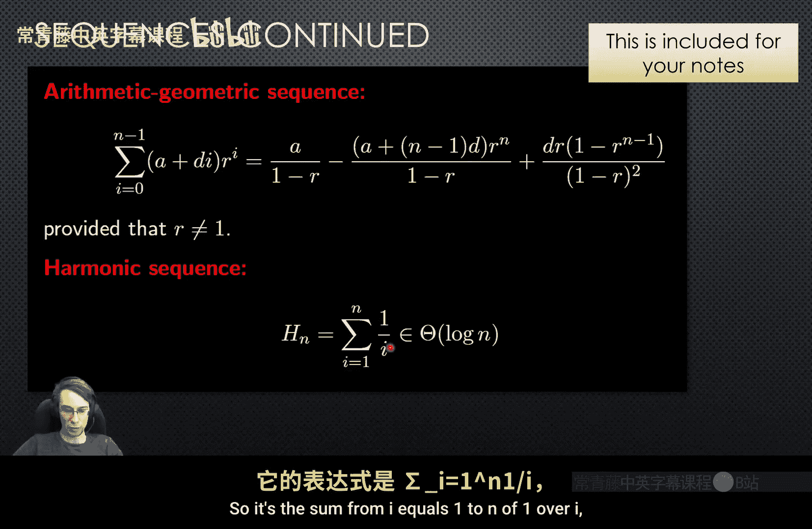
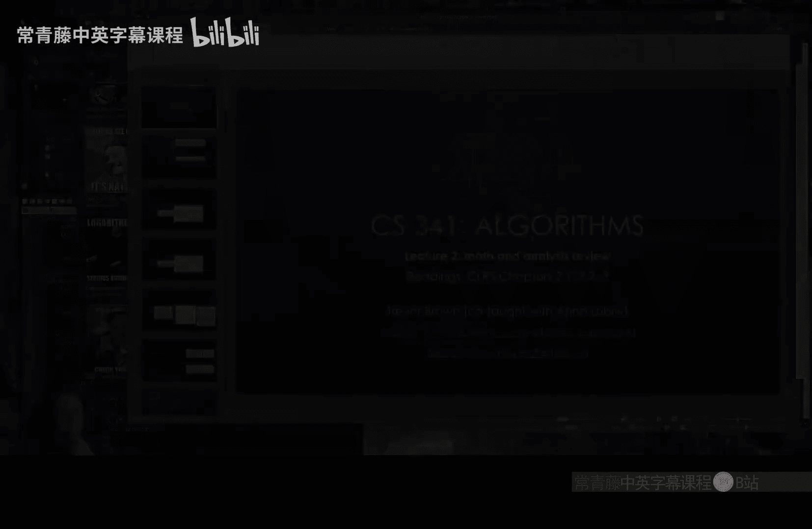

# 滑铁卢大学【中英⚡算法｜CS341 Fall 2021, Algorithms】 p03 P3 Lecture 02 -BV1DhrDBbEwR_p3-

All right， welcome back to another episode of CS341 algorithms where we meet twice a week to discuss algorithms。

And today we're to be talking about mainly background material。

 but we're also going to delve a little bit into analysis。And the readings are listed here。

 but they're also going to be duplicated on the website。Okay， so first things first。

 you guys have definitely learned big O notation before in CS 240 and probably in some other courses as well。

 we're going to do a very quick recap regarding the formalism behind big O notation and we're also going be describing a couple of different types of big O notation that perhaps you guys aren't going to be as familiar with。

 like little O and little omega functions。Okay， so let me dive into the formal definition of what it means for f to be in big O of G。

And I want you guys to understand the formal definitions because a couple times in this course。

 we might ask you to prove that F is in big O of G or is not in big O of G using first principles。

And so using first principles means referring to a formal definition like this and actually proving that。

Okay， so here's the formal definition， if there exist constants that are positive， see and not。

Let me grab the laser pointer here， such that this relationship holds F is between 0 and c times G。

For all large n and greater than equal to n not。Then we say that F is big O of g。Okay。

So here a couple things to note C at the n not have to be positive。 That's important。

 F' people often forget。 they， they remember the F is less than or equal to c times G part of this relation。

 but they forget that F has to be non negative part of this relation。

 So F has to be between 0 and C times G for large n。 Okay， so none of this has to hold for small n。

 But we want to find some large n not， such that for all n greater than equal to n not。

 this relationship holds。Okay， and F is in O of G intuitively means that the complexity of F is at most the complexity of G。

 or it's not higher than the complexity of G。 So it's less or equal。Okay。

 so here's what this looks like。 You have F， which is this nice blue curve。 and then G。

 which is this curve。 I I， I think it's red。 You'll have to forgive me for being somewhat colour blindind。

And n is the point at which this relationship holds F is non negative and it's less than or equal to c times g。

Okay， so here we have F is in big O of G。 omega， big omega is similar。

 So F is in big omega of G if there exists positive constant C and n not such that C times G is between 0 and f for all large n。

 greater than equal to n not。 So this is just kind of the opposite F is not lower。

 It's greater or equal to the complexity of G。 And here C is being applied to G where so the intuition here is that you can multiply G by a C that's as small as you like as long as it's positive in order to make sure that C times G is less than or equal to f。

 Okay， so it looks like this here G is less than or equal to F。

 C times G is less than or equal to f for all n greater than equal to n n。And it's also non negative。

Okay， then big theta is intuitively just a combination of big O and big omega。

 So big theta implies both big O and big omega。 And if you satisfy， you know， big O and big omega。

 then you also satisfy big theta。So， okay， so F is in theta of G。 if there exist positive constants。

 C1， C2， and and not such that we have this expression here that's satisfied。

 So all of all three of these expressions need to be non negative。 of course。

 F is trapped between C1 times G and C2 times G。And， you know。

 C 1 times G has to be greater than equal to 0。 And this has to hold for all large and greater and equal to n n。

 This， you know， intuitively says that F and G have the same complexity。 That is their。

 their complexities differ by at most a constant factor because clearly。

 you can sandwich which F between a constant times g and a constant times g。So this， again。

 this doesn't need to be true for small n， but for large end， this has to be true。

 And all three of these curves have to be non negative after and not。Okay。Okay， so。Let's see。

 this is all stuff I've mentioned。 F is in big theta of G means that F is in big O of G。

 and F is in big omega of G。 And you can think of the C1 times G is establishing that F is in big Oomega of G and the C two times G is establishing that F is in big O of g。

Okay， so in intuitively big O plus big omega equals theta。Okay， and if f is in theta of G。

 then G is also in theta of F。 Okay， we'll talk about that more a little bit。 Okay。

 so on the stuff that maybe you guys haven't seen before。

 I w to mention little O notation and little Oomega notation。

 So these are a little bit different from big O and big Oomega I'll explain the differences in these definitions。

 So F is in little O of G。 if for all positive constant constant C。There exists。

Some positive constants and not such that this relationship holds for all n greater and equal to n n for all large n。

 So here， unlike in the big O definition， where we say there exists positive C and n not here。

 We're saying for all positive C， there exists a constant and not positive constant and not such that this relationship holds。

 So what does this mean， This is sort of like big O， except we have a for all here。😊，Well。

 this for all is really important because it says for every possible choice of constant multiple C。

 that's positive。F is still less than or equal to G。In other words， F is less than or equal to G。

 no matter how small we make C times G。 Okay， so we can make you you。

 you can imagine you could set C to an incredibly small number here， right like 1 over 100。

1 over 100，1 over 1 million，1 over 10 to the 100，1 over 10 to the 10 to the 10 to the 10 to the 10 for every possible constant C still F of n is less than or equal to C times G。

So no matter how small you make this right side by changing this constant multiplier。

 F of n is still at most C times G。 So what this means is the complexities of F and G differ by more than a positive constant。

 they differ by more than a constant factor because if they differ only by a constant factor。

 there would be some small G that would flip this relation。

 So F and G differ by more than a constant factor。 It has F has lower asymptotic complexity than G。

Okay。And little omega is just the opposite of this。

 says F has higher asymptotic complexity than G because for all positive constant C。C times G。

 even if we make this constant enormous， this is still less than or equal to F for some large values of n。

 So we can make C times G enormous by making C 10 to the 10 to the 10 to the 10 to the 10 and so on。

 as long as it's a constant， any gigantic constant。

 we can still show that C times G is less than or equal to F for large n。 Okay， if we can show that。

 then that means that F is in little omega of G F has strictly a higher complexity than G by they differ by more than a constant factor。

Okay， so that's little O and little omega。 And you'll note if if F and G differ by more than a constant factor。

 if F has strictly lower complexity than G， then it's clearly also true that F has at most。

 the complexity of G。 So little O F in little O of G implies F is in big O of G， Similarlyly。

 F in little omega of G implies F is in bigomega of G， but the opposite is not true， right。

 because F has strictly lower complexity。 And so this isn't necessarily true。 So as an exercise。

 you might try to think of a couple of functions F and G， where f is in little o of g。

 but it's not sorry， F is in is in big O of G， but F is not in in little o of G。Okay。Okay。

 so I've thrown up an exercise slide here so you guys can。

 if you feel like doing the exercise before I give you the answers。

 it's always nice to have active learning。😊，You can go through this list of， of relations。

 And for each of these relations， where I say， for example， n squared is in big O of n cubed。

 Try to figure out whether that's true and try to justify that。 And I'll you know。

 give you all the answers in a moment。 So， you know， feel free to pause and answer all these。

 I'll give you a moment to do so。And I'm now gonna assume that you've answered these if you wanted to do so and you've unpaused and you're ready for the answers。

Okay， so n squared is clearly in big O of n cubed， right。

 because the complexity of n squared ist most the complexity of n cubed。

So this is something you should be able to answer with previous knowledge。

 N squared also is smaller than N S N cubed， grows slower than n cubed by more than a constant factor。

 right， It's a non constant factor。 N。 So N squared is in little low of n cubed as well。😊，Now。

 is n cubed in little omega of n cubed， No， they differ by only a constant factor。I mean。

 in this case， they don't differ by any factor。 they're exactly the same function。But they。

 in order for n cubed to be in little omega of whatever here or on the right。

 N cubed would have to be larger than whatever' is on the right here by more than a constant factor by a non constant factor。

 I'd have to be to。 it'd have to grow asymptically faster than what's on the right。

 So that's not true。Okay， is log n in little O of n。 Well， yes。

 log n grows more slowly than n by a non constant factor。

 log n is asymptotically slower growing than n。 The complexity of log n is smaller than the complexity of n。

 I'm rephrasing all of these things a few different ways that you guys can get used to hearing all of the different ways that we tend to say the same thing。

Okay， as n log n in big omega of n， yes。Incidentally， n log n is also in little omega of n because。

 in fact， it grows strictly faster than by my by more than a constant factor than n。And remember。

 big omega so the fact that n log n is in big Oomega does not necessarily imply that it's in little omega。

Okay， how about n log n squared in little omega of n log n？Well。

 it might seem at first that this left side grows asymptically faster。

But that's not true because if you remember your log rules， which we'll review in this lecture。

 log n squared is actually just two log n。 So this left side actually is two times n log n。

 and the right side is n log n。 So these differ by only a constant factor。

 So maybe this is a trick trick question。 But this left side is。

 is actually has the same asympttic complexity is the right side。

 So N log n squared is theta of n log n。Okay， how about n versus n log n Is n big theta of n log n。

 Well， no， because the right side here grows asymptotically faster。Okay， so intuitively。

 we have the following correspondences between order notations and growth rates。

 So F in big O of G means the growth rate of F is less than or equal to growth rate of G。

F in little O of G means growth rate of F is less than the growth rate of G。

 F in big omega of G means F F's growth rate is greater than equal。 The growth rate of G。

 F in little omega of G means growth rate of F is greater than the growth rate of G And then F in theta of G means the growth rates are equal。

 Okay， and then I've got a few these relations here that I'm not gonna go through。

 But I've included these， you know， just for your notes So you have these examples to help remind you of which relations are true。

Okay， so I want to go a little bit over the relationships between order notations。

 or actually really， I've， I've said most of this already。 you know， for example。

 this first slide just says if if F is in theta of G and that's equivalent to saying G is in theta of F and and so on。

 So actually I've， I've really covered all of these relations here。 I'll。

 I'll just include this slide for your notes， the one thing I want to take away from。

 from this slide or explore further on the next slide is this first relation。

 So the idea that if F isn't theta of G， then that's equivalent to say G is in big theta of F。

 I want to prove that as an example。 And I'll leave as an exercise。

 if you guys are curious to prove any of these other relations， you can do so。

 And is's not particularly hard。😊，So I'll show you how you'd approve one of these relations。

 So suppose we want to prove that f is in big theta of G implies G is in big theta f。

 and if we prove this direction， then the opposite direction follows trivially by the same argument。

So suppose F is in big theta of G。 That means by definition of big theta。

 If we go back to the first principles， definitions， there exist these positive constant at C1。

 C2 and n not such that this relation holds， right， F is between C1 times G and C2 times G。

 and all of these are non negative， at least for large n。

So if you look at these expression at this expression and we w to get。

 we w to sort of reverse the locations of， of G and F in this expression。

 We w to show that G is in big theta of F。So we want to have F on the left F on the right。

 some constants times the know F on each of these sides and then G in the center。 Well。

 how could we do that， We can sort of extract two sides this expression from this expression。

 So if we look at this first relation here this less than or equal sign。

 We have C1 times G is less than or equal to f。 Well。

 if we divide by C1 both sides of this relation by c1。

 we get and it's positive so we don't have to flip the sign or anything like that。

 we get G is less than or equal to1 over c1 times f。

 which is exactly the right hand side of this it's exactly this relation in this expression right And if we do the same thing on the side if we divide both sides by C2。

 we get G is greater than equal to1 over C2 times F G is greater than equal to1 over C2 times F so you can see how this expression leads directly to this expression with simple algebra。

This still holds for all n greater and equal to n n。

So if we define C1 prime to be1 over C2 and C2 prime to be1 over C1。Here。

And n not prime is really just the same as n not because this holds for the same values of n that this expression holds for。

 Then we end up with 0 is less than equal to all of these three functions here。

 And we have G being sandwich between two constants，2 positive constants times F。

 And this holds for all n greater and equal to n not prime。

 So we've shown that there exist positive constants， C1 prime。

 C2 prime and n not prime such that this expression holds。

 which is exactly the first principles definition of G is in big theta of F。Okay。

 so that's the proof it's fairly straightforward。So I've prepared a few worked exercises for this lecture just to help us go over how to actually apply these first principles definitions to prove these relationships like F for this F function is in Biggo of n squared or this F is in big omega n squared and so on。

 So let's go through some worked examples。And I realize， you know。

 this may stuff that you guys have covered before in CS 240。

 but this is stuff you're gonna have to revisit revisit again。

 sometimes for some more complicated functions that you might not have learned how to handle N S 240。

 so。hopefully this will end up being useful if for nothing else than for review。 And hey。

 this is one of the benefits of having lectures online line。 If you know what I'm talking about that。

 you could set the YouTube video to， you know，1。25 x or 1。5 x speed。Or skip ahead。Okay。

 so for this function， f of n equals n squared minus7 n minus 30。

 we want to prove from first principles and when you see us right from first principles。

 we mean using the definition。That f is in big O of n squared。 Okay。

 let me get back my laser pointer。Okay， so more formally， working with the definition。

 we want to prove that there exist positive constants C and n not such that for all n greater and equal to n n。

 we have the following relation。 F is between 0 and C times n squared。Okay。

 so let's just try picking a value for C。 we， we could try out one。

 Let's just pick a value for C and see what happens。 because remember。

 we need to say that there we need to argue that there exist positive constant C and n。

 So we could try to work out what values for c and n would work algebraically。

 but often I find it helps to just sort of stare at the formula and you know。

 nat guess some c value and then algebraically computed n value that works。

 So let's just try you know， the value C equals1。 And in fact。

 although this is not a step you usually follow when you're solving these problems。

 just in case there are any visual learners let's try to visualize these curves for C equals1。

 the curves are visualizing here R f which is n squared minus-7 n-30 And C times n squared for c equals1。

 Okay， so I just plug those expressions into Wolf from alpha alpha， which is， you know， a lovely。

On tool for visualizing these sorts of things quickly。So here we have this， this F curve。

 and it looks quite a bit like our n squared curve， of course 'cause clearly。

 these are both quadratic equations。 So they're they're quite they're gonna look quite similar。

 They're both upward facing parabolas。 But， of course， you have this junk here。 So-7 and-30。

 So this thing is shifted down。 And it's no stretched a little bit。Or sorry， rather。

 it's shifted over and shifted down a little bit。Okay， so， by inspection of this graph。

 we could kind of come up with， you know， C and C And N n values that work。 I mean， the C value here。

 C equals 1 does seem to work， right？ And， you know， an n n value that works is。

 is fairly easy to see as well。You know， if all we wanted to guarantee that F was less than or equal to c n squared。

 we could really pick like n not equals negative 4 or something like this。

 But we also need to satisfy that F is， is non negative。 So we could pick， you know， n not equals 0。

 except that we also need n not to be positive， so we could pick， say， you know， n not equals 1。Okay。

 so we've seen this， seems plausible as equals1 will work。

 Let's prove this algebraically and drive and and not value itll work algebraically。😊，Okay。

 so let's answer the question。 When is F of n less than or equal to c n squared？ Well。

 we can plug in F of n and our unsat guest C value。 So we have this relation。 this relation。 we。

 we want it to hold。we， we wan to ask， when does it hold， Okay。

 and this expression really holds for all non negative n， because， I mean， you can。

 you can work this out easily enough。 The algebra。 I'll trust you to be able to work that out。Okay。

 so when is 0 less than equal to f of n。 Well， we could take this quadratic equation and we can factor it to find the roots。

 right， And it's easy enough to see that the roots occur at n equals 10 and n equals negative 3。

 Okay， And so when is this expression greater greater than or equal to 0。 Well， you know， again。

 I'll trust you to be able to work out fairly in a fairly straightforward way that it's when n is greater than equal to 10。

😊，You know， this is also when n is less than or equal to negative3， of course。

 but we want n not to be positive， right， So we're gonna pick the。

 the n greater than equal to 10 root。Okay， so we'll let our nO be 10 and our C be1。ok。

Now that I look at these numbers， I wonder if I said something confusing on the previous slide。 I， I。

 I hope I didn't。 At any rate， the derivation on this slide should be pretty unambiguous。Okay。

So now suppose we want to look at the second example where we want to prove from first principles that F is in big omega of n squared。

 And， of course， since we just proved that it's in big O n squared。

 will have proved that it's in big theta of n squared really from first principles by combining these two definitions。

Okay， so we want to prove there exists positive constant C and n n so that for all n greater and equal to n n。

 we have C times n squared is between 0 and F of n。Okay， so let's pick a value for C。 all right。

 let's try one。Okay， so we have to show then these two sides of that these two relations hold， right。

 So let's try this relation where one times n squared is less than or equal to f of n。Okay， well。

Is n squared less than or equal to n squared minus a bunch of stuff。 only if that stuff is negative。

 right， So for any positive n not， which is gonna result in positive n values。

 This is not gonna be true。 This relation is gonna be false。Okay。

 so this pretty much tells us that C equals 1 is not gonna work out。 C equals 1 is too large。 Okay。

 let's try C equals a half。 Okay， and if we visualize a half n squared and f of n。

 we can see that at some point， a half n squared is gonna be less than or equal to F of n。 right。

 So you can see this visually。 And， of course， you can guess that that's gonna work out algebraically。

Okay， so let's just see it work out algebraically， even though it's quite straightforward。 Okay。

 so let's try C equals one half。 So our goal is to show that 0 is less than or equal to one half times n squared。

 which is less than or equal to n squared minus-7 n-30 for some large values of n。😊。

So the first part is pretty easy， Right，0 is less than or equal to half n squared for all non negative n。

 which means you can pick any and any positive n n right。 So this。

 this first relation doesn't constrain our choice of n n at all。The second part。

 So half n squared less than or equal to n squared -7 n-30。

 that holds when well subtract a half n squared from both sides。

 that holds when a half n squared-7 n-30 is greater and equal to 0。 If you find the roots。

 It's sort of an ugly expression。 So the roots end up being 7 plus or minus the square root of 1，0，9。

 I trust that you guys are all able to， you know， figure out the roots。😊，And， you know。

 just so it happens that both of these roots are less than 18。 you know， the larger route is like 17。

44 or something like that。So if we pick n not equal to 18， you know。

 notice that this parabola that you get from this quadratic points upwards。

 So if we pick the larger of the two roots， we know that this is only gonna be increasing to the right。

 So it's gonna remain greater than equal to 0， right？

 So if we pick n not equal to 18 and C equal to one half， we have our answer。Okay。

 so this relation holds for all n greater than equal to n n， which is 18 and for C equal to one half。

 And you would get different n n values if you chose different C values。

 And this is not the only C value that would work。Okay， so those are those two examples。

 Those were the two very similar examples。 Let's also see a slightly different example。

 So we want to argue now that F， which is n squared plus n。Is not in big O of N。 Okay， now。

 you could look at this expression。 probably tell me immediately， it's not in big O of n。

 but we want to prove this formally， And it can be a little tricky to prove from first principles formally that F is not in big O of some other function G。

Okay， so formally， we're trying to prove not F of n is in big O of n， right。

 And if we turn this F of n is in big O of n into the definition using the first principles definition。

 right， we have not there exist positive constants。

 C And and not such that for all n greater or equal to n not。F is between 0 and C times at。Okay。

 now negating a formula like this。 hopefully you guys remember your rules from formal logic and you can actually negate this formula。

 But my experience has taught me that a lot of students don't remember the rules that well and could use some guidance in negating a formula like this。

 So this year， for the first time， I'm actually gonna walk through the derivation of how you negate this is not particularly hard。

 but I left it to the students of the past and some people were confused。

 So let's try to demystify this。 So if I want to propagate this logical negation into this expression。

 as I pass it over the existential quantifier， I'm going to flip it into a for all。

 a universal quantifier。 As I pass over this universal for all quantifier。

 I'm going flip it into an existential there exists quantifier。 And then finally。

 my negation is going to make it into this last expression。

 And we're gonna negate this last expression。 So how do you negate the expression F is between0 and C N。

 Well， F is not between， which means F is less than0， or f is greater。😊，C N， okay。

 so that's the formal derivation of F is not in big O of G， where G happens to be n。Okay。

 so let's say we want to prove this， we want to prove for all positive constant C and N not。

There exists some big N。At least as large as Ed not。Such that。

F is either less than 0 or greater than c times n。Okay。😊。

So consider any arbitrary C and n n because we need to prove this for all C positive C and n n。

 so let C an nO be any arbitrary numbers that are positive。

we need to show that there exists some large end that makes this true。

So we're gonna find some large n。 in this case， I'm gonna， I think this should be a greater equal。

 fix that in the the slides Well before I post them。 we're gonna find some n greater and equal to n。

 not such that n squared plus n is less than 0 or n squared plus n is greater than C N。😊，Okay。

 so note， n squared plus n is greater than c n。If we can rearrange as expression n squared plus n minus c N is greater than 0。

 and we can factor the n out of all three of these to get n times n plus1 minus c is greater than 0。

 Okay， and remember， our n n has to be positive。😊，Right， we're considering an n n thiss positive。

 So for all n that are greater and equal to a positive n n， this expression holds， right。

 n is positive。😊，So this expression holds if and only if n plus 1 minus c。Is greater than 0。Okay。

 and it that's equivalent to saying n is greater than c -1。Okay， so we can actually take N。

To be the maximum of C。And and not we can just take， you know， if n is greater than c -1。 So。

 for example， if if n is C。Right， then this expression holds。

 which means n squared plus n is greater than c n。And we also want to take it to be the max of C and n not because n F to be greater than equal to n n。

 right， So for n greater and equal to n， we'll it to be the max of C and n and N for n greater than c -1。

 We have this is true。 this， this expression is true， which says F is greater than C N。

 So we we've shown for for any arbitrary C and n not。 we are able to find an n。

 The max of C and n n that's greater than equal to n not And that satisfies F is greater than C N。

 Okay， so that's a formal proof that F n squared plus n is not in big O of n。😊，Okay。

 so let's get a little bit more in depth into comparing growth rates for different functions。

I'm going to start off by just listing out a bunch of common functions that you should know。You know。

 you can't necessarily rely on these relationships in the sense that if we ask you to prove some relationships。

 you know， we might be asking you to prove， you know， for example。

 from first principles that you know， n is in big O of n squared。

 You can't necessarily rely on the relationships I' gonna tell you about here as an immediate fact for those purposes。

 But of course， for， you know， any real world purposes you can。

 it's a good idea to commit these relationships to memory。

 So I gonna list some common growth rates that you might come across in increasing order。

 So you know start off with constant and， you know， the content， in fact， is， is you know。

 essentially no growth， right。And then you have a log。And I would actually add some extra entries。

 I don't mind adding a couple of extra entries between these two points here。

 So log n grows strictly faster than constant， right， log to the K where K is a constant of n。

 So so log n all to the K grows asymptotically faster than log n。

 but asymptotically slower than square root n。And， in fact， square root n。

 which is n to the one half， grows asymptotically faster than n to the to the quarter or n to the 0。

0001。And log to the 100 n grows slower than n to the 0。000001， right。

 So between log and n to the sum constant， there's a big gap。Asymptotic gap。

 so N N grows strictly faster than square root with n n squared grows strictly faster than N N to the C for C greater than2 grows strictly faster than2。

 So in general， know n to the A and N to the B where both are constants。

 if A and B aren't equal then these two differ by more than a constant factor。

 And so they're growth rates are different And whichever one is larger has a larger constant has the faster growth rate。

 So these are all polynomial growth rates Now， we can also talk about exponential growth rates So 1。

1 to the N， this is exponential because the n is in the exponent right If there was if this was here the n is not in the exponent。

 there's a constant in the expent， that's not exponential here if the base is constant and the n is is in the exponent or if the base N then the N is in the expent。

 these are all exponential functions，So 1。1 to the n or even 1。00，0，0，0，0，00。

01 to the n grows faster than n to the C for any constant。Right， asymptotically faster。 Now， if。

 if this is a constant less than one， then this function is actually shrinking as n increases， right。

 So， so 0。5 to the n。That's actually shrinking as n increases。

 So that that actually grows slower down here than than， you know， constant。 It's actually shrinking。

 right。So 1。1 to the n grows slower than 2 to the n。

 which grows slower than e to the n because e is a constant 2 larger than2， right， 2。7 and something。

N factorial。 So if you remember what a factorial is。

 it's n times n plus1 n minus1 times n-2 times n -3 and so on， all way down to1。

 that grows asymptoically faster than any constant base to the n。

And the end of the end grow asymptically faster than n factorial。Okay。

 so those are some just some examples of functions， and you know they're sort of visualized here。

Well， not you know， not all of them。 So really， there's also the reason I've split these up at polynomial an exponential is because there's。

 there's really a huge divide between polynomial and exponential。

 We generally think of polynomial problems as being tractable。

 meaning you can solve these problems for nontrivial input sizes and exponential functions typically if your solution takes exponential time。

 We think of that as an intractable solution。 It's a solution that will take so long to run for any nontrivial input sizes that。

You know， really， really， if it's at all possible， you would like to come up with a poly time solution。

Okay， so how do you compare these growth rates？ I mean。

 you could take my word for it that these relationships hold and then you could maybe build some arguments around these relationships。

 But how could you actually argue that these relationships hold from first principles？ Well。

 one way of doing that is using limits。So if you have positive functions， F and G， well。

 they're positive for large n and larger than equal to n n。

Then you can compute the limit of F over g as n goes to infinity。

 and we care about the limit because in the limit as n goes to infinity。

 this is describing the growth of the function for large n， right。

So we can consider the limit of this quotient and there's this complicated expression to describe a few different cases based off of what limit you get。

And of course， you can only figure this out if the limit exists。But it's actually quite intuitive。

 So if F。Is asymptotically smaller than G Then the bottom is going to dominate。

 and this limit is going to trend to 0。And well， the the bottom dominates is saying F is little O。

 It's asymptotically smaller than G。 right， If F is is asymptotically smaller than G。

 if F is little O of g， then this limit will go to 0。 So this is F is in little O of G。 if L。

 the limit is 0。 if they differ by only a constant factor。

 then the limit will end up being a constant。 So F will be in theta of g in that case。

 So if it's any constant， any finite， you know， positive constant。So。

 I shouldn't say any constant any any positive finite constant， because， of course。

 if it's the constant 0， then F is F is dominated by G F is little L G。Okay， and if F， so， you know。

 you can imagine if F is awesome larger than G， then this will trend trend to infinity， Right。

 So saying f is little omega of G。 if the limit is infinity， okay。

And in order to do this manipulation， in order to compute these limits。 Well。

 you need to know your limit rules。 And so you've learned this stuff before， presumably in calculus。

 but let's just do a really very quick refresher on limit rules。

 So the limit of a constant is just that constant。 The limit of a sum is the sum of limits。

 So you can break up a sum。 you can basically split split the limit to get two limits that are separated by sum。

By all the identities that I show here hold only if the limits exist， right。

 You can't do this algebraic manipulation of splitting this limit。

 if the limit of f plus g doesn't exist。 And remember what it means for a limit not to exist one way in which they don't exist is you could have an oscillating function that never actually converges。

 right， So nonconvergent limits， you can't do these manipulations。

 the product rule says if you have a product inside a limit， you can。

 you can split up the limit across the products。 So the limit of F times G is the limit of f times the limit of G。

 Okay， again， if they exist。The limit of the quotient is the quotient of their limits。

 And in this case， you need the denominator to be the limit of the denominator to be nonzero in order for this equality to hold。

 Otherwise this quality doesn't hold。 So you can split up this quotient into two limits if the limit of the bottom is not 0。

 okay。Power rule， so the limit of a function to a power is the limit of that function all to a power。

 so in other words you can move the power outside the limit。The limit of an exponential function。

You can do this funny manipulation where the limit of a to the f is a to the limit of f。

 And this has to be for large bases A， because if the base is smaller than0。

 sorry I don't mean to say large basis。 I meant to say positive basis is a if the limit is is less than or equal to0。

 this relationship doesn't hold， but this is almost always gonna be true。

 if we're talking about complexity functions， the limit is never going to sorry the base a is never going to be 0 or a negative numbers。

 you can basically always apply this to a formula that you see this in in the context of this course。

And then the limit of a logarithm。 Okay， so the limit of a log of a function is the log of the limit of the function。

 So you can move the log outside。 Again， only if you have a positive base。

 And I can't imagine where you would have a non or you'd have a non positive base in this course。

Okay， well， we talked， if I pop back up here in the quotient rule。

 we talked about how to deal with a limit of a quotient， if the bottom。

 the limit of the bottom is non zero， but what if the limit of the bottom is zero。Or more broadly。

 what if the limit of both F and G tends to 0。 So the limit of f tends to 0 and the limit of G tends to 0。

 Or the limit of f tends to infin and the limit of G tends to infinity。 Well。

 this may remind you of this rule， Loal's rule， which presumably you've also learned in calculus。

 which lets us deal with limits where the numerator denominator or either both infinity either both 10 to infinity or both 10 to 0。

 So we need this rule for such limit， the rule says the limit of f over G is the same as the limit of the derivative。

 And the hope is that if you differentiate f and differentiate G。

 you might be able to get yourself out of this scenario where where f and G both 10 to infinity or f and G both 10 to 0。

 might be able to get yourself into a scenario where one of them no longer tends to infinity or1s to 0。

 and you can actually answer the limit using some other technique。

 You can resolve the limit using some other technique。Okay。

 so let's see an example of using the limit method。

 let's compare the growth rate of n squared to n squared -7 and-30。 Of course。

 this is a trivial example。 You could just do this basically instantaneously。 And and of course。

 we've also solved。 We've shown that these are theta of each other in the previous exercises。

 but let's use the limit method。Okay， so let's try the limit of what we'll call n squared -7 n minus30 F and n squared G。

 you put F on the top G on the bottom， the limit of f over G now。

We can actually just do a little bit of algebra to resolve this。

 right because we can divide each of the terms in the top by n squared。

 and we end up with 1-7 and -30 over n squared。 And what is this trend to as n trends to infinity well。

If n goes to infinity， this term goes to 0， this term also goes to 0。 we end up with one。 Okay。

 one is a constant that's positive， finite， greater than 0， right。

 So what this means is the top and the bottom differ by only a constant because this converges to a positive constant。

Okay， so what that means is these are theta of each other。Okay。

Let's look at a second exercise for to compare the growth rate of two functions that would probably be quite difficult for you to compare otherwise using traditional techniques that you knew before the course。

 So let's compare the natural log of n all squared and the square root of n。 And of course。

 I've told you that a log of n all squared and N to the any constant that's positive that this left hand side will be strictly slower growing than the right hand side。

 I've told you that， But if you don't want to just have to accept that， in fact。

 if you want to prove it， we can use the live method。

So let's put natural log of n square at the top a square root out of the bottom。

 we'll call this F called this G。And then we're going to take the derivative if we're we're differentiating with respect to n。

So we'll take the derivative with respect to and at the top and of the bottom independently。

 And if you remember your derivative rules here， you have to because this is you have to apply the power rule in the top here because this is natural log all squared。

 so to apply the power rule you're going to move the two down in front and then this two is going to become a one。

And then you're gonna preserve the the natural log n inside this expression。

 And then you're gonna to additionally differentiate natural log of n。 And if you remember the。

 the derivative of natural log of n with respect to n， it's one over n。

 So we're gonna end up with two times natural log of n times one over n and then to differentiate the bottom。

 We're gonna apply the power rule again。 we're gonna move this one half in front。

 and we're gonna subtract one from the exponent here。 We're gonna end up with negative one half。Okay。

 oh， and I， I couldn't help myself here。Okay， so this is what we end up with， this expression。

I just walked you through， and we can do a little bit of algebra here。 So this， this you know。

 over one half is gonna move to the top to become a4。

 And then this over n is gonna move to the bottom。 And then you're gonna end up with n times n to the negative one half。

 which is just n to the one half。 Okay， nice and simplified。 Now。

 has Lo Pal's rule helped us get out of a situation where we have infinity over infinity。By the way。

 I forgot to mention， but that's the reason we're applying Lopeel's rule here。

 natural log n squared tends to infinity n to the1/ half tends to infinity。

 This is infinity over infinity， so we're using Lopeel's rule。Okay， so here， four natural log of n。

 that still tends to infinity n to the one/ half still tends to infinity。 So guess what。

 We're gonna to differentiate the top and the bottom again。

 So the derivative of four times natural log of n is  four times 1 over n。 So 4 over n。

And the different the derivative of n to the one half is what a half n to the negative one half。

 just like we had before。 this is the same derivative of the bottom。 Actually， So to simplify this。

 our four over n， the n moves to the bottom， the two moves to the top。

 we're gonna get 8 over n times n to the negative one half， which is just n to the one half。

 So we end up with 8 over n to the one half。 What's the limit of this。 It's 8 over infinity。

 It tends to 0。 And what does that mean， It means the top is dominated by the bottom。

 The top grows strictly slower than the bottom。 which means that the top is little o of the bottom。

So a natural log n squared is little o of n to the one2。Okay。

 and I have a couple of extra exercises here。 These are not。

 These are really not trivial applications of Lopiel's rule or any of the rules I've showed you so far。

 These are actually quite complicated exercises that require you to think quite a bit。 So you know。

 sometimes perhaps you're accused of giving you you know， simple exercises and then you know。

 blowing you away on the midterm or final with super complicated stuff。 So。

 these are complicated exercises。 you might want to try them out and see， if you， if you can get。

 you know， over the hub and figure them out。 So try these out at home。Okay。

 so next we're going to talk about summations and sequences。 not a directly related picture here。

 I mean， we're not really doing a lot of integration in this course。

 but I don't know I thought it was kind of cute。Okay， so first。

 I w to just briefly mention some algebra that you can do on order notation。

 So these are these are socalled maximum rules。 So if you have， you know。

 F and G that are positive for some large n as usual as we're usually talking about when we work with order notation。

 you can you can take if you have o of f plus G you can just simplify that o of max of f and G。

 and this might seem kind of complicated。 But you've all probably done this manipulation without thinking about it。

 right O of n squared plus n n squared is larger。 So you this is just o of n squared。

 and then same thing for theta and omega right omega of n squared plus n is just omega of n squared。

Then you have these summation rules。 So if you have big O of the sum。Of F of I for some different。

 you know sequence of I values。 then you can move the big O inside the sum。

 So it's the sum of big O of F of I。Or， you know this， this， really。

 the fact this is inequality justifies moving the O back and forth across a summation variable。

 Sam thing with theta， Sam thing with omega。 So this is just here really for your notes。 You know。

 you can refer to these rules to justify any algebraic manipulations that you have to do in assignments and so on。

O。😊，And you know， I want to point out the summation rules are commonly used in loop analysis。

 So for example， if you look at a loop where you're iterating4 I equals1 to n and then in the inside the loop。

 you're doing order I work。 this is where you might use one of these rules So that would translate that code would translate into the summation from I equals1 to N of order I which we can move the O。

 we can use one of those previous rules to justify moving the O outside of the summation。

 And then you know what the sum from I equals1 to n of I is。

 It's n times n plus1 over2s a very common formula order n times n plus1 over2。

 you can easily reduce to order n squared using max rules。Okay。

 so there are a couple sequences that you should know。 you should know the arithmetic sequence。

 the sum from i equals0 to n minus1 of a plus D。 Now the only non constant term in this is the I right。

 A and D are constants。And as a constant。well， I mean， don't worry about me saying n is a constant。

 but with respect to this loop with respect to this loop or summation。

 the only variable term is I right， so with respect to the summation and is is a constant A is a constant D is a constant。

 And this is NA plus D times n minus1 over 2。 this is order n squared。

So this is just the fact that I'm giving you these complicated sequences and formula here。

 really they are mainly here so that you have nice shortcuts that you can easily justify your assignments right you don't necessarily need to commit these to memory indeed you don't need to commit these to memory。

 just look them up when you want to use them。You know， the geometric sequence right。

 If you have the sum from I equals 0 to n minus-1 if a times r to the I。

 So notice the to the I is here， if the I， the variable of the loop is in the exponent somewhere。

 then you need this， this you know， geometric sequence and theres three different cases。

 whether R is positive sorry greater than1 equal to1 or smaller than one right intuitively if if it's。

 if R the base is smaller than one。 this is a sum of of shrinking values， if it's equal to one。

 then really this is， you know， this is a constant， R to the I is a constant。 if it。

 if R is equal to 1。And then so that ends up just reducing the n times a。And then which is order N。

 And then if it's greater than one， it's a sum of growing terms， right。

 So if it's a sum of growing terms， you end up with R to the n。 if it's。

 if R to the I is constant because R is1， then you add up with theta n。

 And if R to the I is shrinking terms because it's， it's a R is a positive base less than one。

 then you end up with constant time。Okay， and then we have this gnarly arithmetic geometric sequence that basically combines the previous twos。

 So， you know， this is the， the mother of all sequences you would ever really have to use in this course。

 I think sum from I equals0 to n-1。 if a plus the I all times R to the I， right。

 and you and you get this gnarly expression here that you can work out this。

 this only works of R isn't1， okay， if R is1， then you end up you end up with malformed terms in this that are divide by 0 and really if R is 1。

 You should be going back to the to one of the previous formula， right。

 the the first of the previous two formula I talked about。

And it's worth knowing about the harmonic sequence occasionally as well as with the sum from I equals 1 to n of 1 over I。

 And that ends up actually being theto log n。 So you may have learned in calculus that the harmonic series is nonconvergent。

 It keeps growing forever。 Well， it might be non convergent， but that's not the end of the story。

 We can actually reason about it being the log n。 So that's kind of nice to know。😊。

A couple of other miscelldous formula and factorial is in theta of this complicated expression。

 which is sometimes nice。You can get rid of the the factorial factorial by， you know。

 introducing some entity the end term。And to the end plus other stuff term。

And then log n to the factorial factorial ends up。 Sorry， I played factorial the game a whole bunch。

 And now my， my， you know， I always feel like I， I， I've got this Freud and slipper。

 I want to talk about factorial。 So log n factorial ends up actually just being N log n。

 And if you sort of wonder why this is the case。 you could think of n factorial is being somehow related very closely to N to the end。

😊，And a log n to the N， you would move the n down in front， you'd get theta n log n。

Here's another useful formula。 This is sort of like the， the harmonic series。

 but it's a little bit different as what1 over I squared。

 And this happens to go to sum up to infinity。 You get pi squared over 6。

 And then you end up because this pi squared over 6 is a constant。

 Any finite prefix of this sum is also a constant。And then finally， a sum of powers of integers。

 So I to the C。 So in this case， C is is is a constant。 And I is。

 you know it's it's an integer variable， right， So you add up with n to the C plus one。

 So yeah occasionally these， these cup handy。 I'm really just including these formula for your to。

 to help you justify you know， assignments and so on that you do。Okay。

 so let's talk a little bit about log rules。 So we talked a little bit about log rules before。

 Let me sort of wrap these up with one slide that you can keep your notes。

 Make sure you know these rules。 Sorry， we talked about limit rules before。

 Let's talk about log rules。 So the log of a product is the sum of logs。

 The log of a quotient is the difference of logs。 The log of1 over x is negative log x， right。

 This is trivially derived from the second rule， right， So if you， if you just plug one n for x。

 you get log 1 minus log y and log 1 is 0。So log X to the Y is y log X。

 we' invoked this a couple times in the lecture so far， move the Y down in front。

Log of a log base B of a。 sorry， the base is important for this formula is one over log base A of B。

 So in other words， you can flip the base and the argument to the log by inverting or taking the reciprocal of the log。

And then log base， B of A， we have this change of base formulas。 A log base， B of A where yeah， okay。

 log base， B of A is log base， C of A over log base C of B。 So you can end up changing your base。

 You can introduce a new base C by using this formula And then a to the log base B of C is also C to log base B of A。

 In other words， you can flip the base and the argument of the log。

 if you're taking a base to the log。Ba be of。Something， right， you can swap the， if you'。

 if you have some base to the log of， of C， then you can swap C and the base。Okay。Now。

 you might wonder why， and maybe you've covered this in CS 240， but if you haven't。

 I want to make the point now because I do get to ask this question every now and then it's in CS 341。

 why don't we bother writing the basis of logarithms or what is the base of a logarithm in the log that we're talking about in complexity notation。

So the base of logarithm doesn't matter at all in Vigo notation。

 because all logarithmic bases that are constant。 the difference between log base。

 B of x and log base A of x where A and B are both constant bases is just a constant multiple So we can do the proof really trivially here。

 So fixed two constant logarithm bases in this case， B and C。 These are two different bases。

 They're both constants from the log rules， we can change from log base C to log base B by using that change of base formula I mentioned。

 So if you look at the previous slide， you'll see that you can use that formula just rearrange it slightly by dividing multiping and dividing。

 you end up with log base B of x equals log base C of x over log base C of B。 Now， look。

 we have log base， B of x and log base， C of x。On two different sides of the equation。

 and then log base C of B is a constant because C B or both constants。

 log of a constant is a constant。 This is a constant multiple one over log base C of B。

So because that's a constant， it disappears in big O notation。In other words。

 log base b of x is in theta of log base C of x and vice versa。Okay， so for this reason。

 we just omit the log， the base of logs when we talk about you know， big O notation。Okay。

 so next we're going to talk about running time analysis。

What does it mean to track running time analysis for a program？ Well。

 we have to define what the running time of program is。 So the running time of a program， T M。

 T sub M of I。Is the time in seconds you know， it doesn't need to be in seconds。

 It could be in the number of instructions that are executed。

 but we could normally think of seconds as a proxy for the number of instructions that are executed。

 know， instructions and seconds， there's not a direct correspondence because in real machines。

 not all instructions take the same amount of time。 In can be pipeline to greater or lesser degrees。

 but the difference between instructions and seconds is so small that we're just going to gloss over that。

 you can think of as as a constant difference， because I think it is true in practice in most modern processors。

 the slowest instruction and the fastest instruction differ in their runtime by a constant。 In fact。

 of course， this is true because the processor processor's critical path has constant length。

And you know， well， we can argue about whether the whole universe is constant and whether it's possible to have a processor with an infinite critical path length。

 But anyway， let's not go there。 So the difference between the slowest and fastest instruction is。

 is a constant multiple。And you know， in terms of pipelineing。

 the pipeline depth is also a finite constant。 So you can think of the difference between run time in seconds and runtime and instructions as just being a constant multiple。

 and we don't worry about it。 So let's just talk a little bit sloppily about running time in terms of seconds and this is for a program M。

 So this is the running time of program M on problem instance I， What's a problem instance。

 it's a description of a particular input to that program。 And this is the complete input。

 So if this program runs with 10 different arguments。

 instance I is a collection of those 10 different arguments that you're gonna feed into this program。

 and we always define runtime with respect to how long it takes to run on a particular instance or perhaps the worstcase running time which we typically express as a function not of the explicit problem instance but of a problem size。

 So we can talk about the worstcase running time。Of program M on any problem instance of size I。

And well， what is the run， the worst case or how do we define the worst case running time of TM N。

 Well， it's the maximum over all inputs of size N。Of TM of I。

 the time to run program M on that specific problem instance I。

 so we iterate over all problem instances I that have size n。

 we'll talk about size a little bit later in the course rigorously。

And when we iterate over all those instances， I， we take the one that has the longest running time in seconds。

 and that becomes our worst case running time for any instance of size I。 Okay。

 sometimes we talk about worst case， Well， most of the time really。

 we talk about worst case running time， because it's a lot easier to compute that average case running time。

 even though you might argue that average case running time would be a better or at least very useful metric。

 average case running time is usually quite difficult to compute。 So most of the time in the course。

 we'll talk about worst case running time。 but it's it's worth at least knowing that average case running time is a metric that we that we care about。

 And well， it's defined in the way you would expect。

So the average runtime for program M on an instance of size n is。

The sum over all problem instances of size I。Of the runtime on that problem instance。

Divided by the total number of problem instances of size N。

 So this is the way you would expect of average to be computed。Now in the previous slide。

 I kind of glossed over running time， but before we can analyze the running time of code mathematically。

 we need a precise model of computation that we can talk about。So we're going to use in this course。

 typically， although occasionally we'll use a different model。

 typically we will use the word RAM model。And in this model。

 each memory location is a word that can hold an integer。

Accessing a word of memory takes constant time。Basic operations， so arithmetic。

 plus minus multiply delete bit shifting and logical operators like and or assignment and so on all take constant time。

Now， is a word large enough to hold any integer， because I said here each memory location is a word that can hold an integer。

Well。It's not necessarily very realistic to assume that a word can hold any arbitrarily large integer。

 You know， if I want to hold an integer that has a billion digits。

 maybe it's not reasonable to assume that every memory location can hold a billion digit integer with no loss of precision。

 Of course， such a model wouldn't be particularly realistic。

 because if we assume that we could do billion digit arithmetic， you know。

 or end digit arithmetic for huge n in constant time。

 we might be accidentally giving ourselves a lot of power in our model of computation to solve certain problems extremely quickly。

So it's sort of it makes for a poorer model that's unrealistic and doesn't match practice where。

 of course， in practice， we have a small limit on the sizes of integers that can exist in memory。

 without using multiple know64 bit words to encode them。

 So I think in practice what we do is we say we're going to assume that these words can hold small integers。

 And if you need to hold really large， unbounded precision integers。

 Then what you would do is you would split these large integers into arrays of words。

 and then you would have to account very carefully for the cost of operations because now you'd be modifying many different words in an array。

 potentially in order to do addition or multiplication and so on。

But we do usually make the assumption as part of the model that a word is large enough to hold an address of an object in a data structure。

 In other words， a word is large enough to hold a pointer and indeed this is a realistic assumption because if the data structure fits in memory then by definition you need a way to address memory and typically in modern machines。

 you can only have as much memory as the number of bits in the bus which end up defining your word size。

 so it is a realistic and not too restrictive assumption to say that an address should be able to store a pointer but we're not going to assume that addresses can hold unboundubtedly large numbers。

Okay， now we want to look a little bit at loop analysis and this surely is something you guys have covered before as well。

 but I mean this is you know what we're doing， we're doing background making sure that everybody's caught up to speed and maybe you'll see some analysis that's a little bit more complicated here than stuff you've seen before and again。

 if it's not something that you're interested in learning， you can always fast forward through it。

Okay so I want to mention my sort of meta algorithm for analyzing loops。

 so these are just the steps I tend to follow as as I try to tackle these problems So I first identify operations steps in the code lines of code or steps sometimes the line of code conceptually has multiple steps on that single line'll find individual steps and identify which steps or which lines of code take constant time and then know the complexity of a loop is really the sum of the complexities of all of its iterations so I'll analyze independent loops that aren't nested separately and I'll just add the results up applying max rules to big notation as necessary or as appropriate。

 and then if the loops are nested， I find it often helps to start at the innermost loop and try to come up with closed form expressions for the innermost loop and then integrate that into a nice summation formula for the outer loops but sometimes you really just have to do the gnarly you know expression of several。

Nestted loops together in a single large equation using nested summations and then actually evaluate those nested summations。

 which can be hard， but I want to go over that a little bit。

 and at a high level if you want to analyze the complexity of loops。

 there's the first step where you have to express the loop in terms of a runtime formula T of n。

 that you know， contains maybe a bunch of summations to describe your loops or to describe your algorithms and then you have to analyze and and reduce it to a reasonable big big omega and know ideally big theta bound and there are really two strategies for doing this you could first try to prove a big o bound and then separately prove a big omega bound and then once you've proved the two。

 you've conceptually obtained a big theta bound or you could try to use theta bound throughout the entire analysis and thereby obtain a theta bound for the complexity of the algorithm at the end without proving matching lower and upper bounds。

And I want to try to demonstrate both of those。 The first strategies often easier， but not always。

 Sometimes it ends up creating more work for you。 So I want to look at a couple of quick examples。

 So here's the first loop analysis example。 It's very straightforward。

 the semantics of the program aren't particularly interesting。

 what we care more about is how much work is being done inside the loops and how many iterations there are in the loops。

 And then how much work is being done outside loops。 So outside the loop。

 we have sorry I's skippped ahead a slide。 We have this line1 here， takes constant time。 right。

 It's just an assignment。 So we have this loop for I equals one to N。

 So that's gonna be N N iterations of the outer loop。 Then the it loop goes from one to I。

 Okay so this is， this is I iterations of the inner loop。

 And each of these iterations just does some math。😊，Okay， and this is a constant amount of work。

 right， Subtraction is constant。 The subsequent multiplication to get squaring as constant。

 The ad is constant assignment is constant divideide is constant。

 floor is constant assignment is constant。 This is all constant work， right。

And then we have constant work at the end okay。So， so let's try to use these two strategies。

 So so for the first strategy， let's try to compute separate big and bigomega bounds。

 So I'm gonna focus on the the nested loop first。 and you know， sorry。

 I'm gonna focus on the two nested loops and compute， try to compute how many iterations there are。

 So this first loop we have I sorry n iterations。 It's so we can model this loop as the sum from I equals1 to n of however much work is done by the inner loop。

So a sum from i equals one to n of however much work is done in the inter loop。

 how much work is done in the inter loop。Well， order I。In total， right。

 because there are I iterations doing order I work each。 This is order I work。

 So we can just say this is the sum from I equals one to n。 if order I work， right。

 And I I've disregarded this， you know， plus constant， plus constant for lines 1 and 3。

 It's not particularly important。Doesn't change the result。 Now。

 how do we start manipulating this expression。 Well， we're looking for a big O bound So we can。

 you know， work with the less n or equal sign， that'll help us out。

 this order I term is sort of nasty because there's an I that I'd rather not have to。 I mean。

 I I could solve this sum should explicitly by moving the O out。

 And then the sum from I equals1 to n of I is n times n plus 1 over2， and I can just reduce that way。

 But there's another way that I can do this。 It's actually kind of simpler。

 So I can throw away some precision， right， instead of going up to I。

 What if I go up to n n is greater than or equal to I， right。So on the right hand side。

 I I have this expression that's the sum from equals 1 to n of order n。

That's greater than or equal to order I。And that results in big O of n squared。

 And you have to be a little bit careful when you throw away precision， because I could say， well。

 n squared is also larger， right than I。So I could put an n squared here on the right。

 This expression would remain true， but then my sum would be order n cubed。

 but we can actually or argue that this is order n squared。

 So you have to be careful that you don't give up too much when you insert larger terms of the right hand side of such expressions。

 But in this case， going from I to n is it turns out not to be it doesn't give up too much precision。

 We still end that being able to show order n squared really easily。 Okay。

 on the lower bound side of things。 we have the sum from I equals one to n of big omega of I。😊，Okay。

Because we are going to do I order I work here。And again， we could。

 we could move the omega out and solve this explicitly。

 But let me show you a a technique similar to how I gave up some precision here。

 But for lower bounds。 So just like here， I I added more work on the right here。

 I'm gonna take some of the work away。 Okay， so instead of iterating from I up to n。

 I want this term， I'd like to show a matching order n squared bound if I can。

 So how can I get there。 Well， I would want an n term in here instead of I。😊，Well。

 how could I do that， I is sometimes very， very small。 Well。

 what if I threw away the loop iterations where I was very small。

 So what if I start the loop at n over 2 instead of starting at one well。That's fewer iterations。

 So so left hand side is greater than equal to right hand side。

And the smallest that I can be in this expression is n over 2。

 So I'm going to give up some precision here。 I'm going to throw away the larger values of I the sum from I equals n over 2 to n of big omega of I is greater than equal to the sum from n over 2 to n of big omega of n over 2 because and then this expression here inside the summation now has no dependence on I so we can actually move it entirely outside of the summation and you just have big omega of n over 2 times the contents of this loop。

 which is just the sum of1 from n over 2 to n， which is just n over it's just n over 2 plus1。😊。

Okay and then you can crunch a little bit of arithmetic， and you can see easily enough。

 this is omega n squared over 4， which is big omega of n squared。Okay。

 so let's really quickly see the second strategy where we try to use theta bound throughout。

 And this might be a little bit different from what you guys saw before。 It。

 but it's quite straightforward in this sort of simple example。

 So we know the example line 1 takes theta 1 steps line 3 takes theta 1 steps or time。

 Sometimes I'll just refer to time as steps is force of habit。 I mean， run time。

And then these loops here can be expressed as， well the inner loop has complexity theta I as I already argued。

 and the outer four loop can thus be expressed as the sum from i equals1 to n of theta I。 and well。

 that's easy to argue is actually theta n squared。 How do we do this。

 Well theta I we can move the theta outside the summation。

 the sum from i equals1 to n of I is just n times n plus1 over2。

 and then we can use max rules to argue that that's theta n squared。

 And then our total analysis for the whole algorithm will be theta 1 plus theta n squared plus theta 1。

 which from our max rules， we can just say is theta n squared。 So in this case。

 the theta bound carrying the theta bound throughout the whole analysis made things actually easier。

Okay， so let's quickly look at a second example， it's a little bit different。

 it's a little bit more complicated in the sense that we have an outer for loop。

 which iterates from one to n。And then we have an inner loop where J starts out his I。

 and then we iterate until J is less than1。And you know， we do some work or we add。

 you I over J to a sum。 That's not important。 but crucially J is now。

 how does J change in each iteration of the loop？ Well， we divide it by 2 at Flort。

 So how many times can we divide by2 sorry， let me just say， okay， we have constant work。

 constant work， constant work， This is constant work。

 The print is constant work now when we turn our attention to these， the iterations of this loop。

How many loop iterations are there。 Well， J is repeatedly divided by 2。

How many times is going to happen Well it starts out as I that it becomes I over 2， then I over 4。

 then I over 8， I over 16， I over 32， all it's I over 2 to the K。So well。

 how many times can we divide something by 2 before it and flu it before it becomes less than0。

 Well that it's decreasing by an exponential divisor， right， So。

 so what that means is it could only be divided log I times theta log I times。

 So what that means is the inner loop， which is doing constant work at each iteration is doing a total of theta log I work。

 And then that entire inner loop， is being executed n times， right。

 So we end up with n the sum from I equals one to n of log I work。

OkayHow do we actually solve for this expression？Well， I'm going to solve it using the separate。

 lower and upper bounds technique。So what we do is we say T of n， the runtime expression。

 we're going to say， okay， if this is big theta of this expression。

 it's also big O and big omega of this expression。Okay， so let's take the big O side。

 We'll do the big O side first。 I can observe that the sum from i equals 1 to n of log I is less than or equal to the sum from i equals 1 to n of log n。

And so here I've written that big O of this expression is a subset of big O of this expression， well。

 why I use the subset？Syim when for T， I've used the contains symbol， the in symbol。 Well。

 T is a single expression。 It's it's a single formula And big O defines a complexity class。

 which is a set of functions。 So T is a single function is a member of this set。 this set。

 how do I relate it to another set。 Well， sets are either subset of each other or equal。

 or or you know， they could be incomparable or disjoint or have disjoint components and have some intersection or so on。

 So sets can be related in a bunch of different ways。 but if we're talking about big O。

 big O of one expression， if that expression is smaller than the that another expression。

 Big O of F where F is smaller than G the big O complexity class defined by f is going to be a smaller complexity class。

 then the complexity class induced。😊，IG。So this complexity class。

 all of the functions that have run time asymptotically equal to or smaller than this sum。

Is going to be contained。 and it's going to be a subset of the complexity class consisting of all functions that have complexity equal to or smaller than this。

 because this is a bigger function。So this complexity class is a subset of this complexity class。

 that's a really longwied way of saying if you're relating complexity classes instead of functions of complexity classes。

 if you're relating to complexity classes， you should be using a subset symbol or equality depending on what happens to be true。

😊，Okay， and this sum from equals1 to n of log n is just n log n because we can move the log n term out front because it doesn't depend on I。

 And then we just have this sum ends up being a sum from  equals1 to n of1， which is just N。

 we get n log n。 And I'm gonna say somewhat imprecisely here that this complexity class is a subset of the of O of n log n。

 in reality， they are equal。 I just wrote the subset。

 because I didn't want to have to justify the other side of the equality。

 E of A and B to complexity classes amounts to a being a subset of B and B being a subset of a。

 And you know， I could argue both of them。 but I just rather write the the the thing that requires me to prove or argue less right now。

Okay， so this is just a slightly different notation than what I wrote in the previous example。

 But really， it's arguing the exact same thing。 We're arguing here that T of N is in。

Big O of n log n。 Okay， now let's do the big Oomega side of things。 So again。

 this big theta induces or implies both big O and big omega。 So Let's take the big Oomega side。

 The sum from I equals1 to n of log I。 We're gonna use a similar trick here where we're gonna throw away some of our iterations to cause the I term to be large to blow up our lower bound。

 So we'll throw away half of our iterations will start our， our loop at I equals n over 2。

And then once I've skipped a step here visually， it's just two steps combined at a one。

 So I've thrown away all of the iterations where I is smaller than n over 2， and then I've said well。

 I is greater than equal to n over 2， so I can just substitute n over 2 for I and I still have the desired relationship here。

Okay， so I've gone through two examples of loop analysis really pedantically。

 but they've actually been quite simple examples。 And I wanted to show you an example that's not so simple because it's sort of easy to see what we just did and say。

 okay， well， it's really straightforward。 I don't even even need to think about this at all。

 But you know， I want to give you some example where， you。

 we can really flesh out the ideas and see how they apply with three nested loops。 Okay， so。

 so let's do that。 you know，This is a lot of， you know， loop analysis that we're covering。

 but my claim is that it'll come in heavy later in the course。 So， you know， stick with me。

 We're gonna look at Bentley's problem。 The first brute force solution that we saw in the first lecture。

 Okay， now you might want to try to analyze this yourself。 I'm going give one possible solution。

 but you may want to pause now and try to analyze this yourself， giving biggo and big omega bounds。

So。I'll give you a moment to pause。And try yourself， if you feel like it。

And then I'll move on and I'll show these two bounds myself。

 and I'll try to go fairly quickly because I don't want to drag this on any longer than it needs to be dragged on。

Okay， so we're going to do the separate big O and big omega bounds。 Let's do the constant steps。

 That's constant。 This is constant。 This is constant。 This is constant。

 So really we this is really just the three loops we need to analyze。

 So let's find a mathematical expression of the complexity of this algorithm。

 We're going to turn the loops into summations。 This is the sum from I equals1 to n。

Of the sum of J equals1 I to N。Of the sum of K equals I to J with， you know。

 constant work thrown in there where appropriate， right， So constant plus the sum for this loop。

 plus the sum for this loop， plus this constant work plus the sum for this loop。

 plus constant work inside the loop plus constant work after that loop inside the J loop。 Okay。

 so we've rendered this pseudocode into mathematical expression。 Now let's try to solve。 Okay， so。

First of all， I'd like to do manipulations I can while preserving the theta notation。

 So I don't have to do them twice once for biggo and once for big omega。 Okay， so first of all。

 I can look at all of the work that's done inside this second loop。 And I can say。

 well this loop from I to j is just theta j minus I work because we have constant work per iteration。

 And then there's the iterations i I plus1 I plus2 all the way up to j。 that's just j minus I plus1。

 and we could throw away the plus1， given that we're talking about theta notation and we can combine these two constant terms into that loop terms。

 So this is really just the double sum of these this theta j minus I term。

 and I can throw away this constant term at the beginning too。

 because clearly this is gonna be at least constant work。 So max rule。

 let's me say this is gonna be the bigger term。😊，Okay， so we end up with this sum。

 I'm gonna move the theta outside the double sum。 So we have this expression on the right。

 And now let's try to start to turn this into a big O expression。 So， first of all， J minus I。

 I can throw away some precision here and just say that J minus I is never more than n。 right。

 It's at most n。 So I can。😊，Slap an n in there。Okay。Now， J equals I up to n。

 I can't actually solve this loop cleanly because there's an I here。

 But if I could somehow turn that I into something else that would that was constant that would preserve big O relationship that we're looking for a less equal relationship。

 So in other words， if I can add more work to this it loop by adding more iterations。

 then we can proceed。 So I'll make this I a1 instead。 And again。

 as I throw away precision by adding more work here， turning J minus I into N。

 turning this I into a1。 I'm adding more work， I might be increasing weakening the upper bound that I'm obtaining。

 We're going show that we have matching upper and lower bound。

 So I'm not actually weakening it too much。 I'm just weakening up by like a constant factor。😊，Okay。

 so now that we have the sum from equal from J equals1 to n of n。

 we know how to solve that sum right， move the n out in front。 And then this is just an n term。

 This whole sum becomes n squared order n squared。Okay。

 and then you know the sum from equals1 to n of n squared is just move the n squared out front。

 and then you get another n term。 and you just get order n cubed。 right。

 So this is our straightforward bound for order n cubed。 Now， the lower bound。

 the  big Oomega bound is where it gets complicated。😊，Okay， so here's the lower bound。

 let me walk through the steps really quickly， so recall this formula we came up with us in the previous slide。

The big theta implies big omega。And so we've got big omega this term I'm gonna to start working with。

 Now we want to preserve a greater equals relationship， right， so we want to remove work， right。

 We can remove work and say whatever we have here is bigger than what we end up with。

 So how do we remove work？ Well， I want to try to make this term in the middle large。

 as large as possible to get as good a lower bound as possible while simultaneously making this expression easy to compute。

 So I want j minus I to be large， I want it to be like omega N。

 maybe because we think in some iterations， this can be N， right， if I is1 and j is N。

 This could basically be， you know， order N。 So it's omega n in some iterations。

 What iterations in what iterations I it omega n。😊，Well， to get a good omega bound。

 we want to ask when do just as a meta analysis， we want to ask when do our loops have many iterations。

 we want many loop iterations and when is our dominant term large， okay this is our dominant term。

 when is that large， when J and I are far apart。And when do our loops have many iterations， Well。

 we want， you know， I to be， sorry， let's start at the inner loop。 Okay。

 so if I is small relative to N， then J still has a lot of room to go to hit N。

 So we want I to be relatively small， okay。So we have many iterations when our J loop does order N iterations。

And when this dominant term is large。 So， for example， if I is less than or equal to n over 2。

 then this inner loop will do order N iterations。 So let's。

 let's try making the I loop only go up to n over 2 okay。And now。

 when do we have a large dominant term， supposeuppose our I is at most n over2。 Well。

 we want our j term to be much larger than n over 2。 So let's make it like3 n over4。

 like threequarter n。 Then we still have order n iterations being performed by the J loop and the j is at least a factor of one quarter n larger than I。

 So we're gonna get an order n term in here， and we're gonna order n iterations here and order n iterations here。

 we're gonna get our desired order n cubed result。 And so really。

 it's just a bunch once I plug in my3 n over 4， it's it's just throwing away from precision right our j is at least3 n over4。

 So it might be bigger， but it's at least3 n over4。 So I could just make it3 n over4。

And our eye is shrinking the expression。 So I want to pick the largest value it takes on。

 That's n squared。 That's gonna result in the largest expression。 or sorry。

 the smallest expression here。 So this expression is always gonna be larger。

 J minus I is always gonna be larger than N over 4， which is what we end up with here。

 And that gives us our order n cubed bound。 Okay， so with that。

 I'm gonna end the mandatory lecture content for this week。 And next week。

 we're gonna pick up talking about reductions。 and we're gonna start getting into divide and conquer。

 Alright， thanks， guys。😊，I mean， you know， this is not the thing that there's two kinds of dangers。

 one is what I just talked about that we've arranged a society based on science and technology。

In which nobody understands anything about science and technology and this combustible mixture of ignorance and power sooner or later is going to blow up in our faces。

 I mean， who is running the science and technology in a democracy if the people don't know anything about it and the second reason？

🎼I'm worried about this is that science is more than a body of love。 It's a way of thinking。

🎼We are skeptically interrogating。🎼With a fine understanding of you't fell well。🎼，🎼，🎼，🎼。

