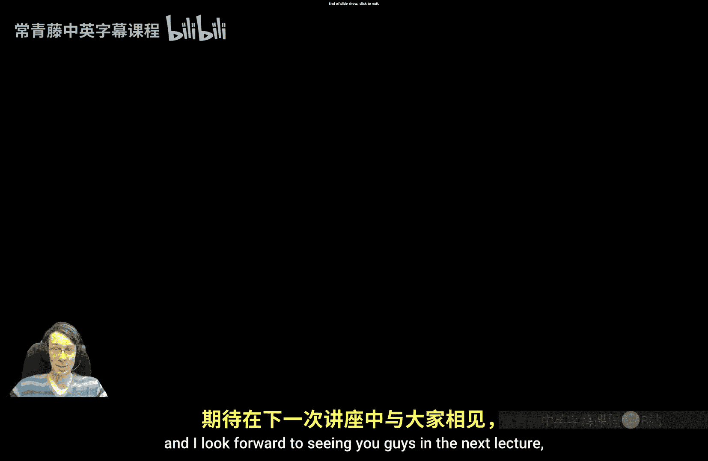
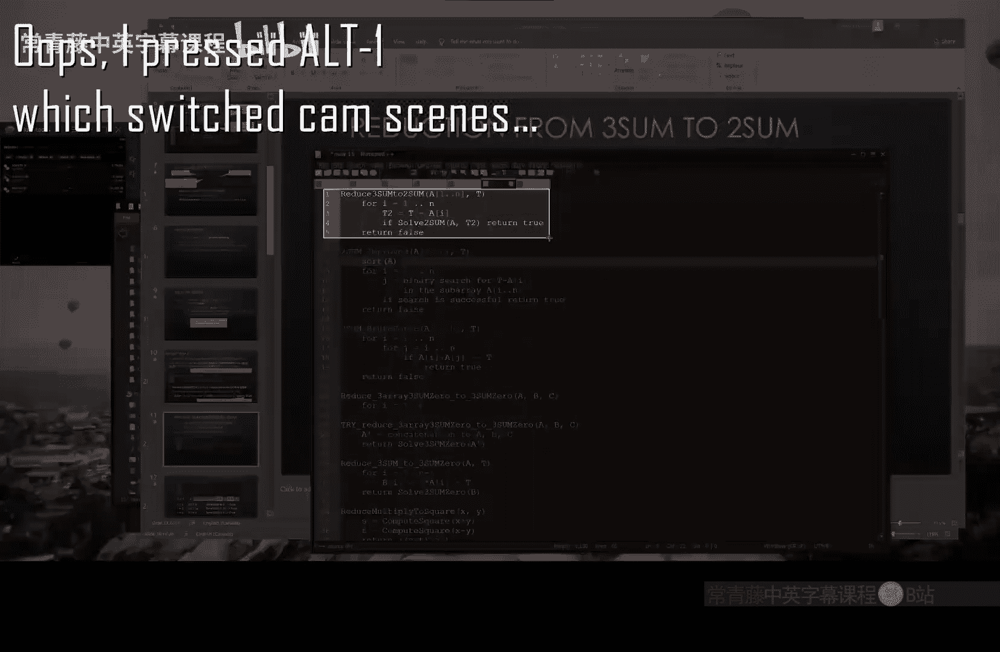
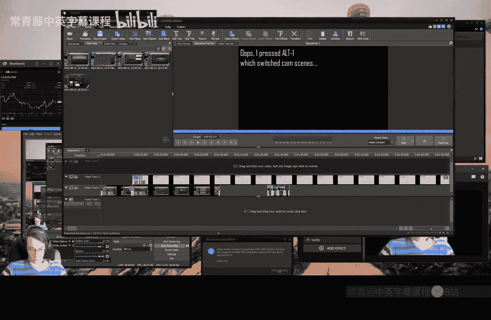

# 滑铁卢大学【中英⚡算法｜CS341 Fall 2021, Algorithms】 p04 P4 Lecture 03 -BV1DhrDBbEwR_p4-

Alright。 Hi there， everyone。 Welcome back to another episode of CS S 3，41 algorithms。

 This is the third lecture where we're going to be diving into reductions。So what's a reduction。

 Well， it's a way of taking one problem and solving another problem。

 using a solution to the first problem。 And so you all kind of intuitively do this。

 I'm sure when you're programming you know why would you reinvent the wheel when you can reuse solutions to problems that you've already solved and use them to solve。

 you know， more complicated problems that are related。So let's jump into an example problem。

 we're going to look at the two sum problem。So we're going to come up with some explicit solutions to2 sum and then we're going to reduce another problem called3 sum to the2 sum problem so that we can use our solutions to the2 sum problem to solve the3 sum problem。

Okay， so the input to the2 sum problem is an array of integers and integers a1 up to anN。

 and a target integer T。And the output of2 sum is true if there exists two values in a。

 they could be the same value whose sum equals the target T。Otherwise， the output is false。

 So the question is in this array of integers， can I find two integers， AI and AJ。

 where J might be the same as I such that the sum AI plus AJ equals T。Okay， and this。

 the output to this problem is true false。And so this this is known as a decision problem because the job of the algorithm is to decide if the correct output is true or false。

 And here's an additional definition we have problem instances which are inputs。

 So an instance is you know， the array A and a target T and a particular instance would be a particular array and a particular target T。

 So， for example， the array 1，2，3 and the target 5 would be a particular problem instance。

 And a yes instance is an input to a decision problem for which the correct output is true。

 A no instance is， of course， an input to a decision problem where the correct output for that problem instance is false。

Okay， so these terms will come in handy throughout the course。

 especially in the latter half of the course， decision problem， yes instance， and no instance。

 and also you know reductions not everyone teaches reductions early on and in a3 year algorithms course at Waterloo。

 but I think it's been becoming more common in recent years。

 or at least I've been more aware of it in recent years because。

Reductions are something that are absolutely vital for understanding the complexity of problems and relating the complexities of different problems。

And so this will be really useful when we get to you know。

 interacttractability and the complexity of problems section in the。

 let's say the last third of the course。 And it's really easy for reductions to appear really mysterious and magical if we introduce them at the same time as intractability。

 So I favor these days introducing reductions early in the course。

 you can start to wrap your mind around them and make sense of them you know。

 without all of the added complexity of thinking about problem classes and you know。

 interacttractability classes andtractability classes and so on。Okay， so this is。

 this stuff we're going to cover in this lecture will largely be used in the la last third of the course。

 but you know， let's， let's look at it now and try to understand it gradually over the over the process of the over the duration of the course。

Okay， so a simple brute force solution to the T sum problem。

 I'm sure is something any of you could have come up with in 60 seconds。

If we want to find two indexes you know， in the array that sum to t whose whose values sum to T just use two four loops。

 So we go for i equals1 to n for j equals i to n。 and there's no need to。

 to explore any J values smaller than I because of symmetry exploring J values smaller than I is really the same as exploring i values smaller than J。

 right。And then， once we find two array indices whose content sum to T we're done to return true if there's no such pair of array indices we return false。

 Okay， this is the trivial brute force solution to this problem and the runtime for this problem is you know。

 order n squared。 It's the n squared by， you know， arguments that are you know stuff we saw in the last lecture。

Now， what if we want to come up with a more efficient solution to this problem， You know。

 let's try to turn the， the innermost loop， perhaps into something more efficient。 And， in fact。

 you might want to pause here for a moment and you know， see if you can solve this problem yourself。

 How how could you implement this more efficiently by replacing this inner loop with something else。

So I'll give you a moment to pause。I'll take a sip of my coffee。HColombian roast。ok。So。

I'm going to assume now that you've done that。 if you wanted to do that， it's actually。

 there's a pretty straightforward way of doing this。

 So we can replace a single loop where we search for a couple of array emdicess with a particular value。

Really， we're we're iterating over the J， looking for something that will match this expression。

 So this is a search problem， right， And to search more efficiently than linear search。

 we have binary search at least in a sorted array。 So okay， we could sort and you know。

 sorting takes n log n time。 And we could still hope to get n log n time after that sort。

 which would be asymptotically better than the n squared that we saw in the brute4 solution。

 So here's's an improvement for a given slot A of。 if we want a I plus a of equal to T。

 we can just rearrange to get a of j equal to t minus A of。

 So this tells us what we're searching for the a of that we're searching for。

 instead of looping over j we'll just do a binary search over the array for t minus A of。

 And of course， this search to do it efficiently I've already given the solution here。

''s binary search。😊，So versus linear search to take linear time。

 binary search will of course take order log end time。

 and of course it needs the elements to be sorted。So here's our improved algorithm。

 we're going to sort the array A， then we're going to iterate over all of the i values we could choose from onean。

And we're gonna do a binary search to get our J value looking for t minus A of I in the a array。

 And if this search is successful， we're gonna return true becauseuse we found two indices A of I and A of J thats sum to T。

 Otherwise we're gonna return false。 And I want to remind you that I and J could be the same index。

So what's the time complexity of this algorithm and you can try to answer this yourself if you want pausing？

I'll give you a moment to pause。诶ok。Real quick 1。 I'm gonna assume youve paused。

 and let's go through the time complexity。 So my， my。Everything's out of order， oh no。Well。

 I don't want to rerecord this， so here's our algorithm and you can see that the sort step of course。

 is theta and log n time assuming we use a comparison based sort。

And then we have theta n iterations of this i loop。

 and then the binary research does theta log n work。

 So our loop is going to contribute the number of iterations times the work per iteration。

 which is theta n times theta log n。 we get theta n log n。And then， of course。

 we have the n log n sort at the beginning。 So the entire algorithm is an n log n sort followed by n log n for all of the work done in this i loop。

 And that， of course， is equal by the max by one of the max rules I mentioned in the previous lecture to just theta of n log n。

Okay。Now， that sort that we did to enable a more efficient algorithm is an example of preprocess。

 So preprocessing is something that you do once to modify the input at the beginning of an algorithm to admit a more efficient algorithm in this case。

 binary search as opposed to linear search。 and this is something that this is a theme that you'll see come up in a lot of algorithms。

 Oftentimes some clever preprocessing enables you to compute everything much more efficiently。Okay。

 so that was the two sum problem and at least a reasonable solution to the two sum problem。

 we came up with an analog end time algorithm。And the three sum problem is quite similar。

 So we have an array of integers and a target T。 The output is true if there exist three values in a whose sum equals T and is false otherwise。

 So two sum is well as you might expect， two sum is two values and three sum is three values。

 just like in two sum where it could have been two of the same value in three sum。

 it could be two or three of the same value。 that's fine。 So you can pick the same value。

2 or three times。In other words， we're looking for A of I plus A of J plus A of K that's sum to T。

 and there are no restrictions on IJ and K。Okay， so this is really similar to T sum and whenever you see a problem like this。

 suppose we have a solution to Ts sumum and we want to solve3 sum。

 and we can see that this problem is very similar to T sum， you might think， well。

 can I just use my solution to T sum to solve this problem？It's natural to ask that question。

So this brings us to the notion of a reduction， Supp we already have a solution to two sum。

Called solve T sum。I'm going to explain what it means to reduce the3 sum problem to the two sum problem。

 I'm going to do this as an example。 And you can infer what reductions are from this example。

 So suppose we design an algorithm called reduce 3 sum to 2 sum that solves 3 sum。 Okay。

 this is a solution to 3 sum。 So I could have called it solve 3 sum。

But I'm calling it reduce3 sum to2 sum， just as a cu to suggest that it's going to use a solution to two sum。

 an algorithm called solve2 sum as a subrtine。So this algorithm reduced 3 sum to 2 sum it's going to solve 3 sum and it's going to do so by using solve2 sum as a subroutine and solve2 sum in this case。

 it's a black box subroutine where our reduction here doesn't know how solve2 sum is implemented and from the perspective of our reduction we call this function and oracle。

 This is a black box subroutine you can call that solves the problem you're reducing to we're reducing to two sum。

So we have an oracle that solves2 sum。 And we're gonna use that as this black box sub team。

 So here's a a candidate for our， this is sort of the template that our reduction would follow。

 We have reduced 3 sum to two sum that takes as its argument an input to the3 sum problem because remember。

 it's solving3 sum。 So it takes an input to 3 sum。 And then it does some sort of preprocessing to transform that 3 sum input into a two sum input。

 because we're going use our solution to two sum to solve this problem。

 You're gonna pass that input to two sum to our two sum solver。

And our two sum solver is going to return a value that we're then going to return。

 This is one possible template for a reduction from 3 sum to 2 sum。 There are other ways to do this。

 sort of， to do reductions。But we're showing one particular template for a reduction here where we take an input to 3 sum。

 We process it into an input to two sum， and then we solve that to sum input。

 And our the way that we constructed this to sum input should be very careful and clever。

 We should construct this to sum input so that solving to sum here gives us the solution to3 sum。

So reduce 3 sum to 2 sum are reduction， that's called a reduction from 3 sum to 2 sum。

And note that we could also process the input to 3 sum in a different way and then call solve2 sum multiple times。

 In this case， we're just calling solve2 sum once。 And that's a particular type of reduction that I'll talk about at the end of this lecture。

 if3 sum can be reduced to two sum， meaning if we can actually solve3 sum using the output from two sum like this。

 If we can transform the input to3 sum。 So it's an input to2 sum。

 And then use the the solution to two sum to solve 3 sum。

 then we say we can reduce3 sum to two sum in that case。

 and we denote this reduction by this lesson or equal to symbol symbol。 say3 sum reduces to two sum。

 That's how we read this3 sum reduces to two sum。 And the mnemonic here。

 if you want to remember this is the solution to two sum。 this is like an arrow pointing to3 sum。

 the solution to two sum goes into3 sum。 So two sum arrow3 sum2 sum goes into3 sum。As a sub problem。

 right， the solution to 2 sub goes into3 sub。 and we solve it using that solution。Okay。

So how can we use solve 2 sum。 So that was sort of running through what it means to have a reduction。

 what a reduction from 3 sum to 2 sum would look like。

 Let's actually try to come up with a reduction from 3 sum to 2 sum。

 So a reduction from 3 sum to 2 sum is going to use a solution to2 sum。As a subroutine。

 So we have access to solve2 sum。 How could we use that to solve3 sum。

 So we have the power to find two numbers in an array that sum to a particular target。

 How could we use that to find three numbers in an array that sum to a particular target。

 Could we transform， We have this input to3 sum， which is an array at a target T。

 Could we transform that input， We process that input to feed it into two sum somehow。Well。

 should we change the array somehow， should we change the target somehow？And well， if you want。

 you can pause here and think for a moment about how you might try to take advantage of this subrtine to solve3 sum。

Im can assume now that you've paused if you wanted to do that。And here's one approach to doing this。

 We iterate for I equals1 up to n。And we compute a new target where we take the old target and subtract I A of I。

 sorry， So why are we doing this， Well， we're looking for three elements that sum to T。

 And we've picked one of these elements。 A of I as a candidate to be part of that sum。

So we want two more elements that sum to t minus A of I。

 we use solve to sum to check if there are two such elements， if there are we return true。

 if we get through all of the possible A of I values and we can't find two other numbers that sum up to t minus A of I for any of those i values。

 we return false。Okay， so let's see how this algorithm works。 We'll just walk through an example。

So here's our A array， or suppose we're looking for a target of9 and let's just take a moment and stare at this array to understand the example。

 the only way that I can pick three numbers to sum to9 here is if I pick this number three。

 three times because everything else is smaller than three。Okay。

 so let's see what the algorithm does。 First， we we'll set I equals1 and we'll compute our new T2 value。

 which is going be 9 minus this array element 1， which is 8。

 So we're gonna run solve to sum on a of 8。 Can we find two numbers that sum to 8。 No。

 so this is going return false。 in the second iteration。 Our T2 value is 9 minus negative 7。

 which is 16。Can we find two numbers at sum to 16， no？In the third iteration we have T2 equal 11。

 there are no two numbers that sum to 11， in the fourth iteration， T2 is9。

 there's no pair of numbers that sums to 9。In iteration 5， T2 is 7。

 there's no pair of numbers that sums to7。In iteration 6， finally， we get to this slot and T 2。 Oh。

 no， sorry， hi， I skipped 1。 So in iteration 6， we're on this slot with negative 1。

 So 9 negative 1 is 10， and we can't find two numbers at sum to 10。 Finally， in iteration 7。

 we get to this this slot where a of 7 is 3。 So 9-3 is 6。 can we find 2 numbers at sum to 6， Yes。

3 and 3。 So solve 2 some a 6 will return true， and we will thus return true here。😊，Okay。

 so that's an example of how that works。 Let's talk about how you would argue that a reduction like this is correct。

So what we want to prove is that for a particular instance， A T of3 sum。

It's correct for3 sum to return true。If and only if。There is some index I。

Such that it's correct for T sum to return true on input slash instance。A comma T minus a of I。 Okay。

 so we're saying consider the instance a comma T that we have for you know， the problem 3 sum。

Think about how we're going to transform it， we're going to transform it such that it becomes an instance of T sum a comma t minus A of I。

 we're going to try a whole bunch of different ways of transforming it， one for each value of I。

There should exist some instance that we feed to two sum。That causes to some to return true。

If and only if。It's correct for3 sum to return true on this problem instance， A of T， A comma T。

 Okay， In other words， let a comma T be any input into 3 sum。 There exists。 AI， A J。

 A K that sum to T， if and only if there exists some AM M。

 such that solve to sum A comma T minus A M returns true。 This is what we want to prove。 Okay。

And by the way， in doing so， we're assuming that our solution to2 sum is correct。

 So we assume this's a correct solution to two sum in this。 So solve to sum is behaving correctly。

When we say that there exists some AM that causes this to return true。Okay。

 so this is we've talked about what we want to prove， let's actually prove it。So we w to prove。

 I'm gonna prove a set of equivalences， right with an if and only F。

 you could do both directions individually。 I'm gonna do both directions at once by giving you a set of equivalences。

 So there exists I J and K such that A of I plus A of J plus A of K equals T。If and only if。

There exists I J K such that a of J plus a of K equals t minus a of I， right。

 I'm just rearranging this expression。 These two expressions are equivalent， right。

And that's equivalent to saying there exists some I。

 such that solve to sum A T minus a of I returns true。Okay， because I， I mean， I。

 I could argue this point in， in detail。 you might want to just work out the details yourself。

 Let me try to walk through why this last equivalence is true。

 This is maybe where just breaking it down into the two directions is instructive， even if， you know。

 this equivalence， It's questionable I whether we actually need this detail。 But anyway。

 let's break it down into the into the two directions here。 just to。

 to try to grow our understanding。So on one hand， if there is an I that causes solve to some a t minus A of I to return true。

 that means that there are two values， you， A J， AK in a that's sum to t minus A of I。Okay， A J A K。

 let's sum to t minus I。 That's exactly in this expression up here， right？ And， you know。

 for the opposite direction， If there exist I JK， such that you have these two values that will sum to T of it to T minus A of I。

 then there will be an I that will cause solve to sum T minus AI to return true。 Okay。

 so hopefully that makes sense。 it's sort of。You know， this is。

 this last step is almost in the realm of just proving triviality。

 So it's hard to restate it in a way that eluci dateates without just confusing you。 Hopefully。

 what I've said here wasn't confusing。Okay， so that was reduction correctness。

 And we'll see a couple more examples of reduction correctness in this lecture。

 So don't worry if you didn't get the first one。 Hopefully， the concepts will continue to。

 to make more and more sense with each passing example。

 How do we talk about the run time of this reduction。 Well。

 if you look at the run time of this reduction。You've got a loop with theta Ed iterations。

 you've got work done by each iteration that is a constant amount of time for this step at line number three。

 and then line four， we're invoking solve to sum。 So really this expression is going to depend on what the runtime of solve to sum is。

 and there are， of course， many different ways that you could solve to sum。

And so the runtime is going to be dependent on that implementation。

 We can say this reduction adds theta n overhead beyond whatever this runtime costs in some sense。

 But there's it's the expression is a little bit more complicated than that because we have this invocation n times in this loop。

 right。So really， when we want to talk about the runtime of this reduction。

 the runtime is going to be n times the runtime of solve to sum。Now。

 for our brute 4 solution of solve2 sum， that was an n squared solution， a theta n squared solution。

 we end up with theta n cubed runtime， but for our more efficient to sum solution。

 we can get theta n iterations times theta n log n runtime for solve2 sum。

 which is theta n squared log n。 So okay， we can solve this problem in n squared log n。😊。

Can we do better though？😊，Well， recall that our， our fastest solve to some solution we've seen so far。

 It had a sorting step that took theta and log n time。

 And then the searching step took theta and log n time over the different I values， right。

 because for each I value， we were doing a log a theta log n search。😊。

Now we can actually improve to some searching time to theta n time total。

 not theta n log n time over all the searches， but theta n time total， so linear time。

 and then that would leave us with this sorting time we have to contend with still， but anyway。

 we can improve the searching time， and it turns out that improving the searching time is actually enough to come up with a new3 sum reduction that's faster。

So let's see how we can come up with a two sum algorithm that's even faster。Okay。

 so here's an example input instance where we're looking for a target sum of 23。

 and we have this array。 A。 let's see。 how could we come up with 23。 Well。

 this3 and this 20 would work for us， right。So I'm going to show you an algorithm visually and it's quite simple。

 we're going to start out with basically two pointers into the array or two indexes that we slowly modifying as we iterate through the algorithm so we're to start with two indexes。

 I and J which start at the left and right endpoint of the array respectively。And then at each step。

 we're going to look at the sum that we get by taking A of I at A F J。 And if it's too large。

 we're going to either increment I or decrement J。 Okay， so if it's too large， we're going to move J。

 right， We're going to shrink J。So that our sum gets smaller。 This is a sortded array。 Okay。

 so we're， we're going to start with our array the same way that we did at our previous to some solution with binary search。

 But now we're going do something iterative instead of binary search。 That's going take linear time。

 So if the sum is too large， we're gonna move J to the left， okay。And okay， what's the sum now。

 It's 22。 Well， in this case， we're gonna increase the sum by moving our eye to the right。

So it's too small， move I to the right。 What's the sum now， it's 23， and that's just right。Now。

 if I and J end up meeting and we haven't satisfied， you know。

 we haven't found the sum we're looking for， then my claim is that there's no solution。

 There's no pair that sum to， to the target T。 Okay。

 now if you want to do to argue the correctness of this algorithm， here is the invariant。

 the loop invariant that you prove as you're adjusting I and J in turn。

 you would prove if there exists a solution。 I prime where I prime is less than I J。

 then I prime is greater than equal to I。And J prime is less than or equal to J。 In other words。

 we haven't passed the I that we're looking for， we haven't passed the J that we're looking for。Okay。

😊，And as an exercise， you can try to fill in the proof details here。Okay。

 so now that we have this faster two sum algorithm that only takes linear time for the search。

 how can we use that to build a faster reduction？ Well， we still have the sorting cost， right。

 And so the faster two sum is not really any faster。 if you have to sort every time we invoke to sum。

 but remember， we're invoking two sum many times in our three sum to two sum reduction。

 but we don't need to sort every time we invoke two sum because the array is the same every time we solve2 sum。

 It's just a， it's not like the array is changing every time we invoke our solution to two sum。

 So we can sort the array once at the beginning of our3 sum to two sum reduction as part of our preprocessing of this input into a two sum input。

😊，So we sort the array and then we're going to iterate for I equals1 to n。

 picking candidate A of I's， and we're going to use our faster linear time to sum algorithm to look for a solution to see。

 are there two other elements that will sum to t minus A of I so we could find three elements that sum to t。

And this is our reduction。 It's， it's basically just plugging in a faster solution to two sum and then making this observation that we only need to sort once。

 So our faster to sum can really be linear time。 instead of n log n time every time we iterate to this loop。

 Okay， so what's the total complexity of this algorithm。Well。

 we have a loop here for equal equals1 to n。 and for each of those iterations。

 we're doing linear time inside the loop。 So this is n squared time。

 And then the sort at the beginning is n log n。 So n log n plus n squared is just order n squared times。

 This is a theta n squared time3 sum algorithm。😊，And for many years we didn't think that we could do any better。

 We thought this was probably an optimal algorithm。

 but it turns out faster algorithms actually existed appeared in 2014 and 2017。 right now。

 the best known solution is order n squared times some crazy polylo factor here。

 So that this is a polylo factor faster than order n squared。

 So so this is asymptotically you know asymptotically subconsant， right。So， but this is。

 this is also a kind of a really convoluted expression that's hard to understand， right， So what。

 what is log log n to the constant over log squared at。Gros， I mean， you could understand this。

 You could actually try to relate this yourself。 these， you know。

 the top and bottom of this expression yourself using the limit method， for example。But， you know。

 this is， this is nontrivial to understand if you haven't seen these sorts of functions before。

 And you always get these sort of weird polylo expressions as a problem is sort of getting close to the point where you know。

 an optimal solution is known。 And， you know， the appearance of these horrible polylo factors as a result of an algorithmic process for optimizing lower bounds and upper bounds that's often referred to as log shaving because you're trying to sve shave off little polylo factors。

And we suspect that there's no solution that's faster than order n squared my n to the2 minus a constant。

So the question is， can we get order n to the two minus a non constant factor， probably not。But。

 maybe you thought this is an open question。Well what's this time for a silicone break？

That was a nice break back to the grind。Okay， so let's go through some harder examples。

 I'm gonna go through a few progressively Well， I'll start with an easy one。

 that I'll go through some progressively harder worked examples。

 So let's start with a really trivial reduction。 At least it's trivial once you know this algebraic identity。

 So suppose we want to multiply two integers X and y。 Okay， so this is the problem。

 We're trying to solve multiplication of two integers。 There's this identity for from algebra。

 which is X Y equals x plus y squared minus x minus y squared all over4。😊，And now， you know， if。

 if you can solve this right hand side without multiplication。

Then you can solve the left hand side without multiplication， right。

 so you can solve multiplication by reducing it to the problem of adding， subtracting， dividing by 4。

 which is really in binary notation， bit shifting to the right by two and then squaring。 right。

 So really， we're reducing the problem of multiplication to the problem of squaring。 Okay。

 so this is the reduction that we're trying to show。😊，And here's a reduction to do that。

 So reduce multipied to square takes two arguments， X and Y that are integers。

 and it relies on you know， addition subtraction， bit shifting。

 and then this compute to square functions。 We'll assume that addition subtraction and bit shifting are all things that we know how to do as base primitives。

 and then compute to square is the oracle that we're reducing to。

So compute square solves the problem of squaring two integers or sorry squaring an integer。Okay。

 so the oracle gives us a solution to the sub problem。 And if we can solve compute square， clearly。

 we've solved multiply because of this algebraic identity。Okay， so that's a really trivial reduction。

 Here's a sort of medium strength reduction that's a little bit harder。

 Suppose we have a problem that's related to 3 sum。 It's just a little variation on it。

 So 3 sum you take an array of integers and a target T 3 sum 0。

 you just take an array of integers as input and the output is true if there exists I JK such that these3 A of IJ sum to 0。

 not to a target but to 0。 So it's kind of like a version of 3 sum where the target is fixed to 0。

 Otherwise， you return false。 and this is a really similar problem to 3 sum， right。

 you might wonder certainly solving3 sum 0 using3 sum is really easy， right。

 If we wanted to solve3 sum 0。😊，Where we only have as input the array A。

 and we wanted to use as a sub problemble。A solution to 3 sum where we're allowed to give it a target。

 We could just give it the target 0。 and that would be just a trivial solution， right。

 But what if we want to go the opposite direction， What if we've solved 3 sum 0。

So we can find three elements that sum to zero， we can determine whether there are we can decide whether there are three elements in the array that sum to zero。

Can we then figure out if there are three elements that sum to a target T。

 So we want to solve full blown 3 sum with a target we want to use as a sub problemble。

 a solution to 3 sum 0。Okay， so it's straightforward to take a solution to 3 sum0 and modify it to solve 3 sum。

 because therell be， you know， in the code， therell be， you know。

 it'll be pretty easy to see how you're searching for something that sum for three elements the sum to0。

 and it'll be easy enough to modify it to search for three elements the sum for T， most likely。😊。

But if we don't want to modify the code of3 sum0， if we just want to use it as a black box。

Can we find a reduction？ToFrom 3 sum to 3 sum0 that will allow us to reuse as a black box。

 the code for 3 sub0 without modifying it。Okay， so given an oracle that solves 3 sum0。

 let's solve 3 sum in other words。Can we find a sum of three elements that three elements。

 the sum of to T by finding three elements that sum to0。Okay。

 so I'm going to walk you through a sequence of equivalences that basically imply immediate correctness for the reduction。

So suppose that we're looking for three elements this sum to T。There are three elements as sum to T。

 if and only if there are these three elements minus t。That are altogether equal to 0。 right。

 This is just algebra。And we can do something sort of funny here。

 We can multiply both sides of this equation by3。Okay。And you'll see in a moment why I do this。

 perhaps， although this step certainly looks like magic。

So the reason I'm doing this is I want to incorporate this T into all three of these a expressions。

 I want to sort of be able to group these expressions into something times a minus T。

 And so I want three copies of T to do that since t is an integer。

 and I don't know if it's divisible by 3， But I do know that3 T is divisible by 3 and remains an integer。

 So I'm going to multiply both sides of the equation by3。

 And now I can group into three expressions on the left 3 A of I minus T。

3 a of j minus T 3 a of k minus T。 I've just grouped this expression differently。

 I've parenthesized it differently。😊，Okay and these are all equivals， right。

 This first expression is equivalent to this last expression。

 So what this tells me is if I can find three terms that sum to0。

 where the three terms are of the form3 a of I minus t，3 a of j minus t，3 a of k minus t。

 and I can find those three terms that are equal to 0。

 that's equivalent to finding three terms that are equal to t。😊，Okay。

 so now how can I plug an input sort of of this form where I'll be able to find these three terms into a solution to 3 sum0。

Well， this equience， this first row being equivalent to the last row suggests the following approach。

 we're going to reduce 3 sum to 3 sum0 by taking our initial array a。

And our target T and producing a new array， B， where each cell of this array B is going to be the corresponding cell in a multiplied by3 and less T。

 So we're going to take each element of a， multiply it by 3 subtract T and make that B。

And now if we can find three elements of B。That are， of course， of this form。

3 times sum element of a minus T。 And we can find those three elements that sum to 0。

 Then that's equivalent saying there are three elements。 AI， A J。

 AK in the original element in the original array， A thats sum to T。

So solving this problem is equivalent to solving this problem。

So return solve 3 sum0 of B is going to give us our answer。

 and I'll leave it to you as an exercise to prove formally that this is a correct reduction。

 but really it follows almost immediately from this set of equivalences。So here。

 just to reinforce this pattern in your mind， we're preprocessing the input to create a new input to the subproble right and the input to the problem can look quite different from the input of the sub problemble right This is two arguments as input。

 This is one argument as input。 We're sort of merging the argument T into this single argument input for3 sum 0。

 and then we're going to use the oracle to solve the subpro。 And if this reduction is correct。

 then the result should be a solution to the overall problem 3 sum。

 the outer problem that we're trying to solve using the inner subpro。Okay。

 so here's our hard reduction。 We're going to go from a problem called3 array 3 sum0。

And we're going try to reduce this to another problem。 So， so what is this problem， first of all。

 Well， we're going to take not one array of input integers， but three arrays， A B and C。

 and the output is going to be true。 if there exists AI Bj and C K。

 So notice these indices are coming from the three different arrays whose sum equals0。

 So we want AI plus Bj plus C to be equal to 0。 if there is such a triple。 then the output is true。

 Otherwise the output is false。 Now this is a little bit different from the other three sum problems we found but we'd actually like to try to reduce this to3 sum0。

 remember 3 sum 0， the sum equals 0 there are three elements from the same array。

 here we have three elements from three different arrays。

 So this problem is going to involve incoding somehow this additional constraint that one element has to be drawn from each of these three arrays despite the fact that we are passing only。

Single array a 3 sub0。 So this problem is an example of。

 I think it's our first example in this course of reductions that are much more creative。

 So it turns out that the sorts of reductions that we're gonna care a lot about in the in the last third of the course are gonna involve a lot。

 really a lot of creativity where we're relating problems that are， in fact。

 quite different from one another and that require substantial transformations of the input into completely different types of inputs。

 you know， for example， some algorithms transform graphs into you know。

 matrices that we do fancy math on or you know， encode logical formulae as graphs and then express the solutions to logical formulae as like whether or not you can do a apartpartite matching。

 So there's a lot of room。😊，For really sophisticated creative reductions。

 And this is gonna be our first， just， you know， dipping our toe into the。

 the vast ocean of complex reductions that have been。Put together by various people。 Okay， so anyway。

 let's just try to do a reduction from three array 3 sum 0 to 3 sum 0。Okay。

 so it's gonna be something like this， right， We need to take the three arrays somehow and turn them into one array so it could be fed to 3。

 sum 0， salt 3 sum 0。 Now， you might just try concatenating the three arrays， right。

 Sos concatenate them into a single array， A prime。And then pass that to solve 3 sum 0 and。

See what happens。Well， is this reduction correct？The problem is that solve 3 sub0 in this case might choose two or more elements from the same subar。

 So two or more elements from a or two or more elements from B。 okay。

 so let's see how this would actually work if we were to run this algorithm。 Well。

 in this particular problem instance， there's no correct way to get a 0 sum。

 you can't pick one element from each of these three arrays and get a0 sum。

 because if I pick you know， one element from this。

 even if it's the smallest element because there aren't that many negative numbers in this example。

 right， So if I pick3 is the smallest element 4 is the smallest element。

 you know there's no way to get a0 by picking a single element from here。 I mean。

 we could pick two element from a and one element from B。

 like negative2 negative 1 and 3 and we could get a 0。 But that wouldn't be a correct solution。

 unfortunately， this try reduce  three array，3 sub0 to 3 sub0。Wow， it's mouthful。

 This reduction attempt。We'll actually find that incorrect solution because concatenating these arrays does nothing to distinguish between them。

 These， these are really the sub arrays， ABC， and this quote， unquote solution。

 really a solution attempt。 We'll unfortunately find the these three numbers。

 when we call solve 3 some 0， these three numbers will be selected and will return true。

 even though it's clearly incorrect for us to return true in this case。

 So this is not a correct reduction。And really， this is where the creativity in this problem comes in。

 how do we prevent picking two or more elements from a subarray？

And feel free to pause and think about this。 But full disclosure。

 when I first thought about this problem， I couldn't come up with a way to， to do this。

 at least in the， you know，5 minutes I spent。 So don't feel bad if you can't come up with a solution to this。

 and we'll see one on the next slide。 And if you can， Well。

 you get to feel like you're smarter than me。 So that's nice。😊，Okay。

 so somehow we want to ensure that the sum can't be0。Unless we pick one element from each subet。

So how can we encode that constraint in the problem instance for 3 sum 0？Well。

 if we multiply all of the array indices by 10， doing so will preserve the set of elements that sum the sets。

 sorry of elements that sum to 10， right， If a set of elements sum to 10。

 before we multiply everything by sorry sum to 0。If a set of elements summed to 0 before we multipied everything by 10。

 then that same set of elements will sum to 0 after we multipied by 10， Similarlyly and conversely。

 if a set of elements sums to 0 after we multiply everything by 10。

That same set of elements already summed to 0 before I multiply by 10。

 So this will preserve the sets of elements that sum to 10。

 But this doesn't guarantee that we can only get 0 if we pick one from each subset。Okay。

 so we're getting to the point where we're， we're going to pull back the curtain and reveal the magical algorithmic trick that'll accomplish this。

So we're going to add one to each of the elements of subset A。

 We're going to add two to each of the elements of subset B。

 and we're going to add negative 3 or subtract 3 from each of the elements of subset C of sub C。Okay。

 well， I mean， how does that help us？Well， note that A of I mod 10 is one through something in the a sub array。

 so mod 10 is's 1。And a of J， I don't know why I've said。 Yeah， I， this is a poor choice of， of。

 I shouldn't have used a here。 I， I should have used B。 So B of J mod 10。

 So something in this B subar is 2， mod 10， right。 And then so really， this should be C of K， mod 10。

 So something in this C subar taken mod 10 is gonna be 7。Now， if you think for a moment。

 if I take a sum of elements， say suppose I take three elements from a and mod 10。

 those elements are all one。The sum of three elements， mod 10， if all three or from a， will be 3。But。

Well， if a sum of three elements is0， their sum mod 10 must be 0。

 So if we're going to pick three elements from this big combined array after this modification and have their sum be 0。

 then their sum mod 10 must also be 0， which means I need to be able to add these residuals together and get0 mod 10。

 the only way to do that is by taking one element from sub array A。

1 element from sub array B and one element from subare C because 7 plus 2 plus 1 mod 10 is 0。😊，Now。

 you can do this checking yourself， but if you just enumerate all of the other cases。

 there are no other ways to choose elements you know to choose three elements to get the sum of these residuals to be 0 Take mod 10 right1 plus 1 plus 1 is3。

 which is3 mod 10，1 plus 2 plus 2 is 5，2 plus2 plus2 is 6，2 plus1 plus 7。 Well， that was good。

 That's one from each。 That sums to 10，7 plus 7 plus 7 is 21， which is 1，7 and 7 is 14， which is 4。

So you can get this idea that the only way to pick elements such that there are sums after this transformation。

 sum after this transformation is0。Is to pick one from each of these three。

 So these modular residuals sum to0 ticket mod 10。Okay。😊，So that's the magic。😊。

And here's how you would implement it。 So we'd have reduced 308，3 sum 0 to3 sum 0。

 ABC or your input arrays。 We would construct new input arrays， D EF。

 And then we're going concatenate D EF。So for each element of each of these input arrays。

 we're going to take D to be 10 times a plus 1 E to be 10 times B plus 2 and F to be 10 times C-3 right just as we showed on the previous slide。

 we're to concatenate those three sub arrays， we get a prime。

 we're going to call solve 3 sum0 on a prime。So is this correct， Well。

 my claim is that it iss correct， Let's show that it's correct To show that it's correct。

 we have to prove the following。True is correct for solve 3， sum 0， a prime。 if and only if。

 so true is correct for this call。If and only if， true is the correct output for this whole call because we return exactly。

The output of this call。 And sorry， my， my animations are out of order here。 But for brevity。

 let's just call this really long name。 Let's just call the solve 3 array。 Okay， so solve 3 array。

 ABC。So we're going to show true is the correct output for solve 3 sum0。

If and only if true is the correct output for solveve 3 array。Okay， so in other words。

 by returning the solution to solve 3 sub 0。As our solution to solve3 array。

 we're doing the correct thing。Okay， so that's what we're going to show。

 And there are two cases we're going to run through。 So first。

 assume true is the correct output for solve 3 array。Well， what does that mean， It means， Okay， Well。

 sorry， before we ask what that means， if we assume that true is the correct output for solve 3 or rate。

 we want to show true is the correct output for solve 3 sum 0。On the transformed input。So， okay。

 what does it mean that true is the correct output for solve3 array。

 It means by our assumption that true is correct output。

 there exists AI plus BJ plus C K that are equal to 0。

So if we multiply all all three of these by 10 and add one to AI2 to BJ and subtract 3 from C K。

 we still get 0 why because these three sum to0。 so 10 times these three sum to0 and then adding one adding two and subtracting 3 sums to 0。

 So this all still sums to0。Okay， that's our DI。 this is our EF， its our EJ， and this is our FK。

So what this means is we will be able to find three elements。 D I， E J FK in a prime thats sum to 0。

 Sorry， I keep advancing animations and slides by accident。 Okay， so true is the correct output。

 There is this D I E J and F K that's sum to 0 in the transformed input。

 So true is the correct output for solve 3 sum 0。😊，Now let's do the opposite case。

 let's suppose true is the correct output for solve 3 sum 0 and show that true is the correct output for solve 3 array。

Well， if true is the correct output for So 3 sum0， that means in this transformed array， a prime。

 a prime of I plus a prime of J plus a prime of k equals 0 for sum I JK。Okay。😊，Now。

 the claim is that this sum consists a one or more element from each of A， B and C sorry。

 not one or more one element from each of A， B and C。Okay， and the argument here would be by cases。

 just as I basically made that argument intuitively a couple slides ago。 So as an example case。

 supposed to obtain a contradiction。That a prime of I。

 a prime of J and a prime of K are all from subar B。 In other words， they were all found in E。

 the sub E of a prime。 So they all came from the sub B。In the original input。Well。

 then the sum of those three elements。In a prime would be。 Remember， a prime is obtained。

By concateating D E and F。 And these elements came from B。 So they were in E。

 So they were transformed by multiplying by tenant adding 2。 So that means the sum of three。

 these three numbers can be expressed as 10 times B of something plus 2。Plus 10 times B of something。

 plus 2， plus 10 times B of something plus 2。 So you can see that this is not going to end up being 0 because it's going to be the the residuals taken mod 10。

 are going to be 2 plus 2 plus 2， which is 6 and mod 10 that's still 6， which is not 0。

 So they cannot sum to 0。 So this is a contradiction。

So what this means is if you enumerate all of these different cases。

 all the ways of choosing three elements from these three different subways， D E and F。

You'll see that there are contradictions in all of those cases。

 except in the case where there's one element from each of A B and C， and that will prove this case。

 that will prove that if there are a prime of I， a prime of J， a prime of k that's sum to0。

 then there must be three elements chosen one from each of A B and C in the original input that will sum to0。

So there is a sum with one from chosen one element chosen from each of A B and C。

 so true is the correct output。For solve3 array。And so if Im to express this using the notation that we talked about for reductions。

 3 array 3 sub0 reduces to 3 sum0， or the solution 3 sum0 goes as a subproblem into3 array 3 sub zeros。

Larger solution。Okay， so the previous three reductions that we saw all had a very special structure。

 We transformed or reduced an instance of the first problem to an instance of the subproble。

 The second problem。 we called the oracle once on the transformed instance。

 So reductions of this form in the context of decision problems are called many to one reductions。

 These are also known as polynomial transformations or carp reductions。

 We call them polynomial transformations because they have this form and they add at most polytime overhead polynomial overhead。

 we'll talk more about what that means when we get into really than the degree of complexity。

And we'll see lots of examples of this in the section of the course on intractability。Now， now the。

 the first reduction that I covered in this lecture did not do a single oracle call。

 It had many oracle call。 So that would not be a many to one reduction。

 And we'll talk more about what kind of of reduction。 That's called a little bit later in the course。

 Okay， so that's it for the mandatory content for this lecture。

 And I'll leave you with random time lapse of stuff that I cobbled together。

 And I look forward to seeing you guys in the next lecture。

 where we'll talk about divide and conquer。 See you guys。😊。

。🎼The。

