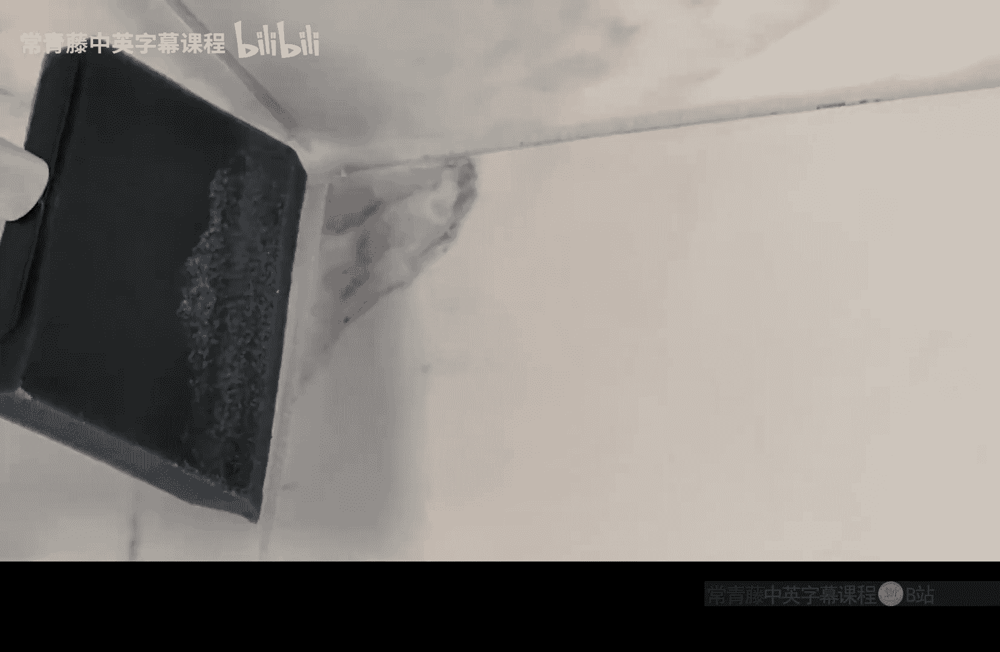

# 滑铁卢大学【中英⚡算法｜CS341 Fall 2021, Algorithms】 p05 P5 Lecture 4 -BV1DhrDBbEwR_p5-

Hey guys， welcome back to another episode of CS341。 We're on lecture 4。

 where we're going to be looking at divideiv and conquer。

 This is going to be the first in a series of currently I have three lectures planned on Divide and Con。

Okay， let's jump into the material。So what is divide and conquer？ Well。

 you probably already know a handful of algorithms that use the divide and conquer paradigm like merge sort。

 quick sort by research。 Of course， let's try to characterize what the divide and conquered design strategy is at a high level。

So you start out by dividing your problem instance I。

 let me grab my laser pointer here so we have a problem instance I that's some input to our algorithm。

 and we try to divide that problem instance up into one or more smaller problem instances I want up to IA。

Then we call these smaller sub instances sub problems that we're trying to solve。

 and usually we want these sub problemsblem to be small compared to the size of I， so for example。

 we might be looking for half the size or something like that。

And then once we've divided up our sub problems， we conquer them。 So for all of our sub problemsble。

 we solve the sub problemble recursively， and then we obtain a set of solutions。

 a sequence of solutions， one for each sub problemble。Next。

 we want to combine all of these solutions to sub problems using some sort of appropriate combining function to find the solution S to the whole problem instance I。

 So the idea is we're gonna run a combining function of some sort on all of these sub problems Get some larger solution S。

 and return that。 So here's sort of the divide and conquer proto algorithm or a divide and conquer template。

 if you will。 So you take a problem instance I， you check if I represents a base case for the problem。

 if it does， then you return immediately some base result for that base case。 So， for example。

 searching in an array of size 1 or even0 would be a base case in a binary search。

Then you divide up I into a bunch of sub problems。 So， you know， for example， in emerge merge sort。

 we would split the array in half and two hs of the array would be our sub problemsble or in a binary search。

 We might in fact， only have one sub problem， which is just the half of the array that we're going to search recursively。

Then we can define an array of solutions to those sub problems or subolutions， if you will。

 and then we iterate over all the sub problemsble and compute subolutions by recursively calling the template on our subproble。

Finally， we combine all of our sub solutionsolutions and return the result。 Okay。

 so how do we talk about correctness， How do we reason about the correctness of a divide and conquer recursive algorithm。

 Well， really， this isn't very different from how we think about correctness in general for recursive problems。

 which are which you know involves these steps proving that your base cases are correct。

Then inductively assuming that your sub problemsble are solved correctly and showing if those sub problems are solved correctly。

 then we correctly assemble those solutions to sub problemsblem into a solution for the larger problem。

How about runtime or space complexity， Well， as we'll see。

 this is sort of a subtle question because we can think about a lot of these steps in straightforward ways。

 for example， we could look at the complexity of our base case function and our result function。

 these could very well be constant time and then if we have a small number of subprom and a small amount of work to construct those subproms。

 it's pretty easy to reason about the time complexity of constructing our subproblem and really the only complexity。

 the difficulty in figuring out the runtime or space complexity of a divide and conquer algorithm comes in these recursive calls。

 because well， what's the complexity of these recursive calls。

So that's something we'll tackle in this lecture。 So we're gonna learn techniques in this lecture to analyze the runtime and same similar techniques can be applied to analyze the space complexity of divide and conquer algorithms。

 So we're gonna model the complexities of these sorts of algorithms using a mathematical tool called a recurrence relation。

 And then we're gonna see some techniques for solving recurrence relations using， for example。

 the guess and check method， the substitution method。

 the recursion tree method and the master theorem。Okay。

 so I want to start out with a worked example of the divide and conquer paradigm。

 I'm gonna start out with this， the design of the merge sort algorithm。 And we're。

 we're working with merge sort here because hopefully you've all heard of it before。

 And so there won't be a lot of confusion about the problem itself。

 muddying up the explanation of how the design of merge sort fits this divide and conquer paradigm。

So in merge sort， a problem instance consists of an array A of n integers。

 which we want to sort in increasing order。 The size of the problem instance。

 and it's always important to be able to define the size of a problem instance。

 because when you construct subpro。 You want your subpro to be smaller than the original problem or else you'll have problems proving termination or analyzing the complexity of your algorithm。

 So the size of a problem instance is going to be n， the size of the array A of integers。

 which intuitively makes sense， because a is our input and you might wonder why it's n in particular。

 because you know the array A who knows how much data it actually represents who knows how large these integers are。

 how many bits they take up here we're not talking about bit complexity wherere thinking of the word ra model where each element of that array is a word and the size of the problem instance is going to be the number of words that it takes to store the input which in this case is n。

So。We start out in merge sort， as you might expect， for a divine conquer algorithm by dividing。

 We split the array A into two subars， the left half。

 which will consist of the the first ceiling of N over two elements and the second half A R。

 which consists of the last floor of N over two elements。 Then we conquer。

 So we run merge sort recursively on those two arrays sort those two arrays。 Now。

 when this conquering phase finishes what we have our solutions to these two subproble。

 So we have a sorted A and a sorted AR。 Then we have to combine our solutions to sub problemsble。

 So after these two subrays have been sorted， we call a merge function to merge those two sorted arrays into a single sorted array in linear time by doing。

 a single pass through A L and AR。And you know， I'll walk through briefly how that works here。

 So what does our divide step look like visually if we have an array。 we split it in half。

 we recursively split those halfs into quarters， those quarters into8s and so on until we're left with single elements。

 That's our base case。 No work is necessary to sort a single element。

 And then we conquer by combining and working our way back up the recursive stack merging executing our our combine。

 So so here we have pairs that we're now going to combine。 So our sorted arrays。

 know A here would be 105 and AR would be 7， and we can combine those two by calling merge into an array of two elements。

7，105。 We do this for all of our recursive calls。 And we resolve all these recursive calls going up the recursive tree。

😊，Until finally， we do emerge on the topmost or on these two subars L and AR of the the topmost array A we have our final answer。

 So let me zoom in on one of these steps just to show you the detail of the merge algorithm really quickly。

 So here's a merge simulation。 How do we merge these two arrays。

 Well as you might expect we start out with one pointer in each of these arrays L and R。

 and we just compare the two elements that these pointers point to and we take the smaller of the elements and add it to our output array and then increment that pointer and we repeat this process until finally。

 all of the elements have been inserted into this output array at which point we return that output array as the output of our call。

 So here's some quick pseudocode for doing that。 this is pseudocode that conforms roughly speaking to the divide and conquer template pseudocode that I showed you So here merge sort。

 take the array A of size N N is one， we just return the array it's already sorted。

 We compute the size of our left sub array。and right sub array。

 and then we construct our left and right sub arrays， we call merge sort recursively。

 and finally we call merge on the solutions to those sub problemsblem。

And then here's our pseudocode for merge。 just for posterity's sake。 You know， at a super high level。

 we have all of our initialization here。Then we have these three cases。

 There's this case where there's still elements in both arrays。

 There's this case where there are still elements to be funneled from the left array and the output。

 But there are no more elements in the right array array。

 And then we have this final case where there are elements in the right array， but not in the。

 in the left array。Okay， so I won't go through this in great detail。

 This is just included in case you guys know， want to see the pseudocode for merge。 Now。

 how do we analyze the complexity of merge sort， So I sort of hinted that this is a little bit subtle。

 A few slides back。 And let's try to do the analysis here。So this first step。

 checking for the base case and returning is constant time。

 Comping the ceiling F n over2 takes constant time。 constructing these two arrays。

 How much time does that take？ Well， we're talking NL time。

 the number of elements on the left to construct the first array and n minus NL time for the number of elements to construct the right or way array。

 Let's just approximate both of those as order N。And then we have these merge sort calls。 Okay， well。

 we also have that merge at the end。 Let's resolve the merge at the end first because we know what that is。

 that takes linear time， right， We do a single pass through the two arrays。

 The total amount of work we do is constant per element。 re traverse。

 and sum of the number of elements in both arrays is at most end。 So this is order N。

Now the merge sort calls， what do we do about those？Well， we're going to end up with。

 this is a recursive algorithm。 So the complexity of this call on this sub problemble of size n is going to be a function of the complexity of the same algorithm on smaller sub problemss。

 So we have a recursive algorithm。 We're going to end up with a recursive complexity expression。

So intuitively， merge sort is going to take linear time plus the time for the two recursive calls。

Okay， so the tool for analyzing these sorts of algorithms is the recurrence relation。

 hopefully this picture helps you understand intuitively what recurrence relation is。

 it's a crucial analysis tool for recursive algorithms。 So okay， formally。

 what is a recurrence relation。😊，Suppose we have an infinite sequence of real numbers， A1， A2。

 and so on。A recurrence relation is a formula that expresses a general term in the sequence A N in terms of one or more of the previous terms。

 A1 up to an minus-1。 So if you have some sequences defined by a recurrence。

 we could express a later term and that sequence in terms of the earlier terms。 So you can see， you。

 for example， of A N was the complexity emerged sort on a problem size of N。

 then we could express that， maybe in terms of a， some other problem size。

In terms of the complexity of merge sort on some smaller problem sizes。

So recurrence relation will also specify one or more initial values。

 So these are these correspond to the base cases in our divide and conquer algorithms。

 starting at a1。 We just pick a1。For， for， for reasons。

 there's no particular reason the choice of a1 is arbitrary。

 You could pick a0 or a whatever other notation you like for your base cases。

Whatever other starting point makes sense for your problem。

So solving a recurrence relation means finding a closed formula for A N that doesn't involve any of the previous terms。

 So you can kind of flatten the recurrence somehow to get rid of the dependence on previous terms on recursive terms。

 There are lots of different methods for solving recurrence relations。

 Two of important ones that I'm gonna cover first in the lecture before getting to the the master theorem are the guess and check method。

 which involves substitution and the recursion tree method。

So let's mathematically express the complexity of merge sort， so let TN。Deote the time。

 time N to run merge sort on an array of length n。So the dividing work we already argued takes linear time。

 The combining， we argued takes linear time。 The conquering is the interesting part， because now。

 once we have this T n expression， we can express the time for those recursive merge sort calls in terms of T of some function of N。

 So what's the size of those two arrays that we are going call merge sort un recursively。

 it's ceiling of n over 2 if floor of n over 2。 So the conquering is going to take t of ceiling of n over 2 plus t of floor of n over 2。

 And if we don't want to deal with ceilings and floors in our math。

 we might be able to talk about values of n that are powers of2。

 So all the ceilings of floors disappear。So we'll end up doing that for the sake of convenience in our analysis。

Okay， so here is a recurrence relation to describe the runtime of merge sort on an array of size n。

 If n is one， it's constant theta 1。 And if n is greater than one。

 We have T of ceiling of N over 2 plus T of flow of over2 plus theta N runtime。 Okay。

 so this expresses the runtime of the divide and conquer algorithm for merge sort。

 But this isn't a complexity of the sort that we're used to seeing。

 this isn't theta n or theta n squared orta n log n。 I mean。

 you probably all remember that merge sort is theta n log n time。 Well， my claim is that this。

 in fact， is theta n log n。 you just can't see it yet。

 So let's solve for a closed form expression and see that it's theta n log n。😊，Yeah。

 and then to make this easier， let's assume that n is 2 to the K for some integer K。

 which lets us ignore the floors and ceilings。 Okay。

 so we're just gonna do the analysis for n being a power of two。 And yeah， we'll see how that works。

 Okay， so I'm gonna do this first with the recursion tree method。

 So the recursion tree method is useful for evaluating recurrences that have T of n over C terms where C is a constant。

😊，And so you can think of the recursion tree as being useful for functions where you have T of n that's expressed in terms of T of n over2 T n over 2。

 T of n over 4 and over 4 and so on and so on， right， as opposed to you know， T of n。

 T n -1 and-2 and so on。Okay， so what's the recursion tree method Well。

 I'm going to show it to you with a picture of a tree as you might expect。

So suppose we have a merge sort call on an input of size N。

 how much time does that contribute to the runtime of the entire recursive call tree well it does linear work plus two recursive calls。

 so let's draw out the recursive calls here in our diagram of size n over2 and n over 2 and then those calls do recursive calls of size n over4 and so on until finally we end up at the bottom of the recursion tree with recursive calls that represent base cases where we're sorting arrays of size1。

And let's think about the amount of work that's done in each of these calls and in turn at each of these levels of the recursion tree。

And if we compute an expression for each of these levels and then sum up those expressions over all the levels we'll have the total amount of work done over the entire recursive call tree。

 which will be the complexity， the overall complexity of this entire recursive call tree of the complexity of this m sort n call。

 Okay， so this m sort n call at this level， it's the only function that it's called。

 It contributes theta n work plus it's two recursive calls。

 So we'll deal with the recursive calls lower down in the recursion tree。

 and we'll just have its CN term that it contributes to the overall complexity。😊。

So at the total for this level is just the total for this single call， which is C。Now。

 for each of these two calls down here， they're doing theta problem size work。

 So it's not theta n for each of these calls。 it's theta n over2 for each of these calls。

 And rather than expressing in terms of theta notation because the n over  two would be lost in the sum。

 perhaps let's express that in terms of C N。 right So when they say it's theta N。

 there's a single C times that N。That were， you know。

 that represents the amount of work that we're doing beyond the recursive calls。

So the C is the same for all of these recursive calls and the n is what's differing。

 The problem size for each of these calls is differing。

 So each of these calls does C times n over 2 work and how many calls are there there are two of them。

 So two times C over2 is just CN worked out at this level。And how about these calls， Well。

 as you might expect， each of these calls does C times n over4 work， and there are four of them。

 So we end up with CN work。 And this continues all the way to the bottom where we have n times constant works。

 we have C N work。 So we have C N work at each of the levels of this recursion tree and how many levels are there。

 Well， how many times can we divide n by  two repeatedly until we hit one。So we take n。

 we divide by 2， divide by2， divide by 2， we can only do that log n times before we hit one。

So we end up with a total， total complexity of C N times log base 2 of n。 This is C times n log n。

 right， So this is just n log n complexity， theta N log n complexity。 Now。

 I'm just gonna argue big O of n log n， but arguing theta of n log n is， is not。

Really not any different using the recursion dream method here。Now， I drew this out as a tree。

 and I did this little calculation lined by， you know row by row and showed my totals on the side and summed them up。

 right， But I could have also done this work on a table without drawing any trees， right。

 so we could just think about the level of the recursion tree and how many nodes there are at each level of the recursion tree。

 and what the runtime is per node。 And then I could multiply those out on each row。

 And I could sum up the final column to get my final answer， right。

 So these are two equivalent representations of the recursion tree method。

 a table and a pictorial tree showing the complexities on the right and summing down。😊，Okay。

 so let's formalize the recursion tree method a little bit。So here we have this recurrence relation。

 this is a sample recurrence relation for any recursive algorithm that makes two recursive calls where each of those recursive calls has problem size n over2。

 and that does C times n work for n greater to1 and n being a power of two。

 we're just going to assume that n is a power of two to make the math easy here。

And then the base case has this complexity D， So C and D are some constants。

This is one particular expression we can of course use the recursion tree method to solve all sorts of different recurrences。

So we can solve this recurrence relation by constructing a recursion tree， so step one。

 you start with a one node tree having the value TN。And then step 2。

 you grow this tree to have two children。 The reason is two children is because it's two times t。

 If it were three times T， it would have three children。

 And these children have the value T of n over 2。 And if this weren't n over 2。

 if the problem size were different， n over 8 or something that these would have the value n over 8。

And then the value of n。Is going to be replaced by C N。 right， So that's that's the。

 the one node tree。And then we repeat this process。 Sorry the one， Yeah， anyway。

 we repeat this process， recursively terminating when a node receives the， the base case value。

 right， So this， this is just listing out in text， you know。

 if it helps you to see the text version of what I've showed pictorial in pictorially on the previous slide。

Step four， you sum the values in all each level of the tree， then compute the sum of all these sums。

 and that's the final total complexity。Okay。So that was the recursion tree method。

There's another method that I want to talk about now called the guess and check method。

 So the guess and check method， I I find it's especially useful when we don't have these multiple recursive calls。

 We only have a single recursive call。 It might be useful to do you know， we don't have like。

 you know， K times T of N over C。 We have like。T of n-1。 We have， you know。

 some nice expression like this， where there's some hope that if we did a substitution。

 we wouldn't blow up the expression。If we did a substitution of， you know， for T n-1。

 the expression wouldn't get more complicated with more T terms。

 It would still just be a single t terms。 So I'll explain that more。

 And hopefully you'll have to maybe do a little bit of practice with each of these methods。

 but you'll learn to spot the scenarios in which each of these two methods are appropriate。

 So suppose we have the following recurrence。 We have T of n is t of n-1 plus 6 n-5。

 And then it has a base case where n is 0， T of 0 is 4。Okay， so。

1 we can the guessing check method involves basically guessing what the closed form is going to look like。

 And there are different techniques for guessing what the closed form might look like。

 I'll show you two different ways involving substitution and basically ons and for my first approach。

 I'm gonna show you the substitution method。 And once you've guessed what the form is you're gonna check that it's correct。

 You would prove that your form that you that you guessed was correct。

 So the substitution method involves recursively substituting this formula for T N into itself。

 So you'd replace T n -1 by figuring out， okay， if I take this formula and replace every n with n-1。

 what do I get。That will be t of n 1 on the left， and some expression on the right。

 take the expression on the right and substitute it for T of n 1。

And then we'll have an expression for T of N in terms of T of n -2。

 And you can unroll it a few steps。 And then you can try to identify patterns as you're unrolling the formula。

 And those patterns will help you to guess the final closed form。

 And once you've guessed the final closed form， you'll prove usually inductively that the guess was correct。

So let's see how that works through a worked example。

 we'll of course use the T expression that I just defined。So let's do one round of substitution。

 So we're gonna do what I just said we would do where we try to turn this t of n -1 expression into some other expression in terms of a previous term in the t sequence T of something smaller than n-1。

 And we'll do that by taking this。 We'll try to figure out， well。

 what is t of n -1 using this equation that we have。 So， well。

 let's take the n and this n and make it an n -1。We'll have T of n -1。 and then this n will be n -1。

 So we have T of n -2。 This n will be n -1。 We have 6 times n -1-5。 So that's exactly what's here。

 T of n -2 plus 6 n-1-5。 All we've done to obtain this term is we've figured out from this equation。

 what T of n -1 would be。And then we've substituted it in this equation。

 We've substituted the value we got solving for t of n -1 into this T of n -1 term。

 We replace this T of n -1 term with whatever we get by figuring out T of n -1 using this equation。

 Hopefully that makes sense。 If that doesn't make sense。 feel free to ask Han piazza。

So here we end up with this expression T of n is T of n-2 plus 6 times n -1-5。Plus6 n -5。

 You can see the yellow part here is what I've substituted for T of M -1。 Okay。

 so let's do a little bit of algebra。 We can rearrange this expression a little bit。 So first。

 I just simplify by， you know， multiplying out the6 n and the-6。

And then I'm gonna group the terms in sort of a funny way here。 Okay。

 so why did I group the 6 n -5 and the 6 n -5， Because there's a 6 n -5 term already here in the expression。

 That's kind of a distinguished term that I wan to watch out for。 And I see， well， actually。

 this is two times 6 n-5。 And then you have a trailing-6 here at the end。😊。

So I group those together largely just based off of intuition because this60 minus-5 appears in the original expression for T N。

And I see that after one round of unrolling this expression by substituting for T N -1。

 I have a T N that's in terms of T N -2， and I have a two here and a -6 here。

 And sort of that's the delta from this original expression in terms of T N -1。

 Let's do another round of substitution， because I'm not ready yet to guess a closed form solution for this recurrence。

 Okay， so we can compare already， we've seen when we unrolled one level。

 we had a plus 6 n-5 and a -6 term。😊，Let's do another round of substitution。

 So I'm going to take this T of n minus-2。And I'm gonna figure out what t of n -2 is。

 If I make the left half of this equation equal to T m -2， I'm replacing an n with an n -2。

 So here I got a T of n-3 plus 6 times n-2。-5。 I'm gonna substitute that right hand side of that expression for my t of n -2。

 And I get T of n -3 plus 6 times M-2-5。 And then I have the remaining terms here plus2 times 6 n-5-6。

 Okay， now again， I'm going to expand and group my terms around this 6 n-5。And I end up with。

T of n -3 plus 3 times 6 n minus-5。And then I can see here， I had a -2 times 6。

 And in the previous expression， I had a -6。 Well， rather than combining the-2 times 6。

 ex turning that into a -12 and。Taking this -6 and just adding and making -18。

 where I lose all of my intuition。 I'm gonna make this a-6 times 1。Plus，2。Okay， there are。

 now there are different ways to do this。 But this is how my brain worked。

 at least for doing this grouping。 I'm watching it for patterns， right。

 So if I compare the new terms here， I added from compared to the previous unrolling。

 I added another 6 n -5 and a -2 times 6。Okay， now at this point， I。

 I think I'm getting ready to guess a closed form because I've taken this from T of n -1 to T of n-3。

 and I now have a3 in front of this 6 n-5 term。 And I have a -6 times 1 plus 2。

 And I'm betting if I unre this again， I'll have a plus3。 And then a plus4 and a plus 5。😊。

And so eventually， when I do， when I get to the base case， T of n minus n。

 I'll have plus n times 6 n-5-6 times 1 plus 2 plus 3 plus4 dot dot dot plus。N-1。Okay。

 so that's what I'm gonna guess。 My pattern is。 That's what I'm gonna guess my sum is in the limit。

 And it takes a little bit of practice to figure out how to unroll a few times and， you know。

 figure out what the closed form solution is gonna be。 But here， you know， I have an n -3。

 And I know my base cases when it's gonna be n  n。 So this3 should become an n。

 this3 should become an n。 This2 should become an n-1。 So that's where I get my n -1 term here。

 So this is my guess。 Okay， I'm guessing that my final closed form for T n is gonna be t 0。

 which is 4 plus n times 6 n-56 times 1 plus 2 plus 3 plus do plus n -1。And notice。

 once I replace that base case by4， I have no more T terms。

 There are no more terms of the recursive sequence in this。 This is a closed form expression。Right。

 so this is my guess。 and it's the guess and check method。 So I have to check now。So， let's check。

Firsts of all， I'm just gonna carry on to the next slidecause I that slide's full。

 So here's my guess。And I can simplify this guess， right？ So plug in my T of0 term。

 which I already know。 and then simplify this expression。 So I end up with， you know。

 n times 6 n is6 n squared5 times n 5 n。 And then-6 times。 what's this expression。

 This is a sum from1 up to n -1。 That's n times n -1 over 2。 So I can just sort of simplify there。

 I simplify a little more。 I end up with 3 n squared -2 n plus 4。 Okay， so that's my guess。

Are we done。 Well， no， I need to prove this was the guess and check method。

 not not a guess and hope method。 As I joked on the previous slide。 This was only an educated guess。

 I have to prove it is correct using induction。 So let's prove it inductively。 So again。

 just to remember， here's our definition of T。 Here's our guess。

 What I want to prove is that the guess is equal to T for all N。

 guess of n is equal to T of n for all N。 I'm gonna prove that cursively。

 I'm gonna start with the base case。 So the base case。 My guess of 0。

 I want to prove is equal to t of 0。 Well， what's my guess of 0。 It's 3 times 0， which is 02 times 0。

 which is 0 plus 4。😊，Great， that's 4。 And remember， the base case。 T of 0 is 4。

 So our base case is proved。 Let's prove the inductive case。 Suppose guess of n is equal to T of n。

 And we're now gonna show that guess of n plus 1 is equal to T of n plus 1。😊，Okay。

 so if we want to show that guess of n plus1 is equal to T of n plus1。

 let's start working with the expressions， guess of n plus1 and T of n plus1。

 and we'll use our assumption that guess of n is equal to T of n。So T of n plus1。

From our formula here， let's plug an n plus 1 n instead of n。 T of n plus 1 is T of n plus 1 minus-1。

 which is T of n plus 6 times n plus 15。So that's by the definition of T。Now， remember T of n。

 we've assumed is equal to guess events， so we can replace T of n with guess of n。

And now we can plug in our guess event。Okay， and then we can simplify it。

 I'm not showing the simplification steps you guys can do algebra。So I plugged in Ga of N。

And I did the simplification。Okay， so now I have a closed form expression for T of n plus 1。

 Let's get a closed form expression for guess of n plus1 and see if it's equal to this。

So guess of n plus one is3 of n plus one squared-2 times n plus 1 plus 4。 Okay。

 and if we simplify that， we end up with3 n squared plus4 n plus 5， which is exactly R T of n plus1。

That's our proof。 We've proved that guess of n plus1 is equal to T of n plus1。 so by induction。

 this holds for all values of n。Okay， so that was guess and check or the check was an inductive proof。

Let's take another approach instead of substituting and recursively unrolling the expression to figure out what the closed form is。

 Suppose you had some other intuition and you could through a lot of experience。

 make an educated guess and onat guess at what the closed form of the previous expression is。

 So for instance， I'm going to look at this expression and C T of n is expressed in terms of t of n minus1。

 So this recursion is is I'm only making one recursive call。

 and it's going continue until T of n becomes t of0。

 So I'm going make n recursive calls and each of those n recursive calls is going contribute 6 n minus5。

 So that's going to be roughly n times n， roughly n squared。

 So let's say I ons guess that this is going to be a quadratic equation。 Okay if you're right。

 it should have the following form A n squared plus Bn plus c for some unknown constants A B and C。

 So what we can do is carry the unknown constants。😊，Into the proof。

 And then you can determine what the constants have to be for the proof to work out。

 And if it's not a function of this form and you are wrong in your guess， there will be no constants。

 A， B， and C that will make the proof work out。So let's try this。

 Our guess now is going be A N squared plus B N plus C， and we want to prove the same thing。

 guess of n is T of n for all N。 So let's do our base case。

 Guss of 0 is going be a times 0 plus B times 0 plus C。 And that should be equal to T of 0。

 which is 4。 So from this， we can see C should be equal to 4。

 And A and B you're not constrained by this equation because A times 0 and B times 0 just disappear。

😊，So we've learned C is going to have to be4 if this proof is going to work out。

 now we want to prove the inductive case， so we want to assume that guess of n is equal to t of n and show that guess of n plus1 is equal to t of n plus 1 so let's start out with the expression T of n plus1 by the definition of this t expression That's t of n plus6 times n plus1 minus 5 and remember our guess of n is equal to t of n by our assumption so we can substitute for guess of n instead of t of n and we can pop in our a times n squared plus bn plus c where our c is now4 expression。

And we can do a little bit of algebra。 and we can group it by， you know。

 in the usual way for a quadratic something times n squared plus something times n plus 5。 Okay。

 so this is our expression for T of n plus1。 This is a closed expression。

 Let's get a closed expression for guess of n plus  one that we're trying to show is equal to T of n plus 1。

😊，So I'm continuing all the same information on this slide here we have T of n plus1。

 let's get our guess of n plus 1， so guess of n plus1 from our definition of guess of n is going to be a times n plus1 all squared plus B times n plus 1 plus C where C is 4 plus4。

Now， if we do a little bit of algebra。Expand this and again。

 rearrange the polynomial to be something times n squared plus something times n plus something。

Then we can see if we want our T of n plus 1 to be equal to guess of n plus1。

 let's set these closed form expressions to be equal to each other。

So we have this expression for guess of n plus1 equal to this expression for t of n plus1。

 And if these two expressions are supposed to be equal。

 then the coefficients of the various powers of n must be equal to each other respectively。

 So A n squared should be equal to a and squared the A should be equal to a two times a plus B should be equal to B plus 6 and a plus B plus 4 should be equal to 5。

 So this expression is equivalent saying this2 A plus B equals B plus 6 and a plus B plus 4 equals 5。

 And if we look at these two expressions。 So the equality here is easy to work out， right。

 Subtract B from both sides divideide by2 you get a equals 3。😊，So once we have a equals3。

 we can substitute that into this expression on the right， and we end up with 3 plus b plus4。

 which is b plus 7。Equals 5， subtract 7 pro from both sides。 We get B equals negative 2。

 So we can see actually， the this proof works out if A is 3， B is negative 2 and C is 4。

 That proves that our guess is correct。 And the final answer is with all the missing A B and C filter into our guess 3 n squared-2 n plus 4。

 And that's actually the exact same expression that we solved for explicitly by unrolling and guessing a closed form expression in the previous approach。

😊，So these are the two approaches。 You have the ons approach where you guess the form and figure out the constants。

 You have the substitution method or unrolling where you unroll a few layers and guess a closed form。

 In both cases， you have to prove that the closed form is correct inductively。What's this。

It's a grout ceiling break。

Nice， clean lines。😔，Well， that was a nice break。Back to work。Okay。

 so having seen a couple of manual techniques for solving for recurrence relations。

 now I want to talk about the master theorem for recurrences。

 which basically provides a formula for explicitly solving for the closed forms of many recurrence relations。

 We're going to start out with a simplified version。

So suppose that you have an algorithm whose runtime can be captured by a recurrence of the following form。

 so you have some base case， for example， T of 1 equals D where d is a constantson。

And then you have the recurrence T of n equals a times T of n over B。Plus theta n to the Y。

 So intuitively here， the way to interpret this expression is you have a recursive calls。

 Each of those a recursive calls is operating on a subproblem of size n over B。

 So you're dividing the sub problemsble into sub problems of size B。

 or you're dividing the problem into sub problems of size B。

 and then the total amount of work done excluding the recursive calls。

 So the amount of work that you do constructing sub problemsblem and combining the solutions that you get is theta of n to the y。

 where y is some constant。So if we have one or more calls where a is greater than equal to 1。

 and we're dividing the problem size by at least a factor of 2， so B is greater than equal to 2。

And N is a power of B， then we can solve this problem in a relatively straightforward way。Okay。

 so now the end as a power of B is maybe a little bit constraining because， well。

 your problem sizes aren't always gonna be a power of B whatever you're dividing your problems up whatever factor you're dividing problems up into into sub problems with。

So。Is this an onerous constraint that n is a power of B。

 maybe we'll talk a little bit more about how you can eliminate this restriction and the result that you get from the master theorem doesn't actually change。

 it just so happens that N being a power of B is really useful for the derivation of the master theorem。

 at least for teaching the derivation of the master theorem because it helps you get rid of all the floors and ceilings that would otherwise occur as you divide up your problem size by B。

Okay， so we're assuming that n is b to the J for some integer J and。You know。

 that's we're assuming that at all， at all levels of recursion。

 which is tantamount to assuming that n is power of B。

 And the result that we derive won't actually depend on that assumption。 just the derivation。

 as I show， it is gonna depend on that assumption just to make teaching it easier。 Okay。

 so what is an algorithm that would generate such a runtime recurrence relation look like。

 here's an example corresponding to bidden conquer algorithm。 So， you know。

 you check if the input problem instance is a base case。 And if so， you return the result。诶。

And then you construct sub problems。 You and solve them recursively。 So we have a sub problemsble。

 That's where the a comes from here。 We're gonna make a recursive calls here。

And then we for each of those a sub problems were for each of those a iterations at this J loop。

 we're gonna construct a sub problem S of size n over B。

Where n is the size of our problem instance I。And then we're gonna compute a sub solutionution by making a recursive call to this DNC Algo。

 giving it the sub problem as its input。 And then we're gonna combine in order n to the y time。 and。

 you know， all of the other calculations we do in this function。

 except for the recursive call should be performed in n to the y order n to the y time。

So intuitively， this is one algorithm， you know， one template for an algorithm that would correspond to such a recurrence。

Okay， so I'm actually gonna in the past， I've given the rather complicated formula for the master theorem and then done a derivation。

 And this year I thought I would actually flip that around。

 let me derive the formula by sort of starting at the recursion tree method。

 which know if you look at the recursion tree method。

 we get some sort of sense that the recursion tree method could be generalized somehow。 So indeed。

 what I'm going to do here is I'm going to generalize the recursion tree method you know。

 incorporating these terms A and B and n to the Y。 and we're gonna see if you generalize the recursion tree method and end up with the closed form expression for the complexity that you would get for the recursion tree method。

 we can derive a master theorem formula。 and my hope is by building up the formula from intuition starting from the recursion tree method that we've already seen the formula will make a lot of sense to you guys and it'll be easier to commit to memory and so on。

Okay， so here copied from the previous slide is our recurrence relation。

 and let's try to construct a recursion tree for this recurrence relation。Okay。

 so the root of our tree is gonna be， we're gonna represent the work that we do before we've actually made any recur recursive calls。

 And so at the top level of the tree， that's just gonna be theta n to the y work。 Okay。

 so C times n to the Y for some positive constant C。And then we're gonna make a recursive calls。

 Okay， so I'll show you that in a second here。 I just wanna， I'm。

 I'm gonna do a little bit of summary analysis at each level on the left side。

 I'm gonna say how many nodes there were at this level and what the problem size。

 It was at this level。 And on the right side， I'm gonna calculate the total complexity at this level。

 So at this top level， we have one node with a problem size of n and the total complexity is one times C N to the y。

Okay， now we're gonna make a recursive calls。 And each of those a recursive calls is going to be on a problem size of N over B。

 So we have a nodes， problem size of n over B。And think about how much work each of those calls is doing。

 excluding its recursive calls， which will count lower down in the recursion tree。

 So they're all doing theta n to the y work where n is the problem size， Well。

 their problem size is n over B。 So they're doing theta N over B all to the Y work。

 So C times n over B to the Y。 Okay， Now how many nodes are there there are A of them。

 So the total amount of work at this level A times C times N over B all to the y。Okay。

 so here's our total work at level 1。 This is level 0。 This is level 1。Now， for each of these calls。

 we're going to make a more recursive calls。So here's a recursive calls。

 The problem size here is n over B squared because we're taking n over B and dividing it by B。

And the work is going to be theta n to the y at each of these nodes where n is the problem size。

 so n over B squared is the problem size here。So c times n over b squared to the y。

 and we have a such nodes under this node。And under this node。

 we'll have a more of those nodes and so on。So for each of the a nodes at the previous level。

 we're gonna have a nodes down here。 So we're gonna have a squared nodes。

 So the problem size of n over B squared。 So the total amount of work done at this level is going be a squared。

 the number of nodes times C times n over B squared to the Y， which is you know。

 the amount of work done at each of these nodes。Okay， and this process is gonna continue。 So this。

 these were levels 0，1 and 2。 You can see what the pattern is gonna be for a level I， you know。

 greater than 2。 You can see what the pattern is gonna be in the expression。

 It's gonna be A to the I times C times N over B to the I all to the y， right？

 So we end up with our general expression for a level of this recursion tree that looks like this。😊。

And the number of nodes， of course， at that level， is a to the I。

 and the problem size is n over B to the I at that level。 And finally。

 we're gonna hit the bottom of the tree And at the bottom of the tree we're gonna in in the base case。

 So there are our our base case expression here。 T of 1 is D tells us that there's gonna be this little constant D at each of the nodes at the bottom of the tree。

 Now， the question is， what is the last level of the tree， We have level 0，1。

2 and I for the general expression。 What's the last level。 remember， N is B to the J。😊。

RightSo J is actually going to be our last level。Okay。

 so we're going to have a to the J nodes at the bottom level。

And our problem size is going be N over B to the J。 I remember， B to the J is N。

 This N over n is gonna to be the problem size， which is one， right。Okay。

 and the amount of work done at the at the last level were in the base case。

 So it's just however many nodes there are times D。 So it's a to the J times D。Okay。

 and now we have to sum up all of the work done at all the levels。 So what's that sum。 Well。

 that sum is going to be T of n equals this base case。

 We can just the base case has a slightly different formula than the rest of the levels。

 All the rest of levels can be described by this formula。 the base case is a different formula。

 So let's add the base case formula first D times a to the j。

 Then we'll add the sum from I equals 0 up to j -1。Of C times a to the I。

Times n over B to the I all to the y。Okay， so this is our sum。 We wan to solve for this sum。

And this sum， my claim is that this can be rearranged to be expressed in terms of a geometric sum。

 sorry， a geometric sequence。So let's rearrange this into a geometric sequence and let's solve it for a closed form expression。

Okay， so we're going to do a bunch of rearranging here。

 Here's our expression copied from the previous slide。

 First thing we're going to do is we're going to apply our power rules to turn this n over B to the I all to the y into an n to the y over B to the I to the y。

And if you remember your power rules， B to the I all to the y is just B to the IY。

 which is B to the Yi。Which is B to the y all to the I so we can do that flip and why am I doing this？

Well， I'm doing this so that I can move the end to the y out。And I can move the A to the eye in。

 So I I'm flipping the position of these two in this expression。

And now I have something to the eye over something to the eye。

 and I can combine those two expressions A over B to the Y， all to the I。Okay。😊，And。Sorry。

 my computer stuttered there for a second。 Now， this C times n to the Y doesn't depend on the loop variable I。

 so I can move this C times n to the y outside the summation。

 So now I have a summation of A over B to the y all to the I。

 This is starting to look a whole lot like a geometric sum。

 becauseuse if you remember a geometric sum is the sum from I equals 0 to N of R。

To the I right so this A over B to the Y could be our R。Now this。

 this isn't a particularly nice expression yet。 So let to， to do our analysis on。

 So let's keep manipulating this expression a little bit。

And if the reason I'm doing some of these steps seems a little bit mysterious right now。

 don't worry too much。 As long as you follow the algebra， you'll see why I end up， where I end up。

With a nice geometric summit I can actually solve。Okay。

 so we want to clean up this A over B to the Y。 I would like to express A in terms of B， actually。so。

We're going let x equal log base B of a。 Now， this is the most mysterious part。

 perhaps of this derivation。 So intuitively x relates the number of sub problemsble。

 which is a to their size， which is basically a function of B。

 We're dividing the size as we make a sub problemble by B。And a is a number of sub problems。

 So x is some sort of relationship between the number of sub problemsble and their size。

 or at least how their size changes from level to level。

And we can rearrange x equals log base B of A to get B to the x equals a， right So how do we do that。

 We raise， we， we take B to the each side， right， B to the X and B to the log base B of A And B to the log base B of A is just a。

Okay， so we have B to the x equals a。 so that tells us we can substitute this A for a B to the x。

So okay， I'll do that in this expression I have b to the x over b to the y all to the I。Okay。

 now B to the x over B to the y。 remember the difference。

 if I have a power raised to a constant or and then divide that by on by the same power raised to a different constant Exponent rules tell me that's the same as B to the x minus y in this case。

 right。Okay。😊，Also， note that D times a to the J。 We can modify this to express this in terms of B as well。

 So I'm trying to just sort of get rid of all my A's。

 express everything in terms of B's to simplify my expression a little bit。 So D times a to the J。

Is D times B to the X to the J。 Y， Well， B to the X is a。 So a to the J。

I can replace the A by B the X， right， B， the x all to the J。And then our， our exponent。

 our exponent rules tell us that we can swap the x and the J here。

 So I get D times B to the J all to the X。 And we'll see why I'm rearranging in this exact form soon。

Okay， so since N E is B to the J。 So remember， we said n is power of B。

 and that power of B was B to the J。 That was our assumption。

 This term D times B to the J to the X is just D times N to the X。

So we end up with T of n being dn to the X plus CN to the Y。

Times the sum from  equals0 to j -1 of r to the I， where r is b to the x minus y。 And。

 this is just a geometric sequence here， this sum。So let's solve the geometric series or sorry sequence。

 I should have said sequence here。So recall the formula for solving a geometric sequence。

It's this gnarly formula here， and basically there are three cases depending on whether r is greater than 1。

 equal to 1 or between 0 and 1。And so just as there are three cases in the solution to this geometric sequence。

 the closeform solution to this geometric sequence。

 there are gonna be three cases depending on the relationship between x and Y in our R for our runtime complexity。

 We're to get three different theta forms。 And this really just comes from this solution to the geometric sequence。

So we have different solutions to name R， we're going to have three cases， this case1 where R。

 which is of course， B to the x minus y， is greater than1。

And when is B to the x minus y greater than1？Well， beta the0 is1， right？

And B to the less than0 is less than one。 And B to the greater than 0 is greater than one。

So what that tells us is it's greater than1。 if and only if x minus y is greater than 0。

 In other words， if x is greater than y。 So if x is greater than y， this is greater than1。

 if x is equal to y， this is equal to 1 because then x equal to y means this is B of the 0。

 which is1。😊，And if x is less than y， then we have B to the x minus y between 0 and 1。 Okay。

 so those are three cases。 really， if x is greater than y。

 if x is equal to y and if x is less than y。 So let's solve in each of those three cases and we'll have our closed form expression。

 that lets us solve for this arbitrary type of recursion tree immediately。Okay。

 so the first case where x is greater than y。So here's our expression from a couple slides ago。Now。

 this sum is what we're actually solving for with the geometric sequence formula right。

 so the geometric sequence formula has the sum from  equals 0 to n minus1 of a times r to the I。Well。

 how can we relate this to our sum Well， the n here is RJ。And the A here is just1。

There is no A in our expression。So if we're in this case where x is greater than y， in other words。

 R is greater than1， we're going to end up with theta R to the n。But what's our N。 Well。

 our N here is J。 So we're going end end up with theta R to the J as our solution here。

 So T of n in this case， is going to be in D times n to the x plus c times n to the y times theta R to the J。

Okay， now I can move the theta out to encapsulate this whole expression and just say T of n is in theta n to the x plus n to the y times r of the J。

And then let's just try to simplify this expression a little bit more。

 So the R was useful just to see how we were going to solve this geometric sequence。

 but let's turn it back into a B to the x minus y。 So we have B to the x minus y all to the j。Which。

 if you remember， our exponent rules can be rearranged into B to the J to the x minus Y。

 And remember， B to the J is n。So。Our T of n is gonna be in theta of n to the X plus plus n to the y times n N to the x minus y。

 and from our limit rules。 Sorry， not our limit rules from our exponent rules， this is。

 this expression on the right is just n to n to the y plus x minus y， which is just n to the X。

So this whole expression is in and to the X。So if ourarrow is greater than1。

Then T of n easy in theta n to the X。 And if you remember， x is log base， B of a。

Or a B And A or constants。 So this is N to a constant。 and you can calculate the constant。

Based off of the A and B from the original recurrence。Okay， so that was case1。

 let's do case2 where r is equal to1。So in this case， we can see R equal to 1。

 We're gonna end up with theta N。 Now What's the n。 Well， it's the， the top of our sum here。

 So in our formula， that's gonna be J。It's the top of our sum here plus  one， right， Theta n this。

 the top of the sum is n -1。 So the top of our sum here is J -1。 So we're gonna be in theta J， okay。

And so what we end up with is D times n to the x plus c times n to the y times theta J。

 And I'm going to again expand the theta around the whole expression。And then note here。

 x is equal to y。So n to the y is just n to the X。So we end up with n to the x plus J times n to the X。

 Well， what's this J， I'd like to get rid of it and only have an expression in terms of N Well B to the J is N。

 So if I take log base B of both sides of this equation， I end up with log base B of B to the J。

 which is just J。And log base B anN。So J is exactly log base B an N。

 So J is certainly a theta of log n。So this tells us that we have to the x plus n to the x log n。

So that's just going to be from the max rule n to the x times log n。 So in this case。

If r is equal to1， then our t of n is in theta of n to the x wherex as a constant。

That we can compute log base B of A， all times log n。

So let's do the third case sorry if Rs between0 and1。

Then you can see from our geometric sequence expression here that we're going to end up with constant。

Data 1。Okay， so that means our sum here is going be constant。

 And we're gonna end up with the expression T of n is in theta n to the x plus n to the y。

 And x is less than y。 So the end of the y term will dominate。

So we're just going to end up with T of n being in theta n to the y。 so we have three cases。

 we have theta n to the x。Theta n to the x times log n。And theta n to the y。

 depending on whether r is greater than 1， equal to 1 or between 0 and 1。Now， note。

 this is sort of interesting。 We have that base case。 T of 1 equals D and the original recurrence。

 and we haven't seen a D appear anywhere in any of these complexities。

 It turns out that that base case， that constant base case。

 as long as it's a constant is dominated by all these other terms。

 so it never shows up in the complexities， which is sort of interesting。

So before I give you the formula， which you you could all probably write down at this point since we've seen the three cases。

 I want to just give you this slide that gives you a little bit of extra intuition for what those three different R cases represent in terms of the problem。

So or in terms of the recursion tree。 So if R is greater than1。Intuitively。

 this means that we have heavy leaves that the values of the leaf。

 of the leaf nodes end up dominating the overall value of the sum of all the complexities in the entire recursion tree。

So that's that's n to the X。 And so n to the x is somehow related to the number of leaves you end up with。

 right， And n to the y is the amount of work we did at in each recursive call excluding the recursion。

 excluding the recursive calls。 just the work we did besides the recursive calls。 So N to the y。

 which dominates when R is less than1 or y is greater x that that we call the heavy top case。

 It means the value of the recursion tree is dominated by the value of the root node。 So。

 so n to the y is the amount of work we did in that root node in the very first call before we didn need recursive calls。

 And that term dominates。 So we call that the heavy top case。

And then the other case where we have n to the x times log n N to the x is somehow related to the number of nodes in the tree。

 and log n is the number of levels。 So we basically are ending up with some value times the number of levels。

 So in some sense， all of the levels of the recursion tree contribute the same amount to the sum。

 except for the last level。 we have our D terms that get dominated。

 So we call that the balance case where all the levels are contributing And。

 You get this log n factor。So that's some rough intuition。 It's。

 it's not too important that you understand this stuff， but it's， it's sort of nice to include。

 at least for your notes。 Yeah， and in case these terms heavy leaves balanced or heavy top show up。

 you sort of know what this refers to。Okay， so the final punch line。

 here's the master theorem for recurrences。 So you have our recurrence relation that we're we're all familiar with now T of n equals a times t the T of n over B plus theta n to the y。

Where a is at least one， B is at least two。 N is a power of B。

 This part I'll talk a little bit more about。 but you can actually remove this restriction。

And we'll let X be log base B of a。 So this is all the stuff we saw before then。T of N。

Is in the theta n to the X If y is also than x in theta n to the x log n。

 if y is equal to x and in theta n to the y， if y is greater than x。 And， of course。

 this just comes directly from the three cases that we saw。Okay。

 so you can actually use this master theorem， at least this simplified version of the master theorem。

 I'll introduce the more complicated one， but I won't prove it correct。

You can use this master theorem that we've now proved in class to solve explicitly for any recurrences of this form really。

 really easily by just tapping into this expression。

 you can do this whenever we're not asking you to solve explicitly using some other method， right。

 if we're asking you to solve using the recursion tree method， you can't use this。

 if we ask you to solve using， you know， first principles， then you can't use this technique。

 But if we don't constrain you， you can just use the master theorem。

 and it's really plug and chug to solve these recurrences really fast。😊。

So let me do a couple of worked examples of how we actually use this simplified master theorem。Okay。

 so here we'll solve all four of these。 and I'll actually。

 this is maybe worth giving you guys a chance to pause。

 I'll give you guys a chance to pause and try to to plug these into the master theorem here。

 I A and B， calculate X， plug this stuff all in and figure out what the complexity these of these are。

 and then I'll run through it briefly after we unpause。Okay。

So I'm to assume if you wanted to do this， you've done this by now。 So let's jump in。

So the question I ask myself， is I'm going to start plugging and chugging is what's my A。

 what's my V， what's my Y， what's my X？And which theta function am I gonna end up using based on the answers I get。

 So for this first expression， a is 2。B is 2。This， this is supposed to be a theta n to the y expression。

 Well， it's n to the one。 So our y is 1。 And our x is log base B of A， and B and A are both two。

 So log base B of A is log base 2 of 2， which is just one。Okay， so here's our。

 let's write all those numbers down。 So A is 2， B is 2。 Y is 1。 x is 1。Okay。

 which theta function are we going to end up in。 We have x equal to y。

 So we're going to get n to the x log n。And what's x。 Well， X is one。

 So this is n to the one log n N log n。 And， you know。

 you should have expected this because this is exactly the merge sort recurrence。

 So we end up with n log n。 This just shows how quick and easy it is to solve the merge sort recurrence once。

 you know， the master theorem takes， you know，30 seconds。Okay， how about this expression。

 So what's a， Well， it's 3。B is 2。 Y is one and to the one。And then x is gonna be log base B of a。

 So that's log base 2 of three。 And you could compute this explicitly on a calculator。

 You could also realize that this is gonna be between know if you don't want an exact answer。

 So first of all， let me back up a second。 So what theta function are are gonna be using here。 Well。

 we want to relate x and y。 So which one's greater log So we is x log base2 of3 greater than1。

 equal to1 or less than1。 log base two of 2 would be1 log base 2 of3 is greater than1。

 So x is greater than y right， So we end up with this first case n to the x。

 So you can write that this is n to the log base 2 of3， And that's totally fine。

 This is a totally valid closed form expression。 if you want you can try to work out what this number is。

 And just for your own understanding。 you know this is clearly gonna be be between log base 2 of2。

 which is one and log base 2。😊，4， which is 2。 So this is gonna be end to the something between  one and 2。

 right。Okay， so how about this expression。 So A is 4。 B is 2。 Y is again，1。

 Our X is gonna be log base， B of a， which is log base 2 of 4， which is 2。So x is 2， y is 1。Okay。

 so x is greater than y。 We end up with n of the x again。And our x is log base 2 of 4， which is 2。

 So this is just n squared。Okay， this final one， A is 2。 B is 2。 Y here。 Now， finally。

 we have something different。 We have three/ hs， not one that it's been in all these cases。

 And then what's x is log base B of a log base 2 of 2， which is 1。So x is 1。

 y is greater than x were in this case， n to the y。So we're going to end up with theta n to the y。

 which is theta n to the three2s。Okay， so that's our worked examples。And next。

 we're gonna look at the general master theorem。 So this is not the simplified master theorem。

 This one is even more complicated。 And don't worry， I'm not gonna prove that it's correct。Okay。

 so what are the differences here， We still require a to be greater than greater than equal to 1。

 B to be greater than equal to 2。 It's written greater than one here， but it's an integer。

 So it has to be greater than equal to 2。But now instead of theta n to the Y， we now have F of N。

This is an arbitrary function。F of n。We're still assuming that n is a power of B。

We're gonna deote x equal to log base B of a。 But now our relationships here are gonna be our functions here are a little different。

 The first two are the same。 The last one instead of being n to the y is clearly gonna be theta f of n instead of theta n to the y。

These conditions here are a little bit different， though。

So we're allowing ourselves to have this arbitrary function F。 So because we're doing that。

 we don't have a simple y term， like an n to the y， that we can relate to x。

 And so now we have to find some other relationship between f and n to the x。

 It's not enough to talk about x and y。 So here's how we establish the different relationships between excuse me。

 f of n and n to the x。 So if f of n is in biggo of n to the x minus epsilon for a positive constant。

 in other words， if this is asymptotically smaller， then n to the X。

 So if if I can prove that there's some n to the x minus a positive constant。

 So you n to the x minus 0。0000001， for example， and F is in biggo of n to that expression。😊。

Then n to the X is going to dominate' because F is dominated by n to the X there。Now。

 if F of n is in theta n to the X， then n to the x times log n。

 This is corresponds to the x equals y case。 And we got the same complexity here。

 n to the x times log n。If F of n， however， intuitively dominates n to the x。

 and the way we're going to show that is by arguing that F of n over n to the x plus epsilon for a positive epsilon。

Is an increasing function of n。 So even if I make n to the x a little bit bigger by adding a plus epsilon in the exponent。

 F of n is still an increasing function。Of M。So this is gonna， you know。

 how do you show something that's increasing， This is gonna involve taking a derivative right。

 and showing that the derivative is positive。So if f of n over n to the x plus epsilon is an increasing function of n。

 then F is going to dominate if you end up with theta f of n。Okay。

 so that's the general master theorem。So we can use this for arbitrary functions。 For example。

 if F of n was like an n squared log n or something like that。 You could do that， you know。

 or three times t of n over 4 plus n log n， because F of n is an arbitrary function of， of N。

 not something of the form N to the Y。 We can still deal with it。

 but we have to do a little bit of extra work to relate N to the X and F。Okay。😊，Now。

 I want to very quickly revisit the recursion tree method because you don't have to go all the way to the complex general master theorem to solve a recurrence that has some fancy term like N log n in the recurrence。

So some occurrences with complex F of n functions。Such as F of n equal to log n can still be solved by hand。

 And this is also important to know， not just because it unchains you from relying completely on the general master theorem。

 but because。We may ask you to solve something like this by hand to prove that you understand it。

 you can solve such recurrences by hand using the re recursion tree method。So let n be2 to the J。

 This is the usual power power of B assumption。 But in this case， we're just gonna do powers of2。

 T of1 is1， and T of n is two times t of n over2 plus n log n。 So here's a simple example。

 This is sort of like a merge sort recurrence， except instead of linear time for the merge。

 we're gonna do like an n log n time for the combining step or or the work that's done at each node besides the recursive calls。

Okay so here this is the table method for the recursion tree， I didn't draw the recursion tree。

 but here's a table showing the same information。So here we have all of our different levels starting at a one node level then a two node level and a four node level and so on。

 And this continues from level J all the way down to level 0。

And then here we have the value at each node。 So you have to make sense of these js and2 to the Js。

 So note that2 to the J is n。 So log base2 of n is J。 J is is log n。And 2 to the J is n。

 So intuitively， this is n log n， which makes sense。 Here's our n log n term， right。

 So J times 2 to the J is n log n。 That's how you should see this。 And J-1。 Well， what's J -1。

 That's log n，-1。Which is actually log n over 2。 if you do the algebra， log n all -1 is log n over 2。

 So this is log n over 2。 This is log n over 4。And this is。This is n over 2， right。

 because we have2 to the j is n， and this is2 to the J over 2。 If we， if you work with the exponent。

 the line -1 exponent here， turn it into a divide by 2。So this is n over 2。

 This is n over 4 and so on。 So this is sort of some， you know， funky way of expressing it。

 But this is n log n。 This is n over two times log n over2。

 This is n over 4 times log n over 4 and so on。So we have one node。With this value。

 So that's the whole value for the level。 We have two nodes with this value。 Well。

2 to the j -1 times 2 for two nodes is 2 to the j。 This is J -1 times 2 to the J。 And then we。

 this pattern continues。 So4 nodes 2 to the two nodes，2 to the J -2， multiply that by 2 to the two。

 You get just 2 to the J。 So we have， we have the value at each level is just J times 2 to the J。

 J-1 times 2 the j， J-2 times 2 to the j and so on until you get down to 2 to the j。

So eventually you go from from J -1， J 2 all the way down to J minus J sorry， J minus。J-1。

So you get1 times2 the J。And then for the base case here at the bottom。

 we have two to the J nodes with value 1 at each node。 and that's just2 to the J。 Okay。

 so what's this sum。Well， the sum is going to be here the values of all the levels， right。

 So this this formula is just， it's not too hard to come up with。

 We have a2 to the J that stays the same at all levels。And then if you factor out to the J， you get。

 you get one plus the sum from one up to J。A by。Like I equals1 to J of I， okay。

And this expression is just j times J+1 over 2。And you can see that this is going to end up being2 to the J order 2 to the J times J squared。

 right。So what's to the J that's n， What's J squared， It's log n squared。

 So we get theta n log n all squared or log squared n。Okay。

 so you can actually solve for this kind of complicated expression using the recursion tree method explicitly。

Okay， so as promised， I want to explain briefly how you deal with that restriction。

 how you lift that restriction that N has to be a power of B in the master theorem I'm just going。

Go over a little bit of detail here。 And， you know。

 this isn't necessarily something you need to know。

 but I've often got questions about this when I taught this in the past。

 and I never actually worked out the details。 So I always just give sort of a sketchy answer。

 So I thought I would give some， some semi reasonable answer to this question。

 how do you lift that restriction and， you know， in turn。

 how do you justify using the master theorem formulae that we developed without。

 you having to make that an assumption on an assignment that， you know， and is a power of B。Okay。

 so what happens if n is not a power of B In other words， if n is sandwiched between two powers of B。

 So it's strictly greater than B to the J -1， but it's less than B to the J。 Well， in that case。

 as you repeatedly successively divide n by B， you're going get n over B n over B squared n over B cubed terms that are not integers。

And this is gonna， you know， if you want things to be to be integers。

 you're gonna have to introduce floors and ceilings into the math。

 And those floors and ceilings are extremely hard to deal with。

 And if you don't introduce floors and ceilings， then you don't have a sensible geometric sequence that you can actually solve explicitly for。

 So I mean， really dealing with floors and ceilings is like the bane of my existence is you know。

 somebody who has to do algorithm analysis。 So any technique that we can come up with that helps us avoid introducing floors and ceilings is a worthwhile technique。

 And let me show you one such technique here。😊，So what we're going to do is instead of going for the theta bound at once。

 we're going to go for a big O bound and a big Oomega bound and I won't show you the big Oomega bound。

 I'll just show you the big O bound and you can figure out how you would do the big Oomega bound。

So to get a big O bound， I actually want to tap into the fact that we've already solved the master theorem for the case where n is a power of B。

 So what if for a big O bound is's going to take longer for a bigger input。

 or at least it won't be faster for a larger input。

 So I'm free to approximate the complexity for a problem of size N by considering the complexity of the larger problem size B to the J that I can solve using the master theorem。

 right So let's get a big O bound for T of n by looking at T of B to the J。😊，Which is a power of B。

 So T of n is going to be less than or equal to T of B of J B to the J。

 which is T of B to the J is something we can solve using the master theorem so。

From the master theem， we're gonna get the following expression。 instead of theta n to the X。

 we have theta B B to the j to the X。 instead of theta n to the x log n。

 we have theta B to the J to the x log B to the J。 and it's the of theta n to the y。

 We have theta B to the J all to the y， Okay， so T of n is less than equal to this。 But this is all。

 this is kind of a nasty expression。 This， this isn't a nice expression along the lines of what we saw before。

 N to the X n to the X log n and so on， right， So let's turn this back into an expression in terms of N。

😊，So I've just copied that to the top of this slide so we can keep working。

So the key observation is that B to the J is less than B times n because n is between B to the J -1 and B to the J and B to the J and -1 and B to the J。

 they differ by a multiple of N。 N is between these sorry， by a multiple of B。Right。

 B to the J -1 times B is B to the J。 So N is between these two。 So if we multiply n by B。

 it will be larger。Then beat to the J。Okay， so this observation is gonna help us How， Well。

 if T of B to the J is in these expressions， where there are all these B to the Js and B to the J is smaller than B N。

 we can replace all those B to the Js with B， N。 And now we have an expression in terms of N。

 But we have all these extra B terms。 So let's see how all these extra B terms can disappear since essentially。

 their're constants。So I copy the expression up here。

 Let's consider the three cases where y is less than x y is equal to x y is greater than x。

 So the first case y is less than x。 We have B times n all to the x。 That's B to the x N to the x。

 and B to the x is a constant because x is log base， A of B， where A and B are both constants。

So this is or sorry， log base B of a， I meant to say， where A and B are both constants。 At any rate。

 B of the x is a constant。So， it's always sort of a toss up whether we're gonna include certain named constants in big O notation。

 Sometimes I think it's relevant。 But in this case， you know， we can just。

 I think we can justify saying that B to the x is just a constant factor and remove it from the expression。

 And we end up with exactly the same expression that we had for the master theorem in the case where we just assumed that n was a power of B。

Okay， case 2， where y is equal to x。 we have B N to the X。 log B N。

 will B N to the X is B to the X N to the X。 and log B， N。

 is this is a log rule where where we can turn log B N into log B plus log n。

 we can split up multiplication in the log with an addition addition of two logs。Okay。

 and then we can expand this a bit。 So， so T of B N is in。Theta of B to the X。 Oh， sorry。

 this should be T of B to the J。Actually， no， this is fine。 Sorry， this is fine。 T ofBN。

Is the in theta B to the x n to the x log B plus B to the x n to the x log n。

 So I just distributed this B to the x n to the x over the two log terms and note that everything I've highlighted yellow here is constant。

 B the x is constant。 log B is constant B the x is constant。

 So we're just left with theta N to the x plus N to the x log n。 And clearly， N to the X log n。

 Max rule says that that term dominates。 So we get T of n is in big O of n to the X log n。So so far。

 both of the cases have worked out to be exactly the same as in the case where the complexities for both the cases have worked out to be exactly the same as as in the case where we just assume that n is a power of B。

 and that's going to be true in the third case as well。

 where y is greater than x this is a nice easy case。

 B times n to the y is B to the y N to the y B to the y is a constant because y is a constant we've assumed right our constants in our our recurrence T are a B and y。

So T of n， because B to the y is just a constant， is just going to be in big O of n to the y。Okay。

 so it turns out this justifies lifting the restriction that n has to be a power of B。

 and you can get the the， at least if you all you want is a big O， right， So so far。

 we've only justified T of n being in big O of the usual master theorem results。

 If you want to get big theta as you have in the normal master theorem。

 you also have to handle the case。Where you show that T of N is the in omega， big omega these terms。

 And if you want to do that， you know， I'll leave that as an exercise。 But if you want to do that。

 you're not going be using this BJ term。 You're going to be using this BJ-1， B to the J -1 term。Okay。

 so with that， I'll end the mandatory content for the lecture and I'll look forward to seeing you guys in lecture number5。

🎼快好。🎼的话已经。🎼あいうな。🎼不在つて。🎼あけな。why。🎼great get off。I always want to hear。🎼We get。🎼Im break up off。🎼Baking。

🎼Bak it off， break it off。🎼We get away。Reget。with a fully automaticdding Sp as you busy she let you know I it I this take what you leg say I'm I confess me get this my I wna break but you still head I just don't get this。

🎼We get up。