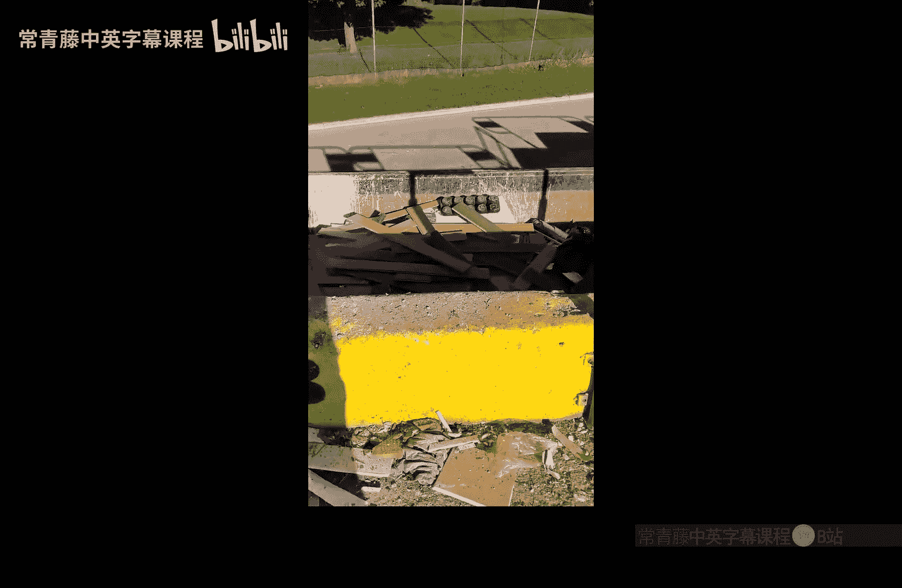
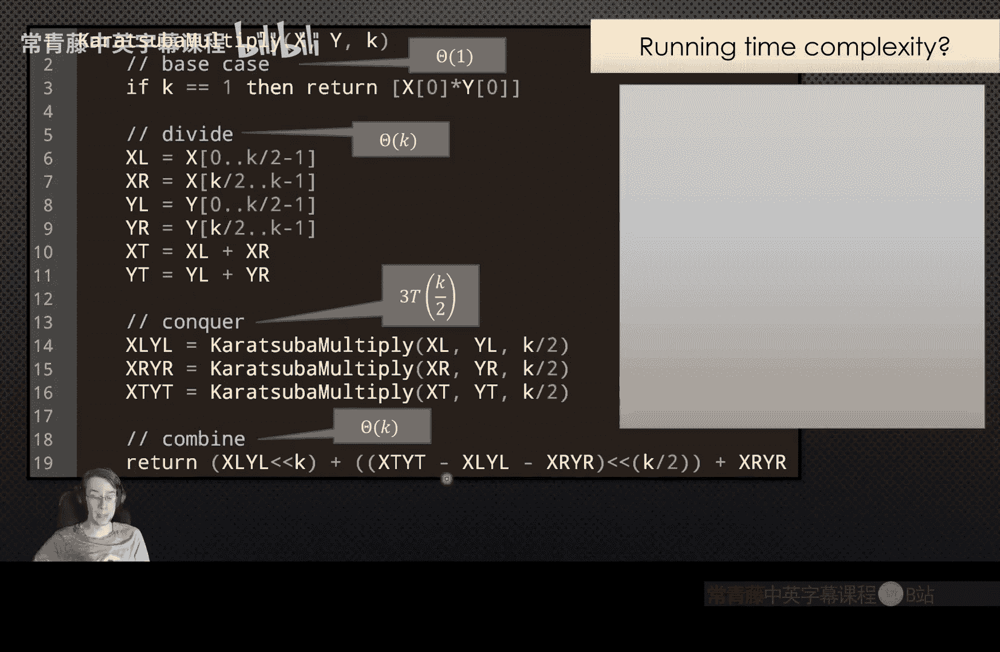
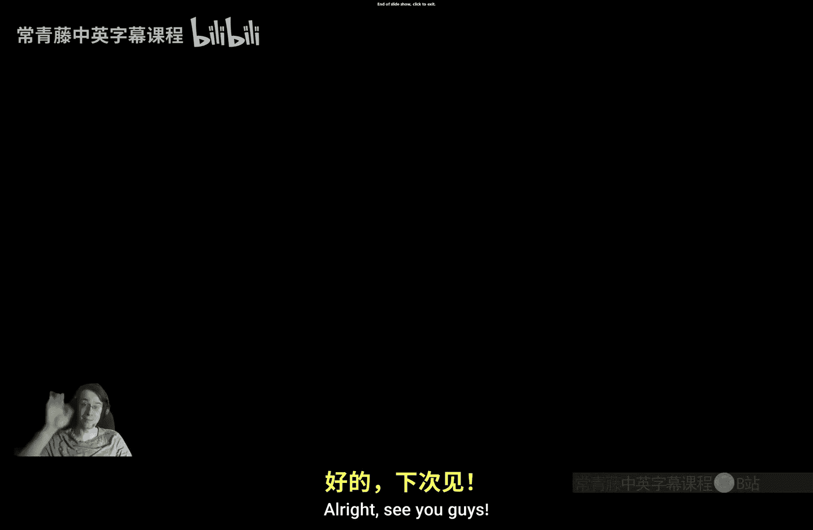

# 滑铁卢大学【中英⚡算法｜CS341 Fall 2021, Algorithms】 p06 P6 Lecture 5 -BV1DhrDBbEwR_p6-

Alright， good morning， evening or afternoon， ladies and gentlemen。

 welcome to another episode of CS341 algorithms。 Today we're going to be working on the second lecture where we cover divideivide and conquer lecture 5。

 Let's just jump in the material here。So we're to start out by talking about a problem called the non dominated points problem。

 So what is this problem， we've got a bunch of points in the 2D plane。

And a point dominates everything to the southwest， to the bottom left。And so， for example。

 this point， which is highlighted in yellow， dominates everything in this box extending to the bottom left to the southwest at that point。

 So there are three points that are dominated by that point。And this point here in yellow。

 let me make sure I'm using the correct pointer。 I'll use the the laser pointer。

 This yellow point here dominates everything to the bottom left。

 So this previously highlighted point is dominated by this one。

 So we would say that previously highlighted point is， it's not a non dominated point。

 It's a dominated point。Okay， so what are the nondominated points。 Well。

 this point isn't dominated by anyone。 So a point dominates everything to the southwest。

 which means a point could only be dominated by something that's to the east and something that's north。

 So there's nothing to the northeast of this point。 So it can't be dominated。

 So this is a nondominated point。 And the problem we're looking at here is the question of how given a sequence of points in the 2D plane。

 do you identify an output the subset of those points that are non dominateinated。ok。So， for example。

 in this diagram， this point's not dominated。 This point's not dominated。 This points not dominated。

 So we want to output the four points that are highlighted here in red。Okay， more formally， given。

Two points， x1， y1， and x2， y2， we say x1，Y1 dominates x2， Y2 if either x1 is greater than x2。

Or sorry， if x1 is greater than x 2 and y 1 is greater than y 2。 In other words， X 2。

 Y 2 is southwest of X1 Y 1。 if we draw north up and。Yeah， yeah， well， I don't wanna be confusing。

 Basically， larger x values are to the right and larger y values are up。

 So north is up and east is to the right。ok。😊，So what's our input。 It's a set S of n points。

 It's actually not particularly important that it's a set。 It could just be an arbitrary sequence。

 an array。And for our output， we want to output all of the non dominated points in S， in other words。

 all the points that are not dominated。By any other point。In S。

 and the output format doesn't particularly matter。

 We're just assuming that you have some sort of sane output format here。

 Like maybe you're going to print out the X and Y coordinates of each of the non dominated points。

Okay， so what's an easy brute force algorithm for doing this？

So take a moment and pause the video and try to think of a brute force algorithm for doing this。

And we'll see if it matches the one that I'm going to show you in a slide。Okay。

 so I'm going to assume that you've done that。😊，So here's our brute force algorithm for non dominated points。

 and I know I called the set of points S in the previous slide I'm just calling it P here for points。

 sorry， changing notations。 I guess I'll fix that on the slides before I post them。

So P is the set of points for each lowercase P point in capital P the set of points。

We're going to set dominated of P to false， so dominated is going to be an array with one entry per point in P capital P。

And it's going to be an array of bos。 So for simplicity's sake。

 let's imagine that the way that this this collection of points。

 P is encoded is it's stored in an array And so because it's stored in an array。

 There's a natural name for each of these points。 That's just the array index from 0 up to cardinality of capital P-1。

 So you can imagine that we can have a parallel array。

 this dominated array where this lowercase P is going to be a subscript in that array from 0 up to cardinality capital P-1。

😊，So we're gonna to set dominated if P to false to start out。 So intuitively。

 the point is gonna start out non-dominated。 And then as soon as we find another point that dominates it。

 we'll set dominated bit to true。 So we go through every other point Q in P in this case。

 It doesn't actually matter if I check that Q is not equal to P。

 although I do because we want to check the other points to see if any of the other points dominate this one。

 It doesn't actually matter if I check if Q is not equal to P because in order to dominate P Q has to have an x that's strictly greater than p's X。

 and that's impossible if Q and P are the same。 So this is kind of a redundant check。 But anyway。

 it's it's one of these checks that's redundant in terms of the correctness of the algorithm。

 but it's explanatory and it doesn't actually it indicates what we're really doing here checking all the other points。

 and it doesn't actually change the runtime of the algorithm。ok。

So this isn't something you'd include probably in real code， but in the pseudocode。

 it doesn't matter。Okay， so we're checking if Q dot x is greater than P dot x and Q dot y is greater than P do y。

 in which case Q dominates P and we set dominated of P to true。

If we get through that whole loop where we check all the other points and no other point dominates P。

 then we can check if not dominated P， if that's true， because no other point dominated it。

 we print out P in some format， so maybe we print you know P do X space， P do Y and then a new line。

Okay， so that's our brute forest algorithm， what's the runtime of this algorithm。Well。

 we have this loop assuming that the input is actually encoded in an array and you usually have to assume some sort of actual data structure based encoding of the input in order to talk about runtime because if I just say P is a set Well a set is an abstract data type。

 It doesn't actually have any complexities associated with it until we say that it's represented as a hash table with probabilistic guarantees or a balanced binary search tree or an array。

 So let's say it's an array then itating over the array know we can do we can iterate over these elements and look up these elements in constant time each so we iterate over let's say the size of the array is called n So we'll iterate over n elements and we'll do constant work at this line then we'll iterate over n elements again for each of those previous n elements。

 So we're going to do n squared iterations over both of these loops and in each of these inner loop iterations we're just going to do constant time work here。

う。So we're going to do order n squared work。O。So this is fine。 If you have a small set of points。

 you know， we saw in the first lecture that you could sort of feasibly run an n squared algorithm up to 10000 or or maybe even larger numbers。

 I think if I remember correctly， I managed to run it up to a million something like that。

 But if you have a very large n。 you know， 10 billion。

 This is gonna take an incredibly long time to run。

 So let's see if it can come up with a better algorithm for doing this。

So our better algorithm for doing this is going to come from a funny geometric observation here that the nondominated points form sort of a staircase。

 right， This sort of looks like a staircase。 albeit with sort of uneven risers and uneven treads。

 This would be a staircase that you would like break your ankles going up and down in the middle of the night。

 But anyway， you get the sort of staircase。 And So these， these treads here。

 the treads everywhere where you put your foot you tread on them。

 These treads of the staircase are defined by all the y coordinates of these nondominated points。

 right， So these nondominated points for each one， we get a tread at its y coordinate。

And then all of the risers， which define how high the arises， are determined by the x coordinates。

 You have a riser at every x coordinate of a non dominated point。

And the staircase is going descend from left to right。 It's going to go down to the right。

 And this is a direct consequence of how we defined dominating to be everything to the bottom left。

 So because you dominate everything to the bottom left。

 the staircase is going descend to the bottom right。Okay， so let's try to decompose the problem。

 This is funny。 I've got a little animation error here。 that 15 is supposed to appear later。

Suppose we presort the points in S with respect to their X coordinates。

So we've said therere n points。 We're going to sort them with respect to their x coordinates。

 We're going to ignore the y coordinate。We can do this we know with the comparison based sort in time theta and log n。

 and once we've presorted， we'll have some sort of relationship between how the points are ordered in the array and how they are ordered how they are close or far from each other in this 2D plane。

 some sort of relationship now after the sort between the encoding and this array data structure and the spatial relationship in the geometric problem。

So this sort of sorting to help with a geometric divide and conquer problem is something that you see quite often。

So here we have the set of points， now you can see where at what point the 15 was supposed to appear。

And if we sort these points by their ex coordinates。

 what we're really doing is we're labeling them in an array， right。

 So this is gonna be the first point。 This is gonna be the second point，3，4，5，6，7，8th and so on。

 We oh， sorry， my 15 number is wrong here。 It should be 121314，1516。

 You know what happened here is I wanted 16 points。 I started out drawing 15， And I wanted 16。

 So it was a power of  two。 I added this 15。 And I forgot to update all of the numbers。

 starting at the 15 to preserve my sort。 oops， I'll have to fix that in the slide。

 So these are supposed to appear in sorted order。 So this should be 1011，12，1314，1516。😊，Okay。

 and unfortunately， that since I added that 15 to a few slides at the end to get a power of two points to make it easier for us to divide the problem in half repeatedly。

 since I added that on a few slides at once， unfortunately。

 this error is going to show up on a few different slides。Okay。

 so how do we decompose this problem to solve it recursively in a divide and conquer way。 Well。

 we first want to divide。So the way we're going to divide in this case， remember I told you。

 we connected the geometric problem， some spatial relationships and the geometric problem。

But to the relationship between points in the array by sorting。

 so the first n over2 points in the array represent the n over2 leftmost points in the geometric problem and everything else on the right know on the right half the right half of the array represents the right half of the 2D problem dividing up the so we're dividing up the array in half over the n over2th element represents dividing the problem geometrically in half over the x axis or along the x axis。

So here， sorry again， my animations are out of order， but you can see what we're doing is we divide。

 so the first n over two points in the array become S1 and the second n over 2 points in the array become S2 is we're dividing the problem into two subproble that are actually separated spatially。

 so all the points in S1 are to the left of all the points in S2。

And now we can think about recursively solving those sub problemsble。

 So well what kind of answer are we going to get back if we recursively solve those two subpro。

 well here we have our first subproble S1 which consists of all these leftmost points and when we solve this problem recursively。

 we're going to get the nondominated points for that set of points and when we this recursive subproblem on the right。

 we're going to get the non-dominated set of points considering only that set of points in S2。

 So we're going to end up with for S1， these two nondominated points and for S2。

 these three non-dominated points and。If we want to now combine these solutions。

 it's possible that some of these non dominated points end up being dominated once we combine the set of points。

So we've got to think for a moment about what the relationship is between the solutions to these sub problemsble and the solution to the overall problem。

Well， here's an interesting observation， all of the problems。

 all of the points in S1 are to the left of all the points in S2。

 so if we combine all of these if we if we think for a moment about what it means to dominate these two points dominate everything to the southwet to the bottom left。

And these points， of course， are also going to dominate to the bottom left。

And all of these points on the right in S2， they are all strictly to the right of all these points in S1。

 which means none of these points in S1， which can only dominate things to the bottom left。

Can possibly dominate anything in S2。So if you think about these non dominated points in the left。

 they cannot dominate any of these non dominated points in the right。

 So these non dominated points in S2， they are actually non dominated in the final combined set of points。

 however。Some of these points in the right might dominate points to the left。

 So some of these non dominated points in S1 might now be dominated after we combine them。

 So think about moving these two pictures together。

 You can see here now that 9 is going to dominate 8。So we now need to think that。

So we now need to think about basically how these points on the right can dominate points on the left。

Okay， so it turns out that we can compute， given this these two sets of nondominated points for the for the left and for the right。

 which ones will survive being after being dominated by some of the points on the right。

 after we consider how these points in the right dominated points of the left。

 It turns out we can do that combining in linear time。 So let's see how we do that。

So we're going to label all of our non dominated points that were solutions to S1。

To the S1 subproble， Q1， Q2， and so on all the way up to QK。

 and will'll label all the points that were non dominated considering the subproblem S2， R1， R2。

 R3 all the way up to RM。And if you look at this picture here。

 remember these points are descending to the bottom right， so in each of these two sequences。

 the Q sequence in the R sequence， the points are descending from larger y values to smaller y values and remember you can only dominate something。

 if it has a smaller x than you and if it has a smaller y than you， so in particular。

 if R1 dominates any points in Q。诶。Then， sorry， if you think about R 2。

 if R 2 dominates any points in in Q。R1， which has a larger y value and is also to the right of all the points in Q。

Will also dominate。 So we don't actually need to consider all pairs of points in Q and R to figure out which ones dominate。

 which we can just observe that if any point on the right in the R set or in the R sequence dominates any of these Q points。

 then certainly R1， which has the highest y value of all of them。

 and is still to the right of all the points in Q will dominate know those same points in Q。

 So to figure out which points in  Q are dominated by points in R。

 all we have to do is figure out which points in Q fall under the y value of R1。

And those points will be dominated by R1， and we should thus delete them。Okay。

 so we just need to find the right most Q point that has y coordinate greater than or equal to R 1 do y。

And keep those points and delete everything else to the right in the Q array。Okay。

 so here's pseudocode for doing this。So here we have first。

 the N D points function that's gonna call a recursive helper function。 It takes the array S。 sorry。

 I switch back to S now to be consistent with a notation I wrote at the beginning。

 whereas my previous pseudocode used P。 Sorry about that。

 I'll make these things consistent in the slides when I post them at least。

 So S is our sequence of points。 Let's just say it's a sequence。 It's encoded in an array。

 S1 up to S N。And we're going to sort S by x coordinate， as we mentioned。

 Then we're going to call this recurse function on S。 Okay， so recur on S， it has as a precondition。

 the requirement that S is sorted by x coordinates。So if we're gonna make recursive calls。

 we better make sure before we make those recursive calls that this precondition is satisfied on those recursive calls。

 So our sub problemblem is better be sorted by X coordinates。

 when we pass them to recursive calls And as we usually have in a recursive function。

 we have a base case where if n is one。 then well， what's the set of non-dominated points in a set of one point。

 Well， it's just that single point。 iss that set of a single point。 we just return S。Then we divide。

 So we figure out what are our subars that that S1 and S2 that we're gonna pass to recursive calls。

 Well， it's one up to floor of n over 2。 And let's just assume for the sake of simplicity that we are actually gonna deal with these floors when we do the analysis。

 You can imagine the pseudocode is written in such a way that we can deal with inputs that are not powers of2。

 but we're not gonna worry about these floors once we do the runtime analysis。

 So we're going take the first half of the elements。 that's S1。

 the second half of the elements that's S2。 we're gonna conquer by making our recursive calls。

 we're gonna get our Q and R arrays that store the non-dominated points in sequence in sorted sequence。

 as we'll see for these recursive subproble。 and then we combine So assuming Q and R are sorted by their x coordinates。

 We know， of course， that the non-dominated points that they're sorted by their x coordinates。

 They are descending in their y coordinates。 we can combine by iterating over the elements of Q。

And stopping at the first one that is less than or equal to oh， sorry， this should be greater equal。

 That's another little mistake。So we're gonna， we're gonna continue as long as Q of I dot y is greater than or equal to R of1 dot y。

 meaning it's not dominated。 as soon as it's less than R dot y， R 1 dot y then it's dominated。

 and we break out of the loop。 So our I value that we end up with is going to be the first point that is dominated。

And then we're gonna return the concatenation of Q1 up to I minus-1。

 So the points that are still not dominated。 And then R。

 And you can think about this concatenation as just being shorthand for writing of four loop that would actually create an array that combines those those two the sub of Q and the array Q。

 And if you think about it， the concatenation of these two arrays with the union of these two arrays。

 the Q elements here are all they're all sorted by their x coordinates。

 If we assume that recurse gives us the nondominated points sorted by their x coordinates。

 and the same thing is true for these R elements。 And also all of the elements of  Q had x value less than the elements of R。

 So just concatenating these two arrays will result in array that is sorted by its x coordinates。

 So that's gonna to be the postcon。 that's what's gonna help us satisfy the precondition。 of know。

 our recursive calls。Okay。So what's the runtime of this algorithm？Well。

 we can start to think about it bit by bit here， so the sort takes n log N time。

The recursive call is going to be our， R T of M。Our base case here is going to be constant time。

Our divide steps are going to take linear time because they're doing roughly half of n work each。

Our conquering is going to be T of floor of N over 2。 And then here， T of ceiling of n over2。

 And remember， when we do the actual analysis， we're going to cut out these floors and ceilings because they don't make a difference when we are going to use the master theorem。

And then we have our combining step， which， of course。

 is potentially iterating through all the contents of Q。

 Certainly that's it most theta n because you， you could imagine inputs where there's going to be。

 you know， every point， all the points just happen to be on a line from the top left to the bottom right。

 and all the points are nondomd maybe Q and R are really just these S1 and S2 arrays Now it occurs to me that I went to the trouble of giving these S arrays。

 these nice names S1 and S2 and that I didn't actually use them， which is awfully silly of me。

 So it doesn't matter。 But really， this should have been recur S1 and recurse S2。

And a lot of mistakes this， this week， which is unfortunate。

 It's not for lack of time put into these slides， but I'm gonna have to do some clean up on these after the fact。

Okay， so at any rate， Q and R are gonna be at most theta n elements。

 And there are some inputs where there are at least， you know， constant times n elements。

 So I think we could just call these theta n elements in Q。

 And so we could be iterating over theta n elements in Q。

Let's call this whole combining work Theta N。 And then let's say this concatenation will also take theta N time。

 Now， it depends on what your data structures are。 If these happen to be encoded in linked lists。

 then you could actually link the two together at constant time。 But， you know， theta 1 or theta n。

 it's not gonna change our answer here because we already have theta n work happening at some places in this function。

Okay， now we're gonna assume that n is a power of2 for simplicity。

 and that means we get a t of n that is theta n work apart from the recursive calls。

 and two times t of n over2 for our recursive calls。 And this should look familiar to you guys。

 this is just the merge sort recurrence。 So this is theta n log n time。 And if you remember。

 we had a theta n log n sort at the beginning plus T of n， which is theta n log n。

 So this is gonna be in total theta n log n time。 So we've improved this algorithm from theta n squared to theta n log n。

😊，What's this？It's a dump break。

Goodbye， old floor。All right， well， the astute viewer will notice that I have changed shirts。

 and this is a direct consequence of me being thirsty and spilling。

 burning hot water all over about a square foot of my shirt。But anyway。

 we can jump back into the next problem that we're going to talk about。

 which is called multi precision multiplication， it's also sometimes called arbitrary precision multiplication or bitwise multiplication。

So the input for this problem is 2 k bit， positive integers X and y with the following binary representations。

 So x is going to be a bit string， which we're going to represent for the purpose of this discussion as an array of bits。

 x of k minus1 x of k minus2 dot dot dot x of1 x of 0。 Okay。

 and y is going to be represented similarly。 So the most significant bits are going to be written first。

And the output is going to be a 2 K bit positive integer Z。 That's the product of x and Y。Now。

 the binary representation of Z is gonna be similar， but of course， it has up to 2 k bits。

 This is just something that you should know from number theory if you have know an n bit number and an m bit number or actually an end digit number at an m digit number you can end up with know n times n n times M sorry。

 digits or in the case of binary numbers， n times M bit。

 So if we have a k bit number and a K bit number， you might end up with a 2 k bit number。

 So we'll just think of our output as being a 2 k bit number Z of 2 k minus-1 Z of 2 k minus-2 dot dot dot down to z of0。

Okay， so that's our input and our output。 And when I say multiplication here I mean binary multiplication。

 which is really no different from the grade school multiplication that you're you know all used to obviously but instead of the digits being 0 to9。

 they're0 and1 and I'll walk through an example。So for this problem。

 we're interested in the bit complexity model because we're talking about potentially very large numbers。

 that's why we're breaking this up into an array of bits rather than say。

 just storing x and Y in a single word and assuming that you can multiply them in unit time。

So the complexity is going to be expressed as a function of K because the size of the problem instance is 2 K bits or you know。

Order K bits。Okay， so what does the brute force multiplication algorithm look like， Of course。

 you all know how to do long multiplication， but maybe you've never satAT down and done long multiplication for binary numbers。

 So suppose you have two binary numbers here，1，0，1，0。 So this number is 8 plus 2，10。

 And this number is 11。 and we should expect to get 21 out at the end。And of course。

 you'll note 21 requires more bits than four。Oh， I'm sorry。 I did addition。

 I was supposed to do multiplication。 So 10 times 11。 we should be looking for a hundred and 10。

 anyway，1 hundred and 10 requires what 7 bits to encode， which is almost 2 k here。 So this is x of 3。

 x of 2 x of 1 x of 0， similarly for y。 Okay， so what we're trying to do is this first number times this second number。

 And we're just gonna do like the grade school long multiplication。 So in other words。

 this is gonna be highlighted as the number that we're gonna multiply this top number by。 So well。

 0 times 1 is 0，1 times1 is1，0 times 1 is 0，1 times1 is1。 So that's it really， this is a one bit。

 So we're just copying this number into this intermediate array。😊。

And then now we're gonna work on the second digit。 This is also a one。

 So we're gonna copy this number again。 But， of course。

 as you do in long multiplication with decimal numbers， you have to pad this number。

 this intermediate sum with a0。 So we put a sort of leading0 or a trailing 0 here。

 And then we copy this number into this slot in this array。 Our next number is0。

 So our intermediate sum will just be 0。 And our final number is a one。

 So we again copy this number here。 But we have to have these leading zeros and the number of leading zeros。

 of course， increases with every sum。And then we sum up all of these numbers， right？ So， you know，00。

0，0， that's 0，1，0，0，0。 that's 1，0，1，0，0，'s 1，1，0，0，0 was 1，0，1，0，1。 This is two。

 but we can't encode do so you have to carry the one and in general。

 we might end up having to carry numbers， right。So we'll carry the one here。

And we'll have a one up here， and this will be a zero。And 0，0，0。

0 plus the carried  one is' going to be 1， and 0，0，0，1 is  one。 Okay， so we end up with。1，1，0，1，1，1。

0。 And what is this。 This is 0 plus2 plus 4 plus 8。 This is 8，1214。

 and it's not plus 16 or plus 32 or plus 64，64 and 32 is 96 plus 14 gives us 1，10。

 That's the number we were expecting。 Okay， so this is brute force multiplication。And okay。

 so what's the runtime complexity of this bru force algorithm。 We actually implemented it this way。

 we have two input arrays。 We have these intermediate arrays， how many intermediate arrays are there。

 Well， there's one row per digit of y。 So if it's a k digit Y。

 then we're gonna have K rows and each of those rows is gonna be2 k bits， Okay。

 potentially and I'm not fussy about the difference between 2 k and k。

 I don't care about trying to save this space with some triangular encoding we'll just allocate a k by2 k array to store this stuff you can imagine or k2 k bit numbers。

 And then what's the work we do。 Well， for each of those rows。

 we're gonna copy the k bits of x into some contiguous set of look of k locations。

 So copying the k bits of x is gonna take。Theta K time for each row and their theta K rows。

 And then so that's， that's theta K squared。 And then we're also gonna add the K rows together。

 which is 2 k times K to do all of that bit wise addition。

 And we have to do a little bit of extra bookkeeping for the carries。

 but I'm not gonna worry about that。 So we're， we're clearly talking theta K runtime here。

 Theta K squared。 Sorry， I meant to say run time。Okay， so theta K squared gives us our naive。

 you know， sort of base complexity for doing multiplication。

 Can we do better using a divide and conquer based approach。So just to make the math easy。

 let's just assume K is even。And， you know， in fact， let's， let's assume something even stronger。

 Let's assume that K is a power of two so we can throw away all of the floors and ceilings in the analysis and justify that really easily。

 And， of course， as you're aware， it doesn't matter if things are actually， if if you know。

 you actually throw away the floors and ceilings because it doesn't make a real difference in the analysis。

 But it also simplifies the code a little bit。 And so I'm gonna， you know。

 take advantage of the code being simpler here because I'm assuming that K is a power of two。Okay。

 so we can think about taking the number X and the number y and splitting them in half。

 So splitting them into their K over to high order bits。

 which we'll call Xl for x and K over to low order bits。 we'll call X R。For x and similarly for y。

 So that looks something like this。 So if you have x。We can split X into Xl and X R。 if we have Y。

 we can split that into YL and Yr。And then we can express X and Y in terms of X， L， X， R， Y， L， Y R。

 So how do we do that？ Well， what's X， X is going to be the high order bits of X， X。

 L times2 to the K over 2， which is a K over2 B shift to the left。

 So 2 to the K over 2 times X L is going be this X L 10 with x with K over 20s after it。

 in this case，2 zeros after it。 And you can see that adding X R to that is going to restore X。

And by the way， if you find this math hard to do， you can figure out the corresponding decimal math that you're more familiar with。

 So if you have the high order bits of a number， if this was like a 64 B number， or sorry。

I won't walk through that example， you can figure out that example on your own if you want to try to relate this to decimal to make sense of it。

Okay。So we can do the same thing for Y， right？ So X can be expressed as 2 to the K over two times X L all plus X R。

 and Y can be expressed analogously。 And now that we have X and Y expressed in terms of X。

 L and Y and Y， L and X， R and Y， R， we can express X， Y as the product of these two expressions。

Sorry， there's just the extra steps showing how the bitwise math works out。So we can express X。

 Y as to the K over2 X L plus X R all times to the K over2 Y L plus Y R， right。

 And we can then expand this to get this gnarly expression to the K over to X L。

Times 2 to the K over 2 yL， which is2 to the K X L， Y L。And then you sort of do the， these two。

 to get the two to the K over two terms。 and then these two to get the X R， Y R term。 So this is X。

 Y expressed in terms of X， L and Y， L。Now， this suggests because we're expressing that what the answer we want X。

 Y， in terms of these what could arguably sub problemsble be sub problems， X， L。

 Y L is a multiplication of two K over 2 bit numbers。

 So we're expressing the multiplication of a K2 K bit numbers in terms of the multiplication of K over2 bit numbers。

 So we have four multiplications here。 That's four subproble。 And now。

 they are these multiplications by two types K to the two and two types K。

 but those are just bit shifting。 They're not the same complexity as multiplication。

 We can accomplish that。 just by basically writing to different spots in an array。

So we're dividing into 4 K over 2 B sub problems or。

 or four sub problems that consist of multiplication of two K over 2 bit numbers。 And if we can。

 of course， then conquer with recursive calls to solve these multiplications recursively。

 And then we're left with just addition and bit shifting of I say K over 2 bit。

 But actually once you multiply these K over 2 bit numbers， they can be K bit numbers。

 So it's not exactly K over 2 bit addition a bit shifting。

 It's really K bit addition and bit shifting。So that's something I should fix in the slides as well。

Okay， so here's our pseudocode for this algorithm。 So we have our， our X and Y。

 which are these bit arrays。 We have our K， which says how big they are。 We have a base case。

 which is gonna be when K is equal to 1 K。 if you have， if you have two single bit numbers。

 multiplying them really easy， Just multiply their bits and return you know。

 an array of a single bit。Okay， and then we have our dividing。

 So we divide X into the high order bits， lower order bit or low order bits。

 Y into the high order bits， low order bits。 I think I've probably mislabeled these。

 at least from my convention of。The high order bits being the high index bit。

 So if K -1 is the highest order bit that I've mislabelled X L and X R， Y and Y R， you know。

 normally these things would just slip by， But I seem to be catching all my own mistakes。

 And I talk through this in today's lecture。 So if this was a live lecture。

 no one would have anything to point out。 maybe。Okay， so X， L， Y Y， sorry， X L X R Y L Y R。

 we've divided up our problems。 At least you understand what these are supposed to represent。

 even if the pseudocode has， you， typos in it。I'll fix these for the slides。So now we have these。

 we've divided up into these subs。 now we can conquer our sub problems。

 which are the multiplication of X LYL。Now these are k over 2 bit inputs。The multiplication of X， R。

Y，R， X， L， Y， R， X， R， Y， L， this just came directly from that expression that I had on the previous slide。

And then once we've conquered these sub problems and we get back our intermediate results。

 our responses， our solutions to our sub problemsble。

 which I've named to try to match what's happening here in the mathematical expression。

 We can combine them。 So we're gonna have X L YL shifted left by K bits。Plus。X， L， Y， R plus X， R。

 Y L shifted to the left by K over 2 B plus X， R， Y， R。

So hopefully the the translation from the algorithm of the previous slide to the pseudo code here。

 Ti mistakes notwithstanding should hopefully be clear。

 And this is something you could actually multi you could actually implement fairly in a fairly straightforward way。

 I think it wouldn't be too hard to write this code。Okay， so what's the runtime for this？Well。

 we have。Theta 1 time for the base case。 then dividing will take theta K time and then conquering。

 we're to have these four different calls。 Each of these calls are working on a problem size of K over 2。

Okay， and then our combining is going be， okay， well。

 you have to think what how much time does shifting take， Well， it takes theta K time。

Then this addition takes theta K time。 The shifting will take theta K times。

 So theta k plus theta K theta K plus theta k is theta K。 And then the。

 these additions here are gonna be also theta K because these are theta K bit numbers。Okay。

 so combining is going to take theta K time， which means our whole expression。

 assuming for simplicity of our analysis that K is power of 2 is going be T of K equals four times。

T of K over 2 plus theta K。 Okay， so we can use the master theorem to solve this。

So the master theorem says that， oh， actually， I've jumped right to the answer。

 but if you wanted to do the steps in between A is 4， B is 2。

 Y is the exponent that your K is raised to， which is one。X is gonna be log base B of a。

 So log base 2 of 4， which is 2。 So x is gonna be 2。 Y is gonna be 1。 X is gonna be larger than y。

 So x dominates。 And that means that it's gonna be theta K to the X complexity or x is log base 2 of 4。

 which is2。 So theta K squared complexity according to the master theorem。 Now， this is。

 unfortunately， the same complexity as bru  force。We。

 we made this fancy divide and conquer algorithm that's you know。

 arguably more complicated than the straightforward brute force algorithm。

And we thought we were to get some fancy divide and conquer complexity。

 But we ended up with exactly the same complexity as the brute force algorithm。 Okay。

 so why did this happen。😊，Well， you actually have to reduce somehow。 This is my intuition。

 You can't just do the same work in a divide and conquer way。

 You have to take advantage of divide and conquer or somehow reduce the amount of work。

 So in this case， we divided up the force that we divided up our input into four sub problemsble。

 And then we just solve four sub problemsble。 Well。

 you either have to shrink the size of the sub problems or you have to shrink the number of sub problems to get at asymptotic improvement I find in practice。

 this is just intuitive。So there's an algorithm that actually improves on this。

 This is called Karasba's algorithm， and it optimizes after doing the dividing。

 it optimizes from solving four subproble to three subproble。

 So remember the expression we came up with。 We had this term here which evolved solving two multiplications。

 And it turns out this intermediate term that we solved as two multiplications。

 Karasubba came up with a way of solving with only one multiplications。 So can we express this。😊。

As only a single multiplication and possibly some of the other terms that we are computing， the X， L。

 Y， L and X， R， Y， R。 Let's see that you can。So note first that XL YR plus XRYL appears in the expansion of this expression。

 XL plus Xr times YL plus Yr。Okay， and， of course， we could compute this with a single multiplication。

 That's what's represented by this multiplication here。 We could sum up X L and X R， sum up Y， L。

 Y R， and then do a single multiplication， and we could end up with this term appearing in the expansion。

 And can we get rid of the other terms that appear in the expansion。 Well， what are those terms。

 Well， this expands to this。 And the extra terms are X， L， Y， L。

 which is a subprom we're already computing and X， R， Y， R。

 which is another subpro we're already computing。 so we can actually compute this product in a single multiplication。

 Then we'll end up with the term we want X L Y R plus X R， Y L。😊。

And these two garbage terms that we can then subtract out because we've already computed them as part of solving the other two。

 know when we solve the other two sub problems。So this leaves us with three sub problems that we have to solve。

 So we can represent。 Let me just label these intermediate sums X L plus X， R as X T。

 It's like a temporary sum。 And Y， L plus Y R as Y T， the temporary sum there。

 And then this whole multiplication is gonna be the multiplication of the subpro。 X T times Y T。😊。

Okay， so X， L， Y R plus X， R， Y L， the term we want is X， T， Y T。

 this multiplication minus X L YL minus X， R Y R。Okay。

 so we have all the terms we need to compute the three sub problems。 So the final number here， X。

 Y that we want。Is we could do the substitution here for the term that we want， right？

 So the term that we want is X， L Y R plus X， R， Y， L。

 We have this expression that we've claimed is the same as this and can be computed with the two sub problems we already have。

 And the one sub problem we're gonna compute X T times Y T。

 We can substitute this right hand side of this equation into the original formula here。

 And we get this， okay。And this has only three unique multiplications。

 And this is what we're going to solve。So here's the pseudocode for Katasubba's multiplication。

 which is quite similar to our naive divide and conquer multiplications， we have the same base case。

 we have similar dividing with of course a similar mistake that I made in the previous slide。

 and then we have our XTYT terms， we have three conquers， XLYL， XRYR and XTYT。3。

3 conquering recursive calls。 And are combining is just pretty much the expression that we had at the end of the previous slide。

 transformed directly into pseudocode。 So what's the runtime complexity of this algorithm。Well。

 the base case is theta 1， as you'd expect。 the dividing is gonna be theta K， as you'd expect。

 Now we have three times t of k over two sub problemsble to solve。

 And our combining still takes theta K。 you could work this out as an exercise。

 It's easy to see that that still takes theta K time。 By the way。

 if you can't see why these additions and subtractions and shifting take theta K time。

's each then it's a good example。 that's a good example to work out of your own。

 a good exercise to work out at home。 So you can look up tos complement notation。

 subtraction and addition of binary numbers it takes theta K time to add or subtract to K binary numbers。

😊。

Okay， so our complexity is gonna be t of k is three times t of k over 2 plus theta k。

 So master theorem， if we you know assume for simplicity so we can get rid of those log floors and ceilings。

 the K is a power of 2 says well our a is 3。 our B is 2 and our y the expent the K is raised 2 is1 log base B of a。

 which is log base 2 of3， Well， what is that you could reason to yourself。

 this is between log base 2 of 2， and log base 2 of 4， which are1 and2 respectively。

 and you could argue that this is then x is larger than y。

 or we could just fu and plug in a calculator and figure that out。 So x is larger than y。

 So we end up with x dominating。 So it's gonna be theta K to the x。

 which is theta K to log base 2 of 3。 And just so you know what log base 2 of3 is a calculator says that this is approximately theta k to the 1。

58。Okay。😊，Cool， so we've improved from theta K squared to approximately theta K to the 1。58。Alright。

 nice。 So what does that mean in practice。 Well， ignoring constant factors。

 just asking how this changes the rates of growth based on the input size， how， you know。

 the the rate of growth of how long it'll take to solve the output size based on K squared versus k to the 1。

58 an input size increase of 10 x。 So if I 10 x the input size， my run time should roughly 38 x。

 If you compare that to K squared at a 10 x should roughly 100 x the time it takes the algorithm to run。

 So， you know， it's appreciably faster。Okay， so a brief word about the additions and subtractions。

 So adding two k bit numbers can actually end up producing a k over2 or sorry adding2 over2 bit numbers in this Xl X R Y Y R can actually end up giving you a k over2 plus1 bit integer。

 So it it's a little white lie that we're multiplying k over2 bit integers here in reality。

 if you want to compute Xt times yt you either have to do a multiplication of2 k over 2 plus1 bit integers or you can actually multiply k over2 bit numbers So you basically chop off the most significant bit and multiply everything but the most significant bit of those two numbers X T and yt and then you have to actually do a little bit of work to account for the last two bits。

 which is like a little manual bit y multiplication and dealing with some X。

Extra carriesies and so on。 So you actually have to。

 to do a little bit of extra work that I'm glossing over to， to do this。 But it's。

 it's not incredibly hard。 You just have to sit down and really think about it。

 And I thought the details in the pseudocode would would really confuse the， the pretty picture。

 That is the algorithm。Okay， now we assume that K was a power of 2。

 But what if k is not a power of 2， It doesn't just affect the complexity。

 It also affects the algorithm because the floors and ceilings can end up changing things。

 So one way to deal with K not being a power of 2， is actually just to pad the original input with zeros on the left。

 So leading zeros， which， of course， don't change the numbers you're trying to multiply so that K is grown to the next power of  two。

So let M be the smallest power of 2 that's greater than equal to k， so M is the next power of 2。

Think about what that would do to the complexity。 Does that change the complexity of this algorithm。

 If instead of multiplying two ca numbers， I am multiply two M bit numbers where M is the next power of 2。

Well， the complexity of the algorithm for multiply2 embit numbers would be theta M to log base 2 of 3。

 and M is less than 2 k。So just， you know， I why am I doing this less than 2 k。

 because it lets me inject a 2 k into the expression。

 which I can work with and relate to K more easily than M。Okay。

 so M is less than 2 k'cause the next power of  two is less than two times， okay。

So the complexity M to the log base 2 of 3 is in big O of2 to the K to the log base 2 of 3。

 and then 2 to the K to the log base2 of 3 is 2 to the log base 2 of3 times k to the log base  two of 3。

 What's2 to the log base 2 of3。Well， that's a base to the log with the same base of three。

 So that's just three。 So this is actually just three times。K to the log base 2 of3。

 which is three times the complexity of the algorithm on K bit inputs。 So actually。

 this only differs by a constant from the K bit multiplication。

 So you end up with exactly the same complexity Big O of K to the log base 2 of3。😊，So actually。

 this is a totally reasonable way of dealing with K not being a power of two and ending up with the exact same complexity。

 Just pad your cabit number with leading zeros into a， you know。

2 to the J bit number for the next larger power of two。😊，Now。

 there are some faster algorithms out there。 So the tomb cook algorithm。

 instead of splitting x and y into two parts， it splits them into three equal parts。

 and it ends up finding a really clever way of doing five multiplications if k over 3 bit integers。

 And so the recurrence ends up being 5 t of k over 3 plus theta K。

 and then you you could all compute this。 I'm sure using the master theorem what you end up with is k to the log base3 of5 which is something like k to the 1。

47。 Okay so you end up going from k to the 1。58 is to K to the 1。47。 That's nice。😊，And then the 1971。

 I love pronouncing this thing。 the Schon Hasssen algorithm。 My German pronunciations are horrible。

 despite the fact that I lived in Austria for a year。

So this is actually based on a fast Fourier transform algorithm。

 And this has this super crazy looking complexity of n log n times log log n。

 So this is almost n log n。 But you have this log log n term and log log n。 if you think about it。

 it's quite small， right， So it grows like the log of log n and log n already grows quite slightly。

 So this is pretty close to N log n。 it's quite， quite a nice algorithm。

 although somewhat complicated in how you get there with this fast Fourier transform。😊，And in 2007。

 the Fi algorithm has complexity Big O of n log n times something else。

 So instead of times log log n， they're times something else that grows slower than log log n。 Well。

 what is this， This is2 to the big O of log star N。What's log star。 Well。

 log star is the iterated logarithm。 And this is a rather complicated function。

 You can think of it roughly as log， log， log， log， log， log， log， log， log， log， log and so on of N。

 That's a super intuitive explanation in order to really understand it。 You have to read about the。

 the adverseverse acraman function and， and anyway。 So the， the log star end function。

 The thing that you really need to know about about it for the purpose of understanding this complexity is that it grows so incredibly slowly。

😊，That。It's essentially the constant 5。For all input sizes that could be encoded in the known universe。

So sort of if you treated all the bits of the known universe。

 all the subatomic particles in the known universe as bits and use them to store data。Basically。

 five or six is the biggest constant that you'd end up with for log star n for n being the number of subatomic particles in the known universe。

 you can roughly speaking， think of this as like five or six。Okay。

 so so big O of basically five or six。 So in other words， this is basically a constant。So this is。

 this is about as close as you can get to a constant time n log n without it actually being a constant。

 as far as I know， no one has found a way to actually do this in big of N log n time。What's this？

A second break。Oscillating saw break。あ。Nice。Okay， so as I hope you guys remember from your linear algebra courses。

Matrix multiplication involves taking two input matrices A and B and an outputting their product C equal to A B。

 where the product is defined on a cell by cell basis， an entry by entry basis in the matrix。

 And so for an entry here。 in this case， this is C 1 comma2。 So we list the row first。

 usually So one comma 2。This cell would be the the dot product of the first row of a and the second column of B。

 you know， similarly this cell， which is C of three comma 3。

 would be the product of the third row of a and third column of B， the dot product of those two。

 And the dot product is just take the first element of the given row and column， multiply them。

 then add the product of the second element of the row and column。

 then add the product of the third element in the row and column and so on。 So okay。

 so the actual algorithm that you're taught in linear algebra for doing matrix multiplication is really at the naive algorithm。

 It's something that's good for doing by hand。So I've drawn here。 Well。

 I've stole this from Wikipedia， but I have this picture here showing this is what a four by two matrix being multiplied by a two by42 by3 matrix。

 but really for simplicity， let's just talk about n by n matrices。

 And we can write down the naive algorithm。 know in computerized form for each output cell C I J。

 we want to compute the dot product of row i of a and column J of B。 and of course。

 the dot product has to be operating on two vectors。 And so the column isnt a vectors。

 you have to transpose it。 So it's a vector as well。Okay， so that's it。 We do this for each IJ。

 How many I Js are there。 Well， sorry， I have jumped ahead。 So we have to do this for each C IJ。

 But let's show what the dot product， how the dot product can be computed and and simple computer science terms。

 So the dot product， we just iterate in the same position in each of these vectors。

 So there's a single loop。 K equals1 to n where n is the size of the row and the size of the columns n by n matrix。

 So this is n。 So we're k equals 1 n。 we take a sub I K and multiply it by B sub K J。呃。Actually。

 this。Yeah， okay， so I I've expressed the dot product in terms of the row and column。

 but I'm expressing the dot product here in terms of the matrices themselves。

 So it's the i throw position K and the column of B position J in that column Okay。

 so this is how you would compute the dot product of row i of a and column j of B。

 And clearly this can take theta n time。 And you have to do this for each IJ。 And of course。

 there are n squared i Js right So n squared i Js。 And for each of those we're gonna do theta n time。

 So we're gonna have theta n cubed time overall So naive matrix multiplication is theta n cubed time。

 and as you might expect， just we came up with a faster than naive know。

 multiplication algorithm for bit strings let's come up with a。

Faster multiplication algorithm for matrices。Okay， so what if we。

 just like we partition bit strings into， you know， two halves。

 What if we partition the matrix that we're trying to multiply the two， you know。

 the two matrices we're trying to multiply into sub matrices。

And then we're going to divide and conquer somehow on the sub matrices。

So here's an example of partitioning a four by four matrix into two sorry into four。

2 by two matrices。 right， we take a four by four matrix， divide it in half know。

 divide its columns in half， divide its rows in half。And you end up with 4，2 by two matrices。

 So a now you have a 1，1， A21， A 1，2， A 22， right， And then matrix B， you have B1，1， B2，1， B1，2， B22。

 These are four different matrices。 and we can actually arrange these matrices into a matrix where each of these represents。

 you know， each of these is a matrix， which of course， can be expanded into， you know， you know。

 its own elements in order to get the original matrix。 So we。

 we can write down this matrix as this matrix of four sub matrices， A， B，C and D， So AB。

C and D are matrices， A 1，1， A 1，2， and so on。 These are numbers。Okay。

 so how do you multiply partitioned matrices？ Well， if you let A be this partitioning ABCD。

Of the original a matrix here。 And let B be this partitioning what we'll call the partitions E。

 F G and H。 These are the sub matrices。 If we multiply A B， it turns out algebraically。

 that's the same as multiplying doing the two by two matrix multiplication of these two matrices。

Okay，And ABC D， E， F， G，H， these are， in fact submatrices， right。

 But what if we treat these as if they are numbers and just compute the product of these two matrices。

 Well， the way that you compute the product of these two2 by two matrices is you take the dot product of their respective rows and columns to derive the you know。

 results right， So we end up with a times E plus B times G and you know。

 a A times f plus B times H and so on。 And we can actually derive C as a two by2 matrix。

 And well what is this actually represent A E plus B G A F plus B H， C E plus D G Cf plus D H。 Well。

 this is telling us how to compute these partitions of the C matrix。

 So if we express the C matrix in terms of four submarices we're expressing the multiplication of these submatrices So get the partitioned expression of C。

In terms of those sub matrices。 So this tells us if we partition C the same way into into four sub matrices。

 those sub matrices in the product will be a times E plus B times G， where A E， B and G are matrices。

A times F plus B plus H， where A F， B and H are matrices and and AF represents matrix multiplication。

 and B， F represents matrix multiplication。 So this is something you can confirm yourself or just test yourself with small matrices to see that these identities work out。

 if you like。But basically， we can figure out what C is as a partition matrix。

 we can figure out each of its partitions in terms of the partitions of A and B。 Well。

 this is starting to look a lot like the sort of structure that we might want for a divide and conquer algorithm。

So these A，E， B， G， C， E， D， G， A F， B，H， C， F， D，H， these represent matrix multiplication。

 specifically the multiplication， if we assume that n is a power of  two of n over 2 by n over 2 matrices。

So for simplicity， as usual， let's it。Sose that n has a power of two。So then we'll end up with AF。

 this is a multiplication of n over2 by n over2 matrices。B， H。

 this is a multiplication of n over 2 by n over 2 matrices and so on。

 So we can compute C using 8 matrix multiplications。 These 8 matrix multiplications。

And four matrix additions。 And by the way， if you don't remember adding two matrices is just adding their pairwise elements。

 And they're n squared of them。 Or in this case， these are n over2 by n over two matrices。

 So they're n over to all squared elements。 So you can。

 you can do that addition in N n over to all squared。 So in other words， n squared over four time。

 a theta n squared time for the additions。 And then we can， you know。

 conquer and solve these multiplications。Okay， so let me just。

 because it's awkward to say A E plus BG， AF plus BH， C， E plus DJ， let me give those names。

 So So AE plus BG B BG is R AF plus BH is S and so on， right。

So suppose A and B are n by on matrices and for simplicity， let's just assume n is a power of2。

Then all of these matrices， AB，C， D， E， F， G，H， R STU， they're all n over 2 by n over 2 matrices。

So we can compute C with eight multiplications of n over2 by n over 2 matrices。

 and here is some pseudocode for doing that。Okay， so we take our two matrices。

 A and B as input and N the size。 If n is one， well， matrix multiplication。

 where there's only one element is just the product of that element from each of the two matrices。

 So we'll just return a new matrix containing that product。Okay，Then we divide。

 So we partition A into ABC D， A B into E， FGH， and the partitioning here， I haven't shown it。

 but this can be done in time that's linear in the size of the matrix。 What's the size of the matrix。

It's n by n。 So it's n squared elements。 What's linear in the size n squared。Well。

 linear in the size is linear in n squared。Theta of size， which is theta of n squared。

 I know it's confusing， but we'll start talking later in the course more about the distinction between n and the size。

 N is not the size of the input here， right。This， this is n squared order n squared is the size of the input。

So actually， if， if partitioning takes theta n squared time， that's linear in the size of the input。

 It's theta of size， right， So we can either talk about this step。

 Partitioning as taking theta n squared， You know， doing a little bit of work for each element。

 copying out， you know， a quarter of the matrix。 So that's gonna take theta n squared time or we can talk about it taking linear in the size of the matrix。

😊，Okay， it's a little deviation there。So this can be done at theta n squared time each。 Okay。

 then we conquer， right， We compute each of those sums that I talked about with these recursive calls and we combine with matrix addition。

 as I showed you on the previous slide。 So how much time does this take， Well。

 constant time for the base case。 theta n squared time or linear in the size of the matrix for divide the conquer is gonna take8 times T of n over 2。

 if I'm defining t of n to be the expression for this n。

 then this is t of n over 2 is gonna be my expression here for n over 2。😊。

So it's8 times t of n over 2。 And then the combining is gonna take theta n squared times。

 This matrix addition can be done in constant work per element of， you know。

 C E and per element of DG And there n squared over four such elements。Okay。

 so the rotting time complexity is t of n is8 times t of n over 2。So T of N for this call。

 T of n over two for this call plus theta n squared。 Now， according to the master theorem， A is 8。

 B is 2。 Y is 2。 And what's log base B of A log base 2 of 8。

 How many times we need to to what power do we raise 2 to get 8，2 to the 3。

 So log base 2 of a is 3 X is 3 is greater than y。 So x is gonna dominate。

 So our runtime is gonna be theta n to the X， which is theta n to the 3。 Well。😊。

So just like in the case where we tried to improve bit wise multiplication or bit multiplication of bit strings by just dividing and conquering naively。

 dividing and conquering naively here doesn't help at all either。 the same as brute force。

 So here's that intuition again to get some speed up。

 We have to reduce either the number of sub problems or their size。 That's some intuition。😊，Okay。

 so Strain， who actually came up， as we saw above in the Schtroraen Schen Haga algorithm for fast bit string multiplication。

 also came up with a fast matrix multiplication algorithm。😊。

And similar to how Karasba came up with fast bit string multiplication that had a smaller number of sub problems。

 reducing four to 3， Ssan came up with a clever way of expressing sub problems that allowed him to compute the necessary multiplications using only 7 multiplications instead of 8 of n over 2 by n over 2 matrices。

 So so here he came up。 These are his sub problems， P1， P2 problem 1， problem 2 problem 3。

 all way have problem 7。 And you can see each of these involves addition or subtraction。 and。

 you know， one multiplication。 So 7 multiplications， okay。And we can combine。

 the claim is you can combine these， you know， problem terms。

 these PI terms with addition and subtraction to get each of these four terms R S T and U。

So let's see an example。😊，So as an example， you know， so here， here's the claim。

 R is equal to some combination P5 plus p4 minus P2 plus p6 and so on。

 You could express R S TN U in terms of these7 sub problemsble。

 So7 multiplications gets you these four you know， terms with only addition and subtraction and these four sub matrices。

 of course， are combined into C。Okay， so here's an example。

 Let's look at just one of the simplest examples T equals P3 plus P4。

 So this is Schrosen's claim that R T and U could be expressed this way。 Let's check his claim for T。

 So he says that T is equal to P3 plus P4。So P3 and P4 are C plus D times E and D times G minus E。

 Let's plug them in P 3， P4。 We get this expression T equals this that we could expand to T equals。

CE plus D plus Dg minus D， these D terms cancel， and you end up with C plus DG。Well。

 what's C E plus D G If we go up here and look at the definition of D， that's C E plus DG。 says。

 it's exactly what we want。 And as an exercise， you can try checking these other。

 these other expressions。So mean' I don't have。 I wish I had some intuition as to how he came up with this。

 I don't have that intuition。 But at any rate， he found a clever algebraic way of expressing these four submatrices using all these seven multiplication。

 So here's his algorithm。 And if you remember I'm putting these problems。

 these sub problems and these R terms here， just to help remind you where all these these funny expressions come from。

 So here we have a and B matrices and then a size n for each dimension of the matrix a base case。

 of course， is the same as our other matrix multiplication algorithm， we partition in the same way。

 only the conquering and the combining are different。 So here our conquering。

 we're gonna do a times F minus H and the minus and the plus represent matrix subtraction and matrix addition。

 So a comma f minus H。 So if you wanted to do this implement this in a real programming language。

 for example， in C plus plus you could use operator overloading to make to be able to express this really nicely like F minus。

😊，And have overload the minus operator or binary operator to do the matrix subtraction。

So we're gonna multiply a times F minus H， A plus B times H。 This is a direct translation of this。

 And then the combine is also a direct translation because I can name all these P1 to P 7 and just just express R T and you exactly the same way。

 And here I'm returning the four sub matrixrices。 You know。

 I didn't write code to combine these into a single matrix。 It's not particularly hard to do that。

 You just have to do this matrix addition and subtraction for all these pluses and minuses。

 then take those four submatrices and copy them into a larger sub matrixtri of four quadrants。😊，Okay。

 so this is Strrain matrix multiplication。 What's the run time for this algorithm？Well。

 the base case takes constant time partitioning。 All we're doing is copying subsets of these of you know。

 the sub quadrants of these arrays out into separate arrays。

 So it just takes theta n squared time to do that copying。

Conquering now we have seven calls that are working on a problem size of n over 2。

 When I say problem size of n over 2。 That's not an input size of n over2。

 The input sizes are this matrix plus this matrix plus however many bits to store this。

 But we're defining a problem size of N。 that's defining our T of n。

 And this is a problem size of n over 2。 It doesn't particularly matter how we define our t。

 we could define t of n squared。 and then we if we wanted。

 we could define our T of something term to be t of n squared and our t of whatever term for recursive calls to be t of n over2 all squared。

 but that makes the math more complicated。 So we like to define it in terms of t of n and t of n over2。

 and we call that our problem size， but that doesn't necessarily tie directly to the input size。

 So problem size， recursive problem size is a definition you're allowed to make yourself。 You define。

What it means for， for， you know a problem to have a particular size and for a sub problemm to have a particular size。

 And that's separate from the input size and coding。Okay。

 so7 times T then over 2 is our complexity for the conquering。

 And then our combining is gonna be theta n squared time。 It's not too hard to argue。

 Each of these addition and subtractions takes theta n squared time。

 Coing all of this into one large matrix takes theta n squared time。 Okay。

 so master theorem says A is 7。 B is 2。 Y is 2， x is log base B of a。 log base 2 of 7。

 which we could reason is between log base 2 of 4， and log base 2 of 8。Lgway 2 of 4， of course。

 is 2 and logs 2 of 8 is 3， so this is strictly between 2 and 3。And x is bigger than y。

 So x is going to dominate。 So our T of n is going to be in theta of n to the x。

 which is theta of n to the log base 2 of 7。Which is according to a calculator theta of n to the 2。

81， which is asymptotically better than theta n cubed。Okay， well， how much better？ Well。

 let's just say for the sake of argument n is 10000。

 And we're gonna ignore all the constants just to understand。

 supposeuppose the constant onto these expressions is one than n to the 2。

81 is 1 hundred and 74 billion。 and n cubed is 1 trillion， which is 6 times more。

 So looks like it's about a factor of thick of 6 for problem size n equal to 10000。Now。

 there are some better algorithms out there。 So Strszen's algorithm was improved in 1990 by copperpperm Vienorad。

 and their algorithm has actually a considerably better complexity of 2。376， However， in practice。

 I think most people actually use Ssen's algorithm because it ends up having somehow better synergy with modern processor or architectures。

 apparently it has better cache behavior and ends up just being something that you can compute much faster。

 even though they end to the whatever powers are so different。

 turns out for matrices that people actually care about computing on in real problems most real practitioners tend to use Strszen's algorithm。

And by the way， once the problem size gets small， we don't usually actually divide and conquer down all the way to the base case of a single。

 you know， single element matrix times a single element matrix。 Oftentimes。

 it turns out to be more efficient in practice， only to go down until a problem size is a particular size。

 You know， maybe you have like a 16 by 16 matrix or something。

 And then you multiply that using the brute force technique。 And that ends up being more efficient。

Some slight improvements have been found more recently， but， you know。

 I am not going to describe them here。 ignoring the constants in front。

 And I think that the the end of the 2。376 algorithm has some really gnarly constants。

 how much better is this than n cubed compared to say how much better end to the 2。

81 was than n cubed。 Well， if n is 10000 then end of the 2。376 is 3。2 billion。

 whereas n cubed is 1 trillion。 So it's about 312 x， which which is like a lot better than 6 x。

 So that really tells you something about the constants involved。 And the synergy of the 2。

81 algorithm with modern architectures compared to the 2。

376 algorithm that this algorithm ends up being faster often in practice。😊，Okay， so with that。

 I'll end the mandatory content for the lecture， and I'll look forward to seeing you guys where we talk through the what I think should be the last set of slides on divide and conquer next time。

 Alright， See you guys。😊。

🎼，🎼那。🎼这个两多。た。🎼对。🎼。🎼来看。I to stop shakingping when I stop the noise on the of their sensation while they all manipulated while I feeling perpetrated and word was never there for me So now I gotta time to say and a out to take a。

 I need these forces out。🎼Be fake same that me done。🎼一で。🎼否 that demonstrate take。🎼Bing的 down我的放。

🎼来个梦re在过里。🎼I know they remember that killing more pieces of your skull， I'm a wrist like a jewelry。

 swearer got it。🎼我来一回。🎼paranoia， they come for you。🎼那个 boyss talk。🎼片ないの。Yeah。🎼think two。

 finger three，think both发什么跑终 out。🎼La on your whole。🎼还有点那先 man都 when爱你。🎼Im Tonyny camel。

 Pi back like a fucking came， I'm an S apple bird out like a birthday candle arrive。

🎼Every。