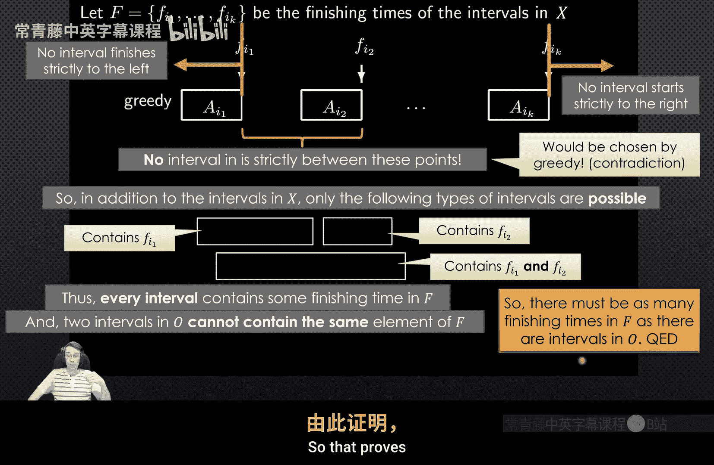
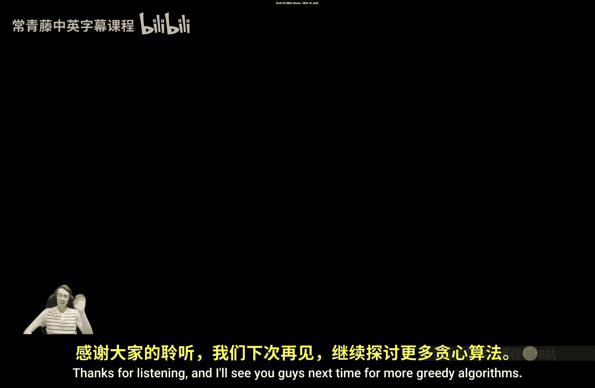

# 滑铁卢大学【中英⚡算法｜CS341 Fall 2021, Algorithms】 p07 P7 Lecture 7 -BV1DhrDBbEwR_p7-

Welcome， ladies and gentlemen to the seventh episode of CS341 algorithms where today we're going to be jumping into the topic of greedy algorithms。

 the greedy algorithm design paradigm。So what is a greedy algorithm Well before I get to greedy algorithms。

 I want to talk to you about the types of problems that we typically solve using greedy algorithms。

 so we usually use greedy algorithms to solve optimization problems。

 That's not to say that optimization problems are usually solved by greedy algorithms。

 optimizationim problems are solved by all sorts of algorithms， divide and conquer。

 greedy dynamic programming， things like linear programming。

 but greedy algorithms are usually used to solve optimization problems。Okay。

 so let me run through a few definitions here。 So what's a problem。 Well， given a problem instance。

 which， of course， is just an input for that problem， find a feasible solution。

 We'll talk about what feasible means that maximizes or minimizes as appropriate a certain objective function Okay。

 so this is a pretty jargon filled sentence。 is this is what an optimization problem is。

 And let's go through all the jargon。 So we know what a problem instance is。

 let's describe what problem constraints are with a little example here。

 So suppose we have some two dimensional problem that we're trying to solve。

 We're trying to optimize some function of two variables X1 and x2。

 And we can draw these two variables。 We can draw know axes for these two variables。

 The x1 axis in the bottom and the x2 axis going up vertically。And constraints， in this case。

 this is a linear program。 Cons represent some sort of requirements that have to be satisfied by any feasible solution。

 So for this linear program， the constraints are x1 plus 2 x2 has to be less than or equal to 8。

3 x1 plus2 x2 has to be less than or equal to 12 and so on。

 each of these constraints actually in represents a line。

 there is a line where x1 plus 3 x2 equals 3， that's this line down here。

 and the inequality doesn't represent a line， but rather a half plane。 So basically。

 you can think in a linear program， linear meaning you have a linear combination of variables and the constraints are are linear constraints。

 inequalities on those variables。 in in a linear program。

 you can think of these constraints as creating half spaces。

 and the intersection of all those half spaces。 So， for example， x1 plus 3。

X2 greater and equal to 3 is the half space to the north up from this line。 x1 plus 3 x2 equals 3。

 And then you have this line，3 x1 plus 2 x2 equals 12 if this inequality says we should be less than or equal to 12。

 then this constraint represents the half plane to the left of this line， this diagonal line here。

 and the intersection of all of the half space is defined by the inequalities creates this region that's highlighted here in yellow。

 And we call that the feasible region because that region consists entirely and precisely of the points that satisfy all of the constraints。

 So for any problem， instance， I feasible of I， which is this yellow region is the set of all outputs i。

e。 solutions for the instance I that satisfy the given constraints。Okay， so that's what a problem。

 instance constraints and feasible solution are。 but we don't just want a feasible solution。

 We're talking about optimization problems。 So we want to select somehow the best solution out of all these points and we want to select you know。

 define what better means so we can select the best by using some sort of objective function。

 And so you can think of the objective function as a function F that maps points in the feasible set into the feasible set of solutions or the set of feasible solutions into real numbers。

 non negative real numbers。 And you can think of this objective function in some cases as being a profit function。

 if we want to maximize it。 you can think of it in other cases as being a cost function that we want to minimize。

Okay， so that's what an objective function is。 Now we can define an optimal solution。

 So a feasible solution X。Is optimal if the profit of x is maximized， if x is the point。

 such that profit is maximized at that point。Or the cost F of x is minimized at that point， X。

 And you can only consider the X that are feasible because we can't say that some some output is an optimal solution if it gives a really great value for our objective function。

 but it's not even feasible， it doesn't satisfy the constraints。

 So in order for something to be a solution to an optimization problem。

 it has to be both feasible and optimal。Okay， so here's a couple arrows and a couple points that just。

 you know， express the things that I just described in terms of this problem。 So， for example。

 you know， this the yellow arrow is indicating that this represents the set of feasible solutions。

 Each of these feasible solutions has an f value。 So， for example。

 this point here might have an f value of $720 a profit and an f value here of $907 a profit。

 And this would be would be better according to that objective function。 This point。

 this solution would be better according to the objective function F。Okay。

 so how do we solve optimization problems。 Well， there are tons of techniques in in this course。

 we're going to study greedy approaches first， while technically。

 we've also studied divide and conquer approaches already。

 and you can indeed solve some optimization problems using divide and conquer algorithms。

 We're going to study greedy approaches now。 And then a little bit later。

 we'll study dynamic programming， which is sort of like divide conquer。

 but sometimes it can be a lot more efficient than divide and conquer。

 especially up the sub problemsble that you're solving have some sort of overlap。

And we'll talk more about that when we actually get into dynamic programming。

 But what's a greedy algorithm。 Well， greedy algorithms are usually very fast and the algorithms are very simple but they're hard to prove optimality for。

 So usually the challenge in a greedy algorithm。 there's a little spark of creativity you need and then you need to put almost all of your work into the proof and that's basically what we're know looking for for you to prove rigorously that your results are optimal because the algorithm usually has kind of almost nothing to it。

 apart from you know the work that you need to do in the proof。 Okay。

 so greedy algorithms follow a particular structure， which is it can be kind of hard to define。

 and the definition of what makes an algorithm greedy。 there are very rigorous precise definitions。

 but theyre not the kind of thing you want to go through in a thirdyear algorithms course in an undergrad degree。

 These are things you might want to go through in a sixth or seventh or eighth year grad course。

 But nevertheless， I'm gonna do my best to give you a definition。That's not completely formal。

 but gets at some of the intuition that underlies the。

 the real formal definitions of greedy algorithms， you know。

 that you can find elsewhere in more advanced courses。So roughly speaking。😊。

A greedy algorithm starts from nothing and then makes a sequence of irrevocable choices one at a time。

 And these choices aren't based off of global knowledge of what will be optimal。

 many choices in the future， They're sort of near sighted choices that are based off of doing something that seems like the best move right now。

 if I'm not looking far into the future。 So there are a couple of concepts that are gonna be helpful in describing how greedy algorithms work。

 So let me define for you partial solutions and a choice set。So for partial solutions。

 given a problem instance， I， it should be possible to write a feasible solution as a tuple。

 so the feasible solution capital x is going to be this tuple， little x1。

 little x2 all the way up to little xN for some integer N and intuitively these are going to represent the choices that the greedy algorithm made。

 each of x1， x2 and so on each of those is a choice。And each of these Xs is in this chi capital Chi。

 which is called the choice， the global choice set。

 This is the set of all possible choices you could take in an algorithm。

 So these are choices in a tuple， a sequence of choices。And a couple where I is from x1 up to Xi。

 where I is less than n。So up to n would be a full solution， a feasible solution。

 if it goes up to something less than n just up to X I， then it's a partial solution。

 only if no constraints are violated， can't violate any of those problem constraints。 Otherwise。

 it's not a partial solution。 it's not any kind of solution if you violate any constraints。

 So if you don't have a full feasible solution you might as long as you've satisfied the constraints。

 have a partial solution with only I of the choices made so far。

 and it might be the case that a partial solution you've developed so far can't be extended to a feasible solution。

 it might be the case that the first eye choices you've locked in。

 prevent you from making choices that will end in a feasible solution。

 So maybe you haven't violated any constraints yet。

 but maybe the first eye choices that you've made have locked you into needing to make a choice in the future that violates constraints。

 then you wouldn't be able to。And a partial solution into a feasible solution。

 But we would like to be able to talk about partial solutions that can be extended into feasible solutions。

 because that's going to be the rough structure of a greed algorithm。

 We're going to build partial solutions into bigger partial solutions eventually into a full feasible solution。

 and then make a sophisticated argument that it's not only feasible but optimal。

 So we'll talk more about that。Okay， now I want to define a choice set。

 which is different from this chi。 This chi is all possible choices that you could make with no respect for whether that choice makes any sense at this moment。

 So this includes choices that would violate constraints。

 We want a way to talk about choices that don't violate constraints。 So for a partial solution。

 X1 up to X I。 we can define the choice set choice of X。 So X is the partial solution。

 choice of X is gonna be the subset of chi。Where if I take one of these choices in the subset。

 I won't violate any of the constraints。 So this is the set of choices that I can make starting from my partial solution X that will preserve my constraints and result in a new partial solution that consists of x1 up to X I and now also the choice Y。

 So really crucially Chi is the set of all possible choices。

 completely irrespective of whether they would violate constraints and choice of X is just the choices I can make starting from my partial solution X that won't violate any constraints and will leave me with a new partial solution。

 and it could be the choice of x is empty。I might not be able to extend the current partial solution at all。

Okay， so we've defined partial solutions and choice sets starting from a partial solution X。

Now we need a way to make choices that actually allows us to come up with not just a feasible solution。

 but also an optimal solution because at any point in time there might be a bunch of different choices that we could make you know our choice set could have 100 different options and we want some way to choose one of them if I just use arbitrarily。

 I'm very unlikely to come up with an optimal algorithm so I need some sort of way to evaluate my choices to figure out which one is best and I want my evaluation criteria to be local。

 I don't want them to depend on complicated calculations that predict many choices in the future to find an optimal choice I want to just look at the set of choices I can make right now。

 and the set of choices I've already made in the past and without considering any future choices。

 just the single choice I can make now， and the choices I've made in the past。

I want to make the the choice that seems best using only that local information。

 not the global future information about future choices。

 just local information about the single choice that I'm gonna make right now。 ignoring the future。

 So I need some local evaluation criterion function G。

 So this is an evaluation function that's going tell me， given a choice why。

 and we might as well define it for all the possible choices。

 not just the choices that leave us with feasible extensions of our partial solutions。

 we can define it in terms of chi。 and we'll only ever really evaluate the local evaluation criterion on the choices that we can actually make and leave us with a feasible solution。

 So given a possible choice。G of y， the evaluation of y is going to give us some sort of measure of the added profit or the added cost that the choice of why。

 the local choice of why ignoring future choices would add to our solutions。

 So how much would making choice Y right now， where we are right now。

Impact the cost or profit that we're going to end up with。

 And we're not going to think about future decisions。Okay， so what's an extension。 Well。

 given a partial solution， X you x1 up to X I， we can choose some y in the choice set of choices that don't violate our constraints。

 And we choose that so that G of y is optimal over all of our possible choices that we could make in this step that won't violate any constraints。

 We want to choose the one that either minimizes our cost function。

 our local cost function G or maximizes our local profit evaluation function G。

And then we're gonna update our partial solution X into an extended partial solution。

 a new partial solution that's an extension of the old one。 X1 up to X I followed by our new choice。

 Y。 And this， with all of these things defined because a lot of definitions with all these things defined find。

 Now， I can tell you what the structure of a greedy algorithm is going to be。

 We start with the empty partial solution， no choice is made yet。

 we repeatedly extend the the our current partial solution with a new partial solution。

 bigger and bigger partial solution。 Each of them an extension of the previous。

 until a feasible solution X has been constructed。 Now。

 this feasible solution may or may not be optimal。 Our job is to prove that our local evaluation criterion is configured in exactly the right way so that the feasible solution we end up with is also optimal。

😊，Okay， so here's some stuff I said just written on the slides for your notes。

 here's something I should point out when we're deciding what our choice is for a given step。

 for a given extension， when we're going to extend。

 we figure out which choice gives us the best value of G of y you over all the different y's we could choose。

And then we pick that choice。 and that choice is irrevocable。 We're never going to undo that choice。

 If we choose to include why our final solution will be an extension of this。

 So why is irrevocably chosen。 And that's crucial。 That's a crucial part of this being a local。

 greedy method。 We don't do complicated reasoning where we undo previous choices or look ahead and consider future choices。

 So neither do we look ahead and consider future choices。

 nor do we look back and reconsider and undo our old choices。

So we're just going to choose the next element to include by greedy taking the y that gives us the maximum local improvement。

 whether that's maximum profit or minimum cost。 Okay， so that's the structure of a greedy algorithm。

 and there are not necessarily greedy algorithms for all problems。 There are lots of problems。

 There are lots of problems where we don't know good greedy algorithms for them。

 and it really doesn't seem like a greedy approach will work。

So so let's run through quickly before we start seeing concrete examples of greedy algorithms。

 Let's run through a couple of core characteristics of them。 So first， as I mentioned。

 greedy algorithms do no looking ahead to future choices and no backtracking of previous choices。

So you can't consider how your current choice affects future choices。

 You can't undo or change your old choices。 greedy algorithms can usually be implemented really efficiently。

How typically， they consist of a pre processingcess step， which is usually a sort。

Based on the function G， so usually G defines like a comparator for your sort and the preprocessing step is a sort。

And then that's followed by a single linear pass through the data。

 So you usually end up with an n log n time algorithm。 If you use an n log n sort。

 And if you're lucky and you have like， you know， bounded integer inputs。

 and you could use a super fast linear time noncompison based sorting algorithm like a radix sort or something。

 And you might even get a linear time algorithm。In a greedy algorithm。

 only one feasible solution is constructed。 We don't explore multiple different paths that coming up with solutions is just a single path we take through the graph of all possible solutions。

 and that single path is dictated by our heuristic local evaluation criteria function G。

And for correctness for greedy algorithms， it's possible to prove that they always yield optimal solutions。

 but these proofs can be tricky and complicated。 And that's where most of the challenge is going to lie。

 And we will see examples of these things。 and you will be asked to do such proofs as well。Okay。

 so the first problem we're going to talk about that we're going to show a greedy solution for is called the interval selection problem。

Okay， so what's the input to the interval selection problem Well， there's a set a of time intervals。

 these intervals are labeled A1 up to AN and each interval AI has a start time and a finish time Fi and of course the F is greater than equal to start to the start time and SI and Fi are positive integers。

And a feasible solution we have to define for this problem。

 this is basically defining what our constraints are。

So this is part of the problem specification that's given to you。

A feasible solution is a subset X of the input intervals。 So we want to output some of the intervals。

 and those intervals have to be pairwise， disjoint。 You can't have any overlapping intervals。

 any intervals that overlap in time。 So if you wanted to think about this problem intuitively。

 you could think about this is a kind of scheduling problem where， for example。

 you're scheduling a meeting room。And there's a single meeting room and the time intervals here represent meetings and you can't schedule two meetings to run at the same time。

 in fact， none of the meetings should overlap with each other because then you'd be running meetings in the same room at the same time。

 So that's why they have to be pairwise disjoint that's one way of thinking about this problem。

So the output that we're looking for is a feasible solution， of course。

 because they have to be feasible And what's the optimality part。

 Well we want it to have the maximum size， Well， what's the size of the output。

 It's the number of intervals， the output。 So the cardinality of our subset X of the input。

 We want to output as many intervals as possible that our pairwise disjoint。😊。

So here's an example input drawn。 And I'm drawing these intervals where you can imagine time going from left to right。

 So left end points is the start time， the right end point is the finish time。

 And I've drawn them on two lines here， because， of course， when these things overlap。

 I can't draw them on top of each other without it looking very confusing。 So I'm drawing them。

 you know， one over the other instead of， you know， I don't drawing them in some other weird way。So。

 you know， for example， we could take this interval and decide， yeah。

 this is gonna be in our subset X that we're gonna output。

 and we could reject this one and say that's not gonna be in our subset X。

 We could take this one and reject these three and we could just output these two basically and maybe we didn't even consider this interval our solution。

 some weird solution that just looks at a subset of the input and decides to take a few of them and rejects the others and some of them aren even considered。

 Okay， you could write an algorithm like that。 And it would produce some kind of output。

 but is it correct。 Well， first of all， is this feasible。 The chosen intervals don't overlap。

 So this really weird execution I just described this really weird example where my outputs gonna be just these two intervals。

 I didn't even consider this interval of my algorithm。 that will be an algorithm that well。

 at least in this case produces a feasible solution for this input。

 that algorithm produces a feasible solution。But is this solution optimal， Well， no， I mean。

 clearly we could take this box and we could get at least three。

 so certainly two is not an optimal number。So there are a few different greedy strategies that we could follow to solve this problem。

 let's explore a couple of them briefly。 So here's a first possible strategy。

 we could sort the intervals in increasing order of starting times， in other words。

 in each step we could choose the earliest starting interval。

That's disjoint from all the previously chosen intervals。Okay。

So let me just tell you how this informal description of a greedy strategy maps onto the formalism I described a few slides ago。

 and I'm not describing this because you need to use this formalism。

 I'm describing this just so you understand the mapping。 And then for most of this course。

 we'll talk about greedy algorithms in these relatively informal terms like I've described here in this box。

 But we should do so Under how this maps to the theoretical concepts concepts and objects I described above。

 So what is a partial solution for this problem。 Well。

 it is an X equal to X1 up to Xi where each X I is an interval that we chose to output。

That's a partial solution。 This is only a partial solution if it's feasible。 So in particular。

 all of these x1 up to X I must be pairwise disjoint。

 and indeed we will produce as we go in this algorithm。

 partial solutions that are feasible as we go because we're always going to pick the earliest starting interval that is disjoint from all previously chosen intervals。

 So it's easy to argue that our R X partial solution X at all times in the algorithm will be feasible。

 and thus it will be a partial solution。 It won't just be a subset of the input。

 It'll be a partial solution。Okay， what are our choices， Well， chi。

 the set of all possible choices is just a。 It's the set of all intervals。However。

 the choice set starting from a partial solution X is the subset of chi。 In other words。

 the subset of a， such that the prefix sorry， the partial solution X i。

e X1 up to X I followed by y extended to add choice Y still respects all the constraints。

 So this is the set of all choices we could make starting from the partial solution X。

 In other words， a set of all intervals we could choose starting from partial solution X。

 such that that interval Y when our our partial solution is extended with that interval Y。

 we still respect all the constraints。 In other words。

 y doesn't intersect any of the previously chosen intervals。

 X1 up to X I right So that's what the choice set is。

 It's the y in a where X1 up to X I as well as Y does not pair Y' is disjoint。

And what's the local evaluation function Well G of y is just the start time of J。

 we're always picking the earliest start time， so we want to minimize the start time of J。

 That's our local evaluation function。 So our G of y is SJ where y is the J interval。Okay。

 so G of the Jth interval is the start time at that interval。Okay。

 so that's our local evaluation function。 And you notice we're gonna sort the intervals and increasing orders of start time。

 So we never actually actually need to evaluate this local evaluation function。

 It's going to be encoded in the sorted order You know。

 because at all times the the interval that that minimizes this local evaluation function will be the earliest interval in the sort order that。

 of course， is disjoin from all the previously chosen intervals。 that'll be the one that we pick。😊。

Okay， so let's draw what this looks like or sorry， we'll talk about that a bit more in a moment。

 Let's talk about the other greedy strategies， some other greedy strategies that we could try。

 So here's a second one。 What if instead of sorting by start times。

 we sorted the intervals in increasing order of duration。

 So we instead of starting with the earliest interval that's disjoint from all previously chosen intervals。

 we start with the shortest interval that's disjoint from all previously chosen intervals。

 In other words， the local evaluation criterion function here is F the finish time of I minus the start time of I。

 the duration of interval I， whereas previously it was the start time of I earliest start is smallest so smallest start。

 smallest duration。There's a third possible approach we could sort intervals in increasing order of finishing times。

So in other words， at any stage， we're going to choose the earliest finishing interval this disjoint from all the previously chosen ones。

 In other words， the local evaluation criterion is the finish time of I。

 So does one of these strategies yield a correct greedy algorithm。

So if you want to try this as an exercise before I show the answer。

 then I'll give you a moment now to pause while I take a sip of coffee。O。

So if you wanted a hint to try that， you just had no idea how to start that。

 I'll give you another chance to pause here， try to think if there are any inputs that would obviously cause you to return a non optimal output。

For any of these strategies。 So if I'm， in other words， if I'm going to pick the earliest start time。

 can you make it bad for me to pick the earliest start time。So。

Take a moment if you'd like to do that。Okay， so I'm going to assume by now you've paused and done that if you wanted to do that。

 And I'm going to try to reveal the solution。 So for strategy number one。

 I'm going to prove here that this is incorrect。 So what does it mean to prove that a greedy strategy is incorrect。

 Well， to do that， I only need to find one input for which the algorithm gives a non optimal solution。

Or a broken infeasible solution that violates constraints。

 Both of those would mean that the algorithm is wrong because for an algorithm to be correct。

 it must solve every input and give an optimal and feasible solution for every input。

 So if there's any input for which it gives the wrong answer where wrong means not optimal or infeas。

 then the whole algorithm is wrong。So all we have to do is find one input。

 It can be any kind of input but we like。 So we have considerable leeway to design an input that looks exactly like we want it to to try to expose a bug in the program。

 because finding any input， no matter how special it is。

 we'll demonstrate that causes the algorithm of misbehave that is。

 We'll demonstrate that the algorithm is wrong。 So if for strategy 1。

 we're sorting and picking in terms of increasing in order of increasing starting times。

 here's an input， can we make it bad to pick the first。😊，Starting interval。 Yeah。

 make the first starting interval huge and make it prevent the selection of a bunch of other intervals。

So here， for example， we have this input， which I'm going to render visually like this。

 so I'm going to draw a time or well I'll calling it the X axis。

 maybe I should have called it the time axis or something。 anyway。

 the X axis or time axis is going to the right。And I'm going to draw multiple rows here because that's how I'm going to just represent intervals that I。

 of course， can't draw directly over top of one another。 So you can't tell what's going on。

 I have to draw them on different rows。 So you can see that they're distinct。

 So here's the interval from 0 to 10。 Here's 1 to 3。 Here's 5 to 7。

 And I'm going to draw all my diagrams for this lecture like this。Okay。

 so you can see if we pick the earliest starting one， we're not going to pick either of those two。

 So we picked one when we could have picked two。 That's not optimal。 This is a proof。

 giving this example is a proof that an algorithm that sorts by starting times that always pick the earliest starting interval is incorrect。

Okay， how about strategy number two， If we sort the intervals in increasing order of duration。

 can you make it bad for me to pick the shortest meeting。Well。

 it turns out you can All you have to do is make the shortest meeting。

 prevent the choice of a bunch of other meetings that are longer。

 So this is in this example we have you know the meeting from 4 to 7 prevents me from scheduling 0 to 5 and 6 to 10 I could schedule to when I'm only going to schedule one。

 That's bad。😊，Now， strategy 3， where we sort in increasing order of finishing times actually always yields the optimal solution。

 And I'm going to prove that。 So first I'm going to show you the code because this is just a drive home。

 the idea that this stuff is really， really easy to code up and relatively speaking hard to prove correctness for。

 So here's the actual optimal solution for greedy interval selection。

 We sort a by increasing finish times and then we're going to start constructing our partial solution X。

 So we're going to choose the first element because it has the earliest finishing time。

 And then I'm going to remember what the index of the last interval that we actually kept in our partial solution was out of a we took a of1。

 So pre is going to be one。 and then for all the remaining intervals in the input we're going to decide do we take it or not and we're always just going to look for the interval that has the smallest smallest finishing time that doesn't overlap any previous intervals So we're looking for an I。

😊，The smallest I because smallest I means smallest finishing time because they're sorted that way。

 Such that a of I's start time is greater and equal to the previously taken intervals finish time。

 So we have to wait， of course， until the previously taken interval ends。

 And then because of our sort order this start time is going to be sorry。

 I'm saying something confusing。 So we always need to wait until the previous interval previously chosen interval finishes。

 right， And then out of the intervals that start after that finishes。 We want the earliest one。

 So we're just gonna take the first one that we see that has a of I dot start greater and equal to a of previous dot finish。

 we're gonna append it to our X subset Now that when I say subset really。

 this is implemented as an array。 just an array。 So constant time access。 if you wonder。😊。

How I'm doing constant time append。 I can actually just allocate this as an array of size n at the beginning。

 So appending really just means writing to the next slot and the next free slot in that array。

 And at the end， I can return this array that's bigger than necessary and just also return the amount of the size that I actually used in it。

 the size of my subset like k or something。So I haven't written that stuff here。

 but we can understand。 I'm not using some fancy data structure。 I'm just using an array。

 And if need be， I can over allocate it。 So I don't need to deal with expandable arrays or or I can assume I have access to an expandable array that gives me amortized constant time access。

 And then I'd have to be a little bit careful about my analysis because I have an amortized term。

 not a worst case term in there。 So just have to think a little carefully。Okay。

 but if I just assume I'm using a basic array， right。

 this isn't going to be very expensive and then I've chosen interval I。

 so I set preve to I because this is now the last interval that I've chosen。

 I just continue this process until I'm done。So for example， on our input that we saw before。

 these are some of our inputs， you know I've just labeled them here in order by increasing finishing times A of1 A of2 a of3 I'm going to take the earliest finishing times at first I'll take these two which is optimal in this example I'll reject that one。

 And then in this example we saw that stumped the second strategy Here's my labeling and increasing order of finishing times and my algorithm will take a1 it can't take a2 because a2 overlaps this you can see a2 do s is not greater than a pre of do finish a pre do finishes5 a2 do s is4 so it won't take this one instead it'll go to the next iteration of loop and it'll see a3 do s which is6 is greater than equal to a pre of do f which is5 and it'll take this one so it solves those two examples that stumped our previous two strategies where is our local evaluation function in this code by the way we never actually check out of all the choices we could make what's the。

Which one has the， the smallest finish time。 Well， it's just embedded in the sort。 right。

 We're taking the first interval that we can that doesn't intersect any previous intervals。

 That's it。Okay， so what's the time complexity of this algorithm。 will we sort。

 And then we do one pass。 And I've argued that this should be constant time for this store。

 constantant time for this append。 Everything in here is constant， except for the loop。

 which does cost it work modeeration。 So basically。

 it's theta n plus theta n log n for the sort iss just theta n log n。 Now。

 how do we prove that this is correct。 In other words。

 how can we show that the returned solution X is both feasible and optimal。

 The feasibility is not too hard， because we always choose an interval that starts。

After all of the other chosen intervals end。Right，How do we know that， Well we only choose。

 we can only append something to X if it starts after the previous interval ends and the previous interval。

 of course， has a finishing time that's greater than all the previously chosen intervals， right。

 So this starts after all the previous intervals end。 So we're always choosing something。

 We're always choosing an interval that doesn't intersect any of the previous intervals。

 If you want to choose that prove that formally， then you do that with a loop invari。 you say， well。

 base case， when I enter the loop， I haven't chosen。 I've only chosen one interval。

 So there there are no overlaps。 There's no overlapping in my X set of things I've chosen or array of things I've chosen。

So I assume now for my loop invariant that at the beginning of the loop my invariant holds。

 I assume that everything in my x array， all of those intervals are pairwise disjoint and I prove at the end of my iteration。

 whether I've added something or not， I prove at the end of my iteration that that loop invariant still holds that will prove that at all times in the loop。

 and indeed once I exit the loop and I have fixed the array of intervals that I'm going to output that that array of intervals I'm going to output contains pairwise disjoint intervals。

 that will prove feasibility how about optimality Well。

 that is harder and unfortunately there's no way to get away from doing a rigorous proof in order to prove optimality here。

嗯。What is it this time？Maybe a glass shelf break。

Oh， no。That's better。Well， back to work。So let's do some greedy correctness proving。

 And I want to outline first at a high level how greedy correctness proofs are usually structured and then give。

 of course， the concrete example。 So a greedy solution。 X is correct。 That's what we want to prove。

 And correct just means feasible and optimal。We typically show feasibility directly along the lines of what I just showed you。

 an optimality by contradiction usually。In other words， we sort of suppose that the solution O。

 some solution O exists。That is better than our greedy solution， X。

 And then we want to show that that leads to a contradiction。Because in that case。

 we've contradicted the existence of O， the existence of a better solution。Well。

 if we contradict the existence of a better solution。

 that means our solution must be the best or at least must be tied with other possibly slightly different。

 but equal in value solutions。And there are two broad strategies for deriving this kind of contradiction。

 in fact， it isn't always a contradiction。 we'll see examples where it isn't。

 but there are two broad strategies， certainly contradiction is one way of doing it。

 There are two broad strategies for proving greedy algorithms and they are greedy stays ahead arguments where we show that every choice that we made in the greedy algorithm is at least as good as some corresponding choice in the optimal algorithm。

So we sort of imagine that we look at the choices made by the greedy algorithm and the optimal algorithm in some order and we don't necessarily know what order the optimal algorithm made choices in or how it works。

 we imagining that there's some we're imagining there's some optimal algorithm does that does better than us and we have no idea how it works。

 so we aren't assuming anything about how that algorithm works。

 but we know how our greedy algorithm works and so we somehow order the choices that are made by our greedy algorithm and this optimal algorithm that we suppose exists and we inductively prove that at all stages in our algorithm。

 if we reorder the choices made by the optimal algorithm some way so that we can map them to the choices made by our greedy algorithm to define some correspondence between the choices made in our greedy algorithm and the choices made in our optimal algorithm。

 then we can show。That every choice in X is at least as good as its corresponding choice in the optimal algorithm。

 And if all of our choices are just as good， the final result should be just as good。

The second approach， and we're going to see an example of that in this lecture。

 the second approach that we're going to see an example of in the next lecture and that might be helpful for your assignment。

 for example， is called an exchange argument， so an exchange argument involves again assuming that there's some you know optimal algorithm that we don't know that exists that can produce an optimal solution O that's possibly better than our solution。

😊，And then if we want to come up with a contradiction。

 we show that this optimal solution can be improved by replacing some choice that it makes with maybe some choice that we made in the greedy algorithm or just some other choice as long as you can find a way of showing that some choice made in this supposedly optimal algorithm turns out to be nonop。

😊，Then we can prove that that solution。 O is not really optimal。

 which is a contradiction that contradicts the existence of this algorithm that produces this better solution。

 O。Okay so let's see the concrete proof for this problem。

 and this is actually going to be a greedy stays ahead argument， not an exchange argument。

So we're gonna give an inductive proof or we prove that the sequence of choices made by greedy are at each of those choices is at least as good as a corresponding choice made by the optimal solution。

 So the sequence of choices made by greedy。 We're gonna write that as I1 I2 all the way up to I。

 and our partial solution or sorry our our feasible solution at the end。

 our greedy solution X is gonna to be written as a I 1 A I2 all the way up to AI。 And you know。

 you might be wondering why I have double subscripts。 Well， it's not a1 up to A K。 that's the input。

 that would be a prefix of the input。 we don't want just a prefix of the input。

 It chooses a sub sequenceence。 So A I 1， A I to the I1， I2 is adding a second layer of indirection。

 You can think of it as this is how you write a sub sequenceence， right。

So I1s less than I2 is less than i3 is less thantt dos less than IK。

 so this is an ordered sub sequenceence of the input。ok。And note by the way。

 these intervals are sorted and so this ordered sub sequenceence is also sorted。

Now let O be any optimal solution。Oh， we're also going to write as an ordered sub sequenceequence of the input。

 But crucially， we are not assuming that the optimal algorithm uses the same sort order。 Okay。

 we're writing down the choices made by the optimal solution。In this sortded order。

 whatever the choices it made， in whatever order it made them。

 we are imagining that we reorder those choices because the choices are just intervals。

 We're imagining that we reorder those intervals according to increasing finishing times。

 but we're not assuming that the optimal algorithm actually makes the choices in that order。

 We're just writing them in this order so that we can form a correspondence。

 a one to one mapping between the choices of our made by a greedy algorithm and the choices made by the optimal algorithm。

 So we're creating here a correspondence between AI 1 and A J1。

 We're creating a correspondence between intervals chosen by greedy sorted by their finishing time and the intervals chosen by optimal sorted by their finishing time。

So we're merely imagining reordering the intervals so that we can easily compare their finishing times to the intervals that were chosen by greedy。

 which of course were chosen in this order。So that ordering is just going to help us compare finishing times。

So what we're gonna to prove as our key lemma in our greedy stays ahead argument is the following。

 We're gonna to prove that the finishing time of I am like finishing time I am is less or equal of finishing time J。

 remember what this I am and JM are the I sub something sequence represents the choices made by the greedy algorithm and the J sub know something choices represents choices made by the optimal algorithm that we've supposed to existed。

 So we're saying for all M for all all M choices made by each of these two algorithms the I choice made by greedy has its finishing time less than or equal to the finishing time of of the sorry the em choice made by greedy in this ordering has finishing time less than or equal to the em choice made by optimal in this reordered in this way yeah。

So greedy' Amp interval has finishing time less than or equal to optimal's Amp interval when I talk about their amp interval it's just the amp interval in this ordering sorting by finishing time。

 not the a choice that Op made in the order that it made its choices。Okay， so here's the proof。

 so we'llreroving by induction。 So you have the base case where m equals1。

 and indeed we do have F sub1 less or equal to fj sub1 because F sub1 is the interval that the greedy algorithm chooses first。

 and it chooses the very first algorithm the very first interval in its sort order。

 which is the one with the earliest finishing time。

 so there can't possibly be any other interval with a smaller finishing time。

 So this holds trivially。Okay now we're going to prove the inductive step。

 So our inductive assumption is just the claim for M minus-1， and we're going to prove it for M。

 So by induction， we have f of I sub m minus1 is less ord f of j sub m minus1。 In other words。

 the M minus minus1 interval greedys m minus1 interval as finishing time less less than or equal to optimals M minus once interval in this order。

Okay， so now consider AIM， in other words， the greedys Emp interval and AJM optimals E interval in this order。

Okay so what does this look like visually， Well you have a sequence of choices made by greedy of a sequence of choices made by optimal。

 Consider now okay， we know from the inductive hypothesis that greedy's M minus1 choice greedy's M minus1 interval finishes at the same time or before optimals M minus1 interval。

 and we want to prove the same thing for M。 So consider AJM。

 the em choice for optimal and and AI am the em choice for greedy。 Well， if you look at AJM AJM。

 it starts， of course， since this is a feasible solution after AJM minus-1。Finishes。

These have to be disjoint in order for this to be a feasible solution。

 and you better believe the optimal solution is feasible。

 So we have SJM is greater than or equal to FJM -1。And of course， by the inductive hypothesis。

 we have FJM -1 is greater than equal to F I M -1。 So we have the start time of this interval is greater than or equal to the finish time of this interval chosen by greedy。

 So what that means is greedy could actually pick this interval。😊，Now， if we consider， of course。

 the interval AIM chosen by greedy， it's going to be chosen such that it has the smallest finishing time of any interval that starts after FI M minus1。

But we just argued that AJM starts after F IM-1。 So this is one possible interval that greedy could choose。

 and greedy is going to choose the interval with the smallest finishing time that it can choose in this step。

 So whatever it chooses is going have to have finishing time less than or equal to AJM's finishing time because it can choose AJM's finishing time。

Therefore， whatever it chooses， we'll have finishing time FIM less than or equal to FJM。

So that's the proof of this lemma， which will be useful。

 This is the crux of the greedy stays ahead argument。 We've just proved。

 given our correspondence where we considered whatever intervals were chosen by optimal in the same in the same order that it made sense to consider the intervals chosen by greedy。

 once we establish that correspondence by reordering the intervals chosen by optimal。

 we prove that for each choice made by greedy， that choice is just as good as the corresponding choice made by optimal intuitively。

 and it's not clear maybe that finish time of one being less than or equal to finish time of the other means that this is just as good。

 but the next part of the proof that uses this lemma should make it clear that this lemma enables us to prove that greedy obtains the optimal number of intervals。

So let's use that lemma， so remember the greedy solution X is AI1 up to AIK。

 and the optimal solution O is AJ1 up to AJL。And now we're okay where're to complete the proof。

 So in order to obtain a contradiction， suppose that the optimal solution manages to select more intervals。

 In other words， L is greater than K。Well， from the lemma we have that the finishing time of AK is less than or equal to the finishing time of JK。

 if L is greater than k， then the greedy algorithm selects AIK is its last block and last interval and the optimal algorithm selects aJK and then it selects something else。

Okay， and a JK plus1， the next block that the optimal algorithm chooses， of course， by disjointness。

 so this is a feasible optimal solution。AJ K plus1 has to start after AJK finishes。

 So the start time S J K plus1 has to be greater than or equal to this finish time FJK。

 And we know from our lemma that FJK is greater than or equal to F I K。

 So the start time S J K plus1 is greater than or equal to F I K。

 Sorry I didn't pop these boxes up at the right time。

 So this thing starts after this finishes and this finishes after this finishes or at the same time as this finishes。

 So this has to start after this finishes。😊，Okay well wait a minute if this starts after this finishes and this is the last interval in this sortded order by finishing times。

 chosen by greedy， well wait a minute， greedy can choose this and obtain a feasible solution。

So greedy would choose this。Well， if greedy would choose this， we know the greedy algorithm。

 it would choose this。 and somehow greedy didn't choose this。

 That tells us that this block can't exist。 This is a contradiction。

 The only thing we've assumed at this point is that L is greater than K。

 So the fact that we arrive necessarily at a contradiction means that the only thing we assumed L greater than K must be false。

 So L must be less than or equal to K。 And， of course。

 that tells us that this solution can't be better than x。 Our greedy solution。

 So our greedy solution is optimal。Okay， so that is our greedy stays ahead， proof。

Now we can also look at a different proof。 This is kind of a slick ad hoc approach so I told you that usually we prove these algorithms are correct using one of two different broad strokes approaches greedy stays ahead arguments and exchange arguments There are also some slick ad hoc proofs that you can come up with for certain types of algorithms that end up being really elegant and short you can't always come up with them of course。

 and they're not general strategies that have a particular name but it's nice to demonstrate some such examples。

 so we're gonna see a second very short one slide proof of the same algorithm optimality proof So let F be the finishing times at the intervals in the array X that we return。

 so x is greedy solution these are the finishing times they're ordered by their finishing times right。

So these are the greedy intervals。Now， note that no interval in the input can finish strictly to the left。

Of FI1， because greedy chooses the first， the earliest finishing interval as its first interval。

 so no interval in input can finish to the left of this。

And also note that no interval can start strictly to the right。

 or else greedy would be able to take that interval without intersecting any of the previous intervals。

 so it would take that interval， so no interval starts strictly to the right。

So all of the intervals in the input start or sorry finish between here。And start sorry。

 finish after here， here or later and start here or earlier。

 Okay and no interval is contained strictly between these two points。

Between the finish I1 and the finish I2， because if interval was， if an interval started in here。

And finished like somewhere in the middle， then Greeny would have taken that instead of AI2 if it started before this point。

 it would intersect AI1 so it wouldn't be taken， but no interval can be in the input strictly between these points。

Or else greedy would have taken it instead of AI too。So in addition to the intervals in x。

Only the following types of intervals。Are possible。We can have an interval that overlaps F1。

And this won't be chosen by greedy， so we don't get any contradiction。

 So this this interval contains F1。 We could have an interval here that contains F2。

And we could have an interval that contains both FI1 and FI2。

 but we can't have any intervals strictly between this point and this point that don't contain either of FI1 or FI2。

 because they would be chosen。 That interval would be chosen by greedy。

 And here we've said these are the intervals chosen by greedy。 So we know in the input。

 there are no intervals that lie strictly between FI1 and FI 2。

So if we restrict our attention to the intervals that are in the input。There are the intervals in x。

 and then there are these other intervals that contain。Finishing times。

So this argument I just made for this space between AI1 and AI 2。

 this applies for the space between AI2 and AI 3 and AI 3 and AI 4 all the way to the end。

 So what this means is you don't have any intervals to the left。

 you don't have any intervals strictly between these two points and you don't have any intervals strictly between AI2 and AI 3 and so on and you don't have any intervals strictly between the finishing times of AI k minus1 and AIK and you don't have any intervals that start strictly to the right of this So you just have the intervals in x and then you have intervals that contain individual finish times or intervals that contain multiple finishing times。

 What this means is every interval。In the input。Apart from x。

Contains those in x contains a finishing time in F。 Well， and well， of course。

 the intervals in x also contain finishing times in F。

 if we define them to contain their end pointss。 So every single interval in the input contains some finishing time。

Of an interval that was chosen by greedy。Moreover， no two intervals in O。

Can contain the same finishing time。 If two intervals that are chosen by an optimal solution contain the same finishing time。

 That means they overlap at that point， containing that finishing time。 So you。

 you can't have two intervals that contain the same finishing time。

 So what this means is there must be as many finishing times。As there are intervals in O。

 because two intervals can't contain the same finishing time。

 so each interval in O has to contain its own finishing time。

 We've said every interval has to contain a finishing time。

So every interval in O has to have its own finishing time in F that it contains。

 so there can only be as many intervals in O as there are finishing times in f and there are only as many finishing times in F as there are intervals chosen by the greedy algorithm。

 so that proves there are only as many intervals in O as there are intervals in the greedy solution。

 so that proves that there cannot be a better solution O。

So that's kind of a slick proof， it's a little bit tricky。But yeah， hopefully that was interesting。

Okay， so the next problem we're going to look at is called interval coloring。Well。

 you know what they say， two shelves， two breaks。

Let's go for 10x speeds， so it doesn't look like I struggled for 30 seconds。Ah niceice and easy。

Don't crack the glass。Wow， nice。Back to work。So interval coloring is a little bit like the interval selection problem。

 except whereas we tried to select as many intervals as possible to include in the output here。

 we're not selecting a number of intervals to include in the output every interval is going to be selected。

 the difference is we're going to give each interval a color rather than selecting which intervals appear in the output。

 so every interval will get a color and the rule for feasibility is that if two intervals overlap in time。

 they should not have the same color。So you're allowed to overlap intervals。

 but you must color them differently， and roughly speaking。

 you could think of each color as a meeting room， so you're allowed to schedule multiple meetings at the same time as long as you have them in different meeting rooms。

So what we want to find is a C coloring that is a mapping from the set of intervals to the colors 1 through C。

 they' are just numbers that assigns each interval of color so that no two intervals receive the same color if they're overlapping。

 they have to be disjoint if they receive the same color。

So we want to output a C coloring that uses for the optimality part of things。

 the minimum number of colors， so feasibility means don't color overlapping intervals with the same color。

 Opity says use the smallest number of colors in total to color all of the intervals。So for example。

 we could just pick a different color for every single interval。

 and this would be a feasible solution， but it clearly is not optimal。

 So a couple of other examples we can use here you know。

 can we can't color these two the same way because they overlap， right So this is not feasible。

In this example， it's okay for these two to be colored the same way because they're disjoint。

So this is okay。 it uses six colors， we managed to reduce the number of colors by one by coloring two adjacent intervals。

 the same color， and of course we can actually color all of these intervals with two colors。

It turns out this is optimal， but how do we know that this is optimal。

 Could we do this with a single color， No， because clearly there's a point here where two intervals intersect and if there exists a point where two intervals intersect。

 you've got to have a different color for each of those two。

So what kind of greedy strategy could we use to solve the interval coloring problem？Well。

 as usual we're going to consider the intervals one at a time and at a given point in time。

 meaning at any stage in the algorithm as we're making our various choices。

 suppose we've colored the first eye intervals so we've made our first eye choices。

 what are our choices going to be well for each of those first eye intervals we will have chosen a color。

And suppose we've used D colors so far。Well we have to color the I+ want interval。

 we're going to color it with any permissible color what's a permissible color。

 it's a color that we can assign to the I+ want interval without overlapping any other intervals that have the same color so if we want to color the I+ want interval with color C。

 it better not overlap any other intervals with color C。Okay，Now。

 if it can't be colored using any of the existing D colors。

 So we'll try to color it with some of the existing colors。 We have D colors。

 if we can use any of those D colors， meaning if， if there's any color such that this i plus plus want interval doesn't overlap another interval with that color。

 we'll use that one。If we can't use any of those existing D colors。

 we have no choice but introduce a new color and so D is going to be increased by one。

 and the question is in what order should we consider the intervals and of course the order that we consider them in well encode our local evaluation function for selecting the interval。

Okay。So we're going to color。The I plus1 interval with any permissible color and the order that we consider these intervals in is going to matter。

So let's see if we just color them using the basic input order。 So here in the rows。

 I've drawn the intervals in the order that they're given in the input a1 up to a 10 So the first interval in the input was this one that goes from0 to3 the second interval in the input was this one that goes from 8 to 11 third was this one that goes from 14 to 20 the fourth was this one that goes from 3 to 9 and so on。

 So if we consider the intervals in this order and in each step we just color the interval using the first color that's available what does it look like Well a1 here is going to get colored with the first color So there are no color at first so we'll increment D from 0 to 1 creating a color I'm going to draw color number one as this nice blue and the second interval here we're gonna to color with the first color that we can apply to it the first permissible color out of the existing ones。

No permissible color will introduce a new color so well this doesn't overlap any of the previous intervals that we've colored so we can use the first color and that happens to be true for the third interval here as well too Now interval4 overlaps an interval with color 1 so we're going to need to increase d by one creating a new color will make that color red and interval 5 doesn't overlap it does overlap an interval with color 1。

 but it doesn't overlap an interval with color 2 so we can reuse color number two。

Interval 6 overlaps a color， an interval with color 1。 It overlaps an interval with color 2。

 so we introduce a new color3。And interval 7 overlaps an interval with color 1。

 It doesn't overlap an interval with color 2。 So we'll reuse2 interval 8 overlaps and interval with color 1。

With color 2 and with color 3。 So we'll increase D， creating a new color 4， interval 9 overlaps。

 color 1，2，3， but not 4。 so we can give it4， reusing4。 And finally， interval 10 overlaps 1，2。

 but does not overlap 3。 So we give it color number 3。

 So we've colored all of these intervals using four colors。But can we do better？Well。

What if we sort these intervals？By。Increasing start time。Then they look like this。

And we can run the exact same algorithm。But now， of course。

 the interval that we're going to greedily assign the next permissible color to now the first permissible color to is going to be determined by this sort order now instead of the arbitrary input order。

So you can think what's our heuristic function deciding。

 it's deciding what's the next interval we are going to color using the first permissible color for that interval。

Okay， so our heuristic evaluation function that we've embedded in our sort order is the first interval we're going to color at any given point in time is the one that has the smallest start time that we。

 of course， haven't already colored。 Okay so let's color a 1。

 It's gonna to use the first color and then a2 is going to overlap color1。

 So we have to create a new color。 A3 over overlaps colors1 and2。 So' got to create a third。

 A4 doesn't overlap color 1。So actually， by the time A4 starts。A1 has already finished。

 so this color is no longer used， so can reuse number one。And then， by the time a5 starts。

 a3 has finished the A5 start time is greater than A3s finish time。

 greater and equal to A3s finish time， so we can reuse this color， color number3。

 a6 here is now greater and equal to well， it overlaps colors1 and 3。

 but it's greater than equal to color 2 here， so we can reuse color number two。

A7 is greater than or equal。 It start time is greater than equal to the finish time of color 4。

 we can reuse blue A 8， it collides with blue， but then color number two， they're red， we can reuse。

And a9， it overlaps color 1， it overlaps color 2， so we have to use color 3， which is yellow。

 but now a10。Doesn't overlap blue so we can reuse that。

 And we managed now to color all of these intervals， using only three colors。Is this optimal？

What do you guys think？So I'm going to assume that if you wanted to answer you've answered by now。

 we have to use at least three because there's a point in time here where all three of these intervals overlap simultaneously and if all three intervals overlap simultaneously clearly we need at least three colors。

 so this is optimal。So here's the algorithm for doing this。

 We sort the intervals by increasing starting time。 and just for notation's sake。

 I'm going to pass around the start times and finish times in that sorted order。

 So I'm going to call return interval coloring SF where these are the start and finish times of the intervals as they are sorted by increasing start time。

 In other words， these start times will be increasing and these will be the corresponding finishing times to each of these start times。

 So F of I will be the corresponding finish time for S of I。

Okay so here's the algorithm we have D color finished。

 these are our sort of key variables that we're going to work with and reused。

 so D is the number of colors we've used so far， lowercase D color of I is going to be the color that we've assigned to interval I。

 so we'll start off by assigning color1 to interval1。

And then finish of I is going to be sorry finish of C for a color。 So the index here。

 the index of this color array is the interval number。

 So for each this has an entry for each interval。 So there are n of these entries。 F of C。

 the index here is a color。 So there are only going to be as many entries of this array as there are colors and initially to avoid having to use expandable arrays here or something。

 we can over allocatelocate， we can make finish have n elements。

 and maybe we just won't use all of those slots。 We're only going to use the slots up to D。😊，Okay。

 so finish of C is going to be the finish time of the last interval that received color C。

 So every time we color an interval with a particular color。😊，So if we color it with color C。

 we're going to store in finish of C the finish time of that interval。

 so it just so happens that the one here and the one here are the same。

 but this is because color1 is being assigned to interval1， these ones represents different things。

 this represents a color this represents an interval。Okay。

 so now we give interval 1 color number one。 And then for each of the remaining intervals。

 we're either going to reuse a color。 and it will check if we can reuse any of the colors one to D that already exist。

 or if we weren't able to reuse any of those， then we'll create a new color。 So for each interval AI。

 we search for an appropriate color C to use by iterating over all the colors from1 to D。

And what's the condition for us being able to reuse a color。

 we're going to check if we can reuse any of these colors， for us to reuse a color。

 let's think about what makes that possible。 Consider the interval AI that we're trying to color here。

 It has start time SI and finish time FiI。And we want to try to color it with color C。

 When are we allowed to color it with color C， Well。

 if the start time of our interval is greater than or equal to the finish time of the last interval that received that color。

 So that color， the last time it was used was before we started。😊。

That means we can reuse that color C without breaking feasibility because we don't overlap with that last interval to use this color。

So a finish time for that color is less than or equal to our start time， we reuse the color。

 we set the color for our interval to C， and we set the finish time for that color to our finish time。

Becauseuse now we can't reuse that color until our interval， which uses that color finishes。

 So we're gonna to be the new interval that is the last one to use that color。

 And we set this flag that says we did manage to reuse a color and we we break out of this for loop。

 So now we jump to this if statement it。 And if we didn't manage to reuse anything in trying out all the color C in this for loop then we create a new color by incrementing D。

 we set our color to D and we set the finish time for color D to our finish time。 Finally。

 once we break out of this loop， we've assigned a color to every interval using， of course。

 the greedy algorithm that we just described。 and so we return the number of color that we actually used D。

😊，Okay， here's some things for your notes。 This is stuff I've said。Okay。

 so let's see an example of running that algorithm with you know the variables that I introduced in the previous algorithm。

 So this is running the pseudocode previously we saw running the algorithmic idea。

 let's see running the pseudocode So here's the initial state where we've done the sort and now we're going to start trying to assign colors before the loop we just assign color1 to a1 and then in the loop our d is1 we're going if this of course is our our finish sorry this is all the initial stuff we did we set the color we set d to1 and we set the finish time of color1 to the end of this interval Now we're going try to assign colors to the rest。

 So for each of these remaining intervals we're going to loop over all the possible colors and that's from one up to D and D is1。

 So that's only the first color so we're going check is finish one less than or equal to the start of the second interval。

😊，No， okay， so we can't reuse it。 so we have to create a new color。So increment D。

 create a new color， assign it to this interval and set the finish time of color 2 to this interval。

 Okay， now we're gonna check for a3， if we can reuse the color。 So first of all。

 is the finish time of color 1 before the start。 No。

 we can't use that is the finish time of color2 before the start。 No， we can't use that。

 So we have to create a new color。 create a new color and we assign it and we set the finish time for color 3 to the finish time of this interval。

 now for interval number4。 we're gonna check and we reuse any of the colors 1 to3。

 Well is the finish time for color 1 less than or equal to start time。 Yes。

 so we can reuse color 1 and the finish of color 1 now changes to the finish time of this interval。

 Okay and we can repeat this process for all of the remaining intervals and I won't walk through all of the steps。

 I mean， you can see these animations yourself。 you don't need to be to talk through them。

 You can verify this。😊，This just continues until we've assigned a color to every interval。Okay。

 so let's reason about the correctness of this algorithm。

 So rather than showing a greedy stays ahead argument or an exchange argument。

 I'm going to give you another slick proof because there is actually a nice ad hoc proof for this algorithm。

 And this is quite a wellknown problem and algorithm with a really nice proof。

 So let's give you the nice proof。 So let capital D be the number of colors that end up being used。

 In other words， the return value of the algorithm。😊，And let F sub D be a special interval。

 This is going to be the first interval。😊，That is assigned the last color D。

 So the last color that's created， this is the first interval to get that color。 So essentially。

 this is the interval that necessitated the creation of that color。

And we should be able to argue that this color， when this color was created。

 we really needed to create it。 So we're going to highlight this special interval FD and talk about it。

Okay， and let L C be the last interval that has color C。And starts before FD ends。Okay。

 so I don't care about the intervals that started after F D。

 I'm gonna talk about the intervals that started before F D ends。 Okay。

 I don't care about the ones that start after FNs， all the ones that start before F the ends。

 So basically， just ignore everything that happens in the， in the execution after after FD finishes。

 Just think about what happens before FD finishes and select the last interval that has color C。

That starts before FD。Finishes for each color see。We're going to prove that FD actually overlaps every single one of those intervals for every color。

😊，In other words， we're going to establish a time when there were D intervals that all intersected。

 so we really need D colors， and that will establish that we have an optimal return value D。

So if D is one， the proof is immediate。 It's trivial。 right， If D is one， there is one interval。

 the FD that got the last color， and there's one interval that needs one color。 So okay。

But what if D is greater than or equal to 2？Well， okay。

 we're going to let FD and LCC be defined as we just described。

 we're to prove that FD overlaps every interval LC。 So I' I've drawn all the LCCs here。

 So the first this is this is the the last interval to receive color1 that starts before the end of FD。

 This is the last interval to get color 2 before the end of FD， the last interval get3。

4 or 5 and so on all the way up to D -1。Now let's argue that L1 must exist and must overlap FD。

So first of all， it must exist because otherwise greedy would just use color1 for FD。

 right if there is no LCC， what does that mean？LlC is the last interval that has color。

 So L1 is the last interval that has color1 and starts before FDNs。 If there's no such L1。

 then there's no interval that has color 1 that starts before FDNs。

So that means theres in this entire everything from the end of FD to the beginning of the execution。

 the beginning of time， there's no interval with color1。Well， then， of course。

 the greedy algorithm will just use color 1 for D。 That's a contradiction because we're saying there were D colors used。

 And this is the first interval to get D D was created here when。

 when this interval received color D D was created。

 So we know the greedy algorithm would just assign this first color in that case。

 unless this L1 already existed。😊，And we can make and sorry。

 And the finish time of L1 has to be after FD starts for the same reason。

 because if the finish time of L1 was before FD starts。 Then again。

 there would be no reason not to reuse color 1 here because color 1 would not overlap interval D and the greedy algorithm would pick color 1 here。

But there is an interval color D。 This is the first one。

 So that means the finish of L1 has to be after has to intersect with this so that the greedy algorithm will say。

 I can't use number one。I have to create a new color D， and the same reasoning。

Applies to all of the other Ls all the way up to L D minus1。So we know that L1 finishes during FD。

 L 2 has to exist and has to finish during FD and so on， all the way up to L D -1。

 which must exist and must finish during FD or you， possibly at the end of FD。

So what this means is FD overlaps d minus1 other intervals and in fact。

Every single one of these intervals contains the start time of FD， and so does FD。

So there are D intervals that all contain the start time of FD。

 so that is D intervals that all overlap at a single point in time。

 which implies there must be at least D colors but D is our return value。

 so D is if we prove feasibility which I think was fairly straightforward。

 I leave that to you as an exercise， then clearly D is enough colors and D is also the minimum number of colors we can have so D is exactly the optimal answer。

😊，Okay， so we must use D colors Okay， so that's the optimality proof。

 I didn't do the feasibility proof， I sort of talked through it intuitively when I described how the algorithm works so you could do the feasibility proof as an example。

 prove that no two intervals that overlap receive the same color。Okay。

 now if you want to talk about the time complexity briefly。

 this sort is going to take n log N time and then restructuring this a into an S and an F。 is。

 this is really just。it's not this isn't something that you would necessarily have to really execute right I could have just encoded a you know in a way that let me sort it and also let me access it start in n times efficiently So these two lines 3 and4 don't really represent steps that need to exist in the algorithm itself。

 But even if they were just naively copying all the contents of a into S and f it would still only take time this linear n n which would be dominated by this sort cost。

 So it doesn't really matter for the complexity。 So we have an n log n time plus a call to greedy interval coloring greedy interval coloring is going to do order n iterations and in each of those order n iterations is going to do order D or up to order D iterations because it might break early as soon as it finds the color that works。

 and of course you're going to do constant time inside this intermost loop and this is constant time and this is constant time。

 So we're just gonna have a total runtime。 It order n log n plus N D。Okay。So， well。

 what's this runtime？ I mean， if， if D is small， suppose D is like a small constant。

 Like we managed to use like 7 colors。 Then this is just order and log n。But if D is really big。

 well， how big could D be， we might need a separate color for every single interval。

 So this might be n times n， which is n squared。 So the runtime actually depends on the number of colors。

 So the most accurate complexity statement that we can give is theta n log n plus N D where D is the number of colors used。

Okay， now， if we wanted to come up with a more efficient version of this algorithm。

 we might want to stop for a second and think about the inefficiencies that exist in this algorithm to see。

 you know， could we make it faster with， for example。

 some clever usage of data structures and my I certainly jump straight to these two loops。

 Do I really need to try every color because this is a search problem。

 I'm really searching for the first C that makes this true right because as soon as I find a C that makes this statement true。

 I'm going to break， well， what's this statement， It's finish of C is less and equal to S of I So I'm looking for。

 well， if if if I could find the C value that has the smallest finish time。😊。

Then I'd have the best chance of satisfying this expression， right？

If if I if finish of C is less than or equal to S I for the C that has the smallest finished C， Okay。

 great， if the smallest finished C doesn't satisfy this expression。

 then every other finished C will also not satisfy this expression。

 like if the smallest finished C is greater than S。

 all the bigger finished C's will also be greater than S。

 so really I just need to find the smallest finish C。 so that's basically what is being said here。

Really， we're looking for some finish C that's earlier than the start time of I so we're really doing a linear search。

 And maybe we could do something more efficient。 So one thing we could do is we could use a priority queue to keep track of the earliest finish time for a color to find what's the color that's that's sort of expiring or coming up for reuse。

 the earliest。😊，And hopefully we can use that one。Then we only need to look at the minimum element and we could use a data structure that can implement a priority because a Pri Q is an abstract data type。

And there are lots of data structures you could use to implement it。

 But there are certainly data structures that can implement a priority queue very fast。

 So looking at the minimum element can be done in constant time with with a particular choice of data structure like a binary heap。

 looking at the minimum element could be done in constant time and dequeing the minimum element can be done in logarithmic time and Nqueing a new element or pushing a new element into the prior prior queue can be done in logarithmic time so we could do much better than a linear search potentially。

😊，So what if we came up with a heap based algorithm。

 so imagine that we have now a heap that's going to store our finish time so instead of an array of finishing times。

 one for each color we have a heap。Okay， so in the first iteration we're going to check the heat minimum。

 if it's empty， then we need a new color， so we're going to create a new color and put it in the。

 put its finish time in the heap and the heap is going to be ordered by these finish times for these colors。

So when we come to the next interval， we want a color。 We're gonna check。

 is it start time greater than or equal to the minimum finish time in the heap。

 minimum finish time in the heap is three。 Well three is after this。

 So this is not greater than the minimum finish time。 So we can't reuse the color。

 So we have to create a new color and we we push it into the heap with the finish time 7。

 we're going do the same thing for the third interval， now for the fourth interval。

 when it comes time to check if we can reuse， we're going take the start time， which is three。

 and we're gonna compare it with the minimum on the heap， which is three。 yes。

 we see we can reuse this minimum element on the heap。

 So we reuse the color blue and now that we've reused it， so how do we reuse it。

 we delete min go back a couple steps， we see yes， we can reuse it because we check the heap minimum and our start time was greater than equal to the heatap minimum。

 So we can reuse it。 So we delete min。😊，So we reserve the color by deleting it from the heap。

 and then we see what's our new finish time， it's9。

 so we push that color back into the heap now we insert it into the heap with our finish time of9。

And so who knows how the heap is organized internally， but the9 is not the minimum element。

 the minimum element here is this yellow color which has finished time5。

 So when it comes time to assign a color to a5， we're going to compare with the heap minimum。

 our start time of six is greater than the heap minimum So we'll reuse this color with finish time5。

 the yellow by deleting min reusing it for our interval and then reinserting it back into the heap with a new finish time and so on。

 so we're going to continue this process。😊，And so on and so forth。Okay， so here's the pseudocode。

 the preprocess is all the same and for the greedy interval coloring code。

 we do the same creation of the first color and assignment of it at the first interval。

 but now we create a minimum priority queue， which is going to be implemented as a min heap。😊。

And we're going to insert pairs into that min heap so the pairs are going to be ordered by their finished times。

 which are the first element but we're going to include the color sorry this shouldn't be know this is right So this is the color we're going insert the pair。

 finishing time of interval1 and color of interval1 into the heap So when we pop out the minimum element to the heap。

 we receive the finishing time that's also what we compare against when we look at the top element of the heap and we receive the color So we know what color that finishing time corresponded to。

 that's why we put pairs in we need to can't forget what color the finishing time correspond to。Okay。

 so for each element here， I'm sorry， I'll talk about complexity。 second for each element。

 we look at the minimum element to the heap， which gives us the finishing time for that color and the color。

 If the finishing time for that color is less or equal to our start time， we can reuse it。

 so we delete that top element from the heap。And we use that color， the color C。 Otherwise。

 if we couldn't reuse that color because the finishing time of that color was after we start。

 then we create a new color and we color our ourselves with that new color and in each case。

 whether we reuse the color or create a new color。 if we reuse the color。

 we deleted the color from the heap。 so we need to put it back on the he。 if we create a new color。

 we need to put that new color on the heaps。 So in each case， we insert our finishing time because。

 of course， we colored ourselves with that color with whatever our color is color I and we push our color onto the heap as well。

😊，Okay， so what's the time complexity of this， Well， inserting takes log S time where S is the size。

 But right now， the size is 0。 When we first do this。 This is actually constant time。

 Not that it really matters。 This won't be a dominating cost。

 Then we have our four loop with n order n iterations。 And in each iteration。

 we look at the minimum of the heap， which for a sorry minimum minimum of the priority queue。

 which for a binary heap implementation， takes O of one time。

And then our check here takes constant time。 Our delete min takes order log D， where， of course。

 the size of the priority log size of the priority queue and the size of the priority queue will be。

 however many colors it contains， which is at most D。

 This is going be order log D time to delete the min。And this is for a binary heap representation。

 so if you remember your binary heaps， deleting them in means taking the last element and taking a hole at the bottom and bubbling until you reach the root。

I hope I didn't misspeak on that at any rate， it's not important for this course if you don't remember how binary heaps work you can look that up。

诶。Arguably I should have done that。Okay， and then there's the insert here。

 which also takes log order log D time。 So what we have here is a loop up to n where we do order log D work in it。

 So it's n log D time for this whole loop。 It's n log n time for the sort here。

 and then it's constant time outside of that loop。 So we have order n log n plus N log D time。

 And actually sorry， I have this backwards。 D is less than or equal to n。 This should be backwards。

 I'll fix that on slides D is less than or equal to n because the most colors we could have is n D is less than or equal to n。

 So that means n log D is at most n log n。 So this whole expression from the min rule ends up turning into theta N log n。

So without the clever use of a priority queue， a heat based implementation。

 we ended up with n log n plus N D runtime， which could be n squared in the worst case。

 Now we have something that manages to solve interval coloring in only theta and log n time。Okay。

 so with that， I I'll end the lecture。 Thanks for listening。

 and I'll see you guys next time for more greedy algorithms， bye。

🎼あ。