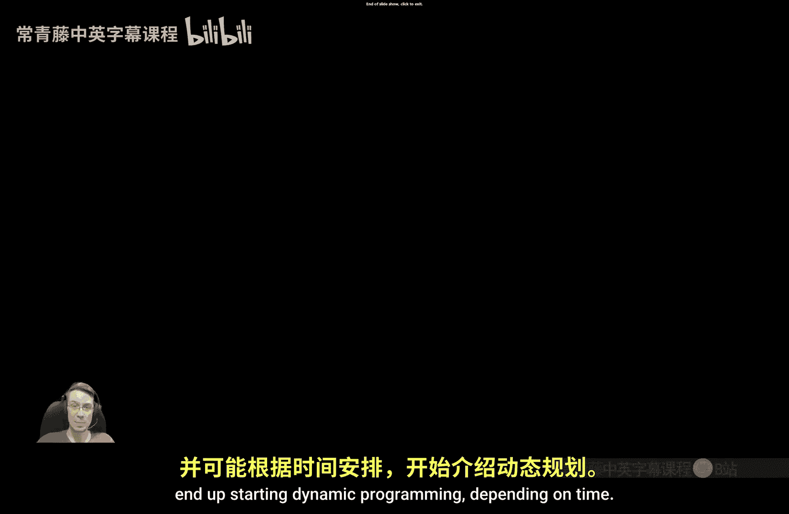

# 滑铁卢大学【中英⚡算法｜CS341 Fall 2021, Algorithms】 p08 P8 Lecture 8 -BV1DhrDBbEwR_p8-

Al right， Hi there everyone， welcomele back to another episode of CS 341 Als today is going to be lecture 8。

 where we talk about greedy algorithms for the second lecture。

So the first thing we're going to talk about today are a class of problems called NApsack problems。

So what's a Napsack problem， well you have a Napsack and there are a bunch of items that you could put into the Napsack。

And each of these n items has some profit。 So we have a sequence of profits P and we label the n possible profits for the n different items。

 P1 up to PN。 These are the amounts that the items are worth intuitively。

 and each of these items also has a weight。 So we have a sequence W of weights。

 and will label these weights。 W1 up to W1 N。 So W I represents the weight for item I profit P is the profit for item I。

And then there's a capacity M that's a weight limit。

 so you can only hold a certain amount in thenapsack before either you can't lift the knapsack or the Napsack rips in half or something like that。

 So there's this capacity or weight limit M that the total weights of items you place in the Napsack cannot exceed。

 and all of these values are positive integers okay。

Now we want a solution to thenapsack problem that is feasible and optimal。

 So what does feasibility mean Well you have to respect the weight limit。

 So the solution is going to be an n tuple capital X and we're going to label the components of this end of this sequence or n tuple X。

 we're going to label these x1 up to X n and intuitively X I represents whether or not you take item I and place it into thenapsack So an X of1 means you took the item and place it in the Napsack and Xi of 0 means you didn't take it。

And so to respect the weight limit， we want to make sure that the sum from i equals 1 to and the sum over all items of the weight of the item times this indicator variable Xi。

 which is either0 or 1， typically。Is less than or equal to M。 So if you think about it。

 if you don't take an item， then the weight disappears from this expression。

 If you do do take an item and X I is one， then W I X I is just the weight of that item。

 So this is the sum of weights where we took the items。 that should be less that are equal to M。

So that's a feasible solution， one， it is an endtople that respects the weight limit。

Now there are a couple different variants of the Napsack problem that we can talk about before I mention what an optimal solution is。

 so there's a 01napsack problem which is often just denoted the Napsack problem and in the01napsack problem we require that each of these indicator variables X I is either zero or one so you have to take the entire item or leave the entire item。

 the items are worth nothing if you take part of them so think of like you a new MacBook or something if you saw it in half it's not worth anything so you have to take the whole thing or none of it。

There's also the rationalnapsack problem。 It's called rational because you're allowed to take any rational fraction of the item X I between 0 and 1。

 So you have to think of items that are infinitely divisible。

 So we can just take any fraction we like of the item， You know。

 it would be like if you were trying to load up on valuable spices from bulk barn or something。

 You know， you can scoop as much or as little as you want。

 Xi represents what fraction of the entire quantity available that you took。Okay。

 at our goal in each of these variants of the Napsack problem is to find a feasible solution X that is optimal。

 meaning it maximizes the sum from i equals1 to n， the sum over items of the profit for item I for the total amount of item I available times the fraction of item I that you took。

 So in 01 Napsack X I be 0 or ones。 you're either going to get whole profits or no profit from an item and the rational Napsack problem you you can get you can basically sum up fractions of profits of different items。

And at first glance， you might think that the 01napsack problem and the rational Napsack problem are really similar。

 and they are quite similar， at least on paper， you might think that the difficulty of solving them is similar。

 but you'd be wrong in thinking that because it turns out that the 01napsack problem is NP hard。

Which means it probably requires exponential time to solve this problem Now we don't know this for sure。

 but we think that's probably true。 So this is something we'll learn more about towards the end of the course when we get into the question of intractability。

 but it turns out that the 01napsack problem is about as difficult a problem as we know of。

 it's one of the hardest problems we're aware of。On the other hand。

 the rationalnapsack problem is solved in a fairly straightforward way in polynomial time by a greedy algorithm。

So it turns out although these two problems look really similar on the surface。

 they're quite different in terms of how difficult they are。😊，Okay， so in this lecture。

 we're going to discuss the rational Napsack problem and then a little bit later in the course when we do dynamic programming。

 we'll talk about the01 Napsack problem and well I think we'll talk about that again as we get into interacttractability at the end of the course。

Okay， so let's talk about a couple of possible strategies that a greedy algorithm could use to try to tackle the rational Maps Act problem。

So our first strategy is going to involve considering items in decreasing order of profit。

 In other words， we're going to try to maximize our local evaluation criteria on P。

 we're always going to try to pick the item that has the largest profit and place it into our bag if we can otherwise we we will place as much of it into our bag as we can。

 And if there's room left in our bag after if we take the whole item and there room left in the bag afterwards。

 then we'll find the next highest profit item and put as much of that into our bag as we can and continue。

 So this seems maybe at first glance like a reasonable strategy。You know。

 you're filling your bag with the most valuable items first。Well。

 let's try an example input to see if you know to start to sanity check the question of whether this is optimal Okay。

 so here's an example input， we have our profits P， our weights W and our weight limit M。

 so this represents three items， items that have profit 20 and weight10。

 profit 50 and weight 20 and profit 1 weight 10， and our weight limit is going to be 10。

So let's think about what strategy 1 will do here。 It'll make a be line for the item with the highest profit in this case。

100， and it'll put as much of this item as it can into the Napsack。

 And it turns out that this entire item fits into the Napsack。

 So it'll just take this whole item and nothing else will fit in thenapsack after that。

 So the solution is just going be item 3， all of item 3 with a total profit of 100。

And that is optimal for this example。But can you come up with an input。

 an example input where this strategy would not be a wise strategy where you would come up with a suboptimal solution？

So try to think of an input where taking the highest profit item is a bad idea。

 and I'll give you a moment to pause here and think about that。Okay。

 so I'm going to assume that if you wanted to do that， you've done that now。

And it turns out that this second example input will expose the problem with this greedy strategy。

 So here， this is the same as the previous input， except the last item that has Prot 100 now has weight 100 instead of weight 10。

 So if the item that has very high profit also has extremely high weight。

 then the amount of it that will actually be able to put into our bag will excuse me。

 not be worth very much。 So in this case， strategy 1 will lead us to take as much as we can of this last item with profit 100 will only be able to take about 10% of it。

 because our weight limit is 10。And that will leave us with an absolute profit of 10。

 which is not very good， considering we could take half of this second item and achieve a profit of 25。

 so this is clearly not an optimal strategy， and this example is enough to prove that this strategy is not optimal。

Okay， well， what about a second strategy where we consider items in increasing order of weight。

 In other words， we try to minimize the local evaluation criterion WI。

 so we're always picking the item that has the smallest weight。

 so we're going to take very light items thinking hopefully that'll allow us to take lots of them and get a high profit。

Well， is this optimal？I might give you a second to think about this and see if you can come up with a counter example。

Okay， so I'm going to assume by now that you've done that if you wanted to， here's a counterex。

 so this is similar to in fact this is exactly the same as our previous example turns out the same counterex that shows us strategy1 is not optimal。

 will also show us that strategy 2 is not optimal。So we're going to pick the item that has the smallest weight in this case。

 the first one。 and we're going to take as much of it as we can。

 It will actually fill our bag and we'll get a profit of 20。

 That's better than the profit that strategy 1 achieved。 However。

 an optimal strategy would take half of item number  two and would get a profit of 25。

 So this is a counterex that demonstrates that proves， in fact， that strategy 2 is not optimal。

Now there is an optimal strategy to do this， I'm going to give you a second again to think to see if you can come up with what that optimal strategy would be。

 given what we saw about how the previous two strategies were non optimal。Okay。

 so I'm going to assume that you've paused and done that if you wanted to。

 and it turns out the optimal greedy strategy is to consider items in decreasing order of profit divided by weight。

In other words， we're trying to maximize the local evaluation criterion profit I divided by W I。

 Okay， Now why does this make sense intuitively， Well。

 ignoring weight and trying to optimize for profit doesn't make sense because when you go for the highest profit item。

 I can give you an extremely heavy item and optimizing for low weight while ignoring profit is also a bad strategy because when you go for the lowest weight item。

 I can make it worth essentially nothing。However， if you try to fill your bag really efficiently to use its weight as intelligently as possible。

 you have a weight limit of n， why don't you fill up that weight limit of n using the items that give you the best return per unit of weight that you consume so if you always fill your bag with items that give you the highest profit per unit of weight that you consume。

 you'll use that weight in the most intelligent way to maximize your overall profit and it should be a clue that this crion actually involves both profit and weight and doesn't just ignore one of them although of course there would be ways that you could construct local evaluation criteria that would use both of these terms and yet be suboptimal。

Okay so let's try to see let's look at our previous two examples and see if this strategy makes the correct decisions on those two。

 so here's our first example input in this case， if we compute our profits divided by weights we'll end up with 20 over 10 is 250 over 20 2。

5 and 100 over 10 is 10 so our highest profit per unit weight item will be number three giving us 10 profit per unit weight so we'll pick that one to fill up our bag with it will take as much of this item as possible and it turns out that will fill our bag and we'll end up with a profit of 100 which is optimal well how about the second example input in this case where the most profit item has the highest weight it will also end up having the least profit per unit weight so we won't choose it instead as we should to get an optimal solution we'll choose the middle item item number two which has the highest profit per unit weight of 2。

So filling up our weight limit of 10， which we can do because there is 20 weight worth of this item。

 more than the 10 that we need to fill our bag， we'll end up with a profit of 25。

 which is optimal for this input。Okay， so we're going to try in this lecture where we are in this lecture going to prove that this third strategy is optimal。

 but before we go into proving that it's optimal， let me just give some pseudocode for it to make sure that we're all on the same page with respect to the algorithm。

So here's the pseudocode we start out with a preprocessing step as usual in a greedy algorithm where the first thing we do is we sort the I've expressed the input here。

 the profits and weights as an array of pairs so you can think of A of I as having a profit and a weight in a pair and I packed them into one array just to make it easy to describe the sort I'm going to sort a by decreasing profit divided by weights。

 so I'm going to sort pairs and then just for ease of reference I could say a of I。p and A of I。

 w to refer to the profits and weights of item I but I don't like what that does to the notation of my pseudocode so just for the sake of notation。

 I'm going to split up this a and two arrays， P for profit and w for weights after the sort and you don't really have to think about this step as actually being a computational step in the code that you would write in code that you write I would really just keep it a of I。

 x or a of I。p and A of。But just for the sake of notation， I'm going split this into separate arrays。

 So we have P of1 up to n and w of1 up to n， which are the profits and weights of those items after the items are sorted by decreasing profit by weight。

 And then we pass these arrays P andW as well as the weight limit to greedy rationalnapsack。

Now I have some annotations for greedy rational K Napsack so I'll bring those up。

 so X is going to be our sequence of x1 up to XN。 these are the fractions of items that were're actually choosing to place into the K Napsack and initially no items are chosen。

Weight is going to be the current weight of our knapsack。 and for all items， we're going to check。

 can the item plus our current weight， whatever the bag currently holds。

 plus the weight of that item can that fit into the bag or is that too big to fit into the bag。

 So if it's greater than them， it's too big to fit into the bag So we if we can't fit the whole item。

 then we're going take as much of the item as we can to exactly fill the knapsack。

 And then once we've exactly filled the knapsack， we can just break out of the loop。

So remember x of I here is the fraction of the item that we're taking and what's the fraction of the item that we're going to take if it can't all fit in the bag Well it's whatever the weight limit it is minus our current weight so this is this expression in parentheses is the amount of weight that's left and it's bigger than WI so dividing that this is floating point division by WI is going to give us the fraction of item I that we can fit。

Okay， so， and then that's gonna fill the bag entirely and we'll break。 Now， on the other hand。

 if we can fit the entire item into the bag， we're just going set x of I to 1。

 and we're gonna add the weight of the item to our current weight。

 And so it it may happen that when we get to this line of code W I is enough to exactly fill the the bag。

 And in that case， we will skip over this if statement。

 We won't satisfy this if statement because it won't be greater than M。 It'll be equal to M。

 The weight plus the weight of I will be equal to M。 We'll go to the else case。

 We'll take all of that item。 We'll add it to the weight。 And now weight will be exactly M。

 but we're not breaking。 Is that a bug。No， because we'll go to the next iteration of the loop。

For the next， I either will exit the loop because that's the last item。

 in which case it's the same as if we do a break here， check if weight was equal to M。

And done a break， it'll be the same as if that， if this was the last item。

 if this isn't the last item， we'll go to the next iteration of the loop。I will check if the weight。

 which is now M plus the weight of that item is greater than M and it will be。

Because the weight is already M。And then when we try to compute how much of that next item we take。

 we'll take M。Minus the weight， which is exactly M that will be 0 over w of I。 So x of I will be 0。

 we'll take none of the next item and will'll break。 So I could， after setting this weight here。

 test if we said it exactly to M and then break。 But I like how the pseudocode is cleaner with only the single break and you。

 not having to have a redundant check because that redundant check is really just gonna get taken care of in the next iteration of the loop。

 if there is a next iteration of the loop。😊，So anyway。

 that's it might look initially like there's a bug in that case in this code， but there isn't。Okay。

 so that's it for this code。 It's not terribly complicated。

 And our return value X here note that it's either in the greedy algorithm going to be 11，1，1，1，1，1。

 some number of ones followed by some number of0 of zeros。

 So we'll either take a whole bunch of whole items。 and then none of the remaining items。

 or it'll be 11，1，1，1，1 up to some X I， which is strictly between 0 and1 followed by a bunch of zeros。

 because we're gonna to take as much as we can of an item before moving on to the next one。

 So we're gonna take a bunch of whole items， And then we might take a fractional item。

 and then we'll take none of the rest。 So that just gives you some。

 we're building a little bit of intuition about what the form of this x return value is。Okay。

 so I want to do a quick informal feasibility argument。

 An argument like this should generally be good enough for assignments or the midterm or the final。

 So here we have an excerpt from the previous slide。 and I want to prove feasibility。

 So what does feasibility mean for this problem。 Well。

 it means that all of our X eyes's are in the intervals zero to1 and the total weight as it most M。

So one of two things is going to be true about this algorithm for a particular input。

 Either all of the items are going to fit in thenapsack or。

 we'll break out of the loop for that reason， because we just ran out of items to add or when we exit this loop we have exited because we executed line 14。

 this break instruction And if we execute this brake instruction。

 we're exiting specifically because we added as much as we can of element I to exactly fill up thenapsack。

 So the weight of the Napsack is exactly M。Now， every time if we want to understand， so okay。

 so this this is an argument that the total weight is less than or equal to M。 In fact。

 the weight is exactly M。 if we exit because of the break statement at line 14 and if we exit because we ran out of items to add。

 then it's less than m。 Now， if we want to understand why the X I's are in the interval0 to 1。

Consider that every time we write to X I， it's either a0 because we're writing to it at the initialization of the x array or a 1。

 because we're writing to it at line 16， or we're writing to it at line 13。

 where we're writing M minus weight all over W I。 Well。

 what do we know about M minus weight over W I， we know that we got into this if block。

 So weight plus W I is greater than M。Okay， well， we can rearrange weight plus WY greater than M。

 just subtract weight from both sides and then divide by WI。

 and we get M minus weight over WI is less than one。And additionally。

 weight is less than or equal to M。 we've already argued。

 So M minus weight is going to be greater than or equal to 0。 and w of I is positive。

 So X I will also be greater than or equal to0。 sorry that's obstructed here by the box。

 but I'll edit the slide to show that before I post。 Okay， so we've proved that X I。

 if it's written to it this line， has to be between 0 and1 as well。

 So we've shown that X I is between 0 and1 for an arbitrary X I。

 which means it's true for all of them。😊，Okay， so that's a basic feasibility proof。

 I do also want to at least give you a high level overview of what a formal feasibility argument would look like。

 not that you need to make such an argument on your assignments or midterms or finals。

 but I thought it would be useful to see what a formal argument looks like to understand the difference between an informal argument and a formal one。

Okay， so here we're going need at least it'll make the proof a lot easier if we make a minor modification to the algorithm。

 This minor modification is not going to change the behavior of the algorithm at all。

 I'm just going explicitly write that the weight is equal to M after I've taken as much of an item as I can to exactly fill up the Napsack。

 Now we never actually read weight again beyond this point。

 this doesn't change the algorithm behavior at all。

And this is just really gonna be useful for one lemma on the proof where I'm gonna argue about what weight is when we exit the loop。

 So this just makes it convenient for me to say， when we break the loop， weight is M in this case。

So we didn't do this in the original algorithm because what's the point of writing to the weight variable if no one ever looks at it again？

Okay， so here's a formal feasibility argument。 I won't go through it in great detail。

 I'll just give you the high level idea。 And if you're curious， just for your own curiosity。

 you could look at this after the lecture。 So the way you prove that this is feasible formally is with a loop invariant and the invariant is going to need to argue for all I X I is in0 to1 and the weight is exactly equal to the sum from I equals1 to n of weight I times X I。

 where X I is the element of our X array。And we're going to prove also that that's less than or equal to M。

 This is all going to be proved as part of one big loop invari。Okay。

 so what are the mechanics of this， well in the base case initially weight is0 and all of the X' are 0。

 so weight will of course be equal to the weight of i times Xi where all the X' are 0 because weight is 0 and 0 will be less than or equal to m because m is a positive integer。

Okay， so the base case is pretty easy， as for all the X's being in zero to 1， they're all zero。Okay。

 for the inductive step， we suppose the invariant holds at the start of iteration I in the loop。

 And then just so that we can actually express the values of the weight and and X I at the beginning of the loop and the end of the loop Iteration。

 Let's let weight prime and X I prime denote the values of a weight and X I respectively at the end of iteration I and weight and X I are going denote the values at the beginning of the iteration I。

 And the idea is we want to prove that the invariant holds at the end of iteration I。

 So we assume it holds at the beginning of the iteration， prove it holds at the end of the iteration。

😊，And then of course， it'll hold at the end of the final iteration after the loop。

 which means the invariant always hold throughout the loop。Okay。

 so what's the precise statement that we want to prove that the invariant holds at the end of iteration I。

 it's for all I， each X I prime is in  zero to 1。And weight prime is exactly equal to the sum from s 1 to n of weight i times X prime。

Which is also less than or equal to M。 Okay， so it looks quite a bit like the loop invariant right。

 But we've got a couple primes in here which tell us these are the values at the end of the loop。

 Why didn't I use a prime for W Y because it doesn't change。Okay， so this is what we want to prove。

 I've copied that from the previous slide and there are gonna to be two cases。

 and I won't go through the cases。 I'll just tell you what the cases are。

 So the first case is if we enter this if statement at line6 and we just end up showing in this case as you would expect that X prime is in0 to1 and that weight prime is exactly equal to this this summation。

 which is less than or equal to M。 and we show that using a few different techniques。

 So very briefly X prime equals1 we can show in this case， sorry I said we were in the wrong case。

 we're actually in this else case。 So in this else case。

 clearly we've set X prime to1 So that's going to satisfy the first part of this loop invari and then at line 12。

 we set weight this left side of this expression will be weight prime。

 So weight prime is going be the old weight plus w I which is going to be less than or equal to M。

Simply by the fact that we are in this case where weight plus W is less than or equal to M。

 So this part of the argument is easy。 The hard part of the argument is actually tying together the value of the variable weight prime with this summation you have to prove that weight prime is actually semantically contains this summation And so that's done here。

 and I won't go into the details for that， you can check them yourself。

 if you're curious the other case， which is when we get into the if statement up here we want to prove the exact same thing just our assumption is different in this case。

 So we do the same thing I won't go through the details here we prove that each Xi primes in zero to1。

 we prove that weight prime is less than or equal to M and also greater than equal to0。

 we end up provinging that by accident。 those are pretty easy。

 pretty straightforward the difficult part again is tying together weight prime with the value of this summation And so that's the stuff that happens down here so this is just here if you're curious。

 you can see it。 And if you're not curious。And you hate proof as probably a lot of you do。

 then don't worry about it。 I'm not gonna ask you to prove this formally necessarily。 However。

 having this as a reference might make it easy if you want to write out something very precisely in an assignment to understand what kind of the。

 the a very formal level of rigor would look like。O。

So now I want to talk not about feasibility but about optimality。

And for simplicity in this optimality argument， it's not necessary to make this assumption。

 it's possible to show optimality， even if I don't assume this。

 but I'm going to assume for simplicity that the profit overweight ratios of all items are distinct so we can order all of our PI over WI expressions from largest to smallest where there's a strict inequality between each of these pairs。

Now， suppose that the greedy solution is X。You know， which is the sequence x1 up to x N。

 And the optimal solution is y， the sequence y1 up to y N。

 We're going to prove actually that x must be equal to y simply because y is optimal。 In other words。

 we're going to prove that there is a unique optimal solution。

 That's exactly equal to the greedy solution。 So what do I mean by x equal to y， Of course。

 it means that x1 equals y 1 x to equals y 2 and so on。

And then so okay so how are we going to do this， we're going to prove that x equals y。

 suppose x doesn't equal y to obtain a contradiction。And if they're not equal。

 then maybe they're exactly the same for some prefix of x and Y。

 but there's going to be some index where they differ， right， simply because x is not equal to y。

 there will be some X J that's not equal to Y J。 Pick the smallest integer J such that X J is not equal to Y J。

 maybe J is just the first element。But we're going to look at the first place where x and Y differ。

 Okay Another way of thinking about this is up to J。 X and Y are identical。 and then at J。

 X J is different from Y J。Okay， so here I've drawn our greedy solution X with x1 up to X J-1。

 followed by X J on the y axis。 you know， up and down here。

 we have the fraction of the item that's placed in the knapsack。

 This is a100% of the item in the k Napssack， This is 0% at the bottom。 and then on the the X axis。

 if you will down here going from left to right。 We have the item number。 So here's item number one。

 We take all of it item number two。 we take all of it and so on。And here's the optimal solution Y。

 the solution we've assumed exists and is optimal and is different from x。 And note we chose J。

 J is defined as the first location where these two differ， right， So up to J minus-1。

 these two solutions are identical。 They take the same items in the same proportions。

Now Yj is not equal to xj， we certainly know that by definition of J。But can we know something more。

 What's the relationship between X J and Y J in particular， Could Y J be greater than X J。Well。

 it can't because if Yj were greater than Xj。And the solutions。

 X and Y are the same up to x J -1 and y J -1。 They each take the same amount of items1 through J -1。

And then the optimal solution somehow manages to pack more of item J into the K Napsack than the greedy solution can。

 but in fact， that contradicts how the greedy solution works because if it were possible to take these first J -1 items in the same proportions that y does。

And then to take more of item J than it does， Well， the greedy algorithm would take more of item J。

 So if Y J is greater than x J， that tells us that it should be possible to take more of item J。

 than x actually does， which yields a contradiction。😊，So Yj can't be greater than next J。

 it has to be less than or equal。To X J。 And in fact。

 because we've just said that Y J and X J differ that the first location that differ in X and Y。

 we have to have that Y J is strictly less than X J。 So basically。

 there's a little bit of extra room up here where we could have more of Y J。

 because we know in the greedy solution We picked more of item J than we did in the in this supposedly optimal solution Y。

 So we could actually take more of， of item J in the optimal solution Y。

 if we got rid of some other items to the right。Because we know we were able to take everything on the left。

 the same in the greedy solution。 And yet we could get more of item J。

 So how much more of item J could we get， Certainly we could get X J minus Y J more。😊，Okay。

 now here's a question， can y be all zeros to the right of Yj？

So I'll give you a second to think about that。You could pause the video。

And see if you can figure that out。Okay， so I'm going to assume that if you wanted to figure that out。

 you've done so by now。So you actually can't have all zeros after y because if it was all zeros after y。

 then the entire optimal solution Y would be worth less than the greedy solution X。

 because to the left of Yj， the two solutions are identical and yj is smaller than xj。

So what that tells us is to the right of Yj， there has to be some item that's actually taken。

 there has to be some K greater than J， K to the right of J。Such that Y K is greater than0。

 So there's got to be this item K that sum of item K。

 Y K amount greater than 0 of item K is taken in solution Y。Now， here's the thing。 By our sort order。

 we're considering items one up to J1 up to n from largest profit over weight to smallest profit overweight。

 So we know that item J because it's earlier in this sort sequence is worth more per unit weight than item K。

 So it actually doesn't make any sense from a profit standpoint to take any of item K until I've taken as much as I can of item J So what if we remove some。

 What if we take this supposedly optimal solution and remove some of item K and take that weight that we saved by removing some of item K and you just fill that weight up with some more of item J。

By doing so， we're taking some amount of weight from item K and we're replacing it with the same amount of weight of item j and j is worth more per unit weight so that should increase the total value of the solution Y。

 but this is an optimal solutions。 You can't increase the value of it。

 That's going to result in a contradiction so let's show carefully that we can actually do that and that we will obtain a contradiction。

 So how much of item K should we remove Well， since item J is worth more per unit weight。

 replacing even a tiny amount of item K with item j will improve the solution。

 so it doesn't actually matter how much weight we take away of item j and add of item K。

 we can just remove an arbitrary infinitessimal delta of weight。 Some delta greater than0。

 we're going remove that much weight of item J K sorry。

 and we're going to add delta weight of item J。 any tiny delta will be enough to improve the optimal solution by a tiny amount。

And produce the contradiction that we want。So if we want to move Delta weight from item K to item J。

 what fraction of item K are we removing， So Dlta is a weight。 Y K is a fraction of item J。

 So how much we should we reduce y K by。 Well， deelta out of the weight of K。

 we're removing deelta weight and this fraction is some weight out of the total weight。

 That's how you express this fraction。 This is some weight out of the total weight。

 So the amount we want to remove if we want to remove Delta weight is delta out of the total weight。

 So delta over Wk is the fraction we want to remove。And similarly。

 a fraction of item J that we want to add is deelta out of the total weight of J。

So Delta weight divided by the total weight of J will yield the fraction of item J we want to add。

Okay， so the modified we can take our solution Y， we can copy it and we can change it slightly to obtain a different solution。

 Y prime。 Y prime is the same as y everywhere， except at items J and K。 So in y prime。

 we've taken deelta weight of item K。 That's a delta over WK fraction of item K。

And we've taken that away and added a delta over WJ fraction of item J。

So you can see that reflected here， otherwise， y prime is the same as y。So in other words。

 y prime the prime is indicating that this is modified is equal to the original yj plus delta over WJ。

 and y K prime is equal to the original YK minus delta over WK we're subtracting that fraction of item K that we're removing。

Okay， so I've copied the modified solution up here。 so you can see it。

 We want to show that this modified solution。 Y prime is both feasible and has superior profit to the original supposedly optimal solution Y。

 This， of course， will contradict the optimality of Y and prove that。

Our only assumption that we've made so far that y exists and is different from x is wrong。

 which will imply that if y exists and is optimal， it will have to be equal to x。

 So let's show that y prime is feasible and that the profit of y prime is greater than the profit of y to show that y prime is feasible。

 We need to show that Y K is still greater than equal to 0， because y y K prime。

 sorry is greater than equal to 0。 So if you think about solution Y。

 we assume that solution y existed and was optimal。 So all of know y1 up to yn were between 0 and1。

 And the weight of the original y was less than or equal to M。

 We need to make sure that we haven't changed that。 Well。

 which parts of y have we changed to obtain y prime。 we've changed yj into yj prime。

 we've changed Y K into y k prime。 We grew yj， So the danger is that now that we made yj larger to obtain a bigger yj prime。

 we might have exceeded1。 So we need to show yj prime is less than or equal to 1。

And as we've shrunk Y K to obtain Y K prime， the danger is that we've shrunk it so far that we've made it negative。

 We've subtracted too much and made it negative。 So we show that Y K prime is greater than 0。

And then， of course， we're going to have to show that the weight of y prime is less than or equal to M as well。

Okay， so that's what we want to show。 Let's show first that y k prime is greater than or equal to 0。

 So by definition， y K prime is equal to y k minus delta over WK。 This is， of course。

 the fraction of item K that we're removing。So y k prime is going to be greater than equal to zero。

 if and only if。Y K minus delta over WK is greater than equal to 0。

 which is true If at only if delta just by a bit of algebra is less than or equal to Y K times Wk。

Well， the original YK is between 0 and 1。Because we assume that y is a correct solution。

And WK is a positive integer。 So in order for delta to be less than or equal to yk and Wk。

 and for delta to still be positive because we want delta to be positive。

 We want to remove a positive amount of weight from k。 WK we know is positive。

 We just need yk to be positive。 But we know yk is positive。

 So this constrains delta to be smaller than ykwk less than or equal to y K wk。 but ykwk is positive。

 so it constrains delta to be less than or equal to a positive number so we can still get a positive delta and satisfy yk prime is greater than or equal to 0。

 So it's possible to choose positive delta so that yk prime is greater than equal to0， Great。

 So far we're doing well。 Now let's show that yj prime is less than or equal to 1。

 So here's the definition of yj prime， it's yj plus delta over Wj。

 So for yj prime to be less than equal to1。 we have yj plus delta over wj less than or equal to1。😊。

And this is true thanks to a little bit of algebra。

 if and only if delta is less than or equal to1 minus W sorry1 minus yj。Times WJ。

 Now we want this thing on the right side to be positive。 so we aren't constraining our delta to be0。

 We want to prove that this thing on the right is positive。 That way。

 we can come up with some delta that's still positive that satisfies this expression and hence satisfies this expression。

Sorry， I think my cursor might not have invisible。 We want a delta that's positive to satisfy this expression while also satisfy。

 which means it also satisfies this expression。 And the fact that it's positive means we're removing a positive amount of item K。

 which means we're actually going increase the profit。 Okay。

 so we want one minus yj to be positive and WJ to be positive。 We know WJ is positive。

 Y is one minus Yj positive。😊，Well remember， Yj is less than x J。

 We argued that a couple of slides ago， so it has to be less than one。 If it's less than1。

 then1 minus yj is positive。So this constrains Dlta to be smaller than some positive number。

 but that's fine because that means we can find a positive delta to make this statement true。Okay。

 so finally， let's show that the weight of y prime is less than or equal to M。 Well。

 if you remember the optimal solution， the supposedly optimal solution Y and our modified optimal solution。

 remember， remember the changes that we made to get y prime from y。

 All we did was we took a delta weight from y K。 So we took away deelta weight of item K。

 and we added delta weight of item J。 This doesn't change the total weight。

 So if y was an optimal solution before it was feasible。

 So weight of y was less than or equal to M and the weight of y prime is exactly equal to the weight of y。

 So this is proved nice and easily。😊，Okay， so that's feasibility of Y prime。

 Now we need to show that Y prime has a better profit than y。

So the profit of Y prime notice that that's just the profit of Y。Plus， our little changes， right。

 how our little change affects the profit。 So consider the profit of Y。

Everything is the same in Y prime， except we take away sum of item K and add sum of item J。

The fraction of itemJ that we add is deelta over WJ。

 so we're adding profit proportional to that fraction of itemJ that we added。

 We're adding profit PJ times delta over WJ。And of course， we're removing some fraction of item K。

 So we're removing profit proportional to that fraction。

 So the fraction of item K we're removing is delta over WK。

 So the profit we're removing is pk times delta over Wk。

 So our profit for y prime is going to be the profit of y plus delta over WJ Pj minus delta over WK Pk and with a little bit of algebra。

 we can pull the delta out front of these two expressions and combine them and we can see that the profit of y prime is going to be the profit of y plus this thing。

 So if this thing is positive， then we've shown that the profit increases when we make our changes to obtain y prime from y。

 So we know already that we can pick a positive delta to make everything else that we need to be true to obtain feasibility true。

 So this is y prime， we can get a feasible y prime for a positive delta。

 So all we need to show is that this expression inside the parentheses is positive which means we need to show Pj over Wj is greater than。

😊，PK over WK。But J is before K in the sortdid sequence in which we consider these items。

 and we consider the items with more profit per unit weight first。

 So we have PJ over WJ greater than P K over WK。So if delta is greater than0。

 which we know we can set delta greater than0 and get a feasible y prime。

 then delta times this expression is greater than 0。

 which tells us the profit of y prime is greater than the profit of y。

 this contradicts the optimality of y。 so our assumption that x is not equal to y is bad。

 therefore x is optimal and is in fact the only optimal solution to this problem。

 so the greedy algorithm produces a unique optimal solution to this problem。Okay。

 so the next problem we're going to talk about is another problem that has an interesting greedy solution called coin changing。

H， what's this？

I think it's a cabinet lighting break。Oops。

Nice。Are we done？There's a few more cabinets。

Okay， there are a lot more cabinets。Nice。Well， back to work。All right。

 so as a first example of the coin changing problem， let's consider the Canadian coin system。

 so we have pennies， nichels Dimes， quarters， 50 cent pieces， loons and tunies。Okay， well。

 to be fair，50 cent pieces are old and we don't have many more。 And， in fact。

 pennies aren't are old and we don't have many more either。

 But let's not remove our pennies because if we remove pennies。

 then we actually can't solve the problem for all sorts of target values we want to obtain for anything that's not a multiple at 5。

 Okay， so let's just assume we have pennies， nickols， dives quarters， linens and tunies。

So the input for the coin changing problem is a sequence of coin denominations。And a target sum T。

 So the coin denominations for the Canadian coin system are going to be represented as a sequence of integers。

200，125，105 and one rest in peace penny and the target sum is also going to be a positive integer T in this case。

155 as an example input。 And the output is the minimum number of coins you need to pay the target sum T。

 And also we would like to output list of those coins。So for example， for the target sum T。

 we might output a looy two quarters in a nickel。And that can be done in four coins and we want to output the list。

 so one loooney， two quarters， one nickel， and also the number four。

 like the maximum number of coins。Okay， so can anyone suggest an algorithm for doing this。

 I'll give you a moment to pause and think about it。Okay。

 so I'm going to assume that you've come up with an algorithm if you wanted to。

 I'm going to go ahead and show a greedy algorithm for doing this。

 So what if we sort the coin denominations from largest to smallest value and at all steps。

 just use the largest possible coin。So here's the pseudocode for that algorithm。

 so we have greedy coin changing the arguments are D a sequence or an array of denominations。

 these are positive integers in no particular order。

 so in this case for the Canadian coin changing problem we might have like 1510025， 200s。

 they don't have to be in order， and then T is your target sum。

 we sort D in decreasing order and then our used array is going to indicate how many of each coins we're going to use。

And we to return this array as our output so if you want to see which coins were used。

 all you have to do is look at the index of a particular coin considering that we're going to sort the array D from largest to smallest you have to understand as the user who calls this that。

 for example， used of one represents how many tus， the largest denomination were used and so on。

And if you want to know how many coins are used in total。

ll just sum up the contents of the used array。Okay。

 so we're going to iterate over all the denominations。

 all and denominations and we're going to specify how many of that denomination denomination I we end up using。

 we're just going to greedily take as many of them as possible so we're going to take our current T target sum that we're trying to hit we're going to take integer division of that T over the value of that that denomination so for example if t was 900 and d of I was 200 this would be4 we're just going to use as many tus as we can。

And then we're going to subtract from T the value of all of those coins of this particular denomination that we use。

 So in the example I just gave a four tus， we're going to subtract 800。So in the next iteration。

 T is going to be 100 and we would use one looy。And then finally， at the end if t is greater than0。

 then for the particular denomination and target sum that were specified as input。

 it's actually impossible to produce that sum。 So for example， if we didn't include pennies in D。

 then there would be all sorts of sum target sums T where you can't solve the problem and you just have to return fail otherwise if you don't return fail。

 we're going to return used， which is the array of coins。Okay。

 so I probably should have put these notes on the screen。

 but anyway they're here for your notes and this is just the stuff that I said。

So what's the runtime complexity of this algorithm。

 I'll give you a second to answer that for yourself。

So the runtime of this complexity is really dominated by the sort。

So this sort is if it's an n log n time sort that's going to be the dominant factor。

 you have to take theta n log n time to execute this sort and then let's say it's linear time to create this used array and initialize all of its contents to zero linear time to iterate doing constant and work per iteration and then constant and work at the end so if you didn't have this sort this could be done in linear time but if you have to sort if you don't have your coins handed to you from largest to smallest then you have to do this sort and you can't get away with linear time you have to spend n log n time。

The feasibility proof of this algorithm is really trivial。

 at least an informal one is either we achieve the target sum T or we return fail。😊。

If we don't return fail， then the solution is feasible。 and if we do return fail。

 then we wouldn't define that to be a feasible solution。

 And we wouldn't say we've solved the problem in that case。Okay。

 so let's talk about the optimal optimality of this algorithm， is this algorithm optimal。

 what do you think？So this algorithm is kind of funny because this is an algorithm that we all intuitively know because we all know how to count change。

 And it turns out that the algorithm is actually optimal。 Let's try to build a correctness argument。

 So it's optimal， at least for the Canadian coin system。

 but maybe it's not optimal for all coin systems。 It seems hard to make a general argument right off the bat。

 So one thing you can do is you can restrict the set of inputs to an input where maybe you'll find to a class of inputs where maybe you'll find it easier to build a correctness argument。

 And then maybe you'll learn something and doing in the process of doing that。

 so that you'll be able to generalize those lessons to other classes of inputs。

 So we're going to try fixing a part of the input in this case we're gonna fix D the arrayD to the Canadian coin system。

 including pennies。 we're going try to prove optimality for all target sums T。

 So this is we're only proving optimality for a class of inputs。😊，Specifically。

 the class of inputs where D is fixed as the Canadian coin system and T is anything any positive integer。

So hopefully we'll be able to show optimality for this and come up with some insights that would help us prove optimality for other coin systems as well or understand maybe that for some coin systems it wouldn't be optimal so okay so let's do this in fact I'm just going to prove it for coin denominations 100。

 25， 105 and 1 and then it's an easy extension to 200 that I'll leave for you guys as an exercise for home。

So we're going to make use throughout this proof of the following four properties of any optimal solution that are pretty easy to understand。

 so the first property is the number of pennies in an optimal solution is at most four because if you ever have five or more pennies then you can take five of them and replace them with a single nickel and you will be using fewer coins so that can't have been an optimal solution。

Similarly， the number of nickels is at most one。Because if you ever have two or more k nickels in a quote unquote。

"op solution， you could replace two nickels by a dime and improve this supposedly optimal solution。

 which would be a contradiction。The number of quarters is at most three for a similar reason。

 you can just replace four quarters by a looy， and then the hardest one to understand here is that the number of nickels plus the number of dimes is at most two。

 to see why， suppose we have three dimes。3 or more。

 Then we can replace three dims by a quarter and a nickel， which is only two coins。

 If we have two dims， then that's， you know， we want to say the number of nickels plus the number of dimmes is it most two。

 So if we only have two dimmees and no nickels， that's fine。

 But if we have two dims and at least one nickel， we can replace two dimmees in a nickel by a quarter。

So that takes care of the two dimme case。 What if we have one dime， Well， if we have one dime。

 we can have one nickel， that's fine。 number of dimmes plus number of nickels is it most two。

And if we have one dime and two nickels we're in trouble because those two nickels can be replaced by a dime。

 so that takes care of the one dime case。 No dimmes， well， we can only have one nickel。

 So in all four of those cases where you have three or more dimmes， two dimmes。

 one dime or zero dime， we were able to prove this claim in quite a straightforward way。

So these four properties are clearly true for any optimal solution。

Now the proof is going to be by induction on the target sum T and as trivial base cases。

 we can take t equals 1，2，3， and4， clearly the greedy algorithm does the optimal thing in those cases because the only solutions are T pennies in those cases。

Excuse me。Now for the inductive step， we're going to consider T greater than4。

 we're going to assume that greedy makes optimal change for target values less than t。

 and we want to show that it makes optimal change for T and here I'm just recalling the properties that we've argued are true of any optimal solution。

So here's the proof we're going to do it casewise and it turns out to be useful to do it casewise where each case is greater t greater than equal to one coin type and less than or equal to the next larger coin type so once we've done t greater sorry we're going to assume t is greater than4 so greater than equal to 5 once we've assume that t is solved for correctly by the greedy algorithm sorry the greedy algorithm makes optimal change for target values less than t we want to show that for values between5 and the next largest coin denomination。

 we also make the optimal change with the greedy algorithm。

So suppose T is greater than equal to5 and less than 10。So first off to obtain a contradiction。

 let's assume that there's no nickel in the optimal solution。 and intuitively。

 if you were to make change for T， you would include a nickel right So assume that there's no nickel in the optimal solution。

 Then while the optimal solution can't contain a dime or any larger denomination because T is less than 10。

 That means it has to be only pennies。 So we can see that property1 implies that this can't be an optimal solution because you're going to have to have 5。

6，7，8 or 9 pennies and clearly some of those can be replaced with a nickel。

 So what that tells us is the optimal solution has to contain a nickel because we assumed it didn't contain a nickel and we obtained a contradiction。

So the optimal solution contains at least one nickel and of course。

 greedy will choose one nickel for all of these T values as well， at least one nickel。

So what that tells us is optimal and greedy match on a decision to include at least one nickel。

 so if we remove a nickel from each of those solutions now we can consider how greedy will solve the rest of the problem for t minus5 and we can consider how optimal will solve the rest of problem for t 5。

 we've reduced the problem of optimally solving for t greater equal to 5 to the problem of optimally solving for t minus5 and by the inductive hypothesis。

 we've assumed that greedy optimally solves the case where the case of t minus5。😊。

So all we have to argue is that if we have an optimal solution for the case of t-5 and we have a nickel that has to be in the optimal solution。

 you put together the optimal solution for t -5 and a nickel and you get an optimal solution for T and that comes really from the fact that we just argue that the optimal solution for T has to include a nickel。

 So we know that that nickel is part of the optimal solution。

 And is it possible that the optimal solution， this is the tricky part。

 I it possible that the optimal solution for t consists of a nickel and then for the remaining t minus5 targets。

It it involves coins that are suboptimal。 So is it possible that it uses that the optimal solution for T consists of a nickel and then a nonop number of coins for t-5。

 No， because if you used a nonop number of coins for t-5。

 you can improve the overall solution by replacing that nonop solution for t -5 with an optimal 1。

 So we have a property here that's called optimal substructure。

 The optimal solution to the problem with target sum T is also built it can be built out of the optimal solution to this subpro T-5。

So what this tells us is that was a very long-wined way of arguing that the greedy solution for tea is also optimal。

 and now that we've argued that in painful detail， we able to argue the rest of the cases without too much difficulty。

 I think So suppose now because we've argued for t less than 10 that t is greater than equal to 10 and less than 25。

 So first assume there's no dime in the optimal solution。

 Well it can't contain a quarter or anything larger because they wouldn't fit in tea。

 So that means we only have nickels and pennies in the optimal solution。

And what that means is from property2， the number of nickels is at most one and from property1。

 the number of pennies is at most4。 So the total number of coins we can have is at most5。

 and their value has to sum up to it most 9。 We can have one nickel and four pennies。 That's 9 cents。

 So we can't possibly make T。 That's a contradiction。 Therefore。

 the optimal solution has to contain at least one dime。

 Now the greedy solution is going to take one dime。 So the optimal and greedy both take a dime。

 And then now we can consider the remaining problem of solving for t-10。

 minus the value of that dime optimally。 Well， we know from our inductive hypothesis that for value smaller than t greedy produces an optimal solution。

 So the greedy solution for t is also optimal because we'll get the optimal solution for t -10。

 and greedy has a dime and optimal must also has have a dime。

 So we're going to end up with the greedy solution for t being optimal。Okay。

 so for this last case where 25 is lessti， which is less than 100。

 I want to let you guys try to do this as an exercise because doing an exercise like this might be useful if you have to make some sort of argument like this on an assignment or homework。

 it's nice to get a chance to try this and then you can see on the spot if your solution was correct or not。

So in a moment， I'll put up some hints or things to remember so you don't have to go back to previous slides。

 if you want to try to do this for memory without having those hints on the screen， then pause now。

 and I'll give you a moment to do that。Okay， so I'm going to assume that you've paused if you wanted to do that。

So I'm going to put up on the screen here， here is the proof we just did for the previous case and here are the properties so now with these things on the screen。

 hopefully you should be equipped to do this as a straightforward exercise。

 so I'll give you a moment to pause if you want to try to do this exercise given these hints for a refresher。

Okay， and I'm going to assume if you wanted to pause and do this， you've done this。

 so let's go ahead and see the solution。😊，So the abstract idea here is to find one coin that has to be in both the optimal ingredient greed algorithm。

 and if it has to be in both the optimal ingredient greed algorithm。

 what we've really done is we've reduced the problem to a smaller problem where that coin is absent from both the solutions。

 So we're reducing it to the case where we're making change for some value less than t。

So assume because a quarter is the smallest size we could we can definitely use here and we intuitively know we're going to use a quarter in the solution and the greedy algorithm will use a quarter in solution。

 assume for contradiction that there are no quarter in the optimal solution and by properties one and four which are that there are at most four pennies in at most two nickels or dims the optimal solution uses at most four pennies or two nickels and dimmes。

 which means the largest value that it can produce is two nickels and 4 pennies which is 24 cents。

 so we can't possibly make change for t so that tells us there has to be a quarter at least one quarter in the optimal solution and there's also a quarter in the greedy solution and because of this optimal substructure the optimal solution which includes a quarter is going to consist of the coins that is going to consist of that quarter and the coins that will optimally make change for t minus 25 cents and greedy must contain that quarter and so if we。

Solve optimally for t minus25 cents， which we know we will with greedy because of the inductive hypothesis。

 we can assemble the greedy solution， which is optimal for t minus-25 cents with the quarter and obtain an optimal solution。

Okay。So let's see greedy is optimal for tea。 That's the proof。 And just as a home exercise。

 you might want to try proving this for 100 less than or equal to tea less than 200。

 So this is for a coin changing system where we have tus now。 So I'll。

 I'll just you don't spoil this for yourself。 I'll pause here and you can try this exercise。

 or Ill let you pause here and you can try this exercise。

 And then I'll flip past it and go to the next slide。Okay。

 so I'm going to assume if you want to do this， you've paused。

So it's unsurprisingly a similar approach。啊。Yeah， okay， that's。I don't think I forgot anything there。

Oh， sorry。 There is one more case。 Actually， as an exercise for outside of lecture。

 you could also try proving this for t values that are larger than the 200。

 I misspoke when I said that this was the last case。

 So this case is introduced for the coin system where we have tunies。 but in any case。

 I haven't shown you the final case where even for the system。

 the coin system that doesn't have tunis。 If we only have loos。

 I haven't shown you the final case or t is greater than 100。

 or if we include this case and cover tus， then we we we need to also prove the case where T is greater than 200。

 So we haven't seen a case yet where we included looy right or a case where we included tuny。

 So those are left as exercises because there's nothing really fundamentally different about them。

 And so I don't want to bore you by going through them here。Okay。

 so what about other coin systems Well， it turns out that this algorithm is optimal for the Canadian coin system。

 if you fill out the last couple of cases， you'll see that in all the cases the greedy algorithm is optimal How about the or sorry for the old Canadian coin system with pennies。

 How about the new Canadian coin system， What do you think is this optimal for the new Canadian coin system。

Okay， so I'm going to assume you'd answered it if you wanted to。

 and some values can't be created at all， and indeed we need to be able to produce both feasible and optimal solutions in order to call our algorithm correct。

 But if we want to talk about optimal outputs， we could talk about outputs。

 there's a more nuanced way of describing this。So we can talk about outputs for which an algorithm is optimal and outputs for which an algorithm is not。

 So even for the new Canadian coin system， this algorithm is optimal for all inputs that have target sums that are a multiple of five and it's not optimal and in fact it doesn't produce even feasible solutions。

 for any other inputs， any other target sums。But if I asked， you， is this an optimal algorithm？

Meaning over all inputs， no， it's not。 It's only optimal for a restricted class of inputs and。

 in fact， even feasible for a restricted class of inputs。 How about the old British coin system。

 So in this coin system， we have a one。 So we can actually make every value， every target sum。

 So we're gonna get feasible solutions。 But will we get optimal solutions。

 So take a moment to think about that。Okay， so I'm going to assume that you've answered that if you wanted to。

So it turns out that the old British coin system， you actually will not get optimal solutions necessarily if you run this algorithm for the old British coin system。

 For example， take the target some 48。 You could make 48 with 224pence coins。 However。

 the greedy algorithm would pick a 30pence coin， followed by a 12pence coin。

 followed by a  sixpence coin。 So if you're using old British coins。

 you actually shouldn't deal change。By just going from the largest coin down to the smallest。

 you actually need to think ahead， do some more complicated reasoning about how to make change for the smallest number of coins if you want to optimize for that。

Now we've seen two coin systems， the Canadian coin system and the British coin system。

 the old Canadian coin system with pennies and the old British coin system where okay we can produce all types of output feasibly because we have a unit value but one of them is optimal and one of them is not optimal。

 What makes a coin system optimal or nonopti for this algorithm So I don't have a solid answer for you。

 I haven't done enough research into this problem。 The research that I have done tells me this and leads me to a more challenging home exercise for you guys。

 So greedy turns out to be optimal， this greedy algorithm turns out to be optimal for any coin system that satisfies this property for all coins if you imagine ordering the coins from largest to smallest each coin should be divisible by the next coin in that sequence。

 So if you have， you know， for example， like 32168。4，2，1。 that will be optimal。

 You will be able to optimally produce change。 And it's an exercise for you to show this。

I've actually included hints for this exercise， although it's still a very challenging exercise。

 not something we would expect you to do on an assignment or you know， the midterm or so on。

 I've included these hints。 They're really tiny so that they， they， I don't spoil。

 if you don't want the hints。 You want to try without the hints。 They don't spoil the， you know。

 the solution for you。 If you wantan to see them。 you'll have to open up the PF and zoom way in。

Now is greedy， so this is a property such that if a coin system satisfies this property。

 then greedy is optimal。So in other words， this is sufficient to guarantee that greedy is optimal for a coin system。

 Is this necessary for greedy to be optimal for a coin system， In other words。

 is greedy non optimal for every coin system that doesn't satisfy this property。

 I'll give you a second to think about that。Okay， so I'm going to assume that you've answered that if you wanted to。

So the answer is no， it's actually not true that this is necessary because if you think about the old Canadian coin system。

If DJ is 25， then DJ-1 is 10 and 25 is not divisible by 10。 And yet the Canadian。

 the old Canadian coin system is optimal for the greedy algorithm。

 So this is a sufficient but not necessary condition。 And I actually。

 I don't know what the necessary condition is。 if you're curious。

 you might have to dig that up for yourself online。But with that。

 I come to the end of the mandatory content for this lecture。

 and I look forward to seeing you guys next time for greedy lecture number 3。

 where we'll wrap up greedy。 and we may end up starting dynamic programming depending on time。

 Allright， thanks for listening， guys， Seeia。😊。

🎼Preer。🎼歌送给。🎼谢谢。🎼对 they you脸笑。🎼哒哒。🎼一能一起。🎼BaBa they又。🎼的一心。🎼你你 yes。🎼一经。🎼一一酒一一。🎼的已睛。🎼你的一切。🎼你心你。🎼的已经。

🎼有没的笑。🎼。🎼ひし？🎼哒哒。🎼跳。🎼ぜ品し？🎼HeBa呦喂。🎼研し？