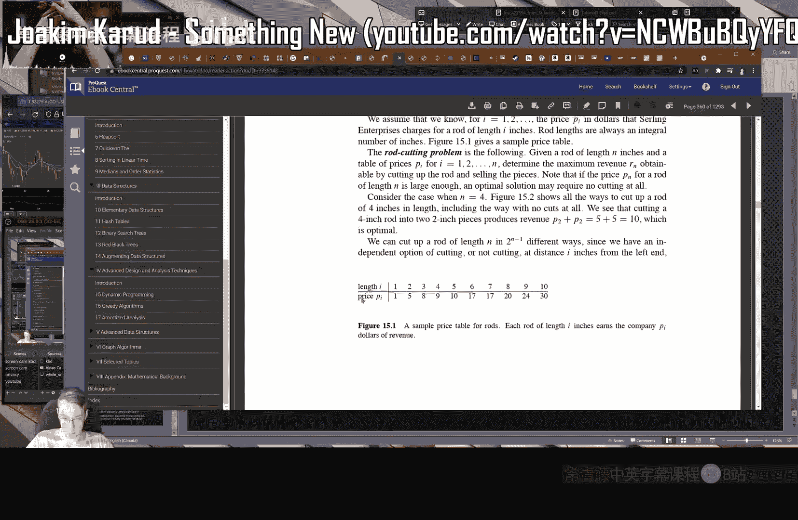

# 滑铁卢大学【中英⚡算法｜CS341 Fall 2021, Algorithms】 p09 P9 Lecture 9 -BV1DhrDBbEwR_p9-

Al right， welcome， ladies and gentlemen to another episode of CS341 algorithms。

 Today we're covering lecture 9， which is going to wrap up greedy algorithms。

 and we're going to start talking about dynamic programming。So let's jump into the material。

 So first of all， I want to return briefly to a proof that we did last week。

 This is the proof of optimality for rational Napsackack。 Now， in that proof。

 I assumed at the very beginning of the proof that when you take for each item that you could put into the Napsack。

The profit of that item divided by the weight of that item。 and you do that for each item。

 and you sort from largest profit per weight to smallest profit per weight that all of the profit per weight ratios were distinct Now。

 this means you couldn't have， for example， an item that had profit 10 and weight 5 and another item that had profit2 and weight 1。

 So because those would have the same profit per unit weight ratios。

 So that assumption of distinctness isn't particularly reasonable。

 it ends up ruling out all sorts of inputs that we might want to account for。

 So what if we can't assume distinctness for profit weight ratios in the proof。

 How does the proof change。Well， there's no longer a unique optimal solution。 Okay。

 the way that we did the proof last time we showed that there was a unique optimal solution that was exactly equal to greedy。

 And that was possible because there was distinctness for the profit weight ratios。

 if there's no distinctness for profit weight ratios， then when I argue that the optimal solution。

Behaved differently from the greedy solution。 It took less of item J and more of item K。

 I can no longer necessarily obtain a contradiction because item J and item K might have the same profit per weight ratios。

 So removing some of item K and adding it to item J doesn't necessarily improve the overall profit leading to a contradiction。

So。We can't prove that an optimal Y must be identical to a greedy X。Okay， well。

 if we can't obtain that contradiction， the whole proof falls apart。

 so how do we actually prove that this algorithm is optimal。

 even if we don't have the distinctness assumption。

And a big part of the reason why I wanted to cover this is A because you're asked often to deal with complicated problems where you can't make simplifying assumptions like distinctness in the assignments and so on。

 but also because there's something interesting in the technique that changes the proof technique that changes。

 and I wanted you to see how the modified proof technique differs from the original to see this nice new technique that you can apply in proofs。

So there might be many optimal solutions， Okay， now the key idea here is we still want to be able to derive a contradiction。

 or we still want to be able to prove that x is optimal。 But instead of comparing it with you know。

 a unique optimal solution， we have many optimal solutions that we could compare X with as we're trying to make an exchange argument。

And so the key is to restrict our attention to one distinguished optimal solution。

 How do we distinguish an optimal solution， Well， it depends。

 There are different ways to pick one particular optimal solution to focus on that'll help you derive your contradiction or for complete your proof。

 In our case， we're going to pick the optimal solution that matches X on a maximal number of indices。

In other words， this optimal solution， Y is going to make the same choices as x on some number of indices。

 right any optimal solution that I pick out of all possible optimal solutions is going to match x on some number of indices。

 maybe and could be 0。Now， out of the set of all possible optimal solutions。

 pick the one that matches x on the largest number of indices。 Now。

 there might be many optimal solutions that match X on a maximum number of indices。

Now here's an interesting claim。If y is optimal and matches x on the largest number of indices out of any optimal solution。

 y is exactly equal to x。Indeed， if x is optimal， then this will be true。

 x will be exactly equal to some optimal solution。 So consider the optimal solution Y that matches x on a maximal number of indices。

 This optimal solution will be exactly equal to X。 So in order to derive a contradiction。

 we can consider this optimal solution Y that matches x on a maximal number of indices。

 and we can try to show that it exactly equals X， and to obtain a contradiction。

 we'll suppose that it's not equal to x， and we'll end up showing that we can modify y to make it match X on one more index。

 which， of course， will be impossible because y is the optimal solution that matches x on a maximal number of indices。

 that will end up yielding a contradiction that we can use to complete our proof。😊，So as before。

 we're going to let J be the first N where x and y differ， and they must differ because， well。

 we're supposing for contradiction that x is not equal to y。

So before index J x and y take the exact same amounts of the exact same items， items 1 to J minus1。

 x and y take the exact same amounts and J is the first index where they differ。Now， X J and Yj。

 of course， have to be different because we've said this is the first index where they differ。

 And we remember， perhaps from the previous proof that yj has to be less less than Xj。

 This is because greedy always takes as much of item J as it can， So if the optimal solution here。

 y somehow manage to take more of item J， then the greedy solution did。

 we'd have a contradiction because the greedy solution would take as much as it can。

 And if the greedy solution can't take more， that means the amount of items1 through J that the greedy solution took plus the amount that it took of。

 sorry the amount that of items1 through J -1。That greedy took plus the amount it took of of item J is already enough to exceed the weight limit。

 So we know here that Y J has to be less than X J。Now， at this next step in the proof。

 in the old proof， we said there has to exist k greater than J， such that y K is greater than 0。

And this is because if the optimal solution Y is really optimal， it must use up all of its weight。

 And so the weights of the greedy solution and the optimal solution must be the same and the greedy solution takes more of item X。

 So the optimal solution has to take some more of some items up here Now we're gonna change this claim here a little bit。

 So instead of saying yk has to be greater than0， we're gonna to say yk has to be greater than xk In other words。

 the optimal solution， whatever item that it takes up here。

 Yk it takes more of this item than greed than the greedy solution does in particular so not only is it greater than0。

 it's greater than the amount the greedy solution takes because again。

 if it's not greater amount the greedy solution takes。

 we haven't yet equalized the amount of weight between x and y because the greedy solution takes more of item J。

 it must take less of some other item after index J。Okay。Now。

 if we remove some delta fraction of item K。And replace it with some deelta fraction of item J。

Our goal is not just to improve the profit anymore because these two items might have the same profit。

 Our goal is to make these two solutions Y and x equal on one more index。

 So we're going to try to make them equal on index J or equal on index K。 In other words。

 we're going to try to take sum of delta away so that what remains in item K in solution Y is the exact same amount we have Xk in the greedy solution X。

 or we're going to add or remove some amount of y K so that we can add that to J to make Yj equal to X Xj。

Okay so the fraction that we should add to J in order to make the solutions equal on index J is xj up here。

 minus yj down here， so if we add this fraction of item J will be making item J。

 the amount taken of item J， the same in the optimal solution and the greedy solution。Now。

 this is the fraction of item J that we need to add between 0 and 1。Now。

 the fraction that we should remove from K to make the solutions equal on index K is this red box here。

 which is Y K， since y K is greater than X K minus X K， right。

 This is the amount we should remove from Y K to bring this box down to the level of X K to make these two solutions match on index K。

Now that's the fraction of this item that we should remove the fraction between 0 and 1。

 because that's what these Y K and Xk variables are。

 What about the amount of weight that we should add here or remove here well。

To add the fraction X J minus Y J of item J， we need to add weight W J times X J minus Y J。

And to remove the fraction Y K minus X K of item K， we need to remove weight W K times Y K minus X K。

 Okay， so this is the weight we want to remove。 and this is the weight we want to add。

So we're going to let deelta be the minimum of those two weights。

 and we're going to observe that delta is greater than 0。

 regardless of which of these two expressions is smaller。

 because we've already argued that y K is greater than xk strictly greater than xk。And weights。

 the weight WK is positive。And。X J is strictly greater than Y J。And the weight W J is positive。

 So this is going to be positive， and then xj minus yj is going to be positive。

 So this weight is gonna be positive。 So both of these weights are positive。

 So delta is going to be greater than0 but it's the minimum of these two weights because we're going to be able to move the minimum of those two weights without exhausting all of this item or know removing too much of this item and without adding too much of this item such that we make the solution in feasibleas。

 So so the minimum of these two is an amount though we can always remove from k and add to j without rendering the solution infeasible。

😊，Okay， so here's our modified solution， Y prime。Let me just switch to my laser pointer。

 So here's our modified solution Y prime。 And we're going to set Y J prime to be equal to Y J plus。

 Now we're going to add some fraction here。 So remember， Delta is the weight that we want to move。😊。

Okay， so what's the fraction？That we want to add。 if we want to add Delta weight to Y J。

 what's the fraction of Y of item J that we're adding。 Well， it's Dta over WJ。

 the weight of the whole item， the weight that we're adding out of the weight of the whole item。

And then what's the fraction we're removing from YK。 Well， it's delta。

 the weight we're removing moving divided by WK， the total weight of the item。

 this is the fraction we're removing So yk is a fraction。 Y K prime is gonna be a fraction。

 Yj is a fraction。 Yj prime going to be a fraction between 0 and1 and we're taking the weight and dividing up by the total weight and we're gonna be moving the weight。

 that's the minimum of these two。 So which one's gonna be the smaller weight。

 let's just say that in this diagram， I mean， this is a smaller box here。

 but it might be that this item is way heavier。 let's just imagine for the sake of argument here that this is the lighter item K is the lighter item So we have a smaller fraction here and we also have a lighter item。

 So this total weight that we're moving this will end up being the lighter of the two weights and so that'll be our delta here will be the lighter of those two weights for item for WJ。

Times this and wK minus this。 So suppose that this is indeed the delta WK times Y K minus xk。

 That's what I've pictured here where the red box is what we're subtracting to get Y K prime and adding to get Y j prime and these don't necessarily have to be the same size because we're adding the same weight to item J。

 But if j is much lighter， we'll be adding a much bigger fraction of j okay。

So just try to remember what the types are on these variables。 Delta is a weight。

 X J and YJ are fractions between 0 and one of an item。

 So know there's some scaling happening here by the weights。anyway。

 in the case that we're picturing here， suppose that this is that the red expression is the smaller weight expression。

 and so we're effectively setting yk prime equal to yk by subtracting this expression。

 and you can confirm for yourself that plugging in if this is the smaller of the two expressions that when you plug this expression in for deelta here。

 you'll see that you'll be effectively setting Yk prime to YK。

 and then you'll be adding some other expression here。Okay。So in this case， if that's all true。

 then we'll end up with YK prime equal to YK。 And if the yellow expression ends up being the smaller expression。

 then you can plug that in for deelta here and see that we'll end up setting Yj prime equal to YJ by adding deelta over WJ fraction of item J to Yj。

Okay。So we want to now show that this new solution， the modified solution Y prime is feasible。

 So in other words， we're not going be able to derive any contradiction or show that the fact that we can modify a solution in this way is a problem and we can show that this actually is a feasible in a possible solution So we're gonna show that the weight of y prime is less than or equal to M it respects the weight limit and that the item K that we're removing some of hasn't become negative since we removed too much and the item that we're adding something to yj prime item J hasn't we haven't taken now more than the entire item。

 We want to say it's still less than or equal to 1。

 Now the weight part of this is actually pretty easy because we're moving delta weight from y from item K to item J moving deelta weight is not going to change the total weight。

 So the weight of y prime is going to be exactly equal to the weight of y and why we assumed was an。

Tomal solution。 So it's going to have weight M。 So this exactly matches the weight limit。Now。

 how about the feasibility of Y prime in terms of showing that all of our YK variables， know。

 all of our YI variables。Har between 0 and1。 Well， we want to show that the item we took something away from Y K primes greater than equal to 0。

 Let's do that。 So by definition， Y K prime， this was on the previous slide。

 We're setting to Y K minus delta over W K。 We want this expression to be greater than or equal to 0。

 Well， this is greater than equal to 0。 if and only if we can rearrange this expression。

 moveve the delta over W K to those side。 Multiply both sides by W K。

 We get deelta less than or equal to Y K W K。😊，But remember， Delta is the minimum of two expressions。

 and one of those expressions is Wk times yk minus xk。 Well， Wk times Yk。Minus。

WK times xk is less than or equal to WK times yk。Okay。So well， there you go。

 Delta is less or equal Y KWK。Okay， how about Yj prime is less than or equal to1。 Well。

 Yj prime by definition is Yj plus delta over WK。 That's how we defined Yj prime。

 We want this to be less than equal to1。And we can rearrange this expression。

 move the yj to the other side， subtract it from both sides， and then we get this。

 and then we can multiply by WJ and we get this， so delta has to be less than or equal to WJ times 1 minus yj。

Okay， well， from the definition of delta， remember。

 delta is less than or equal to it's the minimum of two expressions。

 So it's less than or equal to both of those expressions。

 So let's just pick the one that contains a Wj and a yj。 and we get from the definition of delta。

 Delta is less than or equal to Wj times xj minus Yj。 This is just coming from how we define Dlta。

 This is one of the two terms in that minimum。Okay， well。

 how does this expression relate to Wj times 1 minus yj？Well。

 Delta is less than or equal to Wj times xj minus yj。Is less than or equal to Wj times 1 minus yj。

Because one is the biggest value that X J can take on。And we know that from the feasibility of x。

 right， So X was a greedy solution。And our greedy solution always picks all of our Xj terms to be between0 and1。

So this is at most one。 So this expression is at most this expression， and we're done。Okay。

 so that's feasibility。 Well， how do we complete the proof。Previous。

 we completed the proof by showing what's why prime is feasible。

 We show that its profit must be greater than the profit of y， which is a contradiction。 Well。

 we're going do something similar， but not quite the same So profit of y prime is going to be equal to the profit of y plus we have our change that we made。

 So what's the delta by which we， what's the change to our profit by removing sum of item K and adding removing some weight delta of item K and adding some weight delta of item J。

 Well， here's the fraction of item K that we remove Delta over W times the profit for K for the whole item。

 And the fraction of item J removed times the profit for that whole item。

 And we can factor the delta out in front of this to get delta times this expression。😊，And remember。

 since J is before K in our sort order and we consider items with largest profit per weight first。

 we have。PJ over WJ， that profit ratio for item J greater than or equal to PK over WK。Okay。

 so can we argue that this expression is greater than 0， No， not necessarily。

 because these two profit ratios might be equal， but we can argue that this expression is greater than or equal to 0。

 Since Delta is greater than 0， we argued。And PJ WJ is greater than or equal to P K over WK。

 So we have this expression is greater than equal to 0。 Well。

 well now we don't have our contradiction。 How do we carry the proof forward？ Well。

 since y is optimal， indeed， this can't be positive or else we have our old contradiction。

 If this is positive。 If this expression is greater than our 0。 sorry greater than 0。

 Then we have our old contradiction， We've improved on the profit of an optimal solution。

 that would be an immediate contradiction， So this can't be positive。 Well。

 it's greater than or equal to 0， but it can't be positive， That means it's exactly equal to 0。

 So y prime is a new optimal solution。😊，And it matches X on one more index than y。

 because we chose our what were the two variable names。

 We chose our Y J prime and our Y K prime precisely so that one of them would now match Y X。

 K or X J。And we argued already that this solution Y did not match solution X on either of those two variables。

 And now y prime will match X on those two additional variables。

 And those are the only variables we've changed。 So Y prime matches X on all of the old variables that y matched it on as well as one of these two。

 So we have a solution that's optimal that matches X on one more index than y。

 But y matched x on a maximal number of indices。 There were no optimal solutions that match X on more than more indices than y。

 But now we have an optimal solution that matches X on more indices than y。Okay。

That's a contradiction。So the only assumption that we've made that x is not equal to y must be false。

 thisproves that x is in fact， optimal。Just a minute。 What's this。I think it's some sort of。

Pigment break。Well， that's about as much progress on the wall as we've had in the lecture。

Back to work。So the next thing I want to talk about is dynamic programming and at a super high level。

 dynamic programming is sort of like divide and conquer。

 but sometimes it can be dramatically more efficient。Okay。

 so let's start to try to understand what dynamic programming is。 And to get us there。

 I thought it would be sort of fun to look at a quote by Richard Bellman。

 who invented dynamic programming， I believe in 1953。

 He wrote the following in this autobiography What title。

 What name could I choose in the first place I was interested in planning in decision making in thinking。

 but planning is not a good word for various reasons。

 I decided therefore to use the word programming。😊。

I wanted to get across the idea that this was dynamic。 This was multistage。 This was time varying。

 I thought， let's kill two birds with one stone。 Let's take a word that has an absolutely precise meaning。

 nam namely dynamic in the classic physical sense。 It also has a very interesting property as an adjective。

 and that is it's impossible to use the word dynamic in a pejorative sense。

 try thinking of some combination that will possibly give it a pejorative meaning。 It's impossible。

 Thus， I thought dynamic programming was a good name。

 It was something not even a congressman could object to。

 So I used it as an umbrella for my activities。😊，So in this quote。

 he was talking about trying to come up with some name to describe a programming technique or a mathematical technique that would allow you to do optimization on dynamic systems。

 time varying systems。Now bottom up recursion might also be a reasonable name， as we'll see。

 and there's a related concept called memorization that although it's quite similar。

 we're not going to consider to be the same thing as dynamic programming for the purposes of this course。

And I think perhaps one reasonable way to start getting you used slowly to the idea。

 slowly used to the idea of dynamic programming is to try to compare。And contrast。

 dynamic programming with divide and conquer。 And ideally。

 I'd like to do this on a problem that's so simple that you don't even need to think about the problem。

 So you can really think an isolation about the techniques。 And so here's one， you know。

 really trivial problem， Comping Fibonacci numbers。

 So here's a bad solution to the problem of computing Fibonacci numbers。 When I say bad， I mean。

 horrendously inefficient。So we just have a recursive function where we take the number N。 This is。

 this is， we would like to compute the n Fibonacci number。 So we have our base cases。 If n is 0。

 or if n is1， then we just return n。 So the Fibonacci sequence， if you don't remember。

 starts it at 0。 and then the next number is one。 and then every subsequent number is the sum of the previous two Fibonacci numbers。

 So if we're not in these base cases。 then the nth Fibonacci number is just gonna be the sum of two recursive calls that compute the n-1 and n2th Fibonacci numbers。

Now， what's the runtime of this function because I want to try to understand just how bad the divide and conquerr algorithm is and why the D and conquerer solution gets some intuition as to why the D and conquerr solution is so bad and how dynamic programming can help？

So first of all， I want to just ask the question of runtime。

 and I want to ask it in the unit cost model， which as we'll see in a little bit。

 is actually probably pretty unrealistic for the problem of computing the Fibonacci number we should probably be using the bit complexity model。

 but I don't want to muddy the waters by making this analysis more complicated than it needs to be。

 And if you do an analysis in the unit cost model and the time complexity is horrible it will only get worse once you change to the bit complexity model and now have to think about the additional cost of doing addition or multiplication on large numbers of bits and carrying numbers of bits through the analysis。

 So let's just for simplicity's sake， think about the unit cost model for a moment and then a little bit later in the lecture we'll talk about the bit complexity model。

 So what's the runtime of this divide and conquer algorithm。Well。

 you have T of N equal to T of n minus-1 plus t of n minus2。And then some， let's say constant。

 because we're working in the unit cost model time to do the addition of these two sub problems and to do these checks and a return。

Now this o of1 would change in the bit complexity model and it would change to be probably you however big these numbers are。

 it would be you know if this edition could be done in time that's linear in the size of those numbers。

 we'd have to think about how big the numbers can be which we'll do in a bit and as you can see that would only make the analysis worse。

Okay， but how can I compute this kind of expression？

 We've seen how to compute using the substitution method。

 a kind of expression where we have T of n equal to T of n -1 plus a constant。

You could just sort of unroll。 but if you unroll if you try to unroll with a substitution method here。

 every time you unroll a t of n-1， it's going to turn into a t of n 2 plus a t of n-3 plus a constant。

 Every time you unroll one of these， you're gonna get twice as many T expressions。

 So you could think of expanding this at one level and your two t expressions is going turn into a4 and expanding another level。

 your two t your4 t expressions are going to turn into 8 t expressions and so on。

 your formula is just going get more and more complicated。

 And so this actually looks something more like a recursion tree。

 but then you have these you don't have division here。

 you have subtraction your problem size is shrinking by a subtractive constant not by you know division of know not by a fraction And so the master theorem doesn't apply easily here。

 Well， one way of simplifying this kind of expression is to attack it on two fronts and show a lower bound and an upper bound that are both relatively。

SimpleExs。So if we know that T of n -1 is greater than or equal to T of n -2。

 then we could simplify this expression by saying T of n is greater than or equal to two times T of n -2。

Well now we have something that we could unroll without an exponential blow up in the number of terms in our formula。

 and this we can do the same thing for the upper bound。

 So t of n is gonna to be less than or equal to two times t of n minus1。

 Okay so I can solve for these two using the substitution method And you can see for this first expression we're gonna have n over two levels of recursion。

 And in this second expression， guess because we're subtracting to each time right。

 So how many times we have to subtract to before we hit 0 and over2 roughly。😊。

And then for this larger expression， we have n levels of recursion to think about。 Okay。

 and the work doubles at each level because we have this multiply by  two， right？

 So how many times are we doubling n over two times for this expression。

 and n times for this expression。 So T of N is certainly in big Oomega of2 to the n over2。

 that's doubling n over two times and in big O of two to the n or doubling n times Okay， so， well。

 these are both exponential in n， right。So this is pretty horrible， this is exponential in N。

Is it exponentially in the input size？That's something we'll have to think about more carefully because what's the input size here Well the input is n。

 right？And well， how many bits would it take to store N。Well， if we're thinking about bits。

 it takes log n bits。Now， there's a question of which model we're working and are we working in the unit model or are we working in the bit complexity model。

 And if we're working in the unit cost model， the then maybe we should just treat this as a single bounded word and treat it as a constant number of bits。

 But then there's well， our our input size being a constant is gonna be sort of strange because the largest number that we can write down is a constant。

 We can't solve this for arbitrarily large numbers。So the fact that I've already said we should just。

 for the sake of argument， assume we're working and the unit cost model is gonna maybe get us into trouble here because we have to start talking about bits to get a sensible analysis for the input size and get sensible results。

 It'll make a lot more sense to do this sort of analysis。 once we actually just say， okay。

 let's work in the bit complexity model a little bit later in the lecture。 At any rate， bear with me。

 And let's just say that it takes log n bits， sealing log n bits to store N because we want end to be able to encode large numbers。

So for simplicity， let's say that the input size S is log n。

 will throw away the ceiling just for simplicity。If you， if you didn't have this， you know。

 if you weren't able to make a simplifying assumption like this。

 you would maybe have to put some bound on the input size to get rid。

 you wouldd say have to say the input size is greater than or equal to log n because this is a ceiling。

Okay， just for simplicity， let's say that the input size is equal to log n。

And S is going to be your input size。 So what's N in terms of S。 Well，2 to the S is 2 to the log N。

And2 to the log n， if log， if the base of this log is 2， then well， this is just n。

 So2 to the S is n。 So if s is the input size，2 to the S is exponential in the input size。

 n is exponential in the input size and n over 2 is 2 to the S over 2， which is 2 to the S -1。

So what this tells us is that T of n is in big omega of 2 to the n over 2。

That means T of n is in big omega of。Well， what's n over 2。 It's to the S -1。

 So it's 2 to the two to the S-1。So it's not on the order of 2 to the S。

 which would be exponential in the input size。 It's on the order of 2 to the2 to the S-1。

 This is doubly exponential in the input size。Okay， and then T of n， of course， is in big O to the n。

 which is big O of  two to the two to the S'cause n is2 to the S。 So again， this is。

 this is doubly exponential the input size。 Okay， so。

This is interesting because on the previous slide。 we saw that T of n was exponential in n。

 but n is not our input size。 So we wouldn't say that this is an exponential time function。

 because when we say that this is an exponential time function。

 What we're really saying is this is exponentially in the input size。

 but this isn't exponential in the input size。 This is doubly exponential in the input size。

 So this is a doubly exponential time algorithm。 Now。

 in most of our analysis that we've done before this point。

 N has just coincidentally beyond the size of the input。

 So we don't write O of n or O of n squared because we like the letter N and any time the letter N shows up on our algorithm。

 we use it for our complexity， we use N， because N is our input size， usually。 And really。

 what we want is a runtime that is expressed in terms of S， the input size。😊。

And if it just so happens that n is S， we are happy to write O of n or O of n squared and call it linear or quadratic。

 It's not linear or quadratic because we have an n or an n squared。 It's linear or quadratic。

 because n happens to be our input size， and it's linear in the input size。 In other words。

 it's order S。 or it's quadratic in the input size， order S squared。 So we always want， really。

 from this point on in the course to express wherever we can。

 our runtime analyses in terms of the input size。😊，Okay， so why is this algorithm so slow？Well。

 if we look at the recursion tree to actually evaluate the fifth Fibonacci number F5 that recurs that recursive algorithm to solve for F5 is going to make a recursive call for F4 and a recursive call for F3。

 and this recursive call for F4 is also going to make a recursive call for F3。

 and both of these F3s are going to make recursive calls for F2。

 and F4 is also going make a recursive call for F2。 So the subproblem have a lot of overlap。

 It's not just a question of dividing our subproblem into independent subproble and maybe even throwing away subproble。

 which we often do in fast divide and conquer algorithms。

 It's even worse than just naively dividing partitioning our problem into into subproblem。

 we have overlap in our subproblem and really aggressive overlap because every subte on the right also appears on the left and so on recursively。

😊，So each subte is computed exponentially often in its depth。

 So there's really an exponential amount of overlap in the sub problemsble。

 And this makes this a perfect candidate for dynamic programming overlap in your sub problems is what makes a problem。

 a perfect candidate for dynamic programming。😊，Okay。

 so how do we design a dynamic programming algorithm for optimization problems now。

 just like with greedy， where we talked about designing greedy algorithms for optimization problems。

 but not all problems that we solve in a greedy way are optimization problems。Similarly here。

 I'm going to describe how we solve optimization problems using dynamic programming。

 but sometimes the problems that we solve using dynamic programming aren't optimization problems。

 They don't have an objective function that we're optimizing。 In such cases， you know。

 the objective function is just degenerate。 You can think of it being a constant or something Similarlyly to how we can think about solving greedy problems using greedy techniques where we don't actually have an objective function to optimize。

So nevertheless， I'm going to teach dynamic programming as if we're solving optimization problems and you can understand how you can simplify when you don't have an objective function。

Okay so there are a few key aspects of dynamic programming algorithms and problems that are amenable to dynamic programming solutions。

 so first and perhaps most importantly， your problem should have a recursive structure and if we're talking about an optimization problem it should have an optimal recursive substructure so you should examine the structure of an optimal solution to a problem instance I and then determine if an optimal solution for I can be expressed in terms of optimal solution to subprobles of I。

 so just like in divide and conquer where you try to come up with subproble whose solutions can be combined into a solution to the whole problem。

 you're going to do the same thing in dynamic programming and we need to know that there's an optimal substructure so an optimal solution to my problem necessarily。

Can be composed of optimal solutions to sub problems。 In other words。

 if I solve the sub problems optimally， I can assemble those optimal solutions to sub problems into an optimal solution for the problem。

 This is perhaps the most important aspect of a problem that makes it amenable to solution using dynamic programming techniques。

Okay， so once you've verified that your problem has this optimal recursive substructure property。

 then you want to define your subproble， so just like in divide and conquer。

 you have to define a set of subproblem S of I for the instance I and solving these subproblem should enable the optimal solution to the large problem to be computed。

And the idea is， I is going to be the last or the largest instance in these sub problemsble。

 So you're， you're defining small sub problems that can be assembled in a larger sub problems and larger sub problems and larger sub problems until you end up with a solution to the final problem。

 I， the full problem instance that you want to solve。Okay， and these are just things for your notes。

 basically how would I change these two definitions or these two descriptions for problems that aren't optimization problems。

Okay now the next step once you've defined your sub problemsble is to derive a recurrence relation。

 Okay， so far we've seen recurrence relations and our recurrence relations have always been brought in for the purpose of conducting analysis。

 but here we're going to derive a recurrence relation whose purpose is not to analyze the runtime of the algorithm。

 No， the purpose of this recurrence relation is actually to define how to solve the whole problem we want to derive a recurrence relation that actually relates directly an optimal solution to a problem to optimal solution of the subproblem so the recurrence relation is actually going to define the relationship between a problem and its subproblem。

So it's going to be recurrence relation on the optimal solutions to the sub problemsble in SF I。

 This recurrence relation is going to be completely specified in terms of optimal solutions to smaller instances in SI and to base cases。

And this is going to be something tricky and new for you guys， perhaps。

 and you know this will hopefully become a lot clearer when we see an example。😊，Okay。

 so then once you have your recurrence relation， which defines the relationship between problems and subproble and base cases。

 then we're gonna a recurrence relation is just a mathematical object， it's not an algorithm。

 So we're then going to come up with an algorithm to take that recurrence relation。

 implement it in code and solve the recurrence relation。

 and this is going be the coding part where you take that mathematical object and solve it。

 So we're going to compute optimal solutions to all of the instances in si and we're going to compute these solutions using the recurrence relation。

 and we're going to use it in a bottom up fashion。 and this is key so what does bottom up fashion mean。

 It means we're going to fill in a table of values containing these optimal solutions。

 And whenever a particular table entry is filled in using the recurrence relation。

 You're going be looking up the solutions to optimal subproble。

 you're going be trying to compute the optimal。😊，Soution to a particular problem。

 and you're going to be looking up in the table so that the solution to this。

 the optimal solution to this problem is going to be stored at some location in this table。

And you're going to be looking up in order to compute this location in the table。

 some other locations in the table， which contain optimal solutions to sub problemsble and those optimal solutions of those relevant subproblems must already be computingd when you are computing this entry in the table。

 That's what bottom up means。 you're going to be computing your smaller subproblem first。

 So when you want to combine the solutions to those sub problemsblem into a solution to a larger sub problemblem。

The smaller subproblem that this larger subproblem depends on are already computed from the bottom up。

Okay， and the final table entry is going to be the solution to the entire problem。

 The final entry you fill in is going to be the solution to the entire problem。Typically。Okay。

 so how can we solve Fibonacci， you know， for the Fibonacci number using dynamic programming and note that solving for the nth Fibonacci number isn't an optimization problem。

 So we don't have any optimization element to it。 But that's fine。

 we don't need to have an optimization element to it。 If we pop back to this previous definition。

 the optimal recursive sub substructure should really just read。

 Ex the substructure of a solution to a problem。Instance I and determine if a solution for I can be expressed in terms of solutions to sub problems。

 right， so that's easy。 And then defining sub problemss。

 Just define a set of sub problems S I of the instance I。

 the solution of which enables the solution of I to be computed。

 I will be the last or largest instance in the set of S I。

 So it's a very straightforward extension of what I just described to non optimizationim problems。

 So let's see how to solve fib as a toy example。 So， first of all。

 can we establish the optimal recursive substructure。 Well， the solution to theth Fibonacci number。

 get rid of the optimal word can we establish recursive substructure。

 The solution to the nth Fibonacci number F of N can be expressed to the addition of two smaller Fibonacci numbers。

 okay。😊，So if we solve the smaller problem instances， we can solve the bigger one。

 That's our recursive structure。 There's no notion of optimality， but that's fine。

Now we define our sub problems。 So the set of sub problems that will be combined in order to obtain fib N is fib n -1 and fib n -2。

And I wrote here that SFI was exactly equal to this。 That's not。 that's not correct。 Sorry。

 I made a mistake on the slide here， which I can correct。

S I is supposed to be the sequence of all sub problems from smallest to biggest， you know。

 that you're gonna fill in。 Okay， so it's the set of all sub problems。

 which really would go from n all the way down to， to 0 to the base cases。

And our recurrence relation is going to be f of n equals F of n minus1 plus f of n minus2 for i greater than equal to 2。

That's our sort of recursive case。 And then our base case is one in the case that I is 1 and 0 in the case that I is 0。

 I could also express those two cases together as n in the case where I I is less than 2。Okay。

 so this is a recurrence relation that precisely defines what we want to compute。

 F of n is defined in terms of the solution to F of n is defined in terms of the solutions to F of n minus1。

 F of n minus2， where these are smaller sub problems。Okay， so this is easy for Fb。 In fact。

 this is just the definition of what a Fibonacci number is， right For some problems。

 you might have to try harder to define what a particular problem is and what its subproblem are and how the problem relate the solution to the problem relates to the solutions of the subproble in a mathematical way like this。

 but this is absolutely critical to figuring out how to solve dynamic programming problems。

 If you can express your problems solution as a recurrence relation that looks like this。

 you're almost done。 It's pretty easy to turn this into code。

 usually The final step is to compute your solutions。 So we're going create a table。

 This was a mathematical object F。 We're going create a pseudocode construct a table F。

 which is really just an array one to N。 and then we're going compute these entries bottom up。😊，Okay。

 so I want to compute FN。 That's where the solution is gonna be。 And I'm gonna start from my。

 my base cases。 And I've， I fudge the numbers here。

 whether I start at one or 0 and whether I you know， include the zeroth the。

 the last base case here on this slide。 I'll clarify that on the next slide。

 This might be a mistake to go from one n I might want to go from0 to n ca we might want to include this smallest base case in。

Okay， so let's fill the table bottom up if you're wondering what this sometimes my funny pictures are a little too subtle。

 if you're wondering what this is， this we saw Fibonacci Pieons a few slides ago。 and this is a。

 well， this is a pigeon that's filling out of a bird feeder bottom up。Okay。

 so the key idea when you're filling the table bottom up is whenever you're computing a table entry。

 you have to have already computed the entries that it depends on。Okay。

 so we have to think about dependencies for our computation。

 Usually you can extract your dependencies directly from the recurrence。 In our case。

 entry n depends on n -1 and n-2。 So if we compute the entries to our table in the order 1 up to n。

 that guarantees that n -1 and n -2 are already computed when we compute n。So here's a DP solution。

 So in this case， in the real pseudocode， I actually did define my f to have a zeroth entry。

 just so I can include both the base cases in the array。

 And usually that makes the code simplest because I don't have to write special cases。

 if if you know I is less than1 then I need to I can't go F of I-2 I want that to be defined So I'm starting it too and f of i minus-2 of be f of 0 and that is an array entry。

 So I don't need any extra special cases in my code。 This solution to the Fibonacci numbers。

 I'm sure you could come up with on your own， even if you knew nothing about DP。

 but DP is a nice way of explaining how this algorithm works and justifying its correctness。😊。

Of course， this is a toy problem right So it's gonna be a toy solution。 Anyway。

 you can see how it's applying DB principles。 So let's see we have our array。

 this is our know pseudocode level object， not the mathematical object。 the recurrence F。

 This is the table F。 we start filling in the case is bottom up。

 So0 and want to get filled in and then we have a loop that fills them from two up to n and our subpros are already computed when we're computing f of I。

 And that's key。 if these recursive calls， they wouldn't already be computed here。

 they're already computed and then we're returning the solution to the full problem instance。

 I as the final cell of the table that we computed Now there's a space saving optimization that we can apply here note that once we when we're computing f of I we never look at f of I minus-3。

 and once we've computed f of I， we never look at I minus-3 again， f of minus-3 again。

 So we can actually make do with a few variables here instead of this whole table right。😊。

So I often like to start out with a solution that's maybe a little bit naive。

 So here we have a full table when maybe we don't need the full table。 I'll prove that it's correct。

 I'll analyze its runtime。 And then before I analyze its space complexity。

 if we want it also to be space efficient， I'll apply a space saving optimization to get rid of dimensions of the table or maybe the entire table that I don't need。

😊，So here's an optimization。 We basically need to get rid of the table and we always need to remember what the equivalent entries that we're trying to look up in the table are。

 right we want to have variables to represent F of I minus-1 and f of I minus-2 and F of I and we want the computation to be the same as if we have this table。

So our f of I-2 going into the loop will be 0。 Our f of I -1。' going into the loop be  one。

 and then we have our same loop。 but there's no table。

 We're about to overwrite entry f of I but this f of I that we're trying to write here。

 we want to reuse in the next iteration as our f of I-1。 So we better not overwrite it right away。

 we better save it in a temporary variable。 Then our f of i is going to be computed in the usual way by summing up f of i -1 and f of I -2。

 And now we have to simulate taking one step further in the array。

 So f of I-2 is going become is going to take on the value of f of-1。

 F of-1 is going to take on the value of f of I which we overwrote。

 but it's stored in our temp variable。 that's all we have to do。 This is a space saving solution。

 we can do this in constant space clearly we don't need the table at all。

 But in terms of the correctness of this algorithm。

 It follows immediately from the correctness of this algorithm and the fact that we're kind of simulating having access to the data that we need。

Okay， so there's just some things for your notes。Okay。

 so this on the right is still considered to be dynamic programming。

 but in order to convince a skeptical TA that this is dynamic programming。

 they should probably see this version of the algorithm first。Okay。

 and often you can get away with just pointing out that it's possible to do this space saving optimization。

 You don't necessarily， usually unless we ask for it， you don't need to write out all the details。

 And if we asked you to explain how you could save space。

 you could just explain that this is how you， how you would do it。Okay。

 so how do you reason about the correctness of a dynamic programming algorithm？ Well。

 it's not unlike a divine conquer algorithm， at least in the second step。 And the first step。

 I want to prove that we are filling things bottom up。

So first I want to prove whenever I'm computing a table entry。

The order in which I'm filling in my entries is such that all of the dependent entries have already been computed。

 That's step 1， proving that you're filling things in bottom up。So in our case， that's easy。

 The order 0 to n means I -2 and I -1 are already computed when we compute I。 That's it。 That's。

 that's that part of the argument that we are doing things bottom up。

 that are our dependent entries are already computed。 Step 2。

 this is quite similar to divide and conquer。 We suppose that the sub problems are solved correctly。

 And if this is an optimization problem， that also means optimally。Then we prove that these。

Possibly optimal if this is an optimization problem， that these sub solutionsolutions。

Are combined into an optimal solution。So that much is very much like divine conquerr。

 works the same way。 So assume we' filled in f of I-1 correctly and f of I -2 correctly。

 So they are the I-1 and I -2 Fibonacci numbers。 adding them will produce by definition of a Fibonacci number coming That comes from the problem。

 will produce the the I Fibonacci number。 That's a proof that this is correct。O。😊。

So that's correctness。 again， for a toy problem。 Now。

 I want to return for a moment to the model of computation for computing runtime。

 So the unit cost model is really not realistic for this problem。

 because Fibonacci numbers grow really quickly。 So the0 Fibonacci number is 0。

 and the 10th Fibonacci number is 55。 but the 100th Fibonacci number is this huge beast And let's see。

3，6，9，121518。 This won't even fit in a 64 bit integer by the 100th Fibonacci number And you know。

 the thousandth Fibonacci number has more than 200 digits。 So these these numbers grow really。

 really， really fast。😊，How quickly， how fast do they grow， Well， if we let theta， Oh， sorry。

 they're not theta Phi here be the， the golden ratio， then they grow like this expression here。

 which ends up working out to an exponential function of n。 So this is exponential in N。😊，Okay， well。

 that's kind of shocking。 These numbers grow exponentially fast in the value of n。😮，Okay， well。

 that should give you some hint that if we have to account for the bit complexity of these numbers。

 we're going to be paying minimally some cost that's exponential in n where， of course。

 n is exponential in the input size， as we saw， log n is the input size。

 So we're going to necessarily have a w exponential cost come in here。

 if we have to think about how big these numbers are because these numbers grow extremely large。

 extremely fast。Okay， so these big numbers suggest that we should use the bit complexity model， okay。

Whatever you see really big numbers or the potential for large numbers。

 we should be thinking about the big complexity model。Okay， so let's do the analysis here。

 So F of I -2 and F of I -1 have theta I digits。 So their addition takes theta I time。

So T of n here is going to be， what's the cost of this whole function， Well。

 we do some amount of work here that ends up being constant。Let's。

 let's just assume this is constant work for the these the assigning these variables and that F is a new array。

 Let's just assume that that takes you know， linear， linear time， linear in n。Okay。

 and then this for loop， we have order n iterations。

 but those iterations are doing theta I work for the addition of these increasingly large numbers。

 So T of n is going to end up being theta n squared time。 is this quadratic runtime。😊。

So I'll give you a second to pause and answer that。😊。

I think this is a pretty good exercise at this point。Take a sip of my coffee。

So at this point I'm going to assume that you've answered it， if you wanted to answer it。

 this is not quadratic runtime， this is not a quadratic runtime algorithm。So this is quadratic in n。

 but n is huge。So when we say quadratic runtime， we mean quadratic in the input size。

 What's the input size。 Well， we argued that S， the input size is log n bits。

 So what that means is 2 to the S is n， which means n squared。Is 2 to the S squared。

 So this is still exponential in the input size。Okay。

 but it's not doubly exponential in the input size。So， okay， I mean， unfortunately。

 this is still exponential in the input size。 So this isn't a great algorithm。

 This is an exponential time algorithm， but this is an exponential improvement over the divide and conquer algorithm。

 which was a doubly exponential time algorithm。😊，Okay。

 so I want to give you a few tips for analysis of DP algorithms， so first。

 think really carefully about which model of computation either unit costs or bit complexity is appropriate。

If you can't decide which is appropriate， then you can always try both and see if it changes the answer。

Also think really carefully about the input size S。

And we'll talk more about this as we go in the course and as we look at some sorry some dynamic programming problems or some algorithms to solve problems that use dynamic programming techniques。

 we'll do a bunch of analysis of this type， so hopefully this will make a lot more sense。

So try to express， in general， your runtime in terms of S。

 that doesn't necessarily mean you need to write the letter S。 if n happens to be the same as S。

 then you can write in。 But whenever we ask a question， is this a linear time algorithm。

 or is this a quadratic time algorithm， you better be talking about S。

If it's too hard to express your runtime in terms of S。

 and sometimes there are algorithms where it's impossible or infeasible or changes the complexity or makes the expression really just disgusting to look at。

 and there's a judgment call there that it's better to express your runtime in terms of elegant or natural terms or terms that appear in the input。

And we'll see a bit more of that and see how to make that judgment call in future lectures。Okay。

A couple other miscellaneous tips。 So building a table of results bottom up is what makes an algorithm DP。

 There is a similar concept to dynamic programming called memorization。

Where basically you make recursive calls and before you return the result of your recursive call。

 you save the value somewhere and you can look up that value later to avoid redundant recursive calls for the purposes of this course。

 we are not calling that dynamic programming and we want to see bottom up table filling。

And base cases in a dynamic programming algorithm are really critical。

 They often completely determine the answer。 So if， if you think about the Fibonacci you know。

 algorithm that we just came up with， if you change those base cases。

 So that key base case where f of1 is one。 if you set that to 0。

 then every Fibonacci number becomes 0。 So they're really crucial。😊，Okay。

 so you can verify that for yourself here， what would happen if it line5， you set that to zero。

So base cases are absolutely critical and oftentimes a lot of what makes a dynamic programming algorithm elegant is identifying the cleanest way to express your base cases and finding a nice way to pack your base cases into your table so that it's very natural to have this line of code where you compute your solution refer elegantly to the base cases without having to write any special if statements and things like that。

😊，Well， wouldn't you know it right on time， You need another break。 You got another break。

Looking pretty nice。Back to work。Okay， so I was originally planning to end the lecture there。

 but I think it actually would be a lot more useful than leaving you guys with just the limited amount of stuff I covered already until the next lecture to see an example that's not completely trivial。

So I want to go relatively quickly through an example that's like a little bit more sophisticated。

 but still not a very difficult application of dynamic programming。

 So we're going to talk about a problem called rod cutting So what's rod cutting Well you're given as your input an integer N which is the length of a rod。

 like I think a steel rod that you're going to cut into pieces and the goal here is to cut up the rod into one or more pieces。

 So maybe no cutting as necessary at all。 you could sell the whole rod。

 The goal is to sell the rod in one or more pieces for the highest possible income you'd like to make the highest possible income by selling it。

So you have a set of prices that are also given to you in the input。 So there's the integer n。

 that's the length of the rod you have。 and then there are n other integers。

 P1 up to PN that tell you the price of a rod length for P， the price of a of a rod of length I。

So basically， all of the numbers from one up to n are covered。

 You have a price for every possible integer length up to the length of your rod that you're trying to sell。

So the output that we're looking for is the maximum income that you can make。

 so the sum of all the prices of all the lengths。That you can make by cutting the rod into any number of pieces。

 and those pieces have to have integer lengths and their lengths obviously have to sum up to the original length of the rod n。

And maybe the correct answer is to just sell the entire rod。 so for example。

 here's an example input here， n is equal to 4 and then you have this price array。

 you know P1 p2 p3 P4 so for example， we could sell the entire rod of length4 for 9 so we could get an income of 9。

 however， if we cut the rod in half we could have two pieces of length2 that we could sell for a total of 10 income so but we would want to output in this example is 10。

So we want to get the max income that's possible by possibly cutting the rod into any number of integer length pieces that sum up to the total length and so for example。

 here， all the ways of cutting a rod of length 4 so you can sell the whole rod or a piece that's length 1 and a piece is length 3 or 2 and 2。

3 and1，1，1，2，1，2，1，2，1，1，1，1，11 So we're just going to say out of all the ways of cutting the rod。

 which one gives us the most income and it's this5 plus 5，10。 So our example output should be 10。

So that's the rod cutting problem。Now， how can we solve it using a dynamic programming approach？

 Well， first， I like to come up with a high level idea of how I would tackle the problem with a basic recursive solution。

 So I like to just think of like a naive recursive solution before I then try to use dynamic programming techniques to optimize the recursive solution。

 So given a rod of length N。We can either make no cuts and then we just sell the whole thing for an income of PN or we can make a cut and then recurse on the remaining parts。

So， for example， we could cut it here and then we could recurse on the left half and recurse on the right half and our recursive calls would be solving for the maximum income that we could get from the left half and the maximum income we could get from the right half and we could add that up and return it and we could compare that the maximum income we can get by doing the best we can with the left half and the best we can with the right half recursively we can compare that to the to the sorry。

 the income we can get by selling the entire rod in one go and we can pick whichever one is better。

Now， the question is， where should we cut in order to maximize our income？ Now。

 sometimes a problem will give you some sort of natural way that you can figure out you know where you should。

 you know， split your data and then recurse In this case。

 there isn't an obvious way to avoid trying all of the possibilities。

 So what if we just try all of the different ways of making that cut。In other words。

 we'll try cutting it position one， and we'll see we'll recurse on the left half and the right half and sum up the incomes that we get for those two hals and see how that we see what we get for that that we'll try cutting。

At I equals 2。 and we'll recursse in the left and right hals and see what income we get。

 And then we'll try cutting it at index 3。 and so on and so forth。

 We'll try cutting it every single index。 We're making a single cut。

 And we're trying all the different possibilities for locations for that single cut。

 And for each of those possibilities， We're recursing on two rods that we're left with after the cut。

 one of them of length I that goes from 0 to I。 And the other one of length n minus I。

 That's the remaining piece that goes from index I plus1 up to n。

And we're going to take the maximum income over all the possibilities and well what are all the possibilities。

 well there's each eye and then there's also the possibility that we don't cut at all。

 so we include PN， the profit， the income we can get by selling the whole piece of length and in our max as well。

And the key thing that makes this problem amenable to the dynamic programming approach is that it exhibits this optimal substructure。

 and this is something that you have to argue when you're trying to apply a dynamic programming problem approach to solving a problem。

 you need to argue that the problem exhibits optimal substructure。

 So what do we mean by this problem exhibiting optimal substructure。 Well。

 the maximum income that we can get from two rods。With sizes I and n minus I。

Is the maximum income we can get from the rod of size I。Plus。

 the maximum income we can get from the rod of size and minus I。Okay。

 so we're saying the best you can do with these two rods is the best you can do with one plus the best you can do with the other。

 That's optimal substructure。 We're able to say the best solution I can have for these two pieces is the best solution I can have for each of them individually。

😊，Hopefully that's not too confusing， but at any rate， even if it is。

 we'll see several more examples of this as we continue to talk about dynamic programming。😊。

So we've established that this problem has optimal substructure and we've come up with a recursive approach。

 can we turn that recursive approach into a recurrence relation？Well。

 the first step in defining or deriving a recurrence relation is to define the function and define the quantity that we want or so not the function we want to define the relation。

 give it a name， say what types of arguments it has， and then we want to define the meaning。

 in other words， I'm going to now define a recurrence relation M of K just like we you define recurrence relations T of n earlier。

 the M of K is going to be a recurrence relation and here I'm giving it in words a meaning so what does M of K hold by definition should hold the maximum income I can get given a rod of length K so I'm defining what M of K should be semantically。

 what it should contain semantically。Now， when we try to take this semantic definition and turn it into a mathematical definition to derive an actual recurrence relation that I can write down in mathematics。

 we have to reason to ourselves about various cases and how M of K relates to subproblem or is built out of subproblem。

 for example， M of something smaller than k。So let's think about the problem and how we can start to express this recurrence relation that's going to relate our subprobles to our whole problem。

So if we don't cut the rod， then the maximum income we can get is PK just selling the whole rod。Okay。

 so M of K is supposed to be the maximum income for the rod of length K。 So if we don't cut the rod。

 then M of K should just be PK。If we do cut the rod， suppose we cut it at position I。

 so we're cutting the rod into two rods， one of length I and one of length k minus I。

Now the maximum income that we can get in this scenario where we do cut the rod。

Is the maximum income we can get for this rod of length I plus the maximum income we can get for this rod of length K minus1 I。

 sorry， not -1。Okay， so if we don't cut the rod， the max n income we can get is PK。

 if we do cut the rod at index I， it's MI plus M of k minus I。Now。

 we want to maximize this over all possible choices of I。 So if we do cut the rod。

 then we want then our max income we can get is the max over all the places where we can cut it over all the I。

 So overall I between 0 and K strictly。Of M of I plus M of k minus I right。

 So for all possible ways to cut the rod。Try to do the best we can with the left half and the right half。

And the maximum of this expression over all places where we could cut the rod is the best that we can do if we cut the rod。

 So now we need to combine this expression with this expression for the case or we don't cut the rod。

 And we just combine them with the max because we're looking for the maximum income we can get。

 So M of K is going to be the max of selling the whole rod for Pk or all the different ways of cutting it for I equals one up to K -1。

😊，The maximum income we can get using the left half up to I plus the maximum income we can get using the right half。

 you know the rod that's left on the right after our cut， So this is going to be。

 I claim the maximum income for rod of length K and hopefully you can follow this derivation to see the logic behind that。

Okay， so now that we have a recurrence relation， we want to compute solutions to this recurrence relation。

And we want to store those results in a table and we want to compute all of the entries of the table from the bottom up where bottom up means every time I try to compute table entry K。

 all of the dependencies that I need to compute in order to compute table entry K are already computed so can I find an order that I'll be able to fill in this table so that every time I try to compute a cell K an entry K。

 every entry that M of K depends on has already been computed。 So I'm going to give my table a name。

 my recurrence was named M of K， my table will also be named M of K they're different objects that are indicated by brackets here versus parentheses。

 but anyway I can I can overload the letter。So this is a table M that has an index。

 it has indices 1 up to n for all of the different lengths。

 and this is going to store intuitively the table is going to store the actual value of M of k。

 the recurrence relation as we actually compute it for the given input。Okay。

 so what are the dependencies of an entry K， here's entry K。

If we look at this recurrence relation to compute M of K， we need to look at the profit of K。

 well the price of k， that's not an entry on this table， so that's not a dependency。

And then we are going to look for all I between 1 and k minus1 inclusive。

 We're going to look at M of I and M of K minus I。 So we're going to look at M of I for all I。 Okay。

 well M of I for all I is going to be m of 1 up to k minus1， right。

So these yellow cells are what we depend on for this first M expression what about the second M expression This is M of k minus I well M of k minus I。

 what's the biggest value this can take on when I is the smallest this is the biggest I I is the smallest when it's1 here so this is k minus1 is the biggest value this can take on which is this cell right what's the smallest cell K minus I can take on it'll be smallest when I is k minus1。

Okay， well， when I is k -1， this is M of 1。 So in other words。

 this expression2 depends on cells1 up to k -1。Okay， well， all of these dependencies are less than K。

 So what this tells me is in order to compute K， it suffices to have everything to the left of K computed first。

 Everything smaller than K computed first。 Well， that's fine。

 I can just fill in the table entries starting at one and go up to n。 Sorry， this should be a1。

 not a 0 and going up to n。 And then every time I'm computing a K。

 I'll already have computed everything to the left of K。😊，So here's pseudocode to do this。

So this is the rod cutting algorithm， we' given it an N and an array of prices a P1 up to PN。

And then M is going to be R that contains our maximum income for a rod of length。

 So MK is going to be the maximum income for a rod of length K。We're going to compute each entry MK。

 so for k equals 1 up to n minus1。OrSo， this should actually be up to n。So we want to compute M of n。

So this should iterate all the way up to n， so that's a mistake I'll after to fixing the slides。Okay。

 so remember， from the recurrence here， we want to compute M of K as the maximum of Pk and the maximum over all I of M plus M K minus I。

 Okay， well， the first thing we can do is we can set M of K to P of K。 So so the current best。

The current maximum is stored in MK at all times。And at this point， it's。

 it's just the maximum of this PK。 Currently PK is the best solution where we don't do any cuts。

 and we just sell the whole rod。 And then as we， we implement this max expression with a four loop where we iterate from  equals1 up to K-1。

We're going compare in each step the current M of K with M of I plus M of k minus I。

 So we're going replace M of K with the max of M of K and M of I plus k -1 I。

 So we're going end up between these three lines of code 6，9 and 10。

 we're going end up computing these two max expressions。

 know it's not a direct translation from the recurrence to code， but it's not too hard to see either。

 And then at the end， as long as I fix this bug where I'm iterating up to n -1 instead of n。

 I should be iterating up to n。 Then my solution will be here in M of n。

 because if you recall what the definition semantically of M of n is is the maximum income for a rod of length n。

 That's exactly what I want to return here。 So that's what I'll return at the end。Okay。

 what's the runtime of this algorithm？So I'll give you a second to answer so you can pause and answer。

And now I'm going to assume that you've done so if you wanted to。

 so this we have two loops that iterate up up to n and up to k minus1。

 and this is going to end up being something like the sum fors for k equals1 to n the sum of theta I。

 which is going to be theta n squared。Okay， so this is going to be n squared time。

Is this a quadratic time algorithm？So I'll give you a second to pause so you can answer that if you'd like to。

 I think this is a good exercise。Okay， so I'm going to answer this now。

 assuming you've paused if you wanted to。So in order to answer if this is a quadratic time algorithm。

 we need to ask what the input size is。And in order to do that。

 we have to pick a model of computation。 Now， the unit cost model， I think。

 is appropriate here because we probably aren't talking about gigantic numbers that you can't fit into a single word。

 We're probably talking about reasonable size numbers， and we have an array of numbers here。

So let's say that we go with a unit cost model， and so each element of this P array takes one word。

 which means they take theta 1 bits each。So we have theta n words。

 which means the input size is in theta n。Okay， well， with runtime theta n squared， of course。

 if s is in theta of n， theta n squared is theta S squared。

So this is theta size of the input squared the runtime of this algorithm。

 so this is a quadratic time algorithm。Okay， so next up。

 we're going to look in the next lecture at solving the 01 Napsack problem using dynamic programming。

 so not the rational Napsack problem， which we had a greedy solution for。

 but rather the 01 Naps problem， which turns out to be much harder。However， with dynamic programming。

 there's actually a solution that runs in reasonable time。

 at least for not inputs that aren't too enormous。😊。

And then we're also going to look at coin changing。

 so unlike the greedy coin changing algorithm that we saw that we couldn't say was correct unless we fixed a particular currency。

 So for example， we could say that that algorithm was a correct solution to the problem of making change optimally for the Canadian coin system。

But we couldn't say that it was in general a correct solution to the coin changing problem where the set of denominations。

 the currency is taken as an input。 if the currency is taken as an input。

 then there are inputs where that algorithm doesn't work。

 So that's not a solution to the general coin changing problem。

 It's only a solution to restricted problems where we consider individual currencies or classes of currencies。

Next time we're going to see a dynamic programming solution to the coin changing problem that works for all currencies。

Some of the problems that we're going to see coming up in dynamic programming are going to feature tables that have multiple dimensions。

 so not just a 1D array， and that means bottom up filling orders are going to become less trivial than they were arguing about what is a bottom up filling order or the existence of a bottom up filling order for a table is going to be more difficult than what we've seen so far。

And we also want to solve optimization problems， so I mean we just did this in the previous problem where we solved an optimization problem for rod cutting。

 but we didn't argue in detail that the optimal solution for the rod cutting problem is built up of optimal subsolutions。

 I sort of glossed over it a little bit， you know where I've talked about optimal substructure。

 but this concern of arguing that a problem has optimal substructure is going to become more important as we see more complicated examples。

And finally， I wanted to just mention that input size calculations are going to become more complex as we go。

 not just now as we're working on dynamic programming。

 but also later when we start to reason about intractability and the complexity of problems。

 the hardness of problems。 and some of the runtime that we're gonna to see in dynamic programming will help us get used to the sorts of analysis that we'll do later in the course because we'll start to reason more and more about the input size and about which model we should be using model of computation that is and we're gonna start to see runtime that include multiple variables。

 So most of the time it's right to express your runtime in terms of the input size sometimes we're gonna have to introduce other variables as well。

 So we'll see an example of that next time。 so with that I'll end the mandatory lecture for this episode and we'll pick up next time we'll look forward to teaching you more about dynamic programming。

 All right， See you guys。

🎼Yeah。🎼う。🎼当出有。🎼。🎼，🎼，🎼什。

🎼The thought that we go this far。🎼Don't stop。🎼Waiing for a distant。🎼ど？🎼千年前就踏我谁。😊，🎼兄铁为谁更。🎼都是这么。🎼し路。

🎼された。🎼なし。🎼要远你 to。