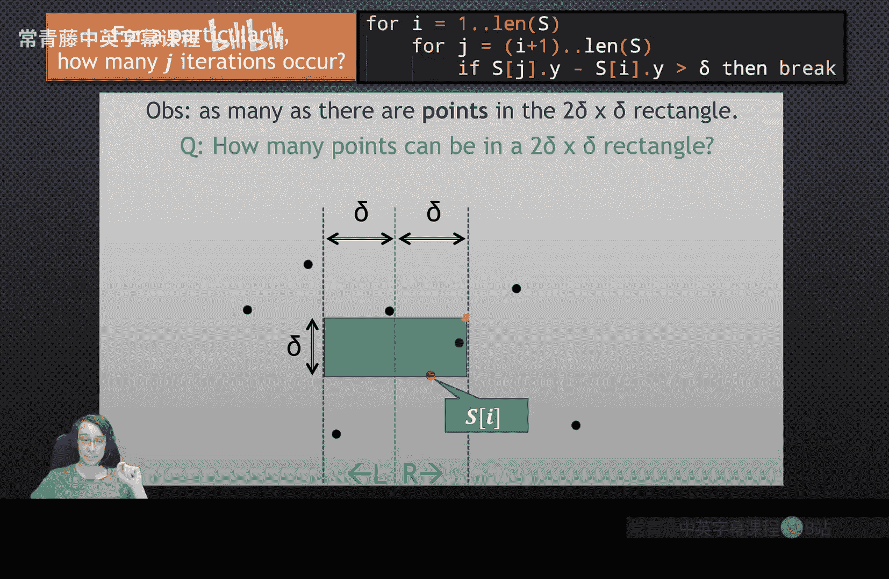

# 滑铁卢大学【中英⚡算法｜CS341 Fall 2021, Algorithms】 p10 P10 Lecture 6 -BV1DhrDBbEwR_p10-

Al right， hi everyone， welcome back to another episode of CS 341。

 where today we're going to be going through lecture 6 and covering the final material on divideivide and conquer。

And the first problem we're going to talk about today is the selection problem so what's the selection problem well you take as your input an array A containing n distinct integer values。

And an integer K between1 and n。 And the output is gonna be the k smallest integer and N。

 So this is called the selection problem because you're selecting the k smallest integer out of an array of integers。

 Now， this array is not sorted necessarily。 it can be unsorted。

 And that's what makes it the problem nontrivial because if the array was sorted。

 then you could just return element K， right， And this also tells us that we're gonna be looking for a solution that's asymptotically faster than n log n。

 because there's a trivial n log n solution where you just sort and return the k element。Okay。

 so a couple of related problems that are actually special cases of the selection problem。

 the minimum problem is just a selection problem with k equal to 1。

The median is a special case where k is equal to n over 2。

 so it's the elements such that half the elements are smaller and half of them are larger。

And the maximum is a special case where k equals n。Okay。

 so the simple algorithm for solving selection， I suppose I was gonna ask us a question。

 but it's so trivial that I think it wasn't a particularly good question。 Anyway。

 you just sort and return the case entry in the array。Now， there is a not quite as simple。

 but somewhat simple algorithm for solving this asymptically faster in the expected case。Then。

The trivial sorting algorithm。 And this faster algorithm is called Quick selectlect。

And so let me try to describe that algorithm for you。

 I think you guys may have actually seen that algorithm before in CS240 and maybe even the analysis of it。

 but at any rate let's go through it here if for no other reason then it will refresh your memories and it'll prime the pumps for when we talk about another variant of this algorithm after this that you guys I don't think have seen。

Okay， so suppose we choose a pivot element， Y and the input array A。

 and we restructure a so that all of the elements less than y come before y in a and all the elements that are greater than y come after y in a Now this is exactly what's done in Quick sort right So if you're familiar with Quick sort。

 you pick a pivot， you restructure so that all the things smaller up here at the left of the pivot。

 all things larger appear to the right and then you recurse on one of those sides。

 depending on how the key you're looking for relates to the pivot。And that restructuring step。

 choosing a pivot， restructuring in quick sort takes linear time。

 So it's going to take linear time here as well。 Let's see what this looks like。

 So here we have some input array a with a whole bunch of elements here。 it's unsorted。

 so we have 12，4，6，27，23，1749。 if we pick suppose we pick 23 It doesn't particularly matter how we pick it there is a lot of discussion in quick sort about how you pick these pivots As you'll see the argument that we're going to make here doesn't actually depend at all on how you pick this pivot。

 So we pick this pivot arbitrarily。So let's say 23 is the pivot。

 We have to restructure this array while the smaller elements appear on the left。

 all the larger ones on the right。 Okay， so all the smaller elements Ive highlighted in blue and all the larger elements I' highlighted in green and after the restructure。

 So restructure of a comma Y is going to look something like this。 And y of course。

 is the name that we're giving to our pivot。Okay， now I want to point out that the number of elements on each side of the pivot after you do the restructuring。

 of course， depends on the value of that pivot。And so suppose we ended up picking this pivot six。

 well， I've highlighted in blue all the elements that are smaller， there's only one， and in green。

 all the remaining element。Now， after the restructure。

 we have four and then 6 and then everything else is larger。

 So if we were now to do a recursive algorithm along the lines of Quick sort。

 where we recursd on one half of this array or not on a half。

 but on either part of the array that's smaller than6 or the part of the array that's larger than 6。

 if we ended up picking the part of the array that was smaller than 6。

 we'd have shrunk the search space enormously the search space would now just be the number4。

 but if we picked the array on the right what we were looking for was larger than 6。

 we'd have to recur on the right and we'd end up with this array that we have to searchs not much smaller than the input array。

 So we wouldn't be cutting down the size of our subproble appreciably and we might end up with bad time complexity because we're not aggressively cutting down the size of our subpro。

So just something to bear in mind， how we choose this。

 Y will have a significant impact on the number of elements potentially that we have to recurse on and in turn on our runtime。

Okay， so if we start with this array a after restructuring in the first case where 23 was our pivot。

I'm going to write the array indexes up top， so IY will start them at one。

 doesn't particularly matter whether we start them at one。

 we're just got to pick one convention and stick to it。诶。The， the index of y is going to be I y。

 I sub y。 and these are numbered from one up to n。Now I want to point out the size of so we're going to call the array to the left of the pivot AL。

 and A left and we're going to call the array to the right of the pivot AR if for a right。

And the number of elements in the range from containing the whole array A L and the pivot Y is just iY。

 Y， because these are 1，2，3，4 all the way up to IY， right？

 So the set of elements here on the left is just IY。

 And that means how many elements are there here on the right。 Well。

 there's n minus IY elements here on the right in AR。 And， you know， in A L， those IY-1， right， Okay。

 so now you sort of have a few different expressions floating around in your head。 I w to ask。

 what's the k， smallest element of a。How how can we figure out where the K smallest element of A is in the following terms。

 Is it in AL。If so， is it the Ks smallest element of Al， Is it like some other K prime。

 smallest element of Al， it could be Y， right， and it could be in AR。

 And then it might not be the K smallest element of AR So I'm being a little bit nebulous。

 but let me give you the answer here。 So if K， the， the K that we're looking for happens to be IY。

So we're looking for， you know， in this case， this is the first second， third， fourth，5th。

 sixth element is the pivot。 So IY is 6。 If K is 6， we're looking for the sixth smallest element。

 and the pivot is the sixth element。Then we've moved everything small in the pivot to the left。

 So IY really is the sixth smallest element in this array。 So if K is IY。

 we actually can just return y。And if K is less than IY。

 then we're looking for an element that's in A， the left array here。

 and what that tells us is if the K element appears to the left of IY。

 then we're looking for the K smallest element in A。Now， if K is greater than IY。

 then what we're looking for is larger than everything in this range containing A L and the pivot Y。

 So we're looking for something in A R， but we're not looking for the K smallest element in A R。

 because we're no longer going to be considering any of these elements to the left of A R。

 So we're going be recursing on a range that does not include any of these elements。

 And all of these elements are smaller than the element that we're looking for。

 So theyre IY of these elements that are smaller that we've already considered and rejected。

 So on the right， instead of looking for the k smallest element， we're looking for the K minus IY。

smallest element in AR， okay。So these are really going to be recursive calls。

 And this is going to be just a final call that we can return from。 So if K is equal to IY。

 we return y， if K is less than IY， we recurse on A L， looking for the K smallest。

 If K is greater than IY， we return。 we recurse on AR looking for the K minus IY smallest element。

 So here's some pseudocode for that。 This is called the quick select algorithm。

We have our K that we're looking for。 We have our A。 So， so K is like the。

 the ornal number we're looking for。 So this would be like 6。

 if we're looking for the sixth smallest element。 and then a is our input array from one to N。

 our base case here。 If n is one。And then we just return a of1。 And， of course。

 this would be incorrect if K was something other than one， right。

 if K was like 6 and we had an array of size 1。 The query would be malformed。

 We wouldn't be able to return this as a correct answer。

 So we have this precondition that K has to be between one and n。

 you have to be looking for an element of some rank that actually exists in the array。

 So if this precondition is satisfied， then this space case makes sense because K will be between  one and an n or n is 1。

 So K will be1 as well。 And looking for the one， you know。

 the first smallest element and array of size 1 is just a of1。Okay， next we pick an arbitrary pivot。

 so our y our pivot is just going to be the first element， totally arbitrary。

And then we call restructure on a giving it the El， the pivot。 this is the actual value of the pivot。

 the value of a1。And restructure is going to return the left array， the right array。

 and the index of that pivot wherever it ended up after we did the restructuring。

And if K is equal to Iy， we return y， if K is less than Iy， we recurse on the left array。

 looking for the k element。 and if k is greater than IY， we recur on the right array。

 looking for the K minus IY element as we saw before。 and restructure is just what you would expect。

 You have an array。 You have the pivot。 You allocate new subars for the left and right。

 we can just make them sized one to n， just to avoid having to deal with like expandable arrays or some fancy types。

 And then for each element in the array， A， you just figure out whether it goes in the left array of the right array and place it in the left array or right array as appropriate。

 And then we return the result。Okay， so let's do a little bit of analysis here。

 let's think about what the runtime would be if we write an algorithm that recurs on either the left or the right of the pivot and at the next level of recursion picks another pivot and recurs on the left or right of that pivot and so on until it reaches a single element。

So if just by chance， by some lovely stroke of luck。

 we chose a pivot so that the index of the pivot after restructuring was the midpoint of the array。

 then we know that whichever side we recurse on we would end up recursing on approximately n over two elements if we could always recur at every level of recursion on half of the elements。

 of course this n is the n at each level， So whatever level of recursion we're at。

 let n be the size of the problem at that level of recursion。

 if we then somehow manage to pick an excellent pivot that exactly split the subproble into two parts then we could always recurse on half of our subproblem size。

 and we would end up with this lovely expression T of n equals t of n over2 or half the problem size and only recursing on one side plus linear work because all we've。

See so far in the algorithm is that we do a restructuring step that takes linear time。

 and the rest of the work that we do is。Just， you know， constant time。Okay， so this。

 according to the master theorem， if you work out the little details here， would be linear time。

 So if we could pick our pivots to always split our problem size in a half。

 we would end up with linear time。 But the problem is， we don't always pick pivots that way。

 And so that's why I call this an overly optimistic analysis if we got lucky， you know， in some case。

 you could think of this as best case analysis， which we don't really tend to do because it tends to be uninteresting。

 but maybe it's illuminating for the rest of what we're gonna talk about here。

So if we got really lucky and always picked these excellent pivots that split the range at the subprom exactly in half。

 then we would get this lovely linear time bound， but we don't。

And so let's take a look at the worst case analysis。

So suppose we getly we were getting in the previous example supremely lucky and always getting a pivot that split the range。

 suppose we get supremely unlucky and we always get a pivot that just happens to be the smallest element and we always recurse on the right。

 so all we end up shrinking our subproblem by is just the pivoted element one。😊，So in this case。

 we would get t of n equals t of n minus-1 plus theta n。

 And if you figure this out by the substitution method， you can see that this is order n squared。

 And just to see the that quickly intuitively， you can see we take an n on the left。

 And we turn it into an n minus-1 on the right by adding theta n work。

 And so to get this down to a base case， T of 0 or T of1。

 we're gonna have to do this addition of n n times。 So that's you know n times n n squared。

So n squared。 So our sort of best case， Op analysis was order N。 Our worst case was order n squared。

 There's this huge gap in the complexity between if we always pick good pivots and if we always pick bad pivots。

 And in some sense， it's a little bit unlikely to always pick good pivots that are right in the middle of the range and always pick bad pivots that are。

 you know， right at the edge of a range。 So it might make sense to think about what the average case is。

 And so this is， I think probably the only example of average case analysis they will do in the course。

So we're gonna define what it means for a pivot to be good。

 So we'll all define a pivot to be good if I， y is in the range and over 4 to 3 and over 4。

 In other words， if it's from the middle half of the array。 see a quarter of the rated left。

 a quarter of the rate to the right。 And if the pivot comes somewhere in this middle half of the array。

 we'll call the pivot good。Okay， so， well， what does it mean for a pivot to be good， Well。

 suppose we pick any location in this middle half of the array。 So suppose this one。

 This is our pivot。 If we recurs in the left half， then we're recursing on maybe a bit more than and over four elements。

诶。If we recursse on the right half， then we're recursing on these n over four elements。

 plus all of this distance in this array between the right array and wherever the pivot is in this middle array。

 So in some sense， we're going to be recursing on either the left array of a quarter elements。

And potentially up to the entire middle array。Or either the right array of elements and potentially up to the entire contents of the middle array。

 So we're either going recur on in the worst case， in a sense。

 N over four plus n over two elements here。 if our pivot is is somewhere in this middle half。

 then we're either going to be recursing on at most this three quarter n elements。

 or if it's somewhere in here and we recurse on the right。

 we're going to be recursing on at most this three quarter n elements， right。

 another way to think about this， just to rephrase this in case one of these different explanations。

 gels with your brain a little better is suppose I'm going to recurse on the left of the pivot。

 What's the worst pivot I could choose， that's good。Well。

 it would be the pivot all the way on the right here。

 and then we'd be recursing on all of the elements to the left。

 which would be basically this entire middle array， plus the left array。

 which is approximately three quarter n。And if we were gonna recursse on the right of the pivot。

 then what's the worst pivot we could pick。 That's good。 It would be this leftmost element。

 And we'd be recursing on again， approximately three quarter n elements。 So for any good pivot。

 we recurse on at most three quarter n elements。 In other words。

 we're cutting down the sub problem size by a fraction of n by n over 4， at least。

So what's the probability of an arbitrary pivot that we choose being good？Well。

 if you think about it， if we choose an arbitrary pivot and we know nothing about its value。

 then it's equally likely for that pivot to appear after a restructuring in any of the slots。

And so it appears here with probability 1 over n and here with probability 1 over n and here with probability 1 over n and so on。

 So what's the probability that it appears in these middle n over two elements。

 while it's1 over n plus 1 over n plus1 over n that is being added n over two times。

 So the probability is1 half。So that's the probability of a good pivot1。

 What this means is on average， every two recursive calls。

 we will encounter a good pivot on average in expectation。Right， because maybe the first one。

 we get unlucky and we don't get a good pivot， but we were supposed to get a good pivot with probability one half。

 And in the second recursive call， there's another one half independent trial to pick a good pivot。

 So you add those two probabilities together。 That's expected probability1。

 So we expect every two recursive calls。 we should encounter a good pivot。

 And the cost of two recursive calls is gonna be linear for the two calls to restructuring to pivoting。

And it's any constant for other steps。 In other words。

 those two recursive calls in total cause induce linear work。 They cause linear work。

And in expectation， we should encounter a good pivot。

 So encountering a good pivot will reduce the problem size by at least n over 4。

 And so after expected linear work， we should be able to reduce the problem size by n over4。

 So let's consider this average case recurrence relation。

So T of n is going to be T of 3 n over 4 because we're reducing the problem size by a fraction of n over 4。

 and it's going to be expected linear work for the two recursive calls that it takes to get this reduction from n to n over to3 n over4 in expectation。

And if we apply the master theorem to this recurrence relation， I won't go through the details here。

 but we end up with linear time on average。 So this is an expected linear time selection algorithm。

Here's a more rigorous proof。 This is just for your notes in case you want to know how to do this analysis formally instead of intuitively。

 as I did in the previous slide， but I， I won't go into this。What's this？It's a miter saw break。Okay。

 cut looks good。That was a nice break。 So we can actually take selection further than this。

 as I hinted a little bit earlier。 So this what we just showed was an average case linear time。

 Quick select algorithm。 So next up， we're going to look at an algorithm called the median of mediums。

 Quick selector mom Quick selectlect。😊，There's got to be some puns in here about mom knowing best and being able to。

 you know， select your outfits for you or something， I don't know。Okay。

 so the worst case run time for Mom Quick select is linear time。And well。

 how do we manage to get worst case linear time？ Well。

 this average case linear time algorithm relied on getting a good pivot within a constant number of recursive calls on average。

 this would work， by the way， if as long as this， this complexity result would。

 would turn out the set to be the same answer。 average case linear time。

Yeah even if we relax the definition of good pivot to allow even more， like。

 let's say it wasn't between a quarter and and three quarter And if it was like an eighth and and3 and and 78 and。

You would still get linear time。 really， you just need a good pivot to occur within0 of one recursive calls on average。

Well， okay， so we have to get a good pivot within a constant number of recursive calls on average in this algorithm。

 we have to get a good pivot within0 of1 recursive calls always， not just on average。

 We have to be guaranteed that after a cost of number of recursive calls。 we get a good pivot。

 And in fact， the algorithm we're gonna show you picks a good pivot in every recursive call by explicitly computing something that's along the lines of the median。

 remember， if we could somehow pick the pivot to be the median element。

 the pivot would exactly split the subproble。 Well。

 what if we don't pick the median because it turns out computing the median is just as difficult as computing selection。

 and we're trying to actually solve whatever we're gonna to use to compute our pivot easier than solving selection because we're going to use it to solve selection。

 So let's say we don't compute the median， but we compute this funny thing called the median of medians that some sort of rough approximation and we'll use that as our pivot。

😊，Okay so the high level algorithms can be similar to Quick selectlect， we choose a pivot。

 we restructure。And then we recursively call Mob quick select on one sub array。

 The big difference is going to be how we choose the pivot。 We always want to choose a good pivot。

 So how do we always pick a good pivot。Well， consider this example input。 Okay。

 so it's drawn on three lines here because I can't draw such a long input on one line， but it's just。

 it's an array。 A of 1 to 50 containing all these numbers。

Suppose we group these numbers into rows of five so you can think of making an array of five elements for each row and packing know fives。

 these partitioning these things into groups of five。

 putting them into these arrays of five elements each。Okay， now imagine that we find or not imagine。

 I mean， consider we're going to do this in the algorithm。

 we're going to find the median of each row。 So for each of these rows， each array of five elements。

 we' going to find the median。How do we find the median here， We can just do it explicitly。

 becauseuse it5 is a constant number of elements。 So it's not gonna be very expensive to find the median of 5。

 We just sort， which takes constant time for  five elements。 And then we find the median。

 which takes constant time， of course， because we just return the third element once it's sorted。

 So we'll find the median of each row。Okay， so here I I've highlighted the medians in bold of all these rows。

Now we're going to build an array out of those medians。 so we're just going to take all the medians。

😊，And we're going to put them into a separate array。

And now we're going to compute the median of those medians， but we're going to do that recursively。

So we're we're going to make a recursive call to find the median of these medians。

 And because it's a recursive call， we're going to assume that the recursive call solves the problem。

And we're just going to assume we have the answer now and figure out how to take that answer and build a solution to our larger problem。

 which is the selection problem。 And this is a really tricky algorithm here。

 we're sort of recursively solving two problems at the same time because we're solving the median problem。

 and we're also solving the selection problems。 We're making a recursive call here to solve the median problem。

 and then we're going to use the solution to this median to do our restructuring。

 And then we're gonna make another recursive call to solve our selection problem。

And it seems like this is super complicated。 But remember。

 the median is just a special case of selection so that we're actually gonna make two calls to our mom Quick select。

 But in one of these calls， we're not gonna be doing mom Quick select K and our sub array。

 We're gonna be doing mom quick select N over 2 and our median array。 Okay。

 it's not gonna be n over2。 It's gonna be half of the number of of these row medians。😊。

So we count how many row medians there are， there are1，2，3，4，5，6，7，89，1。

 there are as many as there are rows， there are and over five rows。

There are gonna be n over five of these medians。 There's 10 in this case。

 And then we're gonna find the median of those medians。 So we're looking for not the 10th。

 but the fifth smallest element or analogously not the n over  fifth because theyre n over 5 rows。

 But the n over 10th element of this， of this median array。

 So we're gonna make a mob quick selectlect call recursively to get the n over 10th or， you know。

 half， you know the element that's halfway in this array of medians。 And then。

Or to use this median of medias that we get back from that recursive call to restructure。

Our whole example input， our whole input。 And then we're gonna make a recursive mo quick select call on whichever side of that input we should be recursing on。

 according to the pivot that we got。 So let's think for a second。

 And I'll show you the pseudocode for this。 Let's think for a second about the time complexity of each of these steps。

 So grouping it to Rosa 5。 What's the time complexity for this step。 Well。

 it's just gonna be linear because essentially what we're doing is we're taking everything in the input and copying it into different arrays。

 Okay， and n elements in total， be them over。 That's linear time。

 What's the time complexity of finding the median of each row。Well。

 each row has constant size so we can find the median at constant time。

 How many rows are there there n over 5。 So this is order n over 5， which is， of course， order n。

So this grouping takes order n， the finding the median of each row takes order n time in total。

 and building the array of medians， this is just copying each of these elements。

 which takes order n time。Then recursively finding the median of these mediumns。 Well。

 we're gonna end up having to introduce a T of something expression into our runtime analysis for this recursive call。

 Well， what's the recursive problem size。 I already hinted at it， right。

 It's gonna be one of element for each row。 How many rows are there。 There are N over 5 rows。

 So this is gonna be of size n over 5。 That's gonna be the recursive problem size for this recursive call。

😊，So we're going to take the output of this recursive call， which is 23。😊。

And we're going to imagine this isn't part of the algorithm， necessarily all the it could be。

We're going to imagine that we sort each of these rows。

So we can see all of these medians lined up here。Now。

 it doesn't actually matter if that sorting as part of the algorithm because it wouldn't change the complexity。

 If we sort each row， each row only takes cost and time to sort。

 you can do it at the same time as you do the medians。

 So it doesn't actually matter whether we imagine that we sort the rows or actually do sort the rows。

 Maybe it's even better do it to suppose we really do sort the rows。 Then our rows look like this。

 right， all the medians are in the middle column。And you can see that， I mean。

 the rows are all sorted， right， So as you step to the right， number is getting bigger。

 but as you step down and up， there's no relationship necessarily between the numbers。Now。

 imagine this is not part of the algorithm。It's important that this is not part of the algorithm because this would take too much runtime。

 Imagine that we order the rows by their median。 So we're just imagining this。

 This doesn't exist in the actual algorithm。 Imagine that you order the rows by their medians。

 And imagining it this way will help us do the complexity analysis。

Because we're going to argue about how many numbers have to be smaller than the median and how many numbers have to be larger than the median to argue about how much of the problem size we're cutting off as we shrink the problem。

Okay， so let's think about that。 So if we start at this median of medians。

 the median in the center of the array。If we move up。

The number is going to be shrinking because we've imagined that we're ordering the rows by medians。

Okay， so the numbers are shrinking if we go up， the numbers are growing， if we go down。

 the numbers are growing， if we go to the right and the numbers are shrinking if we go to the left。

 So to the left is smaller。 So up is smaller from the middle row。And the middle row。

And then from any elementm to the middle row， going left well make numbers smaller and going right will make numbers bigger。

 So what does this tell us the median here in the middle， if we go left， we get smaller， smaller。

 if we go up， we get smaller， left， smaller， smaller， up， smaller， left， smaller， smaller。

 So everything in this box up and to the left of the median is less than or equal to the mediumn。

So okay， well， how many numbers is this in our example， it's three columns and five rows。

 and there were 11 rows total。This is going to be actually at least three tenths of our input。

And if we want to consider how many elements are guaranteed now there can be other elements that are smaller that aren't necessarily counted。

 right， but it's harder to make an argument about those。 This is just this makes our argument easier。

 and this makes this happens to be good enough to show that we're cutting off。

 if we recurse on the larger elements， then we're cutting off all of these elements which are a fraction of n。

 And on the other hand， if we want to recurse on the smaller elements。

 we have to argue about how many larger elements we throw away。 So how many elements are larger。

 Well， again， from the median， if we go down， numbers get bigger。

 And if we go to the right numbers get bigger。 So everything in the bottom right rectangle here。

 will be greater than or equal to the median。 So if we're looking for something small in the median。

 we will cut off all of these numbers and shrink our problem size by again。

 at least threetens of the input。And we'll do the analysis about how this is three/ tenth0s and exactly what the problem size is afterwards。

 this is just to give you the idea。Okay， so after restructuring。

 Pi 23 has to have at least three n over 10 elements before it and at least three n over 10 elements after it and we'll argue this formally a little bit later。

Which means this is gonna to be a good pivot， even by our definition of good， where we said。

 you know， you have to have at least n over four elements before and at least n over four elements after the region where your pivot is chosen。

 Well here， this is 3 and over 10， which is more than n over 4。

 So's even more elements potentially being cut off。 So this is a good pivot。

 And this should give you the idea that we're going to end up getting a linear time algorithm out of this。

 If we pick our pivot in this way。So we're going to recurse on either AL or AR。

 and both of them are going to have size at most7 n over 10。Okay。

 so here's our pseudocode for mom Quick selectlect。 We take K。

 the rank of the element we're looking for and the size of the array A and the array A as input and our base case is this funny n less than or equal to 14 case here。

 Okay， why， why 14， that's an odd number。 I'll talk about that in a moment。 But 14 is a constant。

 So we can just sort the entire array in constant time。

 And we can return a of K again in constant time。😊，Okay。

 then we divide and conquer to find the medians。 And notice here。

 we're div in conquering for two purposes。 We're dividing a conquering to find the median of medians and we're dividing on conquering to find the rank K element。

 Okay， so when we divide and conquer to find the median of medians。

 the first thing we're going to do is we're going to compute this funny R term。😊。

This is related to the number of rows。 so the number of rows is going to be two times hour plus1。

And this okay， this is sort of an odd way of expressing things。

 But we'll see why the n less than or equal to 14 is the base case here in this expression。

 I want to be able to subtract 5 from n and then do an integer division by 10。

And you can think of subtracting n-5 as reserving  one row of 5 elements。

 And then taking integer division by 10 is gonna tell me how many pairs of rows remain in n。

 So in other words， I will have two times R plus  one rows plus maybe some extra data up to 9 elements that were lost in this integer division by 10。

 But we don't really have to worry about those extra 9 elements。

 They won't end up changing the complexity of the solution。

N has to be at least 15 in order for us to be able to subtract one row from n and then be left with at least two rows。

 when we do enterteger division by 10。And expressing R in this funny way makes it really easy to argue that there is a well defined median row because there are going to be an odd number of rows that we're calculating medians 4。

 We're gonna to have two times r plus1 rows that we're calculating medians 4。

 and the R plus one throw out of that is going to be the median rows。

' going to be an odd number of rows。So it just makes it easy for us to unambiguously define our mediums。

Okay， we're going to have one median per row in an array。And for each for each row。

 we're going to copy the relevant subar of a。 So it's not too hard to figure out that this index math here is doing what we want it to。

 So for I equals 0， these bounds are from0 sorry for I equals 1， these bounds are 1 minus1。

 which is 0 times 5， which is 0 plus1。So it's  one up to five times 1， which is 5。 So 1 to 5， right。

 for the first I for the second I， this is gonna be 2-1， which is 1 times 5 is 5 plus 1 is 6。

Up to five times 2， which is 10，6 up to 10。 And for3， it'll be 11 up to 15 and so on。

 So you can see this is copying the appropriate subinterval in A into this temporary B array。

 which has elements 1 to 5， So is re indexexing this。

And then we sort B and it only has five elements。 thatex cost at time。

 and then we take the median of our sorted B， which is just B of3。 Once we've done the sort。

3 is the the third entry as the median element。 And we store that median element in our median's array and slot I。

 So this this whole loop is just computing all of our medians，1 median per row。

 And then we're going do our recursive mo quick select call。

 where we're looking for the R plus once median， which is the median of those medians。

There are two times r plus1 of the medians， and here's the median's array。

 Our mom quick select call when it returns will give us the R plus1 element in this array。

 which is the median of medians。Now that's going to be our Y。

And then we're to use that Y to restructure R A， which is gonna return。

 our restructure calls is gonna return the left array the right away and IY。

 wherever R y ended up in the array after the restructuring if and then you know。

 we're back to the familiar cases here from the previous quick sort algorithm。

 Sorry quick select algorithm that we saw。 So if k is IY， then we just return why。

 if K is less than IY， then we do a recursive call on the left array。

 And we're looking for the case element。And if K is greater than IY。

 we do a recursive call on the right sub looking for the K minus iY element。Okay。

 so this is the mom Quick select algorithm。 Let's see an example of it running。

 So for let's here's an example input。 And let's say we're looking for the 11th smallest element。

 and there are 14 elements in total。 Here's the array A。So the first thing we're going to do is。

 first of all， if we're in the base case， we want to just explicitly sort and return A K and and it's 14 here。

 So we are in the base case。 So we'll just explicitly sort。Okay， and then， oh， sorry。

 I it would appear I have typo here。 My 7 is repeated。 oops。 I should fix that on the slides。

So this is 7 is not supposed here。 This is supposed to be this array up here。 just sorted。

 And then the 11th is gonna be 1，2，3，4。 I shouldn't count this 5，6，7，8，9，1011。

 And that's another little typo induced by my extra 7 here。

 So 38 should be the 11th smallest element。 At any case， you can understand what's happening here。

 It's just a brute 4 solution or resort sort and return 8 K。Now。

 let's see an example where we aren't going to get into the base case。 So n is 21 here。

 and we're still looking for the 11th smallest element。 So we're going to skip over the base case。

 We're going to compute R。 So 21 is n-5 over 10，21-5 is 16 over 10 floor is just one。

And so we're going to end up with how many medians， well， two times 1 plus 1 is three， three rows。

 three medians， let's just compute the rows here。Go through the array and show the rows。

 So the first five elements here go into the first row， we sort that row。

And then we calculate its median， right， which is just gonna be the bold element，20。

 The next row we grab from the array here。 and we sort it and grab the median。 And then finally。

 we have our third row that we grab from the array sort and fetch the median from。

 And notice this ends at 28。 There are all these elements here that we aren't gonna consider。

 That's okay。 Theyre at most 9 of them， which is a constant。 you know， for large n。

 not considering that constant is gonna change how many elements can fall to the left or right of our pivot by at most a constant。

 So it ends up not affecting the complexity。😊，Okay， so now we have our three medians。

29 and 34 and we're going to make our recursive call to find our median of medians and our recursive call is。

 of course， going to sorry， this is just animations for what I just mentioned。

 We're not considering at most9 elements。 Our our recursive call for a median of medians is going to return。

 the median of those medians， which is 20。And then we're gonna end up with a why that we can now restructure around。

 So let's， I'm just continuing that on a previous example on this slide。

 So we want to restructure this input array now around our y and our y was 20。

 So restructuring around 20 is going result in a left array containing all the elements that were smaller than 20 and a right array containing all the elements that were larger than 20。

 And our I y is essentially the size of this left array plus 1。

The plus one is just because we're starting our counts at our indices at zero。

So 10 is going to be the index of y。And now we can compare our iY to K。 So K equals 11。

 which is greater than our iY。 So we're gonna be in this final case。

 So we're gonna do this recursive call。 So we need to compute K minus iY which is just gonna be one and then n minus iY is the size of the array that we're passing and the array that we're passing is our AR So our AR is of size 10 and we're gonna be is that correct。

 make a mistake here I made a mistake here and is 21 and iY is 10。

 this is actually supposed to be 11 oops so this supposed to be111 A and this is gonna return our correct answer from this array're now looking for the first element in this right array the smallest element the first smallest element and just by inspection is 21。

 That's what's gonna be found by our recursive call。

 We're gonna assume that our recursive call works and as long as our。Recursive calls work。

 We should be able to combine our answers to get the， the final result。 And in this case。

 combining is trivial because we're just doing a single recursive call and returning the answer。Okay。

 so we're going to return 21。Okay， and by the way， if you go back and check。

 my claim is that 21 is going to be the 11th smallest element of this array。Okay。

 so what's the time complexity of this algorithm We already argued that the base case is constant time creating the array here。

 we can think of taking linear time， each of these steps inside this loop are going to take linear time because they're all working on a constant number of elements。

😊，And there are gonna be theta n iterations。 Well， how do I know it's theta n。 Well。

 two times R plus 1， But R is， you can think of R as being approximately n over 10。 So this is。

 you know， two times R is gonna be something like n over 5， right？ This is theta n。

So this is gonna to be theta and work in total for this whole loop。

 And then you have your median of medians Quick selectlect here。

 which I argued was t of n over5 right because how many rows are there。 Well。

 it's five elements per row， So n over5 rows。 That's how many medians we're going to be working on。

 So T of n over5。 then our restructuring is linear time。 this base case constant time。

 these last two base cases are going be t of in this caseop in this case。

 we need to think a little bit about this because what are our problem sizes here。

 What are reasonable bounds on our problem sizes。 And this is where that analysis that I talked about before where we were reasoning about cutting off three n over 10 elements above and below is going to come into play and we can do that a little bit more formally here。

Okay， so here are our rows ordered by medians。 This is a diagram you guys saw a few slides back。

 So you can remember what this is here， this is not something we did in the algorithm。

 We didn't actually order our rows by medians。 that would be too expensive。

 But you can imagine them ordered by their medians。 So each row is sorted。

 And then the rows are ordered by their medians。 Our median of medians is here in the middle。 Our y。

And everything to the top left of y is less than or equal to y Well。

 how many elements are to the top left of y Well， there are going to be r plus1 rows because this is the r plus1 entry in the medians array。

 So there are plus one rows and how many columns。 Well， there are five elements in total in each row。

 There are three columns here。 So this is going to be three times r plus1 elements that are less than equal to y。

 and then there are going to be three times r plus one elements that are greater than are equal to y。

Okay。So well， what's three times r plus1 in terms of n because that's we're gonna be reducing the problem size by at least three times r plus1。

 because whether we recur on the larger elements or the smaller elements。

 there are approximately  three times r plus1 elements that we are no longer gonna be considering or I apologize for saying。

 It's not approximate， there're gonna be three times r plus1 elements that we're no longer considering at least there might be other numbers that are smaller and pivoted lower or larger and get pivoted above。

 But we can argue that there are at least three times r plus1 elements that we're gonna be cutting off。

 So we're shrinking our problem size by at least three times r plus1。

 But what's three times R plus1 in terms of n。 Well， remember n is related to R at this line。

 So if we multiply both sides by 10， we get 10 R equals n n5 and then add5 to less we get n is 10 R plus5。

 Now it's not exactly true。 This is a little white lie。

 because if you remember this integer division can lose。At9。

 So there might have to be another plus 9 in here， but that won't hear a plus theta where theta can range between 0 and 9。

 but that won't actually change our analysis。Just adding a little constant there。

 you can confirm that yourself by adding a plus 9 and seeing if it that changes the results as we carry through the analysis。

 it won't。So we're shrinking by at least three times r plus1。 Our problem size is n。

 which is this is a little white live。 but we'll say n is 10 R plus 5。

And our subprom size is thus going to be n minus shrink and minus3 times r plus1。Or I。

 I probably shouldn't have used equals because it's not exactly the case that our subprome size will be exactly this。

 but it'll be at most。 this。 So this should be a less than or equals。

 Our subprome size is gonna be at most and minus three times r plus1。Okay， so what's， Well。

 n-3 times r plus1。 Well， we can substitute for R， right， We can。

 We can work out what R is in terms of n and substitute for it。

And then we end up with this expression 10 times r plus 5 minus3 r minus-3， which is 7 r plus 2。

 and then we can express in terms of n using this expression， n is four of n n minus5 over 10。

 and we're going to ignore the floor because it doesn't actually， well。

 we could ignore the I could just say we can ignore the floor and it doesn't change the analysis or I can point out here the subproblem size being 7 times4 of n minus5 over 10 plus2。

 when we substitute this R into this expression。If the subro size is at most。

7even times4 of M minus-5 over 10 to all plus 2。Then it's also at most take away the floor as expression。

 right？Because flooring only shrinks something。Okay。So this is our， our problem size。

 And with a little bit of algebra， we can see that this is at most 7 n over 10。

 So this is a more formal argument， although I'm missing a couple of less n or equal signs。

 which I should fix。 This is a more formal argument that the problem size is it most 7 n over 10。

So that tells us that we have each of these calls here is t of 7 n over 10。Okay。

 so we end up with this expression。 Okay， so everything。

 apart from the recursive calls is theta n Then we have our recursive calls T of n over 5 and T of 7 n over 10。

 So we get T of n is in theta well， big O of n plus T of n over 5 plus T of 7 n over 10。

 I'm only saying big O instead of big theta here because I'm just not gonna bother arguing theta in great detail。

 I'm just gonna argue the big O。Okay， and this is， of course， a piecewise function， right。

 because in the base case， it's constant。Okay。😊，So we have T of n over 5 and T of 7 n over 10 here。

 These there are two recursive calls。 and this is not something that we can solve with a master theorem。

 right， because。This this doesn't fit an expression that the master theme could be applied to。

 So we have to use some other technique。And by the way， intuitively。

 the key reason that this is not n squared time or some other horrible time。

 the key reason that this actually manages to be linear time when we work out the solution is that if you look at the sizes of the sub problems we're re cursing on7 and over5。

 sorry， n over5 and 7 n over 10， sum up to 19 over 20， which is strictly less than one。

 So we're recursing on something that is a fraction of the problem that's less than one。😊，Right。

 so we're， we're recursing in total over the re both recursive calls on something that's smaller。

 A fraction smaller than the original problem size。 And it's not a subtractive difference。

 It's a multiplicative fraction that we're shaving off， specifically  one over 20。Okay。

 but that's just the intuition。 Let's see why。Is actually sums to linear time。 Well。

 we can do it using guess and check， which I'll show you on the next slide or informally using the recursion tree method。

 So here's the recursion tree。 You have n is the root。

 That's know P O of n and I'm just gonna gonna ignore the C factors here。

 C times n just to make the analysis simpler here。 just just to do it quickly and easily。

 So we have n at the root。 Then you have one child that does n over 5。

 Another child that does 7 n over 10。 And then that n over 5 branches into n over 5 over 5。😊。

Which is n over 25 and 7 n over 10 over5， which is 7 and over 50。

And the 7 n over 10 gets divided by 5。 It gets divided gets multipied by 7 over 10 again， right。

 So we have these expressions。 If you sum up these expressions at each level， you get n 9 n over 10。

81 n over 100， which is 9 squared n over 10 squared。You can see a pattern forming here。

 So we get 9 over 10 to the I all times n。 And it's the sum from that up to。

 we'll just approximate it with up to infinity because we can take that sum and we can see that that's 10 n。

 which is that's linear in n right So we're approximating it with a sum up to infinity because the sum up to whatever the actual depth is。

 which is somewhat hard to compute。 It's hard to compute the actual depth because you have n over 5 and 7 n over 10。

The the real depth would be the max of those two， but it would be hard to get an exact expression。

 So whatever the actual expression is， the sum up to infinity is bigger， and that's linear。

 So T of n is definitely gonna be in big O of n。Okay。😊。

And we could do guess and check as well right so if we wanted to prove that T of n was c times n for some positive C。

 we could make that our guess and then we could let t of n be c prime times n plus T of n over 5 plus t of 7 n over 10 I've just turned this theta n and do a c prime times n or c prime some positive constant and we want to prove that t of n is c n for some positive constant。

So note here， by the way that。😊，The C N I'm introducing here and the C prime here。

 they're independent constants， right， This C prime comes from the work at each level of recursion being linear in N。

 right， just by the definition of big O， I can say this C prime， this positive C prime exists。

 And then when I want to prove that T N is linear in N。

 I don't necessarily care that it's the same as this constant。

 because this constant came from a totally different expression， a totally different big O。

What I want to prove is that T of n is C times n for one particular C。A single C value。

 but it doesn't have to be that C prime value。So I want to prove T of n is c times n for one particular C value。

For all M。For that particular C value being positive。Okay， this。

 this C value is the positive cost that we're trying to show exists。

So we're going to suppose in our inductive hypothesis that there exists a positive C。

Such that T of n prime for n prime smaller than n and bigger than the base case。

Is C the same C times n prime right So on inductive hypothesis， we're using this C。

And when we prove T， so for our T of something smaller than N， we're using the same C。 And when we。

 when we prove T of N， we're using the same C， right， that's the important thing。

 The inductive hypothesis has to use the same C as what you actually prove。Okay。

 the the expression you actually prove。 So T of N here is gonna be C prime times n plus now we're gonna invoke the inductive hypothesis。

 We have our T of n here， right， We're going invoke the inductive hypothesis。 This is smaller than n。

 This is smaller than n。 So we're gonna invoke the inductive hypothesis to argue that these are actually C times N prime。

 Okay， so C times n over 5， C times 7 n over 10。So this is by the inductive hypothesis。

And the definition of T of n。Now we want to show this。

 I'm going to say this is equivalent to something else。

 and I'm going to show that what it's equivalent to is true。

So I want to show T of n as CN Now T of n is this expression up here。

 C prime n plus C n over 5 plus C7 n over 10。I'm going to set that equal to C。

 right these are equivalent， these two statements are equivalent。

And then if I do a little bit of algebra here， I can end up showing that this expression here holds。

If and only Fc is 10 times C prime。Okay， so for C equal to 10 times C prime or C prime was something we know is a constant here that we know exists。

 And that T N， you know， this T N holds。 And this C prime actually exists because of the definition of big O。

 And we said that T of n is big O of n plus something， right。 So this C prime， we know and it exists。

 And if we set C to 10 times that C prime， Then we have a C value that will make our claim that T of n is c times n true。

For all M。Okay， so that's our guess and check proof。

And the next thing we're going to do is talk about our final divide and conquer problem。

 the closest pair problem。What's this， a second break？This time， it's a flooring break。Well。

 that break was a lot of work。The results sure look nice。Back to work。

So the input for the closest pair problem is a set P of n points in the 2D plane。

And the output is a pair of points P and Q， such that the distance between P and Q is the minimum between all possible pairs of points in the set capital P。

 So what are the two points that are closest。And we break ties arbitrarily。

 So if you have a couple pairs that are all。You know。

 the same distance then doesn't matter which one you output And the distance here that we're talking about is Euclidean distance。

 So， you know， the usual notion of distance in2D space。Okay。

 so can we divide and conquer to solve this problem， Well， we have a bunch of points here。

And the solution to this is going to be somewhat like non dominated points。

 so we're going to sort by x axis。So increasing x coordinates。

 and then we're going to divide in half so we can label these points， P1， p2， p3，4，5，6，7，8。

 they're sorted by x coordinates， and then we're going to divide them in half。

 so we're going to find basically the midpoint and if it's an even number of points like this。

 then the midpoint can arbitrarily be either P4 or P5， we'll just pick P4。

And we'll call everything to the left L and everything to the right R。

 And my claim that doesn't require proof is that the closest pair P Q is either going to consist of P Q that are both in the left half or P Q that are both in the right half or P and Q where P is on one of the left or right。

 and Q is on the other of left or right。 In other words。

 you're either going to have both of the closest points the left side or both on the right side or one in each side。

So without loss of generality， let's just assume that P in the third case is in the left and Q is on the right。

Now， in this third case， P and Q are said to be a spanning pair because they span the two hs。

And here is some pseudocode for the closest pair algorithm。

So we're going to sort by x values and recurse on the sorted array in our recursive function。

 the precondition is that P is always going to be sorted by x coordinate and the base case here is going to be when there are less than four points if there are three or two or one points。

 then we're just going to compare all pairs of points， brute force。

 and we're going to return the closest pair。Then we're gonna divide and conquer。

 So our two sub problems are， of course， the array is already sorted by x。

 So we're just gonna recurse on the first half and the second half and each of these recursive calls。

 is going to return the closest pair in the respective half that's being recursed on。

 So we're gonna get pair L， which is the closest pair of points in P1 up to n over 2。 Then pair R。

 which is the closest pair of points in P N over two plus1 up to n。

Then we have to combine these somehow。 Okay， so we'll have to think about what makes sense for combining。

 Well， we said that the closest pair could either be the closest pair where both P and Q are in the left。

 That would be pair L or the closest pair where both P and L are on the right。

 that would be pair R or they could be a spanning pair。

 So what we need is a function to find us the minimum spanning pair。

 And then the result combining all three pair L pair R and pair S will be the minimum distance pair out of these three。

Okay， so the big question here is how can we actually find the minimum spanning pair efficiently。

 I mean， it's not too hard to do at brute force， but that really just means considering all pairs where the left half where P is on the left half and key is on the right half。

And that could end up being order n squared pairs。 In fact， it is order n squared pairs。

 there are n over2 on the left and n over2 on the right。

You're gonna end up with order n squared pairs。 going to end up with order n squared runtime。

 which is no better than the brute force solution where we just consider all pairs of points。

 If you just consider all pairs of points to compute the smallest distance1。

 that's an n squared time solution。 So we would clearly like to do better than the brute force n squared time solution。

 which means this fine minimum spanning pair has to be in little O of n squared minimally。Okay。

 so it turns out we can actually solve this problem of finding the minimum span pair quite efficiently。

 and the algorithm for doing it is fairly straightforward。

But it's got a little bit of intuition baked into it to see。 So sort of once we get the intuition。

 once we make a couple of geometric observations about the problem。

 the algorithm itself will be fairly straightforward。So first， note that the minimum spanning pair。

 if we care about it。Has got to be a pair of points with distance smaller than the distance for the pair L and smaller than the distance for pair R。

 because if it's bigger than the distance for pair L or pair R。

 then it can't be the minimum distance pair。 It would be either pair L or pair R。

 So let deelta be the minimum of the distance for pair L and the distance for pair R。Okay。

Now we know that the spanning pair has to be at distance at most delta。

 or we don't care about it because then it's bigger than the distance for parallel or pair R。

 so what we can do is consider the line that separates the left half and the right half。

And consider all of the points that have。X coordinate at most delta from that line in each direction。

 Okay， now my claim is the pair S， the pair， the minimum spanning pair。

 If it's the closest pair and we actually care about it and want to return it。

 then it has to lie in this strip of with two delta that's centered at this line separating the left and right hals。

Why。So if you like， you could take a moment， think about it and see if you can come up with the solution yourself。

 so I'll give you a second to pause。And at this point。

 I'm going to assume that if you wanted to think about this， you've paused。

 so I'll give you the answer。So we'll rule out one of the elements of the closest pair。

 spanning pair， the minimum spanning pair being outside this strip by example。

 so suppose P is part of the globally closest pair， which happens to be a minimum spanning pair。Pas。

So if P is here outside this strip。Then notice that Q has to be since it's apanic pair on the opposite side of this line separating L and R。

 In other words， it has to be an R。 P is an L。So Q has to be an R。 So wherever Q appears in。

This right side in R。Its distance to P is going to be greater than deelta， right？

Because Delta is more sorry P is more than distance Delta from anything in R。

So that means it can't possibly be the minimum pair P and any Q that form a spanning pair cannot possibly be the minimum distance pair because the distance for P and Q will be larger than deelta。

 And we already have a solution that's as good as delta。

 It's the minimum of the distance for pair L and the distance for pair R。Okay， so PMQ。

 if PQ are part of a spanning pair that is the minimum， the closest pair。

 they have to both be in this strip。Okay， so say P。

 let's just say it's the lowest y valued point in this strip。He is a member of the closest pair。

 which is a spanning pair。Well， where must Q be， Q has to be on the opposite side of this line in R。

 if we assume that P is an L， so without loss of generality， assume P is an L。

The case where P is an R is similar。 so assume P is an L， where does Q have to be。

 it has to be on the opposite side of this strip。And in particular。

 the other point that we're looking for Q can only be in this delta by deelta square P is the lowest y valued point。

 so it can't be down here。So it has to be above P and it can't be on this side in L because it's a spanning pair that we're looking for。

 So Q has to be in this box。 and I've said it has to be in a delta by delta box really this delta by deta box may contain a lot of points that have distance greater than delta to P。

 but certainly it's easy to argue that anything not in this box will either not be a spanning pair because anything on this side would be a P Q that's not a spanning pair or would definitely have distance greater than delta because you know we've said it has to be in this strip So it can't be out to the right over here outside the box because it its x coordinate goes outside this delta。

And it can't be above because if it's above the top of this box， immediately。

 it's why coordinate difference causes this distance to be bigger is distance from P to be bigger than deelta。

 So clearly it has to be definitely in this box if there is a Q that will form a minimum spanning pair with P。

ok。Well I've already answered the why here。Okay， so here's the core idea for an algorithm that'll find the spanning pair。

 We start from the lowest y valued point in the strip。

 Then we search the delta by delta square for all points that are inside that square and treat those as candidate Q points to pair up with P。

 We're going search for all points in the delta by delta square on the opposite side of this line separating L and R。

 And then we're gonna to repeat these two steps for the next lowest y valued point and so on and so forth。

 So what does this look like。 Well here if this is our lowest y value point。

 we're going to search this delta by delta square for a candidate Q value。

 we'll try out this point and we'll see that this pair is bigger than delta。

 we can see that visually here。 So we'll move on to the next lowest y valued point and the next corresponding delta by delta square on the opposite side。

And we can see that square is empty。 So there's no possible matching Q。

 Notice we're ignoring this point that's quite close to this point， but is in the same side。

 And so because this is on the same side， this won't。 This wouldn't be a spanning pair。

 which means it would lie entirely in R， which means if this is the closest pair。

 then it would be found by our recursive call already that's solved for the closest pair where both points lie entirely in R。

 So it's okay to ignore everything in this square。So then we'll switch to the next lowest point and we'll look at the opposite side。

 this square to find a candidate point and we'll check the distance between this candidate Q and this P and see if that's the minimum and if so we'll continue picking which if we're maintaining a variable that says which pairs is the minimum pair currently for spanning pairs we'll keep assigning we'll keep overr that minimum distance pair with whatever the current minimum distance pair is we've seen as we go through this process until finally we've hit the highest of y valued point and we terminate our search here Now switching sides like this might complicate the code。

 And it turns out it's actually not necessary to get good time complexity。

 It doesn't hurt us to search both sides here because you know exploring more pairs can only result in us finding a pair with a smaller distance then maybe we should maybe we'll find a pair that isn't a spanning pair and it'll just so happen to have a smaller distance than any spanning pair。

thanhan we could find here。 So maybe if we ignore the switching sides and just search the box of with two deelta by Delta。

 we may end up finding some point finding and returning some points that aren't spanning pairs。

 They're just pairs where both elements are on one side。That。

 that sort of breaks the correctness of our routine。 if it's supposed to return only a spanning pair。

 but it doesn't matter because we're shooting for the minimum pair。

 irrespective of whether it's a spanning pair So it can't damage the correctness of our algorithm。

 So we're just gonna search a two deelta wide by Delta tall rectangle every time。Okay。

 so here we have to make one change to our recurse function before we can actually show the code for our find min spanning pair function。

 We need to actually supply our find min spanning pair function with Delta。

 So we'll compute a delta by taking the minimum of the distance for perl。

 and the distance for pair R。 and that will pass to our call to find min spanning pair。

Here's our pseudocode for fine minutes spanning pair。 It takes our delta。

 It takes our P that we want to search， and our P is just the set of all the points right now。

 So we actually need to if we want to ignore everything that's outside the strip of widths to delta centered at the line between the left and right sides。

 we want to select like filter our P down to a smaller set S or a smaller array S。

 So I've written this in set notation， but really we would implement it as an array。

 So all we do here is we're going to select all lowercase P in the array P。

Such that the absolute value of the difference between the x coordinates of P and the midpoint。

 the x midpoint。 this is the coordinate sorry this is the point whose coordinate defines the line separating the left half from the right half。

 So if you have an x coordinate that when subtracted and taking the absolute value from the midpoint between the left and right halfs is less than or equal to delta。

 we'll keep that point。 If it's greater than delta， we'll discard that point。

 So this is just a filtering step。 we're just iterating over P and keeping any points that satisfy this test that are within horizontal distance delta from the line between L and R。

 once we have our s we can sort it by increasing y value so that we can do our iterative algorithm starting from the lowest y value and we' here way up。

Then we'll start out with an arbitrary pair as our minimum pair。 We're gonna maintain a minimum pair。

 might as well start with the first pair of points， just as an arbitrary pair。 Of course。

 the true minimum pair will be either this or smaller than this。

 So we can just initial initialize this to the first pair， S1 S 2。

And then for all I from1 up to the length of s， we're going this is our P。

 So S of I is our P that I've been drawing are our current point that we're going to consider the two delta y by deelta tall box on top of and then for each of those points we're going to look at all of the other candidate points for j equals I plus1。

All the points above it， because these are sorted by y coordinate。

 I don't need to consider anything below I because they're all lower points。

 I want to consider the points above point I up to length and length S。

And I'm gonna check if this point has y coordinate greater than Delta。

 meaning it's outside of that box。 It's above that box of height Delta。

 The distance between S J dot Y and S I dot Y is greater than Delta。

 Then I'm going to stop iterating through these higher and higher points as candidate Q points。

 So this is how I'm staying inside the box， is I'm starting at I plus1。

 which has a y coordinate greater than S of I。And then I'm going to break this loop as soon as I hit the first point that's outside that box of height Delta。

And then as long as I'm within that box， I'm going to assign to min pair the minimum distance pair between the current min pair and this candidate pair。

 S I SJ。Finally， once I break out of both of these loops， I'm gonna have my minimum pair。

 having considered all of the the different points， S of I。 and for each of those points， S of I。

 all the S of J in the box of with two Delta and height Delta starting at the Y coordinate for S of I。

 So I'm gonna have considered all the appropriate pairs。 I'm gonna return that minimum pair。😊。

So here's our diagram， this represents the points in S。

 everything that's restricted to we've selected everything within this vertical strip。

 thrown everything else away， we can relabel them S 1，2，3。

4 sorted by their Y coordinates increasing and the question is what's the time complexity of this algorithm？

Well， this selection step here just takes linear time because we're just iterating over the points。

 keeping some of them throwing some others away。This sort takes theta and log n time。

This minimum pair assignment is constant time that we have also。

 this line of code is just a constant time check。 and a break。

 This line of code is a constant time check。 This return is constant time。

 That just leaves these loops。So this loop， this loop and this loop and this step together define how many iterations there are because there's a break in here。

 right， it's not as simple as saying that theta n theta n that would give us an n squared time。

 which is horrible。So it turns out with a more sophisticated analysis of how long these three steps will take。

 we can say we can see that this actually does asymptotically much better than order n squared。

 despite the fact that this looks like an n squared loop。

 and this is because crucially our n squared pair of loops。

 and this is because crucially this test is breaking us out early from the second loop。

 and we can argue that this test here actually breaks this out quite early indeed。

 if we bring in some geometric intuition。😊，So my claim is that these loops together perform a total of theta n work。

 so this inner loop performs actually o of one， a constant number of iterations。

 even though it really doesn't look like it。And so let me try to explain why， well。

 for a particular I value， how many J iterations occur。 Well。

 it has something to do with how many candidate Q values there are。

 which has something to do with how eagerly we break out。 And remember。

 the height of this box is only delta， which limits how far we can go looking for candidate Q points。

 Suppose this is our point S of I when we're going to search a box of height Delta on top of it。Well。

 how many points can there be in this2 deelta wide by Delta high rectangle？

Well， we can sort of break this up into how many points there can be in the left half。

And how many points there can be in the right half。 And it'll just be the， you know， at most。

 the sum of， of the points in the left half and the points in the right half。Okay。

 so let me ask a different question or really the sub question here。

 how many points can there be in a delta by Delta square？Well。

 the key here is to recall that Delta is the smallest distance between any pair of points that are both in L。

Or both in R。And each of these delta by Dlta squares that I talked about。

 each of these squares contains points that are only an L。Or points that are only an R。

 The left square contains points only an L。 The right square contains points only an R。

 So Delta is the smallest possible distance between any pair of points in this square。

So what this means is。If I have a point somewhere in the middle。

The distance from that point to any other point in this square will be less than Dlta and I won't be able to have any more points if I have a point in the top left corner。

 the distance to the top right corner is Delta。 so I can have a point in the top left in the top right。

 I can also have a point in the bottom left。And I can have a point in the bottom right。

 I might be able to have a point， you know， somewhere that's not exactly the bottom right。

 Like the distance from the top left to the bottom right is like square root two times Dlta。 So。

 in fact， I could have a point you know， somewhere in here， maybe。

 And I could get away with distance delta from this point and distance delta from this point。

 distance delta from this point。 But if I put a point in here。

 that doesn't help me pack the square anymore more tightly。

 because I can't fit any more points between this and， you know。

 in this weird little region that's defined here by radius delta from this top left point。

 So I can't actually get any more points in。 another way to think about this is how many points can I fit into say the bottom left triangle。

So the bottom left triangle here can only accommodate three points because in this triangle there are be it's pretty easy to verify that this triangle lives entirely within a quarter circle of radius delta so I can only put points in the top left bottom left and bottom right and if I think about another triangle on the top right I can only put a point here here and here those are the optimal number of points in these triangles so I can either you can either believe my claim that the most points I can have in the square is4 or I can over approximate and just say the most points I can have in the square is6 because trivially I can put three points in this triangle three points in this triangle and so depending on whether you this is all stuff I've said depending on whether you just believe me that four points is the most first square and two times four points is8 or if you want to go to the triangle argument and over approximate say the most I can have in the square is6 and the most I can have in this square is6 and over approximate at 12 in each case。

It's a constant number of points in this two delta wide by Delta high rectangle， either 8 or 12。

 depending on which argument you make。So I can only contain， I mean， I'll claim the stronger claim。

 which is true， that this can only contain eight points。

And then it turns out this inner loop only performs at most eight iterations。

 one for each possible candidate Q point， so how much work is done by the inner loop， well constant。

 how much work is done by the outer loop， including the inner loop， linear in the size of S。

 size of S is linear in the size of n。In the worst case。So this is at most。This。

 this is theta n total work for lines 6 through 9 for both of these loops and everything contained therein。

 So what this means is the cost of this entire procedure is dominated by this n log n term。

 this sort。 So find min spanning pair does theta n log n work。 Now。

 if we return to our encloing function that calls find min spanning pair。 And look。

 consider its complexity。 This sort is well， theta n log n。 This recurs is T of n。

And then this recur here， the base case， if it occurs is constant time and then dividing here into this half array takes theta n time。

 dividing into this halfway array takes theta n time。

 making these recursive calls is theta n for the division for the divide step so copying the array contents or splitting the array contents。

 we can imagine that takes theta linear theta n time if this is making it copy of an array plus t of n over 2 so each of these is a theta n plus t of T of n over 2。

And then the combining step we have this min is constant at time， this return is constant at time。

 this fine man span pair is theta n log n， so this whole thing is theta n log n plus2 times t of n over 2。

 and I do that more formally here。So we have two times T over over two plus theta and log n and this is not something we could do with the simple master theorem。

 we could do it with the general master theorem。But if you remember。

 we actually covered this exact recurrence in lecture 4。

 and we showed using recursion trees that this is T of n in theta of n log squared n， Okay。

 which is considerably better than n squared time。😊。

So the whole expression is this whole algorithm is T prime n in theta of n log squared n。

 The reason I introduce this T prime and T of n is T prime is the overall runtime of the whole algorithm。

 T of n is the runtime of this recursive call。Okay。

 so it turns out we can improve this result further。 It's actually not a bad algorithm。

 It's pretty good， but we can make it faster still。 So here's how we can improve it。

 So if you remember the most expensive part of find min spanning pair in really the dominating runtime factor was this theta n log n time sort where we're sorting by y values。

 And if we didn't have that theta n log n time sort。

 our fine min spanning pair would be theta n time。 and it turns out we would get an asymptotically better result for the whole algorithm。

This happens in every recursive call。 It dominates the running time。

 And so the key idea in this improved algorithm， which we call Shamus's algorithm。

 This is an algorithm from 1975， is to avoid sorting P over and over by creating another copy of P at the beginning of the algorithm that's presorted by y values。

And then whenever we recur， we can just do a selection step。

 selecting a subsequence of this array that represents the points we are actually recursing on。

 and that selected subsence， the filtered sub sequenceequence of this presorted y value array will be actually sorted by y value still because a sub sequenceequence of a sorted array is still sorted。

And that selection step， the filtering step， can be done in linear time。So here's Seamus's algorithm。

So we start out by sorting the array by x and calling up PX and sorting the array by y and calling that Py and we recursse on both arrays。

 we call a recursse on both arrays。Now， this， the precondition for this recursive recursive function is going to be that P x is sorted by x values。

 X yeah， by x values and P Y is sorted by y coordinates。

So the base case is what you expect we solve by brute force。

 we can just pass it PX because we don't actually need both arrays。

 This Y array is only used to help us avoid sorting more you for the five min spanning pair step。

In our divide and conquer， I'm going to compute the actual x coordinate of the line that divides the left and right hals up front just to know。

 I think it looks nice。And then we're going to divide up our X array into P X， L and P X R。

 So we're this is really just the same division step we did in the last version of the algorithm。

 where we just take the first n over two steps in the x sorted array。 So， of course。

 this represents all the points that have x less than or equal to x mid。

Then the rest of the points which have x greater than x mid are our px R Now py L we're going divide our py array also。

 but here we can't just take the first half of the points in Py because those are sorted by y coordinates and those aren't necessarily the same points as these points in Px we want to select all of the points from py that have P do x less than equal to x mid because those will be the same points order differently mind you。

 but those will be the same points that are in this array Pxl。

 So pxl and Pyl will represent the same points but PyL will be ordered differently So we're going to do the selection step。

 this really just means iterating over the contents of Py and checking if。Each of those points。

 P has x value less than or equal to x mid。And we'll end up with a sub sequenceence of the sorted Py array。

 So all those points will be sorted by their Y coordinates。

 but they'll be the same points as in P XL。 do the same thing with to get PY R。

 which will be the same points as in P XR， but sorted by their Y coordinates。

 Both of these steps can be done in linear time， and they preserve that y sort order crucially。

 Then we recurse on P X L， P Y， and P X R， P Y R， and we're satisfying our preconditions。

 that P X and P Y P XL and P P YL contain the same points， but with different sort orders。

 That's the precondition to this recurse function。So if those recursive calls terminate。

 we're going to assume that they give us the correct answers and then we're going to prove that we can combine these answers into the correct answer。

 I'm not going to prove it here， but that's what you would do to prove correctness。

So for the combining step， we compute our delta and then we call find min Spning pair。

 And here we give it PY and our X mid。Now， why am I giving the X mid here？Well。

 in the previous algorithm， we just gave P。 And so we could compute what the line was that divided our left and right half Here。

 we're giving p Y because we're giving the sortded array right away rather than sorting inside5 min spanning pair by Y coordinates werere giving it the sorted array right away。

 And I could either give it the P X array so that it could just take the midpoint。

 know P X and over2 dot X as it's x mid。 I figured I might as well just give it the X mid。

 I liked how compute X mid out here made it easy to argue that the same set of points exists in P X L and P Y L。

 You could sort of see it right here， giving a nice name to it。Okay， so then let's look at。

 I've already said this stuff。So let's look at our find min span pair。

 This is almost exactly the same code。 The only difference here is， you know。

 we're looking at the difference in x coordinate between p do x and x mid。

 we're filtering everything that's within distance delta of the x mid line that separates the left half and right half。

 even though we don't actually have p x pass to this function。

 So we don't know which points are in the left half and right half。

 we just have the points sorted by y coordinate。 and all we do is iterate to these points。

 And of course， the sorted line is missing。 All the rest of this code is exactly the same as in the previous algorithm works exactly the same way。

 So this is now theta n and preserves the y sort order。 And all of this。

 sorry I shouldn't have said this is theta1。 This is clearly not theta1。 This is theta n iterations。

 and then the work in here is theta1。 all this is theta n。

 that's a mistake I have to fix in the slides。 So the total for this whole find min spanning pair is theta n time And so if you look at the time complexity this function。

 Now， we have theta n log n time to do this sort。 We have a。T of N call to recurse。

 We have theta n time total to do all this preparatory work before the recursive calls。

 and that our recursive calls， of course， are T of n over2 each。

 Then we have a fine min spanning pair call。 That's theta n time， and everything else is constant。

 So we end up with T of n equals two times T of n over 2。Plus theta n。

 and this you should recognize as the merge sort recurrence。 So this is just theta and log n。

 So the runtime for theta， sorry for shamemus' algorithm is in theta N log n。

 So it's a super efficient algorithm， really nice solution to this problem。Okay， so with that。

 I'm going to end the mandatory lecture material for this lecture and for this week and for divide and conquer。

And next time we're going to get into a new topic。 I believe it's going to be the first lecture on greedy algorithms。

 So I look forward to teaching you that。 And I'll see you guys。😊。

🎼。🎼夜的了空。こさ。た。🎼こでこトコト。全配た。🎼都为了没什。だから。🎼不是没错，他。🎼こ来有。響ります。Yeah。🎼那比如他。问题。

