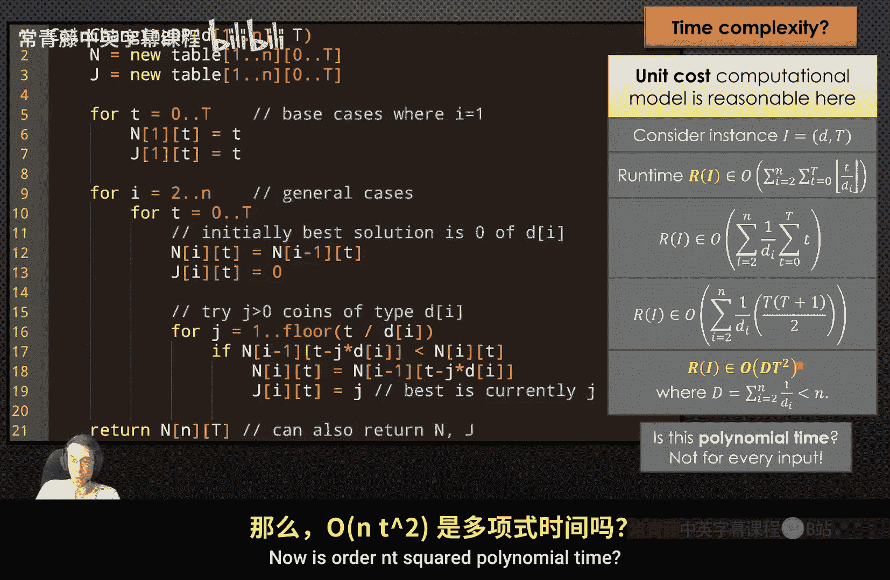

# 滑铁卢大学【中英⚡算法｜CS341 Fall 2021, Algorithms】 p11 P11 Lecture 10 -BV1DhrDBbEwR_p11-

Good afternoon morning or evening。  ladies and gentlemen。

 Welcome back to another episode of CS S 341。 We're getting now into the second lecture on dynamic programming。

 and we're gonna turn our attention to thenapsack problem。

 This is something we studied a little bit when we were looking at greedy algorithms。

 We looked at the rationalnapsack problem where you can take items and you could divide them into any rational fraction So you can take fractions of items in this lecture。

 we're gonna be looking at the 0，1napsack problem where you either have to take none of an item or all of it。

 if you try to divide the item。 It loses all of its value。😊。

And we're going to be coming up with a dynamic programming solution to this problem。

 whereas there was no greedy solution to the 01napsackack problem。

 at least there isn't one that we're aware of。 it seems like this problem is quite hard and the dynamic programming solution is the best kind of solution that I'm aware of for this problem that doesn't involve approximation。

Okay， so what's the 01napsack problem， a quick refresher。 We have anapsack with some capacity。

 which is just a maximum weight that you're able to carry。 So in this case。

$7 kgram is our maximum weight And we're curious to know if we fill up this bag with items that are as valuable as possible what's the maximum value we can achieve that respects the weight limit And in this case。

 we have a few example items we have an ettruscan bore vessel here with a weight of 5 kilogram and a value of $4500。

 And then we have a necklace with $4 kgram weight $4000 value MacBook here that's 3 kilogram and $2000 and a camera here。

 that's 1 kilogram and 1000。 And the question is what subset of these items should we take to maximize the total value while respecting the capacity And we want to solve this problem using a dynamic programmingbased approach So we want to try to think of a way that we could decompose this problem into sub。

Problems， so some possible ways to try to reduce this problem into smaller sub problems could involve。

 for example， shrinking the set of items that you're able to use。 So instead of asking the question。

 what's the best I can do using any subset of these four items。I could ask。

 what's the best I can do using a subset of these three first items， for example， or I could ask。

 what's the best I can do with a smaller capacity。 So these are possible ways that I could think of shrinking the problem size to come up with sub problems。

 Well， let's try to actually derive reasonable sub problems。

So the whole problem is to output the maximum value that one can get from taking at most 7 kg out of these four items。

 You， taking whole items， of course。So let's try to remove one item from consideration and come up with a sub problem that way。

 So let's try asking if we don't have item 4 to use or we're going to consider item 4 separately and then consider the subpro where we try to solve for the best value we can get using items1 to3 in some weight。

 So let's ask， how can we deal with item 4。 Well， the optimal solution。

 it's either going to contain item 4 or it's not。So suppose for the sake of argument that the optimal solution O does not include the camera。

Well， if the optimal solution doesn't include the camera。Then the optimal solution must， in fact。

 be the best value we can get using any subset of these three items， right。

 So if we want to answer the question， what's the max value we can get taking at most 7 kg out of these four items And and I tell you that the optimal solution doesn't include item 4。

Then that the solution to the whole problem will be the same as asking， what's the best I can do。

 What's the maximum value I can get taking a subset of these three items respecting the weight limit。

Okay， so O must achieve the best possible value using items 1 to3 if we're told that it doesn't include item 4。

So the subpro in this case would be what's the maximum value for a weight limit of 7 kilograms using only these first three items as possible choices。

Okay， so this is a smaller sub problem。 We've reduced the number of items。

And our goal here is to create a recurrence relation that relates the optimal solution to optimal solutions of sub problemsble。

 And in this case， if this camera is not included in the optimal solution。

 we can see exactly how the solution to the big problem should be related to the solution to the small problem。

 if this camera is not in the optimal solution to the big problem。

 then the optimal solution to the big problem where we have four items is the same as the optimal solution to the smaller sub problem where we have three items。

So let's let P of I comma M。Be the maximum profit we can get。Using any subset of the items 1 to I。

 So we're restricting the set of items here to be one to I。

 We're ignoring any of the items larger than I。 So if I was3 here， then this would be P of 3a M。

 This would be the maximum profit we can get using any subset of the items 1 to 3。

With weight limit M。So here， P of n comma M。Where capital M is the weight limit and n is the total number of items。

In this case， for our example， is P of4， all four items， comma 7。

 this is the answer that we're trying to output， this is going to be the optimal profit using all the items any subset of the totality of items we're allowed to choose from。

That respects the total weight limit， capital F。Now， if O does not include the camera， then P of 47。

Which is the best we can do using any subset of all four items。

Is actually just the best we can do using any subset of these three items with weight limit 7 kg。

 in other words， P of 4 comma 7 is equal to p of 3 comma 7。

 if we know that the optimal solution doesn't include item number4。Okay。

 but we don't know whether the optimal solution contains item number 4。 What if it is。

 What if the camera item number 4 is in the optimal solution O。Well， let's try to work out。You know。

 whatever we can figure out about that case。 So let's try to figure out how we can deal with the case where the camera is included in the optimal solution and figure out what our sub problem should be in that case。

Okay， so suppose the optimal solution includes the camera。Well。

 then we have this weight of 1 kgram that is consumed。

 so with the remaining 7 kg minus the weight of this camera， so 6 kilogs。

And with the remaining items， one to3。The optimal solution must achieve the best possible value。

 Okay， if we know the optimal solution includes the camera， take the camera。

And now the optimal solution should do the best it can using the remaining items and the remaining weight limit。

This is related to the optimal substructure property that we're talking about in last lecture。

 Clearly， this problem must have this optimal substructure。 If it didn't。

 it's pretty easy to see that you'd derive a contradiction because suppose the optimal solution didn't do the optimal thing with the remaining three items in the remaining weight limit。

 then there would be a way to improve what you know the profit that it can get using the remaining three items in the remaining weight limit。

 and then I could come up with a better solution， which would mean oh is not optimal So oh must achieve the best possible value using the remaining three items and the remaining weight limit of 6 kg。

 So our subproblem is going to be outputting the maximum value for a weight limit of 6 kg and any subset of these three items。

So again， this is a smaller subproble。 we've reduced both the weight and the number of items where in the previous case we only reduced the number of items。

And if you recall the definition of P of I comma M。If O includes the camera。Then P of 47。

 which is the optimal solution to the whole problem。Is going to take the camera。

 So we get the profit of the camera P4。 So it's the profit of item 4。

That's's going to be part of the maximum profit we can get because we're assuming here that0 takes this item。

 So if it takes the item， it gets that profit and then it's going to do the best it can with any subset of the first three items and weight limit 6 kg。

 In other words， P of4 comma 7 is the profit from item 4 plus p of three comma 6。

 the best it can do with the subset of the first three items and6 kg as our weight limit。ok。😊。

So now we've seen two different expressions that relate P of 4 comma 7 to sub problems。

 solutions to sub problemsblem。For two different cases。

 one case where the optimal solution includes the camera and another case where the optimal solution doesn't include the camera。

How do we evaluate both possibilities that the camera is both in and not in O？Okay。

 well let's try to figure that out here， so I'm recalling up here the definition of P of I comma M。

So if O， I'm gonna recap the cases here。 If O doesn't include the camera， then P of 4。

7 is the best we can do with the first three items and weight limit 7 kg。

 we haven't used up any of the weight limit because we didn't take the camera。

 But we're not using that that fourth item， the camera， we're just going use the first three。

 So P of 4，7 is P of3，7。 Now， if O does include the camera， Then p of4，7。

 we includes the profit for the camera plus the best we can do with the first three items and the reduced weight limit where we've subtracted the camera。

 So P of 47 is P4 plus p of 3 comma 7 minus the weight of of item number 4。Okay。

 so let's try both and take the better result because the optimal solution is either going to take the camera or it's not going to take the camera。

 and the optimal solution will take the better of those two choices。 So P of 4。

7 should be the maximum of P of 3，7。Or P of 4 plus p of 3 comma 7 minus W4。Okay。

 so it's the maximum of these two expressions。 Now， this was for item 4。

 What about for the rest of the items， So， you know， I can relate P4，7 to P3，7， and I can relate P4。

7 to P3，7 minus w476 here， P36。How do I relate P37 to smaller sub problems and P36 to smaller sub problems？

 Well， in general， I can just the every argument I've made here about I equals 4 holds for the other I。

 So really， what I'm doing here。 if I plug in I for 4 and M for 7 you know this I equals 4 is the total number is the current item that we're considering and M equals 7 is the current weight limit we're considering。

 So the best we can do with the any subset of the first I items。With weight limit。

 lowercase M is P of i minus-1。So if， if we don't take the item。

 is's just the best we can do with one fewer items in the same weight limit。 P of I-1 M， right。

 So if I is 4， then 3 is I -1 M and M match here。 So there you go。

 This is the generalized expression。we can come up with our generalized expression for this row as well。

 The case where O actually does include the camera。 we can see that P of I comma M。

 the best we can do if we have ever able to choose a subset of the first I items。

 respecting weight limit， lowercase M。If we're taking item I。

 it's the profit for item I plus the optimal profit we can get。If we use a subset。

 an optimal subset of the first I minus1 items， and we have a smaller weight limit M minus the weight of item I。

Okay， and the general max is just gonna be the max of these two expressions。

 So this is a general expression for at least most I values and M values that relates P of IM to P of I -1 m or P of I -1 M minus W I。

 okay。Now， this expression is not always defined， right。If I is 0， then I -1 is negative。

 that's confusing。 And it's not clear how we would define that sensibly。

 at least it seems like we need a base case of sub sort。And then， you know。

 if M minus wI becomes negative， we need some sort of base case to be defined， right。

 So this expression is really， this max， which I folded onto one line here。

 is really only sensible if I is greater than or equal to2。 So if we sub subtract one from it。

 we end up with one。 and we can talk about a sensible base case。

 where P of one comma M is the best we can do using just the one item item number one。

And the weight limit M， that's easy to define。And then M should be greater than or equal to。

 to WI so that this doesn't become negative here。 Or at least this is an expression that's obviously reasonable for these two constraints。

 And if these two constraints， one of these two constraints is violated， we should。

 at least think about what our how our base cases should be defined。Okay。

 so let's define some base cases or special cases when I equals1 or M is less than the weight of item I。

So here's our general case， I'm just copying this from the previous slide。

And there are three other special cases that I can think of for this problem。

So we can just basically break up the negation of this expression right so one of these two is going to be false if we're not in the general case。

 so let's say the second expression is false， so M is less than WI。That's this case。 So in this case。

 we have at least two items to choose from， but we can't take item item I exceeds the weight limit。

And then here's a case where， while the first condition is violated。 I is equal to 1。

 It's smaller than2， but the second condition holds M is M fits sorry item I fits in the bag。

 So this case where item I fits in the bag。 and there's only one item， as's the first item。

And then the third special case here is where there's one item and it doesn't fit。 Okay。

 so we have there are at least two items and item I fits。

 There are at least two items an item I doesn't fit。 There's one item and item number one fits。

 There's one item an item number one doesn't fit。 So I want to give it。

 pose it to you as an exercise。 how would you define P of I comma M in each of these three special cases。

 And so I suggest that you pause and try to fill in these special cases yourself。

 And then I I'll show the answers。Okay， so Im going to assume that if you wanted to do that。

 you've paused and done that by now。So in the first special case where we have two items。

 at least two items to choose from and item I doesn't fit。 Well， we can't take item I right。

 So P of I comma M has to be equal to the best we can do with the first I -1 items because we can't take item number I。

So we can't take item I， we can't include its profit on this side because we can't fit it。

 And if we don't take it， our weight limit is the same。

 So we're not going to reduce M at all because we didn't take item I。

 the best we can do with the first i items。 if we can't use item number I is just the best we can do with the first I -1。

Okay。😊，So this next case。Since we just have one item， it's the only item we could use。

 So we certainly should take it if we can。 And since the weight limit is bigger than greater than or equal to the weight of that item。

 Well， we can pick it。 So we can just take it。 This is patently obviously the， the optimal choice。

 if you don't take the item， you're just making your result worse。 So take the item。

 and there's no recursive term on the right， because there are no more items to take。

Now this final special case here， item1 is the only item we could possibly use。

 it's the only item that we have to choose from。😊，However。

 because the weight limit is smaller than the weight of item I， we can't take it。

 so the best we can do is just0。Okay， so these are our base cases。

 and these are combined into one big recurrence relation here split up by of course。

 the four different cases that we've described here。So we have our general expression here。

 we have our three base cases here， and this is our complete recurrence relation。Okay。

 so now that we have our recurrence relation， we need to actually。

Fill in an array where each slot represents one parameterization of the arguments to the recurrence relation。

 So in this case， the recurrence relation had two arguments。

 It had an I that specified how many items we could use so we could use any subset of the first I items。

 items one up to I。 and that we had an M parameter that specified what the current weight limit is in the problem。

You know what our remaining weight limit is。Okay， so in a bunch of previous examples。

 we've seen just one dimensional arrays or sorry not a bunch of previous examples。 But anyway。

 and we've seen that at least one previous example。

Here we have a two dimensional table that we want to fill。

So here's the table I've drawn both of the axes here， this is the i axis so up here at I equals1。

 this whole row defines problem of instances where there's only one item。

And this whole row defines problem instances where we're allowed to use any subset of the items1 and 2。

And this row represents problem instances where we're allowed to use any subset of the items  one to n。

 In other words， any subset of the items。And this column。

 this first column represents problem instances where we're not able to take any weight at all。

 the weight limit is zero， so we can't take any items。And then this represents a weight limit of one。

 So， for example， this cell right here， we're allowed to use any subset of the first three items。

 but our weight limit is only one。 Okay， so hopefully that helps you understand what these cells represent。

 And we're gonna try to basically fill all of these cells in。

 So our recurrence relation P of I comma M is really translating into a table here。 P of I comma M。

Okay， and we're gonna try to fill in all of these cells so that they represent the computation of the recurrence。

 the actual solution of the recurrence。 So， so this cell here， you know。

 this is gonna be some P of I comma M in particular， it's gonna be P of 3 comma。 Let's see。

 this is 4，5，6，7。8， so this is P of 3 comma 8 here。 And we're gonna try to fill in P of3 comma 8。

 So it's the solution of this recurrence， P of 3 comma 8。 And we want to do so in a particular order。

 We want to do it in a bottom up order。 What that means is whenever we're trying to compute P of 3 comma 8。

 we want to make sure that any table cells that P of 3 comma 8 depends on。

 So any table cells we'll need to compute P of 3 comma 8 are already computed。

 They're already filled in in the table。Okay， so let's think about those dependencies。 But first。

 let's talk about filling in base cases because we have a couple base cases here that have no dependencies at all。

 and we can fill them in really easily。So in particular。

 this first row or I equals1 for all the M values that are less than the weight。 Okay， sorry。

 this is stuff I've already said。 There are no data dependencies for any any other cells。

 It's either just going be 0 or P1。So suppose that item1 does not fit until this M value。

 in other words， this is the M value where M equals the weight of item1。So until here。

 up to this point。The item doesn't fit。 And then starting from this point。

 the item does fit in the knapsackca here M is is equal to weight1。 here M is greater than weight 1。

 here M is less than 1， okay。So that means we should have zeros up to this point and then we should have the actual price of item1 beyond this point。

Okay。Now， how about the next row， Well， the next row we're no longer in the case where I equals 1。

 we're in these two cases where I is greater than or equal to 2。

And suppose that M is the weight limit is less than the weight of item 2。

 So we can't take it starting from here all the way up to here。 And then M equals W2 is this column。

 So from this column on， it's possible to take item number 2。

Well looking at our recurrence here for this region of the table。

We're in this case where the item is too heavy and we can't take it in our remaining weight M。

 And so we're gonna fill it in with P of I-1 comma M。 So wheres P of I -1 comma M。 What's up here。

 I -1。And the same M value。 So this is a data dependency。

 We need the cell above to be computed already。 Okay， and this is true for all。

 for all of these entries。And for all of these entries all the way up to the point where M is finally greater than or equal to W2。

 Okay， as soon as M is great。 Okay， so we're just gonna copy all of these entries down， right。Okay。

 now， as soon as the weight limit M is greater than equal to W2， we're in this case。 Okay。

 so we're to compute this complicated expression， The max of P -1 comma M and P I plus P of I-1 comma M minus W I。

 Okay， so what does this expression look like。 It depends on two different cells。 Okay。

 so here's entry I -1 comma M。Now wheres entry I minus1 comma M minus WI well we're subtracting W I is2 here。

 so we're subtracting W2。Well， subtracting W2， we're starting at the point where M equals W2。

 So subtracting W2 is gonna take us all the way back to 0。

So we're going to depend on the sale above us， and we're going to depend all the way up。

And to the left， the top left corner here。 Okay， so previous row all the way to the left。Okay。

 so what value should we store in this era in this table cell。

 We're going to store the maximum of this cell。And this cell plus the profit for item 2 plus P2。

 Okay， so that's the max of P1， which is this cell and P2， the profit for item 2 plus this cell。

 which is 0。Okay， so it's just going to be the maximum of P1 and P2， basically in this case。

 And for this cell， it's going to depend on the one above it。 And the one all the way back here。

 it won't be the0 M equals 0， it'll be m equal 1 because we're1 to the right and we're subtracting W2。

 And this is gonna be again， the maximum of P1 and 0。

 And as we do this over and over we're going get the max of P1 and 0 because these are all zeros until if we continue far enough to the right。

 depending on how many zeros we have here， depending on the weights of items And how far we go to the right。

We might start to get cells that contain such that this top left diagonal is pointing to a P1。

And in that case， we would get an expression that looks like the max of P1 or P2 plus P1。Okay。

So that'll give you some idea of what kind of entries we might see in the second row。And note here。

 we're only ever looking at the previous row。 We never look at any values。

 We never depend on any values that are in the same row or a later row。

 We're always looking at the previous row。 So if we want to fill this up in a bottom up order so that our data dependencies are satisfied。

 when I'm computing a cell， all of these cells that it depends on are already computed。

 It suffices to make sure that the previous row is computed when I'm computing this row。

 So we can just fill the entries of this table in the order， I equals one up to M up to n， sorry。😊。

And then for each of those rows， we can fill it in M equals 0 to M。To the right。 So we'll。

 we'll fill it in row wise。 And then with each each row within each row we'll go left to right。Okay。

 now， as an exercise， why don't you pause and think about whether the following fill order would work。

For equals1 to n。For m equals capital M down to0。So would that work？Simon Osum。

 if you wanted to do that， you've paused。And answered this fill order would work。Because again。

 we only depend on the previous row。 So as long as the previous row is computed。

 it doesn't matter what order we compute the entries in this row。

 we could go left to right or right to left or in some random scattering order。

 it doesn't matter whenever I'm computing something in this row。

 I only need the entries of the previous row to be done so that was reasoning about how to come up with a bottom up filling order that will respect all of the data dependencies in the table。

 now now that we know what order we should compute our cells in。

 let's do a quick little exercise where I ask you to try to actually compute the value of one or more table cells。

 So suppose we have a table that's computed thus far。

 I haven't shown here I've shown all the entries that are computed here。

 We have our M axis in our i axis I have the relevant part of the recurrence copied up here。

 and I have the profits for the six items in this exam。

And the weights for those six items and the total capacity limit capital M are listed here just in case you need any of those things。

And the first exercise here is to compute the value of this cell with the question mark in it。

 In other words， P of 3 comma 16。 And then as a supplementary exercise。

 if you want to compute any of these other cells that are covered up just， to try。 You can do that。

 I covered up some of the cells here that ostensibly should be calculated already。

 according to our bottom up fill order， in particular， whenever we're computing row 3。

 rows 1 and 2 should already be computed， But if you recall。

 your dependencies are up and up until the left。 So you don't actually need any of these entries to compute this value。

So anyway， as an exercise， try to compute this value here。 and you know。

 I'll give you guys a second to pause。All right， time to assume if you wanted to do that。

 you've paused。So now you can check your your result。

 So this is going to be because I is greater than equal to 2。

 And well do we respect the weight limit constraint here that the weight limit is greater than or equal to W I。

 Well what what's W I I is 3。 So W I， the third item here，1，2，3 has weight 5。

 And our weight limit M here is 1616 is greater greater than or equal to 5。

 So we're in this first case。 So we're looking for the max of P of i-1 and M P of I minus-1 m and P plus P of i-1 m minus w Okay。

 so well， what are these two expressions。 So， P of i-1 m is just up 1。 So that's 3。Okay。

 so it's max of 3。 And well， what's this cell， P of I -1 M W I。 Remember， the weight of item 3。

 W I is 5。 So M-5。 This is 16-5 is 11。So that's this cell here， which is also a3 okay。However。

 it's not the max of 3 and3， it's the max of 3 and P plus3。 Oh what's P PI is 1，2，3。

 Its profit number3 is 3。So this is the max of 3 and 3 plus 3， This is the max of 3 and 6。

 which is just 6。 So's to be the value of the cell。

 And if you wanted to do any of these others as exercises。

 I'm going to give you a second to pause and do that before I show。

 I'll just fill in the rest of this table。Okay， so I'm going to assume if you wanted to do that exercise。

 you've paused and done that。So there are the answers。

 and we can see that the the final optimal solution down here on the bottom right。

 where we use any subset of all six items and where we use the entire weight limit 30 is 18。Okay。😊。

So here's some pseudocode for doing this。 So remember the order that we're filling things in is from row I equals 1 to n and then for weight capacity M equals 0 to capital M okay so our Napsack 01 algorithm is going to take a set of prices or profits or sorry a sequence of prices or profits at a。

P of 1 up to PN and own an array of weights， weight，1 up to weight n。

 and then the capacity limit of the Napsack capital M were to create a new table P。

 you can think of this as a two dimensional array， although of course there are many ways that you could implement it。

You could even implement it as a one dimensional array and just do the index math yourself。

 it's not a bad exercise， by the way， to think about what the index math is to encode a two dimensional array in a one dimensional array。

I can leave that as an exercise for you right now and give you the answer in a second。

 So if you want to pause and do that exercise， if you haven't done it already， you can do that。Okay。

 I'm going assume if you wanted to do that you've paused。 So the index math， by the way。

 is if you want to， so let's say you want to index essentially P of i coa M。 but in reality。

 you just have a one dimensional table that's sized n times m plus1 entries。

 So the size of one one dimensional array it's n times m plus1。

 it's m plus1 because it's0 to M not one to M。So n times n plus 1 is the size。Of the， of this。

 the one dimensional array， let's say you want to access index I comma M。 Well。

 your your index in the one dimensional array is going to be I times M plus1。

 So times the width of a row。Plus M， so that's how you do that。

part of the reason I mentioned this is two dimensional arrays in C plus plus or are hard to get right。

 So if you want to implement something like this on an assignment。

 we may have a programming assignment where you do some dynamic programming and you want to use c plus plus you might want to allocate a one dimensional table to just do the the index math。

 Okay， at any rate， we have our table P。With our two indices here， one up to n and0 up to m。

 And we have our base cases where I equals1。 Okay so for our base cases。

 we need to fill in all of the M values from0 up to M。 And we have， of course。

 the two the decision factor between these two is whether the item fits into the current weight limit。

 little M。 So if little M is too small。 we can't fit the item， then the best we can do is just0。

 but if little m is big enough， then the best we can do is to actually take the item P1。

 And then for the general cases， we go for i equals2 up to n。

 we don't have to do one because we've just computed one for M equals0 to capital M then we have our two cases here And the first case is a direct translation of this row of the recurrence。

 And the second case is also a direct translation of this row of the recurrence。

 So once youve come up with a recurrence， often there's not a whole lot to it writing the solution。

the the one， you know， final thing you have to note here is that the final answer you're looking for is in one particular location in this array。

 right， and you have to return that。 So the final answer we're looking for is the best we can do using any subset of all the items。

1 up to n and the total weight limit capital M。 So actually， in fact， this is a mistake here。

 This should be capital M not little M。 So I'll have to fix that in the in the slides。

 So the important thing is here， we're trying to use up to and including the entire capacity capital M。

Okay， so we're reading and returning the optimal profit。What if。

I wanted to return the optimal sequence of items to choose， not just the optimal profit。Okay。

 so we can output the contents of the Op Napsack。The optimal solution can actually be derived by tracing backwards through the table。

 starting from the table entry that contains the optimal profit。So for example。

 for the same you know input that we saw previously consisting of these profits and these weights with capacity 30。

Here's our table that I showed you before， completely filled in。

 we can trace backwards from the optimal solution。As follows。So we started the optimal profit。

 P of 6 comma 30。And we check， do we take the sixth item necessarily in the optimal solution？ Well。

 how do we know if we take the sixth item necessarily in the optimal solution。Well。

 if we have to take the sixth item in the optimal solution。

 then the the optimal profit using a subset of the first six items。

Will be better than the optimal profit we can get using a subset of the first five items， right。

 If the sixth item necessarily is in the optimal solution。

 it should help us do better than we can using the first five items。

 So if this cell is greater than the cell， which it is。

 then any optimal solution has to take item number 6。Okay， so let's take item number 6。 Well。

 what's the weight of item number 6， It's 16。 So we'll subtract that from the weight limit。

And we get 14。 so we jump over here and say， what's the best we can do now with the remaining weight limit and a subset of the first five items。

Okay， so the best profit we can get using the remaining weight limit and the of a subset of the first five items is 8。

 And that's not actually any better than we can do using the first four items。

 So that tells us we don't need to choose 5 in our optimal solution。So， okay， it's the same profit。

 There exists an optimal solution that doesn't use item 5。 Okay。

 so we'll consider that optimal solution that doesn't use item 5。

Now if we look up at how how well we can do what's the best profit we can get using the first three items。

 it's less。 so we have to take item 4 in this optimal solution so we'll take item 4 the weight of item 4 is 8 so we'll subtract 8 from 14 that takes us all the way back to 6 and so now that we we take item number four the best we can do is to use our remaining weight6 optimally using a subset of the first three items and we can see the best we can do there is three and as an exercise why don't you pause here and try to come up with the remaining items in the solution yourself。

Okay， so I'm going to assume if you wanted to do that， you've paused and done that。

 You can double check your solutions here。 So3 is equal to the row above it。

 So we don't need to take item 3。 However， item 2 clearly helps us do better than than only using item 1。

 So we'll take item 2， item 2 ways3。And we have six currently so we'll jump back to6 minus-3 is three and we've taken item2 so we can only use item number one And the question is can we fit item number one into ournapsack with a remaining weight limit of three item1 ways2 so we can we take item1 as well So just for the sake of completeness here's pseudocode for the algorithm that we just saw。

 of course I won't walk through it because you just saw a walk through how the algorithm works just if you're curious to see how you would write it up。

 here's complete pseudocode for it Now what's the runtime of this pseudocode given so assuming we've already run thenapssack algorithm to produce the table P if we're given the table P here。

 what's the runtime of this algorithm Well we have a while loop that starts with I equal to n and continues doing constant work per loop iteration until I equals1 and there's just constant work here。

 constantant work here and even if this array isn't constant if it takes linear time it's just order n。

So this whole thing is order and time。Is order end time linear time？Well。

 in order to answer that question， we need to be able to answer the question。

 is it linear in the input size， we need to think carefully about the input size。

 we're going to do that a little bit more later in this lecture。

 so you might want to come back here after you've seen how to do this kind of analysis where we think very carefully about the input size and try to answer this question for yourself at the end of the lecture。

Let's jump into the complexity of the algorithm。 So suppose we assume the unit cost model。

So addition to subtractions and assignment and all of those simple operations take constant and time。

Then the complexity to construct the table ends up being theta and M because we just have a four loop4 n。

 and then we have four loop 4 m， and they're nested， and we do constant work inside。

 And that ends up being the dominating term。 So the complexity of our Napsack 0。

1 algorithm that actually computes the table is theta N M。And capital F。

Is this a polynomial time algorithm？Well， in order for it to be a polynomial time algorithm。

 it should be a polynomial in the input size。 So it should be polynomial。

 a polynomial function of the input size for the problem instance。 And that means we need。

 we need to think about the input size。 So what is the input size。 Well。

 the size at the input instance。 Well， remember， for a second， what's in the input instance。

 We have the capacity M。 we have the array of weight we have the array of profits。

So a number can be written down in log base 2 of that number。 Okay。

 so the number M could be written down log base 2 of M bits。

And then each of the weights in the weight array can be written down in logbase 2 of WI bits。

 and then for the profits PI， they can each be written down in log base2 of PI okay。

And M is exponentially large， compared to log M。Okay。So I mean。

 M is 2 to the log base 2 of M right so M is exponential in log M。

And the table can be constructed in theta N M time。But you can see this input term here。

He is log based2 of M。Okay， so think about an input where I make these terms really。

 really small so I can make all of the weights and profits like one。

 and I can make n like a small constant like 5。 And then these two terms will just become a constant。

 And the size will be proportional to log base 2 of M。

And the runtime will then be theta of n times M， where n is just a small cost and it'll be theta M。

 So the runtime will be proportional to M， and the size will be proportional to log M。Well。

 that means the runtime is exponential in the input size。So， this is not。A polytime algorithm。Okay。

 well， have we done any better than a basic recursive algorithm。

 Well like a brute force algorithm that just tries all possible subsets。Well。

 a recursive algorithm that tries all possible subsets would take something like theta 2 to the n time or maybe theta n times 2 to the n time。

 So this is an algorithm where you just try all combinations of taking the item or not taking the item。

You're going to get something that's exponential in N。

And the dynamic programming solution is taking theta N M time。

That's not necessarily exponential in N。 for a really big M。That's on the order of 2 to the n。 right。

 if we let M be huge， like 2 to the n， then this is n times 2 to the n。

 which is maybe worse or maybe similar to the recursive algorithm。 the brute force algorithm。

 Well that's not great。But， but wait， what if M is small。If M is small。Then。

Let's say M is polynomial in n。Well， in that case。This would just be a polynomial。In N， right？

 So if M is polynomial in N。 So if M， for example， we just happen to know that M doesn't get that big。

 It gets to the size of like n cubed， for example， then this would be like n times n cubed。

 which is n to the four。 and that is not exponential。 That's poly polytime。

 So you can get an exponential time improvement using dynamic programming， which works for very。

 very large N values。 But for M values that are not too big。 Okay。

 so if you want to get an asymptotic improvement or， you know。

 an exponential improvement over this recursive algorithm。 then this M should be polynomial in N。

Okay， so this DP algorithm is faster when there are many item types。

 whereas the recursive algorithm can't deal very easily with many item， many item types， right。

 this n doesn't have to be very big before this runtime is enormous， right， if n is 100。

 you know this， this will keep running until the sun is burned out， right。

 But this can easily handle an N of a billion as long as M isn't too big。

 So DP algorithm works really well， if there are many item types。 But relatively small profit values。

ok。So the runtime， as you can see， is not particularly easy to analyze for dynamic programming solutions。

 and you don't necessarily get really clear cut answers like algorithm A is strictly better than algorithm B。

 So we're going to see more kind of nuanced runtime analysis as we continue to talk about dynamic programming problems。

Okay。So the next thing I want to talk about quickly is just techniques for simplifying base cases because there are a lot of base cases in this recurrence。

 And it's not clear that you need all of these base cases。

 And sometimes you can actually encode a base case in the array that makes your pseudocode simpler and sometimes even makes the recurrence simpler。

So here's just the visualization of the table as we showed it it a few slides ago。

 and here's the recurrence。 we showed a few slides ago。

 you can actually simplify this recurrence and the corresponding pseudocode slightly by adding a zeroth row to this table。

 So we started this table at I equals 1。 What if we started this table at I equals0。

So then my claim is that this recurrence will compute exactly the same thing。

And this only has two base cases instead of three。And all we have to do。

 one of these base cases is super simple to compute。 You just fill in the first row with zeros。

 right， and that's it。And if you think of your， if you have an array in a programming language where you already know that the array is gonna be filled with the zeros。

 you don't have to do anything to compute this recur this base case in the recurrence。 By the way。

 if you're coding something like this up and C or C plus plus。Arays are not zeroed by default。

 That is not in the CC plus plus spec。 And you can sometimes get garbage values。 You might。

 just by chance have your arrays initialized to 0 most of the time。 But if you run your thing your。

 your program many， many， many， many times and assert that all the entries are 0 in some runs。

 you'll find that some entries aren't necessarily 0。Okay。

 so let me try to argue to you that this recurrence accomplishes exactly the same thing as this recurrence。

So for I equals1， the case where I equals1 and M is less than W， I。

What are we going to compute in this recurrence？ Well。

 now the I equals one case is folded into these top two expressions， which it wasn't before。

 It was a base case。Okay， for I equals 1 M less than WI。 where're in this case。

 we're going compute P of I minus1 comma M。Well， we're just going to look at the previous row and that's going to be zero。

 okay？Okay， so is that the same as this expression。 Well， yes， for equals 1 M less than W1。

We have zero。Okay， seems easy so far。And then for I equals 1 m greater than or equal to WI。

 were in this case。Okay， so we're going to compute the max of P-1 comma M。

Which is just the cell above， which is just0。 So that's not really going to enter into the max in a meaningful way。

And P。Which is the。Profit of item number one。Plus， P of I -1 M W I。 And this is， again。

 looking at the previous row， this is just going to be 0。

 So this is going to be the max of 0 and P plus 0。 It's just going to be P， where I is 1。

That's just P1。 Well， is that the same thing we do in this space case， Yes， that's exactly the same。

Okay， so here I've managed to， just by adding one trivial row to the table containing zeros。

 I've folded two cases up into these two cases and just have one super trivial case。 row 0。

 fill in zeros。Okay， so that's kinda nice。 How much does this simplify the code。 Well。

 actually a fair bitcause you lose that whole， you know， base case Ch of code the to fill in right。

 So if you compare the old code and the new code， this looks quite nice。

 And we just get a table from0 to n instead of from one to n。😊。

So the other thing we like to do with dynamic programming problems is， of course。

 ask can we save space because this could be a huge table， And maybe we don't need this entire table。

 right， So we never really look at P of I-2 right when we were talking about the bottom up filling order。

 We realized we only ever look at the previous row。 So I don't need to keep rows， I-2。

 I-3 all the way down to 0 around when I'm working on Pi。 I just need to keep pi -1。

 So let's just keep two arrays。 So instead of creating this whole table。😊。

I'm just going to create two arrays。To 1 D arrays。P and P preve。 And this P represents P of I。

 P pre represents P of I -1。 And I'm just gonna compute P of I for， for all the different eyess。

 right， So for each I for each M， we're just doing exactly the same thing we did before everywhere we look we we're using we were using a P of I。

 We use P and everywhere we were using P of I -1。 We use P。 And then we need to swap the two， right。

 Because in the next iteration of the loop， We want our P of I to to represent P of I -1。

 And we want to overwrite our old P of I -1， So we do a swap of P and P pre How much does this improve the space savings。

So that's an easy exercise。I'll give the answer here quickly。 So it's just order n times M space。

 right， And here we just have order M space。 So， you know。

 that could be an appreciable reduction if we have large n。 And by the way。

 large n is the case where the DP solution works really well。

 So this is particularly nice space savings'cause we want our M to be small and our N to be large。

So the next thing I want to do is talk about a dynamic programming solution to the coin changing problem that again。

 we saw in the context of greedy。 We saw a greedy algorithm that was correct for some coin systems。

 but it wasn't a correct solution to the general coin changing problem overall all coin systems。 Now。

 I'm going show you a dynamic programming solution that's correct for all coin systems。

 As long as they have a unit coin value。Okay。What's this？It's an outlet break。

h， it's something else too。It's a networking break。Not bad。Okay。

 so I want to cover coin changing a little bit more quickly than we covered Napsack because I don't want the lecture to be too long。

So if you remember the coin changing problem， we have a bunch of different coin denominations starting with one。

 So D2 might be like 5 or 10 and so on。 and a positive integer T， which is the target sum。

 This is the amount of change that we're trying to make。

 And the goal is to find a list of coins that produce the correct change T using the smallest total number of coins。

Okay， so in order to solve the coin changing problem using a dynamic programming approach。

 we need to ask what subpro we should consider and what type of tables a table of values we should fill in。

Now in the 01 Napsack problem， we only really had two subproblems to consider in our recurrence and they came from this choice of whether we take an item or not here you know you could sort of think of the coins。

 the coin denominations as items and you could think of。

 you know we thought of taking an item or not， we could think of taking a coin type using a coin type or not。

Here we have a little bit more granularity than that。 You don't just have the binary choice。

 Do I use a coin denomination or not， You could also ask。

 how many coins of that denomination do I use。So if you want to try to think about how you might structure sub problems for this yourself。

 you could pause and do that。 Now， I can assume you've done that。 and I'm just gonna move on。Okay。

So we're going to let n of i comma T denote the optimal solution to the subprom consisting of the first i coin denominations。

And the target some lowercase T。Okay， so this is the minimum number of coins that we can use to make change for the amount T if we only use the coin types D1 up to D。

 so we aren't going to use any of the coin types for D plus1， D plus 2 and so on。ok。

And if you wan to pause here and try to use some of the guided cues here。

 you could try to explore what some sensible base cases for this definition of n would be。

And then once you figured out some base cases， you might try to think about what are the different ways that we could use a particular coin denomination D for the general case of an I。

 you know， somewhere in the middle of the range of coin denominations。 So for a general D。

 what are the different ways that you could use denomination D。

 And then depending on how you use denomination D， what subpro could you build into an optimal solution to the whole problem if you had an optimal solution to the subpro for sub particular N I T could you。

 could you build subproble solutions into a solution for a larger a larger problem。

And then you might want to think about finding a recurrence relation。

 So I'll let you pause and try this as an exercise， if you'd like。 and again。

 I'll just chug through the。The material here。 Okay， so for sensible base cases， since D1 is1。

If we have only the single first coin to work with。

 n of one commt T is the best we can do using only the single coin type。

 the answer here is just gonna be n of one t is t because you've got to use these like pennies。

 you've got to use t pennies to make change for t in this case。

 And that's clearly the optimal way to make change in that case。

 another possible base case you could think about is if you had to make the target some t equals0。

 And in that case， n of I for any I if you need to make0 change is just use the best way is just use0 coins right so you can clearly make zero change with zero coins for the general cases Well。

 if I is greater than or equal to2 then the number of coins of denomination Di。

 you could use0 of a particular denomination D or you could use one or you could use2。

 how much could you use well， the most you could use is t divided by Di So if D is 25。

And T is like1 hundred10 that you want the floor of that divisioncause you could use four quarters and you can't use anymore in110。

So we can try all of the different possible numbers of coins of type DI there are so for each J between0 and floor of T over DI。

 we can try all those options。And if we use J coins of denomination Di then the target sum is reduced to a sub problem right we're not going to be looking for target sum T anymore。

 but we're looking for target sum t minus J times Di。

 and we will have then used coin type Di so we should achieve this target sum not using di but using all of the previous coin types1 up to I minus1。

 So the best way if we use J coins of type D， then the best way to make change under that assumption that we are going to use J coins of type D。

Is to take that that value that we get from the J times D subtract it for the target sum and then find the best way to obtain some t Jdi using the first i-1 coin denominations。

 And again， this is where the optimal substructure comes in because if there were a better way to do that。

 we can improve our solutions。 So clearly， in order to make the best change if we if we want to make the best change for target sum t and we are going use j coins of type D。

 then we need to use the best way to make change for t JD using the first i 1 coin denominations。

 Okay， so， of course， we're gonna end up minimizing the total number of coins over all possible choices of j So the recurrence relation is going look something like this。

 N of I comma T， that is the minimum number of coins that we can use out of denominations1 up to I to make target sum T is going be the minimum over all J。

Between0 and the floor of T over D， all the different numbers of coins of type D that we could use。

Of。J， that's the number of coins。 J plus the optimal number of coins that we can use taking only the first I-1 denomination types to make the target sum T minus JD I。

 Okay， so this this is our recurrence for I greater than equal to 2。

 And for I equal to 1 or t equals 0， we have our base case here where we can just make it T。

 And notice up here， I said n of I comma 0 is 0。 But in that case， the T is 0。

 So I can just write n of I comma T is T where t is 0。

 That's all I've done here just to fold those two base cases together。So here's our recurrence。

Now let's see in what order we should fill up the array in order to satisfy all of the data dependencies that this recurrence has。

So here's gonna be our array。 and we're gonna have an array that whose structure matches the。

 you know， is inspired， obviously， by the parameters of our recurrence。

 So we have these two parameters I and T and I varies from1 to n because there are n different denomination types and T varies from 0。

 oh sorry， from1 up to capital T。Exe me。Okay， so for the i axis。

 which is how many coin types we're able to use， we have this drawn from top to bottom and the t axis we start out。

 I said here that we start at t equals 1， but really we can start at t equals 0。

 I defined the base case that way， so this is just type up here， this should be from0 up to t。

And there is a way to formulate this problem so that you start T at 1 or you start it at 0。

So here's our target sum remaining， it goes from0 up to capital t and we can start by filling out the base case。

 so for this column where t is 0， we can fill in t which is just 0 and for this row， where I equals1。

 we can fill in t okay。So these of course， have no data dependencies on their cells so we can just fill them in directly。

 that's what makes them base cases。 and yeah this is what we'll fill in。Okay。

 and now we want to try to compute a general cell somewhere in the middle。

 So consider a cell n of I comma T。 It depends here on n of I-1。 So up a row。

Comma T minus J times Di， where， of course， J varies。 So it starts at at 0 times T D sorry。

 So just t minus0 just T。 So I minus-1 T。 So we look straight up。

And then we subtract a D1 and look to the left， you know， and we subtract another， sorry， A DI。

 and we subtract another DI and look further to the left。

 We keep doing that until we hit floor of T over DI。 so we won't run off the edge of the。

 of the array。Of the table。Okay， so these are all of the cells we're going to look at and you can see that they all come from the previous row。

 So all we really need to guarantee is that when we're computing anything in row I。

 we've already computed row I minus-1。So what that means is the filling order can be row 1 up to row n。

 and then so row I equals 1 up to up to I equals n。 And then within a row。

 it doesn't actually matter what order we fill things in。

 So let's just arbitrarily pick for t equals0 up to capital T。Okay， so here's the pseudocode。

 So we're gonna do something kind of funny here。 broadly speaking， we have our table N。

 which of course， is the the table that contains the optimal number of coins for each of these subproblem。

 and then we have this table J that I'll talk about in a second。

 We fill in our base cases where I equals1。 and then we do our general cases down here where we're maximizing over all the different J。

😊，Okay， so what's this J table。Well， J of I comma T is going to contain the number of coins of type D that we used to get the optimal value n of i comma T。

So in other words， if n of1 T consists entirely of pennies。

 J is going to be J of1 T is going to be how many pennies we used。 And。

 you know J of2 T is going to be in order to get to the optimal number of coins N to T。

 How many coins of type 2。 Did we use。 That's what J2 T is going be。

 And this is going to end up being useful to help us reconstruct not just the optimal number of coins N。

 but also the optimal sequence of coins so we can output the actual sequence of coins that produces the optimal number of coins N。

Okay。So for our base cases， for t equals 0 to capital t， obviously。

 we're just going implement the recurrence here。 So the optimal way to make change for target sum T using only pennies is just to use T pennies。

 And then how many pennies did we use for that optimal sum T。 Now， for our general cases。

 we're going to do the maximum here。 And the way we're going to do the maximum is we're gonna to say initially the best solution is just n of I minus-1 comma T。

Where J is 0 in other words。 And in that case， the number of coins of type I that we use is， it's J。

 That's where this name J comes from。 It's just 0。 in that case。

 So we're saying the best J so far for this particular coin type is 0。

 Then we're gonna try all the different J。 we're gonna save the best J and this capital J array。

So we're going to try for j equals0 coins of type D， so we'll try from1 up to floor of t over di。

 and this is just implementing the recurrence， and we're just going to check if this expression for this particular J。

Is better is smaller than our current best。 We're to store the current best of in end of I T。

Then we store this new best in NF IT， and J is the new best number of coins to use of type DI。

 so we save that in capital J。And at the end， we can return the final optimal value。

 which is in N N comm T。 We could also return the arrays n and J。

 if we want to be able to reconstruct the solution， those will help us reconstruct the actual。

 not just the optimal number of coins， but the sequence of coins。Okay。

 so how do we output that optimal sequence of coins？ Well。

 here's an algorithm to do that using you supply to it D and J。

 I think that's actually enough to get the job done here。

 So counts is going be our array of coin counts of types1 through n。

 So counts of I is going be how many coins of type I of type D I are in the optimal solution。

 And T is going to be the current amount of change that we need to make it's gonna start out of capital T。

 And then for each of the coin types from n down to one。 We're gonna set counts of I to J of I T。

 it's in the optimal solution how many coins of type I did we use to make change for T。

And then as we go， we're going to do this iteratively。

 we're going to subtract counts of I times di from T at each step。Okay， and as an exercise for later。

 you might want to try computing the correct output here without using the J array。

 So using only the N D N and D arrays and T So it turns out you can actually do this in a way that's a little bit more similar to how we did thenapsack problem so that you don't actually need this auxiliary array J。

 the auxiliary array J is just a nice way of avoiding reevaluating the maximum to figure out what the optimal J was at each step。

 So try to work out for yourself as an exercise how you would get rid of this capital J array and still be able to solve to output the optimal sequence of coin types。

Okay， so what's the time complexity of coin changing。Well。

 I think the unit cost model is reasonable here if we're not expecting enormous number sizes。

 and we probably aren't。And also we have an array of elements here for denomination types。

 and we don't expect T to be too large， so I think the unit cost model is reasonable here。

So if we consider a problem instance I， what is a problem instance was just the D and T， right。

So the runtime， and I'm going to call it R of I instead of the usual t of I and I'm going to do that because that would be overloading t T is actually a parameter here。

 So R is R of I is gonna to either run time of instance I if we compute that by looking carefully at this code we can see that there's a four loop here up to t which gets dominated by this four loop。

 which is2 nested for loops。 So it's not only to t it's to t for each I in2 to n。

 So this is clearly going dominate this four loop and these table constructions are certainly not going to be more expensive than this these two four loops。

 So these two four loops dominate。 And if we look at the runtime。

 it's the sum for I equals2 to n of the sum for t equals0 to t of however much work is done in here。

 how much work is done in here， it depends how many iterations there are of this j loop。

 Well this j loop iterates up to floor of t over di。

 So it's just floor of t over di work being done Order floor of t over。I work being done。

 constant work proeration。So this is our runtime expression right here。

And we can manipulate this runtime expression a little bit to simplify it so we can throw away the floor here。

 and it doesn't change anything。 It'll just make the expression larger。

 So if we were in biggo of this， we're also in biggo of this larger expression。

And once we remove the floor， the D's don't depend on the parameter of this of this summation variable so we can move one over DI outside this summation that we just have the sum of t equals 0 to capital t of t so we can solve for that。

That's just t times t plus 1 over2， which is order t squared。

And then we have this sum from I equals 2 up to n of1 over Di times order t squared。

So this all works out too being R So this all works out to the runtime R of I being in big O of capital D T squared。

 where capital D is this funny sum from I equals 2 up to n of1 over D I。

 and that is actually less than n。Because each of these numbers is at most one。 you know。

 we have a penny and the other denominations are all larger than that。

 So this is going to end up being less than n。 So this ends up being order N T squared。

 That's our runtime。 Now is order N T squared polynomial time。

Well， not for every input， as we'll see。 So let me do the analysis here。

 Let me first just briefly explain what polytime really is。 So an algorithm runs in worst case。

 polynomial time。If and only if its runtime R of I on every input I is upper bounded。

Meaning is less than or equal to by a polynomial in the input size S。

 So what's a polynomial in the input size S。 Well， a polynomial is some。

 it's the sum of constants times powers of s。 that's what a polynomial and S is。

 So this is the form of a polynomial and S where K and c0 to C K R constants。

 So if R of I is in this form of expression。 In other words， if it's just in big O of s to the K。

 then R of I is polytime。 It's a polytime algorithm because S is the input size。

 and it is upper bounded by a polynomial in the input size。Okay。

 so is order and T squared polynomial in the input size S。Well。

 what is the input size was the number of bits needed to write down T。

 as well as all of the D denomination values。 So well。

 T can be written down in log base 2 of T bits and D。

 each DI can be written down in log base2 of D bits。 Now。

 if we assume that D is less than or equal to T。Which is reasonable because if it's greater than T。

 then we can't use that coin type， and we could just throw it out。 It shouldn't even be in the input。

So if you assume that Di is less than or equal to T。

Then we have that log base 2 of D is in log T because DI is less than or equal to T。Okay， well。

 in that case， we have n of these variables， like an array of n elements。

 each of which is log based T in or order log based T bits。

 And we have this order log based T bits for T as well。

 So we're going to end up with S being order n log T。Okay。

 so now we have to relate the runtime order n T squared to the size order n log T。Well。

 as an example， because this is a rather complicated expression。

 given that it's got two variables that are independent。

 let's try to think for a second about how letting one of those variables vary and fixing one of them to a constant。

So for example， if n is fixed at 10。And T is allowed to vary。

Then this n log T just becomes order log T， and this N T squared just becomes order T squared。

 In this case， R I is exponential in S。 This is because T is exponential in log T， right。

2 to the log base 2 of T is T。Okay， so this is something like2。To the S squared。

So this is our R of I is exponential in S。 On the other hand。

 if t is fixed at 10 and n is allowed to vary。Then if we look up at our S expression here。

 So T is fixed， this becomes n。T is fixed， so this just becomes n。 Well。

 we have s is order n and R I is order n。 In this case， the runtime is linear in S。Okay。

 so what we're learning here is depending on how large either of these variables is we might end up with an algorithm that's linear time or exponential time。

 certainly in the worst case， it's exponential time。

 but we can think in a little bit more of a nuanced way breaking things down into cases and that'll help us understand and begin to characterize for what types of inputs and algorithm is guaranteed to perform better than another algorithm or is likely to perform better than another algorithm。

 So in this case， a large n and small T is where this dynamic programming solution shines。

 I can do a little bit more principled analysis here。

 so this is just the same thing copied from the previous slide at the beginning of the previous slide。

If T is in。Big O of n。 So for inputs where T is linear in n。Then S is in not n log T， but n log n。

 It's order n log n， because T is order n。And in that case， R of I。

 which is order n t squared would be order n n squared order n cubed。Well。

 how can we relate and log in and cubed？Well， n cubed is smaller than S cubed because S cubed is n log n。

 all cubes。 That's n cubed log cubed n， and the three comes down in front， which comes n cubed log n。

 So N cubed is a smaller runtime than S cubed。 That means because S cubed is polynomial and S。

 that n cubed， which is smaller， is also polynomial in S。Okay， so this is， this is cubic N S。

So for some inputs with relatively small t， so for example， we just saw for t that's linear in n。

 we get a polynomial runtime in particular， for any t that is polynomial in n。

 So if t is in n to the K where k is a constant， then I'll leave it to you to double check that this math is correct。

 but we can see that r of I ends up being in big O of S to the 2 k plus1 where this is all a constant so。

R of I ends up being polynomial in S。Okay so for T polynomial in n， the runtime is polynomial。Okay。

 so that's where I'm gonna to end the mandatory lecture for this episode。

 And next time we're gonna take a look at the final divide sorry dynamic programming material。

 And after that I think we're actually going end up handing off the reins for the course to Ota who's gonna begin with her video lectures。

 I think she'll be starting off in graphs。 Alright， thanks guys。

Yeah。Yeah。🎼，う。🎼Yeah。中。