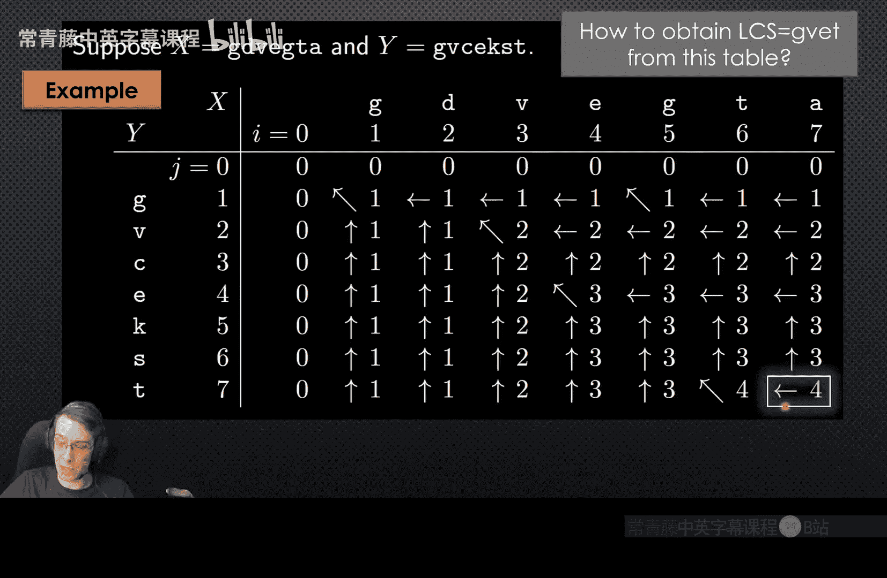

# 滑铁卢大学【中英⚡算法｜CS341 Fall 2021, Algorithms】 p12 P12 Lecture 11 -BV1DhrDBbEwR_p12-

Alright， Hi there， everyone。 Welcome back to another episode of CS341。

 where we're gonna be talking about dynamic programming for the last time。 and the next lecture。

 we're gonna to switch over。 and Anna' is gonna to take over for me。Okay。

 so the first thing we're going to talk about today is a problem called the longest common subsequence problem or the LC CS problem。

 So what's the longest common subsequence well。An input instance is going to consist of two strings。

 X and Y。 we'll call them sequences， but there's no real difference between a sequence and a string。

 A string is just an array of characters and a sequence is an ordered array。So we have X。

 which consists of the characters X 1 up to X M， and we have Y。

 which consists of the characters Y 1 up to Y N over some finite alphabet gamma。

 So each of these characters is drawn from gamma。 and we don't have a restriction on how big gamma can be。

 but it has to be finite。 And intuitively， you know， in most cases。

 you would think of gamma as being relatively small。 like， you know， the English alphabet。

 for example。And the goal in the LCS problem is to find a sequence Z of maximal length。

That is a sub sequenceequence of both x and y。Okay。

 well what's a sub sequenceequence So if you take the string X and you delete some number of characters from it。

 what you are left with is a sub sequenceequence of X。

 you'll have some of the characters that were in X and they'll be in the same order as they appeared in X you've just deleted some characters in between。

So you can think of obtaining a sub sequenceequence of x as taking x and deleting some number of characters from it。

 and you can think of a sub sequenceence of y as just y having deleted some characters。

 So we want to find the longest possible Z that appears in both x and y。

 meaning it's a sub sequenceequence of X and it's a subsequence of y。 In other words。

 we want to find the longest possible Z such that we could delete characters from x to obtain Z and delete characters from y to obtain Z as well。

 This is the longest common subsequence of those two strings。And I have a formal description here。

Okay， so ultimately， we want to solve for the longest common subequence。

 meaning we want to actually output the longest common subequence itself。

 the string that is the longest common subence of x and Y。 But before we actually output the string。

 let's solve for the problem of finding the length。

Of the longest common sub sequenceequence of X and Y。

I wanna start out with a couple of examples here。 So here' are some example strings。 X and Y。

 So here， if x is A， A， A A， A and y is B， B， B， B， B。

 what is the longest common sub sequenceence of X and Y， I'll give you a second to think about that。

Okay， I'm going to assume that you've paused and answered that if you wanted to。

So they have nothing in common。 there are no characters in common。 so the empty sequence， epsilon。

that is the empty string or the empty sequence？Well how about this example， We have A，B，C， D， E。

 and we have B， C D。Okay， so I'm sure you can answer this。

 The longest common sub sequenceequence is B， And D， because if I delete A and B from X。

 I'm left with BD， And if I delete nothing from y， I'm left with BD。

 So when I say you have to delete some characters from X and from y， you can delete 0 characters。

 That's fine。Okay， so BD is the longest common sub of X and Y。 How about A BC D E and L A， B， E F。

 This is just， you know， me typing label wrong La F。Okay， so what's the longest common sub of this。

What do you think。So I'm going to withs if you wanted to answer that， you've done so。

So we can see A appears in both followed by B， followed by E。

 although the E has a few characters in between it and the previous character B。So A B，E。

 we can delete C And D， and we can delete L and F， and we end up with ABE in both strings。

 So that that is the longest string that we can obtain by deleting characters 0 or more characters from X and Y。

 So that's the longest common sub sequence。I have to wait one second my computer is pausing here。

Okay， so could you solve the longest common subence problem with a greedy algorithm。

 perhaps it sort of seems like it might be plausible at first glance， right？

So here's a possible greedy algorithm。 Suppose for each character in X。

 we try to choose a matching character in Y that's to the right of all previously chosen matching characters in y。

So let's try to run it on this pair of strings that we just saw and see if it comes up with the optimal solution。

So we'll start with the first character X， A， and we'll try to find a matching character to the right of all previously chosen values in Y。

 Well， there are no previously chosen values in y。 So we'll just find the first character。

 the first occurrence of A。 Okay， we'll match those up。 and we'll go to the next character of B。

 and we'll try to find a matching B and Y to the right of a。Okay， we found one。

 Now we'll go to C and we'll try to find a matching C to the right of B。 Well。

 there is no matching C。Then we'll try to find D。 There's no matching D。

 We'll try to find an E to the right of B。 And we do find the matching E。 Okay， so in this case， the。

Proposed greedy algorithm came up with the optimal solution， A B， E。Is this always optimal？

So I'll give you a moment to pause here， see if you can come up with a counter example for this algorithm。

In other words， try to come up with an example for which this algorithm does not find the longest common subence of x and Y。

Okay， so I'm going to assume you've paused and done that if you wanted to。

So let's see such a counter example。 So here we have。

 I've taken the the very magical sounding word Abracadabra。

 and I've put a Z in right after the A here。And then I've put a Z at the end And y。

 So we have as As As cadabra， tongue twister and Abra cadabras， okay。So。

Let's see what the algorithm does when we run it on this pair of strings。

 So for the first character of x， we'll find a matching character on the right。

 for the second character of x， we'll try to find a matching character on the right。

 That's to the right。Of all previously chosen letters。 So to the right of a。

Now we'll try to find a B that's to the right of the Z that we found。 Well。

 there's nothing to the right of the Z that we found。

 so it can't find a match for this B or this R or this A， C A， any of the other characters。

 There will be no further matches。 The fact that the Z that we greedily tried to take into our potential longest common sub sequenceequence was found right at the end of this Y string messes us up。

So we're gonna end up with Z equals A Z。 The， And this is clearly not the longest common sub sequence。

 right， because we can， we can find abracaabbra in both of these strings。Okay。

 so is there a greedy algorithm that'll solve for this case？Well。

 we can actually take the greedy algorithm that checked all the letters of Z moving from left to right。

 and we could flip it。 so it check all the letters of Z of sorry of x， all the letters of x。

 instead of checking them from left to right， we can check them from right to left。

 and that greedy algorithm will actually find the optimal solution for this example input。However。

 it's not hard to modify this example input so that algorithm fails。And indeed。

 I'm not aware of any greedy algorithm for this problem。

 And I would be very surprised if there were a greedy algorithm for this problem。

So blindly taking Z here is bad because we end up matching it very far on the right。

 and then we can't continue after that point。How should we decide whether to take or leave said in this case。

 So in dynamic programming， we could maybe try both possibilities， right， whereas in greedy， we。

 you know， if we take it， then we can't later try not taking it。

 Our decision is irrevocable and a greedy algorithm in dynamic programming。

 we could try both and we could， you know， take the max of both options。 something like this。

 So we can try all possibilities using dynamic programming。

 and that's gonna to help us get an optimal solution。

 and it turns out the runtime will be actually quite reasonable。Okay。

 so the first step if we're gonna take a dynamic programming approach is we have to try to define sub problems that we're gonna solve。

 So let me just state the full problem here before we state sub problems to make sure we're on the same page。

 So the full problem is gonna be to return the， the length。Of the LCS string itself。

 So the length of the string， the length of the LCS of x and y。

And a natural way to define sub problems here would be to somehow shrink X and Y。

 So we're dealing with smaller input strings。So in our case。

 we'll reduce the size of x or y by taking prefixes of X or Y。 So let me define some notation here。

 X I is gonna be the prefix of X of length I。 So it's gonna be the first I characters of X。

 So I've drawn X M here， which is the， the whole string X and then x 4 heres just the first four characters。

 right， And similarly for y， Y I is the first I characters of Y。 And， of course。

 we said that X has length M and y has length N。 So x is just X M and Y is just Y N。😊。

So our sub problemsble are going to be returning the length of the LCS of Xi and Yj for all the different I's and J's。

 those will be our sub problems。And how are we going to try to relate our optimal solution to the full problem to optimal solutions to subpro。

 to try to find this recursive optimal substructure that we can use to solve dynamic programming solve this in a dynamic programming way。

 Well， here's an idea for a recurrence。 We can try to do something with the last letter of X or Y。

 and we can try to reduce the problem you know X， I， Y J to like X I-1 Y J or like X， I， Y J-1。

 or X I -1 Y j-1， something like that。 So we'll try somehow cutting off the last letter of X or Y。

 And I'm going to try to explain how we do that by working from a couple of different examples to build intuition。

 So suppose we have this example string here。 X， which is Abraca， A B，RA， C， A Z Z。

 and then Y is gonna be A Z， B， R A。DADA B。 This is Asbro aab。Okay。

 and here in these two example strings， X and Y， you know。

 the last letters don't match Z and B don't match。Now， here。

 just I'm gonna write the indices here so we can tell what indices these represent in this case。

 M is however many digits。 This is， this is 8 digits。 So M is 8。 And so it's x1 up to x M。

 And this is y 1 up to Y N。 Okay， so these are the names of these individual characters。

 The indexes of these individual characters。Okay， and I want you to consider because we're always trying to relate an optimal solution to the optimal solution to sub problems。

 I want you to consider the optimal solutions Z。Which is the LCS of x and Y。So just by inspection。

 we could look really carefully at this and we could see that the optimal solution。

 the LCS is going to be。A B，RA， C A。 Okay， so it's gonna be six letters here。

 And we're gonna call this Z， and its letters are gonna be Z 1 up to Z L， in this case， Z 6。

It's like， okay， so we don't know this optimal solution until we solve the problem， right。

 But we can still imagine the optimal solution and reason about it similar to how we did in you know。

 the other dynamic programming problems that we've seen so far。So I want you to look at this example。

 So I know this is just a concrete example。 but let's see in this concrete example。

 the last letter of x does not match the last letter of y。

 and neither of them match the last letter of Z。 So remember。

 Z is the longest common sub of both of these strings。

 So Z appears as a sub in both of these strings。 So this a。

 the last letter of Z should appear somewhere in x。 And indeed we can see it appears here。

 and it should appear somewhere in y and we can see it appears here。

 or maybe it's this a hard to tell because there are lots lots of a's as extra letters in this Y。😊。

Okay， so this a certainly is not the last letter of x in this example right， becauseuse it's a Z。

 This can't be the final a in our LC S string。Now， Z is a sub sequence， as I mentioned， of x。

 so that a has to appear somewhere here in the prefix X M minus-1。

 the prefix where we've chopped off the last letter。

And this last letter can't be used at all in the longest common subsequent。Okay。

 so now if we turn our attention to y， similarly， this last B in y， the last letter。

 it doesn't match the last letter of Z。 So this can't be the final A that we're looking for in the LCS。

 So just like in the case where we just talked about x。

This last letter of Z because it Z is is a sub sequenceequence of y。

 It has to appear in this prefix of y。 The entire sub sequenceequence Z has to appear in the prefix。

 Y N-1。 So this a has to be back here somewhere in Y N -1。

 So it turns out we don't need this final B in order to compute the LC S'cause the entire LC CS can be found in this prefix of y。

 Similarlyly， we don't need this final Z， because the entire LC C S can be found in this prefix of X。

 X， M -1。So neither of these letters is part of Zed。This， if we're， if this is true。

 if the last letter of x does not match the last letter of Z。

And the last letter of Y does not match the last letter of Z。

Then we know that the LC S Z we're looking for can be found in X M-1 and Y N-1。

 So the LC S will just be the LC S of X M-1 and Y N-1。 Okay。

 so this is the case where the last letter of x and the last letter of Y do not match the last letter of the optimal solution。

 Z。Here's a second case where the last letter of x does match the last letter of Z。

 but the last letter of y does not。Okay， so this might be the final A in Z。

Or maybe this is at any rate， we don't want to chop off this a and recurse on a smaller prefix of x because we might need this A。

 Okay， but this B at the end of y is certainly not the last A in Z in this case。

 This doesn't match the last letter of Z。 so we don't need this letter because the entire LCS Z should be found in Y And the last letter can't be this last letter B。

 So the entire LCS should be found in the prefix Y N-1。Okay， so in this case。

 in order to find the LC S， we can just invoke LCS X， Y， N-1。 Okay。

 so we can solve the sub problemble X， Y， N-1， and we'll end up with the same LCC S。

 If this condition is true that the last letter of X matches the last letter of Z。

And the last letter of Y does not match the last letter of Z。Okay。

 and the symmetric case where the last letter of x doesn't match the last letter of Z。

 but the last letter of y does that case is symmetric。 And so in that case。

 the LCS will just be the LCS of x M minus-1。And why， so we'll chop off。 In that case。

 we'll chop off the last letter of x because it won't match。In this case。

 we chop off the last letter of y because it doesn't match the last letter of Z。Okay。

 and for a final case， Okay， So we saw neither letter。

 neither last letter of X or y matches the last letter of Z。

 We saw one of the last letters of X and Y match the last letter of Z。

 Let's see both of the last letters of X and Y match the last letter of Z。So in this case。

 this last letter of x might be the final A in Z。Or or maybe one of this earlier ones。

 one of these earlier a's。 but we can't chop this off because we might need it。Similarly。

 this final a might be the final a and Z。 So we can't chop it off because we might need it。 I mean。

 we can see in this particular case by counting A's and， you know。

 just sort of staring at the string that we don't really need this a。 But the thing is。

 without doing a lot of computation on the string Y that would end up taking a really long time if y is very large。

 you can't tell that this a isn't needed。 So naively， because this a matches this last letter of Z。

 we might need it。 So how do we get around this problem where it seems like we can't shrink the problem size at all because we can't chop off this A。

 we can't argue it's useless and we can't argue this A is useless。

 So we can't shrink either X or Y to a prefix。Well， in this case。

 we know that the last letters of x and Y match each other and match the last letter of Z so why not just consume XM and by matching them both with z L and now we won't think of finding the entire LCS in a subproble will match these two A's with this a and we'll think about finding a smaller part a prefix of the LCS in a prefix of a and a pre prefix of x and a prefix of y so the LCs of x and is going to be the LC of X M minus1 andn minus1 plus this last a that we found and matched ourselves。

So this is the generalized formula here。 So the LCC S is just gonna be the LC S X M-1 and Y n-1 plus that last letter that we just matched with these two characters at the end of X and y。

Okay， so let me summarize these cases。 So we just saw the last character of Z matches neither of the last characters of X and Y。

 in which case we chop off the last characters of x and Y and recurse on smaller subprobles in each case。

Each of these is smaller。Or we see Z L matches one of these， but not the other。

 And we chop off the one that doesn't match。 That's these two cases。

 We chop off the last letter that doesn't match。Or Z L matches both X M and Y N。

 in which case we match X M and Yn。 So we add it to the LC CS。

 and we recurse to find the rest of the LC CS， the prefix of the LC CS in X M -1 and Y n -1。Now。

 the problem is we have four cases where we have different expressions。

 and the case that we should pick depends on which of these statements is true。

 These are statements about the optimal solution， but we don't know the optimal solution。

 If we knew it， we'd be done， We'd just print it right？ So we don't know Z L。

 So how do we figure out which of these cases we're in。Well， intuitively。

 in the past when we've had this problem， we've tried all of the cases and maximized over all of the cases。

 right so we're going to do something like that here。

 but you have to be a little bit careful because this last case is only valid if XM and YN match right because we match those two letters and we said。

 okay， now we're going to add that letter to the LCS。

 So this last case we need XM to be equal to Y N。😊，Okay。Now， additionally， note。

 and this is a little bit tricky。 so bear with me。X M is equal to Y N only in this last case。

 In each of these three previous cases， X M is actually different from YM。

 Let's argue that that's the case。So in cases 2 and 3， where Z L matches one of X M and Yn。

 but not the other， this is trivial because if X M was equal to Yn， Z L would match both of them。

So in each of these two cases， it's easy to argue that XM is different from Yn。 But what about here。

 Z L matches neither XM nor YN， It could be that Z L is like A， and XM and YN are both B。

But if A is the last letter of the longest common subsequence and both of these are B。

 we could match up those B's and add them to the longest common subsequence to improve it。

 but that's a contradiction because the longest common subence is the longest common subence。

 we can't extend it by adding a B at the end。 So since we can't improve the longest common sub sequenceequence。

 we can't have Xm equal to Yn。 So in each of these three first cases， Xm is different from Yn。Okay。

 so I'm， I've copied the the recap from the previous slide。 plus。

 I've annotated it with these XM not equal to Y N and XM equal to Y N bits here。Okay。

 so let's try to derive a recurrence using these expressions。

 So we had to be a little bit careful because we could only use this last expression。

 We could only include it in a max if it was valid。

 if we actually had an X M that matches Y N for the rest of these three expressions。

 X M is different from Y N。 And there's no such constraint that we have to make sure we have a matching X M and Y N in order to include these in the max expression。

 It's perfectly safe to include these in the max expression。 the LC C S we're looking for。

 will be the max of all three of these， And if X M is equal to Y N。

 it'll be the max of all four of these。😊，Okay， so let C I J be the length。

Of the LC C S of X I and Y J。 This is what we're gonna。

 These are the sub problems we're gonna try to solve。 C I J is gonna be our， our recurrence Here。

 I'm defining the meaning of the recurrence， and then we'll show how to actually compute the recurrence。

 So the meaning of C I J that we're trying to compute here is the length of the LC C S of X I and Y J。

Now let's brainstorm sensible base case here。 So C I J。 well。

 what values of I and J would make sensible base cases， remember。I， J become X， I and Y， J。

 And these are the prefixes of X and Y of lengths， I and J respectively。 Well。

 what about a prefix of length 0， That would just be an empty string。

 And then we would know what the LC C S of the empty string and some other string is， right？

 What's the， what's the LC C S of an empty string and another string。It's just zero。

 they can't have any letters in common。Okay， so well， if I is 0， then one string is empty。

 So C of0 comma J is just 0。And it's the same thing for j equal to 0， right， if j is 0。

 then well the Yj string is empty。 So we have C of I comma 0 is 0 as well。

 So those are our base cases。And for our general cases。

 we're gonna combine all of these all of these expressions here at the top of this slide。

 according to these two cases。 X M equals Yn and X M not equal Y n。

 So if X M is equal to Y N then we're allowed to include this last expression in our max。

 So in this case， C I J is actually just going to be exactly this expression， right。

 because this is the only case where X M is equal to y N。

 So we've argued already that the optimal solution。 if X M is equal to y n has to be this。

 the LC S of X M1 Y n-1 plus Z L well， plus Z L is a character here。

 we're trying to compute not the LC CS itself， but the length。

 So so this Z L is gonna be replaced by1 because it's the length of that character， just one。

So we're going to have C of I J is C of I -1， J -1。

 So the best we can do with prefixes X I and Y J is the best we can do with prefixes X I -1 and J -1 plus the one character that we matched。

And if X M is not equal to Y N， then one of these three cases apply。

 and we don't know which of those three cases apply， so we'll just take the max over all three。Okay。

😊，Not too bad。So let's combine these expressions into a single recurrence of the form that you' were used to seeing。

 So here those expressions are just rewritten into a recurrence here with conditions written。

 we have the base case folded into the recurrence as well。

And I can actually simplify this forcurs a little bit because if you observe that。

 so there are three terms here being maximized over right and this last term see if I minus1。

 J minus1。😊，That's a sub problem of each of these two terms。

 Each of these two terms is solving a larger subpro than this because this， you know， for example。

 I -1 J。 This is what's the LCs of the first I-1 characters of x and the first J characters of y。

 Well， that's going to be at least as big as the LCs of the first I-1 characters of x。

 and the first j-1 characters of y。 this expression on the right has actually more of the strings to work with。

 So it should be able to extract an LCcs that's the same or larger。

 So this term here is always going to be less than or equal to this term on the right。

 and we're taking a max of three terms。 So this term。

 which is always the same or smaller than this term。

 there's no reason to ever choose this expression。 So we can actually delete it entirely from this recurrence without changing the result。

😊，So here's our simplified recurrence。Okay。So I want to give an example of actually computing the table of values here。

 first of all， what order should we compute our table entries in？Well。You know as you might expect。

 it makes sense to do the base cases first right so we can do the base case first and then we have to ask which rows and columns are we referring to in our dependencies as we try to compute CJ。

 we're depending on C J minus1 C minus-1 J。So in this diagram。

 J is going down and I is going to the right。 So J-1 is up1。 So we're looking at the cell above us。

 I-1 is to the left ones。 We're looking at the cell to the left of us and I-1 J -1。

 We're looking at the cell to the top left of us。Okay， so we depend on a cell up left and top left。

 So that tells me if I compute rows from the top down from， from J equals 0 to j equals 7。

 and then within each of those rows， I compute left to right from I equals 0 to I equals 7 then I'll have a solution that all we Ill have an order for computing these entries that always ensures when I'm trying to compute C J。

 I've already computed C I -1 J -1， C I J-1 and C I -1 J。

 So I I've already computed the previous row that that knocks out this J -1 and this j -1。

And then within this row， I'm computing left or right。 So I've computed my smaller eye value already。

Maybe it's more confusing to think about up and down left and right。

 You should just think about the numbers。 So I want to compute smaller J first。Okay。😊。

And I w to compute smaller I first。 So I from 0 to n J from 0 to n。 or sorry。

1 to n in each of those kit。 Oh， no，0 n。Confusing myself。 we do have a zero throw in column。

Thanks to our base case。Okay， so as you might expect here， this first row is J equals 0。

 That's just 0。 And the same thing for this first column。 I w to give you guys as an exercise here。

 a few of these table entries to fill in。 And in a second， I'll explain the computation。

 So why don't you take a look at this recurrence and try to compute manually Q 3，4，5，6 and 7s values。

 I'll give you a second to do that。Okay， so I'm gonna assume if you wanted to do that。 you have。

 Let's see how those computations work。 So for Q 3， we need to figure out which case we're in。

 We're not in the base case anymore。 So we're in one of two these two cases。

 And these two cases differ based off of whether X I is equal to Y J， Okay， so what's our X I。 Well。

 if we go up， this is our I values， right， here's X。 So X I is G。 And Y J is G， they're equal。

 So we're in this case。 So we're gonna look at the top left。Sell to the top left of us。

 and we're going to add one to that。So0， that's going to become one。And then for Q4。

 we're gonna ask the same question。 Are our X， I and Y J equal G is not equal to V。

 So now we're in this case， we're gonna take the max of the cell above us and to the left of us。

 Well， that's gonna be one， right。And here we're going to do exactly the same thing because C is not equal to G。

 so we're going to take the max of 1 and 0。 that's1。 And then of course。

 we can compute the rest of these。 I'll just fill them in。 Now here for Q6， we have V。

 which is not equal to G。So we're going to take the max of above and to the left， which is1。

 And here in Q 7， we have V equal to V。 So we're going to take the top left。Plus one。

'cause we're in this case。 So we have one plus 1 is 2。

 So you can sort of see how the number is growing。 the number grows every time we go down to the right。

 right。And it stays the same。 It just gets propagated by this last rule， right。Okay。

 so there's the rest of the values。 And you can see once we get to the end of the X string and the end of the Y string in the bottom left。

 we have the LC C S length， the longest common sub sequenceequence length of4 of both of these。

 So it's the longest common sub sequenceequence of G D， V， E， G， T， A and GV，C， E， K， S， T。 Well， C。

 K and S don't appear。 So we're gonna get G V， E， T， G V，E T， yep， they occur in both those orders。

 So G V， E T is the answer。 and its length is 4。Okay。

 so here's the pseudocode for this LC cS algorithm。

 All we really do is take this recurrence and then try to implement it with a table。

 So our table is going to look just like our recurrence。 We have a recurrence with two arguments。

 I and J that vary between 0 and well， Ive varies between 0 and M and J varies between 0 and n。

It's not one to M and1 to M。 It's 0 to M and 0 to n because we have this extra base case row and column。

And we're just going perform my base case first。 that's these two four loops。

 And then this last know pair of nested four loops is going to compute all of the nonb case value values。

 all the values of those problems。 we're gonna compute cell I J。

 And we're just going check which case we're in of X I is equal to yj or not。

 And we're gonna just implement these two different cases of the recurrence。

 And then the final answer that we want is CN， because what's our semantic definition of C that we claim we've implemented here。

 Well， the semantic definition of C is the length of CMN is the length of the longest common sub sequenceequence of X M。

 which is just x and Y N， which is just Y so it's the length of the longest longest common sub sequenceequence of x and Y。

 That's exactly what we want to return。Okay， so what's the complexity。

 Let's think for a second about the complexity of this algorithm。

 And I want to think about both time complexity and space complexity。

 And let's just think about the word Ram model。 So why is the word Ram model reasonable here。 Well。

 we're talking about strings of characters。 And characters aren't huge numbers like Fibonacci numbers。

 right， There's no reason to think that we're probably gonna be working with a gigantic alphabet where you can't even fit a character into a single word。

 right？ So we're thinking of characters being relatively small numbers here。So the word Ram model。

 I think， is reasonable here。 So in the word Ram model， accesses to a word。 in this case。

 accesses to a character take order one time， right， so I can， I can do a lot of these steps here。

 I can read cells of my table and order one time I can do these subtractions and additions and order one time。

 I can do the max and order one time and so on， right。

So the time complexity here is going to be constant time per iteration of loops。

 So that's order M N time for these two nested loops。

 And then this first loop is when we order M time。 And the second loop is order n time。

 So order M N time dominates this whole expression。How about the space complexity？

So I haven't focused a whole lot its space complexity。

 but space complexity is the number of words that are used in this case， by the algorithm。

Excluding the input。 So we'll ignore the input。 What。

 How many words are we using in this algorithm over and above the input。 So we're using I J。 Well。

 that's just， you know， a couple of extra words， right， kind of irrelevant in their calculation here。

 C is the biggest source of words。 And there M times N words in C， right？

 So the space complexity here is O of M N words。ok。So hopefully that makes sense。 I。

 I think I'm not gonna go into a huge amount of detail on it in this lecture。

 but I want to point out at the end of the deck of slides for this week。

 I think I have four or five educational slides that should be helpful for just clarifying and reviewing you know。

 a few of the models and clarifying some of the complications that， you know。

 students have asked about in Piazza， I'll try to you know。

 clarify a little bit of the of the uncertainty in how you should be computing runtime and space complexity and input size for the word Ram model and the bit complexity model。

Okay， so we'd like to be able to compute not just the length of the LCS， but the string itself。

 we'd like to be able to output the LCS string so to make it well relatively easy to find the actual LC。

 not just its length。 We're gonna store a little bit of extra information alongside our C array。

 we're gonna have a parallel pi array or a pi table， just like we have our C table。

 and we're gonna store extra information in this pi table。

 similarly to how we stored extra information in the coinchan problem or in the Napsack problem。

 the 01 Napsack problem to help us understand how to a sort of back trace from an optimal number to an optimal string itself。

 So in in Napsack， we figured out how to backtrace from an optimal profit to an optimal sequence of items。

 So we're gonna do something similar here， but we're gonna try to output the actual。Will LC s。

 So in order to do this。We want to consider for a given table cell C I J。

 We want to consider which table entry was used to calculate C I J。 Okay。

 so let me grab my laser pointer here。 So C I J might either be computed from C I -1 J -1。

 if we're in this case。 if X is equal to Y j。 or it might be one of these two cells。

 C of I J -1 or C of I -1 J。 So we have three different cases。

 And we're going to store information in pi of I J that tells us which cell。

 which entry in C was used to help us compute this entry C I J。

 So pi here is it represents the predecessor， the previous cell that we're coming from to get to this cell。

 So it'll be one of these three cells。😊，So there are three cases。

 either C of Ij is going to be equal to c of I j -1， or it's going to be equal to c of i -1 j。

 or it's going to be equal to c of I -1 J -1 plus1 and I'm ignoring the case where C of I j is equal to 0 because once we're in a base case。

 we're not trying to backtce anything one of the strings has length0。 So there's no more Ls defined。

 So as long as we're not in the base case， these are our three cases。

 So in case1 where c of I j is C of I J-1 what we're gonna to store in pi of ij is just a symbol。

 or're going store just as a string。 the letter J， and that's going to tell us that to get to the predecessor entry in the table。

 we should subtract1 from j。 So j just represents decrementing j to get I J -1。Okay， so， I mean。

 we could store this in any number of ways in the predecessor array。

 I'm just picking an arbitrary way to store it。 I'm just gonna store the string J。

 And when we do our back tracing， when we see the string J。

 we're gonna know that that means we should decrement one from J to get to the previous entry that was used to calculate this entry C I J。

😊，Okay。😊，And in case 2， where we're trying to get to see I -1 J， I'm gonna store I。

 the string I and pi I J to indicate that we should decrement our the current I that we're at。

 So instead of being at I J， we're gonna be at I-1 J。 So we're just， we're leaving these breadcrumbs。

 these instructions that are back tracing procedure are is going to follow。

 So back tracing procedure is gonna see the string I and it's gonna decrement I。

 And that's going help it get to the previous cell as it's tracing its way backwards through the the table。

And then for C I J， we're coming from C -1 J -1。 So we're going to store the string Ij。

 which is just going to tell our back tracing procedure that we want to decrement both I and j to reach the entry that was used to calculate CJ in this case。

 CJ is calculated from I -1 J -1， So we're going decrement both I and j。 And remember。

 in this case where we're adding one that's this case up here in the recurrence X is equal to y I。

 And if you remember， when X is equal to y I， we're going include X I in the longest common sub sequenceequence。

 So this is a special case in case 3， whenever we're in this case and we see an IJ in pi。

 we know that we need to include X I in the LCs。 And it doesn't make a difference whether we include X I or Y j because they're the same thing。

😊，Okay， so I can show you， I'll show you pseudocode for this modified algorithm in a second。

 And then I'll walk you through the table examples so you can see in the table that we。😊。

Discuss a couple of slides ago。 you can see how we would trace our way backwards。

 And in that diagram for that table， I'm not gonna write I and J and I J。

 I'm just gonna draw an arrowca it's easier to see。

 So we'll represent J as an up arrow for J-1cause remember J is starts at 0 and then goes down in our diagram。

 And I'll represent the the letter I by just a left arrow becauseuse it's gonna represent going left and the and I J。

 the string I J I'll represent as a diagonal going up and left just makes it easier to see in the diagram。

Okay， so in our example table， I'll just draw an arrow to the entry instead of writing the string。

 You know， if we were to program， I can't store an arrow in the cell right。

 so you've got to store some value that I can actually program。So here's the pseudocode for this。

 so we have not only the arrayC but also an array pi and we're going to have our base case as usual where we just implement the recurrence base case and then we have our two loops where we compute C of IJ for all of the general case。

 you nonbase case entries。And then we have our cases。

 just as we had when we looked at the algorithm before， we had this notion of the pi array。

 So if X I is equal to Y J， then we add one and refer to entry C I-1， J -1。

And we store IJ'cause we need to decrement I and J。 if we're in this case。

 C IJ was computed using C I -1 J-1。 So we set pi I J to IJ。

 which will indicate that when we back tracece， if we want to figure out where C IJ came from。

 it you know， you just decrement I and decrement J， right。And then similarly， if yeah， so okay， I。

 actually， I think I have an animation here， if I just。Give it a second to pull it up。

 My computers sort of slow。 My animation's all out of order。Anyway， here are the three cases。

 So we covered these cases on the previous slide， right。

 So this is the case where c of I J is C of I J -1， right， We store J。

 This is the case where c of I J is C I minus-1 J。 we store I。😊，Okay， so really。

 what's new in this is just that we have this pi array that we're populating alongside the。

 the values of the C array that we are populating in the same way as before。And at the end。

 we return the array C and the the array pi。 So both tables get returned。 And that way。

 when we want to do our back tracing， we can pass both of those tables to the back tracing。

 and pi will help us figure out how to back trace。 Okay。

 so let's see an example of how we would actually run this back tracing algorithm。

 So suppose we have two strings， X and Y。 and we've reasoned about these strings before。

 We've reasoned that GVE T should be the LC S of these two strings。Let's see our table。

 And here this is our table that we filled in before。 But now I also have arrows。 right。

 So up left represents I J up represents Js。 we're decrementing J when we go up。

 left represents I because we're decrementing I when we go left。

 So I'm just drawing them as arrows to make it easier to see the path。

 And if you remember the bottom right entry here is our long it's the length of our longest common sub sequenceequence。

 So let's figure out how to extract the longest common subsequence or some longest common subence because there might be many for a given set of input strings。

 You know there can be many subsequences that have the same length and and they're all maximal So anyway。

 we'll extract some longest common sub sequenceequence using this method。So we'll start here。

 This arrow says we should go to the left， so we'll decrement I and we'll go to the left。

 And then the fact that we're going left here means this a is not in the LC cS。 Okay。

 we're only saying something belongs in the LC S when we go up left because that's the case where。

 you know， the X I and Y J are equal and we take that letter。 X I to be part of the LCS。

Okay， so this says up left， which tells us that。The the sequence so far that we've accumulated of letters。

 We're going to accumulate these letters。 We're going to push them into a string。Is T。

 So we see this up left that tells us that we're in this case where we're moving up and to the left and we're adding one。

 So we're actually taking this letter T in the LCS。 Okay， so we move up left。

 We're here now and we see up。 so that's not in the LC S。 We move up。 You know。

 this K is not in the LCCS。 We move up。 We end up here。 you know， we。

 we aren't extending the LC S at all。 we end up here at a diagonal。 finally， wherere E。And E。

 so X of I and Y of J are equal。 So this is gonna be in the this E is gonna be in the LC C S。

 So our sequence so far that we're accumulating。 if we manage somehow to prepen because remember。

 we're tracing this backwards。 So we're starting at the last letter in the longest common sub sequenceequence。

 So we have to preend these。 So if we have T， we can preend E before T。 And remember。

 we're trying to build up to G V E T。So we go up into the left。 We end up here。 This is an up arrow。

 so we don't do anything except go up。 Then we end up at this up left arrow， which tells us that V V。

 this X of I， which is equal to Y of j is gonna be in the longest common sub sequenceequence。

 So we add this V to the sequence。 We prepen it to get V E T。 and we move up into the left。

 This left， we don't really do anything except move to the left。 Then we end up here where finally。

 we see X I equals G Y J equals G， they' the same。 we end up taking it in the LC C S and our LC S。

 once we prepen G is G V， E T。 Finally， we end up in a base case。

 If we end up in the first row or the first column， like a0 through row or the zeroth column。

Then we're done because one of the two strings is empty at that point。Okay， so in the end。

 our LCS is GVET as it should be。And here's pseudocode for doing this trace back that I just showed you。

 So first we create a new string， LCCS， and then we set I and J to M and N respectively we start at that bottom right cell。

 and then as long as we're not in a base case， so while I is greater than0 as J is greater than 0。

We see we inspect pi of IJ to see which direction we should go， if it's IJ。

 then we only go up left when we're taking an element into the LCS。

 so X I is going to be part of the LCS so we can assuming that our strings don't have the ability to prepen。

 we can upend and then we can reverse our string at the end。So we append and we decrement I and J。

 And on the other hand， if we saw pi of I J as J， we decrement J。 if we saw pi of I J as I。

 then we decrement I， we just continue until either I as 0 or j is 0 or both。 And then at the end。

 we reverse the string that we've appended。 So in our case。

 we started at the end of the LCS in the previous example。 if we appended。

 We would so it was G V E T was the LCS。 we would append T， then we would append E。

 then we would append V， then we would append G， we'd end up with TVV E G or sorry T E V G So we have to reverse that at the end。

 we do this reverse step finally。Okay。So what's the runtime complexity of the space complexity of this algorithm in the word RA model。

Well， our operations are going to take constant time on the entries of these arrays and you know let's see our decrement will take constant time。

 decrements are constant time， these comparisons are constant time， this appending。

 let's say that we can append to the string in constant time So everything is done inside this loop will be constant time。

And then how many iterations are there。 Well， I starts at M and J starts at N。

 And in each iteration of the loop， we decrement either I or J。

 So we can only have M plus n iterations， each doing a constant amount of work。Okay。

 so the whole loop is gonna take， let's say order m plus n work。

 and then lines 3 and 4 will take constant time line2。

 Let's say we have to allocate a string and let's just say that allocating enough space to hold the largest possible LCS the LCS could be the bigger of M or n。

 So let's say we have to allocate the bigger of those two sizes and let's say that allocating that string takes time proportional to the size of the string。

 So let's say it takes time proportional to the maximum of M or n。

 and we can express that on asymptotic notation as big O of M plus n。

 So line 2 will take bigger O of M plus n time。 So in total， and then reversing can be done in time。

 that's linear in the length of the string and the length of the string is in the worst case。

 the bigger of M and N。 which is order M plus N。 So reversing will take order m plus n time as well。

 So this whole thing can be done in order M plus N time。Well， how about the space complexity？Well。

 for space complexity， we want to count in the word RA model the number of words that we introduce in the algorithm that are not part of the input。

 So we ignore the input。And what words are we introducing， We're introducing a string。

 Let's say the string has one word per character。 And the number of words then for the string will be order M plus n。

 Then we introduce words for INJ， which is basically nothing， you know， just constant， right。

And that's about it。 Maybe there's an extra array used as part of the reversing procedure。

 At any rate。 You won't need more than order M plus n space for that。

 So this can all be done in order M plus n space。 And note that when we're computing a space complexity。

 we exclude the input variables。 So even though these are bigger than order M plus N。

 we don't count them。 So this is order N plus M space in terms of words。 It's order n plus M words。

 And the time is order M plus n steps。 what's this？I think it's a towel rack break。

 that looks pretty nice。And。

It's nice and level。Okay， so the next problem I want to talk about is called the minimum length triangulation problem。

So the input for this problem is going to consist of n points Q1 up to QN in 2D space。

 so we're just talking about regular 2D Euclidean space。And these points， they form a convex polygon。

 an ngon with end points。And we're going to call that polygon P。

And we can assume that the points are sorted clockwise around the center of P。 So here you can see。

 you know， if you just imagine the center of P， by the way， because it's convex。

 the center of P is inside P。 if it's concave， then things get weird， but this is a convex polygon。

And you can see that the points here are sorted clockwise， right， so 1，2，3，4，5，6，7。Okay。

 and the goal in this problem is to find a triangulation of P。 What's a triangulation。

 It's a way of cutting this polygon up into triangles that don't overlap one another the triangles cover the whole polygon but no triangles overlap so you want to be able to draw these lines that don't cross each other if there was overlap lines that be crossing each other。

 So you want to basically draw lines to cut this up into triangles and there are different ways of cutting up this polygon into triangles And you want to do this this is an optimization problem。

 want you want find the particular triangulation that minimizes the sum of peri of the triangles。

 So and I say of the n-2 triangles here because there are n points and it turns out that any way of triangulating n points will produce n2 triangles。

 here we have in this example here which I。amlessly stole from Wikipedia。 I have 1，2，3，4，5，6 points。

 This is a hexagon。 and we divide this into 1，2，3，4 triangles。

 each of these triangulations is four triangles。 And in fact， every triangulation is four triangles。

 if you have6 points and a convex polygon。 Okay， so we're gonna take these n points。

 and we're gonna find the triangulation into n-2 triangles that has the smallest sum of peri for all the triangles。

 So first of all， what's the perimeter of a triangle， right。

 iss just the sum of the lengths of the sides， right， So for this for this top left triangle。

 we're gonna sum this side， this side and this side。😊，Then for this triangle。

 we're gonna sum this side， this side and this side。 Yes， this side is double counted。 That's fine。

 For this triangle， we're going to sum this side and this side and this side。 And for this triangle。

 we're going to sum this side and this side and this side。

 And we want to find the the triangulation that has the minimum sum of all those side lengths， okay。

And the output， rather than going all the way for the complicated version of this problem and having you output the actual triangulation。

 you can output just the sum of the perimeter that is minimum okay。So how hard is this problem。

 Could we just try all the triangulations or something like this。 How many triangulations are there。

 it turns out they're a lot。 So the number of triangulations of a convex n gone。

 is the n minus second cattle n number Here's what that looks like。

 And if you actually solve for a closed form。 you can show that this is in theta of 4 to the n over n2 to 3/ps。

 So this is something like， you know， it's exponential in n， certainly right。

 So this is this is extremely large， you know， for a 100 gone you know， polygon with 100 points。

 you're talking runtime that's along the lines of number of particles in the known universe。

 So we really don't want to try all the triangulations。 that would be incredibly slow。

 So we're gonna have to do something more intelligent。 So we won't brute force。

 it will come up with a dynamic programming solution。😊，So first off。

 we want to try to ask the question， how could we try to decompose this problem into sub problemsblem？

So if I have some convex n gone here， which I've drawn on the right with points Q1 up to QN。

 consider the edge between Q1 and QN。That edge is going to participate in some triangle， you know。

 when we triangulate this， that edge will be part of some triangle。 and， of course。

 that triangle will have a third vertex。 So call that third vertex besides Q1 and Q N。

 It'll have a third vertex Q K okay。Now， for a given K， if I fix that Qk。What do we have here。

 What does our problem decomposition look like， Well， we have this triangle， Q K sorry， Q Q1， Q K。

 Q N， right。And then we have some other parts here， right。

 We have this polygon here with vertices Q1， Q2， Q3， all the way up to Q K， and then back to Q1。

And we have this polygon here from Q K， Q K plus 1， Q K plus 2 all the way up to Q N。

 And then back to Q K， right， So by。Considering this edge from Q1 to Q N。

 which must participate in a triangle and then fixing the third point on that triangle Q K。

 we've divided the problem into a triangle。And then two other polygons， two other convex andgons。

 because this whole thing being convex means that if I take one triangle out of this and consider what remains。

 I end up with two convex and gos。 Well， not end gos， But， you know。

 you get a convex kgon and a convex n minus k plus one gone。ok。And you， I'm not going to prove that。

 but anyway， this this just comes from geometry。Okay， now the optimal solution to this problem。

 if we fix this K， like suppose this triangle for this fixed choice of QK。

 suppose that this triangle is in the optimal triangulation。

 the triangulation that has the minimum sum of perimeter， supposeose that's true。

 Suppose this triangle is in the optimal the optimal triangulation。

Then the optimal triangulation will consist of this triangle and the optimal triangulations of this polygon and this polygon so we can start to see the recursive structure come together。

 the optimal recursive substructure come together。And if you wonder why this is true。

 supposing that this triangle is part of the optimal solution。

 we have to triangulate this polygon somehow， and we want to triangulate it with the optimal triangulation。

 because if we use a suboptimal triangulation， we can improve our solution by replacing it with an optimal triangulation。

 The sum of perimeters here has to be minimized because if it's not minimized。

 we can improve this So we're gonna have to have the optimal triangulation of polygon 2。

 the optimal triangulation of polygon 3 and this triangle under the assumption that this triangle is in the optimal solution。

 Okay， but maybe this triangle isn't in the optimal solution。

 some triangle is gonna be in involving this edge is gonna be in the optimal solution。

 So we may just have to consider different choices of Q K。😊，Okay。

 so we're going to consider these separate polygons。

 We're going to consider the optimal triangulation of them。

 and now we have our optimal recursive substructure。

So let's try to turn this intuition about the optimal recursive substructure and how we can express the whole problem in terms of subproblem into a recurrence relation。

So let S I J， we're going to define now our recurrence relation expression， S I J。

 and we're going to define the semantic meaning that S I J should have。

 This is the meaning that we're going to try to implement。 And by the way。

 when you're solving divine and conquer problems， you should always start by writing down whenever you you define or declare a term here for a recurrence。

 you should always try to define the semantic meaning， what this should contain。 Without this。

 you have no way to reason about the correctness of your algorithm because this is。

 this is the definition that you're trying to actually solve for when you implement this when you actually write down a recurrence。

Okay， so SIJ is going to be the optimal solution to the subproblem consisting of the polygon。

With vertices， I to J。Okay。And so we're gonna restrict the set of vertices basically。

 And that's gonna give us some polygon。 And we're gonna try to figure out the optimal solution for that polygon consisting of vertices Q I to QJ。

 And just for the sake of， of making the not notation simple， let Delta I JK。

 denote the peri of this triangle， Q I， Q， K， QJ。Or equivalently QI， QJ， QK。Okay。

 and what is this perimeter。 It's the distance between I and J using the usual Euclidean distance formula square root of。

 you know， you know x squared sorry square root of Q I dot x minus QJ dot x squared plus you know。

 etc cea， etc cetera。 It's the usual two dimensional distance formula。

But I'm just gonna write it down like this。 So we don't have， you know， big， ugly expressions。

 So Delta I J K is just gonna be the， the perimeter。

 meaning using the usual Euclidean two dimensional distance formula。

 the distance between I and J plus the distance between J and K plus the distance between K and I。

 right。So Delta IJK is the perimeter of that triangle now。

A given point Q K or rather if the triangle defined by Q I， Q J and Q K is in the optimal solution。

So I mean， th this line here I is a typo I should have written if this triangle Q I， Q K。

 QJ is in the optimal solution。Then。S， I J， right， the optimal way to use vertices Q， I up to Q J。

 And these， these are vertices that are sorted clockwise， right， So here's Q I。

 Q I plus1 all the way up to Q J。So if。This triangle， Q I， Q K， QJ is in the optimal solution。

 then the optimal way to triangulate all of these vertices from QI up to QJ。

Is the optimal way to triangulate QI up to QK？that polygon。Plus， the perimeter of this triangle。

Delta IJK。Plus， the optimal way to triangulate the remaining piece from QK all the way up to QJ。

 this polygon。So S of I J is S of I K plus deelta Ij K plus S of K J。Now。

 the problem is we don't know the optimal K right we know that this edge from So if I back up one step。

 this edge between I and Q I and QJ will be involved in some triangle but we don't know if if if this should be QK or maybe this point here should be  Q K or this point here should be QK。

 So we sort of have to try all of the different possible K values between I and J and we want to maximize over all those possible K values right。

 So here if we choose  Q K to be this point here。You know， that that's this diagram， right。

 And in fact， in this case， we， we have this triangle。 and then we only have one remaining polygon。

 So it's not necessary that there will be two polygons， right。

 There might only be one extra polygon besides our triangle， right。

 if it's the leftmost triangle or here， if it's the rightmost triangle。

 is only one polygon on the left of it。Okay， and then this is all the possibilities， right。

 We try all the different possibilities for choices of Q K。 And for each of these。

 we're gonna compute the recurrence that we saw in the previous slide that assumes that K is optimal。

 right， And for one of these choices of K。 this will be a triangle that appears in the optimal triangulation。

 So your's K equals I plus1 K equals I plus 2 I plus 3 and so on all the way up to J -1， right。

 And this next point is QJ of Q I， QJ。Okay， so here we're going to have S of I K where K is just I plus1 in this degenerate case。

This is not actually a polygon right the polygon to the left of this triangle doesn't actually exist。

 so it's just going to be zero。And our S K J is what we're computing here on the right。 And then。

 you， similarly here， this is our S I K。 So Q I all the way up to Q K。

And then here's our K all the way up to J and so on。 And then here in the final diagram。

 we have S of I all the way up to K。 And in this case， where J is just K plus 1。

So we have K and then K plus1。 This is a degenerate polygon。 It's， it's a two gone that has。

 you know， zero area， right， Sos there's no need to triangulate here。

 So this is going to contribute0 because there's nothing to triangulate。

 This will contribute 0 to the result。Okay， so we want to maximize over all these choices of K。

 here's our recurrence S of IJ。Is going be this is this is the， the optimal way。

 This is the optimal sum of parametersmeter for the optimal triangulation of the polygon consisting of points Q I up to Q J。

 Okay， so these were points that were all consecutive and part of the original polygon。

 which was convex。 and they were all sorted clockwise。 right， so it's gonna look something like this。

That's going to be the maximum for K strictly between INJ。Of S IK， this part。Plus， Delta I JK。

 this part， plus S K J， this part。And this is reasonably well defined formula。

 If J is greater than equal to I plus2， if J is only i plus1。Then， well。

 here we saw what happens right here。 J is K plus one here。 And there's a degenerate polygon。

 It's a two gone that doesn't contribute anything to the triangulation。 So if we have like K。

 K plus1， in this case， we have like I， I plus1， Then we should just make the perimeter 0。

 the contribution to the perimeter of that degenerate2gon is 0。

 So if I J is greater than equal to I plus 2， meaning we can actually make a triangle。

 then this is the formula。 Otherwise， if we can't make any triangles， then 0 is the formula。Okay。

 so here's our recurrence。Now， how do we fill in the table？ So first of all。

 our table will be defined in the way that you might expect for our recurrence S IJ。

 we're gonna to have a table S I J。 it's going have it's gonna to be I equals1 up to n。

 And then for each of those eyes， you have j equals1 up to n。 and let's draw it like this。

 So here's our table as a square。 and it is a square n by n in size。

 let's draw our js going to the right increasing to the right and our eyes increasing going down。

Just for the sake of the diagram。And we have this， we have two different formulas here， right。

 So if J is greater than equal to I plus 2， well， we need to look at the line。

 J equals I plus 2 and figure out which side of the line we're on。 So here's J equals I， right。

 It's a diagonal line。Through the diagram， through the table。 Wheres J equals I plus 2。 Well。

 if we start out at some point in this line where J is equal to I and we go to the right。

 J is increasing。 So J is getting bigger than I as we go to the right。

 So we're gonna shift this line to the right by two units。 And that's gonna be the line。

 J equals I plus 2。 Okay， and for J greater than or equal to I plus 2。

 We're talking about everything to the right of this line。 Okay， of this orange line。

So everything in here satisfies J greater than equal to I plus 2。

 So this is where we're gonna use our complicated fancy formula in this blue region。

 And in the gray region， we're going use just 0， right， So this is all gonna be  zeros。

So let's consider the data dependencies for a cell IJ that's in this blue region because we don't need to think about data dependencies for anything in this gray region。

 it's all just zero。Well， the dependencies for S I J are going to be S I K and S KJ for all the different K。

 And well， what are the K values， It varies from I plus1 up to J-1。

 So let's think about these two expressions。 S I K and S KJ for all these different K values。

 So S I K。 Well， K starts at I plus1。 That's S I， I plus1。And it goes all the way up to J -1。

 it's going to go from Si plus 1 to S J minus1。Okay， Si plus1。S I J minus1。

So this is SJ SI J minus1 is just to the left of this。SI J minus2 is to the left of that skill。

 and we keep going until we get all the way to S I plus1。

W whichch is just to the left of this line where j equals I。 Okay。

 so this black region here is for S I K。 This is all the dependencies that are induced by the term S I K in this recurrence。

 What about the term S K J。 Well， for S K， J， We're varying the first term， right。

 So it's going to be S of something J， And that is going to vary from I plus1 to j -1。

 So we're going from S of I plus 1 J to S of J -1 J。 So where does this appear in the diagram， Well。

 here's S I J S I plus 1 J is going to be one lower。

S high plus 2 J and so on all the way up to S J-1 J。

 So we're to go all the way almost down to J comma J， but only to J -1 comma J。

 So it's this black region here。 So this red box depends on these two black regions。Okay。

So looking at this diagram， everything in this black box has a larger eye value。Thenhan the red box。

 right， This is all S something greater than I comma J。 Okay。

 so we depend on things with larger eye values。And we depend on things with the same I value。

 but with smaller J values， that's what this diagram is telling us。Larger I or same I， but smaller J。

Okay， so what's a correct fill order that will respect the constraint that when we compute IJ。

 we want to make sure everything we depend on has already been computed。

 I'll give you a second to think about that so you can pause and figure that out。Okay。

 I'm gonna assume if you wanted to figure that out。 you've paused and done so。

 So we depend on larger eyes。 We should make sure that larger I rows are computed first。 Okay。

 so we're gonna iterate from large I down to small I。 and then within a row。

 we want to make sure that smaller J already computed。 So we want to compute smaller js first。

 So from smaller J to large J。 so for I， we go from n down to one。 And then within a row for J。

 we go from one up to n。 Okay， this fill order。We'll make sure that our dependencies have already been computed when we compute IJ。

Okay， so I'm not going to show pseudocode for this because it's fairly straightforward and it's a good exercise。

 I think， to translate this recurrence into pseudocode。

 but let's talk about the runtime and we don't actually need the pseudocode really to at least have a rough discussion about runtime in the word RA model。

So first let's talk about the number of subpros， how many subprobles are there， well。

 we have a subprom for each IJ。And well， there are n squared I J parameterizations of I J。

 So there are n squared subproble。 How much time does it take to solve subproble S I J， Well。

 for S I J， we need to do some constant amount of work for each K。 How many ks are there。

 There are J minus I approximately K values。 So this is order J minus I。 And， of course。

 if we're only looking for a big O expression， J minus I is less than or equal to n， right。

 J minus I is less than or equal to J， which is less than or equal to n。So， you know， this is。

Big O of n to solve a sub problem naively， and their n squared sub problemsble。

 So we can trivially get order n cubed runtime， at least if we only care about a big O expression。

If you want to show big omega， then note that at least n over 22 squared subproble do omega J minus I work。

 How am I getting this funny expression， Well， in order to show a big omega。

 I need to show that there are order n squared sub problemsble that do something like omega n work。

 right。So we only do constant work in the base case。

 So we need to ask the question how many cells are there that aren't this base case。

 How many of these cells are there， where j is greater than equal to I plus 2。

 This is where the the two is coming from in this formula So take the diagonal。

 That's the line J equals I shift by2 that's this minus2 and then square that and it's order that many subproblems that are in that triangle to the top right。

 you can do a more precise calculation。 if you like if I pop up a little bit here to calculate how many cells there are in this blue triangle because that's how many cells are doing order j minus I work。

 And then with a little bit of care you can do the leg work here to show that there are enough of those subproble that do order n work in order to justify an omega n cubed complexity to finally get a theta n cubed complexity。

 So I'm not filling in the details here because the computation gets kind of annoying and I don't want to get bogged down。

Mathematical details， certainly it's easy to argue that this is big O of n cubed time。Okay。

Incidentally， this happens to be polynomial time in the input size。

 but I want to make the point that basic runtime analysis doing this order n cubed you know。

 analysis does not require an argument that this is polytime in the input size。

 like you only have to talk about whether this is polytime in the input size。

 You only have to reason about the input size。 If we ask you to prove something along the lines of that claim that this algorithm is polytime in the input size。

 If we ask you to prove that， then you need to think about the input size。 Otherwise。

 if we just ask you to argue about the runtime。 you don't need to think about the input size because you notice。

 I didn't have to say anything about the input size in order to to give this runtime order n cubed。

Okay， so the last thing I want to talk about very briefly is something very similar to dynamic programming。

 but slightly different memorization。 So this is an alternative to dynamic programming。

 but has very much the same goal。 you can transform a dynamic programming algorithm into a memorization algorithm and vice versa vice versa。

 So problems that can be solved at thev can be solved with memorization。

 It's just two different expressions of the same idea。

 And sometimes memorization is more natural for a particular problem。

 and sometimes dynamic programming is more natural for a particular problem formulation when we ask you for a dynamic programming solution。

 We don't want you to provide a memorization solution。

 We want you to instantiate a table and show how to fill it。

 But I wanted to let you know about memorization because I think it's good to know about。😊。

So the idea in memorization， like in dynamic programming is to remember which subproblem have been solved the difference is and dynamic programming。

 you want to make sure that you compute your subproblems from the bottom up And in order such that whenever you want to compute a particular subproblem all of its dependencies are already computed in memorization rather than precomputing from the bottom up we're going to start from the top down and whenever we want to compute a subproblem we're going to recur so this is a recursive problem or as a recursive algorithm we're going to come up with。

 but whenever we return from a recursive subproblem。

 we're going to save our return value so the next time we try to recompute the same subproblem we're actually just going to reuse the value that's already been computed so we'll cut off the recursion tree at that point so rather than recalculating recursive subproblem over and over again we'll just look them up in a table the difference is we're not going to precompute the table we're going to compute the table as we return from recursive calls。

Okay。So let's see what this looks like。 And I'll just do it with a toy problem。

 We're gonna do this with with Fibonacci numbers。 So we saw a divide and conquer solution to Fibonacci numbers。

 Let's see how you would memorize the results in that divide and conquerr solution。 So first of all。

 in order to do memorization， you do need a table that you're gonna save your results in And that table should be global。

 it should be external to the recursive procedures that you're calling。

 or perhaps you could provide it as an argument to your recursive procedures。 At any rate。

 it needs to continue to persist once your recursive procedure returns。

 So I'm going to declare it here as a global。 So we're gonna have this array that's a global memorization array。

 and we're gonna try to use it to compute Fibonacci numbers up to n。

 So the array is gonna have size N。 And I'm going initialize all of the content of the array to negative1。

What does negative 1 mean Intuly， it means I have not yet computed this table cell。

 So this is what's going to help us distinguish between cells that are computed and cells that aren't computed。

 We're using the fact that Fibonacci numbers are never negative。U。And。Okay。

 so let's see how we would， so we， we initialize the table。

 and then we call the recursive Fibonacci procedure， which has a small modification。 So here。

 let's see what's different about this from the usual recursive Fibonacci procedure。 First。

 we have the base case。 If n is 0， we return the 0th Fibonacci number， which is 0。 If n is one。

 we have our second base case， where we return the1 Fibonacci number， which is one。

And then in the general case， we want to now compute the anth Fibonacci number recursively。

 but before we go into that recursive computation， we want to check has this anth Fibonacci number already been computed。

 so we check in our table， has it already been computed。If so。

 then we just read the precomputd value that was already computed。

 and we're going to return that value down here。 Otherwise。

 if it hasn't been computed yet for this particular end that we're computing in this recursive call。

 we're going to make our recursive calls here one and2。

 as we do in the usual recursive Fibonacci algorithm。We're going to sum up the results。

 and we're going to before returning， save that result in our table as the nth Fibonacci number。

 and then finally we'll return the value that we computed。😊。

So how does this make a difference in the recursive computation here on the right。

 we have the recursion tree for the fifth Fibonacci number， and this is for a naive recursion。

 Let's see how this recursion tree changes once we introduce memorization。

 So it starts out the same as in the recursive algorithm。 We make our fifth Refib call。

 and it's going to make recursive calls to F4 and F3 to compute F4 and F3。😊。

So we recurse into our F4 call。And then that F call is going to recurse into F。

 is going to recur into an F2 call， which is going to recurse into an F1 call。

 and then finally this F1 call is a base case， so we're just going to return。

And when we return now we're going to pop back up into computing our F2。

 So our first call here on the left in F2 is going to return， so we now have one here。

Then our second call to the right， we're gonna make that recursive call。 It's gonna it's a base case。

 So it's just going to return0。 And now we've executed both of those calls。

're we're in this we've pop back up the stack into this F2 call。

 We're gonna add those two numbers together。 saveve them in F。

 We're gonna save those in M2 So M2 is now computed and we're gonna return that result。

 So now when we pop up to F3， we're gonna pop up the stack back into our f3。

 It's gonna make a recursive call to the right。 That's， of course。

 already done I wrote already done here， but really that's a base case。

 So it's just gonna return1 and we're going take our F2 and our F1 are're going them together and we're going save it in M3。

 so we're saving M3 now M3 equals 2。 We're gonna pop back up the recursive stack to F4。

 It's going make a recursive call on the right to F2。Now， what it makes this recursive called F 2。

 it's gonna to see is a space case 0。 It's not。 I this space case 1。 It's not。 I this pre computed。

 Yes， F 2 is pre computed， So it's going to look up the pre computed value and it's not going do any further recursive calls in that sub tree。

 So we're going take。2 and F2， which is one。 And we're gonna add them together。 We're gonna get 3。

 And before we return from our F 4 recursive call， we're gonna save it in M of 4。

 So now when we pop up the recursive stack to F5， it's gonna try to make a recursive call on the right looking for M for F 3。

And F3， that call is going to see on my base case 0。 No， on my base case 1。 No。

 have I been computed already， Is M3 already computed， It is。 We computed it down here。

 So we're not going to do any recursive calls in the subre。

 We're immediately going to return the value of F3。

So what's interesting about this diagram is that our recurs our recursion on the left， you know。

 all gets finished， we all actually execute the recursion on the left。 but every right child。

 by the time we recurse on the right， at least above this F3 tree。 if we made the tree way bigger。

 we'd see as we go up and up and up all these right children。 these entire subrees are being cut off。

 They're precomped right because by the time we compute the left side。

 we've already computed the right side because the right side is the smaller sub problemble n-2 when on the left。

 we've computed M -1。 So basically this reduces this recursion tree almost to a straight line along the left。

 or all of our left leaning recursive calls work。 But all of our right leaning recursive calls。

 their subtes all get pruned。 This reduces the amount of recursion from exponential in n to linear。😊。

In N， So you get the exact same exponential speed up that you get from dynamic programming by doing memorization。

🎼Okay， so with that， I guess I'll end the mandatory material for this lecture。

 But I encourage you to check out the bonus clarification material that I've included in the last few slides。

 Hopefully you'll just help solidify some of the discussion of different models and， you know。

 a discussion of how to calculate input size that's been going on on Piazza in a。

 in a a more cohesive way than the disjointed discussions there。 So with that。

 I'll look forward to teaching you guys， at least in the capacity that I will be in creating assignments and。

 and finals and marking you know， I hope you guys enjoy the the lectures by Anna from this point on。

 Alright， thanks， guys， Take care。😊，🎼不的。🎼いか？🎼just three。🎼是。🎼这。

