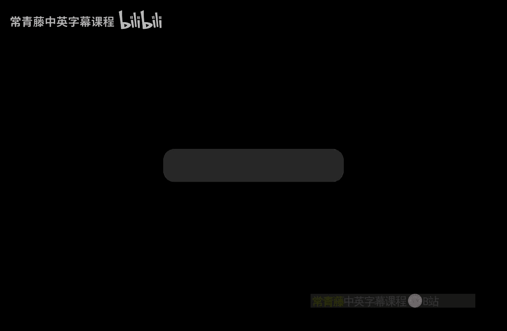
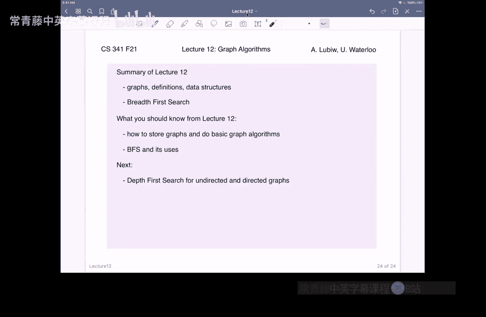

# 滑铁卢大学【中英⚡算法｜CS341 Fall 2021, Algorithms】 p13 P13 Lecture12 -BV1DhrDBbEwR_p13-

去。Okay。Hello CS 341 students i'm professorfessor Anna Lubo and i'm doing the lectures for the second half of the course so a reminder of what we've done so far the course so far has been。

About algorithmic paradigms in particular we've looked at reductions which will come up again in a later part of the course looked at divideiding conquer algorithms greedy algorithms and dynamic programming and we are going to revisit all of these in the context now of graph algorithms so there's a section of the course coming up now on graph algorithms I like this section very much because graph algorithms are one of the。

Things that I study the most。Okay so what is a graph first of all I'm assuming you've seen graphs in previous courses math 239 basically so a graph has vertices and we are going to use elements one through n as the vertices of the graph I'll say more about that in a moment the edges of a graph are pairs of vertices and we often draw graphs as pictures so here this graph has these five vertices and which edges are there there is for example the edge12 so I have the pair one2 and because this is an undirected graph I could list it as two comma1 just the same as one2 so you can see that for example the pair one4 that is not an edge of this graph。

Now a directed graph by contrast， the edges are ordered pairs。

 so here I have the edge from one to two， but I do not have an edge that goes from two to one it's not in this graph。

Between vertices one and three， I have the edges going in both directions so we indicate that this way。

Now one thing we're going to assume throughout this section of the course is that we never have loops a loop would be an edge that goes from a vertex to itself we're not going to allow them and secondly we are not going to allow multiple edges there are some contexts in which those are useful but we're not going to need them so I am not allowed to have。

 for example two edges going between the edge 23 over here。嗯。

Now as to make these things a little bit more concrete。

 let's think a bit about how many edges a graph can have。

So we are thinking of there being in vertices and we want to ask， how many edges can there be？

At this point， I think I will turn off my video because I'm going to be looking down at the iPad as I'm writing for you。

So first of all， in an undirected graph。The number of edges which we call M can be zero or it can be as many as think about it a minute and choose to because that's the number of unordered pairs so we're looking at n times and minus one over two that is the maximum number of edges。

On the other hand， for a directed graph。We get more possibilities， so again。

 the number of edges is between zero。But now the upper bound becomes n times n minus1。

So twice as many because I have this option here of having edges in both directions。Okay。

 so what do we get out of this that the number of edges is always big O of n squared。

 we can't have more than that， but there are some graphs where we can have that many。

 so I'm going to say that it can be in the maximum case or the worst case it can behave like n squared。

Now， one reason to pay attention to this is that a graph with few edges in particular graph with a linear order n number of edges is called sparse and sometimes we can have algorithms that work much more efficiently on sparse graphs than they do on very dense graphs。

Okay so next I have a slide that is somewhat full but I thought it's helpful to have all these things in one place。

 so some basic notions about graphs， we say that two vertices U and V are adjacent or their neighbors if we have an edge between them。

 so for example， vertex 1 and vertex 3 here are adjacent their neighbors。

 but vertex 1 and vertex 4 are not neighbors。When we have U as a vertex and E is an edge。

 we say U is incident to E if it's one of the endpoint of the edge。

 so vertex5 is incident to this edge， vertex 5 is not incident to this edge23。Now for a。

An undirected graph， we talk about the degree of a vertex which is the number of edges incident to it。

 so for example vertex5 here has degree123 it has degree3 vertex4 has degree two it is possible to have a vertex of degree zero that means it's an isolated vertex and there are no edges coming into it。

Now for a directed graph， we talk about the in degree and the out degree because we distinguish whether the edge is pointing into the vertex or pointing away from the vertex so in this little example this vertex here has two edges coming in so I say the in degree is two and on the other hand it has three edges going out so the out degree is three。

Okay next up what is a path i'm thinking you've seen this before when you've looked at some graph theory but a path is a sequence of vertices such that each pair like V1 to V2 has an edge between them so I have let me draw a little picture I have an edge from V1 to V2。

And in a directed graph， I would want that edge to be directed from V1 to V2 and I continue and eventually I have an edge that leads to the last vertex of the path。

 which I was calling v sub K here。The length of a path is always counted by the number of edges。

So not the number of vertices， but the number of edges。

 so the number of edges in a path will be one less than the number of vertices in the path。

And we say that a path is simple if it does not repeat vertices so if I took a path here going from five to one to two to three I that's a bad example let me start over if I went from five to three。

 one to three， four， that is a path from five to four but it is not a simple path a simple path would be just doing this and one thing to observe is that if I do have a path then I can always take away the repeated parts and get a simple path。

Next up， what is a cycle a cycle is a path that starts and ends at the same vertex。

 so for example going from five， this would be a cycle I end up back at the same vertex five。

And then we say that a cycle is simple if it doesn't repeat vertices except that I start and end at the same vertex。

 right？The length of a cycle is a number of edges that's completely consistent with the way we count the length of a path。

Now one thing I'll caution you about is that some textbooks and some web pages， if you look at them。

 they use the word path to mean a simple path， so when in doubt just check which meaning is intended and we'll try to be clear on any assignments。

Okay， three more things here， a tree is a connected undirected graph without cycles。So for example。

 this is a tree on three vertices， this however is not a tree because I have a cycle in it right and if I think of this as a whole graph here that is not a tree because it's not connected。

Or if I think of these two， I don't have any cycles。

 but again that is not a tree because it's not connected。Now I should have said first。

 perhaps what does connected mean an undirected graph is connected if every two vertices in the graph are joined by a path。

 so I do not have a path from here to here， so this whole graph here is not a connected graph。

And the number of connected components is just the number of pieces， so in this case three。

 the number of connected components。嗯。Good so graphs have been studied for a very long time by mathematicians starting with Euler in 1735 who formulated this for the purpose of the Kigsburg bridge problem so the town of Kunigsburg had a river going through it with a couple of islands here's one and here's one they're drawn here as these green blobs and it had some bridges and one of the games for young couples was to go for a walk and try to cross every bridge exactly once so they might have started here and crossed to the island crossed to the North shore crossed here crossed here crossed here。

Oh whoops there are two possible bridges， but if you take this one you would have to repeat this bridge in order to catch that one so that was a failed attempt and when you when Euler abstracted this by drawing the graph corresponding to this so here's the north shore the South shore the one island the larger island then it's easy to see that there is no way to。

Across every bridge， the bridges are now the black edges of the graph there's no way to make a tour an earian tour it's called that goes over all these bridges exactly once and the reason is that all of these vertices have odd degree so here one。

2，3，4 degree5 here's three three degree3 degree degree3 and if I start somewhere and go through a vertex and maybe I come back and go through it a second time I always visit the vertex and even number of times so there is no way I can visit all the edges exactly once when there are more than two vertices of odd degree now I suspect that the young couples who were doing this this game of trying to cross all the bridges didn't actually care too much if it's possible or not this was their evening entertainment back in the 1700s。

Anyway， there are many， many applications of graph theory and I'd suggest looking at the Wikipedia page for a taste of some of them。

I'm going to show you a little bit and some pictures of various graphs。

 so one is the kind of graphs you get from road networks as shown over here， so subway maps。

 road maps， the vertices can be thought of as either the intersections where two roads meet or perhaps on a larger scale the vertices would be the cities and roads are the edges are the roads that connect the cities。

Here is an example of a graph that might indicate clusters in some data。

 so every vertex here is representing some data point and the edges are representing relationships amongst them。

Here I have an example of a graph that arises from WiF networks if you think that every WiF node is a point in the plane and it can reach for a certain distance and then for two of these Wifi nodes。

 I say they can communicate if the two distances overlap。

And then we get graphs as this example shows with the black edges。

And finally over here I have a picture of some of the names that people have attached to various graphs。

 one famous graph you might know particularly well is this one which is K5 the complete graph on five vertices and another one you might have encountered both of these when you were studying planar graphs。

 this one is here called the utility graph but you might know it as K33。

 the complete graph with three vertic three sorry the complete bipartite graph with three vertices on one side and three on the other it's called the utility graph because of this puzzle where you say I have three houses and three utilities I would like to connect every house to every utility and make that as a planar graph and if you've seen a bit of Katowkis theorem for example。

 you know that that's not possible。Okay。I have some more pictures here of graphs arising in various ways and if。

You might look at this picture for a little bit of time and try to think where each of these graphs is arising like do you recognize what this graph is showing have you ever seen a graph like this have you seen the Stanford bunny in this form。

So here I have the same slide but captioned， so this first graph is the graph is what's called the Serinsky triangle。

 but it arises from the towers of Hanoi puzzle， each vertex here。

 each node of this graph is showing one configuration for the towers of Hanoi and an edge indicates one move that you're allowed to make where you move one disk onto another peg in such a way that the peg the disc underneath is larger than the one you've just moved on。

And so it's interesting that the towers of Hanoi， which you have probably seen before。

 you may not have seen that it leads to such an interesting graph when you think about all the possible configurations of the game and how you get from one configuration to another。

This graph is a dependency graph of some Apache software， what a mess of edges isn't it yeah？

This graph I'm thinking here of the graph as consisting of these little nodes that you can just see as these dots and the edges are making these triangles on the surface of the Stanford bunny so this is a very nice graph it's a planar graph。

And there are very nice properties of it， for example， the number of edges。

 it will be a sparse graph， the number of edges is linear in the number of vertices that you've used。

And I wonder if people recognize this， this was Darwin's drawing of an evolutionary tree。

And this is caffeine。tWhich we can think of as a graph again with lots of six sided cycles。

 hexagonons。Now we're going to be studying graph algorithms。

 so an important thing then is how we're going to store graphs。

 what kind of data structures we're going to use。Now we're going to focus on really sort of core graph problems abstract graph problems it's great to know all these applications but we're not programming the applications we're thinking of the graph as an abstract structure in particular we are always going to think of the verticase as being numbered from one to n when I talk about them I might call them V1 through VN just because sometimes we have too many numbers floating around and it's good to indicate V to indicate a vertex which vertex vertex number two okay and we might sometimes just use letters so I'll say for each vertex v in the graph to something else look at vertex AA in this graph but really we are storing them as the numbers from one to n。

Now in practical applications graphs have labels for the vertices and before the edges。

 so we do need for such applications， we need a mapping from the labels to the vertex numbers and。

Hashing and maps， those are great ways to do that and we're not going to be concerned with that in this section of the course。

I have to hear， well this is the caffeine where we see it's important that the nodes are labeled here and here is a graph that comes up from a database application。

I guess the red nodes are indicating a person because a person likes this purple node。

 the purple node has as author this person， so I presume this is a book。

Something else that a person can alter and some of these directed edges are indicating friends。

I would think friends should go in both directions okay。

So also in applications there's another complication which is that we often have graphs that are changing over time so we want to add and delete vertices and edges these are called dynamic graphs and we're not going to be concerned with that that's a more advanced topic is to store a graph subject to changes in the graph so we're going to be thinking of static graphs and the vertices are numbered from one to end。

Okay， so with that understanding or that simplification how are we going to store our graphs there are two basic ways called the adjacency matrix and the adjacency lists。

Now the matrix is maybe the easiest thing to understand so if theyre n vertices I will make an n by n matrix the columns are indexed by the vertices and the rows are indexed by the vertices and an entry inside here is one if there's an edge between vertex I and vertex J and zero otherwise so I have a little example down at the bottom and let let's look right away at how we would represent this graph with an adjacency matrix so I have vertices 12。

3，4 and I record the same vertices down the rows I'm going to fill in this four by four matrix。

And one thing you should note right away is that because we don't have loops。

 that is we don't have an edge from a ver text to itself。

 I'm going to have zeros down the main diagonal。How about one and two are they joined by an edge yes。

 they are joined by an edge here so I put a one in the matrix there。

And it's an undirected graph so the matrix is symmetric the edge2 one and the edge one two are the same thing is there an edge from one to three yes there is so that's this entry is there an edge from one to four there is not okay and finally two to three there is an edge two to four there is not。

And the very last one is there an edge from three to four， yes， there is okay。

 so that's the adjacency matrix。Now adjacency lists are a little bit different for each vertex I'm going to store a linked list of its neighbors or in the case of a directed graph of its forward neighbors okay so coming down to this example again I would have an array。

 one， two， three， four and for each place in the array I would start a linked list of all the neighbors so vertex one over here has neighbors two and three so I would list them here。

Sorry two and three vertex two has neighbors one and three。

mightight be listed in the other order i'm not going to make an assumption about that vertex 3 has neighbors one。

 two and four， so maybe they appear one， four two and vertex4 only has the single neighbor three。

Now an advantage of the adjacency list structure is that the size behaves like theta n plus m so I have a number of vertices down here and every edge。

 for example， the edge one2。Is appearing in two places in this list， right。

 from one to two and from two to one。So I'm recording every edge twice， essentially。

And as I mentioned before， the number of edges in a graph can be anything between0 and n squared。

 so to capture this variability， we often measure graph algorithms in terms of both of these parameters and and M。

And so it's nice to say okay， the space is order n plus M and that's the smallest that it can be。

 I have in vertices， I have M edges that I need at least that amount of space。Okay， by contrast。

 the adjacency matrix it takes n squared space， so this matrix。

 even if it has a huge number of zeros in it， that is m is very small。

 I am still explicitly storing all of the zeros for the non edges and using space n squared。Okay。

So I have here a slide where I'm inviting you as an exercise to work out for a directed graph like this one in this example。

 what does the adjacency matrix look like and what do the adjacency lists look like and there are more examples in your textbook and another good source for this basic graph stuff is the online book of Jeff Erickson's there's a link to that from the course webpage。

Now I've been talking theta n plus M without yet saying what model of computing are we using for graph algorithms how are we measuring space how are we measuring time we're using a word RA that's our basic model of computing and it's totally appropriate to use for graphs Now if you remember we discussed early on in the course Professor Brown discussed these two models the bit model and the word RA model the difference is the bit model counts how many bits we've used to count space or input size and it counts the number of bit operations for time this model is appropriate for problems for example where I have one or two numbers as input and so some examples would be multiplying two numbers。

Which was an example， you saw a divide and conquer algorithm to do that。

 another example would be if I want to test if a number is prime。

So here the input is a single number。And to say how good is that pro testing algorithm。

 I would want to say， how does it behave in terms of the number of bits in the original algorithm？

So on the other hand， the word RA model。Sor of abstracts away from this bit model when we talk about sorting taking n log n time we're not thinking in terms of a bit model we are thinking that I can compare two numbers in a unit cost and for that it's the word RA model that we use we are counting words for space and counting the size of the input in terms of the number words we're giving given and counting word operations。

As each one taking unit time， so how do I count time。

 I just count how many word operations were there。Now to keep this realistic we have to limit how many bits there are in each word。

 otherwise I can make one word that has the entire code of the program in it， for example。

 or the entire input and that's cheating that's not allowed so we're going to limit the number of bits per word and the way that's done is if the input consists of capital n words we allow the number of bits in each word to be log of capital n。

And if you recall the rationale for doing this is that if I wish to store n words。

 I have to be able to address them， I have to count from one to capital n and need those different addresses for each one so I need log n bit just to fit an address into one word so that is a reason why we should not say that W is a constant。

And on the other hand， we don't want W to be even larger than that because then we get the danger of sort of cheating and cramming too much into a single word。

So examples here are sorting， the input is in numbers。We often write little N。

 but I'll be consistent here and write capital N for。The number of。Of things were given。

And we say sorting takes and log in。嗯。If the numbers fit into order login bits。Okay。

 so in particular， it would be inappropriate to use the bit model here。

 I would end up with a log squared factor because I'd have to take into account how big the numbers are and we don't think about sorting that way。

Okay， and on the other hand， this word RA model is not so appropriate if we're thinking about multiplying two numbers here。

 capital n is equal to two and by restriction here would be saying that oh。

 I'm only allowed to store a constant number of bits in each word， it's not the appropriate model。

Okay， so but coming back to graphs a graph has n vertices， they are the numbers from one to n。

 each one needs log n bits， we know how many edges you we have and we are going to use the word RAM model so we're going to say that the input size is n plus M words to capture order n plus M words to capture the input graph。

And we will measure running time in terms of N and N。Later on in the course。

 we're going to think of having weights on the edges of a graph， for example， in a road network。

 the weight would be the distance you travel and there again we will use the word RA model。

 in other words we will assume that the weights are not huge numbers that they fit into log of n bits sort of order log of n bits and we will assume that arithmetic on those weights takes a unit。

Unit just one word operation to do that。Okay， so coming to basic graph operations then the really basic things we would like to be able to do with graphs are given a vertex to list all of its neighbors now if I have an adjacency matrix I have to look through the row corresponding to V and it'll be a list of ones and zeros and from that I can extract all the neighbors but it's going to take me theta n time。

On the other hand， with the adjacency list， I just looked down V's list and it's going to take me basically the degree of V。

 but I'm going to say one plus the degree of V， just in case the degree is zero。

 it still takes me constant time to do that， not zero time。

Listing all the edges with the adjacency matrix is going to take me n squared time。

 whereas with adjacency lists， I can do it in time proportional to the number of edges plus the number of vertices。

So in both of these first two cases， the adjacency lists are preferable。

 it takes less time here than it does here。Now the one exception is this test。

If we're given two vertices U and V and we want to know is that an edge with the adjacency matrix。

 I just look at that place in the matrix and see if it's a1 or a0 on the other hand。

 if I have adjacency lists， I can't do anything better than check the whole list for you or for V I could check whichever one is shorter but still it's going to take me time like one plus the degree of one of these vertices。

Okay。So。On the next slide I'm going to compare these a tiny bit more。

 let's also look at space though as I commented already this takes n squared space here I have what's called linear space so theta n plus M。

So for algorithms in this course， maybe let me move to the next slide here。

Our algorithms in this course we're going to use only these two operations we're going to try to avoid this one in fact there is a way with adjacency lists to improve this with some sophisticated hashing techniques that are sort of beyond this scope but this course or of CS240 where you saw hashing。

So for algorithms in this course， we're going to use adjacency lists occasionally we might use the matrix。

 but then we'll explicitly say so。And。We I guess I've said this already。

 but when we have a graph algorithm and it runs in order n plus M time we say that's a linear time algorithm。

 it's linear in the input size， which is n plus n in our word RA model。

Okay so that was the first part of this lecture in general in my lectures I'm going to have these purple colored slides occasionally as sort of pause points where if you're tired of watching a video all in one sitting you can pause at this point each time I'm going to summarize so so far we saw definitions of graphs and paths and trees and so on。

 we saw how to store graphs， what you should be able to do from this first part of the lecture is know how do we store graphs。

 how to work with adjacency lists， what order M plus M means and how big M can be and next we're going to talk about exploring graphs。

Okay so now we're turning to the topic of exploring a graph this will be review because I know you have seen bread first and depth first search before perhaps in the context of trees only and here we're doing it for graphs so the idea of exploring a graph is that we want to visit all the nodes or perhaps all the nodes reachable from some source node some starting node or vertex and furthermore we are going to in the process of doing that exploration we're going to be able to find shortest paths find connected components and do other good things that I'll tell you about。

Now the first method of exploring we're going to look at is breadth first search and in the next lecture we'll look at depth first search so what is breadth first search it's a cautious way of searching a graph where we check all the vertices one edge away from the start node then I go to the vertices that are two edges away and so on so if I start with vertex1 here I would then explore its neighbors these ones and then I would start exploring maybe from vertex8 is there anything else I can get to from vertex6 can I get to something else and so on so to fill in something more of this example。

I would start with vertex one， I'm making what's called a bread first search tree and I'm going to put all of its neighbors in the next level。

 so it has a neighbor two。3。6。And eight those are the neighbors and now I will start with vertex2 and look at its neighbors。

 they are four and five。I guess when I'm at vertex 2 I also say， oh。

 I have this edge from vertex2 to vertex 1， so I have to notice that that was already there right。

 so I'm only exploring the new vertices that I have not already seen。

When I explore from vertex three。What am I going to find vertex1 which I've already seen vertex6 which I have already reached it as a neighbor of vertex 1 vertex4 and vertex5 so let me draw these in here I would say oh I can get to six which is already there I can get to four and I can get to five but those are already in my tree so there's nothing new to reach from vertex3。

Next I will look from vertex6 and discover that there's one new thing I can see， vertex7。

And I explore from vertex8 and I find that there's nothing new。嗯。

And then I would continue and explore from vertex4。

 but I've already seen all its neighbors vertex5 there I see neighbors let me see two。

 three and seven， so two and three I've already seen seven。

 I have it already waiting for me and finally from vertex7 there are just those two edges so this would be the complete breadth first search of this graph。

I call these nodes level one nodes。And these ones are level two。This one we can call level zero。ok。

And just to put this in another way or another context。

 the order in which the vertices are discovered， first I find two and first first I find vertex one and then I find its neighbors。

 two， three， six， eight， so these are the neighbors of one。嗯。neighbors。

And then I'm next exploring vertex2， and I would then add on its neighbors here， so four and five。

So two neighbors。I'm going to abbreviate neighbors at tooudong and vertex 7 appears as。You know。

 I explore two， I explore three， I explore six， and that's where I discovered Vert seven。So。

Protect sixes neighbors。NeorsOkay， so this is an example of the bread first search of this little graph。

Now here is the pseudocodeote for doing the bread first search。

 we're going to use a cu that's the appropriate structure for the way I was doing that exploration of vertices right we use a cu to store the vertices that we've discovered but we haven't yet explored and the vertices are initially marked as undiscovered and we change them to discover when we first encountered them。

So how does the Exp subrout work when I'm exploring from a particular vertex。

 I look at each neighbor of the vertex v and if that vertex U is as yet undiscovered。

 then I say now I'm discovering it and I add it to my cu to be explored later。

The entire redfi search from a particular start vertex。

 if you recall in the previous picture vertex1 was our start vertex， right。

 we would initialize by marking every vertex undiscovered。

And I would put my initial vertex into the queue mark as being discovered and then while the queue is not empty。

 I pop a vertex from it and explore it so that would when I explore one I add vertices two， three。

 six and eight to the queue。And then I'm done with vertex1， the next vertex on the Q is vertex2。

 so that's what I explore next。So this Q behavior is precisely what we wanted here。

Now it's useful to store something more when we go through this。

 this explorer and breakfast search I'm not doing very much except marking vertices through time。

 so we do want to store the parent pointers and we also want to store the levels the way I indicated levels over here right？

So let's see how we would do this， the time when I discover vertex u。

 this is the time to declare what is its parent the parent of U is assigned V。And the level of you。

 I also know this at this point in time， and that will be the level I was at for V plus one。

Because all these edges that I'm discovering， they are going from one level to the next level。

 they're the tree edges。The one more thing I need to add here is that when I initialize with v0。

 I should say the parent of v0 is empty， it's the root of my tree and the level of v0 this is to get us started here is zero okay。

So this is the complete code。For our bread first search。And here it's。Written in just with。

 I've just typed what I hand wrote before。Here's what's new on this slide is how much time does this bread search take？

It takes order n plus M and the reason is that I explore each vertex。

Once exactly once so long as I can reach that vertex from v0 and if you look at the code for Exp。

It's it's just a constant amount of work going on here well constant no that's not quite fair I have a loop that says for each neighbor u of V so I have to take into account how many neighbors does that vertex have so the time is linear plus the sum of the degrees of all the vertices。

And here I've written that that is going to be order n plus m and the reason is that the sum of the degrees。

Is twice the number of edges because every edge is counted twice right the edge from u to V appears once when I look at the degree of u and it appears once when I look at the degree of V so every edge is counted twice in this sum。

This is something that， you know it seems obvious when I explain it。

 you should probably think it through a little bit more。

 there will come times when you need this and then you should come back and say， oh。

 that red box was something that I should remember and use。

Okay so we're going to talk about some properties of B first search three properties in particular there's two of them on this slide already and a third one will come later so the first property is that the parent pointers of my bread first search create a directed tree and the idea here is that you know I have created some part of the tree so far and when I discover vertex v I point up to its parent so when we discover V。

tity。We set it parent。So if you think of this as directing the edge from the vertex to the parent。

 every vertex except the root which has the empty parent right。

 every vertex has exactly one parent and that's exactly the notion of a directed tree in the computer science sense yeah。

The second property here says that if UV is an edge。

 then the level of U and the level of V differ by zero or one in other words。

 this is saying I would never have some kind of edge that goes from level zero to level two or from level two to level five or something like that。

 all of the edges both the tree edges and these extra nontree edges。

 they just go between one level and itself like this or between one level and the next level。

So let's look at the proof of this， so the first thing to note is that the way that Q works in the bread first search is that we explore all the vertices on one level before we start on the next level。

 so we explore all the vertices on level I。Before we explore anything on level I+ one。

So let me put it explicitly before starting level。I plus one plus a bit messy sorry so if you think of what does the picture look like in general。

 there is some part of the tree that I have explored。

Here I'm drawing it as though I'm partly through this level at the bottom here。

Now there are some vertices that I' have discovered， they are the explored ones。

 but plus also everything that's waiting in the queue。

 and that will consist of the remainder of this level， plus something in the next level。

 so it'll look something like this， in particular， I have vertices here that I have already explored and I have discovered their neighbors in the next level。

Right the vertex that I am currently exploring is this one vertex v it's the start of my the first vertex in my Q that I've just popped off the queue and i'm about to explore all of its neighbors now V had some parent up here maybe this has some more things there's some more things so these guys here and here。

Are things that have been discovered， so all of the blue stuff is discovered。

But these ones here have been discovered but not explored， they are waiting in the queue。Okay。

 so now when I come along let let me now come back to what we're trying to prove if UVv is an edge I want to look at the levels of the two vertices。

 so let us suppose between U and V suppose V is explored first。Before you。Remember。

 we are in an undirected graph here。So suppose V is explored before you。

 and I want to look in this picture here， the situation when I explore from vertex V。

So Im going to look at the various neighbors of vertex U。

 I might find that there is a neighbor here that is in my large pool of undiscovered vertices。

If you look back at the pseudocode， that was the first line。

 I look at a neighbor U of the and if it's undiscovered。

 then I set its parent and I put it into the next level， right？So。

If so let me back up one step and say one more。Thing before this， so we check。All edges。

Going from V to U and I want to look at all these possibilities。

 so now if you is undiscovered as shown in the picture。Then I set the level right at that point。

 if you look back at the sew quote， I set the level of u to be the level of the。Plus one。Okay。

 so that certainly works as far as proving what we wanted to prove the level of U and V are going to differ by one in that situation。

On the other hand， so else you。Is a discovered vertex？

But it's not yet explored right because we made this assumption that you was explored before sorry V was explored before you。

 so else you is discovered but not explored。And we showed where those possible vertices lie here。

 it could be a vertex like this one， and it could be a vertex like this one。

So these are the possible。Places where that vertex u can be。😀。So。Thus， it's in the same level as V。

Or the level of V plus one。Okay， because those are the only vertices here and here。

 those are the only vertices that are in the queue they've already been discovered。

 but I have not yet explored them。Okay， so that's this proof。嗯哼。

Now I promised you three properties about bread first search and so here is the third property it says that a vertex is connected to my starting vertex v0 if and only if bread first search from starting at v0 reaches vertex v and there's a stronger phrasing of that which is that the level of a vertex v is the length of a shortest path from v0 to v so for example vertex7 here if we looked back at that graph you would see that the shortest path from vertex1 to vertex 7 is of length2 it has two edges in particular we're saying there's no path of length1 in this little example that's all it's saying here okay so we're going to prove this property。

let me again emphasize that this is a really important thing。

 it means that breadth first search is finding shortest paths shortest paths from v0 to everything else so later in the course we are going to look at more complex situations where we want shortest paths maybe we have weights on the edges maybe we have a directed graph but the most basic version of shortest paths is this one and breadth first search does it we have an undirected graph and we have no weights on the edges every edge just counts as one in the length of a path。

B first search is the secret。Okay。So let's look at this lemma。

 it says that a vertex is on level I if and only if the shortest path from our start vertex to V has like I。

 this is another way of saying this right we're going to prove this by induction on I and first case being the base case being when I is equal to zero so vertex v is on level zero。

Well， that means it has to be this one right our start vertex if and only if the shortest path from v0 to v0 has length zero。

 that's certainly true Okay， so that's an easy case shortest path。V02 v0。And thats length zero。

It's sort of a degenerate case of a path， it has no edges at all。

 the start verts and the invertts are the same， it's a legitimate path and that path has length zero。

😊，Okay， so now we are going to consider the case of larger I and assume that this statement we wish to prove is true for all values of j smaller than I so we're going to look at the two sides of this in the first direction we will suppose that vertex v is on level I。

Okay， so maybe we are looking， for example at this vertex7 and what do I know about it being on level i I know that its parent is on the level before that right so that's going to be my secret to doing induction so parent of the。

Is on level i minus1？And then we can say， okay， by induction。

I know that the shortest path from v0 to the parent of V has length i minus1。And in particular。

 I'm going to make a weaker version of that and just say there exists a path。V0 to parent of V。

Of length I minus1。Induction tells me something stronger。

 which is that that's the shortest possible length， but I'm not even going to use that Okay。

 so out of this I can then say there exists a path。From D zero。In terms of my picture here。

 I've said， oh， there's a path from the start vertex to the parent of vertex7 of length one。

 now I'm going to add to vertex7 and get one more in the length。V02 V。Of length， I。

And is this what I wanted to prove， I wanted to show that the shortest path v0 to v has length I。

 but let's consider that if there is a shorter path。So let me put here， is it shortest。

 that's the last thing we have to consider。If there is a shorter path。

Then what I'm going to do is use the induction statement going the opposite direction， say， oh。

 if there's a path from v0 to v that's shorter than length I。

 then I get to apply induction and say that vertex v is on a level before I。So again， by induction。

V is on a level less than I。Wch is not， well we right， we assumed that vertex v is on level I。

All right， so that completes the one direction and the other direction。We are starting by saying。

 all right， the shortest path。嗯。V0 to v。As length I。

And I am going to again do this trick of looking at the second last vertex of the path。

 so let you be the second last。Vertex of the path。Okay， so then we have。The shortest path from。嗯。

The shortest path from v0。To U has length i minus1。

Certain there is a path of that length and if there were a shorter one well then we would get to v in length less than I so that's not possible Okay so the shortest path has this length and therefore by induction。

Inuction the。嗯。Let me see。You is on。Vve I minus1。And this will imply by our property too here。

So this is important， this is where we're using property too。

 which says that if I have a vertex U on a certain level and there's an edge from u to v。

 then vertex v has to be on level I minus1 or I。The level the levels differ by at most one。So。

V is on。Level less than or equal to I。And again this is not the precise thing we wanted to show we wanted to show that v is on level i and here what we've got so far is that v is on a level less than or equal to I。

 but we do the same thing as E4 if the。Is on a level less than I。is思？Then by induction。

There is a shorter path from V0。ToV。Okay we assume that the shortest path had length I so we shouldn't be able to find a shorter one so this is an induction proof I know you' you're all masters of induction proofs I guess the one thing i'll say about this is that it has this weird final thing about using using induction at the very end to get the stronger thing we need and this was a reason why I did induction for the whole if and only if rather than you might imagine a different structure that says I will first prove the forward direction by induction and then I will prove the backwards direction by induction here we did the if and only if statement by induction so that's one interesting thing to note okay。

I don't think I'll write it down though。All right， so we've now seen three properties of B first search and now what I'd like to do is show you how to use those properties for getting some nice information out of Bth first search。

So again this is for undirected graphs please note that so the first application is that I can find all the connected components of a graph and if you remember we once had a picture that said you know if I have a graph that has various disconnected pieces。

I might wish to find that here there are three connected components of graph of this graph how can we do this with B first search i'm leaving it as an exercise but i'll at least tell you the idea and leave it to you to enhance the pseudocode。

I would pick some vertex before my start vertex maybe this one I would do a bread first search and I would be discovering all of this and then I would run out my bread first search would stop and what do I do at this point I should say oh well I've only discovered these one23。

45 vertices there are undiscovered vertices still waiting for me so let me pick an undiscovered vertex maybe this one and do a bread first search from that oh now have I seen the whole graph no so I again started a new vertex and do a bread first search there so each time I start from a new starting vertex I'm finding a new component so I invite you to fix up the pseudocode and make a bigger loop around the bread first search from v0。

To find all the connected components。Okay， the second application is the one we just talked about on the previous slide。

 which is to find the shortest path from some start vertex to any other vertex V。

I could do that here， for example， if I started here， I would find oh。

 all these three vertices are distance one， the shortest path is length one from my start vertex。

However， all of these guys， the distance is infinity from my start vertex， yeah。

The third application is to test if a graph has a cycle and for that it's worth looking here at this picture and noticing these dashed edges that were not part of the tree。

 what do you see about those dashed edges？If I add them into the tree。

 they're the ones that make the cycles right， so that is a hint for how to do this exercise and discover out of a breadth first search whether or not the graph has cycles。

嗯。The fourth one is one I would like to spend a little bit more time on and that is testing if a graph is bipartid。

 so let's look at that。Now first of all what does it mean for a graph to be bipartite I said it briefly at the start of the lecture but here's the formal definition。

 a graph is bipartite if I can partition the vertex set V into two sets and if you remember what partitioning means it means that V1 union V2 would be the whole set and V1 intersect V2 is the empty set that's what a partition is yeah。

So。A graph is partpartid if we can partition the vertices into the two sets such that every edge goes in between the two sets。

 so I have my V1 I have V2 all the edges go in between here doesn't mean that every pair here has an edge this pair doesn't have an edge it just means that any edge that I look at goes across the split here I never have an edge that's just inside V1 or an edge that's just inside V2。

Now the first thing I'd like you to note you've probably seen this in map 239 is that if a graph is bipartheidite then it cannot have an odd length cycle so think about that I start here。

 I take one edge oh I'm on the other side two edges I'm back on the first side three edges I'm over here whenever I've done an odd number of edges I can't be back at my starting node right because I'm in the other set if I had an edge here now I have an even number of edges and I'm back where I started so that's the argument why a bipartid graph does not have an odd length cycle。

So。Here's our algorithm to test if a graph is bipartheid， it's really simple。

 I run the bread first search， I take my set V1 to be all the vertices in the odd levels。😊。

So if we think about our level structure， which I guess I was drawing in blue。

Then I'm saying that I would put into V1 all the odd levels。And I would put into V2。

All of the even levels。Let me draw one more even level just so。Yeah呀。Yeah。

 so this is my partition that I'm declaring。And then I'm just going to test if that partition works。

 so for every edge I'm going to check if U and V are both in the same set either V1 or V2。

 I'm going to return no， this is not a bipartite graph and otherwise I return yes okay so the runtime is just the bread first search here and then linear time to do this and here I'm checking through all the edges so order M here the runtime is order n plus M and let's look at correctness if the algorithm returns yes it means I found a partition that shows that it's bipartid so that part's good and the other half is that I must prove that if the algorithm returns no here that the graph is not biparting in other words if this partitioning here doesn't work the claim is that there's no partitioning that is going to work。

And we prove that in a beautiful way by showing that if the algorithm returns no。

 then the graph has an odd cycle， and we know that if it has an odd cycle， it cannot be bipartisan。

So let's have a look at that。So the claim here is that if there is an edge that lies entirely inside V1。

 V1 is the odd levels or entirely inside V2， which is the even levels。

 then the graph is not bypartheid。So。Suppose。There is an edge。There's an edge UVv。

That lies entirely inside one of these parts。So I equals one or I equals two。

But the both vertices lie in the same vertex set。Okay。

 then we're going to again use that property too of the。Breread firstt search。

 which said that if we have an edge， then the level of the two vertices involved。Der by zero or one。

Okay， but is it possible that the level of U and the level of V could differ by one？

That would mean one has to be in an even level and one in an odd level。So。They can't differ by one。

I guess I don't want to explicitly say which one is in which set because I never did identify that。

 but we would have one in V1。And one in V2。Okay， that's not possible， so we know that U and V。

Are the are in the same level。And let's suppose that that is level K， all right。

So let me draw a picture of things， I think I've been using blue for my level set。

 so here's my level K。And I have two vertices U and V that are both in this set。

And I have some edge I'll make it a dash dashed edge because it's not one of the edges of the tree right there's a dashed edge going between them and what I would like to do now is find an odd length cycle that that's in this graph somewhere。

Now the secret is that U and V have to be connected some other way。

 I'm going to look up my parent pointers up the tree from you and up the tree from V。

 and at some point those are going to meet。And I call that the least common ancestor。嗯。

But in other words， I just take the path from U up to the root of the bread first search tree。

 the path from V up to the root of the bread first search tree and the place where those two paths first meet。

Okay， and this is in the parent tree。The tree of parent pointers， parent edges。

And now we have a cycle， don't we， because this edge together with this path。

 together with this path makes a cycle， so we get a cycle。

I'll call it C and let me draw it in red just so that we can see it。So this is the cycle C。And。

Now I want to look at the length of this cycle。Well it's the length of the path from U to Z and remember we have to go up levels and levels right so the length of C I claim is if I call this length T。

 then this length here has to be the same length let me write it in a little bit better in this picture。

So。The length is exactly the length in the breadth for search tree is exactly the number of edges。

 so the length is 2 t plus one， the one is arising from this very last edge between U and V right and both of these have the same length because I'm going from level K in both cases to whatever level vertex Z is in。

So to make that really truly explicit， if I said， suppose Zed。嗯。Level L。

Then T is equal to level k minus level L。Plus one， right。嗯。嗯。No， no plus one， oh。

 I always have trouble with my。Off by one errors， okay， so this is an odd cycle。Hard length cycle。

RightI'm only looking at this number and saying it's of the form even number plus one。

 so it's an odd number it's an odd length cycle and therefore the graph G is not bipartheid。Okay。

 so that's a beautiful little proof。And the one thing I'd like to say more about it is that this proof was by way of an algorithm。

The proof said either this either a graph is bipartid or it has an odd cycle and not both things can happen it's another way of saying this ge is bipartheid if and only if it has no odd cycles so either a graph is bipartheid or it has an odd cycle and not both and the proof is via an algorithm that finds one or the other of the or statement either a bipartition or an odd cycle so one thing I like very much about this is that it mixes a beautiful mathematical if and only if statement with a beautiful algorithm that sort of effects the if and only if so it's computer science and mathematics shaking hands with each other。

Okay so that's the end of this lecture in summary then we did graphs， definitions。

 data structures and then the second part of the lecture was on B first search and what you should know is the basic stuff plus how to use bread first search。

 what it's good for， what the properties of it is， when you can use it。

 remember this is for an undirected graph。And next， we're going to look at depth first search。

 which we will use both for undirected and for directed graphs。Okay， and that's it for this lecture。

 thank you。

