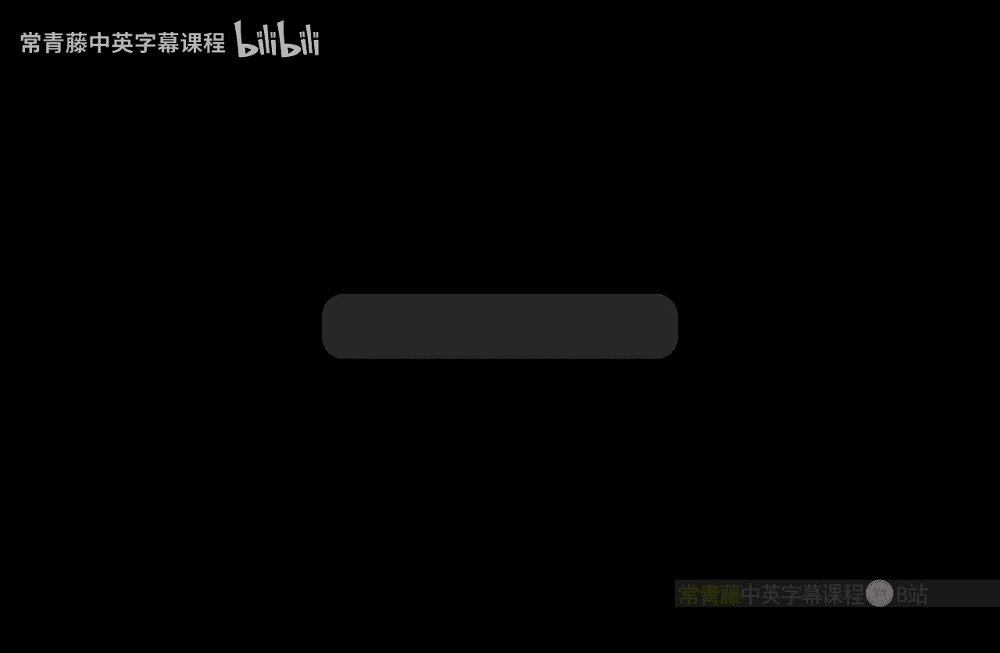
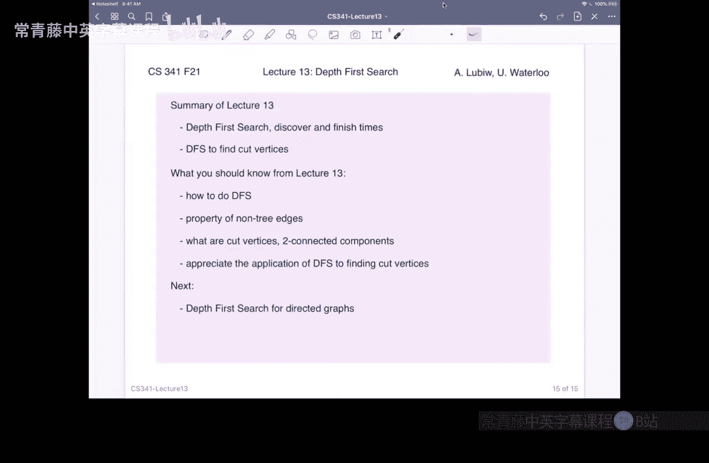

# 滑铁卢大学【中英⚡算法｜CS341 Fall 2021, Algorithms】 p14 P14 Lecture13 -BV1DhrDBbEwR_p14-

Welcome this is lecture 13 on depth first search so first let me remind you where we were from last time we were talking about graph algorithms and in particular about exploring a graph sort of the more most basic thing we need to do with graphs and lastly what we looked at is Bth first search which is sort of a cautious search it looks at everything from where it is like all the neighbors of vertex1 before proceeding to the next vertex which in this case would be two it stores vertices in a queue in order to do this and it ends up finding levels of the vertices which have the property that we are finding shortest paths from the start vertex to every other vertex Now the first thing we're going to look at today is another way of searching a graph depth first search and this is more like a bold search it goes as far as possible。

In its exploration before backing up to find if there's anything new， so let's look at this example。

 we're going to start the depth first search at vertex one。

And we would then look in the adjacency list of vertex 1 and say， okay。

 vertex 2 is the next thing that I find。So vertex2。

 and now rather than exploring other neighbors of vertex 1。

 we now look at the adjacency list of vertex 2 and say， okay， vertex 5 is what I find next。

Now from vertex5， we look in its adjacency list， we see vertex2。

 which we've already discovered already， the next one we find is vertex6。

 so from five we find vertex6。Looking at neighbors of vertex 6 it's only vertex 5 and we've already seen that so now we are done with vertex6。

 we back up and we come back to vertex 5 we got as far as this in the adjacency list so next we look at vertex 7。

So from vertex5， we find vertex 7。And from vertex 7 we found all of it。

 sorry we found one neighbor here is the one we already found， the other neighbor is vertex 2。

 so I'm going to mark that as an edge it's as with the bread first search tree there are some edges we discover here that are not going to be part of the depth first search tree and I'm going to mark those with the dashed edges。

Now at this point， we have completed Vertex7s adjacency list and we back up then to。

Vertex5 and discover that we are done with it so we back up to vertex two。

 we have seen the neighbor five。嗯。The neighbor seven， we have now found already as a dotted edge。

 and the next neighbor is vertex。4。So I find vertex four。😔。

I look in vertex4's adjacency list and I find vertex3。Yeah。I look in vertex3's adjacency list。

 I find vertex1， so that's going to be another of these back edges。And I find vertex 4。

 which I've already seen and vertex 2。 So there I have another back edge。

And now I am done with all of the neighbors of vertex3。

 there are three and we have all three edges and now I back up to vertex4 and continue exploringing there I have found the neighbor three there's a neighbor one。

小的无逼。Another edge is something we've already seen in other words the back edge。And vertex 2。

 which was the parent， which I've already done。 So now we are done with vertex 4。

 We back up to vertex 2。嗯。We have found vertex4 vertex 3 or I've already seen that edge and vertex 1 I've already seen that edge now I finally back up to vertex1 and I say oh all three of these things I have discovered so this would be the complete depth first search tree and just to emphasize the order in which we explored things I went as far as I could to vertex6 and then I backed up and started looking from vertex5 backed up tried vertex2 Sam。

Went as far as I could and finally backed up and came sort of back out of my recursion。

 if you like at Vertext one。Now， one thing I'd like you， oh let me add。

Here the order in which these vertices are discovered， so vertex 1 then two，5。

 six then7 and then I came down from two vertex4 vertex3 that's the total order and it's also good in the depth for search to pay attention to the order in which we finished the vertices and that is that vertex6 was the one I finished off first then vertex 7 I backed up and finished five。

Then I finish three， four， two， and one finally at the end。Now I've put a couple of notes here。

 one is that the order in which we discover things and the shape of the tree。

 it depends on the ordering that was in the adjacency lists。

And the other thing is moving forwards towards our pseudocode， whereas in B search we use the queue。

 and that's what governed our search by the levels in the case of depth first search。

 we're using a stack to store vertices， the ones that we have discovered but not yet explored。

 essentially。Okay， so let's look at the pseudocode for this。Um。I。

Have written here depth first search as a recursive routine， in other words the stack is implicit。

 I'm not explicitly pushing and popping from the stack。So as a recursive routine。

 when I'm searching from a particular vertex V， I will start off by marking that I've discovered it and then I look at all of its neighbors and so I look in the adjacency list of vertex V。

If I find a vertex U， a neighbor of V that is undiscovered。

 that's when I recurse and do a depth first search of vertex U。

 I've left little space here because we're going to add some things to this code。

Now here is the top level code for depth first search and the point of this is when I do not have a particular vertex I want to start with I just want to explore the whole graph。

 so I believe that for bread first search I left it as an exercise to give the main routine that would find all the connected components and in the case of depth first search here I'm giving it explicitly to you so we would initialize by marking every vertex as undiscovered and then for every vertex v。

 I say， oh if it's undiscovered that I'm going to start a depth first search tree rooted at that vertex so I'll run the depth first search tree of V it will discover for me everything that is connected from vertex V but in case the graph is disconnected I will come back to this loop and be checking other vertices and potentially find another another tree so I may eventually。

Have some kind of structure where I find one tree and then because the graph is connected。

 I find another tree later on。Okay now as with B' first search we should store more information than just going through this routine this routine doesn't actually collect any information as we go so what we're going to do is store the parent pointers so that I explicitly know which edges are in the tree and we are also going to label edges as being either part of the tree or not part of the tree and we could also in cases like this store component number so I would say this is component one this is component two and I might like to record for every vertex which component it blend in。

So let's look at what I would do to collect the information about parent。Now。

 when I find here vertex U being undiscovered， that is when I'm adding something to the tree。

 so I would set the parent of vertex U。Is vertex V？And I also now have an edge of the tree。

 the vertex from V to U is a tree edge。Okay， it goes from parent V down to the child view。And。

Then in this case I'm calling depth first search， but otherwise here。

I have an else statement after my if。嗯。This in this case I I have either a back edge or i'm looking at the parent itself。

 so I have to escape from that if you is not equal to the parent of the。嗯。

Then I'm going to mark that the U is a non treeage。

And I am also going to explicitly mark a vertex as being finished when I'm done with it。嗯。Yeah。

Okay and in a little bit we're going to think about the order in which we discover vertices。

 but also the order in which we finish with the vertices as we marked on on the previous slide。

 if you remember this was the order in which the vertices are finished and that ordering is going to be very useful for us。

Okay。So on the next slide I。I simply have the blue parts marked here in the code and we're going to talk about the runtime analysis and I claim that it's order n plus n if you remember n is the number of vertices in my graph and M is the number of edges。

Perhaps I don't have that written down yet， so。And is the number of vertices？

M is the number of edges。And the way we prove that this is the runtime。

 it's the same analysis that we had for B first search。

 essentially we are looking for every vertex once we are looking through its adjacency list。

 and we argued that this the sum of all this work is order M。

 the number of edges because every edge appears twice the edge from U to the appears once in used adjacency list and once in these adjacency list。

 so the total amount of work for going through all the adjacency lists is two times M in other words order M。

 and that was the argument the runtime list in total M plus M for doing a depth first search。

Now I've left as an exercise to do the other useful thing I suggested we might do。

 which is to number the connected components in case there's more than one and to record for each vertex which component it belonged in。

Okay， so some of the properties of depth first search it gives us quite a lot of structure。

 first of all， it partitions the graph into one tree for each connected component bread first search would do that too。

Secondly， we can classify the edges so far I've talked about tree and non tree edges as we go further and consider depth first search。

 especially in directed graphs， we're going to further refine this classification on the Da tree edges to say there's different kinds of non treere edges。

And then the other part of the structure we get is vertex order and the order that in which we discover vertices and the order in which we finish the vertices。

So one of the more basic things we want to know is that if I do a depth first search from a vertex v0。

 then I do reach everything connected to v0 that's part of what's claiming that I can find all the connected components this way。

So let's look at the proof of this limitma， if there's a path， let's say v0 up to some final vertex。

 v sub F。If I look at the last vertex of this path that I've discovered， let's say B sub i。

Then what happens in the depth first search is I explore and I discover all the neighbors of v sub I including the next neighbor in this path right。

 so that means I will eventually get from v0 to v subf a more formal way to do this would be to say that this is a proof by induction。

 but this is the heart of it。Okay。Okay， so the next property we're going to look at is that any non-tree edge joins what I'm calling an ancestor and a descendant in the tree so to define that let's look here。

 I say that a vertex v is an ancestor of U and the other way to say it is that U is a descendant of V if I can follow parent pointers from U and get to V so U is a descendant of V v is an ancestor of U as another example here V is not an ancestor of X because when I follow the parent pointers from X I get here and I never get to vertex v okay so that's the definition of ancestor and descendant。

And what we're going to prove now is this lelemma that says any non tree edge joins an ancestor and a descendant。

So let's look at that。Essentially， what we're claiming is that I never have an edge like this that goes sort of across the tree between vertex A and vertex B。

 where neither one has an ancestor of the other。🤧So let's look at this proof。

Let's consider some non tree edge。I'm going to call it AB。

 but it need not be like in this picture we're going to prove it can't be like in this picture。

 suppose that vertex A is discovered first。Okay， so I have an edge from A to B。

 so when I call the depth first search at A， as soon as I discovered it I call this。

 I'm going to examine the neighbor B。Okay。And what does it mean to examine that neighbor in the depth for search code I look to see is you discovered。

 so I will certainly discover。嗯。Discover B before A is finished。

It need not happen that we will discover B as a child of vertex A。

But we will definitely discover B before we are finished with a because we go through all of its universe so then this means that B appears in the subre rooted at a。

I exhaust that whole search before I'm finished with Mertex A。

And this means that so A is an ancestor of B。Okay， so that's the end of this proof if we have a non tree edge A B and vertex A is discovered before B。

 then a is going to be an ancestor of B。One little thing to note about this proof is it's not approved by contradiction and I think often when we prove things we often first think oh suppose it's false and then what can I get out of that but very often that's more complicated than it needs to be and you could just directly prove the thing you want here we just said suppose we have a non-tree edge and we directly prove that such an edge joins an ancestor and a descendant so whenever you're tempted to do a proof by contradiction first think can you just prove directly what you want。

There are times when we need the hypothesis that the conclusion fails。

But those cases are actually sort of rare。Okay。😊，So let's look at enhancing depth first search to explicitly compute the discover and the finish times。

So the one thing different here are these lines in blue I'm initializing time if I had multiple connected components and we had the depth first search that just tries each vertex in turn as a root then I should initialize time to be one at the start of that but here I'm just writing the piece of the code that does depth first search from a particular vertex okay so I'm initializing time to be one and when I discover a vertex that's when I'm setting the discovery time DV stands for Disc time and I update time becomes time plus one so that I have only one event happening at each time point。

And when do I set the finish time for a vertex here was the line in the code where we were saying we're finished with the vertex so here is where I would set the finish time of the to be the current time and update time now a good thing to notice about the discover and finish times is they have a certain ordering property in particular they form a parenthesis system。

Which I misspelled here， sorry system in particular suppose that I discover vertex V before vertex u。

 So V goes on the stack before u goes on the stack then either it happens that I discover V and finish V there's another typo here。

 this should be the finish time of V。And then after that I discover u and then finish U or the alternative is that I discover V it goes on the stack。

 then I discover U it goes on the stack so at this point in time they are both on the stack and then it must be that I finish U before I finish V just from the stack property so in particular if I look at joining discover times and finish times。

I would never have a situation like this where they interleave， so this is not possible。对。Okay。

 and by this， I mean that I discover V then I。Discover。You。Then系。Finish V。And then I finish you。

 That is not possible。Okay。That was part one of this lecture， we've talked about depth first search。

 discover times and finish times， and you should know how to do depth first search。

 how to carry it out， how to make use of it and the property of non tree edges。

 remember what that was that every non tree edge goes between an ancestor and a descendant。

So the next part of this lecture is going to be looking at an application of depth first search。

 and we're going to continue this in the following lecture when we look at depth first search for directed graphs。

All right， so let's look at this application of depth first search。

The application is for finding what's called two connected or biconected components of a graph now we've looked already at connected components of a graph that's when the graph itself is not connected and we look at the separate pieces as being the connected components so there's one level sort of further than that which is to suppose what happens if there's a vertex that I remove from the graph if I remove vertex2 from the graph I disconnect it and that's a very bad property to have in a network that it's so fragile that there's a single vertex which if it fails the network becomes disconnected so we do not like to have these cut vertices in a graph。

In this particular graph vertex2 is a cut vertex and vertex5 is also a cut vertex if I remove vertex 5 I separate this piece of the graph from vertex6 left all by itself which cannot connect anymore。

So here's the definition of a cut vertex， V is a cut vertex。

 if removing V well together with the incident edges makes the graph disconnected。

So this application is to find the cut vertices of a graph and something a little stronger than that。

 which is when I have a cut vertex， I can think of it splitting the graph into separate pieces。

 so these are what's called the biconnected components of this graph。I imagine removing two。

 seeing the pieces that I get and putting vertex2 back into each of the pieces I get。

 similarly removing vertex 5， seeing what are the pieces I get and adding vertex five into each of the two pieces。

So we're going to find the cut vertices using depth first search and this is the same graph that I had in previous pictures and I showed a depth first search starting at vertex1。

Here I'm showing a depth first search starting at vertex5。

 just so you see that we get a different structure tree if we start at different places。

 and also I wanted to show you what happens when this depth first search starts at a vertex that is a cod vertex。

So here's the picture of the depth first search starting from vertex5。

 and we see the two components fortex6 and the rest of it happening because vertex5 has two children。

The other cut vertex here， if you look at what it looks like in this tree。

 one of the pieces I get is vertices one， two and。Sorry one three and four which are here and the other piece I get when I remove vertex two is this five and six and seven right so we' are going to work at understanding the cutvers in terms of a depth first search。

Now here's a tiny bit of history of this together with by the way the picture from Wikipedia showing cut vertices done with this fancy coloring system where this vertexes colored red to indicate it's part of this component and with the scion to indicate that it's part of this component so if you like this kind of picture I thought it was a little bit illuminating about cut vertices they're the ones with the multiple colors and the components that you get from these cut vertices。

Now this algorithm， I'm going to show you a linear time algorithm to find the two connected components。

Using Death first search， it's due to John Hopcroft and Bob Tarjan back in 1973 and often when when people talk about famous computer scientist and these are two of the most famous computer scientists they show you pictures of them currently as they look now Hopcroft is rather elderly now and Tarjn not quite so elderly but certainly older than in this picture。

 what I'm showing you here are photos of them from about the 1970s so Hopcroft and Tarjn had a beard and long hair。

 he doesn't look like that now， but I invite you to look at this Wikipedia page to find more current versions if you follow the links。

All right， so let's look at。Finding two connected components what we're going to do first is define find those cut vertices and first we're going to characterize what do they look like in terms of the death first search tree so here i've written down in a more precise way what I was telling you about in the previous picture the root is a cut vertex if and only if it has more than one child。

So the reason is the only way the root vertex is going to separate into multiple components when I remove it is if I have multiple children of the root。

If I do have multiple children， why does that make the root a cut vertex the reason is I can't connect across here because remember that every nontree edge goes from an ancestor to a descendant so there are no edges that connect here to here and if I remove five i'm separating this from this so that's what the claim is saying。

And as far as cut vertices that might not be at the root。

 here is thelemma that characterizes that so a non root vertex V is a cut vertex if and only if。

V has a subtree， in this case， for Tex2 has two subtes hanging off it and there's one subt for each child of a vertex。

So V has a subt tree that has no non tree edge going from the subt tree to an ancestral V。

 so let's look what that property means here vertex2 has two possible children。Vertex7。

 the child7 is in a subre that only consists of seven。Is this does this satisfy this property。

 no there's an edge going from seven to an ancestor。

 so this child does not make vertex to a cut vertex。On the other hand， this child， if I look at it。

 I have this subre。And is there a non treee edge going from the subte to an ancestor of vertex 2 well no。

 all the non treee edges just go up only as far as vertex 2。

 so that is why vertex 2 satisfies this property and by thelemma is a cut vertex。So。

Let's look at the proof of this lima。It's not difficult at all if I have this property that vertex V has a sub tree。

 let's look at V。So I have various children and each of those children weeds to a subt and remember that we have no edges like this。

 okay？No edges crossing between the subtes。And let's look at where some of the other non tree edges might go。

 I might have one going like this， I might have here， just some that go to here。

 and here I might have some that go higher。What we're supposing for the first direction of the proof is that。

The has a subt T with no non tree edge going from the subt to an ancestor， so that would be this。

 for example。Here is my sub T。😔，And in this case， when I removing V。Separates that subte。

From the rest of the graph。Okay， depending crucially on the fact that there are no cross edges here。

 none of these red edges， okay， so that proves the one direction。And for the other direction。

We want to suppose that we have a non root vertex V that is a cut vertex。

So since removing V disconnects the graph。Then the only way that can happen is if one of the subtrees of the is what becomes disconnected。

 right？嗯。And if a subre becomes disconnected from the rest of the graph。

And then that means that there's no non tree edge。From the subtreat to an ancestor of the。Okay。

 so that proves both directions of this manner。And now let's see how we're going to use that。

So we want now to make that lemma into a fast algorithm that will find the cut vertices。

And the way we're going to do that is with a kind of helper function。

 which I'm calling low because that's the conventional name for it。

 the low value of a vertex v is the minimum of the discovery time of vertices W where so here's my vertex u in my picture。

 either there's an edge from u to W then I would consider the discovery time of W as a possibility here。

Or you has a descendant here X。And there's an edge from X to W。Okay。

 so the interpretation of this is that the low value of a vertex V is the how high up in the tree can we get by either taking an edge from you or going down from you and taking an edge up to some ancestor now the one thing that might be slightly confusing is that i'm saying low but i'm talking about higher in the tree so you have to remember that what we're considering or the low value。

Here is the discovery time and those are lower as you go higher in the tree。

 so these are lower D values。Going up in the tree。And as I go down in the tree。

I get to higher Dvalue。Okay， so I hope that helps make sense of this that low of U is how high in the tree。

 how low a D value can get by from the vertex u by going down zero or more edges and then up one non tree edge。

Okay， so with this idea of the low function， we can reinterpret that lemma as saying that a non root vertex V is a cut vertex。

 if and only if V has some child where the low value is not higher up in the tree。

 not smaller than the D value of the itself。For example， here the。嗯。

Vertex2 has a child for and what is the low value of four it's seeing how high up can I get by going down and then up one edge and you can see that the lowest I can get。

The highest up in the tree is vertex 2 itself， and that's what makes vertex 2 a cut vertex because of this child4 that can't connect upward。

Let's look at this example a little bit more thoroughly i'm going to look what happens as time proceeds in what order do I discover vertices finish vertices and so on so at time one I start I discover vertex five。

Then I discover vertex 2， I come down and discover it's child seven。

And now I jump out of this recursive call I'm finished with seven， there's no more children of it。

 so I'm exploring some more from vertex 2， I discover vertex4。And then I discover vertex 3。诶。

Discover vertex 1。And then I finish with vertex one。

 so if I sort of mark the time when things are on the stack。

This is what I've got so far I finish with one， I come and finish with three。嗯。There's that。

 I finish with four。Itscover four finished four。Now this is the time when I finish with two。

I now discover Vertex6。And finish it。And finally I finish with Vertex5。

 so this one comes all the way to this one， so there's our parenthesis system。For this if we。

In order to compute their low values right we're depending on the discovery times。

 so let me write those down explicitly for vertex one， two， three。4，5。Six and seven。

 what are the discovery times？嗯。Okay。Let's see。This I should， I should complete the timing here。

 This is time step 3，4，5，6，7。8， nine，10。There we go， so I discovered vertex one at time seven。

Discover vertex2 at time 2， vertex3。At time six。Fortex for。I discovered at time five。

Vertex5 is the first one I discovered， vertex six at time 12 and vertex seven at time three。Okay。

 and from this we can say what the low values are。And' just I'm just basically looking at a tree to discover this。

 so for vertex1， how how high can I get in this tree by going down when I can't go down at all I can only go up and I get to vertex2 and vertex 2 has a discovery time of two。

So。There's for vertex1， it's low values2。For vertex2。

 how high can I get by going down and then up well this way I can only get to vertex2。

 but if I take this child， I can get up to vertex5 and the low value of the discovery time of five is one。

So I have a one here。Vertex three， I can get to vertex 2。

 but no higher up the tree and discovery time of two is two。Vertex4 similarly。

Vertex 5 is the root of the tree and I cannot get higher than itself and it as discovery time1。

Vertex6 I can't get higher than six itself and discovery time of six is 12 and finally vertex7 I can get all the way up to。

To the root and vertex5， the root has discovery time of one， so those are my low values here。

And if we finally also look at the test that we should perform。

 according to the lemma to know if a vertex is a cut vertex， we make this test about。

 does it have a child view whose low value is at least as high as D of V？

So let's look at that test if I test vertex 2， which we know from before it is a cut vertex。

So do you？Two is two， and I'm looking at its children。And in particular， I will look at child four。

Has a low value。Of two， child vertex 4 has a low value of two。And that is。

Cter than or equal to the discovery time of two， right？

So then we would say that vertex 2 is a cut vertex。Okay， on the other hand。

 if I applied this test to vertex number three。And note that the discovery time of three is six。

Vertex 3 only has one child， so when I apply this test to see I check all the children you right。

 but in this case there's only one child child one has a low value。Of。2。

So the low value of vertex1 equals。2。And that is less than the discovery time of three。So。

Three is not a cut vertex。Okay， so I hope that's a little more helpful to understand exactly。

What the low values are， what the。What the discovery and finish times are and how we use the low value to。

To check the Lena， okay。Here's how we compute the low value when I'm looking at a particular vertex u。

 I do consider the edges from u to W and what is the discovery time of such W。

But I also consider the low values of children of the vertex U。And say how if I go to a child。

 how high can I go from that child now notice here X was not just a child that was further down。

 but the recursive property will help us here， which is if I look at the child of you that leads to x its low value will already capture this so it suffices to look at the children of the vertex rather than to be considering all the descendants of the vertex。

Now the order in which this recursive formula should be applied is I have to know the low values of the children of a vertex before I apply this formula to compute the low value of the vertex itself。

 so I need to do the children like to have the low values for the children before the vertex itself and one way to do that is to order by the finish time because if you remember how the depth first search works。

 it finishes a child of a vertex before it finishes the vertex so inside the depth first search code when we finish a vertex we should use this recursive formula to compute the low value。

I'm not going to give the details of doing that。I think this computation with low was complicated enough that I'm happy if you just have some understanding that there's a recursive formula and that we could compute that recursive formula inside the depth first search。

 I won't look at the details i'll leave it as an advanced exercise for you。Now supposing we do that。

 then here is how we apply the lemma and test if vertices are cut vertices， so I compute low as here。

 then I run the following test， I see does the root have more than one child then the root is a cut vertex。

And for every other vertex not equal to the root， I check。

 does V have a child where the low value is at least the discovery value of V and if so then V is a cut vertex how much time does it take to do that for every vertex V I'm looking at all its children and then I'm looking up in my precomputed low values and my precomputed discover values so the time taken here is again this order M the number of edges for each vertex I'm looking at its children。

Actually， that's even only that only order n because I'm only looking at the children in the tree and the tree has n minus one edges。

Anyway， the runtime is linear for this。Now so far what we've talked about is just finding the cut vertices and what I claimed was that we could actually find the two connected components and I will leave all of that also as an advanced exercise to actually find the two connected components。

Okay， so then the summary of this lecture is we've talked about depth first search about discover and finish times。

 and we've used depth first search to find cut vertices and I've claimed you can also find the two connected components。

What should you be able to do out of this lecture， do a depth first search， understand it。

 what are the properties of the non-tree edges， as I mentioned in my first level summary。

 what are cut vertices of a graph， what are two connected components of a graph and here I'm saying appreciate that depth first search can be used to find the cut vertices in linear time and the two connected components in linear time。

And in the next lecture， we're going to look at depth first search for directed graphs。

See you in the next lecture。

