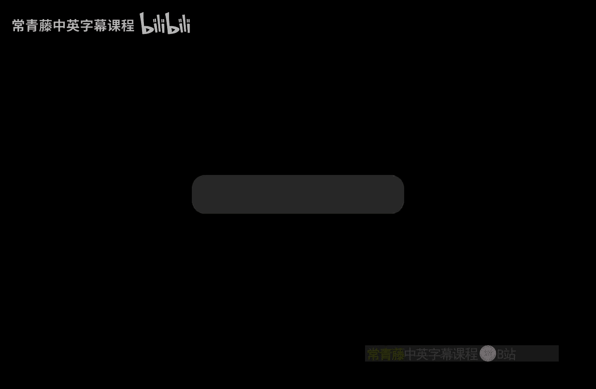

# 滑铁卢大学【中英⚡算法｜CS341 Fall 2021, Algorithms】 p15 P15 Lecture14 -BV1DhrDBbEwR_p15-

。Okay I hope people are ready to learn more about depth first search so if you remember last time we did depth first search on undirected graphs。

 so this was one of the examples that I did we start with some vertex and then look at its first child and then start exploring from there so we go as far as we can as soon as we can the order in this example。

 the order in which the vertices are discovered is written here。

 the order in which vertices are finished is here in particular for example once we come down here vertex6 is the first one where we say I'm done exploring all its neighbors I'm going back up to five seven is the second vertex in this order that we're finished with。

And we talked about how the graph edges partition into the tree edges which are solid colored here in this picture and what I was just calling the nontree edges which were given with these dashed lines and here I'm calling them back edges okay。

 and the property was that all of those go from a descendant to an ancestor。

 we always discover them in this from the bottom side going to the top side with respect to the tree order。

So what we're going to do today is look at depth first search for a directed graph and remember that means all my edges have arrows on them and if I have an edge from here to here。

 I can also have an edge going in the other direction or I might not， right？

So here's an example of depth first search in a directed graph。

 I'm using letters for the vertex names just because there's too many numbers floating around。

 but remember that whenever we're thinking about graph algorithms and how to implement them。

 we're thinking about the vertices being numbered from one to end。

 so these letters are just for us not for writing the algorithm。

Okay so what's shown in red here with this red arrows is the order in which we explore things and let's write out in terms of what happens during the time steps what we what we discover and what we finish so i'm starting at vertex r so that's the first thing that happens I discover vertex r I called up first search on it I look at its children it only has one edge directed out of vertex r right and that's this one this other edge is directed into vertex r so we don't find it when we look at r's adjacency list。

So the next thing that happens is we discover vertex x。And。From vertex X。

 we look at its out neighbors， there are two of them V and y， we look at V first， let's say。

 so we discover vertex V。And it has only one out edge， so we discover ver text U。

AndWhen I look at vertex U， I'm looking at the edges that go out of it。

 there's only the one and it goes back to vertex R。

 so that is when we identify this edge and we'll call it a back edge。

So when we do depth for search in a directed graph。

 we're going to have more kinds of back edge more kinds of non tree edges。

 and that's what I'm trying to explain with this example。Okay。

 what happens next in our ordering after we discover this back edge from U to R then I am finished with vertex u there's no more edges leaving it and now my depth first search so this is a care in our parenthesis system we back up to vertex V there's nothing else to explore there so I finish vertex V。

And then I back up to vertex x， which is when I discover one more edge， so I discover vertex Y。

Now here's something interesting happens， I look at edges going out from vertex Y and what do I find there's an edge here that goes to this vertex u now this is an interesting thing that did not happen for undirected graphs。

 we will call this a cross edge。You'll remember that for undirected grass we would never have such a cross edge because we would look at vertex U and say。

 oh， there's an undirected edge going over here to Hawaii and I would explore it right then and there。

Whereas now because the edges are directed， when I look at the edges leaving you。

This is not one of them， so I don't explore vertex Y right then。

So when I discover this edge going in this direction。

 it goes back to this vertex I had already finished with。And that's how I identify this cross edge。

So let's continue a few more steps here with this。I discover why I finish with why。

So there's another pair back up to X and there's nothing else to see from X。

 so now I'm finished with。X。Oops I should have marked the finishes there， I finish with X here and。

Now I back up to R and I'm finished with R because there's no other edges there。

So that completes this component and now because we're not done with the graph。

 there are vertices we have not yet discovered， I will go and discover a new vertex in my main loop here。

 I will discover the vertex S。And you know that will lead to somewhere in my parenthesis system。

 I think i'm not going to write down the whole thing here。

 but let's just look what happens from vertex S， I discover the neighbor W。

 I do depth first search from W， I discover Z。From Zed I look are there edges going out well yeah there's this edge going back to vertex U so this one is another cross edge and the interesting thing here is I'm joining two different components right I have one component here that i'm exploring one tree and one tree over here and I have a cross edge that's going from one tree to the other tree that also could never arise for undirected graphs。

So coming back here， I would identify this edge as a cross edge back up to W。

 nothing else to explore from there， back up to S， and I discovered there is one more edge from S。

 but it goes to a vertex I've already seen。嗯。And that is， again。

 something that would not happen for an undirected graph because if this were an undirected edge。

 I would explore it from Z。But because it's directed into Z I can only explore it from this end。

 so this is the third kind of edge these ones are called forward edges。ok。

So both the back edges and the forward edges join ancestors and descendants in the tree。

 but forward edges are directed down in the tree and back edges are directed up in the tree and the cross edges don't join ancestors and descendants here。

 so that's the distinction。Okay。So here's that same picture and now just writing in words。

 what are the different kinds of edges， there are four kinds， there are the tree edges， back edges。

 forward edges and cross edges and what I'd like to right down here is how can we distinguish them how can we test which kind of edge is which。

So let's look at that。嗯。First of all， the tree edges are the ones。

I'm always talking about an edge going from V to a neighbor U so we're talking about a directed edge from V to U in this example we do happen to have a V and a U but here I mean it in general right I might have this as V and this as U Okay。

 so I identify a tree edge by finding that U is not yet discovered。

That was my test in my depth first search， if you remember。A back edge。

 it's the case that the vertex U has already been discovered。

 that'll be the case for all three of these back edges forward edges and cross edges。

 but how do I tell the back edges， it's because the vertex u is not yet finished。

That's the distinguishing thing， for example here， I'm looking from you， I look at this edge。

 I say oh wool vertex R was already discovered I'm not adding it as a child of you in the tree but I haven't finished it i'm still exploring its subte so that's when I identify that this is a back edge。

嗯。The remaining cases。Forward edges and cross edges， it will be that U is already finished。

 so here u is finished。And in this case， also you is finished。

I mean the last case I could just test by saying well if I fall through all the above cases i'm in the case across edge but let's be more explicit here。

 so how do I tell a forward edge it's because the discovery time of you。

Is greater than the discovery time of the so let's look at our single forward edge and see how that's happening I discovered as later on I discovered zed。

When I backed up in my depth first search， I examined this edge and I said， oh。

 I've already discovered。Zed I've already finished with it and furthermore its discovery time is larger was discovered after vertex S so that's how I identified that I have a forward edge that i'm in this case。

On the other hand， the cross edges here， for example， when I'm at vertex Y。

 I'm looking over here and I say， oh， well that vertex has already been discovered。

 it has already been finished and I discovered it earlier than vertex Y。

 so that's why I have a cross edge here。And similarly from Zed to you。

 this other cross edge also matches that pattern。So discovery time of U is smaller than discovery time of V okay。

 we never have equality in discovery times because we're always they all get unique discovery times。

Okay， let's look at that then in terms of the actual pseudocode for depth first search。

 so the lines that are in black are the same as for undirected graphs and the part that's in blue here I'm filling in at the star。

 all of these lines， that's what's new for a directed graph。

Now remember our notation that DO ofV is the discovery time and F of V is the finish time。

So I am initializing in the very main loop， I'm marking every vertex as undiscovered and unfinished。

 I want also a mark when I've finished the vertex and I'm initializing time to be one。

And coming back here， what do I do when I'm doing a depth first search from a particular vertex V。

 I mark it as being discovered， I set its discovery time and increment time。

 and then for every vertex U in the adjacency list of V。

 that means there is an edge from V to U okay the adjacency list only contains the forward neighbors。

Then I say okay， if you is undiscovered， that's when I have found a tree edge and I do a depth first search on the new vertex U and otherwise。

This else should be out here under the if this is when I label the non tree edges so i'm going to label either back forward or across edges if you is not finished that's the case when I have a back edge it's going from the descendant V to an ancestor U。

And otherwise， I check the discovery time in order to distinguish my forward and my cross edges。

 just as we had in the previous slide。Okay。😊，One thing to note is the step first search still takes order n plus M。

 the stuff that I've added here is just a constant amount of work for an edge in the adjacency list of V so that's still within our order N+ M time bound。

The other thing I wanted to remark here is that in the main loop of the depth first search。

 I'm doing a loop that says I try to find an undiscovered vertex and then I start a depth first search from it and what might happen is I do one depth first search and find one tree and then I do a new depth first search so this is the second tree that I'm discovering and you know I might discover many trees。

What i'm pointing out here is that the structure of what happens here depends on the order in which i'm looking at these vertices it's not the order inside the adjacency list that can be anything we've already seen how that affects the structure of a tree but the choice here of the order in which I look at the vertices can actually affect which trees I discover and that's a more serious difference so this point will come back later on I just wanted to point it out here。

Okay， so we're going to look at three applications of depth first search for directed graphs。

 the first one is kind of the easy one， how to tell if a directed graph has a cycle by that I mean a directed cycle and the claim is that a directed graph has a directed cycle if and only if the depth first search has a back edge。

 it would be instructive to look back let's see at this example。

Here we do have a back edge and do we get a directed cycle out of that well sure because I have a directed path going down the tree and a back edge going up and that's what gives me my cycle so returning to this proof then that's the easy direction of this。

嗯。So this direction is easy。If the depth first search has a back edge。

 then the structure is that I go down some tree edges。And I discover a back edge going back up。So。

A back edge。Gives a directed cycle。And i'm just going to say cycle and always mean directed cycle because we're in a directed graph okay it's the other direction that's a little more interesting so here i'm going to suppose that we do have a directed cycle in the graph。

嗯。Suppose there exists a directed cycle。No， I'm saying directed when I said I wouldn't okay。

And let's suppose that V1 is the first vertex that I discover out of all of these。

And then I'm going to number name the vertices。嗯。Of the cycle。In order。呃。

V1 v2 up to v sub k where k is the length of my cycle， so V2， V3。

Or dot dot dot in this particular case， I just have k equals5 in this example。Okay。

 and the claim is that。That the edge from V5 to V1。VK to V1 more generally， is a back edge。Okay。

 so that if we prove that claim， we will have completed the proof of thelemma。

And let's see the proof of this claim。So the thing to note is that。Before we are finished with V1。

 we must call depth first search on all these vertices， V2 V3 V all the way to VK。So we discover。And。

Call depth first search on。All of the VIs before we finish with V1。

Okay that's just the structure of what our depth first search is doing note by the way that I might have like I might have other vertices involved here that I do a depth first search on as well right so there's there's other stuff that may go on in this graph there are more vertices that I might explore as well。

So when I do a depth first search of v subK， which I'm saying happens before I finish this。

 I will examine this edge going from v subK to v sub1 and I will do my test is V1 already discovered yes it is so I don't have a tree edge here and then I will next test oh is v1 already finished and the answer is no it's not yet finished so that's when I identify that this is a back edge。

So。嗯。We。When we test？The edge V5 to V1。We discover that V1 is not finished。

Sorry the one is already discovered， that's how we say we don't have a tree edge。But not finished。So。

That's when we label that edge as a back edge。Okay， so that completes the proof of the claim。嗯。

And that completes this direction of the proof of the memo， so we're done here。

So I was saying this is an algorithm to detect cycles in directed graphs。

 I guess I haven't explicitly said what the algorithm is。

 but the algorithm is just that I go through the depth of search and if ever I discover a back edge I say。

 oh there's a cycle and we could recover the cycle very easily as well。Okay。

The second application of depth first search is what's called topological sort of a directed acyclic graph what is acyclic means it means there is no directed cycle so we can have tested that as I showed on the previous slide now we're in the case where we do not have any directed cycles and we want to find a special kind of ordering so what kind of ordering it's called a topological sort and that means an ordering of the vertices such that for every edge U v the vertex u comes before the vertex V in the ordering。

And the claim here is that such an ordering exists if and only if the graph has no cycle。

 so one thing you might check out as an exercise is if the graph has a cycle to show that it's not possible to find an ordering with this property。

Now'm going to let's look at this example first that will give you a better feel for things here。

Here I have a graph it happens to be a path it's just that three edges a topological sort there's various possibilities。

 but I could order the vertices B and then a and then。

No I could not put it B and then A right because then verortex C has to come later and that would violate our property so let me back up from that choice if I had B and then C and then A and then D I claim that's a topological sort because we should look at every edge B to a goes forward in the ordering C to a goes forward in the ordering and C to D goes forward in the ordering。

There are other possibilities， of course， I could order C and then D。

And then B and then A and let's check this one out the edge C to a goes forward C to D goes forward and the edge from B to a goes forward so there are multiple possible topological orderings often okay sometimes it could be unique think about a case where it's unique。

Now there is one sort of simple minded way to find a topological sort， and it works perfectly fine。

It's to find a vertex that has no edges coming into it。

And to put that vertex first in the ordering and then remove that vertex and repeat so for example。

 here vertex B has nothing coming into it。And once I remove it， then I would look next， oh。

 vertex C has nothing coming into it。And my alternative here。

 I started with vertex C and I removed it and then I'm saying what now has no edges coming in and I have the choice of either D。

Or B，And I'll leave us an exercise for you to show how to carry this out in order N plus N。嗯。

Now what we're going to look at is an alternative way。

 so this was one way but an alternative way is to make use of a depth first search and why would you want to do that well the depth first search is very useful for other things as well anyway maybe you've used the depth first search to first check if there are any cycles and now you know there are no cycles and you want the topological sort then it's nice to get that right away out of the depth first search。

So let's see how to do that。嗯。So the claim is this that I'm just going to use the reverse of the finish order。

 so I don't even have to add anything into the depth first search code。

 I just run depth first search say in what order did I finish the vertices。

 take the reverse of that order and the claim is that that will be a topological sort。

So we're looking at this example， it's the same as the first example。

 but I took away that one edge that went here because that made a directed cycle and I only want to。

Find topological sorts I'm only able to when there are no directed cycles， right？

So let's look at this example and see what is the order in which I finish things and then look at that in reverse。

So。I come down here， the first vertex that I finish with is vertex U。

I'm not going to mark the finished times i'm only going to mark the the finish order okay the next vertex I finish with is this one then I come this is the third one I finish fourth one I finish the fifth one I finish。

Here comes six seven and this is the last one that I finish Okay so if I write down the reverse of the finish order it's going to start with。

Finish number。The eighth vertex in the finish order S W Z。Then I will have R。X。hy。

V and finally you so I have the reverse of the order and now let's check so i'm going to prove this in a minute that this truly works。

 but for now we're just looking that it works for this particular example what are my edges I have a directed edge from S to W。

W to Z。I have an edge from S to Z。I have an edge from Zed to you over there。

Maybe I won't write them all in but let me write a few more I have edge from r to X so certainly all the tree edges are going to be okay right because I finish a child before I finish the parent it's the non tree edges that are more interesting so let me finally mark the non tree edge the cross edge that goes from Y to U。

And。That one looks like this， okay。So there are some more edges。More tree edges。Okay。

 but it checks out this is a topological order。ok。😊。

So let's look at that in a more formal way and prove this claim。

That every edge directed from the VE toU goes from a high finish number to a low finish number that means it goes forward in this reverse finish order of the vertices so in other words F of V is larger than F of U so let's look at that。

So all of this is just repeating what I had there， the new thing is going to be the proof of the claim I needed more room for that。

All right。So let's look at this， so if V U is a tree edge， I'm just going to separate into cases。

It's either a tree edge or it's one of the other kinds of edges right forward edge I'm going to examine all of these。

Okay， so if VU is a tree edge， then we finish。You before we finish the so that works out okay that checks if I have a forward edge or a cross edge。

The thing you should do is remember what my rule was for defining forward and cross edges。

 let's go back to that slide for a moment。So。We're going way back to here and looking。

 what is the rule？For。A forwardward edge or a cross edge it's that you to already be finished if you is not finished I would call it a back edge if you is finished that's when I call it a forward or a cross edge depending on the D values。

In other words， what is happening is that I am at some vertex v which I haven't finished because i'm still working on it。

 I discover this forward neighbor you and I discover that you。Is already finished。So。

Here is finished already， so by the rule for edges。Threere edges。

You is finished at this point in time。And V is not。ok。

So the finish time for you will end up being smaller than the finish time for V。

 which is the property that we wanted。Okay， perhaps I should add in this proof that consider this edge at the time when we label it。

嗯。And then finally， we had a fourth kind of edge edge right。

 these were the back edges and what about those back edges？Well， remember we once had a back edge。

 but I said we're supposing there's no directed cycles in this graph so there were no back edges that was the previous application there aren't any。

Okay， so that completes this proof that if we wish to find a topological sort ordering of the vertices of a graph。

 we just take the reverse of the finished order coming out of the depth first search。Good。😊。

We have a third and final application， which is defined what's called strongly connected components in a directed graph now you should think maybe of。

These arrows now as one way streets and we're examining where from which intersection can I get to which other intersection so if I start here can I get to this vertex over here and the answer is yeah I can follow my one way streets and get there。

On the other hand， if I started here。And I wish to get over here。

 is there any way for me to do that with my one way streets Well no。

 because if you look let me actually write this in in another color。

 there is no way to get from these vertices back to the other vertices。

 all of the arrows point into this group of vertices and none of them point out。

So this is a graph that is not strongly connected and the definition of strongly connected is that for every pair of vertices there's a path from U to V and a directed path from V to U okay so when I say path I mean directed in this case the same way when I said cycle it was meant a directed cycle。

Okay， so the first thing we're going to look at here is can I test if a graph a directed graph is strongly connected and let's see how to do that in linear time and after that i'm going to do this stronger thing which is to find all of these what are called strongly connected components okay。

So first just this test， now you might think from this definition。

 it's saying for every pair of vertices U and V， so there are n squared order n squared pairs of vertices and you might think you have to test them all and look if there's a path from one to the other。

 it's going to take way more than n squared time。But in fact， there's a way to do it in linear time。

And the first idea is that we don't need to test all of the pairs。So here's our claim。

 if we look at some vertex S， I'm just arbitrarily picking one vertex S。

The claim is that the graph is strongly connected， if and only if for every other vertex V。

 there's a path from S to V and a path from V to S。So let's look at that in terms of the picture。唔系。

Saying I have some vertex S。I'm going to be concerned about other pairs of vertices U and V， right？嗯。

But let let's let's let's separate the proof into its two cases so in the first direction G is strongly connected does that imply that for every vertex s there's a directed path from S to V and a path from V to S yes that's just by the definition of strongly connected okay。

It's the other direction that is the interesting one。

 so suppose that for every vertex v there is some kind of path I'll draw kind of wiggly from S to V and a directed path from V to S。

And vertex U， that condition also applies， it's one of the other possibilities。

 so there's a directed path from SDU and a directed path from U to S。Now。

 what we would like to find here is how do I get from U to V？And how do I get from V toU？

And this picture should make it pretty clear how do I get from U to V I first go up to s and then from S I go down to V right so there's my directed path from U to V and I can also find a directed path from V to U also going through S。

So I use the path。From U to S。Plus， the path from S2V。And the same idea for VTU。sneakne that in here。

Okay so this claim at least tells us that we don't need to check all the pairs。

 we just need to check this condition here， we pick some arbitrary vertex s and we want to know is it true that for all vertices v there's a path from S to V and a path from V to S so we're going to separate into those two parts and say first of all。

 how do we test if there's a path from S to V for all vertices V？

And that's just precisely what a depth first search is doing， okay。

 so we just do a depth first search。三意。And I guess I did not prove explicitly for directed graphs this property that if I do a depth first search。

 I'm sorry， this should be me back up a step。I do my depth first search from S right I'm starting from S and looking what all can I get to？

For the case of undirected graphs， I explicitly proved this as alemma that if I do a depth first search from a vertex S。

The tree will contain everything that I can reach from S and the same proof applies for directed graphs。

 so I didn't repeat that proof， but that's the heart of what's happening here。Now。

 the second aspect is we need to test if there's a path from V to S for all vertices V。

At first glance that seems harder right instead of looking you know do I have these paths coming out of S。

 I'm now asking do I have paths going up into S？And I'd like you all to like pause the video and think about this a little bit because it's this beautiful idea。

 it's this aha moment you will have to realize how can I find if every vertex has a path going up to S。

 I say a path to S。Okay， so I hope you've thought about it a little bit。

 but the idea is this that we are going to reverse all the edges。All the edge directions。

And then again， do a depth first search。From S。RightAnd so if you imagine doing that here。

 this path which used to be directed this way now gets directed in the opposite way。

 and I'm finding can I get from S to everything， meaning can I get from everything to S in the original？

Okay。So neat idea here。This would be I guess a case of a reduction right I didn't call it that but we are testing if there's a path from V to S for all V just by again using my regular depth first search and doing this reduction that says。

 oops first reverse the edge directions before calling my original algorithm。Okay。So at this point。

 this complete how to test if a graph is strongly connected and what we'd like to do next is actually find all the strongly connected components。

So let me say a tiny bit more about what I mean by strongly connected components。

So if I have a set of vertices like these ones where I can get from every U to every V。

With a directed path。That's what's called a strongly connected component and I would like to make these components as large as possible so。

Here， for example， I have another one of these three cycles here。

 so this piece this little piece is strongly connected。

 but for my component I would like to expand to everything I can get so that's my strongly connected component here。

If I have an edge going backwards and forwards like this。

 that's a strongly connected component and can I grow this one， no， I can't。So。

These things I've circled in blue are the strongly connected components in the directed graph。

And if I just think about these components。So here I'm drawing them but not filling in what's inside each component and the technical term for that is to say I'm sort of contracting away what's inside each blob here。

Now， if I look at the edges that go in between components。

 so first of all here I'm marking this edges like this one， there are edges here。嗯。

So I will put a directed edge here。I have a way to get from this blob to this bb that corresponds to these directed edges。

And。And I can get from here to here。And I can get from here to here， right？

So this is all these edges they go in between two strongly connected components。

And the thing I'm stating here is that if you just consider the strongly connected components as blobs or as vertices。

 super vertices， if you like。And look at the graph on them that that graph is going to be ascyclic。

 so I'm claiming here that this this graph I've drawn here does not have a directed cycle。

Because if it did， for example， if this edge went the other way， it would be， oh。

 I can get from everything here to everything here。

 I can get from everything here down to everything here。

 this would be one blob instead of being separate bbs。

So this is just to give you some understanding of sort of the structure of a graph， a directed graph。

 a di in terms of its strongly connected components。

 and what we're going to do next is give an algorithm to actually find the strongly connected components。

At least I will be giving you an outline of this algorithm I won't give complete details because it is a reasonably sophisticated algorithm。

Lan airtime and this algorithm， by the way， was due to Ta a beautiful application of depth first search。

Okay， so here is the algorithm。We are going to run a depth first search and use the vertex ordering one two up to n to iterate through the vertices what do I mean this iterate through the vertices I want to jump way back to the slide where I gave you the depth first search and point out what I mean by this okay so we're going to zip。

All the way back。To the pseudocode。which was here and it's this line that i'm talking about when I start a new component。

 whether I start it here or whether I start it， for example。

 here depends on my vertex ordering that's what i'm talking about。Okay， let's come back here。

Where were we here so we're going to use the original vertex ordering one to n to iterate through the vertices and find my separate components of depth first search。

Now I'm going to suppose that the order in which I finish vertices is first F1 then F2。

 this is a list of the vertices in the finish order， okay。

Now I'm going to take the graph that has the reversed edges。

And I'm going to run a second depth first search on that reverse edge graph。

Using the vertex order where I start with。Finish last and go to finish first to iterate through the vertices。

So this has got to seem totally mysterious at first， like how in the world would this work？

Let's look at an example here。So I'm starting my first let me mark in red the order in which I'm searching things so I start at vertex1 and I would find it's got a child six so this would go in the tree from six I would explore let's say I explore three first it doesn't matter but then I would come along and explore this edge so I would call a depth first search at five and I would find oh it's got one out edge I would do a depth first search of two and discover vertex4 from vertex4 I discovered that I have a back edge from four to five oh that's okay and also by the way I discovered a back edge here from three to one so these two are my back edges。

And I continue， I come out of my depth first search and。I'm done。

 I have only found one connected component。Let me mark the order in which I finish things here。

 so I finish this ver text first。😔，嗯。系 then。Finish this vertex。Finish this one。

 I'm coming up my branch here， finish this one。Finish this one。And finally。

 I finish for text one and perhaps it's actually worth writing down what is this reverse finish order。

什么。So I finished vertex one last and then vertex six， vertex5。For text two。

Vertex4 and then vertex3 okay vertex3 was the one I finished first so the second step of my algorithm here is that i'm going to reverse all the edges so that's what i've drawn here my original graph but now this edge instead of going forward now it goes backwards okay I reversed all the edges。

I'm going to run a depth first search on this graph using this vertex ordering in my main loop of the depth first search so I guess it would also help if I still numbered these vertices 165。

The vertices are numbered the same it's just the order I'm looking at them that's different， right？

What does this say to do， I start with vertex1， it was the last one I finished。

So I explore its out edges。And from six I can't go anywhere else。

 so I back up and I'm done with this depth first search tree。

 I'm going to call that one strongly connected component。So。

I guess I didn't write in my pseudocode how we're finding the connected components。

 so this is the first strongly connected component。And here each。

 I should add each depth first search tree。Is one component。

Okay so coming back and continuing this example I have completed one depth first search tree I have not exhausted I have not discovered all my vertices so now I would look in my in my order of vertices did I discover six already I did did I discover five already no I did not so I start my second depth first search tree at vertex5 and what happens there I explore from five it's it's got a。

🤧Okay。You know， it depends which neighbor I look at first。

 but let's let's say I look it doesn't matter， I would explore this and this and this going in this order。

 come out of my depth first search。When I I do a depth first search of two。

 I discover this as a back edge and when I explore this edge coming out of S。

 I find it to be a cross edge， it's going to a previously discovered and finished vertex over here。

Okay， so this would then be the second tree and the second strongly connected component。Okay。

 is that the correct answer for this particular graph yes absolutely it is if you look at the original graph I have one component。

Here with this little three cycle and one component here with this three cycle and there is a single edge going between them so my my structure of。

My two strongly connected components and the edge joining them is like this。Now you might say， well。

 you know， all of that depended on the fact that I started at a vertex that was over here in the first component。

 so let's imagine that the vertices were numbered different or at least that I started with a different ordering here to do it。

So。If。The first depth first search。Started。At vertex 2。

You know maybe my vertices were input in a different order。

 I know'm i'm sort of violating the way I've written this。

 but what i'm imagining here is that the vertices were given to us in a different order。

 that's the point。So let's look at that I have my i'm not going to draw all the directions on the edges。

 but i'm just going to play through what would have happened here so my vertex2 my start vertex is here now。

And when I do a depth first search from here I would explore edge going out of here this one was this way right edge going out here and remember this edge goes the other way so my depth first search would find this component。

And then I would start somewhere over here and discover。You know。

 maybe if here I would start at this vertex， I would discover this component。

🤧And I would identify this particular edge here as a cross edge。

 it's going from a vertex I'm currently doing depth first search to a vertex that has already been discovered and finished over here。

So this is just the first depth first search。And now I would， which vertex did I finish last here。

 the last finished vertex is here。And more generally。

 maybe you see the structure is that the last finished vertex is always going to be here on the left hand side。

 and then when I do the second depth first search it's going to look similar to the above so the second。

Deepth first search。Will behave just the same as this one。same as here。

And find the same two connected components， two strongly connected components。

All right so we have carried out an example and maybe that seems to make it a little more believable that this kind of mysterious pseudocode would be working correctly i'm not going to give a really formal proof。

But I。Well say that you can find the more precise pseudocode in your textbook。

The runtime is order n plus m because look at all that i'm doing i'm running one depth first search i'm taking out the order in which I finished vertices i'm reversing all the edges that's order m to do that and then i'm running depth first search a second time so certainly my runtime is this。

As far as correctness， the claim is that the trees that are found by the second depth first search are exactly the strongly connected components。

 and I'd like to sort of give you the first high level idea but not give you a detailed proof。

In general。So。The format of telling someone something verbally is different from writing it down in a textbook and what's worthwhile in both situations actually is just to discuss the high level idea first before the nitty gritty details you need the nitty gritty details to make sure the idea really works but describing the idea first for any human being trying to listen to you it's much better to know the big idea before trying to check the details so here I'm trying to give you the level of what is the idea so I'm going to imagine just that we have two strongly connected components C1 and C2 and I have edges only going from C1 to C2 so this is a slight generalization of the example I showed but it's not showing you the whole picture of multiple strongly connected components。

So if the first。Depth first search。Starts at a vertex。In C1。Then。My depth first search。

Is going to reach all the nurse。R just C1 union C2。And。The last finished vertex。

So F sub n is the last finished vertex lies in C1。It's my start pertex。And。电。

The new depth first search。The second depth first search then starts in C1。In the reversed graph。

Starts in C1。And it will never when the edges are reversed here， it's never going to jump over to C2。

 so we will start a second depth first search to discover C2。So we find the two components。

is the two components。So this is case one here and case two is if the first depth first search。

Starts in C2。Then it's not going to reach the whole graph， it reaches only C2。

It reaches all of C2 because C2 is strongly connected， okay？And。We start a new tree for C1。

This means that the last finished vertex is going to be the very last thing I finish up with in C1 FN lies in C1。

And then I can just say star holds gain。That the second depth first search in the reverse graph starts in C1 and therefore it doesn't reach C2 and it finds the two components。

ok。So that completes this outline of a proof， the high level idea of the proof。

 and a more formal proof would take care of the fact that we will in general have more than two strongly connected components。

Okay， so a summary of this lecture， we have looked at depth first search for directed graphs。

 it's different from the undirected graphs because the non treee edges are now of three different kinds。

 back edges， forward edges and cross edges。Then we looked at depth first search for three applications to test if a directed graph has cycles or not。

 in case it does not have cycles， we could find a special vertex ordering where all the edges go forward in the order。

 and the last and most difficult application was to find the strongly connected components。

What should you be able to do after this lecture certainly be able to do depth for a search on a directed graph。

 modify the code to do other types of things， know about the different types of edges certainly know about cycles and topological order completely how to find them why it's linear time as far as how to and how to test strongly connected I gave you complete details out so you should master that and here i'm just saying appreciate the application to finding the strongly connected components because I didn't give all the details of that。

And what comes next is more graph algorithms and now some that are not just linear time that are not just depending on depth first search and in particular minimum spanning trees which you might remember from math 239 and then some lectures on algorithms for shortest paths。

 so that's it for this lecture。

