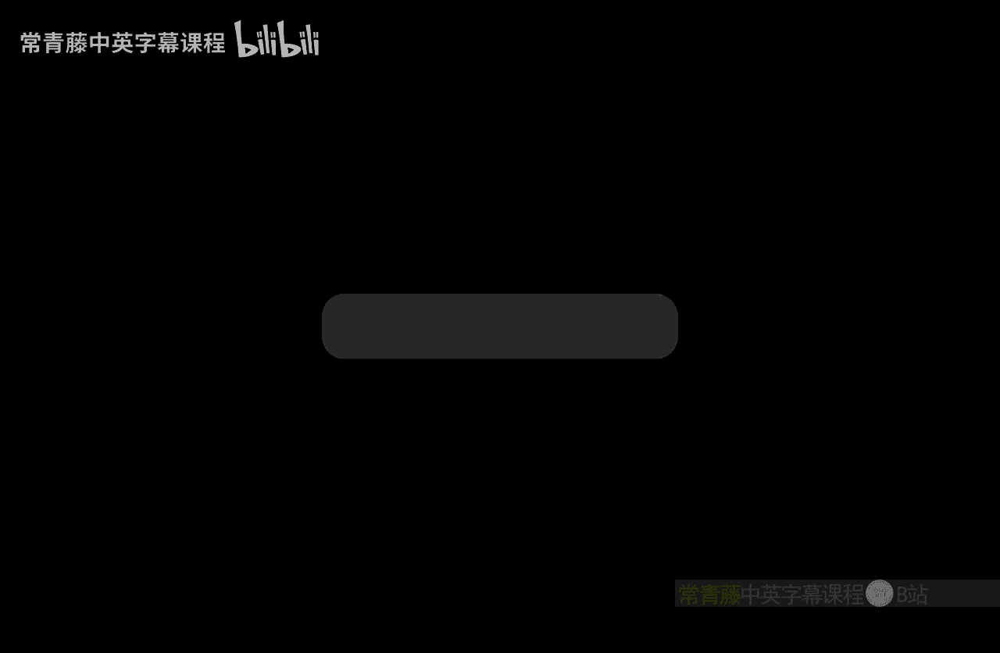

# 滑铁卢大学【中英⚡算法｜CS341 Fall 2021, Algorithms】 p16 P16 Lecture15 -BV1DhrDBbEwR_p16-

Welcome this lecture is about minimum spanning trees it's going to bring together things you've seen from two previous courses in math 239 you have seen spanning trees minimum weight spanning trees and in CS240 you've seen data structures and we're going to be putting these together and give the best algorithms possible for finding minimum weight spanning trees so let's start by saying what they are we're given a graph this should be an undirected graph and I should put that in that's important。

Undirected。And this graph has weights on the edges so i've written that as a weight function that takes the set E to the set of non negative numbers so and the problem is to find a minimum weight subset of the edges that connects all the vertices so we want to connected。

Subgraph set of the edges that connect all the vertices and if you add up the weights of the edges that we choose in our set s F that should be the minimum possible so let's look at these examples。

I've written the edge weights here along along the edges and I haven't named anything because the pictures will do just fine so one example is I could take one vertex and just add in this case there are enough edges touching this vertex that I can connect the whole graph that way so the tree ends up being a star all the vertices except one are leaves so that's a possibility here so let's consider that one so I'm using this edge this edge this one and this one and my total weight if I add it up here is four five six7。

And so what we're asking here is can we do better than this weight of seven？

Now there's a couple of ways to think about this you might be seeing first of all that this edge of weight for that's a really heavy edge so I shouldn't use it unless I really really need to and notice that if we throw away this edge the graph is still connected right so surely we can do without that edge so this was a bad solution here because we used that edge。

Another way to think about this example is here I have an edge of weight zero that means that's a really good one so I should use it if I can so here is a better possibility then I will use that edge of weight zero I have to get to the top of ver text and you know weight one looks like the best I can do for that and if we。

Add these two edges， weight one and weight two， we have in total here a weight of four。

And if you sort of try out other possibilities on this example。

 you can verify that this is the minimum weight we can possibly get。Okay。

 so the first thing to note is our definition here。

 a minimum spanning tree is the edges that we get in a minimum spanning tree here。

 minimum weight set of edges that connects all the vertices and this edge set will be a tree because think about that if I included enough edges to include a cycle and that's useless I could remove one of those edges and I would still be connecting everybody so it's sort of an observation that we're going to have a tree and what follows from that is that we can say how many edges are going to be in a minimum spanning tree and it'll be in minus one because that's the number of edges in a tree on N vertices that's something you will have seen in Ma 239 and you can easily prove by induction if you wanted to reverify it。

So as a simple case let's suppose that all the edge weights are one then how can we do this well that that's all the previous lectures we've just had on depth first search and bread first search either one of those will find a tree that connects all the vertices of the graph so bread first search or depth first search and I can start at any vertex to do this so starting at any vertex。

We'll find a spanning tree。Well， it'll find a spanning tree so long as the graph is connected， right。

 but if the graph is not connected in the first place。

 then there is no way we can find a spanning tree。Perhaps the other good thing to note。

 so this this is going to take order n plus M so linear time to do this。

We will be seeing in this lecture that to find when there are weights on the edges to find a minimum weight spanning tree takes more than this linear amount of time。

There's one thing， however， that we can do right away just at unit cost， which is to check。

If the number of edges is sufficient。So first check that m is at least n minus one。

 otherwise there's no way we have enough edges to find a spanning trait。Okay。

 so this is a check that we can make in order one time。

 presuming that we are given our graph in such a way that we know the number of edges that we don't have to go and count them up from the adjacency lists。

Okay。So。嗯。Minimum spanning trees can be found using greedy algorithms and that's the thing I'm thinking that you have seen in Ma 239。

 exactly to what level of detail you saw that probably depends on who it was it was teaching in which term you took it。

There are several possible greedy approaches and we're going to explore a few of them in this lecture and the following lecture and they have different implementation challenges and that's what we're going focus on so the first approach is the one I was hinting at in the previous slide when I said oh that edge of weight zero we should surely take it because that's the low weight edge and it connect some things it's good so the continuing on that idea we would add the minimum weight edge first and then keep going through the list of edges but make sure we never create a cycle because we don't want a cycle in our final spanning tree this is known as Crusll's algorithm。

Another greedy possibility is to grow a connected graph from one vertex。

 this has a little more the flavor of the bread first or depth first search except now we're dealing with the weight right and this algorithm is known as Pris algorithm。

If you look in Jeff Erickson's book， he gives a much longer history of these two algorithms and who we should really attribute them to because both of them were invented long ago when people didn't necessarily they didn't have Google Scholar and these things to find other people's published work so things were reinvented and given。

Not the name of the first discoverer。There is a third possibility which I hinted at in the example on the previous slide by saying that edge of weight four is a really heavy edge and so we should throw it away so that's another greedy approach which is to start with the heaviest edges and throw them away but make sure we never throw away an edge that is going to disconnect the graph that we have at that time Anyway we are going to spend our time today on Ksco's algorithm and in the next lecture on Pri's algorithm。

So。Here's Cruical's algorithm in a little more detail we order the edges by weight so the weight of E1 is less than equal to the weight of E2 and so on and we break ties arbitrarily but when we look yeah it doesn't matter how we we break the ties here we initialize our tree to be the empty set and then we go through this list of edges in order and if the edge does not make a cycle with the current set T then I added into T so i'm picking edges from smallest to largest if we go back to the example on the previous page and see what would this algorithm do。

嗯。For the example。Let me just write it down one more time really quickly。

 so the minimum weight edge here was zero so we add that first。Three， four。

So it's an edge of weight two two and one I would then look at these edges of weight one suppose I look at this one first and I look at that one second I would then start looking at edges of weight two well this edge of weight two makes a cycle so I would throw that one I would not use it on the other hand this edge of weight two I would use it because it gets to a new vertex the remaining edges like at this point I could stop because I have my n minus one edges and I know i'm done but if we continued with the algorithm it would not be incorrect I would be checking this edge and that edge and I would not add either one because in both cases they create cycles with the edges I already have okay。

So。Yeah， we could add an escape clause here in the algorithm that says， you know。

 stop when I have n minus1 edges in T。Okay。Let's see so here again。

 I've just repeated the algorithm so we can look at it as as。

As we continue here now the general situation is that t is going to have some edges in it it's not yet going to connect the whole graph maybe there are even some isolated atices that have no edges touching them so the general situation is T is going to be a forest that is some。

Its connected components are trees， but it doesn't yet connect everything。

And then we're thinking what are the next steps， so I might have， for example， the next edge here。

Being something of。We four that connects these。And here I would be saying， okay， edge F。

Makes a cycle， so don't include it。So discard it。Do nothing。On the other hand。

 if I have an edge here like this edge G。Maybe the next week， five， then I would use that at， right？

So H G。Does not make a cycle。And so we add it to tea。

Okay now the really important observation here is that how do I know if an edge makes a cycle with the t that I've got at this point in time well the thing I check is are the two vertices at the endpoints of the edge are they in the same component in the case of f they are and in the case of the edge G one endpoint is over here in this component and the other endpoint is in that component so this picture is is verifying that the edge E makes a cycle if and only if E joins vertices that are in the same connected component so when we come to the implementation that's the crucial thing that we're going to have to check okay？

Now before we get to the implementation I want to look at the correctness of this greedy algorithm if you remember with greedy algorithms it's like it really simple always to say what the algorithm is doing and the tricky thing is to prove that that is a correct algorithm it seems intuitive that this would be correct but you've also seen many greedy algorithms that seem intuitive but they turn out to be incorrect so let's look at this correctness proof。

So many of the exchange proofs that you saw for greedy algorithms the overall structure was to do a proof by contradiction and but I mentioned in one lecture that we shouldn't do proofs by contradiction unless we really need to so here will be an example of doing this correctness proof for greedy algorithm by induction instead of by contradiction it actually has a simpler structure that way so。

I hope it's enlightening so we are going to prove by induction on I that there is a minimum spanning tree that matches the tree T that is created out of this algorithm on the first eye edges of T。

I should specify that that's what I mean here。Okay。

 now the basis case is I equals zero and then all we're claiming is that there's a minimum there exists a minimum spanning tree that matches t on zero edges zero or more I should say and surely that's true there's no problem there so we turn to the general case where we are assuming by induction that there is a minimum spanning tree that matches our greedy spanning tree on the first i minus one edges。

So let's look at that。Our situation then is that we have the tree tea that was produced。

By the greedy algorithm and here i've listed the edges of it now here I need to correct this in the slide I should name these I mean these edges are the same up to point I but I should really call them M。

M sub I and this should be m sub n minus1 Okay sorry about that typo so we're imagining that the greedy tree matches our current minimum spanning tree we're going to change it as part of the proof to another minimum spanning tree that it matches on indices up to i minus1 and that this is the first place where they differ now it's important that we are ordering the edges by weight in both cases。

So。Let's suppose that this edge here， the first one of the greedy algorithm that does not match in our minimum spanning tree。

 let's suppose it's the edge E that goes between two vertices A and B so let's imagine the picture at the time when the greedy algorithm adds the edge E and let's let C be the connected component that contains the vertex A when this edge is added so my picture is that I have one connected component here are these edges joining some vertices V minus C is all the rest of the graph at this point in time so I might have put various edges into my greedy spanning tree but it won't be connected over here in general。

可。😊，Now， the condition for the greedy algorithm is that this is the first edge that crosses the gap between the component C and the rest of the graph。

And in particular， what that means is that E is the minimum weight edge doing that， so all the edges。

In the whole graph from C to v minus C。Have larger weight。Well or possibly equal weight right。

 but weight at least the weight of the edge E because the greedy algorithm。

Looks at the edges in order by their weight。Okay， so the next step in this proof is that I would like to do an exchange so that I add the edge E into M and to sort of pay for that i'm going to remove some other edge from M Okay so if I add the edge E to m let's consider what happens。

If we add。E to M。It's going to make a cycle， right。

 because we added all the edges we could without creating a cycle， so it makes a cycle。

And I'm going to draw this cycle in red here。AndTraccing out what happens in M when I add this edge。

Certainly it's got to cross， you know， it crosses between C and V minus c once。

 so it's got to cross back to get to the other side again， maybe it crosses more than once。

 maybe it does some stuff like this。But eventually it comes back to B。

 so there is our cycle containing the H E when I add E to M。

So the one thing I'm claiming about this cycle is that it contains an edge。Which I'll call E prime。

this edge here。From C to V minus C。Or between them。

 I should properly say there's no sense which are we are going in one direction。Now。

 a thing to note here is that the weight of E prime is at least the weight of E。

That's because of this property here。And furthermore， E prime comes after E in the ordering。

Inch order。And this is just because the greedy algorithm took the first edge it could， right？

So the exchange we're going to do here then。Is our new spanning tree or we're going to prove it's a spanning tree。

 I consider M add in the edge E and remove the edge E prime。And we are going to prove。

 I'll do this on the next slide。That M prime is a minimum spanning tree。

MST stands for minimum span injury and then we're done with the lemma we wanted to prove correctness of crystal3y algorithm。

And the reason we're done is now M prime is a minimum spanning tree that matches T on the first eye edges。

One more inch， at least。I guess the one further thing to note about this proof is that the reason we we still match on the first I minus1 edges is that these edges here haven't been touched by the exchange right both E and E prime are later edges so that's how this holds。

Okay， so module approving the claim we are done here and now let's look at the proof of the claim。

So let's look at that proof here， so we're going to prove it with two parts one part is to show that M prime is a spanning tree。

嗯。I think in Professor Brown's lectures this would have been called the feasibility aspect of things and second is optimality we're going to show that m prime has minimum weight by showing that its weight is less than or equal to the weight of my my minimum spanning tree I started with now this second aspect is the really easy thing and this is because what is the weight of m prime i'm going to look up here at the the definition of m prime it's the weight of m。

Plus， the sorry minus。iness。对。Minus the weight of E prime。And plus the weight of E。

And we know that the weight of E prime。Is greater than or equal to the weight of E right because e was the minimum weight edge crossing between c and v minus c so putting these together we get that the weight of m prime is less than or equal to the weight of n okay so this part is is easy。

Now let's look at why is M prime a spanning tree in the first place and the argument here is that it connects all the vertices。

We're going to show that。Connect all ofverses。对。And it has the same size as the original and。Okay。

So if we connect all the vertices with n minus one edges because that's what a standing tree has then I cannot have cycles so I have the right thing so the one thing that's left to prove is is this statement here that we connect all the vertices and why is that well first of all M connected everything when I add the edge E that still connected everything。

And because removing an edge of a cycle。Doesn't disconnect。So。To the cycle。Does not disconnect。

In particular， if we look at this picture， I've drawn a slightly different cycle than in the previous slide just to indicate another possibility。

 remember that our red cycle was the cycle in M union E and E prime was going to be the edge of that resulting cycle that I removed。

So that completes this。What are we doing next， we're thinking about how to implement and analyze the runtime of Kscal's algorithm。

We're going to do this in terms of our usual parameters。

 n is the number of vertices and M is the number of edges in our graph。

So again here's the algorithm just repeated for our convenience now the first step is that we're going to sort the edges right so M log m to sort the edges by their weights。

 we are working on a word RA model so we are assuming that each of the weights fits into one word and I can sort in time the same as the number of comparisons between elements so I can sort in M log n。

Now what I've written here is that this is the same M log M is the same as M log n and let's look a little bit why that is really the same contained in here is because M is order n squared always always right so then we have if we have M log M。

This is contained in， as a set， contained in。Actually， as the first step I'm going to say equal to。

People do order M。Log of n squared and that's not equal， what am I saying？Okay。Someet up。

And here we can take the square out of the log， right， so this is equal to M log n。

And for the other direction， why are these two sets actually equal， this is based on assuming that。

M is at least n。My your assumption。That M is at least n minus1。Okay。

 that was our very initial test that we could make。Okay。

 so that's how much time I'm taking just for this part and now we have to see how do I implement this test whether each successive edge makes a cycle with the current T。

So we are going to do that using that if and only of statement。

 that was a few slides back that said the edge makes a cycle if and only if both endpoints of the edge lie in the same connected component。

Okay。So equals。In points of EI。Ly in different connected components。

So that's the way we're going to implement this test。

So what we have to do for that is we have to maintain the connected components as we add edges and also we must be able to test if two vertices。

 the endpoints of some edge， have the two endpoints in the same component or in different components。

Now that is formulated as a data structures problem it's called the union find problem。

 I wish to maintain a collection of disjoint sets， our connected components。

 if you remember our disjoint sets and the two operations I want to be able to perform on those sets are first of all to find which set contains a given element X and also the other operation is I want to unite to sets that's what happens when when I say。

 oh here's the answer I'm adding to my minimum spanning tree its endpoints we in different connected components and now that connected component becomes a single connected component。

Now， our particular application of this union find is that the elements are the vertices of the graph and the sets are the connected components in the forest T so far。

So the structure of what's happening next is we are going to look at how to implement the union find and then how to do C using the union find。

 so let me start with the second of those things first。

So here is Csll's algorithm using a union find data structure。

The new things are what's marked in blue here。So initially I make one component or one set out of each vertex and then when I go through the edges。

 when I test， should I add this edge e sub I going from vertex A to vertex B。

 I do find operations to test if A and B lie in different components。

 that is if the find returns different things for A and B， and if that's the case。

 then I add the edge to T and I have to then connect the two components so I do a union on those two sets okay。

Now， one thing to notice here is that we don't actually care about the names of the connected components。

 and that is the way that the union find more generally is formulated。

 that we really don't care about the names of the components。

 we only want to know if two elements are in the same component or in different components。Okay。

So we next is going to look at how to implement Union find and then come back to this code and say。

 well， how much time will this take given the particular implementation of Union find？Okay。😊。

So this slide and the next few are going to be about the Union find problem just as its own problem。

 ignoring minimum spanning trees， and then we'll come back to the minimum spanning trees。

So this is just a reminder of what the Union findine problem is about。

And we're going to see a simple implementation that will give rise to order m log in time for Cruucical now if you remember we were getting that time for the sorting anyway so it's like the sorting is going to dominate the runtime and there is no reason to try to be even faster with our union find given that we're spending this time on the sorting okay now on the other hand there are other applications for union find not just this minimum spanning tree so there is a fancier union find implementation that is faster in some situations and I'll tell you a tiny bit about that later on because it's a bit fascinating it's an algorithm that's quite simple to describe but the analysis is hard and the runtime involves a bizarre function so i'll tell you about this okay。

But let's start now with just the simple implementation of union fine that is going to absolutely do perfectly fine for Cscoal。

So here is our simple implementation of Union find。

I suppose that the elements are one up to n that was true in our application for MSD。

 right theyre the elements with vertices one through n。

And I'm going to keep an array that just tells me for each element which set is it in at the moment I'll update it as I go and I'm also going to keep a linked list of the elements in each set so suppose I have in equals seven and at some point I have these sets as I proceed by the way the number of sets I get is only going down right because i'm doing unions but I'm never taking sets apart so every time I do a union I combine two sets and I will never again split them。

So let's look at what the array S would be like for these sets at this point。

So element one is in set A， two is in B，3 is in A again， four is in B， five is in a，6 is in A。

 and C is in the set seven。And let's imagine， well。

 I guess I could play out a find if we did a find of four and I said。

 well which set is element four in， I would just look into the array and see that element four is in set B okay。

 so the find operations are trivial and they just take order when one time I just look into the array。

Now the union， let's look at that as an example， if I wanted to take the union of A and B so I want to combine these two sets and remember I don't care what the resulting set is called so I could think of this as adding the elements of a into the set B or adding the elements of B into the set A they're both fine and what I've chosen down here is to add B into the set A so elements two and4 are joining the set A and let's look at the change that we would get in the sets let me just mark as a change up here。

 so it's elements two and4 that I added to a so those are the ones where I have to change the entry in the array S。

So element two， I would change the B to an A and element four， I would change the B to an A， okay。

So more generally， what's happening when I do a union is I must join。嗯。

Two linked lists in particular I've joined the linked list for a and the linked list for B and that takes order one time to join two linked lists okay but I also have to update the S entries for one of the two sets and that could be order n in the worst case it might be that half the elements are in a half the elements are in B and i'm taking n over two steps to update my array S so well then I can do n unions or n minus one unions I guess until I have a single set right and each of them can take order n in the worst case so am I looking at n squared there。

No， this is a case where it's better to be slightly clever。

And it's better to update the array S for the smaller one of the two sets that was what we did here in this example right B had two elements A had four elements and so I just did the update work for the elements in B。

 there were only the two of them here。So that seems a good sort of rule of thumb to reduce your work。

 but it's even better than that because if we now count what is the total amount of work for all the unions that I might do。

 I'm going to show you that it's better than n squared。

 which was our rough bound we were getting here。So we consider it element by element if one element needs its entry in the SRA changed。

 it's because that element is joining a larger set。

 so the new set it joins at least doubles in size because I had it in a set let's say size five and it's joining a bigger set a set of size six or something。

 so the size of the set at least doubles。And how many times can that happen for a particular element Well the maximum size of any of these sets is n so I can double at most log of n times and what this means is that the total work for all the unions if I added up for each element how how much work am I doing for that element there are n elements and for each element I do at most log n work so the total work for all the unions is behaving like n log n。

So the total runtime for union find is then how many fines did I do， they take a unit cost each。Plus。

 order M log n in total for all the unions that I might ever do。嗯。Good， okay。嗯。

Let's come back then to Csco and see using the union find this was our version of CRscoll using the Union find what is the runtime now with that simple implementation for union find so first of all I had the order M log N for the sort。

Sort the edges by weight and how many find operations do I do well I'm going through all the edges and I'm doing two finds for each edge。

So order M for the number of fines。And plus， I'm doing some amount of work for all my union operations。

 but we saw from that previous slide that in total。

 all the unions I can do is going to cost and log n。Okay。So the total here。

iss going to be order M log n and again here we are using the fact that M has to be at least n before we even bother running a minimum spanning tree algorithm。

Okay， so since。M is at least n minus1。And we check this before running a span tree algorithm。Okay。

So I want to finish off this lecture with two slightly more advanced things。

 so you can think of them as enrichment as something that you should appreciate。

 not necessarily know the details of， but I think it's very exciting to know these two things so I want to tell you a tiny bit about a fancier way of implementing union find。

 the algorithm is simple to describe and the analysis is what's beyond the level of CS341。

So the fancier implementation， I'm going to store each set as a tree of parent pointers and keep the name of the set at the root of such a tree。

 so the picture here before adding this red thing ignore this for now is that I have a set A that contains elements two。

3 and 11。I'm no longer storing a linked list i'm no longer storing the array s this is a totally different structure I'm using now I have a second set B that has in it all these elements that are drawn here and I have these parent pointers so that for if I wanted to know element what if I written here 17 which set does it belong to I would say。

 well I follow the parent parent parent and get to the root and say oh it's in set B？Okay。

So how do we implement our two operations union and find given this kind of tree structure for a union like if I had the union of A and B。

 I am going to make the smaller tree make its root point with a parent pointer to the root of the larger tree now one thing I should note here is that smaller is to be defined it's not just counting how many elements it's a more sophisticated root。

And I'm not going to tell you the sophisticated rule， but it's some measure of size， okay？

So that's what I'm doing for union and how much time does it take to do this union just order one because I'm only adding one parent pointer。

Okay。Now for a find this now is the operation that takes more time as I said from 17 I would follow these parent pointers up so the time it takes is like the length of this path and that could be really bad so there's a second heuristic if you like that I can use to save time in the future which is if I do a find of like element 14 I would go parent parent parent but I'm going to save work in the future by saying oh now I know that element 14 is in set D let me add a parent pointer that goes directly to there and get rid of this one element 13 I just touched it on my way up to the root so let me add a shortcut parent pointer so I would be removing these two edges and adding the two blue edges and by doing that I'm making my tree bushier I'm getting rid of long paths。

So the find now it seems kind of mysterious it's taking time proportional to the length of this path but I am then saving time in all the future finds by making the tree more bushy okay now the fascinating thing about this is that so here's just a repriese of what we were doing the runtime of this we analyze it in terms of the number of elements I have and the number of operations that i'm doing so here i've added up how many finds and how many unions am I doing。

Now this simple approach we certainly need by the way。

 unit cost for each operation the simple approach was order k plus n log n as my total time for all the unions and this is indeed the best possible I can't do better than the K right so if K is at least n log n then this is the best I can do already it's best if best possible if K is large。

 but when K is small that simple approach spends too much time on the unions it's spending n log n when maybe it could do better。

Now this' new approach this fancier union find remedies that so the new approach there's sort of a manageable analysis that shows that the new approach takes time k times log star of n so we're replacing this rather large n log n term by something that is a log star of n。

And there's a harder analysis that shows， in fact， log star of n is too big and it's an even smaller growing function。

 slower growing function。Now what what are these functions so log then you all know we're assuming base two always and this is the number of times you divide the number n by two to get something below one log star then is defined similarly but we repeatedly take the log and see how many times do I need to do that in order to get below one so as an example the number two to the 16th which is like 65000 log of that is just 16 right on the other hand log star of this number is just four because if you think the first log gets me to 16 then I get to four to two to one so four applications of log get me down to the number one。

That's why log star of this huge number is just four。

And to get a sense of how slow growing this log star function is look at this one。

 log star of two to the power to to the 16th， so this is two to the 65。

000 this is huge log star of this is only five right because the first time I take the log I get to two to the 16th and then I just need four more applications of log to get to one。

So what this is saying is that loggstar is extremely slow growing and what I'm telling you here is that the true behavior of this algorithm。

 this is what the theta here means is instead of logstar I have something called inverse ackermen function and that is even more slowg and it's less than or equal to five for all practical purposes。

 so really this algorithm is like its behaving in linear time K is by total number of operations and it's almost linear time but not in a theoretical sense truly linear time because this is not a constant function it does grow but it grows so so very slowly。

This theta is what it means is that this is the true behavior of this algorithm there are sequences of union find operations where the algorithm truly takes this much much time it's not an overestimate of the time taken by this algorithm Now those of you who have taken math classes and learned about some esoteric functions and ackerman's function is one of them might think that those functions don't arise in real life and the interesting thing here is that the inverse ackerman function arises as the true behavior of this fairly simple algorithm that seems to have nothing to do with esoteric functions like ackermen。

Okay。So。The one last thing I wanted to tell you about is nothing to do with union find it's only to do with Cical and it's like how much can Ccal's algorithm be generalized what are more general settings where the idea of C's algorithm works now I want to look at a variant of Ccal's algorithm that will actually find a maximum weight spanning tree that might not be seem like the practical thing to do but there are situations where that is what we might want and in the more general setting that's valuable thing to look for so the variant of the algorithm is just that I order the edges in reverse so largest weight to smallest weight and then if an edge does not make a cycle I added in it's my maximum weight that I can add without producing cycles。

So the same arguments work as before and the same implementation would work。

 this variant finds a maximum weight tree or in the case of a disconnected graph。

 a maximum weight forest。And what I want I'm listing here is the properties that make this greedy algorithm work。

 which is to say if we looked back at。That exchange proof or variance of that exchange proof。

 what crucial ingredients do we need to make that correctness proof work and there's two things both of which are pretty obvious for the case of spanning trees in a graph。

The first says that if I have a subset of my edges or my elements that has no cycles and we're going to call that now being independent。

And I get rid of some of the elements of the set， so I take even a subset of F。

Then that subset will also be independent so it's just saying if I have a bunch of edges that don't have a cycle and I throw away some of those edges。

 I will not produce any cycles that's all it's say。

The second property says that if I have two independent sets， so two sets without cycles。

one of them is smaller， G has fewer elements than F。

 then there's some element in the bigger set that I can add to the smaller set and stay independent。

In our case of minimum spanning tree， this is saying if I have a set of edges f and a set of edges G and neither one contains cycles。

 but F is bigger， then there's some edge I can take from F and add into G without creating cycles and if you think of our structure with connected components。

 you'll see why that is true。Now the name for a structure satisfying these two properties is a mattroroid and those of you who are or will take comminatorics courses。

 comminators and optimization courses will encounter mattros。

 Cruco's greedy algorithm finds a maximum weight independent set for any Maroid。

And it's sort of the prototypical greedy algorithm and the structure for which the greedy algorithm works。

Another example of a mattro you know there's no value in looking at something more general unless the more general thing captures more than one simple thing so the first simple thing that mattros capture are minimum standing trees but here's the second beautiful and familiar to you thing that mattros capture so the elements are vectors in some real vector space and independence here is linear independence so whether a set of vectors is linearly independent or not and Cscal's greedy algorithm will find a maximum weight set of linearly independent vectors from a set of vectors so this is a second case of a mattro and a second case where this kind of greedy algorithm works so this was more advanced stuff but just sort of a link into things that you would。

See if you go further in combinatorics or further in the study of greedy algorithms or further in the study of algorithms altogether。

 so here's a summary of our lecture， we looked at minimum spanning trees and we looked at Crusco's greedy algorithm how to implement it using Union find。

What should you be able to do out of this lecture certainly understand minimum spanning trees and work with them。

 understand Cruscoll's algorithm， understand how we implemented it and the runtime understand union find and our simple solution for union find now those's two last things I covered which is the fancier version for union find and the generalization of Cruscoll's algorithm to mattros that was more like enrichment so you know you should appreciate that that stuff was out there but we would not be asking you questions on that。

The next lecture， I'm actually going to continue on minimum spanning trees a little bit in the next lecture and then start talking about shortest paths in graphs。

Okay， that's it for this lecture， bye。

