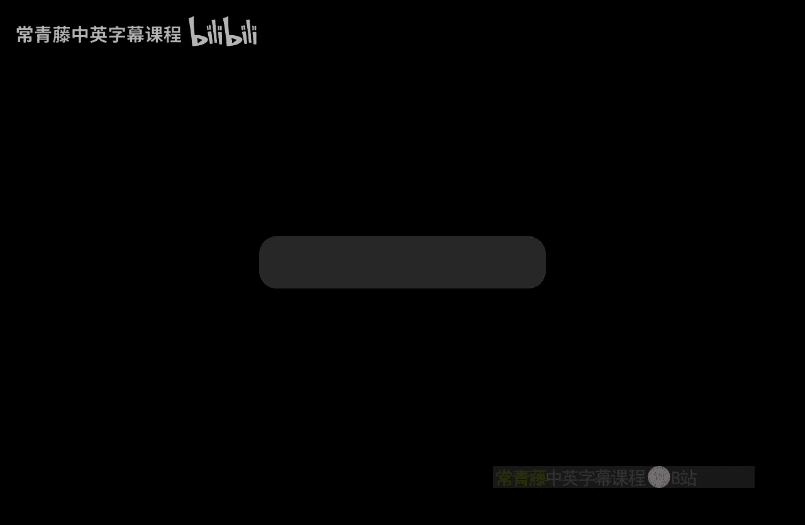

# 滑铁卢大学【中英⚡算法｜CS341 Fall 2021, Algorithms】 p17 P17 Lecture 16 -BV1DhrDBbEwR_p17-

Yeah。Hello everyone today what we're going to do is finish up on minimum spanning trees looking at Prince's algorithm and then get started on shortest paths and look at one of the most famous algorithms in computer science which is Dyktra's shortest path algorithm I like to do these two algorithms in the same lecture because they have a lot of similarities。

So let me start by reminding you what minimum spanning trees are。

 we have an undirected graph and we have weights on the edges and what we're looking for is amongst all those weight。

 how can I take a minimum weight subset that connects the vertices so we here were some examples that we looked at last day for this little graph if I take this subset of edges it indeed connects everything together and with weight seven this tree connects everything and has weight 10 and here is the minimum weight spanning tree of weight just four？

So one of the things we discussed last day is that the set of edges will be a tree always。

 there's never any reason to include a cycle in such a minimum weight set of edges as long as the weights are non negative。

And the other thing we looked at last day was Crusco's algorithm to find a minimum weight spending tree。

 and what I'd like to start with today then is to look at an alternative algorithm called Prince algorithm。

Okay， so。Here is what Pris algorithm does， we grow one connected component in a greedy fashion。

 so it's an alternative greedy algorithm rather different from cuicles。

So the general structure is that from my I start at some arbitrary vertex S and I grow a connected component that includes s so at a general point in time C will be the set of vertices that I've reached so far and I have various other vertices that I haven't reached yet and some edges cross from the set C to the vertices I haven't reached yet and we are greedy in the sense that we pick the minimum weight edge that crosses from C to a vertex not in C。

 so we choose this minimum weight edge leaving C at each step。So here's how we would do this。

 we initialize the set C to contain just the vertex s again s is an arbitrary vertex。

 our tree is initialized to be the empty set and while I have not reached all the vertices。

 I find a minimum weight edge E that has one end point in the set C and the other end point not in C。

I add that edge to my tree and I add that vertex V to my set C。Now as far as correctness of this。

 the exact same exchange argument that we looked at last day for Cruzco will also work and I'm not going to go through the details of it now it is in fact true that you can prove one single Emma that proves simultaneously the correctness of Prims algorithm and of Kzcoll's algorithm you can find that proof in your textbook CLRS I didn't choose to do that because I think it's it's much easier to understand if you're just focusing on one algorithm first so that was why I didn't present you that early general proof。

Okay， so let's move on and talk about how we would implement PRm's algorithm and analyze the runtime so again we are doing this on a word RA model。

 which is we're assuming that each weight fits in one word and we can add them up and compare them and so on do basic arithmetic at unit cost per arithmetic step。

We analyze things in terms of the number of vertices and the number of edges。So again。

 here's the algorithm just so we can refer to it。And this general step is that I need to find the minimum weight edge that leaves the set C and the natural thing you should think of for that is oh。

 I need to repeatedly find the minimum in some set that's sort of changing out from under me。

 so a priority queue is the right data structure for that。

So we want to have the operations available to us of finding and deleting the minimum weight because that's what we're doing here in this step and then the update operations that are allowed for a priority queue are insertions and deletions in the setting。

So priority queues as you know， can be implemented as a heEAP。

 you've seen that in CS240 and the time it takes for each of these three possible operations is then log K where K is the number of elements in the priority queue the maximum number at any time or you can think of K as when I perform an operation。

 how many things are there in the set and then K changes out from under you。Now in our case。

 the current set of elements here's a piece of notation for you。

 it's the set of edges that leave the set of vertices C and we call that delta of C it's sort of the boundary of C。

Now， what that means is that our value of k is bounded by M， the total number of edges。

 so then we are looking at a log of M time for each of the priority Q operations。

Now the elementary things we must do then inside Pris algorithm is find the minimum weight edge that's in our boundary set delta of C so that's a find me operation and then we need to see well how do I update that set of boundary edges when the vertex V is added to the set C so we're going to look at that a little more carefully and then sort of put things together and say how many of each of these operations am I doing？

All right， so here again is the general picture of what we're looking at in PRmMS algorithm。

 we have a current set C， and I'm supposing here that V is the vertex that I find that I'm going to add to the set C。

And how am I going to update this boundary set？So let me see the current boundary set is。

Let me perhaps draw it in blue this is my current boundary set this is the the edges leaving the set C and what I want to update it to。

Is now this set， so this is the new delta of C。All right because the vertex v joins C。

 so the edges that have to leave my boundary set are these ones。Okay。

 so the edges that go between C and the vertex V are the ones that leave my boundary set。

 and so I use delete operations to get rid of those from my current priority cube。

And on the other hand， the edges that are the other edges incident to V。

 and I wish I had a third color， but I don't， so let me draw these with squiggly lines。

 the other edges incident to V， and that would be these ones。

They are the ones that join the boundary set they're part of the new boundary set and for those we're going to use insert operations okay now how do I find all of these these edges these ones and these ones what I do is go through these adjacency list because every edge incident to V either leaves the boundary set or joins the boundary set and how do I know which I know which by testing the other endpoint to C is it currently in the set C or not okay so I go through these adjacency list once and then the thing to observe for the runtime is that each edge will enter this boundary set once and it will leave the boundary set once so per edge how many insertions am I doing one and how my name deletions am I doing just one so with that in mind we can analyze the runtime here。

The time per operation， we were saying this is going to be order log of the size of the priority queue。

 and that's the number of edges at worst at the maximum。

How many times do I do a find min operation I do that until until C contains all the vertices so i'm doing it in minus one times once for each vertex other than s which started in C in the first place right and the number of insert and delete well as I mentioned we do one insert per edge and one delete per edge so the total runtime then is going to be。

Order N。This is for the number of fines times log m per operation， so this is the find min。

And plus my inserts and deletes， there are M of them and each one costs log of the size of the priority queue and altogether this is so I should write here。

 sorry。I should write that these are for the inserts and deletes。Yeah。And altogether。

 this is giving us a runtime of order M log M， log N。

Remember because m is at worst n squared and log of n squared is two log n and the other thing I've done in this final line is say。

 oh， I have here an n log of M and here an M log of M and here I am assuming then that m is at least n。

The reason we can make that assumption is because we don't even need to run a minimum spanning tree algorithm if there are fewer than n minus1 edges。

唔。So that completes this is the final runtime then of Prims algorithm we're getting the same runtime as we did with Cscos algorithm we are using perhaps a more basic data structure just a priority Q data structure。

 whereas if you remember for Csco's algorithm we needed the union find data structure。

 which was not something I think that you did in CS240， it's not so basic。

Okay now there's two comments I want to make one is that it is slightly more efficient to keep a priority Q of the vertices that are outside C so these vertices over here and the point is that then the priority Q has size n at the most。

 whereas with the way we're doing it keeping edges in the priority Q the size of the priority Q can be as bad as n squared so this is why I say slightly more efficient it doesn't change the asymptotic runtime but it does change things in practice because the priority Q is smaller。

🤧う。😊，So how can we do it by keeping a priority queue of these not yet added vertices。

 the idea is that we set the weight of a vertex to be the minimum weight of an edge that goes from the set C to the vertex V。

So that's what we would have to take into account， okay。

 what are the different possible edges that go into a vertex and which one gives me the minimum here？

The update operation then becomes a decreased key operation。

 perhaps that's an operation you studied in CS 240 that also takes order log n if you implement the priority queue as a heAP。

One way to do it a decrease key is to remove the element whose key is changing and then insert it with the new key value so we're doing to log in time operations but for some implementations of a priority key the decreased key can be done even faster than this you shouldn't do a delete and an insert there's a faster way to do it with a heap I guess the way that you can do it if you remember how a heap works we're decreasing the key of an element so it would sort of bubble up in the heap closer towards the root the root is storing the minimum value element。

so altogether this still gives M log n total， but if you look at Prim's algorithm anywhere online。

 you're going to find this slightly more efficient method。

I presented it using the edges because I think it's easier to understand that way as a first presentation and the one last thing I will add here is that the fastest way to implement Prim's algorithm is to use a different way of implementing priority cues。

 so a Fibonacci heap。This is the name of the fancier。Implementation of a priority queue。

Gives a total runtime that's better because with a Fibonacci heap you can do a decrease key in order one。

 so the total time that we get then is going to be n log n。

This is because I'm doing my still my n minus one find operations each at log in but my changes to the priority queue are just decrease key operations and M in total so this is theoretically better in practice I think it's better to stick with the ordinary heaps that you know because Fibonacci heaps are very complicated but from a theoretical point of view this is the best way to implement minimum spanning trees。

Okay， so here's a summary of what we've done so far Prims algorithm for minimum span tree。

 it is a greedy algorithm but different from Ksle's greedy algorithm and what you should know is what is Prim's algorithm how to implement it and what runtime we get never mind the Fibonacci heaps that was just sort of added information。

What we're turning to next is shortest path algorithms， so new topic， new problem。

 but we're going to look at an algorithm that is slightly similar to friends。All right。

 so we're looking for the rest of this lecture and also for the following lecture at shortest path problems in edge weighted graphs。

So this is an incredibly practical problem， we have a road network。

 we want to know what's the shortest route to travel from point A to point B or we have a network and we want to know the fastest way to route a message from one point to another。

Very， very practical problem now the one way in which we've seen this problem so far in this course is that we saw that a bread first search if we started at a particular vertex v then it's going to find the shortest paths from V to all the vertices in an unweighted undirected graph so unweighted means I just count every edge as weight one i'm just counting how many edges are in the path。

So specific for unweighted and undirected we know how to do this in linear near time now more generally we're going to have either a directed or undirected graph we look at algorithms for both of these and we're going to have nonneg weights on the edges and sometimes maybe negative weights okay。

 so there's going to be a variety of different scenarios that we'll look at。

So just a basic example to show what shortest paths mean in a weighted graph。

 if I look at this example and I say that I want to get from vertex a to vertex D over here well there's various possibilities I can do it with just two edges but then the weight is five plus two or seven that's a pretty heavy weight path a better way might be three plus one plus two so that would be weight six and 345 this way or 3。

45 this way so there are ties for the shortest path but the weight of it is five and let's write down one of those possibilities so a to B。

Today。Of weight。Three plus two。Equals five。If there are multiple paths of the same weight。

 we might prefer the one that has the fewest edges。

 and that might be one of the things we'll look at in maybe one of the problem sets。

On the other hand， if I look for example， what is the shortest path from a to E。

 I could get there with weight five， I could also do weight three plus one and I believe that's going to be the shortest here。

 so a comma B comma E of weight。4。Okay。Now we were just doing minimum spanning trees。

 the one thing you might wonder is does a minimum weight spanning tree always contain shortest paths and the answer even for this little graph here。

 you can see it the answer is no in general， no， not always。

And another thing we might consider is since we know how to find shortest paths if all the edges count for one all the edge weights are one could I reduce the current problem when there are edge weights to that unweighted case and you might think when the edge weights are integers like they are here that we could do that right so maybe I have an edge of weight three and what I would change it in two is three edges in a row so that now。

If I traverse this， it costs me three。So think about that， this is indeed a correct reduction。

But what is the run time here we've taken the number three which we can express with log of three bits and we've changed it into the number three in urary I've changed it into three edges okay。

 so the issue is that this is not polynomial not a good running time。嗯。

I know we haven't talked very formally， I know Professor Brown mentioned this。

 but we're going to talk a lot more about what is polynomial runtime。嗯。

And this is not a case of getting a good runtime if I had an edge weight of 100 instead of doing on a word Ram my unit cost operations on 100。

 I would be changing that into 100 weight 1 edges and taking time proportional to the number 100 rather than log of 100。

Okay， so。Let's move on to some good shortest path algorithms we're going to study directed undirected graphs。

 single source， all pairs and I guess I should add here non negative。Or。Or arbitrary edge weights。唔。

And the algorithm that we're going to look at first is Dextra's algorithm。

This is an algorithm that comes from way back in 1959 and I'll tell you a little bit of the history of why Dyktra invented this algorithm back then。

 but let's first look at what the algorithm does so it works on either a graph or a diagram。

And the edge weights， on the other hand， have to be non negative for this algorithm to work。

 that's going to be important。We are starting with a start vertex s and what the algorithm finds is the shortest path from s to every other vertex okay。

 so this is called a single source。Shortest path algorithm。

It presumes that you know your starting point， but you're going to answer it for every possible end point。

嗯。Okay， and then just to be a little more precise than I was on the previous slide。

 what does a shortest path mean it's the path of minimum weight and what does that mean what is the weight of a path it's the sum of the weights of the edges in the path okay so just to be precise about that。

And one more point is how do we give the output I've suggested that we should have the shortest path from S to every other vertex。

 there are n minus one other vertices and each of those paths might have n edges so you might think that we are asking here for order n squared size output and that's not the case we can get by with an output of size order n and the way to do that is to discover or prove that the set of shortest paths can be captured with a tree and that's going to come out of Dykestras album。

Okay。So what is the idea of Dyketra's algorithm， it's to grow the tree of shortest paths starting from vertex S so this picture is going to look exactly like p so that's what I was saying there's some similarities between this and Prim's algorithm。

So and I've drawn it as a directed graph but this algorithm works for directed or undirected so starting from S and initially I would have only s in my set of reachable vertices I grow this shortest path3 so that at any point in time I know what is the shortest path to every vertex in my set B okay and at each point I want to grow my set B by adding one more vertex to it so I'm going to be looking again at the boundary of the set B namely the edges that leave the set B and I want to see which edge should I add so that I have the shortest path to one more vertex y and then I add that vertex Y into my set B。

So it is， again， a greedy algorithm。We have to be a little careful what we're being greedy about remember in Prim's algorithm we were just looking at the weight of this edge here we have a different problem we are looking for shortest paths from s to the vertex so our objective will be different。

So again just a little more in words， we have the tree of shortest paths to all the vertices in the set B and initially B is just s we are going to choose one new edge here it's shown as the edge X to y where x is in my set b and y is outside that set and the thing I would like to minimize to be greedy about if you like。

 is the distance from S to that start vertex X plus the weight of the edge from x to y okay so I am considering all the ways I can get from s to some vertex in B。

And take one edge。To the vertex， Y。And out of those various possibilities。

 I'm picking the shortest path that does that。So I'm minimizing over all possible pairs X Y satisfying this。

 I'm minimizing the distance from S to x， which is something I know already because x is in B plus the weight of the one new edge that goes outside B to vertex y I'm going to call that number D for noun okay。

And then the update I need to do is I'm going to then declare， oh。

 the shortest distance from S to y is the value D， I will add the x the edge X Y to my tree。

 in other words I will say oh， if I want to get to Y。

 I should first get to x and then take the edge X Y I set the parent of y to the X。

And I add the vertex Y to this set B， so these are the updates that I do。

I'll give you the exact pseudo of code in a moment what I'd like to address first is just the idea of this and why should this be correct。

So again， it's a greedy algorithm in the sense that we're always adding the vertex。

 namely y here that has the next smallest distance from S。And that's actually something we need to。

That's not true without the the proof we need we need the I mean it is true but we don't know it's true without proving it Okay so the claim here the the correctness claim is that this value D here maybe let me。

Circle this D is this D just so it's clear this D is the minimum distance from s to y that is no matter how I travel in this graph travel here travel out there。

 whatever kind of path I take to y it is going to be at least as long as the value D D is the minimum distance。

So let's look at the proof of that claim。嗯。So again。

 the scenario we're in here is that we're assuming that the distance from S to x is correct for all x in the Z B。

 and then we define D， like on the previous slide， and then the claim is that that value D is the minimum distance from S to the vertex Y。

Okay， so we want to show that for any path。From S to Y。So this is to prove。

Any paths from xs to y has weight greater than or equal to D。Okay。

 that'll show that D is the minimum distance from S to y， so consider such a path。Any path。

From S to Y。And let me call that path pi standing for a path。And I'm going to break this up。

Reak up the path pie。Into。The following， let me draw a picture of this， so I have my set B。

And I have S， I have my vertex Y， which is currently outside here。

And I'm going to say okay I have some path that goes from S to y it might wander around in here for a while。

 I'm not saying it has to be part of the tree just that it wanders around here for a while eventually it has to take an edge that goes outside the set B right so it goes from some vertex U to some vertex v over here and then maybe it wanders around maybe it even goes back into the set B and eventually it gets to y。

Okay。So B in blue was my set B。Okay， so I'm going to break pi into pi one is the initial part。

That stays inside the set B Okay， so in this picture pi1 is the part that goes from S to U。是。

Thats to you staying inside B。Then the path has to have some edge that steps outside B right so the E equals the edge from u to v the first edge of the path。

Of pie。Weaving B。It's like in the picture and pi2 is the rest of the path。Okay。

So what is the weight of my whole path pi well I've just broken it into three parts right so it's the weight of pi1 plus the weight of that edge E plus the weight of the remaining part。

And I want to first say that I can ignore the weight of the remaining part I am trying to show that the weight of this path is at least d right so here i'm saying it's greater than or equal to and i'm just going to take the weight of pi1。

Plus the weight of E。Well， why is this true， it depends very much that the edge weights are greater than or equal to zero。

 okay？So this is because。Edge weights。嗯。Are greater than or equal to zero。

And this means that the weight of pi2 is greater than or equal to zero okay。

 this would fail if we had negative weight edges。All right。

 and then the next thing I want to claim is that this is at least the distance from S to U。

Why is that so this part I'm claiming is greater than or equal to this part。

 I have some path from s to the vertex u and I knew that I have the correct shortest paths already stored in my D values。

 so the weight of this path is at least the minimum weight path， which is the distance from S to U。

And I'm leaving the other part alone the weight of E。Okay， and then I just want to say that well。

 I chose my。My value D。To be the minimum of anything of this form the distance from s to some vertex in b plus the weight of a single edge leaving okay now I get to the vertex v here but if if let's look back for just a second I chose this edge not for a specific y but I chose it overall all possible values of the vertex y to minimize this quantity so here I have something that is of the form of what I was minimizing on the previous slide and I chose D to be the absolute min here okay。

So let me write down。One of the reasons for these steps， so this is because U is in B。

So we have the minimum distance。Yeah。TheD value。Let me mix that up with the other D on writing D of SU。

Is less than or equal to the weight of any path going from SU and this step here is because we chose D to be the minimum。

O。And what this means therefore， once we've proved this claim。

 this is the end of the proof of the claim， is that by induction on the size of mySAT B。

 this algorithm will correctly find the minimum distance from our given start vertex S to every other vertex V。

And yeah， so this gives us the length of a shortest path if I actually want to find the path。

 then I'm going to follow my parent pointers backwards from V until I get back to S。Okay， so here is。

呃。I guess I would like to say a little bit about implementation before I describe the pseudocode that uses this implementation。

 so if you remember then our our plan is that we're choosing one edge leaving this at B to minimize this。

 this is what I was calling D。And as for prints algorithm， if I want to implement this。

 I can use a priority queue， in other words， implement it as a heap if you like。

 where the elements are the edges that leave the set B。

 so the edges that are in delta of a B using the notation we had B and now rather than just saying the key or the value of an element in my priority queue of an edge is the weight of the edge in this case it's different。

 the value or the key of an edge is the distance from S to the first vertex of the edge plus the weight of the edge okay。

Now， as for Pri's algorithm， it's more efficient if I keep a heap of the vertices。

 it does not change the asymptotic runtime， but it does in practice it's more efficient to have a heap of size n than a heap of size M。

 which might be n squared。Okay， so now we want to make a priority cube or a heap on the vertices that lie outside of B and set the key value of every vertex to be。

 we can think of it as the tentative distance， which is the minimum weight of a path that goes from s to y。

 but that has this special form that I start from s， I follow tree edges。

To some vertex and then I look at one possible edge going out of that so I will compare for any vertex y outside B what are all the possible ways that I could。

Travel from S inside the set B to some vertex in B using a shortest path then and then take one edge stepping outside。

Okay。So this is the。The definition of D of y that I store alongside the vertex y and use as my key values in the heap。

Okay， so with all of that here is dike stresss algorithm how the way it works I initialized the tentative distance to any vertex being infinity so far I can't get to that vertex at all I update the distance to S as zero because I'm already at S as is my starting vertex I initialize B to be the null set in this case note i'm not putting s into it right away okay and I set up a heap on all the vertices V using those tentative distances here as the key values。

Now while my set B is not the whole set of vertices。

 I pick a vertex of the minus b that has the minimum d value in the very first step what is this going to do it's going to pick my vertex s so the very first choice for y will be the vertex s itself。

More generally， I'm using my priority queue and doing a find mean operation。

Now the tricky thing is that I need to then update the values that are attached to the vertices outside B and the way I do that is I'm considering my set B is going to grow to join y so for every edge that goes from y to some other vertex like a vertex Z。

 I need to update and say， oh， I now have a new way to travel to vertex Z starting from S。

 I can take a path inside B to y and then take one edge outside。

 so I have to do that update so if the distance to y which you know that just came from my heap。

 plus the weight of the edge from y to Z is less than the current value I'm storing for Z。

 then I do an update。I set D of Z to be this improved value I've just found this shorter。

 smaller value， and I update the heap， so the key value of vertex Z has decreased and then I set the parent of Z to be equal to Y and that's so that I can trace back with my shortest path。

By the way， note that when I added this vertex into B。Which I guess I should have added in here。

So I should have one more line in here that says add y to B。Yeah。Okay。

 I don't need to set its parent there because I will have have set its parent along with its tentative distance as I go through the algorithm。

Okay， so。Here's。That same code here and we'd like to talk about what is the runtime of this the correctness is what I already proved that by finding this minimum we're doing the correct thing。

So we've got a priority queue implemented as a heap on order N elements。

 find me insert and delete all take log n time， and how do I update the heap。

 the value or key of vertex Z changes for all the neighbors Z of Y and I can do that by deleting and reinserting Z。

 or I could use a decreased key operation either way with a heap。

 it's going to cost me login to do that。So the runtime that I'm getting then I have my n minus one find operations because I'm adding vertices one by one。

 I guess actually in this case I have n because the very first find finds the vertex S。

And then every edge causes me to do possibly one insert and delete or one decreased key operation。

 so the total time is then going to be the same as it was for Pris algorithm。

 this is the number of find min。Login per operation plus order M。Log in。

Now we are explicitly making a heap of。Size n。And this is for the inserts and deletes。

Or the decrease key， if you like。And the total here then becomes order M log n。Assuming。

M is at least in。Okay。So that's our total runtime then for dike stress algorithm。And。

The one last thing I wanted to tell you was a little bit of the history I have a picture of Dyktra from the time in the 1950s when he discovered this algorithm。

 he was known not only for this algorithm but for many contributions in computer science。

 concurrent programming structured programming。This shortest path algorithm。

 he designed it for a slightly strange reason， he had some hardware that he wanted to demonstrate the capabilities of。

 so he had an audience of people who were not familiar especially back in the 50s with computers at all。

 and he wanted to demonstrate that a computer was a useful thing。

 so he used the shortest path algorithm to find how to get the best railway trip in the Netherlands between any city and any other city and design the algorithm for that reason。

Now at that time the result was not considered like an important discovery in computer science。

 computer science altogether was in its infancy and the analysis of algorithms was maybe in pre-infancy and what Exextra wrote about it later on I think he said at that time algorithms were hardly considered a scientific topic I wouldn't have known where to even publish it。

 the math culture of the day was very much identified with the continuum and with infinity could a finite discrete problem be of any interest。

😊，The number of paths from here to there on a finite graph is finite， each path is a finite length。

 you must search for the minimum of a finite set and any finite set as a minimum next problem please。

 it was not considered mathematically respectable。😊，So in terms of the history of mathematics。

 calculus is what has been done for some centuries。

 people were interested in continuous problems and how to analyze trajectories of gammon balls and you know。

 the rate at which water fills vessels and things like that and finite problems。

Discrete problems were considered too small to be interesting that's what diyktra is essentially saying here and it's only with the advent of computers and the world the way it is now airline schedules and roing problems in huge networks that discrete problems。

Are considered extremely interesting and the runtime of algorithms as a function of that discrete size is considered incredibly important。

😊，So anyway， Dyktra was at the very forefront of that and I think this little bit of history of the reason he discovered this algorithm。

 which was just to show the usefulness of some hardware， and I think that's pretty interesting。😊。

Okay so a summary of this lecture we looked at Prims minimum spanning tree algorithm and we looked at Dykestra's shortest path algorithm you should know what is Prims algorithm how to implement it and what is the runtime and the same thing for diykestra you should certainly know the conditions for Dykestra to work does it work on a directed graph and undirected graph does it assume we know the start vertex does it assume we know the Nvertex is there any property that's required on the weights yeah the weights have to be non-negative okay？

And it's also good to think through again the differences between primm and Dyktra。

 they are both greedy algorithms， but the objective function that we are being greedy about at each step in the algorithm differs。

And next we're going to look at some more algorithms for shortest pass。

 but that's it for this lecture。

