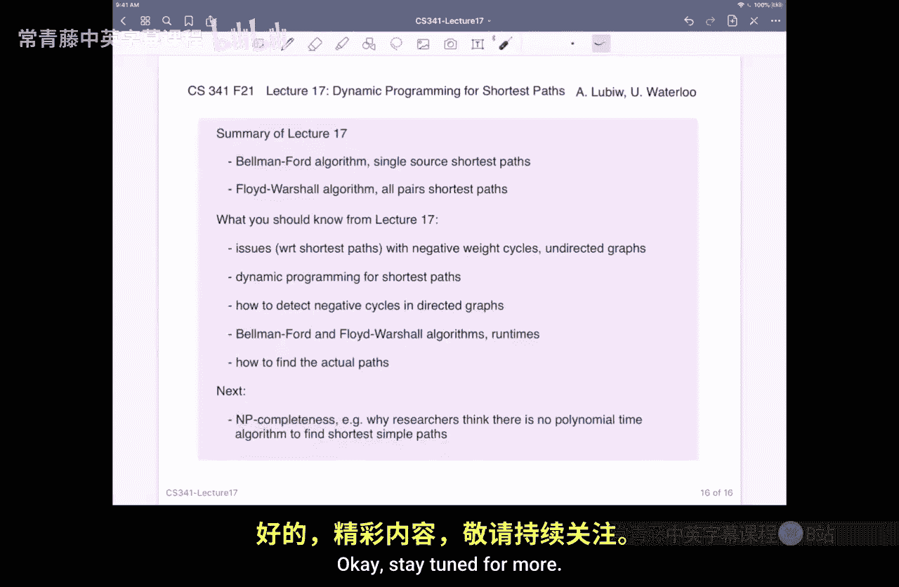

# 滑铁卢大学【中英⚡算法｜CS341 Fall 2021, Algorithms】 p18 P18 Lecture 17 -BV1DhrDBbEwR_p18-

Welcome everyone this is going to be the second lecture on shortest paths last day we did Dketras algorithm and today we'll do two more very famous shortest path algorithms so in this course you've learned a bunch of techniques for designing your own algorithms but it's also important to come out of this course knowing about some of the famous very good efficient algorithms that other people have developed and so that's what we're doing right now so remember what shortest paths are about we have a graph such as this undirected graph with weights on the edges i've just written the number beside the edge to indicate its weight and for example in this graph if I wanted a path from C to E that had minimum length and remember what the length of a path means we add up the weights on all the edges in the path so I could take the direct edge from C to E and that has weight nine。

Better alternative would be to do five plus two that has weight seven and even better would be well I guess nope that one's not better but the shortest path is this one where I add zero and three and I get a total length of three for traveling from C to E along this path okay now one thing I probably should have discussed earlier in this course but we talked very early on about how to store a graph the main contenders being the adjacency matrix versus having adjacency lists now when we have weights on the edges or more generally when we wish to store other information alongside the edges of a graph there are again these two basic possibilities only we should have seen how exactly you do them so first of all we can store something like the adjacent。

See matrix and then in a particular entry like here for vertex one and vertex2 the number that's put into the matrix is the weight of the edge so from vertex one to vertex two it's the same graph here i've just。

A becomes vertex1 and so on recall that we're using letters occasionally for the vertices of a graph just because it's easier for us to understand。

 but the way we're actually storing them is with numbers for the to identify the vertices which is how we can get an n by n matrix okay so coming back to where I was is edge from vertex one to vertex two has weight three it's written as the second number here in this pair。

So we could just store that weight in the appropriate place in the matrix now one little thing is that we then have to distinguish between a zero meaning there is an edge of weight zero and we used to put a zero meaning there is no edge and now i've indicated that with these little blanks you would want to use some special symbol to indicate that there's no edge there。

So this takes order n squared space because we are storing an n by n matrix now for space considerations and because most things are faster。

 we prefer to use adjacency lists and the idea there was that for each of the vertices。

 we would store its adjacent vertices。How can we modify that when we want to store weights of edges the most practical thing is to actually number the edges as well so in this case I have seven edges in my graph and the blue numbers here are the edge numbers that I've assigned kind of arbitrarily okay so edge one edge two edge three edge4。

 five， six and seven and so for each edge I can indicate what is its weight edge one which happens to go between vertices one and three has weight three。

We would also like to know for each edge what are its two endpoint and that's the reason to have this row in this vector of information and then for each vertex rather than listing its adjacent vertices we would then list its incident edges so vertex one is incident to edges one and two let's check that edge one edge2 incident with vertex1 and so on so we would store these as linked lists。

In order to save space， so the total amount of storage here is order n plus N。

And then it would be good to check as we go through today's lecture and talk in a very high levels pseudocode。

 how these algorithms work to think about how you would actually do them if you had this representation。

One of the algorithms we'll talk about today actually takes more than n squared time in which case we could go to this storage mechanism and it wouldn't matter。

Okay， so let's look about shortest paths。Now there are a number of versions of this shortest path problem I wasn't very specific on the last slide。

 one is that we might be given the start vertex and the end vertex and we wish to find a shortest path from the start to the end in terms of algorithms solving this problem seems to involve finding shortest paths from the vertex as to every other vertex V so that you will rarely find algorithms that deal directly with problem one it's just done in terms of problem two here。

There are certain heuristics one can do to solve problem one faster， for example。

 even with diykestras algorithm that we saw last day。

 if I want to know a shortest path from S to T and i'm running diykestrass algorithm。

 then as soon as I discover the true distance to T I can cut the algorithm short so that's one heuristic that saves some time。

So the second problem here， this is the one that Dyketra works for and we will tackle it again today is we're given a source vertex s and we want to find the shortest path from S toV for all vertices V。

 this is called the single source shortest path problem。

A third version is that we might want all pairs shortest paths， so for every vertex U and vertex v。

 we want to know the shortest U to v path。So remember now what Dykter's algorithm was doing。

 it was solving problem two， single source shortest paths。

If the graph had non negative weight edges and one thing I mentioned is that it works both for directed and for undirected graphs by contrast。

 some of today's algorithms will not work for undirected graphs。

But let's look first at this issue of negative edge weights。

 so Dyktra only worked for non negative edge weights。

 I should have asked you to make an example where Dykestra's algorithm fails it finds the wrong answers if there are negative edge weights in the graph。

Now more generally， what is the trouble with negative edge weights。

 even irrespective of which algorithm we might use。

 let's just think about what does a shortest path mean。So let's look at this example。

 there is a simple path that goes from s through this vertex， let me call it C。

 so S to C to T has weight three。Yeah。Is there？A shorter way to get from S to T Well the thing to observe is that if I go around this cycle what is the weight around this cycle minus2 plus minus1 so that's minus3 plus one it's minus2 to go around this cycle so if you imagine I went from S to C that's weight2 I go around this cycle minus2 i'm back to0 now I get a path of weight1 that goes to T。

So let's record that one if I go S to C to a to B to C to T， this has weight one。

Well is that the true shortest path from S T well no。

 if you see we could go around that cycle more and more times and get a more and more negative weight。

 so if we go around the cycle twice。Instead of just once。Then we're going to get weight。Minus one。

 right， and we could keep going。Dot dot dot， so weight is minus infinity。Well。

There are some situations where we might like to consider that to be the weight。

 but in many other situations we would not want to repeat vertices。

 so one natural idea would be to say well， in case there are negative weight cycles。

 negative weight edges and possibly negative weight cycles therefore a natural idea would be to ask for a simple path。

 so find the shortest simple path。So you might ask in this lecture as we go on why we're not doing that。

 why aren't we finding shortest simple paths？The trouble with this is that no one knows an efficient algorithm for this。

 no one knows a polynomial time algorithm and researchers believe that there is no such algorithm。

So no one knows a good algorithm for this。That really seems mysterious doesn't it and we'll be getting to the subject next。

 this is the subject of NP completeness。Okay so what are we going to do we're going to be looking at single source shortest paths in directed graphs i'll tell you in a moment why we're looking at directed graphs and we will consider three possibilities to avoid this terrible situation of having this negative weight cycle one is that we have no cycles altogether no directed cycles in the graph then there's a very efficient algorithm to find single source shortest paths so i'll tell you about that in this lecture。

Second option is there are no negative weights on the edges and then we saw Dyextra's algorithm that runs in this time okay so that was in the last lecture so no cycles or no negative weights and the more general option is that we allow negative weights we allow directed cycles but we assume that there are no negative weight cycles and then again we avoid that weird situation from the last slide where the by going around the negative cycle more and more times we get a length of minus infinity so we will study an algorithm for that it's called the beman Ford algorithm it uses dynamic programming and the runtime it's worse than diyextra it's order n times M remember n is number of vertices M is the number of edges。

Okay。The problem three that I mentioned which was the all pairs shortest paths again we will be looking at directed graphs and here again under the assumption that there are no negative weight cycles we will look at an order in cubed algorithm for that that's again a dynamic programming algorithm it's called the Floyd Warshall algorithm and that will be the third thing in this lecture so before we get to any of those algorithms let me mention what happens about undirected graphs now you might say well a twoway street I could just model it as two one way streets right so the natural reduction we could use。

From an undirected graph。To a directed one。Is that I would take a single edge AB。

So an undirected edge。And I would model it， I would turn it into two directed edges。I have。

Two directed edges。A to B and B to A， okay？So that's fine in many situations and we can do that。

 but what if we have some negative weights so what if the weight。

The weight of the edge AB is negative。What is happening here？

Then what we're getting here is a negative weight cycle right this has a negative weight I come back I get two times that negative weight and I've gone from vertex a to itself with a negative weight and' there's my cycle so that messes up all of these algorithms here。

嗯。So then we get。A negative weight cycle after the reduction。wait。

 let me say directed cycle just to make it clear。Okay， so we would need different techniques here。

There are indeed some algorithms that will deal with this。

 that we have an undirected graph with potentially negative weights。

But we're not going to discuss them in this course。ok。One thing I will note， however。

 is that this works perfectly fine if there are no negative weights on the edges。

 so these algorithms that we will be looking at in this lecture。The Belman Ford and the Floyd Wshall。

 they work on undirected graphs。With no negative weights， okay？All right。

 so coming back to our plan of what we're going to do here。

 the first thing I'm going to tell you about is single source shortest path problem in a directed graph that has no cycles that is the most efficient of all just a linear time algorithm。

And then we'll continue on to these dynamic programming algorithms。Okay。

 so a single source shortest paths in directed acyclic graphs。

 these are some items abbreviated dags for directed acyclic graph yeah so we're given a source vertex s and we want to find shortest S toV paths for all the other vertices V。

And the secret to this algorithm is just to use the topological sort that you might remember from depth first search back in lecture 14 so what was a topological sort it's an ordering of the vertices and I'm just going to like renumber the vertices to say let's suppose it's the ordering one two up to n with the property that every directed edge by J has I coming before J in the ordering so if you remember what such a graph looked like we had the vertices like this and all the edges go forward in the ordering。

Every edge Ij has I coming before J in the ordering。

Now if our source vertex s happens to be some vertex like here in the middle of this ordering。

 then there is no directed path that goes from s back to any of the previous vertices right so if a vertex comes before S there's no path from S to v so we might as well just say you know no path for those guys for those vertices and throw those vertices away and then the problem we get is with s equal vertex1 okay so this code is going to assume that S is vertex number one。

Okay， so this code。Zooms。S is vertex number one。Okay and it's very simple the plan is to use a variable or to construct an array D where d of I will be the distance from vertex1 to vertex I okay so we initialize by setting d of I to be infinity for all I and then I set d of1 to be0 to get from vertex12 itself takes no edges so that is a path of weight zero then for I equals1 to n I'm going to look at every edge from I to j so that'll be from I going to some later vertex and for all of those I am going to update the d value at the far end of that edge so I'm going to set d of j to be the minimum of what it currently is because maybe there was some other way to get to J what it currently is or the distance to vertex I plus the weight of the edge from I。

TJ。Now if you think about that for a minute， what it means is that when I get to a certain value of I here。

 I will already have looked at all the edges coming into vertex I which means that I will have the true shortest path to vertex I and then inside the loop。

 the work that I do for vertex I is to update for the edges going out of vertex I and so on so the correctness is a proof by induction on I that when we start the loop when we enter this loop for value I then D of I is the true minimum distance from one to I。

And so I'm not going to fill in more details on this。

Because it is a standard kind of induction proof。The runtime here we have。

A loop I going from one to n and I end up looking at every every vertex and every edge just once。

 for example， if I have a vertex that has no edges leaving it。

 I still spend unit time for that edge for that vertex I'm sorry and otherwise I spend time proportional to the number of edges leaving vertex I so we get order n plus n okay it's not just order M because I do indeed look at every vertex。

And I certainly initialize it too， right， so order n plus n linear time。Okay。

So we're next going to turn to the other two algorithms that I'm going to tell you about in this lecture。

 they are both dynamic programming algorithms， so I'm going to start off by little telling you a little bit about using dynamic programming for shortest paths。

So if the shortest path from some vertex u to some vertex v goes through a vertex x。

 then I can break it into two other smaller subproblem I want a shortest path from u to X added to a shortest path from X to V okay。

 the reason is that I shouldn't use if I'm going through x anyway。

 I shouldn't use a longer path than I need to right it's a really obvious sort of thing。

So if it goes through x， then we have a shortest u to x path and a shortest x to V path。

And the heart of the dynamic programming for shortest paths is to think in what way are these problems smaller or simpler to solve？

So there's actually two possibilities for that one is that they use fewer edges right I have some number of edges here some number here and the total number from U toV is the sum of those two so these subproms are smaller because they use fewer edges。

That leads to a kind of dynamic programming where we first try paths from U to v of one edge well either there is an edge or there isn't if there isn't the length is minus infinity sorry plus infinity and then we would go on and try paths of two edges paths of three edges and continue in that way so that is indeed the approach we're going to use for the single source shortest path problem the Belman Ford algorithm。

The other possibility for how these two subproblem are simpler is that they do not go through vertex x right if I went from you and went through a vertex x and then came to x again well then really I have a cycle from x to back to x itself and if this cycle does not have negative weight which was what we were assuming no negative weights then there's no point going around this cycle I could cut off the cycle and just go direct here to hear so that says that those subproblems do not use vertex X so this leads to a kind of dynamic programming where we first try the paths that use only vertex1 as possible intermediate vertices and then paths that only use vertices1 and two as intermediate vertices and so on okay。

So that's the approach we're going to use for problem three， this Floyd Wshahol algorithm， okay？

So we're first going to look at this idea being used for single source problems。All right。

 single source， the Belllman Ford algorithm。This was in fact one of Bellman's first dynamic programming algorithms I know that Trevor told you a little bit about Bellman and why dynamic programming is called dynamic programming it was named by Bellman who invented the technique anyway this single source shortest path problem is one of the first instances where dynamic programming was used。

So again I've written the problem here， we have an edge weighted directed graph with no negative weight cycles。

 we've discussed why we want both of those properties。

 we have a single source vertex S and we want shortest paths from S to all vertices B。

We are going to use variables D sub i of V， so I is going to go from1 to n minus1 and v is going to be over all the vertices。

 and we want this to mean the length of a shortest path from S to V that uses at most i edges。

And then I claim that to answer this question， the thing we really want is d sub n minus1 of V and what is the reason for that？

The reason is that。If I had a path that was longer。If we had a path of n or more vertices。Sorry。

 edges， edges， that's the point。Better than or equal to n edges。Then it would have。

Greater than or equal to n plus one vertices， right？So it would repeat a vertex。

And the same argument that I outlined on the last slide。

Says that we don't need to consider repeating a vertex if I go from S。

To some vertex and my directed path comes and repeats that vertex before getting to T。U。

So this would give a cycle。Directed cycle。We're always meaning a directed cycle when we say cycle because we're in a directed draft so then we can leave out the cycle。

So we could go direct from S to here to here， this is leaving out the cycle。And get a path。

Path with weight less than or equal to the original。Maybe equal， but that's just fine。Okay。

 but what this is is saying is that we really just want to know what is the shortest path that uses at most and minus one edges。

 and then we will have found the true shortest path。Okay， so with that idea with these variables。

 we are going to initialize as follows if I have a path of zero edges。

 I'm going to set that to be infinity for all V because remember we're asking what is the shortest path from s2 v that uses at most zero edges。

 okay so I can't get with zero edges from s to any other vertex v except for s itself so I will reset d sub zero of s to be zero？

And then the general formula， the recursive formula that we use in our dynamic programming is going to say that d sub I of v。

 assuming I already have d sub I minus1， d sub I of v is going to be the minimum of D I minus1 of V and what this is saying is oh。

 I only use less than or equal to I minus1 edges。And then the second line is saying well what if I really do use i edges what is the last edge so it's going to be some edge from u to v because we want to get to v and we will try all the possibilities for this vertex u and i'm going to say well I have a path of it most I minus one edges to u plus one more edge going to v and I add up my length here plus the weight here so this is using i edges and we try all choices for the last edge so。

That's our general formula。I've written it here again just so that we can have a look at it。

Why is this correct this is by induction the initialization gives us the correct values for d sub zero and then assuming that d sub I minus1 is correct。

 this formula here gives the correct values for d sub I because really I'm trying all possibilities of what the path can look like either it's shorter or it's exactly length I and I try everything for the last possible edge of it。

So that's correctness。Wrapping that all up what do we get for the beman Ford algorithm I do the initialization that I suggested on the previous slide and then for I equals2 to n minus1 I carry out this formula so for each vertex v I initialize d sub I of v to be d sub I minus1 of v and then I check for each edge u to v can I get a smaller thing by using this part of the formula right d sub I minus one of u plus the weight of u v。

One curious thing to note about this is that here I want edges i've fixed my vertex v right and i'm trying all the edges U to v so that's not what we usually have from our adjacency list we usually have from vertex v what are the edges forward from vertex v and what are the edges out of vertex v in other words and here what I want is the edges going in to vertex v so to do this this would needs。

To create some modified adjacency lists。To create the in adjacencies。As a pre processing step， okay？

You've seen how to do that on assignment five， well you've seen how to reverse the edges。

 but you could do the same thing to find the inadjacencies of every vertex。Okay。

 so what is the runtime for this algorithm， we have a mean loop。

 I goes from one to an essentially if we're only paying attention to asymptotics。

And inside that loop， what are we doing， we are looking at every vertex and at every edge coming into that vertex another way to think about this is I'm looking at every edge once during this the edge from a to B I will look at when I consider vertex B and when I try this value for a okay so it's order n plus M inside that loop。

This is the outer loop。And this is the inner loop。Is order one for each vertex and edge。Okay。

 now in total， this is order n squared plus n times m。

And we usually just write that as order N M because we're assuming our graph is connected otherwise we wouldn't be looking for shortest paths from one thing to everything else。

 we should run a depth for search or something first to find connected components and just concentrate on the connected component that contains ver text as okay。

 so this is we're assuming M is at least in here。ok。So this is our final runtime。

For this Belllman Ford algorithm。And we should think a little bit about space and how we can save space。

 so we are using how much space are we using， first of all。Thank。I have these。Variables， D subi。

I goes from one to n and the vertices go from one to n。

 so I'm looking at space order n squared and we're going to see how we can save that space okay。So。

The idea is a simple one you've seen it before actually for dynamic programming which is I don't need to use a different D sub I I can just reuse the same D sub v value and just overwrite it we can also simplify the code and avoid the need for the in edges that we had on the previous slide the idea there is that inside that loop I am just looking at every directed edge once so rather than organizing my search by saying for each vertex V look let me look at the edges coming into V I will organize it instead by just saying let me look at every edge okay。

I will look at the edges in a different order by doing this， but it will still be correct。

So I initialized the same as before and then for I equals one to n minus1 for each edge I set d of V to be the minimum of what it is。

 this used to be V I minus1 but minimum of what it is and what I can get by going from S to u with the minimum distance I have so far plus the weight of the edge UVV Now this code has gotten even shorter you know if we made any further simplifications the code would be so short it would vanish look at this and the curious thing here is that here I have a main loop。

 I equals1 to n minus1 and if you look what's happening inside that loop there is no reference to the variable I at all so it's very curious that this code works correctly the way to see that it works correctly is to show that it's doing the same work as the previous algorithm where we prove by induction on。

I that it's doing the correct thing。So as an exercise。

 convince yourself that this code does the same thing and therefore that it's correct。😊。

As a second exercise， show that we can exit this top level loop i equals one to n minus1。Early。

 if we find an iteration where none of these d values change。

 so if we go around this loop for some value of I and I find that the minimum here is always just the d of V。

 then if you think about it for a second makes sense if I if I increase I and go around the loop again still nothing is going to change right。

So that's an easy enough exercise to do。Okay。So two more things about this algorithm。

 one is that we have so far described it as finding the distance from S to every vertex V。

 that's our variable D of V， but it does not yet find the actual shortest path so let's see how to do that。

The idea for doing that is like in Dyextra to store a parent pointer with every vertex。

 we would have to initialize those to be the null， but then when I update if I update D of V to be D of U plus the weight of the edge U V。

 if we go back for a sec， remember this is one of our options here。

 so if we find that this is smaller than the current D of V， that's what I mean by when we update。

 when I do this update then I would update that the parent of V is U。

 and the meaning of this is that if I want to get to vertex V with a shortest path。

 I should come from vertex U。And use my shortest path from S toU， okay。

 so I'm updating the parent pointer。And then if we do that， then the path from S to V。

 we can recover it by following the parent pointers backwards from the so I would say。

 okay once I'm done running the bellman For， I look what is the parent of V that would tell me it's you。

 what is the parent of you what is the parent and so on until I get back to vertex S。

 so I'm recovering the path backwards， which is a little bit awkward but you've seen other instances of dynamic programming where we have similar sort of behavior。

Okay one more thing about this Belman Ford algorithm I was saying that the algorithm is for directed graphs with no negative cycles。

 but how do I test if an input is valid for this algorithm I would want to test if a directed graph has a negative directed cycle and the claim here on the rest of this slide is that we can do that in the same runtime as beman Ford so。

The more obvious step is that I can test for a negative cycle that is reachable from vertex S and the idea for doing that is to run one more iteration of the Belman Ford algorithm so our algorithm went from I equals1 to n minus1 now I'm saying one more iteration so for I equals n。

And see if any Dvalue changes when I do that final iteration。

And I'm going to leave it as an exercise to prove that that works correctly。

 but let's look at one little example here。So in this example， I have a negative weight cycle。

 it has weight negative one if we go around here， and that cycle is reachable from S in the sense that there is a directed path that gets to a vertex such that I can go around the cycle。

So let's think about what happens when we run the Belman Ford algorithm。So I would initially set。

S the distance up to s to be zero and all the others will be infinity initially， right？

And then when I equals one I will try the edges in some order it depends in what order we visit these edges what happens in each iteration。

 but let's suppose that I do this edge first so can I get a shorter path to x by first visiting Z at infinity and then adding one and getting here no can I get a shortcut by doing this infinity minus3 is still infinity can I get a shorter path from here to here no can I get a shorter path here by using this edge yes zero plus one gives me just a length of one here so I would correct this to be a one。

🤧う。And in the second iteration。Let me maybe write it down this way and equals one we。

We get d of x equals one and no other change。When n equals2。N equals three and we have one， two。

 three， four vertices so this is our last iteration of the algorithm as written。

 but n equals4 is what we're suggesting here in running one more iteration right so when n is two again if I do my edges in a bad order I would leave this edge alone I would leave this edge alone and here I would say I can get to vertex y with length2 okay。

D of y equals 2。And in my third iteration， if I gain and visit the edges in that same order。

 nothing happens for this edge， for this edge， I say， oh。

 my length is2 minus3 minus1 to get to vertex Z。So。Distanceance to Z is minus1。

And if I were to run this one more time and examine， is anything changing in terms of my D values。

 when n equals4， I would try this edge and discover whoops I should have updated this one and distance to Z is minus one。

So I would try this edge and say can I do better getting to x by taking minus1 to z plus one for this and the answer is yes。

 I am now setting d of x equals zero so this changed。So we found that negative white weight cycle。

And please check out if I had done the edges in some different order rather than thinking of this as edge1 edge2 edge three。

 if I had done it in a different order， I would still have this behavior that in the last iteration some distance value would change okay。

So that was just finding a negative cycle that is reachable from S。

What we really want is to test for a negative cycle anywhere in the graph and here is a way to do that so here for example I have a cycle of weight minus1 but I can't get from s on a directed path to that cycle so this this negative cycle is not reachable from s this one is okay so the idea here is to do a reduction。

To the previous case。And the reduction is that we add a new vertex I'm going to draw this in blue so just distinguish add a new vertex S prime and add directed edges。

From S prime to every edge in this graph。Of weight zero。Yeah。So。A vertex S prime。And edges。

S prime to V for all V， all vertices V and those edges of have weight zero。

And then do test number one。And the point of this is now that any negative weight cycle in the graph is reachable from s prime right。

 so we have reduced this problem to this problem which we could solve in our order m plus n time by running Bd forward。

All right so if you remember our overall plan for this lecture we have now completed Belman Ford algorithm and the final thing for the lecture is to look at the Floyd Warsshall algorithm which solves the all pairs shortest path problem again we are assuming in a directed graph with no negative weight cycles this is just exactly the same slide as before so i'm not going to say more about the slide。

ok。😊，So again here is written what the problem is， direct to graph no negative weight cycle。

 find shortest paths u to v for all pairs of vertices U and V。

 and we are going to output the distances as an n by N matrix where capital D of UV gives the distance from U to V。

 so that's an n squared size matrix in the first place。

Now we just looked at Belman Ford and so your first obvious idea of solving this would be well I could use Belman Ford and run it for each vertex U as a source how much time would that take well remember Belman Ford ran in n times M and we're proposing to run that n times once for each vertex so we would be looking at order n squared times m and what we're going to look at in the rest of this lecture is a faster algorithm that excuse me it runs in times n cubed so instead of here having something that in worst case might be n squared times n squared in other words n to the fourth we're going to have something that is just n cubed。

N cubed is still a high runtime， but when our output is a size n squared。

 we're doing pretty good to have an N cubed time algorithm。Okay。

 so we're going to use dynamic programming， but use that second idea where the subprom allow us to use only a restricted set of vertices as the intermediate vertices on a path so our vertices remember are numbered one through n and we are going to let capital D subi B or we're going to use a variable whose intended meaning is the length of a shortest path from U to V that uses intermediate vertices only from this set doesn't have to use all of them。

 but it can't use anything from outside this set。And we are going to solve these sub problems for all U and V。

 but as I goes from zero to n and the final answers are going to be what is my shortest path going from U to V where the intermediate vertices can be anything in this at one up to n so in this case it's really clear that that's our final answers that we're seeking。

Now the initialization step for our dynamic programming is that if I have no intermediate vertices。

 then certainly I can get from u to itself with length zero。

 and if I use a single edge I can get from u to V with the weight of that edge if I have an edge there and otherwise I can't get from U to V。

With no intermediate veres。Then the general formula I equals1 to n is suppose I know the right values for d sub i minus1。

 then how do I solve for D sub I from u to v？And the idea is going to be that there's these two options if I don't use vertex I。

Then I'm just solving the previous problem right I want to get from you to the using only vertices1 through I minus1。

On the other hand， if I use vertex I， then let me draw that little picture of things again。

I'm going from U to V。I am using vertex pi。And the the the main claim here is that I should I will not be using vertex I in either of these subpass because I'm never revisiting a ver vertex because I have no negative weight cycles so I should take。

The distance from u to I using vertices 1 through i minus1 plus the distance from I to v using vertices 1 through i minus1 okay？

So with that explanation， I hope it's clear that this formula is correct。

I've just repeated it here and the correctness then is just by induction on I base case here。

 if we assume that we have the correct answers for i minus1。

 then this formula tries all possible things to get d sub I so it's correct as well。

Putting this all together， here's our algorithm， I do my initialization here。Actually。

 these first three lines are my initialization。Okay。

 so I'm setting the distance from u to itself to be zero and for every edge I'm setting the distance from u to v if I use zero。

 if I don't use any intermediate vertices to be the weight of that edge。

And then here's my main index I that goes from one up to n。

 and within that I'm doing a double loop for all vertices U for all vertices V do an update just as it' said up here。

 the minimum of these two possibilities。Okay， so what is the runtime of this well this is like your analysis level zero because I only have three nested loops here right and so my runtime is order n cubed。

Space though， space is kind of bad because at the moment I am using N cubed space because each。

Matrix D sub i is an n by N matrix。Okay but you're saying well I know the trick of how to reduce space usage right so we can reduce the space to n squared by just reusing the same matrix so instead of having my subscript here I and I minus one I will just use the same D matrix all the time okay。

And then the other thing is that so far this algorithm only finds the distance from U to V as a number。

 the weight of the path， if we want to find the actual actual paths。

 here is how we can do it alongside our D matrix we will also store a next matrix and next of U and V will be the first vertex after U on a shortest U to V path。

So if and when I do an update that I reset D ofU because I find that this is the smaller value。

 this is smaller than this。Then when I do that update， I have to update the next value。

And what we're discovering is that to get from U to V。It is better to go through vertex I。

And so what should I update next of UV to be， I should just take next of you and I。Okay。😊。

So that's just saying my first edge is whatever is the first edge on this first half of the path。

Now one thing to notice if I use these next values is that when I'm finally done with the algorithm and I want to say okay what's my shortest path from U to V I use next of you to find the first thing and then I will have some vertex X and I will say okay in next of x to V what is my next vertex and so on so we are recovering the path going forward whereas Belmand Ford had this awkward thing that we had to use parent pointers and find the path from the back to the front so this is even nicer here。

Okay。So summary of this lecture then we looked at two main famous algorithms。

 the Belman Ford and Floyd Whol algorithms for single source and respectively all pairs shortest path。

 what should you be able to do or to know from this lecture first to understand the issues with negative weight cycles and with undirected graphs and why we assumed for both of these algorithms that we were working with directed graphs that had no negative weight cycles。

 you should understand those issues。You should understand the ideas of dynamic programming for shortest paths and how we used two different flavors of dynamic programming for these two different problems。

You should certainly also know how to detect negative weight cycles in a directed graph we did that as part of the bellman Ford could we do it as part of Floyd Walsshall yes we could but that's a higher runtime so if you just want to detect negative cycles in the quickest time possible you can do it in order n times n。

Then you should understand these two algorithms certainly， what are their runtimes。

 what is the space usage， why are they correct， and for each of those algorithms how to find the actual paths not just the length of the shortest paths。

Okay so that's it for shortest path algorithms and in fact that's it for graph algorithms。

 there are many more beautiful graph algorithms in computer science。

You know the University of Waterloo is really a center for the study of algorithms。

 the riches available to you here at this university are huge。

 but the downside of that is that you will not find all of that in CS341 there are courses in the Cominatorics and optimization department that will teach you about linear programming that will teach you about matching algorithms for graphs。

And coloring algorithms and all sorts of other things。

 so if you are really serious about learning about algorithms， you should take more CNO courses。Yes。

But what we will do next in this course is talk about NP completeness and why there are some problems that seem to not have good algorithms and cubed algorithms or into the fifth algorithms nobody has found algorithms that good and one example of such a problem that we just encountered in this lecture is finding shortest simple paths。

In directed or undirected graphs， we will see that that is one of these infamous NP complete problems and no one knows how to do it efficiently。

Okay， stay tuned for more。

嗯。