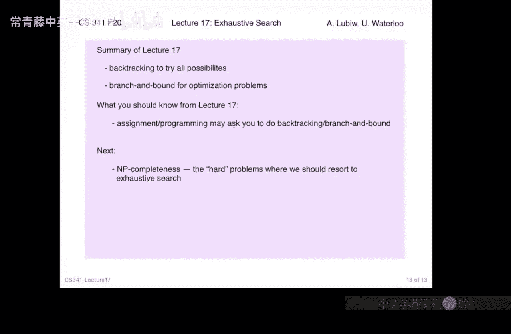

# 滑铁卢大学【中英⚡算法｜CS341 Fall 2021, Algorithms】 p19 P19 Lecture 18 -BV1DhrDBbEwR_p19-

Hello everyone， we're at a part of this course where I'd like to reuse some of the videos that I did a year ago。

 so I'm going to be correcting the numbers of the lectures and but on the slides at least on the PDF slides but in the videos you'll see a numbering that corresponds to last fall。

I will be adding extra or different introductions as appropriate。

So a summary of the course so far is you've learned a lot about algorithmic paradigms like general methods for designing algorithms and also about how to analyze algorithms can't forget that so the paradigms we've looked at our reductions divide and conquer greedy algorithms。

 dynamic programming and then there's been a chunk of the course on graph algorithms where we've used all of these paradigms to solve particular graph problems like minimum spanning tray and shortest path and so on and you've seen lots of efficient algorithms where I'll use the word efficient to mean that the runtime act like a polynomial grows like a polynomial in the input size so for example linear time algorithms in log n time algorithms and we've even seen some algorithms where the polynomial rate of growth of the runtime is higher and in particular dynamic programming algorithms often had this kind of higher runtime。

On the other hand， there are many practical problems where there's no efficient algorithm known。

 This means like no researcher has ever found such an efficient polynomial time algorithm。

 Some examples are the 01napsack problem。 If you recall， you saw a dynamic programming algorithm。

 but it wasn't truly polynomial time。 It was only pseudo polynomial time。

Another example of an algorithm where no efficient problem where no efficient algorithm is known as traveling salesman problem。

 and another one is finding a shortest path in a graph when there might be negative edges。

 but we don't want the graph to repeat edges。Now there's a few options when we encounter these hard problems that cannot seemingly be solved in polynomial time one and often the most common is to use heuristics。

 so methods that run quickly but we don't get a guarantee on the runtime and we don't get a guarantee on the quality of the solution by quality I mean we might have an optimization problem where we're trying to find the best something and if we are not finding the absolute best but just something is pretty good that's what I mean by saying that a heuristic does not guarantee the quality of solution。

An alternative with more theoretical grounding is to have an approximation algorithm。

 so often these are analyzed in the same worst case runtime bounds as we've seen so far in this course and they guarantee some kind of quality of solution so we'll look at an example of some approximation algorithms towards the end of this course。

And the topic we're looking at today is to find exact solutions。

 but since nobody knows how to do it in polynomial time efficiently we're going to take exponential time and just look at how you would do things as efficiently as you can given that it's going to take exponential time so that's the topic of today's lecture。

And I'll just make one remark here about these three options。

 which is that even if you are practicalminded and you would prefer to have heuristics。

 it's often a good thing to check， run some experiments to say， well。

 how good is this heuristic and what's needed in that case is to compare the exact solution to the solution that your heuristic finds。

 at least on some small set of examples， and in order to do that。

 you need to find the exact solutions？So that's a couple of reasons why we like to study finding exact solutions even when it takes exponential time。

So we're going to look at two methods， one is called backtracking and the other is called branch and bound and backtracking。

 well they both are systematic ways to basically try all possible solutions。

 so they are both like searching in an implicit graph of partial solutions and we build up each partial solution more and more to look like a full solution。

Now backtracking is used for decision problems and branch and bound。

 the other technique I mentioned that's used for optimization problems and we'll look at that in the second part of this lecture。

So what do I mean by decision problems， here is an example。三杀十。

Now this is a decision version of Napsack， so the 01 Napsack problem。

 if you remember we had these items and every item had a value and had a weight。

 and we were trying to optimize， maximize the value while staying within our bound。

 our weight bound for the Napsack。So with subset sum， we don't have this value aspect to it。

 We only have weights， We have elements1，2 up to n， and each element has a weight。

 and we want to fill ournapsack exactly so we have a target weight capital W and the question we're asking in this problem is is there a subset S。

 a subset of the elements， such that if I add up the weights of the elements in that set S。

 I get exactly my bound capital W。So let's look at a little example here， I've got one， two， three。

 four， five elements and their weights are two，2， three，5， and seven。

 and the question I'm asking is can I pick some subset of these elements such that their weights add up to exactly 13？

This might remind you a little bit of the problem of making change there we had a target sum of money that we wanted to get and we had various values of coins the difference with the coin changing problem is that we're allowed to take multiple copies of the nickel or you know multiple loooneies to make up $7 or whatever here the difference is that I have one item of weight two a second item of weight two but I don't have any more than that so it's different from the coin changing problem in that respect。

So for this little example， is there a solution here Well。

 some of you have probably thought about this already as I've been talking， if I use the seven。

 then I've got six left that I have to get right and there is no way I can make six out of adding up some subset of these numbers。

And on the other hand， if I decide not to use seven， then well。

 we could start trying what if I use five and how much do I have left。

 we could think about it that way， if I use five， then I've got eight left that I have to make up and all I've got here is a weight of seven so the answer in this particular case is no there is no solution in this case。

Okay， and we sort of argued that by considering maybe not all the possible subsets。

 but quite a lot of them to make this argument that there's no solution， right？

So it's a fact we will look at this later that this problem is called NP is one of the problems that's called NP complete this means that no one knows a polynomial time algorithm so we're going to define NP completeness later on and look at proof of this。

 but for now the one takeaway is that no one knows a polynomial time algorithm for subset some。

It's true we could use the NApsack dynamic programming。

 but as you saw that that does not truly run in polynomial time。

So we're thinking today about exploring all the subsets and how to do that efficiently。

 and we should think then about how many subsets are there when I have N elements。

So element one can be either in or out element two can be in or out so I have two choices times two choices right I have two to the end different possible subsets you might say well I don't want to consider the empty set you know fine there's a few we can we can hive off but the general bound is two to the end so this is an exponential number。

So。How does backtracking work to explore all of the possible subsets and see if I can find one where the weights add up to our goal capital W？

So I'm going to talk about backtracking just in general to explore all the subsets of a set of elements。

 and then I'll come back to saying， well， how do we use this to solve subset some？

So the idea is to make a tree of all the possibilities。 So I'm going to start by saying， well。

 I can consider my set S to be the empty set， and I'm going to keep track as I build this tree。

 I'm always going to keep track of the remaining set of elements。 So in this case。

 S is the empty set and all the other elements are still remaining。

 So R equals the remaining elements。And then I am going to。

Consider one by one each of the elements and say， well。

 I could put element one in or I could put element one out。And if I put element one into my set。

 then I get a new configuration where my set just has one in it。

 and my remaining set has from two all the way to n。On the other hand。

 if I make the choice of putting one out of S。Then S remains the empty set。

And my remaining set now I've settled on item1 one， I'm not going to use it。

 so my remaining set is just two through n。And then I would continue in this fashion。

 so I would look at element two， is element2 going in or is element2 going out？

And I would look at what set do I get by making this choice， the set  one2。

And R is the remaining things are from3 to n。And so on and so forth。

 so I'm not going to draw the whole tree here， but again at this level I'm just choosing based on element two on the next level I would choose based on element three and so on and finally when I get down to leaf this would be the case when R is the empty set。

Nothing has left to make choices based on and if I were to， for example。

 follow this branch all the way down to the leaf， I'm always making the choice of putting an element in so I would finally get to the complete set of all the elements and R is the empty set okay。

So how many leaves will there be in this tree in the end， there will be two to the n leaves。

 one leaf corresponding to each possible subset of my elements one through n。

And with this number of leaves， the size of the tree is bounded by order2 to the end。

This is because I have two to the n nodes at the last level。

 half of that at the previous level and so on， so if you add that up you get it most double two to the n。

 so the tree has size order two to the n。Okay， next what we're going to do is describe how we would explore this backtracking tree in general and then come back and talk about how this applies to the subset sum problem。

So here is the general backtracking algorithm， not just for exploring all subsets。

 but for any possible backtracking。Approach。Excuse me。

 so I have a set a which I will call the set of active configurations and initially that set has just the root configuration。

 so for subsets， for example， that root configuration was when s is the empty set and the remaining set has all the rest of the elements。

And my main loop in this algorithm is to say， while I still have active configurations。

 I'm going to remove one of them from the set A， call it Z。

 and then I'm going to explore this configuration。Now if C solves the problem。

 so this is this code depends on filling in some details according to the exact problem that we're solving。

 so if C solves the problem then we're done and the algorithm stops and we output C。

If C is a dead end and this is another problem specific thing。

 then we're going to discard this configuration and not explore it any further。

 and otherwise we are going to expand the configuration to some child configurations。

 so in the looking at all possible subsets example， there were just two child configurations。

 there were two children for each node in the tree。

We choose these children in general by making additional choices for our configuration and we add all of these configurations to the set of active configurations。

Okay， so this general thing has a couple of aspects that depend on the problem。

 what does it mean to solve the problem， what is the dead end and how exactly do I expand to children？

But even so， even still thinking about this general algorithm， there's a couple of options。

And they have to do with how we store our set A of active configurations。

 I could store it as a stack and then I'm essentially doing a depth first search of the configuration space and abound on the size of a is going to be the height of the tree because I store everything down a path of the tree。

 I backtrack go down a different branch of the tree。

 so at any point in time the number of configurations I will have in the set A is bounded by the height of the tree。

An alternative is to store a as a Q and you've studied this too。

 this is like doing bread first search of the configuration space and the size of the set of active configurations then is like the width of the tree so remember we would have all of these being active and I would start expanding and in general I am looking at the number of nodes across a level of the tree and that we call the width of the tree and that will be abound on the size of a Now to reduce space it's usually best to store a as stack for example。

 for the subset some problem the width of that tree is two to the n down at the leaves or if I'm met level I it's two to the I and on the other hand the height of the tree is n so I much prefer having a space requirement of n rather than2 to the n。

Now there is a third alternative and we will especially use this when we're talking about branch and bound in a few minutes。

 and this is to explore the configurations by using the most promising one first and most promising is another thing that will depend on the exact problem we're looking at。

If we were to do this， then we would want to store a as a priority queue so that each time when I remove a configuration。

 I'm able to remove the one with the best priority，Okay。

So let's look at applying that general backtracking algorithm to the subset sum problem。

 So I've put here just the same algorithm that was on the previous slide and down here is where I'm going to fill in more details about it。

 So first of all， how do we explore a configuration for subset sum。

 Well subset sum had weights on the elements and the whole point was we were looking to find a subset of a particular weight。

 So what we're going to do is remember we had the set S。

 which is our set so far and we had R is the remaining elements。

 I'm going to keep track of two things I'm going to keep track of little W which is the sum of the weights of the elements in S。

And I'm also going to keep track of the sum of the weights of the elements in R the remaining set。

 and based on these two things， I'm going to explore my configuration in the following way。

If the weight I've got from my current set S is exactly my target weight， capital W。

 then that's success。 that's when I've solved the problem。

 so I would cut short my search and just output my current set S。On the other hand。

 here's another possibility if little W is larger than capital W then it's like whoops。

 I've exceeded the capacity of my knapsack and nothing I'm going to do by adding elements is going to help this I am assuming here and I neglected to write it down。

 I am assuming that the weights are positivesed。Or at least non zero。

So if I've already got a weight that is larger than my target。

 then this is a dead end and there is no point exploring it further， so I throw it away。

There is one other case when I can stop exploring a configuration and that is when little R plus little W is less than capital W Think about what that means。

 I have a set so far that has weight little W and even if I add in everything from the remaining set。

 I can't get all the way up to my target weight and my goal in subset sum is to get equal to that target weight。

 so this would be another dead end。The runtime of this algorithm for subset sum is order2 to the N。

 This is because that's abound on the number of configurations and the time that we take to explore a configuration。

 so long as we keep little W and little R as part of the configuration。

 then testing these conditions is just constant time so I have number of configurations is order two to the N times order one work per configuration and that gives this runtime。

Okay， so thinking a little bit more broadly about the subset sum problem。

 there is also this dynamic programming algorithm like for Napsack。

 it's an even simpler problem than NapsAC because we're not concerned with the values of the items。

And that algorithm has a run time of order N times capital W， My target weight。 Now。

 which of these algorithms is better， This dynamic programming or this one here that runs in time 2 to the n In the worst case。

 Well， it all depends if W is small， then it's better to do the dynamic programming。

 On the other hand， if W is extremely large， then backtracking is better。

 especially when you start to consider how much space it's taking。Okay。

 so that's the end of the discussion here on subset sum。

 I'd like to tell you one more thing about backtracking and that is to explore not the subsets of a set from one to N。

 but rather the permutations。One example of where we might like to explore all the permutations is for the Hamiltonian cycle problem in a graph which I will be talking about in a little bit。

 this is the question of whether in a graph we can find a cycle that visits every vertex exactly once。

And if you think about the ordering of the vertices around that cycle that makes a permutation of the set of vertices。

 So that's a case where we might like to look at all the permutations of the vertex set。

 And for each such permutation C。 this is permutation form a cycle。

 or is there an edge missing there so， but here on this slide。

 we're only thinking about permutations， not about Hamiltonian cycles。

So to explore all the permutations， I would again grow a tree。

 I would start with an initial configuration where I say so far my permutation is empty and my remaining set has all averted all the elements in it。

 and then I would make a choice， what comes first in this permutation so one choice would be that item1 comes first。

 another choices， item two comes first and I have N children all the way along to saying item N comes first in my permutation？

From each of these nodes， I make a choice as to which element comes second in the permutation。

So here I have one coming first， but I could have two second or third or four all the way to n I have n minus one choices at this level。

And I continue in this way down this extreme left end of my tree。

 I'm going to end up with the permutation that puts the elements in order and at the extreme right hand leaf of this tree。

 I'm going to get the permutation that puts the items in reverse order。

 and there are altogether n factorial leaves， one for each possible permutation of the elements。Okay。

 so a configuration in this case。Is P the permutation I've built up to this stage and the remaining elements and in this tree。

 by the way， I did not draw the set R， I drew it only up at the top。

 but it's the obvious thing in each of these nodes of the tree。Okay。

 so that general back trackingracking algorithm that we had a few slides ago that could be applied to this situation。

 the difference is that when I generate all the children。

 I have to look at each possibility in the remaining set as my next element in the permutation。

And depending on what particular problem I'm solving。

 is it Hamiltonian cycle or something else that would define for me when is a node a solution already。

 I would need to go down to a leaf for Hamiltonian cycle for example。

 and also when can I stop exploring a certain configuration， perhaps for example。

 I discover that between vertex 1 and vertex n there is no edge， I'm looking for Hamiltonian cycle。

 then there has to be an edge so I would kill this configuration at that point。O。

So here's a little breakpoint which I'm going to insert in many of the lectures。

 so so far we've looked at backtracking to try all possibilities for a decision problem we've looked at exploring all subsets。

 we've looked at exploring all permutations， we looked at the general code for backtracking and what it looks like specifically for subset。

What should you know so far， how backtracking works。

 and we may ask this on an assignment and or on the programming problem that comes next。

And what we're doing next in this lecture is branch and bound for optimization problems。

So before I get to what is branch and bound， let me tell you what the difference between optimization versus the decision problem so one example that we already looked at is subset sum versus 01napsack the general distinction is that sometimes we want a solution and sometimes we want the best solution by some measure of best the measure would be what we call the objective function that we're using。

A second example， and this is what I will use for my running example where this second part of the lecture is Hamiltonian cycle versus traveling salesman problem so the Hamiltonian cycle problem。

 I set it in words but here it's written down I'm given a graph and I want to find a cycle that goes through every vertex exactly once some graphs have such a Hamiltonian cycle。

 some graphs do not for example in an extreme case if my graph is a tree。

 then there's no cycles at all never mind having a cycle that goes through every vertex exactly once。

The traveling salesman problem can be viewed as an optimization version of Hamiltonian cycle。

 so here we are given a graph and there's weights on the edges we're thinking of these weights as being non negative。

And we want to find a Hamiltonian cycle such that the sum of the weights in that cycle is minimum。

 I want to travel around the whole graph at a minimum cost， minimum sum of weights。

 visit every vertex exactly once。So for the traveling salesman problem。

 we often assume that we've got a complete graph and the excuse for doing that is that if my graph has a missing edge。

 I could sort of artificially put that in and give it a very high weight。

 and then I'm looking for a minimum weight Hamiltonian cycle。

 if it ends up using one of those extremely high weight edges， then I would say no no。

 no if there isn't really a tour here。So I've shown a couple of examples here here's a minimum traveling salesman tour of the US state capitals so and this is if you're doing a road trip and your goal is to visit every state capital in the US and spend the least amount of time driving around to all of them then this is the solution you might notice that theres you never travel somewhere and then have an edge that crosses it and that's a general property of traveling salesman when we have a weight function like this one where the weight of an edge is the distance or the time to drive it。

You might be asking why did I use US state capitals in this example。

 and the reason is that the Canadian version of this is really kind of boring because the provincial capitals are sort of strung out in a line。

 so this is only to make the picture look more like a cycle。😊。

Now the traveling salesman problem is a really famous problem。

 it's of interest for practical purposes， for example。

 I might have a machine head that has to visit various sites on a metal car body or a VLSI chip then we have exactly a traveling salesman problem。

But it's also a problem that has attracted a lot of interest just for its own sake。

 so there is a whole book about the traveling salesman problem There is a movie which I don't recommend about the traveling salesman problem there are contests to solve bigger and bigger instances of the traveling salesman problem and in fact the University of Waterloo has one of the world's experts on these methods of solving larger and larger traveling salesman instances and that's Professor Bill Cook in the Cominatorics and optimization department and you can look on his website to find examples like this one and this one which i'll tell you a little bit about This is one of these contest instances of traveling salesmen the goal was to find the minimum weight tour the traveling salesman tour of all 24978 cities in Sweden now I didn't know this Sweden't had that many cities I kind of think they're actually looking at little towns and I know that in this picture you can't。

We see what the tour is doing， you'd have to go to this website and enlarge the picture to get some sense of what this tour is doing as it is it's all the little towns and villages in Sweden。

So。😊，For Hamiltonian cycle， I discussed how we could use a backtracking method to try all the vertex orderings。

And before the point of the rest of the lecture is to use branch and bound。

To explore traveling salesmen and to find an optimum traveling salesman tour。Before I get to that。

 let me mention one final thing here about optimization versus decision。

 which is we will revisit this notion in the next few lectures about NP completeness。

 so it's a very good exercise to think about the problems that we've covered in the course so far and think a bit about which ones were decision problems。

 which ones were optimization problems， which ones didn't really fit nicely in either category。

 for example， sorting， doesn't。Okay， so let's turn to this branch and bound algorithm。

 I'm going to describe it in general at first and then come back and say。

 how do we apply it to the traveling salesman problem？

So it's an exhaustive search technique for optimization problems and instead of as in backtracking。

 instead of using depth first search， we are definitely going to explore configurations using the most promising one first and most promising is going to be by looking at our objective function。

 what are we trying to maximize or minimize。I'm going to stick to saying minimize in general for the rest of the lecture。

 it's an easy translation between these two， but it's awkward saying minimize or maximize every single time。

 so I'm going to say minimize and in part because for the traveling salesman problem that is a minimizeization problem。

We're going to， as we do our exploration of possibilities。

 we're going to keep the minimum that we've found so far。

And the algorithm will branch the way the backtracking did。

 so that is from a configuration I am going to generate child configurations。

 I think of it as exploring a tree。But there's a new aspect to the algorithm and that's the bounding part and the idea here is that I will be able to discard some configurations because I'll discover that there's no way they're going to lead to a better minimum than what I already have。

So the idea is that I will look at a configuration and compute a lower bound on the objective function for that configuration。

 What that means is I look at the configuration and say。

As I fill in this configuration to a solution， what's the best I could possibly get。

 the smallest I could possibly get for my objective function。

 and if I find that the best I could get is already bigger than the minimum I have so far。

 then there's no point exploring this configuration。

 it's not going to lead me to anything better than what I already have。

So this is the bounding aspect of a branch and bound algorithm。

So what is the general code for branch and bound again I have a set of active configurations initially there's just the one that's going to be like the root of my tree。

I will maintain my best so far， so up here I said the minimum so far and for minimization problem。

 I will start by setting that to infinity。I will explore active configurations until there aren't any left at each time around this loop。

 I'm going to remove the most promising configuration from my set of active configurations。

I'm going to expand it to a bunch of child configurations and this is the branching step that is common with backtracking and then i'm going to check out each of those children if a configuration a child configuration solves the problem then that's nice but i'm not really done in this case I first have to check what is the cost or the objective function of that solution if it's better than what i've got so far then i'm going to update my best cost。

And I'm going to continue looking， right， because there might be something that's even better。

And otherwise， if C is a dead end and again， this is problem specific， but the the。

This would be that。You know there's no way to complete this configuration even to a feasible solution。

 never mind how valuable it is to me， then i'm going to discard it and my third choice here is I have something that's potentially a solution if I add to it and I'm going to check its lower bound。

And if the lower bound is better than the best cost I've got， then I say， oh。

 that's a worthwhile configuration to explore further and I'm going to add it to my set of active configurations。

 so this is my bound step。I phrased it up here as when I should discard a configuration and I wrote it here the opposite way as when I should add a configuration Okay so I I hope that's not confusing that I expressed it in the opposite way above and below。

O。So let's look at how we apply this branch and bound algorithm for the traveling salesman problem。

Now， there's a surprising thing here， which I mentioned that for Hamiltonian cycle。

 we could do an exhaustive search by looking at all vertex orderings。

And our algorithm our branch and bound algorithm for traveling salesman problem is not going to work that way。

 instead it's going to explore all the subsets of edges。

 I'm looking for a set of edges that makes a cycle cycle of length end and I'm going to as my configurations store subsets of edges and hope to build up to a cycle。

嗯。So what will a configuration be， I'm going to keep track of two sets of edges I'll call one n and this is the set of included edges。

 I'm using the n rather than the first letter I just because capital letter I and this font doesn't look like anything much so n is the set of edges I wish to include in my solution hoping to build up to a cycle and X on the other hand is going to be the excluded edges these are the ones that I'm saying nope I'm not going to include that edge in my solution。

So at any point in time， what I want is that these two sets have an empty intersection。

 right either I include something or exclude something I don't do both。

So here's a little example just to make those two sets of edges clear， so I have a graph。

 it' it's a complete graph in this case， I haven't written down the weights because we're not thinking about weights quite yet。

And if X had the edge AB in it， so I'm saying this edge AB， I want to exclude it。

 I am not going to use that in my traveling salesman。Then if you look at the rest of this graph。

 the only possible tour is this one， right？I have as a second example。

 what if I said I am excluding this edge， but I really want to include this edge CD。

 so I'm putting it in my set end。And if you look at this， now there's there's no solution。

 there's no way I can include this and yet go and visit B and yeah。

 I can't visit A and B both so if I came to this configuration I would discard it and say that there's no solution there。

So。More generally more generally than this example。

 what are the necessary conditions for a configuration？

So one of them is that if I remove the excluded edges from my whole set。

I'm hoping to find a tour in the in this set e minus x right so certainly it has to be connected if I ever removed so many edges that what's left is not even connected。

 then that's a dead end I should throw it away and actually we even need that to be by connected if you remember what that means。

A second condition necessary condition is that my set n of included edges should have at most two edges incident with every vertex For example。

 if I said I want to include all three of these edges incident to see well it's not possible if I'm trying to make a cycle every vertex in a cycle has degree to so this is a necessary condition。

And the third1 I've written here is that N should not contain a cycle。

 except when I get to all the vertices。 So it should not have a cycle of length less than n。

 And again， here's an example。 If I said， oh， I really want to include these three edges in my traveling salesman tour。

 I put all three of them in the set N。 Well， it's impossible。

 I can't expand this to a cycle that also touches vertex A。

So these are the conditions I'm going to use to discard a configuration to say it's a dead end and I should not explore it any further。

Now， branching， on the other hand， is going to be。Quite simple。

 I'm just going to look at each edge and say do I put that edge in。

 do I add it to n or do I put that edge out in which case I add it to the excluded edges。So。

Branching is straightforward binary choice， the way it was in the very first backtracking algorithm we looked at and that is some sort of intuition or motivation why we're exploring subsets of edges rather than trying vertex orderings where each node in the tree had possibly many children。

 it's simpler to work with a situation where I just have two choices at each step。Okay。

 so we're talking about branch and bound for the traveling salesman problem。

 And so far we've looked at a few ingredients。 One is how do I discard a configuration and the other is how do I branch。

 how do I make child configurations， And the thing that's missing so far is to talk about this bounding step。

 So that's what comes next。So how to bound， we're given some configuration and we want to efficiently。

 like not spend too much time doing it， compute a lower bound on the minimum cost traveling salesman tour where I have to include the edges in N。

 and I have to exclude the edges in X。And I want to do that more efficiently than trying to solve the TSP problem modular these constraints right and that sort of defeats the purpose。

 I want something faster。So we're going to look at a relaxed or easier problem than solving TSP on NNX。

So consider this definition a one tree is a spanning tree on the vertices 2 through n plus two edges incident to vertex 1 so I'll say y in just a sec but let's first look at examples。

 so here I have the vertices2 through n I didn't label them but and here is a spanning tree on those vertices。

And now I've added two edges incident with vertex 1， so this is an example of a one tree。

Here's another example of a one tree。 I have here my vertices 2 through N。

 and I have a spanning tree on them。 It happens to be a path， but that's a case of a spanning tree。

 And I've added two edges incident with vertex 1。Okay。

So why are we talking about one trees the intuition is that spanning trees are something we know how to find efficiently。

 whereas traveling salesmen tours we don't know how to find efficiently so a one tree is something I can find with a better algorithm so that's the idea of where we're going with this。

So to make that a little more formal， the claim here is that any traveling salesman is a one tree。

 we saw an example here， I had a path on elements two through n plus two edges touching vertex1。

If I had some other traveling salesman tour it would use a different two edges here。

 and I would want in that case to have a path that goes from here to here， I haven't， by the way。

 drawn all the edges in this graph over here。So a way to see why this claim is is。Actually。

 here's what I want to say。 I want to say that the claim implies that the minimum weight of a traveling salesman tour is greater than or equal to the minimum weight of a one tree。

 And the way to see that is to think about a Venn diagram。 So if I have all the T SP tours。

 that's a smaller set， a subset of all the one trees。嗯。That's what this claim was saying。

 an ETSP tour is also a one tree。And what I'm saying here is that if I find the minimum weight of all the TSP tours。

And I compare that what's the minimum weight of all the one trees。

 then I have the potential to get even lower by considering one tree right so that's the reason why we have this inequality。

So this gives us the lower bound that we were looking for。

 we wanted a lower bound on the minimum cost TSB that includes n and excludes x。

 and so what we're going to do is compute the minimum weight one tree that includes n and excludes x and let me show you how we can do that。

So I want to exclude the edges x， so I'm just going to discard them right， discard the edges x。

Throw them away and how can I insist that I use the edges in N when I'm finding a minimum spanning tree？

What I'm going to do is assign them weight to zero。

 because if you remember what the minimum spanning tree algorithm did is it first grabbed all the minimum weight edges。

 right， the greedy algorithm， Cru skill or print algorithm。So assign and this is just temporary。

 however。Temporarily。Assign a weight of zero to the edges in N。Okay。

 and then I am going to find using the algorithms you already know and love。

 find a minimum spanning tree。On the vertices，2 through N。

And then I need to add two edges incident with vertex 1 and I want to minimize the weight of this so I'm going to add the two minimum weight edges。

嗯嗯。Sorry。😔，Two minimum weight edges。Incident to vertex 1。Okay。

 so this is my algorithm that is going to compute the minimum weight one tree that includes n and excludes x。

 And then the thing I want to know is what is the weight of that one tree Okay， so then。

Compute the weight。The sum of the weights of the edges in in the one tree。

So this just means add up the。The weights of the edges。And here I mean。

 the true weight's not this zero that we artificially added。So I'll sneak that in here。

 the true weight。OK。So this is a complete description then of how from a given configuration n and X。

 we compute a lower bound on the best traveling salesman tour we could get that includes n and excludes X so this fills in our missing ingredient for the general ran and bound algorithm。

So I've written here the same code that was there before and the things that are new that are specific for traveling salesmen。

 I've now written in red， so I'm now plugging in the ingredients that we just saw into this general branch and bound algorithm。

So initially my configuration says I have no edges included and no edges excluded。

 all the edges are in my remaining set， which I'm not explicitly keeping track of because it's just the edges that aren't in n or X。

I set my minimum weight initially to be zero to be infinity and I'm going to lower that as soon as I find a valid tour of all the vertices。

Now I explore configurations until active configurations until they're all gone and at each stage I choose a configuration remember that's a pair N X I choose the most promising configuration and I still have written this in sort of the generic terms but here I've written what it should be for TSP I should take the configuration whose minimum weight one tree is as small as possible because that's the most promising thing to explore right potentially that is something that has a very low weight traveling salesman tour。

So I choose C。And then I'm going to branch， so I choose some edge that I haven't decided on yet。

 So it's neither in my included nor excluded set。 it's some other edge and I'm going to expand C to two children by saying oh。

 either that edge little E can be in or it can be out。

 either I put it in my set N or I put it in the set X。

 and then I'm going to check each of those two child configurations for each one I'm going to say。

 does it solve the problem， that is to say is it a cycle that goes through every vertex。

 then I'm going to look at its weight and say， oh， if the weight is better than what I had so far。

 I'm updating the minimum weight， I'm going to continue to explore because there might be some other Hamiltonian cycle that has an even better weight right？

Otherwise， oh， but I should say here， notice that this configuration does not get added to my active configurations because I'm done with it。

 it's a cycle already， there's nothing more I need to consider adding to it。

My second option here is if the C sub I， the configuration C sub I。

 if it's a dead end and those were those necessary conditions that we had two slides ago。

 if it's a dead end， then I'm going to discard it， not explore it any further。And finally。

 my third case is I look at。The minimum weight one tree for this configuration。

Had an algorithm for on the previous slide and I say。

 h if that is smaller than the weight I have so far as my best TSP tour。

 then this is a good configuration， I'm going to add it to my active set and explore it later on。

And this is the bounding step。Mm。😊，So I mentioned this first enhancement here， which is。

That as the most promising configuration， I should use the one that has the minimum weight one tree。

Another enhancement is that I should branch wisely by choosing this edge E。

Somehow depending on the minimum weight one tree， like which edge is it best to add to？

Improve to minimize the weight of the one tree for that given configuration。

And so I'm not going to give more details about that。

 but these plus some further enhancements lead to a competitive TSP algorithm。

 so I'm not telling you some toy here I'm telling you the first steps towards a competitive traveling salesman algorithm。

Now that said， I've given you a lot more detail here about the minimum weight one tree than you are responsible for。

 so don't worry too much about the details of one trees。

 but the point here was to carry out at least one example enough so that you have some idea of what's involved in this bound step in a branch and bound algorithm。

O。So that's the end of this lecture， we've seen backtracking for decision type problems。

 we've seen branch and bound which is similar in flavor except that it has this extra bounding idea of how to discard configurations that are never going to lead to an optimum。

And what you should know out of this lecture is enough about both of these to do assignment questions。

And this is the end of this topic of exhaustive search So what we're going to turn to you next in the coming lectures is NP completeness which will be a big chunk of the remainder of the course and how does NP completeness relate to what we just talked about in this lecture well it's studying the hard problems the ones that nobody knows how to solve in polynomial time and those are exactly the kinds of problems where we should resort to exhaustive search so when faced with a new problem and you're trying to discover an algorithm you should spend some time trying to find an efficient algorithm otherwise you should check or look up is that problem NP hard。

 is it so hard that nobody has ever discovered are polynomial time algorithm and if that's the case then you should resort either to exhaustive search or to heuristics。

Okay， that's the end of this lecture。

